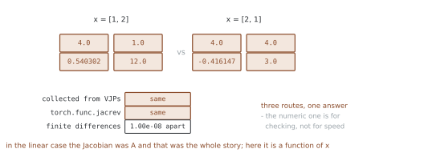

# 비선형 전체 야코비안

<div class="leadbox" markdown>

**들어가는 이야기** — 상수였던 것이 함수가 된다

앞 쪽에서 다룬 식은 선형이었고, 그 **야코비 행렬**은 식에 적힌 수 그대로였다.
**한 번 적어 두면 끝**이었다는 뜻이다.

비선형 식에서는 그렇지 않다. 같은 함수인데도 **어느 자리에서 재느냐에 따라**
야코비 행렬의 내용이 달라진다. 이 쪽은 두 자리에서 재어 네 칸 가운데 셋이 바뀌는 것을
보인다.

그래서 야코비 행렬을 들고 다닐 수가 없다. 쓸 때마다 그 자리에서 다시 만들어야 하고,
만드는 비용이 출력 개수에 비례한다. 딥러닝이 이 행렬을 아예 만들지 않는 까닭이
하나 더 늘어나는 셈이다.

다만 **만들 줄은 알아야 한다.** 손으로 짠 역전파가 맞는지 확인할 길이 이것
말고는 없기 때문이다. 이 쪽은 세 가지 방법으로 만들어 서로 맞춰 본다.

</div>

「선형 사상의 VJP」에서 야코비 행렬이 $A$ 자신이었다. **상수**였다는 뜻이다. 비선형
함수에서는 야코비 행렬이 **$x$에 따라 달라진다.**

$$
f(x_1, x_2) = \begin{pmatrix} x_1^2 x_2 \\ \sin x_1 + x_2^3 \end{pmatrix},
\qquad
J = \begin{pmatrix} 2x_1 x_2 & x_1^2 \\ \cos x_1 & 3x_2^2 \end{pmatrix}
$$

이 야코비 행렬을 **세 가지로** 구해 서로 견준다 — VJP를 모아서, `torch.func`으로,
그리고 수치 미분으로. 셋이 맞으면 어느 하나도 의심할 까닭이 없다.

## 1. 코드

```python
"""비선형 함수의 전체 야코비 행렬 — x 에 따라 달라진다.

「선형 사상의 VJP」에서 야코비 행렬이 $A$ 자신이었다. **상수**였다는 뜻이다.
비선형 함수에서는 야코비 행렬이 **자리마다 달라진다.**

$$
f(x_1, x_2) = \\begin{pmatrix} x_1^2 x_2 \\\\ \\sin x_1 + x_2^3 \\end{pmatrix}
$$

의 야코비 행렬을 세 가지로 구해 서로 견준다 — VJP 를 모아서, `torch.func`
으로, 그리고 수치 미분으로.

실행: 이 쪽의 코드를 파일로 갈무리해 돌린다
"""
# math 는 파이썬 표준 라이브러리다. 손으로 미분한 식의 cos 값을 구하는 데만 쓴다.
import math

# 파이토치를 불러온다. torch.tensor, torch.stack, torch.sin 이 다 여기서 온다.
import torch
# jacrev 는 함수를 받아 「그 함수의 야코비 행렬을 구해 주는 함수」를 돌려준다.
# 야코비 행렬은 출력 하나하나를 입력 하나하나로 미분한 값을 모은 표다 —
# i 행 j 열이 ∂f_i/∂x_j 다. 이름의 rev 는 역방향 모드(reverse), 곧 역전파로
# 구한다는 뜻이다.
from torch.func import jacrev


# 절 제목을 찍는 도우미다. 계산과는 상관없고 출력을 읽기 좋게 나눌 뿐이다.
def header(title):
    # f"...{title}..." 은 문자열 안에 값을 끼워 넣는 파이썬 문법(f-string)이다.
    # 맨 앞의 \n 은 줄바꿈이라 제목 위에 빈 줄이 하나 생긴다.
    print(f"\n=== {title} ===")


# 본문의 f 다. 수 둘을 받아 수 둘을 내놓는다.
# t 는 수 둘을 담은 텐서(파이토치가 다루는 수의 묶음)이고 형태는 (2,) 다.
# t[0] 이 x_1, t[1] 이 x_2 다. 파이썬은 번호를 0 부터 센다.
def f(t):
    # ** 는 거듭제곱이다. torch.sin 은 텐서를 받는 사인 함수이고, 파이토치의 연산이라
    # 미분할 수 있다(math.sin 은 파이썬 실수만 다룬다).
    # torch.stack 은 수 하나짜리 텐서 둘을 쌓아 형태 (2,) 인 텐서 하나로 만든다.
    #   x = (1, 2) 이면  f = (1^2 * 2, sin 1 + 2^3) = (2, 8.841471)
    return torch.stack([t[0] ** 2 * t[1],   # 첫째 출력  f_1 = x_1^2 * x_2
                        torch.sin(t[0]) + t[1] ** 3])   # 둘째 출력  f_2 = sin x_1 + x_2^3


def hand_jacobian(a, b):
    """손으로 미분한 야코비 행렬."""
    # a 가 x_1, b 가 x_2 다. 파이토치를 쓰지 않고 파이썬 실수로만 계산해 견줄 답을
    # 만든다. 바깥 리스트의 원소 하나가 행 하나이므로 2x2 행렬이다.
    #   (a, b) = (1, 2) 이면  [[4, 1], [cos 1, 12]] = [[4, 1], [0.540302, 12]]
    return [[2 * a * b, a ** 2],   # 첫째 행  ∂f_1/∂x_1, ∂f_1/∂x_2
            [math.cos(a), 3 * b ** 2]]   # 둘째 행  ∂f_2/∂x_1, ∂f_2/∂x_2


# ========================================================================
# 1. 야코비 행렬이 자리마다 달라진다
# ========================================================================

# 같은 f 의 야코비 행렬을 두 자리 (1, 2) 와 (2, 1) 에서 구해 손계산과 견준다.
def varies():
    header("1. 자리마다 다르다")
    # pt 는 야코비 행렬을 잴 자리다. 두 자리를 차례로 돈다.
    for pt in ([1.0, 2.0], [2.0, 1.0]):
        # torch.tensor(pt) 는 파이썬 리스트를 텐서로 바꾼다. 형태 (2,).
        # jacrev(f) 가 「야코비 행렬을 구하는 함수」이고, 거기에 자리를 넣어 부른다.
        # 입력이 2 개, 출력이 2 개이므로 J 의 형태는 (2, 2) 다 — (출력 수, 입력 수).
        # jacrev 에는 requires_grad=True 를 걸지 않은 텐서를 그대로 넣어도 된다.
        J = jacrev(f)(torch.tensor(pt))
        print(f"  x={pt}")
        # J.tolist() 는 텐서를 파이썬 리스트(행들의 리스트)로 바꾼다.
        # zip 은 두 리스트를 나란히 놓고 한 쌍씩 꺼낸다 — r 이 자동 미분의 한 행,
        # h 가 손계산의 같은 행이다. *pt 는 리스트 [1.0, 2.0] 을 풀어 a=1.0, b=2.0 으로
        # 넘긴다.
        for r, h in zip(J.tolist(), hand_jacobian(*pt)):
            # round(v, 6) 은 소수점 아래 여섯 자리로 반올림한다. [... for v in r] 은 행 안의
            # 수마다 그렇게 해서 새 리스트를 만든다. 따옴표 문자열 둘을 잇따라 적으면
            # 하나로 이어 붙는다.
            print(f"    자동 {[round(v, 6) for v in r]}"
                  f"   손으로 {[round(v, 6) for v in h]}")
    print("  선형에서는 A 하나였는데 여기서는 x 를 넣어야 정해진다")


# ========================================================================
# 2. VJP 를 모아서
# ========================================================================

# 야코비 행렬을 라이브러리 없이 직접 만든다. backward 를 출력마다 한 번씩 불러
# 행을 하나씩 얻는다.
def by_vjp():
    header("2. VJP 를 모아서")
    # requires_grad=True 는 「이 텐서로 미분할 것이니 이 텐서가 들어간 계산을 모두
    # 기록해 두라」는 표시다. 이것을 경사 추적이라 하고, 기록된 것이 계산 그래프다.
    # x 처럼 다른 계산의 결과가 아니라 직접 만든 텐서를 리프 텐서라 한다.
    x = torch.tensor([1.0, 2.0], requires_grad=True)
    y = f(x)   # 순전파   y = (2, 8.841471), 형태 (2,)
    rows = []   # 야코비 행렬의 행을 차례로 담을 빈 리스트
    # 출력이 2 개이므로 두 번 돈다. i 번째 바퀴에서 J 의 i 행을 얻는다.
    for i in range(2):
        # e 는 i 번째 자리만 1 이고 나머지가 0 인 단위벡터다. 형태 (2,).
        # torch.zeros(2) 로 0 둘을 만든 뒤 i 번째만 1 로 고친다.   i=0: (1, 0)   i=1: (0, 1)
        e = torch.zeros(2)
        e[i] = 1.0
        # backward 는 .grad 에 값을 「더해 넣는다」. 앞 바퀴의 값이 남아 있으면 섞이므로
        # 부르기 전에 비운다. None 으로 두면 다음 backward 가 새로 채운다.
        x.grad = None
        # y 가 스칼라가 아니라 벡터이므로 backward 에 벡터 v 를 함께 넘겨야 한다.
        # y.backward(v) 는 벡터-야코비 곱(VJP) v^T J 를 계산해 x.grad 에 넣는다.
        #   v 형태 (2,)  ·  J 형태 (2, 2)  →  v^T J 형태 (2,)  — x 와 같은 형태
        # v 로 단위벡터 e 를 주면 v^T J 가 J 의 i 행만 골라낸다.
        #   i=0: (1, 0) J = (4, 1)        i=1: (0, 1) J = (0.540302, 12)
        # retain_graph=True 는 계산 그래프를 지우지 말라는 뜻이다. backward 는 기본으로
        # 한 번 쓰고 나면 그래프를 비우는데, 같은 y 로 한 번 더 불러야 하므로 남긴다.
        y.backward(e, retain_graph=True)
        # .clone() 은 값을 복사한 새 텐서를 만든다. x.grad 가 뒤에 바뀌더라도 모아 둔
        # 행이 따라 바뀌지 않게 복사본을 담는다.
        rows.append(x.grad.clone())
    # 형태 (2,) 인 행 둘을 위아래로 쌓아 형태 (2, 2) 인 J 를 만든다.
    J = torch.stack(rows)
    print("  모은 J:", [[round(v, 6) for v in r] for r in J.tolist()])
    # torch.allclose 는 두 텐서가 (반올림 오차 안에서) 같으면 True 를 낸다.
    # 같은 자리 (1, 2) 에서 jacrev 로 구한 것과 견준다.
    print("  jacrev 와 같은가:",
          torch.allclose(J, jacrev(f)(torch.tensor([1.0, 2.0]))))
    print("  출력이 2 개라 backward 를 2 번 불렀다")


# ========================================================================
# 3. 수치 미분으로 검산
# ========================================================================

# 수치 미분(유한차분)으로 야코비 행렬을 근사해 자동 미분과 견준다. 미분의 정의로
# 돌아가, 입력을 조금 움직였을 때 함숫값이 얼마나 변하는지를 재는 방법이다.
# 사슬 규칙도 계산 그래프도 쓰지 않으므로 자동 미분과 독립된 검산이 된다.
def numeric_check():
    header("3. 수치 미분")

    # 함수는 위의 f 를 그대로 쓴다. 텐서의 자료형은 식이 아니라 입력이 정한다 —
    # float64 텐서를 넣으면 결과도 float64 다. 따로 함수를 만들 필요가 없다.

    # fn 의 야코비 행렬을 중심차분으로 근사한다. x 는 재는 자리, h 는 움직이는
    # 간격이다. h=1e-4 는 따로 주지 않을 때 쓰는 기본값 0.0001 이다.
    #   ∂f/∂x_j ≈ [f(x + h e_j) - f(x - h e_j)] / 2h      (e_j 는 j 번째 단위벡터)
    def numeric(fn, x, h=1e-4):
        cols = []   # 야코비 행렬의 「열」을 차례로 담을 빈 리스트
        # len(x) 는 입력의 개수(여기서는 2)다. 입력 하나마다 한 번씩 돈다.
        for j in range(len(x)):
            # x 를 두 벌 복사한다. 바로 아래에서 제자리에서 고치므로, 복사하지 않으면
            # 원래 x 가 바뀌어 버린다.
            xp, xm = x.clone(), x.clone()
            xp[j] += h   # xp = x 에서 j 번째 입력만 h 만큼 늘린 것
            xm[j] -= h   # xm = x 에서 j 번째 입력만 h 만큼 줄인 것
            # 순전파를 두 번 하고 차이를 2h 로 나눈다. 결과는 형태 (2,) — 두 출력이 j 번째
            # 입력에 대해 얼마나 변하는가, 곧 J 의 j 열이다.
            cols.append((fn(xp) - fn(xm)) / (2 * h))
        # dim=1 은 모은 것들을 「열」로 나란히 세우라는 뜻이다. by_vjp 에서는 행을 모아
        # 그냥 쌓았고(dim=0), 여기서는 열을 모았으므로 dim=1 이다. 결과 형태 (2, 2).
        return torch.stack(cols, dim=1)

    # dtype=torch.float64 는 수 하나를 64 비트로 담으라는 뜻이다. 파이토치의 기본은
    # 32 비트(float32)로 유효숫자가 일곱 자리쯤이고, float64 는 열여섯 자리쯤이다.
    # 수치 미분은 거의 같은 두 수를 빼므로 자릿수가 모자라면 답이 거칠어진다.
    x = torch.tensor([1.0, 2.0], dtype=torch.float64)
    Jn = numeric(f, x)     # 수치 미분 — 순전파 4 번 (입력 2 개 × 2)
    Ja = jacrev(f)(x)     # 자동 미분 — 같은 자리, 같은 자료형
    print("  수치:", [[round(v, 6) for v in r] for r in Jn.tolist()])
    print("  자동:", [[round(v, 6) for v in r] for r in Ja.tolist()])
    # (Jn - Ja).abs().max() 는 네 칸의 차 가운데 절댓값이 가장 큰 것이다.
    # :.2e 는 1.00e-08 처럼 지수 표기로 소수점 아래 두 자리까지 찍는다(1.00 × 10^-8).
    print(f"  가장 큰 차: {(Jn - Ja).abs().max():.2e}")
    print("  float64 로 해야 이만큼 맞는다. float32 면 한참 거칠다")


# ========================================================================
# 4. 세 길의 비용
# ========================================================================

# 계산은 없다. 세 방법의 비용과 쓸모를 글로 정리해 찍는다.
def costs():
    header("4. 셋 중 무엇을 쓰는가")
    print("  VJP 모으기  : 출력 수만큼 backward. retain_graph 와 grad 비우기를 챙겨야")
    print("  jacrev      : 같은 일을 라이브러리가 한다. 짧고 안전하다")
    print("  수치 미분    : 입력 수의 두 배만큼 순전파. 느리고 거칠다")
    print("  수치 미분의 쓸모는 속도가 아니라 **검산**이다")
    print("  손으로 짠 backward 가 맞는지 보려면 이것 말고 길이 없다")


# ========================================================================
# 5. 그런데 보통은 야코비 행렬이 필요 없다
# ========================================================================

# 트레인에서 실제로 필요한 것은 야코비 행렬이 아니라 스칼라 로스의 그래디언트다.
# 그것을 backward 한 번으로 얻고, 야코비 행렬을 거쳐 손으로 구한 값과 견준다.
def usually_not_needed():
    header("5. 보통은 안 쓴다")
    x = torch.tensor([1.0, 2.0], requires_grad=True)
    # f(x) = (2, 8.841471) 을 원소마다 제곱해(.pow(2)) 모두 더한다(.sum()).
    #   loss = 2^2 + 8.841471^2 = 82.1716   — 수 하나(스칼라)다
    loss = f(x).pow(2).sum()          # 스칼라로 줄인다
    # loss 가 스칼라이므로 backward() 에 v 를 넘기지 않아도 된다. 한 번 부르면
    # x.grad 에 d(loss)/dx 가 들어간다. 형태 (2,).
    loss.backward()
    print("  로스를 스칼라로 줄이면 backward 한 번")
    print("  x.grad:", [round(v, 6) for v in x.grad.tolist()])
    # 같은 값을 야코비 행렬을 거쳐 구한다. 여기서는 값만 쓰고 미분하지 않으므로
    # requires_grad 없이 새 텐서로 계산한다.
    J = jacrev(f)(torch.tensor([1.0, 2.0]))   # J 형태 (2, 2)
    y = f(torch.tensor([1.0, 2.0]))   # y = (2, 8.841471), 형태 (2,)
    # 사슬 규칙이다. loss = y_1^2 + y_2^2 이므로 d(loss)/dy = 2y 이고,
    # d(loss)/dx = J^T (2y) 다 — v = 2y 인 벡터-야코비 곱이다.
    # J.t() 는 전치(행과 열을 바꾼 것)이고 @ 는 행렬 곱이다.
    #   J^T 형태 (2, 2)  @  2y 형태 (2,)  →  형태 (2,)
    #   2y = (4, 17.682942)
    #   첫째 칸 = 4*4 + 0.540302*17.682942 = 25.554134
    #   둘째 칸 = 1*4 + 12*17.682942       = 216.195297
    print("  야코비로 손계산 (2y)^T J:",
          [round(v, 6) for v in (J.t() @ (2 * y)).tolist()])
    print("  같은 값이다. 야코비를 거치지 않고 바로 얻은 것뿐이다")


# 다섯 절을 차례로 돌린다.
def main():
    varies()
    by_vjp()
    numeric_check()
    costs()
    usually_not_needed()


# 이 파일을 직접 돌렸을 때만 main() 을 부른다. 다른 파일에서 import 하면 부르지 않는다.
if __name__ == "__main__":
    main()
```

**출력:**

```
=== 1. 자리마다 다르다 ===
  x=[1.0, 2.0]
    자동 [4.0, 1.0]   손으로 [4.0, 1.0]
    자동 [0.540302, 12.0]   손으로 [0.540302, 12.0]
  x=[2.0, 1.0]
    자동 [4.0, 4.0]   손으로 [4.0, 4.0]
    자동 [-0.416147, 3.0]   손으로 [-0.416147, 3.0]
  선형에서는 A 하나였는데 여기서는 x 를 넣어야 정해진다

=== 2. VJP 를 모아서 ===
  모은 J: [[4.0, 1.0], [0.540302, 12.0]]
  jacrev 와 같은가: True
  출력이 2 개라 backward 를 2 번 불렀다

=== 3. 수치 미분 ===
  수치: [[4.0, 1.0], [0.540302, 12.0]]
  자동: [[4.0, 1.0], [0.540302, 12.0]]
  가장 큰 차: 1.00e-08
  float64 로 해야 이만큼 맞는다. float32 면 한참 거칠다

=== 4. 셋 중 무엇을 쓰는가 ===
  VJP 모으기  : 출력 수만큼 backward. retain_graph 와 grad 비우기를 챙겨야
  jacrev      : 같은 일을 라이브러리가 한다. 짧고 안전하다
  수치 미분    : 입력 수의 두 배만큼 순전파. 느리고 거칠다
  수치 미분의 쓸모는 속도가 아니라 **검산**이다
  손으로 짠 backward 가 맞는지 보려면 이것 말고 길이 없다

=== 5. 보통은 안 쓴다 ===
  로스를 스칼라로 줄이면 backward 한 번
  x.grad: [25.554134, 216.195297]
  야코비로 손계산 (2y)^T J: [25.554134, 216.195297]
  같은 값이다. 야코비를 거치지 않고 바로 얻은 것뿐이다
```

## 2. 자리마다 달라진다

| $x$ | $J$ |
|---|---|
| $(1, 2)$ | $\begin{pmatrix} 4 & 1 \\ 0.5403 & 12 \end{pmatrix}$ |
| $(2, 1)$ | $\begin{pmatrix} 4 & 4 \\ -0.4161 & 3 \end{pmatrix}$ |



손으로 미분한 값과 소수점까지 같다. 그리고 **두 자리의 야코비 행렬이 네 칸 가운데 셋이나 다르다.**

선형에서는 "$J = A$"라고 적으면 끝이었는데, 여기서는 $x$를 넣어야 정해진다.
이것이 딥러닝에서 야코비 행렬을 들고 다니지 않는 또 하나의 까닭이다 — 파라메터가
바뀔 때마다 다시 구해야 한다.

## 3. VJP를 모아서

```
모은 J: [[4.0, 1.0], [0.540302, 12.0]]
jacrev 와 같은가: True
```

「v를 이용한 벡터 역전파」 쪽에서 한 그대로다. 출력이 2개이므로 `backward`를 2번
부르고, `retain_graph=True`와 `x.grad = None`을 챙긴다.

`torch.func.jacrev`가 같은 일을 한다. 손으로 할 까닭이 없지만, **무엇을 하는지
알고 쓰는 것**과 모르고 쓰는 것은 다르다.

## 4. 수치 미분으로 검산

```
수치: [[4.0, 1.0], [0.540302, 12.0]]
자동: [[4.0, 1.0], [0.540302, 12.0]]
가장 큰 차: 1.00e-08
```

중심 차분

$$
\frac{\partial f_i}{\partial x_j} \approx \frac{f_i(x + he_j) - f_i(x - he_j)}{2h}
$$

으로 구한 것이 자동 미분과 $10^{-8}$까지 맞는다.

**float64라서 이만큼 맞는다.** float32에서는 한참 거칠고, 연습문제 1에서 그
한계를 잰다.

## 5. 세 길의 쓸모

| | 비용 | 쓸 자리 |
|---|---|---|
| VJP 모으기 | `backward` × 출력 수 | 무엇을 하는지 알기 위해 |
| `jacrev` | 같은 일 | 야코비 행렬이 정말 필요할 때 |
| 수치 미분 | 순전파 × 입력 수 × 2 | **검산** |

수치 미분의 쓸모는 속도가 아니다. **손으로 짠 `backward`가 맞는지 보는 데는
이것 말고 길이 없다.** 「사용자 정의 함수」에서 `gradcheck`을 쓴 것이 바로 이
방법이고, 연습문제 2에서 다시 본다.

## 6. 그런데 보통은 야코비 행렬이 필요 없다

```
로스를 스칼라로 줄이면 backward 한 번
x.grad: [25.554134, 216.195297]
야코비로 손계산 (2y)^T J: [25.554134, 216.195297]
```

$L = \sum f_i^2$의 그래디언트를 두 가지로 구했다. 야코비 행렬을 만들어
$(2y)^\top J$를 계산한 것과, 그냥 `loss.backward()`를 부른 것이 같다.

**뒤쪽이 야코비 행렬을 거치지 않고 바로 얻는다.** 그것이 역전파가 하는 일이고,
그래서 야코비 행렬을 명시적으로 만들 일이 거의 없다.

## 연습문제

<div class="drillbox" markdown>

**연습문제 1.** <span class="diff easy" title="쉬움"></span>
수치 미분의 $h$를 작게 할수록 정확해지는가? float32에서 $h$를 $10^{-1}$부터
$10^{-7}$까지 바꿔 가며 오차를 재어라.

</div>

??? success "풀이"
    위 프로그램의 `f`와 `jacrev`를 그대로 쓴다. `numeric()`은 `numeric_check()`
    안에 들어 있어 밖에서 부를 수 없으므로 여기에 다시 적는다.

    ```python
    # numeric_check() 안의 numeric 과 같은 함수다 — 중심차분으로 야코비 행렬을 근사한다.
    # 입력마다 +h, -h 로 움직여 순전파를 두 번 하고, 차이를 2h 로 나눈 것이 J 의
    # 한 열이다. 그 열들을 dim=1 로 나란히 세워 형태 (2, 2) 를 만든다.
    def numeric(fn, x, h=1e-4):
        cols = []
        for j in range(len(x)):
            xp, xm = x.clone(), x.clone()
            xp[j] += h
            xm[j] -= h
            cols.append((fn(xp) - fn(xm)) / (2 * h))
        return torch.stack(cols, dim=1)


    # dtype 을 적지 않았으므로 기본 자료형 float32 다. 이번에는 일부러 float32 로 잰다.
    x32 = torch.tensor([1.0, 2.0])
    Ja = jacrev(f)(x32)   # 견줄 기준 — 자동 미분으로 구한 J, 형태 (2, 2)
    # 간격 h 를 0.1 부터 0.0000001 까지 열 배씩 줄여 가며 일곱 번 잰다(1e-1 은 10^-1).
    for h in (1e-1, 1e-2, 1e-3, 1e-4, 1e-5, 1e-6, 1e-7):
        # 수치 미분과 자동 미분의 차 가운데 절댓값이 가장 큰 것이다. .item() 은 수
        # 하나짜리 텐서에서 그 수를 파이썬 실수로 꺼낸다.
        err = (numeric(f, x32, h) - Ja).abs().max().item()
        # :.0e 는 1e-01 처럼 소수점 아래 없이, :.3e 는 9.993e-03 처럼 세 자리까지
        # 지수 표기로 찍는다.
        print(f"  h={h:.0e}  가장 큰 차 {err:.3e}")
    ```

    ```
      h=1e-01  가장 큰 차 9.993e-03
      h=1e-02  가장 큰 차 8.392e-05
      h=1e-03  가장 큰 차 3.939e-04
      h=1e-04  가장 큰 차 7.545e-03
      h=1e-05  가장 큰 차 1.630e-02
      h=1e-06  가장 큰 차 5.559e-01
      h=1e-07  가장 큰 차 7.232e+00
    ```

    **아니다.** $h = 10^{-2}$에서 가장 좋고, 더 줄이면 **나빠진다.** $10^{-7}$에서는
    오차가 7.2로, 아예 쓸 수 없다.

    두 가지 오차가 반대로 움직이기 때문이다.

    - **절단 오차** — 중심 차분은 $O(h^2)$만큼 틀린다. $h$가 **클수록** 나쁘다
    - **반올림 오차** — $f(x+h) - f(x-h)$가 거의 같은 두 수의 뺄셈이라 유효숫자가
      깎인다. 그리고 $2h$로 나누므로 그 오차가 **$1/h$배 확대**된다.
      $h$가 **작을수록** 나쁘다

    여기서 $\epsilon$은 **기계 엡실론** — 그 자료형이 1 바로 옆에서 가를 수 있는
    가장 작은 간격이다. 절단 오차가 $h^2$에, 반올림 오차가 $\epsilon/h$에 비례하므로
    합이 가장 작아지는 자리는 대략 $h \approx \epsilon^{1/3}$이다. float32의
    $\epsilon \approx 10^{-7}$을 넣으면 $h \approx 5 \times 10^{-3}$쯤이고, 잰 값
    $10^{-2}$가 그 언저리다.

    **수치 미분으로 검산할 때 float64를 쓰는 까닭**이 이것이다. $\epsilon$이
    $10^{-16}$이면 좋은 $h$가 $10^{-5}$ 언저리로 내려가고, 거기서 얻는 정확도가
    훨씬 높다.

---

<div class="drillbox" markdown>

**연습문제 2.** <span class="diff med" title="중간"></span>
`torch.autograd.gradcheck`이 바로 이 검산을 해 준다. float64와 float32에서
각각 돌려 보라.

</div>

??? success "풀이"
    ```python
    # textwrap 은 긴 문장을 정한 폭으로 줄바꿈해 주고, warnings 는 파이썬의 경고를
    # 다루는 표준 라이브러리다. 둘 다 출력을 다듬는 데만 쓴다.
    import textwrap
    import warnings


    # 검사할 함수다.   g(x) = x_1^2 * x_2 + sin x_1
    # 결과가 이미 수 하나(스칼라)라 끝의 .sum() 은 값을 바꾸지 않는다.
    def g(t):
        return (t[0] ** 2 * t[1] + torch.sin(t[0])).sum()

    # float64 로 만든 입력이다. gradcheck 은 이 입력으로 미분하므로 경사 추적을
    # 켜 두어야 한다(requires_grad=True).
    x64 = torch.tensor([1.0, 2.0], dtype=torch.float64, requires_grad=True)
    # torch.autograd.gradcheck(함수, 입력들) 은 수치 미분으로 구한 야코비 행렬과 자동
    # 미분으로 구한 것을 견주어, 맞으면 True 를 돌려주고 어긋나면 오류를 낸다.
    # (x64,) 는 원소가 하나인 튜플이다 — 입력이 여럿일 수 있어 묶음으로 받는다.
    print("  float64 gradcheck:", torch.autograd.gradcheck(g, (x64,)))

    # 같은 값인데 자료형만 기본값 float32 다.
    x32 = torch.tensor([1.0, 2.0], requires_grad=True)
    # with ... as caught: 블록 안에서 나온 경고를 화면에 바로 찍지 않고 caught
    # 리스트에 모은다.
    with warnings.catch_warnings(record=True) as caught:
        # 같은 경고가 되풀이되어도 빠뜨리지 않고 모두 잡으라는 설정이다.
        warnings.simplefilter("always")
        # try 안에서 오류가 나면 프로그램이 멈추지 않고 except 로 넘어간다. float32
        # 에서는 검사가 어긋나 오류가 나므로 그 메시지를 받아서 찍는다.
        try:
            print("  float32 gradcheck:", torch.autograd.gradcheck(g, (x32,)))
        except Exception as e:
            # 오류 메시지의 첫 줄만, 그것도 앞 66 글자만 찍는다.
            print("  float32 gradcheck:", str(e).splitlines()[0][:66])
    print(f"  경고 {len(caught)}개")   # len(caught) 는 모인 경고의 개수
    # 경고 문장이 길어 68 글자 폭으로 줄을 나누어 찍는다.
    for w in caught:
        for line in textwrap.wrap(str(w.message), 68):
            print("   ", line)
    ```

    ```
      float64 gradcheck: True
      float32 gradcheck: Jacobian mismatch for output 0 with respect to input 0,
      경고 1개
        Input #0 requires gradient and is not a double precision floating
        point or complex. This check will likely fail if all the inputs are
        not of double precision floating point or complex.
    ```

    **float32에서는 실패한다.** 게다가 검사를 시작하면서 경고까지 띄운다 —
    "입력이 double이 아니면 이 검사는 실패할 가능성이 높다".

    자동 미분이 틀려서가 아니다. **수치 미분 쪽이 못 따라오는 것**이다.
    연습문제 1에서 본 그 한계다.

    그래서 `gradcheck`을 쓸 때는 **반드시 float64로** 바꿔서 쓴다. 실제
    모델은 float32로 돌리더라도, 검사할 때만 올린다.

    이것이 「사용자 정의 함수」에서 손으로 짠 `backward`를 확인하던 방법이고,
    새 연산을 만들 때 가장 먼저 할 일이다.

---

<div class="drillbox" markdown>

**연습문제 3.** <span class="diff hard" title="어려움"></span>
스칼라 함수의 그래디언트를 한 번 더 미분한 것, 곧 그래디언트의 야코비 행렬이
**헤세 행렬**이다. $s(x) = x_1^2 x_2 + \sin x_1$의 헤세 행렬을 구하고 손계산과 견주어라. 대칭인가?

</div>

??? success "풀이"
    손으로 미분하면

    $$
    \nabla s = \begin{pmatrix} 2x_1 x_2 + \cos x_1 \\ x_1^2 \end{pmatrix},
    \qquad
    H = \begin{pmatrix} 2x_2 - \sin x_1 & 2x_1 \\ 2x_1 & 0 \end{pmatrix}
    $$

    ```python
    # hessian 은 스칼라 함수를 받아 「헤세 행렬을 구해 주는 함수」를 돌려준다.
    # 위 프로그램의 jacrev 와 쓰는 법이 같다.
    from torch.func import hessian

    # 스칼라 함수 s(x) = x_1^2 * x_2 + sin x_1 이다. 결과가 이미 수 하나라 끝의
    # .sum() 은 값을 바꾸지 않는다.
    def s(t):
        return (t[0] ** 2 * t[1] + torch.sin(t[0])).sum()

    # 재는 자리 (1, 2). 손계산과 여섯 자리까지 견줄 것이므로 float64 로 둔다.
    xh = torch.tensor([1.0, 2.0], dtype=torch.float64)
    H = hessian(s)(xh)   # 입력이 2 개이므로 H 의 형태는 (2, 2)
    print("  자동:", [[round(v, 6) for v in r] for r in H.tolist()])
    # 손으로 미분한 H 에 a = x_1 = 1, b = x_2 = 2 를 넣는다. math 는 위 프로그램에서
    # 불러온 것이다.
    #   [[2b - sin a, 2a], [2a, 0]] = [[4 - 0.841471, 2], [2, 0]]
    #                               = [[3.158529, 2], [2, 0]]
    a, b = 1.0, 2.0
    print("  손으로:", [[round(2 * b - math.sin(a), 6), round(2 * a, 6)],
                       [round(2 * a, 6), 0.0]])
    # H.t() 는 전치(행과 열을 바꾼 것)다. 전치해도 같으면 대칭이다.
    print("  대칭인가:", torch.allclose(H, H.t()))
    ```

    ```
      자동: [[3.158529, 2.0], [2.0, 0.0]]
      손으로: [[3.158529, 2.0], [2.0, 0.0]]
      대칭인가: True
    ```

    맞는다. 그리고 **대칭이다** — $\partial^2 s/\partial x_1 \partial x_2$와
    $\partial^2 s/\partial x_2 \partial x_1$이 같기 때문이다(슈바르츠 정리).

    대칭성은 **검산의 도구**로 쓸모가 있다. 헤세 행렬을 구했는데 대칭이 아니면
    어딘가 틀린 것이다 — 함수가 매끄럽지 않거나, 중간에 제자리 연산이 끼었거나,
    수치 오차가 너무 크거나.

    헤세 행렬은 비용이 크다. $n \times n$ 행렬이므로 파라메터가 백만 개면 $10^{12}$개의
    수다. 「선형 회귀」 쪽에서 안정 경계를 구할 때 헤세 행렬의 최대 고윳값이
    필요했는데, 실제 모델에서는 **헤세 행렬을 만들지 않고 벡터와의 곱만** 구한다
    (헤세-벡터 곱). 그것은 그래디언트를 한 번 더 미분하는 일이라
    `create_graph=True`로 할 수 있다 — 「retain_graph」 쪽에서 본 그 길이다.
