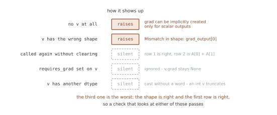

# 벡터 역전파의 함정

<div class="leadbox" markdown>

**들어가는 이야기** — 터져 주는 쪽이 고마운 쪽이다

벡터 출력을 역전파할 때 `backward(v)`에 함께 넘기는 `v`가 있다 — **벡터-야코비 곱**에서
출력들을 각각 얼마씩 섞을지를 정하는 값이다. 그 `v`를 어긋나게 주는 방법이
다섯 가지인데, **둘만 터지고 셋은 조용하다.**

터지는 둘은 걱정할 것이 없다. 메시지가 무엇이 안 맞는지 적어 주므로 읽고
고치면 된다.

조용한 셋 가운데 하나가 특히 고약하다. 답이 **반쯤 맞게** 나오기 때문이다.
결과의 형태가 맞고, 첫 줄도 정확하다. 그래서 「형태 맞나」로 확인해도 통과하고
「첫 줄 맞나」로 확인해도 통과한다. 틀린 것은 둘째 줄부터인데, 그 줄은 두
줄이 더해진 값이라 그럴듯해 보인다.

나머지 둘은 더 조용하다. 하나는 켜 둔 설정을 말없이 무시하고, 다른 하나는
자료형을 말없이 맞춰 주느라 정수 `v`까지 받아서, **소수점 아래가 이미 잘린
가중치**를 아무 경고 없이 통과시킨다.

</div>

「v를 이용한 벡터 역전파」 쪽부터 여기까지 `backward(v)`를 여러 각도로 보았다. 이 쪽은
**틀렸을 때 어떻게 드러나는지**로 모아 정리한다.

| | 어떻게 드러나는가 |
|---|---|
| `v`를 아예 안 주면 | **터진다** |
| `v`의 형태가 다르면 | **터진다** |
| 여러 번 부르며 안 비우면 | **조용히 쌓인다** |
| `v`에 `requires_grad`를 켜면 | **조용히 무시된다** |
| `v`의 자료형이 다르면 | **조용히 맞춰 준다** |

위의 둘은 메시지만 읽으면 고쳐진다. 아래 셋이 이 쪽에서 볼 것이다.

## 1. 코드

```python
"""벡터 역전파의 함정 — 터지는 것과 조용한 것.

「v를 이용한 벡터 역전파」 쪽부터 여기까지 `backward(v)` 를 여러
각도로 보았다. 이 쪽은 **틀렸을 때 어떻게 드러나는지**로 모아 정리한다.

터져 주는 쪽
- v 를 아예 안 주면
- v 의 형태가 출력과 다르면

조용한 쪽
- v 를 비우지 않고 여러 번 부르면 (그래디언트가 쌓인다)
- v 에 requires_grad 를 켜면 (아무 일도 안 일어난다)
- v 의 자료형이 다르면 (말없이 맞춰 준다)

실행: 이 쪽의 코드를 파일로 갈무리해 돌린다
"""
# 파이토치를 불러온다. torch.randn, torch.ones, torch.autograd.grad 가 다 여기서 온다.
import torch


# 절 제목을 찍는 도우미다. 계산과는 상관없고 출력을 읽기 좋게 나눌 뿐이다.
def header(title):
    # f"...{title}..." 은 문자열 안에 값을 끼워 넣는 파이썬 문법(f-string)이다.
    # 맨 앞의 \n 은 줄바꿈이라 제목 위에 빈 줄이 하나 생긴다.
    print(f"\n=== {title} ===")


# ========================================================================
# 1. 터져 주는 둘
# ========================================================================

# v 를 어긋나게 주었을 때 파이토치가 오류를 내는 두 경우를 일부러 일으켜 본다.
def the_loud_ones():
    header("1. 터져 주는 둘")
    # 난수의 시드를 고정한다. 아래에서 뽑는 텐서가 돌릴 때마다 같은 값이 된다.
    torch.manual_seed(0)
    # torch.randn(3) 은 표준정규분포에서 뽑은 난수 셋을 담은 텐서다. 형태 (3,).
    # requires_grad=True 는 「이 텐서로 미분할 것이니 이 텐서가 들어간 계산을 모두
    # 기록해 두라」는 표시다. 이것을 경사 추적이라 하고, 기록된 것이 계산 그래프다.
    # 이 절은 오류 메시지만 찍으므로 x 의 값이 무엇이든 출력이 같다.
    x = torch.randn(3, requires_grad=True)
    # try 안에서 오류가 나면 프로그램이 멈추지 않고 except 로 넘어간다. 오류를
    # 일부러 내고 그 메시지를 받아 찍으려는 것이다.
    try:
        # x ** 2 는 원소마다 제곱한 것으로 형태 (3,) 인 벡터다. backward() 는 계산
        # 그래프를 거꾸로 따라가 그래디언트를 구하는 역전파인데, 인자 없이 부를 수 있는
        # 것은 출력이 수 하나(스칼라)일 때뿐이다. 벡터이므로 여기서 RuntimeError 가 난다.
        (x ** 2).backward()
    except RuntimeError as e:
        # str(e) 는 오류 메시지이고 .splitlines()[0] 은 그 첫 줄이다.
        print("  v 를 안 주면 :", str(e).splitlines()[0])
    # 출력이 벡터이면 backward(v) 처럼 벡터 v 를 함께 넘긴다. 그러면 벡터-야코비 곱
    # (VJP) v^T J 가 구해진다 — J 는 출력 하나하나를 입력 하나하나로 미분한 값을
    # 모은 야코비 행렬이고, v 는 출력들을 얼마씩 섞을지 정하는 가중치다.
    # v 의 형태는 출력의 형태 (3,) 와 꼭 같아야 한다. 틀린 형태 셋을 차례로 넣어 본다.
    #   (4,) 원소 넷   ·   (3, 1) 3행 1열 행렬   ·   () 수 하나
    for shape in ((4,), (3, 1), ()):
        xx = torch.randn(3, requires_grad=True)
        try:
            # torch.ones(shape) 은 그 형태로 1 을 채운 텐서다. 이것을 v 로 준다.
            (xx ** 2).backward(torch.ones(shape))
            # 오류가 안 났을 때만 이 줄에 온다. {str(shape):6s} 는 형태를 문자열로 바꿔
            # 여섯 칸 폭에 맞춰 찍는다.
            print(f"  v 형태 {str(shape):6s} -> 통과")
        except RuntimeError as e:
            # [:50] 은 메시지의 앞 50 글자만 자른 것이다. 그래서 출력에서 문장이 중간에 끊긴다.
            print(f"  v 형태 {str(shape):6s} -> {str(e).splitlines()[0][:50]}")
    print("  둘 다 고치기 쉽다. 메시지가 무엇이 어긋났는지 적어 준다")


# ========================================================================
# 2. 조용한 것 하나 — 쌓인다
# ========================================================================

# 야코비 행렬을 한 행씩 모을 때 .grad 를 비우지 않으면 어떻게 되는지 본다.
def accumulates():
    header("2. 조용한 것 — 쌓인다")
    # 난수의 시드를 고정한다. 그 뒤로 뽑는 난수가 돌릴 때마다 같아져 출력이 재현된다.
    torch.manual_seed(0)
    # A 는 3x3 난수 행렬이다. y = A x 는 선형이라 야코비 행렬이 A 자신이다. 그래서
    # 모은 J 가 맞는지를 A 와 견주어 바로 알 수 있다.
    A = torch.randn(3, 3)
    # 같은 일을 두 번 한다 — 한 번은 바퀴마다 .grad 를 비우고(True), 한 번은 안
    # 비운다(False).
    for clear in (True, False):
        x = torch.randn(3, requires_grad=True)
        # @ 는 행렬 곱이다.   A 형태 (3, 3)  @  x 형태 (3,)  →  y 형태 (3,)
        y = A @ x
        rows = []   # J 의 행을 차례로 담을 빈 리스트
        # 출력이 3 개이므로 세 번 돈다. i 번째 바퀴에서 J 의 i 행을 얻으려는 것이다.
        for i in range(3):
            # e 는 i 번째 자리만 1 이고 나머지가 0 인 단위벡터다. 형태 (3,).   i=0: (1, 0, 0)
            e = torch.zeros(3)
            e[i] = 1.0
            # x.grad 는 backward 가 그래디언트를 넣어 두는 자리다. None 으로 두면 비워진다.
            # clear 가 False 면 이 줄을 건너뛰어 앞 바퀴의 값이 남는다.
            if clear:
                x.grad = None
            # v = e 로 역전파한다. e^T A 는 A 의 i 행이다.
            #   v 형태 (3,)  ·  J 형태 (3, 3)  →  v^T J 형태 (3,)  — x 와 같은 형태
            # backward 는 x.grad 를 덮어쓰지 않고 「더해 넣는다」. 그래서 안 비우면
            #   i=0: A[0]      i=1: A[0] + A[1]      i=2: A[0] + A[1] + A[2]
            # 가 된다. retain_graph=True 는 계산 그래프를 지우지 말라는 뜻이다. backward 는
            # 기본으로 한 번 쓰면 그래프를 비우는데, 같은 y 로 세 번 불러야 하므로 남긴다.
            y.backward(e, retain_graph=True)
            # .clone() 은 값을 복사한 새 텐서를 만든다. 안 비우는 쪽에서는 x.grad 가 같은
            # 텐서인 채 제자리에서 더해지므로, 복사하지 않으면 모아 둔 행들이 함께 바뀐다.
            rows.append(x.grad.clone())
        # 형태 (3,) 인 행 셋을 위아래로 쌓아 형태 (3, 3) 인 J 를 만든다.
        J = torch.stack(rows)
        # torch.allclose 는 두 텐서가 반올림 오차 안에서 같으면 True 를 낸다.
        # {clear!s:5s} 는 True/False 를 문자열로 바꿔 다섯 칸 폭에 찍는다.
        print(f"  비움={clear!s:5s} J == A 인가: {torch.allclose(J, A)}")
        # 안 비운 쪽이 「어떻게」 틀렸는지 본다. J[0] 은 J 의 첫 행, A[0] 은 A 의 첫 행이다.
        if not clear:
            print("    첫 줄은 맞다:", torch.allclose(J[0], A[0]))
            print("    둘째 줄 = A[0]+A[1] 인가:",
                  torch.allclose(J[1], A[0] + A[1]))
    print("  형태도 맞고 첫 줄도 맞아서 검산이 쉽게 속는다")


# ========================================================================
# 3. 조용한 것 둘 — v 의 requires_grad
# ========================================================================

# v 에 경사 추적을 켜면 v 로도 미분해 줄 것 같지만 그렇지 않다는 것을 본다.
def v_requires_grad():
    header("3. 조용한 것 — v 에 플래그를 켜면")
    # 난수의 시드를 고정한다. 아래에서 뽑는 텐서가 돌릴 때마다 같은 값이 된다.
    torch.manual_seed(0)
    # 시드를 다시 박지 않았지만 2절의 manual_seed(0) 에서 이어지는 난수라 돌릴
    # 때마다 같은 값이 나온다.
    x = torch.randn(3, requires_grad=True)
    # v 는 1 셋, 형태 (3,) 이다. 일부러 requires_grad=True 를 켰다.
    v = torch.ones(3, requires_grad=True)
    # y = x^2 을 v 로 역전파한다. y_i 가 x_i 에만 달려 있어 야코비 행렬이 대각선에
    # 2x_i 만 있는 행렬이다. 따라서 x.grad = v^T J = 2x * v 이고, v 가 1 이므로 2x 다.
    (x ** 2).backward(v)
    # .tolist() 는 텐서를 파이썬 리스트로 바꾸고, round(t, 4) 는 소수점 아래 네
    # 자리로 반올림한다.
    print("  통과한다. x.grad :", [round(t, 4) for t in x.grad.tolist()])
    # 오류는 없는데 v.grad 는 None 이다. backward(v) 의 v 는 계산 그래프 안에 있는
    # 값이 아니라서 역전파가 v 까지 가지 않는다.
    print("  그런데 v.grad    :", v.grad)
    print("  v 는 '가중치' 일 뿐 미분 대상이 아니다. 플래그는 무시된다")
    print("  v 에 대한 민감도가 필요하면 식을 다시 세워야 한다")
    # v 로도 미분하고 싶으면 v 를 식 안에 넣어야 한다. 새 텐서로 다시 세운다.
    x2 = torch.randn(3, requires_grad=True)
    v2 = torch.ones(3, requires_grad=True)
    # v2 * x2^2 을 원소마다 곱해 모두 더한다 — sum_i v_i * x_i^2, 수 하나(스칼라)다.
    # 스칼라이므로 backward() 에 인자가 필요 없다. 이번에는 v2 가 계산 그래프 안에
    # 있어서 v2.grad 도 채워진다.
    #   v2.grad_i = x2_i^2          x2.grad_i = 2 * v2_i * x2_i
    (v2 * x2 ** 2).sum().backward()
    print("  (v*y).sum() 으로 적으면 v.grad 도 온다:",
          [round(t, 4) for t in v2.grad.tolist()])


# ========================================================================
# 4. 조용한 것 셋 — 자료형
# ========================================================================

# v 의 자료형(dtype)이 출력과 달라도 오류가 나지 않는다는 것을 본다.
def dtype_of_v():
    header("4. 조용한 것 — v 의 자료형")
    # 난수의 시드를 고정한다. 아래에서 뽑는 텐서가 돌릴 때마다 같은 값이 된다.
    torch.manual_seed(0)
    # 자료형 넷을 차례로 넣는다. float32 는 32 비트 실수(파이토치의 기본값),
    # float64 는 64 비트 실수, float16 은 16 비트 실수, int64 는 64 비트 정수다.
    for dt in (torch.float32, torch.float64, torch.float16, torch.int64):
        x = torch.randn(3, requires_grad=True)
        # dtype=dt 로 그 자료형의 1 셋을 만들어 v 로 준다.
        (x ** 2).backward(torch.ones(3, dtype=dt))
        # x.grad.dtype 은 결과의 자료형이다. v 가 무엇이든 x 와 같은 float32 로 나온다.
        # {str(dt):16s} 는 자료형 이름을 열여섯 칸 폭에 맞춰 찍는다.
        print(f"  v dtype {str(dt):16s} -> 통과, x.grad dtype {x.grad.dtype}")
    print("  말없이 맞춰 준다. 정수 v 도 받는다")
    print("  0.5 같은 가중치를 정수 텐서에 담으면 0 으로 잘린다")
    x = torch.randn(3, requires_grad=True)
    # 소수점 없이 적었으므로 torch.tensor([1, 0, 1]) 은 정수(int64) 텐서가 된다.
    # v = (1, 0, 1) 이므로 x.grad = 2x * v 이고 가운데 칸이 0 이 된다(출력의 -0.0).
    (x ** 2).backward(torch.tensor([1, 0, 1]))          # 정수
    print("  정수 [1,0,1] 로 준 x.grad:", [round(t, 4) for t in x.grad.tolist()])


# ========================================================================
# 5. 쌓임을 아예 피하는 길
# ========================================================================

# 같은 야코비 행렬을 backward 대신 torch.autograd.grad 로 모은다.
def use_autograd_grad():
    header("5. autograd.grad 로 피하기")
    # 2절과 같은 시드로 같은 차례로 뽑으므로 A 가 2절의 A 와 같다.
    torch.manual_seed(0)
    A = torch.randn(3, 3)
    x = torch.randn(3, requires_grad=True)
    y = A @ x   # y = A x, 형태 (3,)
    rows = []
    # 2절과 같이 단위벡터 e 를 차례로 주어 한 행씩 모은다. 이번에는 .grad 를 비우는
    # 줄이 없다.
    for i in range(3):
        e = torch.zeros(3)
        e[i] = 1.0
        # torch.autograd.grad(출력, 입력, v) 도 같은 벡터-야코비 곱 v^T J 를 구한다.
        # 다른 점은 결과를 x.grad 에 넣지 않고 「돌려준다」는 것이다.
        # 돌려주는 것은 입력마다 하나씩 담은 튜플이다. 입력이 x 하나라 원소가 하나이고,
        # g, = ... 의 쉼표가 그 하나를 꺼낸다. g 의 형태는 (3,) 이고 A 의 i 행이다.
        # retain_graph=True 는 2절과 같은 뜻이다 — 그래프를 남겨 세 번 쓴다.
        g, = torch.autograd.grad(y, x, e, retain_graph=True)
        # 부를 때마다 새 텐서를 돌려받으므로 clone 도 필요 없다.
        rows.append(g)
    J = torch.stack(rows)
    print("  autograd.grad 로 모은 J == A :", torch.allclose(J, A))
    # backward 를 한 번도 부르지 않았으므로 x.grad 는 처음 그대로 None 이다.
    print("  x.grad 는 그대로 :", x.grad)
    print("  .grad 를 건드리지 않으니 비울 일도, 쌓일 일도 없다")
    print("  야코비를 모을 때는 이쪽이 안전하다")


# ========================================================================
# 6. v 의 부호
# ========================================================================

# v 의 부호가 스텝의 방향을 정한다는 것을 본다. y = x^2 의 최솟값은 x = 0 에 있다.
def sign_of_v():
    header("6. v 의 부호")
    # (sign, label) 쌍 둘을 차례로 돈다. sign 이 v 의 값이고 label 은 찍을 이름이다.
    for sign, label in ((1.0, "v=+1 (경사 하강)"), (-1.0, "v=-1 (경사 상승)")):
        # x = 3 에서 시작한다. 원소가 하나인 벡터이고 형태는 (1,) 이다.
        x = torch.tensor([3.0], requires_grad=True)
        # 옵티마이저 — .grad 를 읽어 텐서를 고쳐 주는 도구다. SGD 는 가장 단순한 경사
        # 하강법으로 x ← x - lr * x.grad 로 옮긴다. [x] 는 고칠 텐서의 목록이고
        # lr=0.1 은 러닝레이트(한 스텝의 크기)다.
        opt = torch.optim.SGD([x], lr=0.1)
        # 다섯 스텝 간다. _ 는 「이 변수는 쓰지 않는다」는 뜻으로 쓰는 관례다.
        for _ in range(5):
            # x.grad 를 비운다. 2절에서 본 대로 backward 는 더해 넣기 때문이다.
            opt.zero_grad()
            # 출력이 형태 (1,) 이므로 v 도 형태 (1,) 로 준다. x.grad = v * 2x 다.
            #   v = +1: x.grad = 2x          v = -1: x.grad = -2x
            (x ** 2).backward(torch.tensor([sign]))
            # x.grad 를 읽어 한 스텝 옮긴다.
            #   v = +1: x ← x - 0.1 * 2x = 0.8 x     다섯 번이면 3 * 0.8^5 = 0.9830
            #   v = -1: x ← x + 0.1 * 2x = 1.2 x     다섯 번이면 3 * 1.2^5 = 7.4650
            opt.step()
        # .item() 은 수 하나짜리 텐서에서 그 수를 파이썬 실수로 꺼낸다. :.4f 는 소수점
        # 아래 네 자리까지 찍으라는 뜻이다.
        print(f"  {label}  3.0 -> {x.item():.4f}")
    print("  부호를 뒤집으면 최솟값에서 멀어진다")
    print("  GAN 처럼 올리고 싶은 로스가 있을 때 쓰는 길이기도 하다")


# 여섯 절을 차례로 돌린다.
def main():
    the_loud_ones()
    accumulates()
    v_requires_grad()
    dtype_of_v()
    use_autograd_grad()
    sign_of_v()


# 이 파일을 직접 돌렸을 때만 main() 을 부른다. 다른 파일에서 import 하면 부르지 않는다.
if __name__ == "__main__":
    main()
```

**출력:**

```
=== 1. 터져 주는 둘 ===
  v 를 안 주면 : grad can be implicitly created only for scalar outputs
  v 형태 (4,)   -> Mismatch in shape: grad_output[0] has a shape of t
  v 형태 (3, 1) -> Mismatch in shape: grad_output[0] has a shape of t
  v 형태 ()     -> Mismatch in shape: grad_output[0] has a shape of t
  둘 다 고치기 쉽다. 메시지가 무엇이 어긋났는지 적어 준다

=== 2. 조용한 것 — 쌓인다 ===
  비움=True  J == A 인가: True
  비움=False J == A 인가: False
    첫 줄은 맞다: True
    둘째 줄 = A[0]+A[1] 인가: True
  형태도 맞고 첫 줄도 맞아서 검산이 쉽게 속는다

=== 3. 조용한 것 — v 에 플래그를 켜면 ===
  통과한다. x.grad : [3.082, -0.5869, -4.3576]
  그런데 v.grad    : None
  v 는 '가중치' 일 뿐 미분 대상이 아니다. 플래그는 무시된다
  v 에 대한 민감도가 필요하면 식을 다시 세워야 한다
  (v*y).sum() 으로 적으면 v.grad 도 온다: [0.3231, 1.1762, 1.9561]

=== 4. 조용한 것 — v 의 자료형 ===
  v dtype torch.float32    -> 통과, x.grad dtype torch.float32
  v dtype torch.float64    -> 통과, x.grad dtype torch.float32
  v dtype torch.float16    -> 통과, x.grad dtype torch.float32
  v dtype torch.int64      -> 통과, x.grad dtype torch.float32
  말없이 맞춰 준다. 정수 v 도 받는다
  0.5 같은 가중치를 정수 텐서에 담으면 0 으로 잘린다
  정수 [1,0,1] 로 준 x.grad: [-1.7133, 0.0, -2.1424]

=== 5. autograd.grad 로 피하기 ===
  autograd.grad 로 모은 J == A : True
  x.grad 는 그대로 : None
  .grad 를 건드리지 않으니 비울 일도, 쌓일 일도 없다
  야코비를 모을 때는 이쪽이 안전하다

=== 6. v 의 부호 ===
  v=+1 (경사 하강)  3.0 -> 0.9830
  v=-1 (경사 상승)  3.0 -> 7.4650
  부호를 뒤집으면 최솟값에서 멀어진다
  GAN 처럼 올리고 싶은 로스가 있을 때 쓰는 길이기도 하다
```



## 2. 터져 주는 둘

```
v 를 안 주면 : grad can be implicitly created only for scalar outputs
v 형태 (4,)   -> Mismatch in shape
v 형태 (3, 1) -> Mismatch in shape
v 형태 ()     -> Mismatch in shape
```

출력이 `(3,)`인데 `(4,)`, `(3,1)`, `()`가 전부 거절당한다. 「선형 사상의 VJP」에서
본 대로 **브로드캐스팅되지 않는다.**

고마운 자리다. 고칠 것이 무엇인지 메시지가 적어 준다.

## 3. 조용한 것 하나 — 쌓인다

```
비움=True  J == A 인가: True
비움=False J == A 인가: False
  첫 줄은 맞다: True
  둘째 줄 = A[0]+A[1] 인가: True
```

야코비 행렬을 모을 때 `x.grad`를 안 비우면 아래 줄로 갈수록 누적된다.

**형태가 맞고 첫 줄도 맞는다**는 것이 고약하다. 눈으로 확인하려고 첫 줄을
찍어 보면 정상으로 보인다. 틀린 것은 둘째 줄부터다.

## 4. 조용한 것 둘 — `v`의 `requires_grad`

```
통과한다. x.grad : [3.082, -0.5869, -4.3576]
그런데 v.grad    : None
```

`v`에 `requires_grad=True`를 켜도 **아무 일도 일어나지 않는다.** 오류도 없고
`v.grad`도 안 온다.

까닭은 `v`가 미분의 **대상**이 아니라 **가중치**이기 때문이다. `backward(v)`는
"이 가중치로 섞어서 뒤로 보내라"는 명령이지, $v$를 포함한 식을 미분하라는 것이
아니다.

$v$에 대한 민감도가 정말 필요하면 식을 다시 세워야 한다.

```python
# 조각이다 — v 는 가중치, y 는 벡터 출력이다. v 를 식 안에 넣어 스칼라
# sum_i v_i * y_i 를 만든 뒤 역전파한다. 스칼라이므로 backward() 에 인자가 없다.
(v * y).sum().backward()      # 이러면 v.grad 도 온다
```

```
(v*y).sum() 으로 적으면 v.grad 도 온다: [0.3231, 1.1762, 1.9561]
```

같은 값을 계산하는 두 길인데 **하나는 $v$를 그래프에 올리고 하나는 안 올린다.**

## 5. 조용한 것 셋 — 자료형

```
v dtype torch.float32  -> 통과, x.grad dtype torch.float32
v dtype torch.float64  -> 통과, x.grad dtype torch.float32
v dtype torch.float16  -> 통과, x.grad dtype torch.float32
v dtype torch.int64    -> 통과, x.grad dtype torch.float32
```

**넷 다 통과한다.** 「형상, 자료형, 장치」에서 본 자료형 승격과 달리, 여기서는
`v`를 출력의 자료형에 맞춰 조용히 바꾼다.

대개 편한데, **정수 `v`도 받는다**는 것이 걸린다. 0.5 같은 가중치를 실수로
정수 텐서에 담으면 0으로 잘리고, 아무 경고도 없다.

```python
# 소수점을 적으면 실수(float32) 텐서가, 안 적으면 정수(int64) 텐서가 된다.
torch.tensor([0.5, 1.0])      # float32 — 괜찮다
torch.tensor([0, 1])          # int64  — 0.5 를 넣었다면 이미 잘렸다
```

## 6. 쌓임을 아예 피하는 길

```
autograd.grad 로 모은 J == A : True
x.grad 는 그대로 : None
```

`torch.autograd.grad(y, x, v)`는 그래디언트를 **돌려주고** `.grad`를 건드리지 않는다.

```python
# 조각이다. y 를 x 로 미분한 벡터-야코비 곱 v^T J 를 x.grad 에 넣지 않고 g 로
# 돌려받는다. 돌려주는 것이 튜플이라 g, 의 쉼표로 하나를 꺼낸다.
g, = torch.autograd.grad(y, x, v, retain_graph=True)
```

비울 일이 없으니 쌓일 일도 없다. **야코비 행렬을 모을 때는 이쪽이 안전하다.** 3절의
함정이 구조적으로 사라진다.

| | `.grad` | 쓸 자리 |
|---|---|---|
| `y.backward(v)` | 채운다 (쌓인다) | 트레인 루프 |
| `torch.autograd.grad(y, x, v)` | 안 건드린다 | 야코비 행렬, 고차 미분, 분석 |

## 7. `v`의 부호

```
v=+1 (경사 하강)  3.0 -> 0.9830
v=-1 (경사 상승)  3.0 -> 7.4650
```

부호를 뒤집으면 **최솟값에서 멀어진다.** $-\nabla$ 대신 $+\nabla$ 방향으로
움직이는 것이니 당연하다.

실수로 뒤집으면 로스가 올라가므로 금방 알아챈다. 그런데 **일부러 뒤집는 자리**도
있다 — GAN의 제너레이터처럼 어떤 로스를 올리고 싶을 때다. 대개는 로스에 음수를
붙이는 쪽이 읽기 좋지만, 같은 일이다.

## 연습문제

<div class="drillbox" markdown>

**연습문제 1.** <span class="diff easy" title="쉬움"></span>
출력 가운데 **하나만** 역전파하려면 어떻게 하는가? 두 가지 길을 써 보고 같은
결과인지 확인하라.

</div>

??? success "풀이"
    ```python
    # 시드를 고정해 출력이 재현되게 한다.
    torch.manual_seed(0)
    # 난수 셋, 형태 (3,). requires_grad=True 로 경사 추적을 켠다.
    x1 = torch.randn(3, requires_grad=True)
    # (x1 ** 2)[0] 은 출력 y = x^2 의 첫 원소 y_0 = x_0^2 하나다. 수 하나(스칼라)이므로
    # backward() 에 v 가 필요 없다. y_0 은 x_0 에만 달려 있어 x1.grad = (2 x_0, 0, 0) 이다.
    (x1 ** 2)[0].backward()                    # 길 1: 원소를 골라 역전파
    print("  y[0].backward()      :", [round(t, 4) for t in x1.grad.tolist()])

    # 같은 값으로 x2 를 따로 만든다. .detach() 는 계산 그래프에서 떼어 낸 텐서를,
    # .clone() 은 그 복사본을 만들고, .requires_grad_(True) 가 경사 추적을 다시 켠다.
    # x1 과 값은 같지만 .grad 를 따로 가진 새 리프 텐서(직접 만든 텐서)다.
    x2 = x1.detach().clone().requires_grad_(True)
    # 이번에는 y 전체(형태 (3,))를 v = (1, 0, 0) 으로 역전파한다. 벡터-야코비 곱
    # v^T J 가 J 의 첫 행, 곧 y_0 의 그래디언트만 골라낸다.
    (x2 ** 2).backward(torch.tensor([1.0, 0.0, 0.0]))   # 길 2: v 로 고른다
    print("  backward([1,0,0])    :", [round(t, 4) for t in x2.grad.tolist()])
    # torch.allclose 는 두 텐서가 반올림 오차 안에서 같으면 True 를 낸다.
    print("  같은가:", torch.allclose(x1.grad, x2.grad))
    ```

    ```
      y[0].backward()      : [3.082, -0.0, -0.0]
      backward([1,0,0])    : [3.082, -0.0, -0.0]
      같은가: True
    ```

    **같다.** `y[0]`을 떼어 내 역전파하는 것은 $v$를 첫 단위벡터로 주는 것과
    같은 일이다.

    `y[0]`이 0차원이므로 `backward()`에 인자가 필요 없다는 점이 편하다.
    고르는 출력이 하나면 이쪽이 짧다.

---

<div class="drillbox" markdown>

**연습문제 2.** <span class="diff med" title="중간"></span>
4절에서 `v.grad`가 안 왔다. 그렇다면 `backward(v)`에서 `v`를 바꾸면 결과가
**선형으로** 변하는가? 확인하라.

</div>

??? success "풀이"
    ```python
    # 시드를 고정해 출력이 재현되게 한다.
    torch.manual_seed(0)
    # A 는 4x3 난수 행렬이다. y = A x 는 입력 3 개를 받아 출력 4 개를 내고,
    # 야코비 행렬이 A 자신이다.
    A = torch.randn(4, 3)
    # v 를 받아 벡터-야코비 곱 v^T A 를 돌려주는 함수다.
    #   v 형태 (4,)  ·  J = A 형태 (4, 3)  →  결과 형태 (3,)
    def vjp(v):
        torch.manual_seed(1)                 # 같은 x 에서 재려고 시드를 고정
        x = torch.randn(3, requires_grad=True)
        # A @ x 는 행렬 곱으로 형태 (4,) 다. v 로 역전파해 x.grad 에 v^T A 를 넣는다.
        (A @ x).backward(v)
        # x.grad 의 복사본을 돌려준다.
        return x.grad.clone()

    # a, b 는 난수 넷씩, 형태 (4,) 다. v 로 쓸 두 벡터다.
    a, b = torch.randn(4), torch.randn(4)
    # 선형이면 두 가지가 성립한다 — 더한 것의 VJP 는 VJP 의 합이고, 두 배 한 것의
    # VJP 는 VJP 의 두 배다. 아래 네 줄이 그것을 둘씩 짝지어 찍는다.
    print("  vjp(a) + vjp(b) :", [round(t, 5) for t in (vjp(a) + vjp(b)).tolist()])
    print("  vjp(a + b)      :", [round(t, 5) for t in vjp(a + b).tolist()])
    print("  2*vjp(a)        :", [round(t, 5) for t in (2 * vjp(a)).tolist()])
    print("  vjp(2a)         :", [round(t, 5) for t in vjp(2 * a).tolist()])
    ```

    ```
      vjp(a) + vjp(b) : [-1.58776, -1.99875, 2.19892]
      vjp(a + b)      : [-1.58776, -1.99875, 2.19892]
      2*vjp(a)        : [-2.35213, -3.8263, 2.24002]
      vjp(2a)         : [-2.35213, -3.8263, 2.24002]
    ```

    **$v$에 대해 선형이다.** $v^\top J$가 $v$에 대한 선형 사상이니 당연하다.

    쓸모가 둘 있다.

    첫째, **검산에 쓴다.** VJP 구현이 맞는지 보려면 선형성을 깨뜨리는지 확인하면
    된다. 깨지면 어딘가 틀린 것이다.

    둘째, 야코비 행렬을 모을 때 **단위벡터 말고 다른 것을 써도 된다.** $v$들이
    기저를 이루기만 하면 되고, 모은 결과를 변환하면 야코비 행렬이 나온다. 보통은
    단위벡터가 가장 간단하다.

---

<div class="drillbox" markdown>

**연습문제 3.** <span class="diff hard" title="어려움"></span>
6절의 `autograd.grad`가 `.grad`를 안 건드린다고 했다. 그렇다면 **트레인 루프
한가운데서** 그것을 써도 되는가? 쌓여 있던 그래디언트가 어떻게 되는지 확인하라.

</div>

??? success "풀이"
    ```python
    # 시드를 고정해 출력이 재현되게 한다.
    torch.manual_seed(0)
    # torch.nn.Linear(3, 1) 은 입력 3 개를 받아 출력 1 개를 내는 선형 레이어다.
    # 웨이트 m.weight 의 형태는 (1, 3), 바이어스 m.bias 의 형태는 (1,) 이고, 둘 다
    # 경사 추적이 켜진 파라메터다.
    m = torch.nn.Linear(3, 1)
    # x 는 표본 8 개 × 피처 3 개로 형태 (8, 3), y 는 맞혀야 할 값으로 형태 (8, 1) 이다.
    x, y = torch.randn(8, 3), torch.randn(8, 1)

    # 트레인 루프의 한 스텝처럼 로스를 내고 역전파한다. m(x) 는 레이어의 출력(형태
    # (8, 1))이고 mse_loss 는 평균제곱오차 로스로 수 하나다. backward() 가
    # m.weight.grad 를 채운다.
    torch.nn.functional.mse_loss(m(x), y).backward()
    # 그 그래디언트를 복사해 둔다. 뒤에서 그대로인지 견주려는 것이다.
    saved = m.weight.grad.clone()
    # .flatten() 은 형태 (1, 3) 을 (3,) 으로 펴서 한 줄로 찍기 좋게 한다.
    print("  backward 로 쌓인 그래디언트:", [round(t, 5) for t in saved.flatten().tolist()])

    # 이제 「다른 양」을 들여다본다 — 출력의 합 m(x).sum() 을 웨이트로 미분한 것이다.
    # m(x).sum() 이 스칼라이므로 v 는 필요 없다. torch.autograd.grad 는 결과를
    # .grad 에 넣지 않고 튜플로 돌려주며, probe, 의 쉼표가 그 하나를 꺼낸다.
    # probe 의 형태는 m.weight 와 같은 (1, 3) 이다.
    probe, = torch.autograd.grad(m(x).sum(), m.weight)
    print("  autograd.grad 로 딴 것:", [round(t, 5) for t in probe.flatten().tolist()])
    # m.weight.grad 가 saved 와 같으면 autograd.grad 가 .grad 를 건드리지 않은 것이다.
    print("  쌓여 있던 그래디언트가 그대로인가:",
          torch.allclose(m.weight.grad, saved))
    ```

    ```
      backward 로 쌓인 그래디언트: [0.25892, 0.79127, -0.2553]
      autograd.grad 로 딴 것: [-0.31461, -1.96776, -0.77923]
      쌓여 있던 그래디언트가 그대로인가: True
    ```

    **써도 된다.** 쌓여 있던 그래디언트가 그대로다.

    그래서 트레인 루프 한가운데서 **다른 양을 들여다보는 데** 쓸 수 있다.
    그래디언트의 노름을 재거나, 특정 레이어의 기여를 보거나, 적대적 예제를 만들거나.
    「with torch.no_grad()」 쪽의 연습문제 2에서 입력에 대한 그래디언트를 딴 것도
    같은 형태다.

    다만 같은 그래프로 뒤에 `backward()`를 또 부를 것이라면 `autograd.grad`에
    `retain_graph=True`를 주어 그래프를 남겨야 한다. 이 예는 `m(x)`를 새로 불러
    **새 그래프**를 만들고 그것을 한 번만 걸으므로 필요 없다.

    공짜는 아니다. 그래프를 한 번 더 걷는 것이므로 역전파 한 번만큼 든다.
    스텝마다 하면 트레인이 두 배 가까이 느려진다 — 몇 스텝마다 한 번 보는 쪽이 보통이다.
