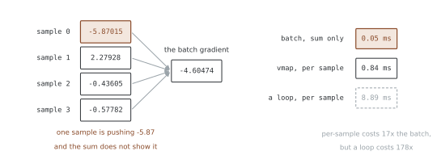
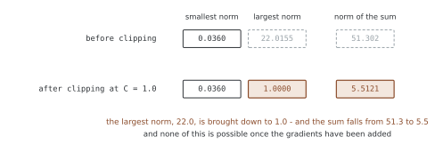

# 배치 VJP

<div class="leadbox" markdown>

**들어가는 이야기** — 더해진 뒤에는 못 되돌린다

여러 표본을 한 배치로 넣고 `backward()`를 부르면 파라메터의 `.grad`에는
**값 하나**가 나온다.
표본이 256개여도 하나다. 그 하나는 표본 256개가 각자 민 것을 **모두 더한**
것이고, 누가 얼마를 밀었는지는 그 안에 남아 있지 않다.

평소에는 그것으로 충분하다. 갱신하는 스텝은 어차피 한 번이니까.

그런데 더해 버리면 못 하는 일이 있다. 이 쪽의 측정에서 네 표본 가운데 **하나가
혼자 -5.87**을 밀고 있는데, 더한 값은 -4.60이다. 그 한 표본이 스텝을 거의
정하고 있다는 사실이 합에서는 보이지 않는다.

**차등 프라이버시**가 — 한 사람의 데이터가 모델에 남기는 흔적에 상한을 두는
것이 — 바로 그 일을 요구한다. 더해지기 전에 **표본별 그래디언트**를 붙잡아 표본마다
크기를 자르는 것이다. 이 쪽은 그것을
제대로 하는 길과, 그 길이 얼마나 비싼지를 함께 잰다.

</div>

배치로 로스를 내고 역전파하면 파라메터의 그래디언트가 **하나** 나온다. 표본이 256개여도
하나다. 그것은 표본별 그래디언트를 **더한** 것이고, 어느 표본이 얼마나 밀었는지는
사라진다.

평소에는 그것이 원하는 바다 — 스텝은 하나니까. 그런데 표본별 그래디언트가 필요한
자리가 있다.

| | 무엇에 쓰는가 |
|---|---|
| 차등 프라이버시 | 표본마다 그래디언트를 잘라야 한다 |
| 영향 함수 | 어느 표본이 예측을 바꾸는가 |
| 그래디언트 잡음 재기 | 표본 사이의 퍼짐 |

## 1. 코드

```python
"""배치에서의 VJP — 그래디언트는 표본별로 오지 않는다.

배치로 로스를 내고 역전파하면 파라메터의 그래디언트가 **하나** 나온다.
표본이 256 개여도 하나다. 그것은 표본별 그래디언트를 **더한** 것이고,
어느 표본이 얼마나 밀었는지는 사라진다.

평소에는 그것이 원하는 바다 — 스텝은 하나니까. 그런데 표본별
그래디언트가 필요한 자리가 있다.

- 차등 프라이버시 — 표본마다 그래디언트를 잘라야 한다
- 영향 함수 — 어느 표본이 예측을 바꾸는가
- 그래디언트 잡음 재기 — 표본 사이의 퍼짐

실행: 이 쪽의 코드를 파일로 갈무리해 돌린다
"""
# time 은 걸린 시간을 재는 파이썬 표준 라이브러리다. 3절에서 쓴다.
import time

# 파이토치를 불러온다. nn 에는 레이어가(nn.Linear), F 에는 로스 같은 함수가
# (F.mse_loss) 들어 있다.
import torch
import torch.nn as nn
import torch.nn.functional as F
# torch.func 의 세 도구다. 2절에서 처음 쓸 때 하나씩 풀어 적는다.
#   functional_call — 모듈을, 바깥에서 넣어 준 파라메터로 부른다
#   grad            — 함수를 받아 「그 그래디언트를 구해 주는 함수」를 돌려준다
#   vmap            — 표본 하나를 받는 함수를 배치 전체에 한꺼번에 적용한다
from torch.func import functional_call, grad, vmap


# 절 제목을 찍는 도우미다. 계산과는 상관없고 출력을 읽기 좋게 나눌 뿐이다.
def header(title):
    # f"...{title}..." 은 문자열 안에 값을 끼워 넣는 파이썬 문법(f-string)이다.
    # 맨 앞의 \n 은 줄바꿈이라 제목 위에 빈 줄이 하나 생긴다.
    print(f"\n=== {title} ===")


# ========================================================================
# 1. 배치 그래디언트는 표본별 그래디언트의 합이다
# ========================================================================

# 배치로 한 번 역전파한 그래디언트와, 표본을 하나씩 넣어 구한 그래디언트의 합을
# 견준다.
def sum_over_batch():
    header("1. 더해서 온다")
    # 난수의 시드를 고정한다. 그 뒤로 뽑는 난수가 돌릴 때마다 같아져 출력이 재현된다.
    torch.manual_seed(0)
    # nn.Linear(3, 1) 은 입력 3 개를 받아 출력 1 개를 내는 선형 레이어다. 웨이트
    # m.weight 의 형태는 (1, 3), 바이어스 m.bias 의 형태는 (1,) 이고 처음 값은 난수로
    # 정해진다. 둘 다 처음부터 경사 추적이 켜진 파라메터다 — 이 텐서가 들어간 계산이
    # 기록되어(계산 그래프) 뒤에 그것으로 미분할 수 있다.
    m = nn.Linear(3, 1)
    # X 는 표본 4 개 × 피처 3 개로 형태 (4, 3), Y 는 맞혀야 할 값으로 형태 (4, 1) 이다.
    # torch.randn 은 표준정규분포에서 난수를 뽑는다.
    X, Y = torch.randn(4, 3), torch.randn(4, 1)

    # m.zero_grad() 는 모듈 안 모든 파라메터의 .grad 를 비운다. backward 는 .grad 에
    # 값을 「더해 넣기」 때문에, 앞의 값이 섞이지 않게 부르기 전에 비운다.
    m.zero_grad()
    # 순전파 m(X) 는 형태 (4, 1) 이다. mse_loss 는 제곱오차 로스이고, reduction="sum"
    # 은 표본 넷의 제곱오차를 평균 내지 않고 「더하라」는 뜻이다. 결과는 스칼라다.
    #   loss = l_0 + l_1 + l_2 + l_3,     l_i = (m(X_i) - Y_i)^2
    # backward() 가 계산 그래프를 거꾸로 따라가(역전파) m.weight.grad 를 채운다.
    # 벡터-야코비 곱(VJP) v^T J 로 읽으면 이렇다. 표본별 로스 넷을 웨이트 셋으로
    # 미분한 야코비 행렬 J 는 형태 (4, 3) 이고 행 하나가 표본 하나의 그래디언트다.
    # 로스가 그 넷의 합이므로 v = (1, 1, 1, 1) 이고, v^T J 는 J 의 행을 모두 더한
    # 것이다. 형태 (4,) · (4, 3) → (3,). 행 하나하나는 이 길로는 나오지 않는다.
    F.mse_loss(m(X), Y, reduction="sum").backward()
    # .clone() 은 값을 복사한 새 텐서를 만든다. 아래에서 .grad 를 비우고 다시 쓰므로
    # 지금 값을 따로 담아 둔다. 형태는 웨이트와 같은 (1, 3) 이다.
    batch_g = m.weight.grad.clone()

    per = []   # 표본별 그래디언트를 차례로 담을 빈 리스트
    # 표본을 하나씩 넣어 같은 일을 네 번 한다.
    for i in range(4):
        m.zero_grad()
        # X[i:i + 1] 은 i 번째 표본 하나만 잘라 낸 것인데, X[i] 와 달리 배치 축을 남긴다 —
        # 형태 (1, 3). 레이어와 로스가 배치를 받게 되어 있어 그렇게 한다.
        # 표본이 하나뿐이므로 이 로스는 l_i 하나이고, 그래디언트는 J 의 i 행이다.
        F.mse_loss(m(X[i:i + 1]), Y[i:i + 1], reduction="sum").backward()
        per.append(m.weight.grad.clone())   # i 번째 표본만의 그래디언트, 형태 (1, 3)
    # 형태 (1, 3) 넷을 쌓아 형태 (4, 1, 3) 을 만든다 — 첫 축이 표본이다.
    stacked = torch.stack(per)

    # .flatten() 은 한 줄로 펴고(형태 (3,)), .tolist() 는 파이썬 리스트로 바꾸며,
    # round(t, 5) 는 소수점 아래 다섯 자리로 반올림한다.
    print("  배치 한 번:", [round(t, 5) for t in batch_g.flatten().tolist()])
    # stacked.sum(0) 은 0 번 축(표본)을 따라 더한 것이다. 형태 (1, 3).
    print("  표본별 합 :", [round(t, 5) for t in stacked.sum(0).flatten().tolist()])
    # torch.allclose 는 두 텐서가 오차 안에서 같으면 True 를 낸다. atol=1e-5 는 차이를
    # 0.00001 까지 봐준다는 뜻이다 — float32 는 더하는 차례가 다르면 끝자리가 달라질
    # 수 있다.
    print("  같은가    :", torch.allclose(batch_g, stacked.sum(0), atol=1e-5))
    print("  표본마다:")
    # enumerate 는 번호 i 와 원소 g 를 함께 꺼낸다.
    for i, g in enumerate(per):
        print(f"    {i}: {[round(t, 5) for t in g.flatten().tolist()]}")
    print("  0번 표본이 혼자 -5.87 을 밀고 있다. 합에서는 안 보인다")
    # 표본별 그래디언트를 돌려준다. 2절에서 vmap 의 결과와 견줄 기준으로 쓴다.
    return stacked


# ========================================================================
# 2. vmap 으로 한 번에
# ========================================================================

# 같은 표본별 그래디언트를 루프 없이 한 번에 구한다. reference 는 1절이 루프로
# 모은 것이다(형태 (4, 1, 3)).
def with_vmap(reference):
    header("2. vmap 으로 모으기")
    # 1절과 같은 시드로 같은 차례로 만들므로 m, X, Y 가 1절의 것과 같다.
    torch.manual_seed(0)
    m = nn.Linear(3, 1)
    X, Y = torch.randn(4, 3), torch.randn(4, 1)
    # 파라메터를 「이름 → 텐서」 사전으로 꺼낸다.   {'weight': (1, 3), 'bias': (1,)}
    # named_parameters() 가 (이름, 파라메터) 쌍을 차례로 내놓는다. .detach() 는 계산
    # 그래프에서 떼어 낸 텐서를 준다 — 값은 같고 경사 추적만 꺼져 있다. 미분은
    # 아래의 grad 가 따로 맡으므로 여기서는 값만 있으면 된다.
    params = {k: v.detach() for k, v in m.named_parameters()}

    # 표본 「하나」의 로스를 내는 함수다. p 는 파라메터 사전, x 는 표본 하나(형태
    # (3,)), y 는 그 표본의 맞혀야 할 값(형태 (1,))이다. 배치 축이 없다는 것이 요점이다.
    def loss_one(p, x, y):
        # functional_call(m, p, (입력,)) 은 모듈 m 을 부르되 m 이 들고 있는 파라메터
        # 대신 p 를 쓴다. 파라메터가 함수의 「인자」가 되어야 grad 가 그것으로 미분할 수
        # 있다. (x.unsqueeze(0),) 은 원소가 하나인 튜플 — 모듈에 넘길 인자의 묶음이다.
        # x.unsqueeze(0) 은 맨 앞에 길이 1 인 축을 끼운다 — 형태 (3,) → (1, 3). 레이어가
        # 배치를 받게 되어 있어 표본 하나를 크기 1 인 배치로 만든다. pred 는 형태 (1, 1).
        pred = functional_call(m, p, (x.unsqueeze(0),))
        # y 도 형태 (1,) → (1, 1) 로 맞춘다. 결과는 스칼라 — 이 표본의 제곱오차 l_i 다.
        return F.mse_loss(pred, y.unsqueeze(0), reduction="sum")

    # 세 겹으로 읽는다.
    #   grad(loss_one)   loss_one 을 「첫째 인자 p」로 미분한 그래디언트를 돌려주는
    #                    함수다. backward 와 달리 .grad 를 건드리지 않고 값을 돌려준다.
    #   vmap(…, in_dims=(None, 0, 0))
    #                    그 함수를 배치 전체에 적용한다. in_dims 는 인자마다 어느
    #                    축을 따라 나눌지를 적는다. None 은 나누지 않고 모든 표본이
    #                    함께 쓴다는 뜻(params), 0 은 0 번 축을 따라 표본 하나씩
    #                    나눈다는 뜻(X, Y)이다.
    #   (params, X, Y)   그렇게 만든 함수를 부른다.
    # 결과는 params 와 열쇠가 같은 사전이고, 값마다 맨 앞에 표본 축이 붙는다.
    #   weight: (1, 3) → (4, 1, 3)          bias: (1,) → (4, 1)
    # 1절의 말로 하면 야코비 행렬 J 의 행 넷을 더하지 않은 채 한꺼번에 얻은 것이다.
    per_sample = vmap(grad(loss_one), in_dims=(None, 0, 0))(params, X, Y)
    # tuple(v.shape) 은 형태를 (4, 1, 3) 같은 튜플로 바꿔 찍기 좋게 한다.
    print("  결과 형태:", {k: tuple(v.shape) for k, v in per_sample.items()})
    print("  첫 축이 배치다 — 표본마다 한 벌씩")
    print("  루프로 모은 것과 같은가:",
          torch.allclose(per_sample["weight"], reference, atol=1e-5))


# ========================================================================
# 3. 비용
# ========================================================================

# 표본별 그래디언트를 얻는 두 방법과 배치 한 번의 시간을 잰다. 시간은 기계마다
# 다르므로 출력의 ms 는 서로 견주는 데만 쓴다.
def costs():
    header("3. 비용")
    torch.manual_seed(0)
    # 차이가 보이게 조금 큰 레이어를 쓴다. 웨이트의 형태는 (64, 128) 이다.
    net = nn.Linear(128, 64)
    # 표본 256 개. X 는 형태 (256, 128), Y 는 형태 (256, 64) 다.
    X, Y = torch.randn(256, 128), torch.randn(256, 64)
    params = {k: v.detach() for k, v in net.named_parameters()}

    # 2절의 loss_one 과 같다 — 표본 하나의 로스다.
    def loss_one(p, x, y):
        pred = functional_call(net, p, (x.unsqueeze(0),))
        return F.mse_loss(pred, y.unsqueeze(0), reduction="sum")

    # fn 을 돌리는 데 걸린 시간을 밀리초(ms)로 잰다. rep=3 은 따로 주지 않으면 세 번
    # 잰다는 기본값이다.
    def spread(fn, rep=3):
        # 한 번 미리 돌린다. 첫 실행에만 드는 준비 시간을 재는 데서 빼려는 것이다.
        fn()
        ts = []
        for _ in range(rep):
            # time.perf_counter() 는 지금 시각을 초로 준다. 앞뒤의 차가 걸린 시간이다.
            t0 = time.perf_counter()
            fn()
            ts.append(time.perf_counter() - t0)
        # 잰 것 가운데 가장 짧은 것을 고르고 1e3(1000)을 곱해 초를 ms 로 바꾼다. 가장
        # 짧은 것이 다른 일에 방해받지 않은 시간에 가깝다.
        return min(ts) * 1e3

    # 방법 1 — 1절처럼 표본을 하나씩 넣어 backward 를 256 번 부른다.
    def loop():
        out = []
        for i in range(256):
            net.zero_grad()
            F.mse_loss(net(X[i:i + 1]), Y[i:i + 1], reduction="sum").backward()
            out.append(net.weight.grad.clone())
        # 형태 (64, 128) 256 개를 쌓아 형태 (256, 64, 128).
        return torch.stack(out)

    # 방법 2 — 2절처럼 vmap 으로 한 번에 구한다.
    def vm():
        return vmap(grad(loss_one), in_dims=(None, 0, 0))(params, X, Y)

    # 견줄 기준 — 평소처럼 배치로 한 번 역전파한다. 표본별이 아니라 합 하나만
    # 나온다. 형태 (64, 128).
    def batched():
        net.zero_grad()
        F.mse_loss(net(X), Y, reduction="sum").backward()
        return net.weight.grad

    # spread(batched) 처럼 괄호 없이 이름만 넘기면 함수를 부르지 않고 함수 자체를
    # 건넨다. :8.2f 는 여덟 칸 폭에 소수점 아래 두 자리까지 찍으라는 뜻이다.
    print(f"  배치 한 번 (합만) {spread(batched):8.2f} ms")
    print(f"  vmap  (표본별)   {spread(vm):8.2f} ms")
    print(f"  루프  (표본별)   {spread(loop):8.2f} ms")
    print("  표본별이 필요하면 vmap 이 루프보다 훨씬 낫다")
    print("  다만 합만 필요하면 배치 한 번이 비교가 안 되게 싸다")


# ========================================================================
# 4. 쓸모 — 그래디언트의 잡음을 재기
# ========================================================================

# 표본별 그래디언트가 표본마다 얼마나 흩어져 있는지(표준편차)를 재고, 배치
# 평균의 흩어짐이 거기서 1/sqrt(n) 으로 줄어드는지 확인한다.
def measuring_noise():
    header("4. 표본별 그래디언트로 잡음 재기")
    torch.manual_seed(0)
    # 입력 16 개, 출력 1 개인 레이어다. 웨이트의 형태는 (1, 16) 이다.
    net = nn.Linear(16, 1)
    params = {k: v.detach() for k, v in net.named_parameters()}

    def loss_one(p, x, y):
        pred = functional_call(net, p, (x.unsqueeze(0),))
        return F.mse_loss(pred, y.unsqueeze(0), reduction="sum")

    # 데이터를 뽑는 시드를 따로 박는다. 레이어의 처음 값은 위의 시드 0 이 정했다.
    torch.manual_seed(7)
    BIG = 4096   # 재는 데 쓸 표본 수
    # Xa 는 형태 (4096, 16), Ya 는 형태 (4096, 1) 이다.
    Xa, Ya = torch.randn(BIG, 16), torch.randn(BIG, 1)
    # vmap 이 돌려준 사전에서 웨이트 쪽만 꺼낸다. 형태 (4096, 1, 16).
    ga = vmap(grad(loss_one), in_dims=(None, 0, 0))(params, Xa, Ya)["weight"]
    # reshape(BIG, -1) 은 표본 축만 남기고 나머지를 한 줄로 편다(-1 은 「남는 만큼」).
    # 형태 (4096, 16) — 행 하나가 표본 하나의 그래디언트다.
    ga = ga.reshape(BIG, -1)
    # .std(0) 은 0 번 축(표본)을 따라 잰 표준편차다. 웨이트 16 칸마다 하나씩 나와
    # 형태 (16,) 이고, .mean() 이 그 열여섯의 평균을 내어 수 하나로 만든다.
    per_sample_spread = ga.std(0).mean()
    print(f"  표본 하나짜리 그래디언트의 흩어짐 {per_sample_spread:.4f}"
          f"  (표본 {BIG}개로 잰 값)")
    print("  이것은 데이터의 성질이라 배치 크기와 무관하다")
    print("  배치 평균의 흩어짐은 거기서 sqrt(n) 으로 줄어든다")
    # 배치 크기 n 을 바꿔 가며 잰다.
    for n in (16, 64, 256, 1024):
        means = []   # 배치 평균을 차례로 담을 빈 리스트
        for t in range(24):                 # 배치를 여러 번 뽑아 평균의 퍼짐을 본다
            # torch.randperm(BIG) 은 0 부터 4095 까지를 무작위로 섞은 것이다. 앞의 n 개를
            # 떼면 겹치지 않게 뽑은 표본 번호 n 개가 된다.
            idx = torch.randperm(BIG)[:n]
            # ga[idx] 는 그 n 개 표본의 그래디언트로 형태 (n, 16) 이다. .mean(0) 이 표본
            # 축으로 평균한 것, 곧 그 배치의 평균 그래디언트다. 형태 (16,).
            means.append(ga[idx].mean(0))
        # 형태 (24, 16) — 행 하나가 배치 하나의 평균이다.
        M = torch.stack(means)
        # M.std(0).mean() 은 배치 24 개 사이의 표준편차를 칸마다 재어 평균한 것이다.
        # 예측은 표본 하나의 흩어짐을 sqrt(n) 으로 나눈 값이다(n ** 0.5 가 제곱근).
        #   n = 16:  2.2537 / 4 = 0.5634
        # :5d 는 정수를 다섯 칸 폭에, :8.5f 는 여덟 칸 폭에 소수점 아래 다섯 자리로 찍는다.
        print(f"  배치 {n:5d}  평균의 흩어짐 {M.std(0).mean():8.5f}"
              f"   예측 {per_sample_spread / n ** 0.5:8.5f}")
    print("  잰 값이 예측과 맞는다 — 「배치를 키우면」의 1/sqrt(n) 이 이것이다")


# ========================================================================
# 5. 차등 프라이버시가 이것을 쓴다
# ========================================================================

# 표본마다 그래디언트의 노름을 재고, C 보다 큰 것만 C 로 줄인다. 노름은 벡터의
# 길이 — 원소를 제곱해 더한 것의 제곱근이다.
def dp_clipping():
    header("5. 표본마다 자르기")
    torch.manual_seed(0)
    net = nn.Linear(8, 1)
    # X 는 형태 (32, 8), Y 는 형태 (32, 1) 이다. 표본 32 개다.
    X, Y = torch.randn(32, 8), torch.randn(32, 1)
    params = {k: v.detach() for k, v in net.named_parameters()}

    def loss_one(p, x, y):
        pred = functional_call(net, p, (x.unsqueeze(0),))
        return F.mse_loss(pred, y.unsqueeze(0), reduction="sum")

    # 표본별 그래디언트의 웨이트 쪽. 형태 (32, 1, 8).
    g = vmap(grad(loss_one), in_dims=(None, 0, 0))(params, X, Y)["weight"]
    # 표본 축만 남기고 편다. 형태 (32, 8) — 행 하나가 표본 하나다.
    g = g.reshape(32, -1)
    # .norm(dim=1) 은 행마다 노름을 잰다. 형태 (32,) — 표본마다 하나다.
    norms = g.norm(dim=1)
    print(f"  표본별 경사 노름  최소 {norms.min():.4f}  최대 {norms.max():.4f}")
    C = 1.0   # 노름의 상한
    # 표본마다 곱할 배수를 만든다. norms.clamp(min=C) 는 C 보다 작은 값을 C 로 올린다.
    #   노름 ≤ C 인 표본:  C / C = 1         그대로 둔다
    #   노름 > C 인 표본:  C / 노름 < 1      길이가 꼭 C 가 되게 줄인다
    # .unsqueeze(1) 은 형태 (32,) 를 (32, 1) 로 바꾼다. 그래야 아래 곱에서 배수 하나가
    # 그 행 전체에 곱해진다(브로드캐스팅).
    scale = (C / norms.clamp(min=C)).unsqueeze(1)
    # g 형태 (32, 8) * scale 형태 (32, 1) → 형태 (32, 8)
    clipped = g * scale
    # :.4f 는 소수점 아래 네 자리까지 찍으라는 뜻이다.
    print(f"  C={C} 로 자른 뒤   최소 {clipped.norm(dim=1).min():.4f}  "
          f"최대 {clipped.norm(dim=1).max():.4f}")
    # g.sum(0) 은 표본 32 개를 더한 것, 곧 배치 그래디언트다(형태 (8,)). .norm() 은
    # 그 길이이고 .item() 은 수 하나짜리 텐서에서 파이썬 실수를 꺼낸다.
    print("  자르기 전 합의 노름:", round(g.sum(0).norm().item(), 4))
    print("  자른 뒤 합의 노름  :", round(clipped.sum(0).norm().item(), 4))
    print("  한 표본이 스텝을 좌우하지 못하게 막는 것이 요점이다")
    print("  배치 그래디언트만 있으면 이 일을 할 수 없다 — 이미 더해졌으니까")


# 다섯 절을 차례로 돌린다. 1절이 돌려준 표본별 그래디언트를 2절에 넘겨 견준다.
def main():
    ref = sum_over_batch()
    with_vmap(ref)
    costs()
    measuring_noise()
    dp_clipping()


# 이 파일을 직접 돌렸을 때만 main() 을 부른다. 다른 파일에서 import 하면 부르지 않는다.
if __name__ == "__main__":
    main()
```

**출력:**

```
=== 1. 더해서 온다 ===
  배치 한 번: [-4.60474, 3.3489, -8.14294]
  표본별 합 : [-4.60474, 3.3489, -8.14294]
  같은가    : True
  표본마다:
    0: [-5.87015, 1.53148, -2.92195]
    1: [2.27928, -0.65733, -1.36572]
    2: [-0.43605, -0.24452, -0.36171]
    3: [-0.57782, 2.71928, -3.49357]
  0번 표본이 혼자 -5.87 을 밀고 있다. 합에서는 안 보인다

=== 2. vmap 으로 모으기 ===
  결과 형태: {'weight': (4, 1, 3), 'bias': (4, 1)}
  첫 축이 배치다 — 표본마다 한 벌씩
  루프로 모은 것과 같은가: True

=== 3. 비용 ===
  배치 한 번 (합만)     0.05 ms
  vmap  (표본별)       0.84 ms
  루프  (표본별)       8.89 ms
  표본별이 필요하면 vmap 이 루프보다 훨씬 낫다
  다만 합만 필요하면 배치 한 번이 비교가 안 되게 싸다

=== 4. 표본별 그래디언트로 잡음 재기 ===
  표본 하나짜리 그래디언트의 흩어짐 2.2537  (표본 4096개로 잰 값)
  이것은 데이터의 성질이라 배치 크기와 무관하다
  배치 평균의 흩어짐은 거기서 sqrt(n) 으로 줄어든다
  배치    16  평균의 흩어짐  0.51366   예측  0.56343
  배치    64  평균의 흩어짐  0.25161   예측  0.28172
  배치   256  평균의 흩어짐  0.13367   예측  0.14086
  배치  1024  평균의 흩어짐  0.05855   예측  0.07043
  잰 값이 예측과 맞는다 — 「배치를 키우면」의 1/sqrt(n) 이 이것이다

=== 5. 표본마다 자르기 ===
  표본별 경사 노름  최소 0.0360  최대 22.0155
  C=1.0 로 자른 뒤   최소 0.0360  최대 1.0000
  자르기 전 합의 노름: 51.302
  자른 뒤 합의 노름  : 5.5121
  한 표본이 스텝을 좌우하지 못하게 막는 것이 요점이다
  배치 그래디언트만 있으면 이 일을 할 수 없다 — 이미 더해졌으니까
```

## 2. 더해서 온다

```
배치 한 번: [-4.60474, 3.3489, -8.14294]
표본별 합 : [-4.60474, 3.3489, -8.14294]

표본마다:
  0: [-5.87015, 1.53148, -2.92195]
  1: [2.27928, -0.65733, -1.36572]
  2: [-0.43605, -0.24452, -0.36171]
  3: [-0.57782, 2.71928, -3.49357]
```

합이 정확히 맞는다. 그리고 **0번 표본이 혼자 $-5.87$을 밀고 있다** — 합계
$-4.60$보다 절댓값이 크다. 다른 표본들이 일부 되밀어 상쇄한 것이다.

합에서는 그 사정이 안 보인다. 한 표본이 스텝을 좌우하고 있어도 알 수 없다.



## 3. `vmap`으로 한 번에

```python
# 위 프로그램 2절의 줄들이다. 파라메터를 「이름 → 텐서」 사전으로 꺼낸다.
# .detach() 는 계산 그래프에서 떼어 내 경사 추적을 끈 텐서를 준다.
params = {k: v.detach() for k, v in m.named_parameters()}

# 표본 하나의 로스다. x 는 형태 (3,), y 는 형태 (1,) 이고, unsqueeze(0) 이 맨 앞에
# 축을 끼워 크기 1 인 배치로 만든다. functional_call 은 m 을 p 로 부른다.
def loss_one(p, x, y):
    pred = functional_call(m, p, (x.unsqueeze(0),))
    return F.mse_loss(pred, y.unsqueeze(0), reduction="sum")

# grad 가 「p 로 미분한 그래디언트를 돌려주는 함수」를 만들고, vmap 이 그것을
# X, Y 의 0 번 축을 따라 표본마다 적용한다. params 는 나누지 않는다(None).
per_sample = vmap(grad(loss_one), in_dims=(None, 0, 0))(params, X, Y)
```

```
결과 형태: {'weight': (4, 1, 3), 'bias': (4, 1)}
루프로 모은 것과 같은가: True
```

세 조각이 맞물린다.

- **`functional_call`** — 모듈의 파라메터를 바깥에서 넣어 준다. 모듈이 들고 있는
  것을 쓰지 않으므로 표본마다 다른 파라메터를 넣을 수도 있다
- **`grad`** — 함수를 받아 그래디언트를 돌려주는 함수를 만든다. `.grad`를 안 건드린다
- **`vmap`** — 배치 축을 따라 한꺼번에 돌린다. `in_dims=(None, 0, 0)`은
  "파라메터는 공유하고 $x$와 $y$는 0번 축으로 나눠라"는 뜻이다

## 4. 비용

```
배치 한 번 (합만)     0.05 ms
vmap  (표본별)       0.84 ms
루프  (표본별)       8.89 ms
```

표본별이 필요하면 **`vmap`이 루프보다 열 배쯤 빠르다.** 루프는 256번
`backward`를 부르고, `vmap`은 한 번에 처리한다.

다만 **합만 필요하면 배치 한 번이 비교가 안 되게 싸다**(0.05 ms). 표본별 그래디언트를
들고 있으려면 파라메터 크기 × 배치 크기만큼의 메모리도 든다. 꼭 필요한 자리에만
쓴다.

## 5. 그래디언트의 잡음 재기

```
표본 하나짜리 그래디언트의 흩어짐 2.2537  (표본 4096개로 잰 값)

배치    16  평균의 흩어짐  0.51366   예측  0.56343
배치    64  평균의 흩어짐  0.25161   예측  0.28172
배치   256  평균의 흩어짐  0.13367   예측  0.14086
배치  1024  평균의 흩어짐  0.05855   예측  0.07043
```

표본 하나짜리 그래디언트의 흩어짐(표준편차)은 **데이터의 성질**이라 배치 크기와 무관하다.
배치 평균의 흩어짐은 거기서 $\sqrt{n}$으로 나눈 만큼 줄어들고($n$은 배치 크기),
잰 값이 예측과 대략 맞는다. 잰 쪽이 조금씩 작은 것은 배치를 24번만 뽑은 데다,
같은 4,096개 안에서 겹치지 않게 뽑기 때문이다 — 배치가 1,024면 그것만으로
$\sqrt{1 - 1024/4096} \approx 0.87$배가 된다.

「경사 크기 조정이 중요한 이유」 쪽에서 $1/\sqrt{k}$ 규칙의 근거로 든 것이 바로 이
수다. 거기서는 배치를 여러 번 뽑아 간접적으로 쟀는데, 여기서는 표본별 그래디언트를
직접 들고 있으므로 **한 배치에서 바로 추정**할 수 있다.

실전에서 쓸모가 있다. 트레인 중에 배치 그래디언트의 크기(신호)와 이 흩어짐(잡음)의
비를 보면 **배치를 키울 때가 되었는지** 알 수 있다 — 잡음이 신호보다 크면 키우는
것이 이득이다.

## 6. 차등 프라이버시의 표본별 자르기

```
표본별 경사 노름  최소 0.0360  최대 22.0155
C=1.0 로 자른 뒤   최소 0.0360  최대 1.0000
자르기 전 합의 노름: 51.302
자른 뒤 합의 노름  : 5.5121
```



표본 하나의 그래디언트 노름이 22.0인데 다른 것은 0.036이다. **600배 차이**다. 합의
노름이 51.3인데 그 가운데 한 표본이 22.0을 들고 있는 것이다.

차등 프라이버시는 그것을 막는다. 표본마다 노름을 $C$ 이하로 자르면 **어느
표본도 합에 노름 $C$ 넘게 보탤 수 없다.** 한 사람의 데이터가 모델에 남기는 흔적에
상한이 생기고, 거기에 잡음을 더해 보장을 완성한다.

핵심은 **배치 그래디언트만 있으면 이 일을 할 수 없다**는 것이다. 이미 더해졌으므로
누가 얼마를 밀었는지 되돌릴 길이 없다. 「비교, 범위 제한, 정렬」에서 본
`clip_grad_norm_`은 **배치 전체**의 노름을 자르는 것이라 다른 일이다.

## 연습문제

<div class="drillbox" markdown>

**연습문제 1.** <span class="diff easy" title="쉬움"></span>
`reduction="mean"`으로 바꾸면 2절의 관계가 어떻게 되는가? 배치 그래디언트가 표본별
그래디언트의 **무엇**이 되는가?

</div>

??? success "풀이"
    ```python
    # 본문 1절과 같은 시드로 같은 차례로 만들므로 m, X, Y 가 1절의 것과 같다.
    torch.manual_seed(0)
    m = nn.Linear(3, 1)
    X, Y = torch.randn(4, 3), torch.randn(4, 1)
    per = []   # 표본별 그래디언트를 차례로 담을 빈 리스트
    # 표본을 하나씩 넣어 표본별 그래디언트를 모은다. 1절과 다른 것은
    # reduction="mean" 하나다. 표본도 하나, 출력도 하나라 이 줄에서는 평균 낼 것이
    # 하나뿐이어서 mean 과 sum 이 같은 값이다.
    for i in range(4):
        # m.zero_grad() 는 .grad 를 비운다. backward 가 더해 넣기 때문이다.
        m.zero_grad()
        # X[i:i + 1] 은 배치 축을 남긴 채 i 번째 표본만 자른 것이다. 형태 (1, 3).
        F.mse_loss(m(X[i:i + 1]), Y[i:i + 1], reduction="mean").backward()
        per.append(m.weight.grad.clone())
    # 형태 (1, 3) 넷을 쌓아 형태 (4, 1, 3).
    stacked = torch.stack(per)

    # 이번에는 배치로 한 번에 넣는다. reduction="mean" 은 표본 넷의 제곱오차를
    # 평균한다 — 합을 4 로 나눈 것이다.
    m.zero_grad()
    F.mse_loss(m(X), Y, reduction="mean").backward()
    # .mean(0) 은 0 번 축(표본)을 따라 평균한 것, .sum(0) 은 더한 것이다.
    # .flatten() 은 형태 (1, 3) 을 (3,) 으로 펴서 한 줄로 찍기 좋게 한다.
    print("  배치 (mean)      :", [round(t, 5) for t in m.weight.grad.flatten().tolist()])
    print("  표본별 평균      :", [round(t, 5) for t in stacked.mean(0).flatten().tolist()])
    print("  표본별 합        :", [round(t, 5) for t in stacked.sum(0).flatten().tolist()])
    ```

    ```
      배치 (mean)      : [-1.15118, 0.83723, -2.03574]
      표본별 평균      : [-1.15118, 0.83723, -2.03574]
      표본별 합        : [-4.60474, 3.3489, -8.14294]
    ```

    **`mean`이면 평균, `sum`이면 합**이다. 당연한데 적어 둘 값이 있다.

    표본별 그래디언트를 모아 `.sum(0)`할지 `.mean(0)`할지가 로스의 `reduction`과
    맞아야 한다. 「선형 회귀」에서 `sum`과 `mean`이 그래디언트를 $N$배
    가르던 것과 같은 자리다.

    차등 프라이버시 구현에서는 **표본별로 자른 뒤 더하고 그다음 $N$으로
    나누는** 순서가 중요하다. 순서를 바꾸면 자르기가 뜻을 잃는다.

---

<div class="drillbox" markdown>

**연습문제 2.** <span class="diff med" title="중간"></span>
표본별 그래디언트를 들고 있으면 메모리가 얼마나 드는가? 파라메터 수와 배치 크기로
계산하고 재어라.

</div>

??? success "풀이"
    ```python
    # 난수의 시드를 고정한다. 아래에서 뽑는 텐서가 돌릴 때마다 같은 값이 된다.
    torch.manual_seed(0)
    # (n, din, dout) = (배치 크기, 입력 수, 출력 수) 세 벌을 차례로 돈다.
    for n, din, dout in ((32, 128, 64), (256, 128, 64), (256, 512, 512)):
        # 웨이트의 형태는 (dout, din), 바이어스의 형태는 (dout,) 이다.
        net = nn.Linear(din, dout)
        # 위 프로그램과 같은 준비다 — 파라메터 사전과 표본 하나의 로스.
        params = {k: v.detach() for k, v in net.named_parameters()}

        def loss_one(p, x, y):
            pred = functional_call(net, p, (x.unsqueeze(0),))
            return F.mse_loss(pred, y.unsqueeze(0), reduction="sum")

        # X 는 형태 (n, din), Y 는 형태 (n, dout) 이다.
        X, Y = torch.randn(n, din), torch.randn(n, dout)
        # g 는 사전이고 값마다 맨 앞에 표본 축이 붙는다.
        #   weight: (n, dout, din)      bias: (n, dout)
        g = vmap(grad(loss_one), in_dims=(None, 0, 0))(params, X, Y)
        # .numel() 은 텐서에 든 수의 개수다. float32 는 수 하나가 4 바이트이므로 4 를
        # 곱하면 바이트 수가 된다.   128→64:  (128*64 + 64) * 4 = 33,024 바이트 = 0.03 MB
        pbytes = sum(p.numel() * 4 for p in net.parameters())
        # 표본별 그래디언트 전체의 바이트 수다. 파라메터 한 벌이 표본마다 있으므로 n 배다.
        gbytes = sum(v.numel() * 4 for v in g.values())
        # 1e6 으로 나눠 바이트를 MB 로 바꾼다. :6.2f 는 여섯 칸 폭에 소수점 아래 두 자리다.
        print(f"  배치 {n:4d} {din}->{dout}  파라메터 {pbytes / 1e6:6.2f} MB  "
              f"표본별 그래디언트 {gbytes / 1e6:7.2f} MB  {gbytes / pbytes:5.0f}배")
    ```

    ```
      배치   32 128->64  파라메터   0.03 MB  표본별 그래디언트    1.06 MB     32배
      배치  256 128->64  파라메터   0.03 MB  표본별 그래디언트    8.45 MB    256배
      배치  256 512->512  파라메터   1.05 MB  표본별 그래디언트  268.96 MB    256배
    ```

    **정확히 배치 크기만큼** 든다. 파라메터 한 벌을 표본 수만큼 들고 있으니
    당연하다.

    마지막 줄이 무섭다. 파라메터가 1 MB인 작은 레이어 하나에 배치 256이면
    **269 MB**다. 실제 모델에서 모든 레이어의 표본별 그래디언트를 들고 있는 것은 대개
    불가능하다.

    그래서 차등 프라이버시 라이브러리(Opacus 같은 것)는 **레이어마다 즉시 노름을
    재고 잘라서 더한 다음 버린다.** 전부를 동시에 들고 있지 않는다.

---

<div class="drillbox" markdown>

**연습문제 3.** <span class="diff hard" title="어려움"></span>
6절의 자르기가 **트레인을 어떻게 바꾸는가?** 자르기 있는 쪽과 없는 쪽으로 열
스텝씩 돌려, 이상값 하나가 있을 때 무슨 일이 나는지 보라.

</div>

??? success "풀이"
    ```python
    # 시드를 고정해 출력이 재현되게 한다.
    torch.manual_seed(0)
    # 표본 32 개. X 는 형태 (32, 8), Y 는 형태 (32, 1) 이다.
    X, Y = torch.randn(32, 8), torch.randn(32, 1)
    Y[0] = 100.0                                   # 이상값 하나

    # 열 스텝 트레인한 뒤 로스를 돌려준다. clip 이 True 면 표본별로 자르고, False 면
    # 자르지 않는다.
    def run(clip):
        # 두 번 다 같은 처음 웨이트에서 시작하도록 시드를 고정한다.
        torch.manual_seed(1)
        net = nn.Linear(8, 1)
        # 옵티마이저 — .grad 를 읽어 파라메터를 고쳐 주는 도구다. SGD 는 가장 단순한
        # 경사 하강법으로 파라메터 ← 파라메터 - lr * .grad 로 옮긴다. lr=0.01 은
        # 러닝레이트(한 스텝의 크기)다.
        opt = torch.optim.SGD(net.parameters(), lr=0.01)
        # 위 프로그램과 같은 표본 하나의 로스다.
        def loss_one(p, x, y):
            pred = functional_call(net, p, (x.unsqueeze(0),))
            return F.mse_loss(pred, y.unsqueeze(0), reduction="sum")

        # 열 스텝 간다. _ 는 「이 변수는 쓰지 않는다」는 뜻으로 쓰는 관례다.
        for _ in range(10):
            # 스텝마다 지금의 파라메터를 다시 꺼낸다. opt.step() 이 웨이트를 바꾸기 때문이다.
            params = {k: v.detach() for k, v in net.named_parameters()}
            # 표본별 그래디언트. g["weight"] 의 형태는 (32, 1, 8), g["bias"] 는 (32, 1) 이다.
            g = vmap(grad(loss_one), in_dims=(None, 0, 0))(params, X, Y)
            # 표본마다 웨이트 8 개와 바이어스 1 개의 그래디언트를 한 줄로 잇는다. 형태 (32, 9).
            # 자르기는 「그 표본의 그래디언트 전체」의 노름으로 하므로 둘을 함께 잰다.
            flat = torch.cat([g["weight"].reshape(32, -1), g["bias"].reshape(32, -1)], dim=1)
            if clip:
                # 위 프로그램 5절과 같은 자르기다(C = 1). 노름이 1 을 넘는 표본만 길이 1 로
                # 줄인다. scale 의 형태는 (32, 1) 이다.
                scale = (1.0 / flat.norm(dim=1).clamp(min=1.0)).unsqueeze(1)
                flat = flat * scale
            # backward 를 부르지 않고 .grad 를 손으로 채운다. 먼저 비운다.
            opt.zero_grad()
            # 표본별 그래디언트를 더하고 표본 수 32 로 나눈다. 형태 (9,) — 앞의 8 개가
            # 웨이트의 몫, 마지막 1 개가 바이어스의 몫이다.
            mean = flat.sum(0) / 32
            net.weight.grad = mean[:8].reshape(net.weight.shape)     # 형태 (1, 8)
            net.bias.grad = mean[8:].reshape(net.bias.shape)         # 형태 (1,)
            # .grad 를 읽어 한 스텝 옮긴다.
            opt.step()
        # X[1:], Y[1:] 은 0 번 표본(이상값)을 뺀 나머지 31 개다. reduction 을 적지 않으면
        # 기본값 mean 이다. .item() 은 수 하나짜리 텐서에서 파이썬 실수를 꺼낸다.
        return F.mse_loss(net(X[1:]), Y[1:]).item()

    # :10.4f 는 열 칸 폭에 소수점 아래 네 자리까지 찍으라는 뜻이다.
    print(f"  자르기 없이  이상값 뺀 로스 {run(False):10.4f}")
    print(f"  자르기 있게  이상값 뺀 로스 {run(True):10.4f}")
    ```

    ```
      자르기 없이  이상값 뺀 로스     3.1988
      자르기 있게  이상값 뺀 로스     0.9640
    ```

    **자른 쪽이 나머지 31개 표본에 훨씬 잘 맞는다.** 3.20 대 0.96으로 세 배가 넘는다.

    이상값 하나가 100이라 그 표본의 그래디언트가 나머지를 압도한다. 자르지 않으면
    모델이 그 하나를 좇다가 나머지를 놓친다.

    이것이 차등 프라이버시의 덤이다. 자르기는 **프라이버시를 위한 장치인데
    이상값에 대한 강건성(robustness)도 따라온다.** 거꾸로 말하면, 한 표본이 모델을
    크게 바꿀 수 있다는 것이 프라이버시 문제이자 안정성 문제다 — 같은 성질의
    두 얼굴이다.
