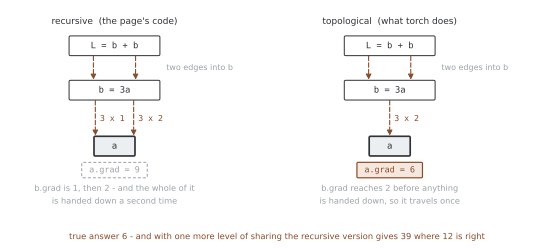

# Autograd 바닥부터 만들기

<div class="leadbox" markdown>

**들어가는 이야기** — 통과한 검사가 보증하지 않는 것

자동 미분이 어떻게 돌아가는지 알려면 직접 한 번 만들어 보는 것이 가장 빠르다.
이 쪽이 만드는 것은 백 줄 남짓이고, 만든 뒤에는 파이토치와 값을 맞춰 본다.
**전부 맞는다.**

그런데 맞지 않는다. 검사를 몇 개 더 만들어 보면 **같은 코드가 6이 나와야 할
자리에서 9를 내놓고**, 식을 한 단계 더 중첩하면 12가 나와야 할 자리에서 39를
내놓는다. 틀리는 정도가 깊이에 따라 커진다.

고친 코드가 어려운 것도 아니다. 어려운 것은 **처음 검사들이 왜 전부
통과했는지**다. 통과한 까닭을 알고 나면, 어떤 검사를 짰어야 했는지도 같이
알게 된다.

이 쪽이 남기는 것은 자동 미분의 원리 하나와 그보다 오래 쓸 교훈 하나다 —
**검사가 통과했다는 것은 그 검사가 통과했다는 뜻뿐이다.**

</div>

스칼라와 NumPy 배열을 감싸는 작은 클래스로 자동 미분의 원리를 살펴본다. 교육용 구현의 지원 범위와 한계도 함께 구분한다.

## 1. 코드

길어서 접어 두었다. 열기 전에 **무엇이 들어 있는지**만 적어 둔다 — 같은 엔진을
두 벌 짓는다.

| | 무엇인가 | 들어 있는 것 |
|---|---|---|
| `NumberWithGrad` | **스칼라** 엔진 | `__add__` · `__mul__` · `__sub__` · `__truediv__` · `__pow__` · `__neg__` · `backward` |
| `TensorWithGrad` | **텐서** 엔진 | `__add__` · `__mul__` · `matmul` · `sum` · `relu` · `sigmoid` · `backward` |
| 보조 함수 | 형태(shape)를 맞춘다 | `ensure_number` · `ensure_tensor` · `unbroadcast` |

연산마다 짝이 되는 역방향 규칙(그 연산의 국소 미분)을 적어 두고, `backward`가 그것들을 역순으로 적용한다.
스칼라를 먼저 짓는 까닭은 **브로드캐스팅이 없어 사슬 규칙만 남기 때문**이고,
텐서로 옮길 때 새로 생기는 일이 곧 `unbroadcast`다.

??? note "코드 (824줄)"

    ```python
    """밑바닥부터 짜는 자동 미분."""
    # ---
    # title: "밑바닥부터 짜는 자동 미분"
    # description: "파이썬으로 가장 단순한 자동 미분 엔진 만들기 — 계산 그래프,
    #               역전파, 그래디언트 누적, PyTorch와의 비교"
    # ---
    #
    # PyTorch의 autograd 체계는 강력하지만, 그 속에서 어떻게 동작하는지 이해하는 것이
    # 딥러닝을 제대로 익히는 데 필수적이다. 이 스크립트는 최소한의
    # 자동 미분 엔진을 바닥부터 만든 뒤 PyTorch와 대조하여 검증한다.
    #
    #   1부 – NumberWithGrad: 덧셈/곱셈을 지원하는 스칼라 자동 미분
    #   2부 – 그래디언트 누적과 여러 경로를 가진 그래프
    #   3부 – 뺄셈, 나눗셈, 거듭제곱으로 확장
    #   4부 – TensorWithGrad: numpy를 이용한 벡터화된 자동 미분
    #   5부 – PyTorch autograd와 대조 검증
    #   6부 – 우리 엔진으로 작은 뉴럴 네트워크 만들기
    #
    # 출처 각색: O'Reilly "Deep Learning from Scratch" 6장

    # 이 한 줄은 타입 힌트를 「나중에」 읽게 한다. 아래에서 클래스 NumberWithGrad 를
    # 정의하는 도중에 -> NumberWithGrad 라고 제 이름을 적는데, 이 줄이 없으면
    # 아직 다 만들어지지 않은 이름이라 오류가 난다.
    from __future__ import annotations
    # 타입 힌트에 쓸 이름들이다. 힌트는 「이 자리에 무엇이 온다」는 메모일 뿐이고
    # 파이썬은 실행할 때 검사하지 않는다. 계산에는 아무 영향이 없다.
    #   Union[A, B] — A 또는 B,   List — 리스트,   Optional[A] — A 또는 None
    from typing import Union, List, Optional
    # numpy 는 수의 배열을 다루는 라이브러리다. 4부부터 텐서의 값을 담는 데 쓴다.
    # 이 엔진은 파이토치를 쓰지 않는다 — 파이토치는 5부에서 답을 맞춰 볼 때만 부른다.
    import numpy as np

    # 「수처럼 쓸 수 있는 것」 — 파이썬 실수 또는 정수. 힌트에 쓰려고 붙인 이름이다.
    Numberable = Union[float, int]


    # =====================================================================
    # 1부 – 스칼라 자동 미분
    # =====================================================================
    # 자동 미분 엔진이 할 일은 둘이다.
    #   (1) 순전파 — 값을 계산하면서 「이 값은 무엇과 무엇으로, 어떤 연산으로
    #       만들었는가」를 함께 적어 둔다. 이 기록이 계산 그래프다.
    #   (2) 역전파 — 그 기록을 출력에서 입력 쪽으로 거꾸로 따라가며 사슬 규칙으로
    #       그래디언트(출력을 각 값으로 미분한 값)를 구한다.
    # 먼저 수 하나짜리(스칼라)로 만든다. 형태를 맞출 일이 없어 사슬 규칙만 남는다.
    #
    # "=" * 60 은 문자열 "=" 를 60번 이어 붙인 것이다 — 출력의 가로줄이다.
    print("=" * 60)
    print("Part 1: Scalar Automatic Differentiation")
    print("=" * 60)


    # a * 4 의 4 는 보통의 파이썬 수라 .num 도 .grad 도 없다. 연산자마다 「상대가
    # 노드인가 수인가」를 따지지 않도록, 연산에 들어가기 전에 모두 노드로 맞춘다.
    def ensure_number(num):
        """일반 파이썬 수를 NumberWithGrad로 감싼다."""
        # isinstance(값, 클래스) 는 값이 그 클래스의 객체이면 True 다.
        # 이미 노드이면 그대로 돌려준다 — 새로 감싸면 그래프의 연결이 끊어진다.
        if isinstance(num, NumberWithGrad):
            return num
        # 보통의 수이면 부모 없는 노드(리프)로 감싼다. 상수도 그래프의 노드가 된다.
        return NumberWithGrad(num)


    # class 는 「값과 그 값에 딸린 함수」를 한데 묶은 틀을 정의한다. 이 틀로 찍어 낸
    # 것 하나하나가 객체이고, 여기서는 객체 하나가 계산 그래프의 노드 하나다.
    # 파이토치에서 requires_grad=True 인 텐서가 하는 일을 수 하나짜리로 줄인 것이다.
    class NumberWithGrad:
        """자동 미분을 위해 자신의 계산 그래프를 추적하는 스칼라 값.

        인스턴스마다 다음을 담는다.
          - num:         스칼라 값
          - grad:        누적된 그래디언트(.backward()가 채운다)
          - depends_on:  부모 NumberWithGrad 객체의 목록
          - creation_op: 이 노드를 만든 연산을 가리키는 문자열 표지
        """

        def __init__(
            self,
            num: Numberable,
            depends_on: Optional[List] = None,
            creation_op: str = "",
        ):
            # __init__ 은 객체를 만들 때 파이썬이 저절로 부르는 함수다.
            # NumberWithGrad(3) 이라고 적으면 __init__(self, 3) 이 불린다.
            # self 는 「지금 만들고 있는 이 객체」이고, self.이름 = 값 은 그 객체에
            # 값을 붙여 둔다. 붙여 두는 것은 넷이고, 앞의 하나가 순전파의 결과,
            # 뒤의 둘이 계산 그래프의 기록, 가운데 grad 가 역전파가 채울 칸이다.
            self.num = num                       # 순전파의 값
            # 역전파 전에는 None 이다. 파이토치의 .grad 도 backward() 전에는 None 이다.
            self.grad: Optional[float] = None
            # 이 노드를 만드는 데 쓰인 노드들(부모). 역전파는 이 목록을 따라 거슬러
            # 올라간다. 직접 만든 노드는 부모가 없다 — 그런 노드를 리프라 한다.
            # 「depends_on or []」 는 depends_on 이 None 이면 빈 리스트 [] 를 쓴다.
            self.depends_on = depends_on or []
            # 어떤 연산으로 만들었는가. 역전파 때 이 표지를 보고 어느 미분 규칙을
            # 쓸지 고른다. 부모 목록과 이 표지가 파이토치의 grad_fn 에 해당한다
            # (파이토치에서 a * 4 의 grad_fn 은 <MulBackward0> 이다).
            self.creation_op = creation_op

        # ── 순전파 연산자 ────────────────────────────────────────────────
        # 밑줄 둘로 싸인 이름은 파이썬이 정해 둔 약속이다. a + b 라고 적으면 파이썬이
        # a.__add__(b) 를 부르고, a * b 는 a.__mul__(b) 를 부른다. 이 함수들을 정의해
        # 두면 노드끼리 보통의 식처럼 적을 수 있다(연산자 오버로딩).
        #
        # 여섯 연산이 모두 같은 일을 한다 — 값을 계산하고(순전파), 그 값을 새 노드에
        # 담으면서 부모와 연산 이름을 적어 둔다(그래프 기록). 미분은 아직 하지 않는다.

        def __add__(self, other: Numberable) -> NumberWithGrad:
            other = ensure_number(other)         # 상대가 보통의 수이면 노드로 감싼다
            return NumberWithGrad(
                self.num + other.num,            # 값: a + b
                depends_on=[self, other],        # 부모: [a, b] — 이 차례를 역전파가 쓴다
                creation_op="add",
            )

        # 3 + a 처럼 보통의 수가 왼쪽에 오면 파이썬은 먼저 (3).__add__(a) 를 해 본다.
        # 정수는 노드를 모르므로 실패하고, 그러면 오른쪽의 a.__radd__(3) 을 부른다
        # (r 은 right). 덧셈은 차례를 바꿔도 같으므로 a + 3 으로 넘긴다.
        def __radd__(self, other: Numberable) -> NumberWithGrad:
            return self.__add__(other)

        def __mul__(self, other: Numberable) -> NumberWithGrad:
            other = ensure_number(other)
            return NumberWithGrad(
                self.num * other.num,            # 값: a * b
                depends_on=[self, other],
                creation_op="mul",
            )

        # 4 * a 를 위한 것이다. 곱셈도 차례를 바꿔도 같다.
        def __rmul__(self, other: Numberable) -> NumberWithGrad:
            return self.__mul__(other)

        # a - b. 뺄셈과 나눗셈은 차례를 바꾸면 값이 달라지므로 __radd__ 처럼 넘길 수
        # 없다. 이 엔진은 __rsub__, __rtruediv__ 를 두지 않았고, 그래서 3 - a 나
        # 1 / a 는 TypeError 가 난다. 노드를 왼쪽에 두고 적어야 한다.
        def __sub__(self, other: Numberable) -> NumberWithGrad:
            other = ensure_number(other)
            return NumberWithGrad(
                self.num - other.num,            # 값: a - b
                depends_on=[self, other],
                creation_op="sub",
            )

        # a / b. 파이썬에서 / 는 __truediv__ 다(// 는 __floordiv__ 로 따로 있다).
        def __truediv__(self, other: Numberable) -> NumberWithGrad:
            other = ensure_number(other)
            return NumberWithGrad(
                self.num / other.num,            # 값: a / b
                depends_on=[self, other],
                creation_op="div",
            )

        # a ** n. 지수 n 도 노드로 감싸 부모에 넣는다 — x ** 2 의 2 도 그래프의
        # 리프가 되고, 역전파 때 지수에 대한 그래디언트까지 받는다.
        def __pow__(self, exponent: Numberable) -> NumberWithGrad:
            exponent = ensure_number(exponent)
            return NumberWithGrad(
                self.num ** exponent.num,        # 값: a^n
                depends_on=[self, exponent],     # 부모: [밑, 지수]
                creation_op="pow",
            )

        # -a. 부모가 하나뿐인 연산이다.
        def __neg__(self) -> NumberWithGrad:
            return NumberWithGrad(-self.num, depends_on=[self], creation_op="neg")

        # print(노드) 나 대화창에서 노드를 찍을 때 보일 글자를 정한다.
        def __repr__(self) -> str:
            return f"NumberWithGrad({self.num})"

        # ── 역전파 ───────────────────────────────────────────────────────
        # 파이토치의 loss.backward() 에 해당한다. 한 번 불릴 때 하는 일은 둘이다.
        #   (1) 위에서 내려온 그래디언트를 제 grad 에 더한다.
        #   (2) 제 grad 에 「이 노드를 만든 연산의 국소 미분」을 곱해 부모에게 넘긴다.
        # 부모에게 넘긴다는 것은 부모의 backward 를 부른다는 뜻이다. 부모는 또 제
        # 부모의 backward 를 부르고, 부모 없는 리프에 닿으면 멈춘다. 함수가 저와
        # 같은 함수를 부르며 이어 가는 이런 방식을 재귀라 한다.

        def backward(self, backward_grad: Optional[float] = None) -> None:
            """계산 그래프를 따라 그래디언트를 재귀적으로 전파한다.

            사슬 규칙을 쓴다:  dL/dx = dL/dy * dy/dx
            여기서 y는 이 노드의 값이고 x는 부모의 값이다.
            """
            # backward_grad 는 위(출력 쪽)에서 내려온 dL/dy 다. 사용자가 c.backward()
            # 처럼 인수 없이 부르면 None 이고, 그 노드가 출발점 L 이 된다.
            if backward_grad is None:
                # 역전파의 루트(출발 노드) — 출력의 자기 자신에 대한 그래디언트는 1이다
                # (dL/dL = 1). 사슬 규칙의 곱이 여기서 시작한다.
                self.grad = 1.0
            else:
                # 그래디언트 누적(팬아웃/여러 경로 그래프를 처리한다)
                # 한 노드가 두 곳에 쓰였으면 출력에서 이 노드로 오는 길이 둘이고,
                # backward 도 두 번 불린다. 미분은 길마다의 값을 「더한」 것이므로
                # 덮어쓰지 않고 더한다. 파이토치의 .grad 도 이렇게 누적된다.
                if self.grad is None:
                    self.grad = backward_grad    # 첫 방문 — 그대로 넣는다
                else:
                    self.grad += backward_grad   # 두 번째부터 — 더한다

            # 생성 연산에 따라 부모로 전파한다
            # 아래 식은 모두 「부모가 받을 값 = 내 grad * 국소 미분」 꼴이다.
            # 국소 미분은 순전파 때의 값(.num)으로 잰다 — 그래서 값을 담아 두었다.
            # 리프는 creation_op 가 "" 라 어느 가지에도 안 걸리고, 재귀가 멈춘다.
            #
            # 넘기는 것이 backward_grad(이번에 들어온 값)가 아니라 self.grad(지금까지
            # 쌓인 전부)라는 점을 눈여겨본다. 이 노드를 한 번만 방문하면 둘이 같다.
            # 두 번 방문하면 달라지고, 3절이 재는 버그가 바로 여기서 나온다.
            if self.creation_op == "add":
                # d(a + b)/da = 1,  d(a + b)/db = 1
                # 곱할 것이 1 이므로 제 grad 를 두 부모에게 그대로 넘긴다.
                self.depends_on[0].backward(self.grad)                # a 로
                self.depends_on[1].backward(self.grad)                # b 로

            elif self.creation_op == "mul":
                # d(a * b)/da = b,  d(a * b)/db = a
                # 곱셈은 「상대의 값」을 곱해 넘긴다. depends_on[0] 이 a, [1] 이 b 다.
                self.depends_on[0].backward(self.grad * self.depends_on[1].num)
                self.depends_on[1].backward(self.grad * self.depends_on[0].num)

            elif self.creation_op == "sub":
                # d(a - b)/da = 1,  d(a - b)/db = -1
                self.depends_on[0].backward(self.grad)
                self.depends_on[1].backward(-self.grad)

            elif self.creation_op == "div":
                # d(a / b)/da = 1/b,  d(a / b)/db = -a/b^2
                # a, b = 리스트 는 원소 둘을 두 이름에 나눠 담는다(언패킹).
                a, b = self.depends_on
                a.backward(self.grad / b.num)                         # grad * (1/b)
                b.backward(-self.grad * a.num / (b.num ** 2))         # grad * (-a/b^2)

            elif self.creation_op == "pow":
                # d(a^n)/da = n * a^(n-1),  d(a^n)/dn = a^n * ln(a)
                base, exp = self.depends_on                           # 밑 a, 지수 n
                base.backward(self.grad * exp.num * base.num ** (exp.num - 1))
                # 지수 쪽 미분에는 ln(a) 가 들어가고, 로그는 a > 0 일 때만 정의된다.
                # self.num 이 순전파 때 구해 둔 a^n 이다. np.log 는 자연로그다.
                if base.num > 0:
                    exp.backward(self.grad * self.num * np.log(base.num))

            elif self.creation_op == "neg":
                # d(-a)/da = -1
                self.depends_on[0].backward(-self.grad)


    # 시연: 간단한 사슬  c = (a * 4) + 3
    # 순전파 — 식을 적기만 하면 __mul__, __add__ 가 불려 그래프가 만들어진다.
    #   a(3) ──┐
    #          mul ── b(12) ──┐
    #   4   ───┘              add ── c(15)
    #   3   ──────────────────┘
    a = NumberWithGrad(3)
    b = a * 4          # b = 12   a.__mul__(4) — 4 는 리프 노드로 감싸진다
    c = b + 3          # c = 15   b.__add__(3)
    # 역전파 — c 에서 거꾸로 간다.
    #   c.grad = 1               (출발점)
    #   b.grad = 1 * 1 = 1       (add 의 국소 미분 1)
    #   a.grad = 1 * 4 = 4       (mul 의 국소 미분은 상대의 값 4)
    # 상수 4 와 3 을 감싼 노드도 grad 를 받는다(3 과 1). 이 엔진에는 파이토치의
    # requires_grad 같은 구분이 없어 모든 노드가 그래디언트를 받는다.
    c.backward()
    print(f"  c = (a * 4) + 3,  a = 3")
    print(f"  dc/da = {a.grad}   (expected 4)")
    print(f"  dc/db = {b.grad}   (expected 1)")
    print()                                      # 빈 줄 하나를 찍는다


    # =====================================================================
    # 2부 – 그래디언트 누적(여러 경로를 가진 그래프)
    # =====================================================================
    print("=" * 60)
    print("Part 2: Multi-path computation graphs")
    print("=" * 60)

    # e = c * d 이며 c도 a에 의존하고 d도 a에 의존한다
    # a가 두 번 쓰인다 → 그래디언트가 누적되어야 한다
    # a 를 새로 만든다. 1부의 a 에는 grad = 4 가 남아 있어, 그것을 그대로 쓰면
    # 이번 그래디언트가 그 위에 더해진다. 파이토치에서 스텝마다 zero_grad() 로
    # .grad 를 비우는 까닭과 같다 — 이 엔진에는 zero_grad 가 없어 새로 만든다.
    a = NumberWithGrad(3)
    b = a * 4           # b = 12
    c = b + 3           # c = 15
    d = a + 2           # d = 5   (a 를 여기서 또 쓴다!)
    e = c * d           # e = 75
    # e 에서 a 로 가는 길이 둘이다. 길마다 국소 미분을 곱해 내려와 a 에서 더한다.
    #   e → c → b → a :  1 * d(=5) * 1 * 4 = 20     첫 방문   a.grad = 20
    #   e → d → a     :  1 * c(=15) * 1    = 15     둘째 방문 a.grad = 20 + 15 = 35
    # backward 의 「self.grad += backward_grad」 가 이 덧셈을 한다. 덮어썼다면
    # 나중에 온 15 만 남는다.
    e.backward()

    print(f"  e = ((a*4)+3) * (a+2),  a = 3")
    print(f"  de/da = {a.grad}  (expected 35)")
    # 확인: e = (4a+3)(a+2) = 4a² + 11a + 6
    # de/da = 8a + 11 = 8*3 + 11 = 35  ✓
    print(f"  Manual check: 8*3 + 11 = {8*3 + 11}")
    print()


    # =====================================================================
    # 3부 – 확장 연산: 뺄셈, 나눗셈, 거듭제곱
    # =====================================================================
    print("=" * 60)
    print("Part 3: Extended operations")
    print("=" * 60)

    # x = 3에서 f(x) = (x^2 - 1) / (x + 1)
    x = NumberWithGrad(3.0)
    # 한 줄이지만 연산자 넷이 차례로 불려 노드 넷이 생긴다.
    #   x ** 2   → pow 노드, 값 9
    #   ... - 1  → sub 노드, 값 8
    #   x + 1    → add 노드, 값 4
    #   ... / .. → div 노드, 값 8 / 4 = 2      이것이 f 다
    f = (x ** 2 - 1) / (x + 1)
    # 여기서도 x 로 가는 길이 둘이다(분자 쪽과 분모 쪽).
    #   분자 쪽: div 가 1/b = 1/4 를 넘기고, sub 가 그대로, pow 가 2 * 3^1 = 6 을 곱한다
    #            0.25 * 6 = 1.5
    #   분모 쪽: div 가 -a/b^2 = -8/16 = -0.5 를 넘기고, add 가 그대로 넘긴다
    #            -0.5
    #   x.grad = 1.5 + (-0.5) = 1.0
    f.backward()
    print(f"  f(x) = (x² - 1)/(x + 1) at x = 3")
    print(f"  f(3) = {f.num:.4f}  (expected 2.0)")
    print(f"  df/dx = {x.grad:.4f}")
    # f(x) = (x-1)(x+1)/(x+1) = x-1  →  x ≠ -1일 때 df/dx = 1
    # 그러나 원식에 몫의 미분법을 쓰면: ((2x)(x+1) - (x²-1)) / (x+1)²
    #   = (2x² + 2x - x² + 1) / (x+1)²  = (x² + 2x + 1)/(x+1)² = (x+1)²/(x+1)² = 1
    print(f"  Expected: 1.0")
    print()


    # =====================================================================
    # 4부 – TensorWithGrad: 벡터화된 자동 미분
    # =====================================================================
    # 같은 엔진을 한 번 더 짓는다. 이번에는 노드 하나가 수 하나가 아니라 배열
    # 하나(텐서)를 담는다. 뼈대 — 값·grad·부모·연산 이름, 재귀로 도는 backward — 는
    # 그대로이고, 새로 생기는 일은 둘이다.
    #   - 국소 미분을 「곱한다」가 행렬 곱이나 원소별 곱이 된다
    #   - 그래디언트의 형태가 그 값의 형태와 같아야 한다(unbroadcast 가 맞춘다)
    print("=" * 60)
    print("Part 4: Tensor-level automatic differentiation")
    print("=" * 60)


    # 1부의 ensure_number 와 같은 구실이다. 노드가 아닌 것(수, 리스트, numpy 배열)을
    # 노드로 감싼다. np.asarray 는 받은 것을 numpy 배열로 바꾸고, dtype=np.float64 는
    # 원소를 64비트 실수로 둔다(파이토치의 torch.float64).
    def ensure_tensor(t):
        if isinstance(t, TensorWithGrad):
            return t
        return TensorWithGrad(np.asarray(t, dtype=np.float64))


    def unbroadcast(grad, shape):
        """브로드캐스팅으로 늘어난 축을 합산해 grad를 shape에 맞춘다.

        numpy는 (4, 4) + (1, 4)처럼 형태가 다른 배열을 자동으로 늘려 더한다(브로드캐스팅).
        순전파에서 늘어난 만큼, 역전파에서는 그 축을 따라 그래디언트를 더해
        원래 형태로 되돌려야 한다. 이것을 빠뜨리면 바이어스 b가 (1, 4)인데
        그래디언트는 (4, 4)로 나와 b -= lr * b.grad에서 오류가 난다.
        실제 자동 미분 엔진이 모두 이 축소 합산을 내부에 갖고 있다.
        """
        # 왜 「더하는가」: 바이어스의 원소 하나가 브로드캐스팅으로 네 행에 복사되어
        # 쓰였다면, 그 원소는 네 곳에 쓰인 것이다. 여러 곳에 쓰인 값의 그래디언트는
        # 길마다의 값을 더한 것이다 — 2부의 그래디언트 누적과 같은 규칙이다.
        #
        # 순전파에서 앞쪽에 축이 새로 생긴 경우: 그 축을 모두 더해 없앤다
        # grad.ndim 은 grad 의 축 수, len(shape) 은 원래 값의 축 수다.
        # 보기: 원래 (2,) 인데 grad 가 (4, 2) → 0번 축을 따라 더해 (2,) 로.
        while grad.ndim > len(shape):
            grad = grad.sum(axis=0)
        # 길이 1이던 축이 늘어난 경우: 그 축을 더하되 자리는 남겨 둔다
        # enumerate 는 (번호, 원소) 를 짝지어 준다 — i 가 축 번호, s 가 그 축의 길이다.
        # keepdims=True 는 더한 축을 길이 1 로 남긴다.
        # 보기: 원래 (1, 2) 인데 grad 가 (4, 2) → 0번 축을 더해 (1, 2) 로.
        for i, s in enumerate(shape):
            if s == 1 and grad.shape[i] != 1:
                grad = grad.sum(axis=i, keepdims=True)
        # 형태가 처음부터 같았으면 위의 둘 다 안 걸리고 grad 가 그대로 나간다.
        return grad


    class TensorWithGrad:
        """행렬 곱, 원소별 연산, 합을 지원하는 텐서 수준 자동 미분."""

        def __init__(self, data, depends_on=None, creation_op=""):
            # NumberWithGrad 와 같은 네 칸에 shape 하나가 더 붙는다.
            self.data = np.asarray(data, dtype=np.float64)   # 순전파의 값(numpy 배열)
            self.grad = None                     # 역전파가 채운다. data 와 같은 형태다
            self.depends_on = depends_on or []   # 부모 노드들
            self.creation_op = creation_op       # 이 노드를 만든 연산의 이름
            self.shape = self.data.shape         # 형태. (4, 3) 이면 4행 3열이다

        def __repr__(self):
            return f"TensorWithGrad(shape={self.shape})"

        # ── 순전파 연산 ──────────────────────────────────────────────────
        # 스칼라 때와 같다 — numpy 로 값을 계산해 새 노드에 담고, 부모와 연산
        # 이름을 적는다. 앞의 둘은 연산자(+, *)로, 나머지 넷은 x.matmul(w) 처럼
        # 점을 찍어 부르는 메서드로 만들었다.

        def __add__(self, other):
            other = ensure_tensor(other)
            return TensorWithGrad(
                # 형태가 다르면 numpy 가 브로드캐스팅으로 늘려 더한다.
                self.data + other.data,
                depends_on=[self, other],
                creation_op="add",
            )

        def __mul__(self, other):
            """원소별 곱하기."""
            other = ensure_tensor(other)
            return TensorWithGrad(
                # numpy 의 * 는 같은 자리의 원소끼리 곱한다. 행렬 곱이 아니다.
                self.data * other.data,
                depends_on=[self, other],
                creation_op="mul",
            )

        def matmul(self, other):
            """행렬 곱하기: self @ other."""
            other = ensure_tensor(other)
            return TensorWithGrad(
                # @ 가 행렬 곱이다. (4, 3) @ (3, 2) → (4, 2). 가운데 두 수가 같아야 한다.
                self.data @ other.data,
                depends_on=[self, other],
                creation_op="matmul",
            )

        def sum(self):
            """스칼라로 줄인다."""
            return TensorWithGrad(
                # 모든 원소를 더한 수 하나. np.array(...) 로 싸서 축이 없는(0차원)
                # 배열로 둔다 — 형태는 () 다.
                np.array(self.data.sum()),
                depends_on=[self],
                creation_op="sum",
            )

        def relu(self):
            """ReLU 엑티베이션 함수."""
            return TensorWithGrad(
                # 원소마다 max(x, 0) — 음수는 0 으로, 양수는 그대로 둔다.
                np.maximum(self.data, 0),
                depends_on=[self],
                creation_op="relu",
            )

        def sigmoid(self):
            """시그모이드 엑티베이션 함수."""
            # s(x) = 1 / (1 + e^(-x)). 어떤 실수든 0 과 1 사이로 눌러 담는다.
            # np.exp 는 원소마다 e 의 거듭제곱을 구한다.
            s = 1.0 / (1.0 + np.exp(-self.data))
            return TensorWithGrad(s, depends_on=[self], creation_op="sigmoid")

        # ── 역전파 ───────────────────────────────────────────────────────
        # 구조는 NumberWithGrad.backward 와 같다 — 내려온 것을 제 grad 에 더하고,
        # 국소 미분을 곱해 부모의 backward 를 부른다. 지켜야 할 것이 하나 는다:
        # 부모에게 넘기는 배열의 형태가 그 부모의 data 형태와 같아야 한다.

        def backward(self, grad=None):
            # 출발 노드 — 인수 없이 불렸다. dL/dL = 1 을 data 와 같은 형태로 만든다.
            # np.ones_like(x) 는 x 와 형태가 같고 모두 1 인 배열이다. loss 가 스칼라면
            # 수 1 하나다. 파이토치는 스칼라가 아닌 텐서에서 인수 없이 backward() 를
            # 부르면 오류를 내는데, 이 엔진은 모두 1 인 배열로 시작한다(합을 미분한
            # 것과 같다).
            if grad is None:
                grad = np.ones_like(self.data)

            # 그래디언트 누적 — 스칼라 때와 같다.
            # 「self.grad += grad」 로 적지 않은 데는 까닭이 있다. numpy 배열에서 +=
            # 는 배열을 제자리에서 고친다. 그런데 아래 add 가지처럼 같은 배열 하나가
            # 여러 노드의 grad 로 넘어가 있을 수 있어, 제자리에서 고치면 다른 노드의
            # grad 까지 함께 바뀐다. self.grad + grad 는 새 배열을 만든다.
            if self.grad is None:
                self.grad = grad
            else:
                self.grad = self.grad + grad

            # 아래에서 G 는 이 노드의 grad(dL/d이 노드)를 가리킨다.
            if self.creation_op == "add":
                # 두 피연산자의 형태가 다를 수 있으므로 각자의 형태로 합산해 줄인다.
                # 바이어스를 더할 때가 바로 이 경우다
                # d(a + b)/da = 1, d(a + b)/db = 1 이므로 G 를 그대로 넘기되,
                # 브로드캐스팅으로 늘어났던 쪽은 unbroadcast 가 원래 형태로 줄인다.
                a, b = self.depends_on
                a.backward(unbroadcast(self.grad, a.data.shape))
                b.backward(unbroadcast(self.grad, b.data.shape))

            elif self.creation_op == "mul":
                # 원소별 곱: d(a * b)/da = b,  d(a * b)/db = a  (원소마다 성립한다)
                # 스칼라 때처럼 상대의 값을 곱해 넘긴다. 여기서도 형태를 맞춘다.
                a, b = self.depends_on
                a.backward(unbroadcast(self.grad * b.data, a.data.shape))
                b.backward(unbroadcast(self.grad * a.data, b.data.shape))

            elif self.creation_op == "matmul":
                # d(A @ B)/dA = grad @ B^T
                # d(A @ B)/dB = A^T @ grad
                # 곧 Y = A @ B 일 때  dL/dA = G @ B^T,  dL/dB = A^T @ G 다.
                # 형태로 확인한다. A (4, 3), B (3, 2), G (4, 2) 이면
                #   G @ B^T : (4, 2) @ (2, 3) → (4, 3)   A 와 같다
                #   A^T @ G : (3, 4) @ (4, 2) → (3, 2)   B 와 같다
                # .T 는 전치(행과 열을 바꾼 것)다. 스칼라의 「상대의 값을 곱한다」가
                # 행렬에서는 「상대의 전치를, 제 쪽에서 곱한다」가 된다.
                A, B = self.depends_on
                A.backward(self.grad @ B.data.T)
                B.backward(A.data.T @ self.grad)

            elif self.creation_op == "sum":
                # s = 모든 원소의 합이면 ds/dx_ij = 1 이다 (원소마다).
                # 그래서 수 하나인 G 를 부모와 같은 형태로 복사해 넘긴다.
                self.depends_on[0].backward(
                    np.ones_like(self.depends_on[0].data) * self.grad
                )

            elif self.creation_op == "relu":
                # d relu(x)/dx = 1 (x > 0),  0 (x <= 0)
                # (x > 0) 은 True/False 배열이고 .astype(float) 가 1.0/0.0 으로 바꾼다.
                # 순전파에서 0 으로 잘린 자리에는 그래디언트가 흐르지 않는다.
                self.depends_on[0].backward(
                    self.grad * (self.depends_on[0].data > 0).astype(float)
                )

            elif self.creation_op == "sigmoid":
                # d s(x)/dx = s(x) * (1 - s(x))
                # s(x) 는 순전파에서 이미 구해 이 노드의 data 에 들어 있다.
                # 다시 계산하지 않고 그것을 쓴다.
                s = self.data
                self.depends_on[0].backward(self.grad * s * (1 - s))


    # 시연: 선형 레이어  y = X @ W + b, loss = sum(y)
    # 난수의 시드를 고정한다. 그래야 돌릴 때마다 같은 수가 나와 아래 출력과 맞는다.
    np.random.seed(42)
    # np.random.randn(4, 3) 은 표준정규분포에서 뽑은 수로 채운 4행 3열 배열이다.
    X = TensorWithGrad(np.random.randn(4, 3))    # 입력 — 표본 4개, 피처 3개
    W = TensorWithGrad(np.random.randn(3, 2))    # 웨이트 — 입력 3 → 출력 2
    b = TensorWithGrad(np.random.randn(1, 2))    # 바이어스 — 출력 2개에 하나씩

    # X @ W 는 (4, 2) 이고 b 는 (1, 2) 다. 더할 때 b 가 네 행으로 늘어난다
    # (브로드캐스팅). matmul 노드와 add 노드가 차례로 생긴다.
    y = X.matmul(W) + b
    loss = y.sum()                               # 원소 8개를 더한 수 하나
    # loss(sum) → y(add) → X@W(matmul) → X, W 로, 그리고 add 에서 b 로 내려간다.
    #   sum    : G = 모두 1 인 (4, 2)
    #   add    : X@W 쪽으로 (4, 2) 그대로, b 쪽으로는 0번 축을 더해 (1, 2) = [[4, 4]]
    #   matmul : dL/dW = X^T @ G — G 가 모두 1 이므로 X 의 열마다의 합이 두 번 놓인다
    # 아래 출력에서 dL/dW 의 두 열이 같고 dL/db 가 [[4. 4.]] 인 까닭이다.
    loss.backward()

    print(f"  X shape: {X.shape}, W shape: {W.shape}")
    print(f"  y = X @ W + b, loss = sum(y)")
    print(f"  loss = {loss.data:.4f}")
    # 그래디언트의 형태는 그 값의 형태와 같다 — W 가 (3, 2) 이므로 W.grad 도 (3, 2).
    print(f"  dL/dW shape: {W.grad.shape}")
    # 문자열 안의 \n 은 줄바꿈이다.
    print(f"  dL/dW:\n{W.grad}")
    print(f"  dL/db: {b.grad}")
    print()


    # =====================================================================
    # 5부 – PyTorch와 대조 검증
    # =====================================================================
    print("=" * 60)
    print("Part 5: Validation against PyTorch autograd")
    print("=" * 60)

    # 같은 식을 두 엔진에 넣고 그래디언트를 견준다. 세 검사가 모두 통과한다.
    # 다만 세 식 모두 「중간 노드를 한 번씩만 쓰는」 그래프다. 통과했다는 것이
    # 무엇까지 말해 주는지는 3절에서 다시 따진다.
    #
    # try: ... except ImportError: 는 「해 보고, 이 오류가 나면 저쪽으로 간다」다.
    # 파이토치가 깔려 있지 않으면 import torch 가 ImportError 를 내고, 그때는
    # 검사를 건너뛴다. 엔진 자체는 numpy 만 있으면 돈다.
    try:
        import torch

        # --- 스칼라 검사 ---
        # 3부의 식을 파이토치로 적는다. requires_grad=True 로 경사 추적을 걸어야
        # backward() 뒤에 x_pt.grad 가 채워진다.
        x_pt = torch.tensor(3.0, requires_grad=True)
        f_pt = (x_pt ** 2 - 1) / (x_pt + 1)
        f_pt.backward()

        # 같은 식을 우리 엔진으로 적는다. 식을 적는 방법이 글자 하나 다르지 않다 —
        # 연산자 오버로딩 덕분이다.
        x_ours = NumberWithGrad(3.0)
        f_ours = (x_ours ** 2 - 1) / (x_ours + 1)
        f_ours.backward()

        print(f"  Scalar test:  f(x) = (x²-1)/(x+1) at x=3")
        # .item() 은 수 하나짜리 텐서에서 그 수를 파이썬 실수로 꺼낸다.
        # 우리 쪽 grad 는 처음부터 파이썬 실수라 꺼낼 것이 없다.
        print(f"    PyTorch grad:  {x_pt.grad.item():.6f}")
        print(f"    Our grad:      {x_ours.grad:.6f}")
        # 실수 계산은 끝자리가 조금 다를 수 있어 == 로 견주지 않는다. 차이의
        # 절댓값이 1e-10(0.0000000001)보다 작으면 같다고 본다.
        print(f"    Match: {abs(x_pt.grad.item() - x_ours.grad) < 1e-10}")
        print()

        # --- 텐서 검사: 선형 레이어 ---
        # 4부의 시연과 같은 시드, 같은 차례로 뽑으므로 같은 X, W, b 가 나온다.
        # numpy 배열로 한 번만 만들어 두 엔진에 똑같이 넣는다.
        np.random.seed(42)
        X_np = np.random.randn(4, 3)
        W_np = np.random.randn(3, 2)
        b_np = np.random.randn(1, 2)

        # PyTorch
        # 파이토치의 기본 실수는 32비트다. 우리 엔진이 64비트로 계산하므로
        # dtype=torch.float64 로 맞춘다 — 안 맞추면 정밀도 차이가 어긋남으로 보인다.
        # X 는 데이터라 미분할 일이 없어 requires_grad 를 걸지 않는다.
        X_pt = torch.tensor(X_np, dtype=torch.float64)
        W_pt = torch.tensor(W_np, dtype=torch.float64, requires_grad=True)
        b_pt = torch.tensor(b_np, dtype=torch.float64, requires_grad=True)
        y_pt = X_pt @ W_pt + b_pt                # 파이토치도 @ 가 행렬 곱이다
        loss_pt = y_pt.sum()
        loss_pt.backward()

        # 우리 구현
        X_t = TensorWithGrad(X_np)
        W_t = TensorWithGrad(W_np)
        b_t = TensorWithGrad(b_np)
        y_t = X_t.matmul(W_t) + b_t
        loss_t = y_t.sum()
        loss_t.backward()

        # .numpy() 는 텐서를 numpy 배열로 바꾼다. 원소마다 차이의 절댓값(np.abs)을
        # 구하고 그 가운데 가장 큰 것(.max())을 본다 — 하나라도 어긋나면 드러난다.
        W_diff = np.abs(W_pt.grad.numpy() - W_t.grad).max()
        b_diff = np.abs(b_pt.grad.numpy() - b_t.grad).max()
        print(f"  Tensor test: y = X @ W + b, loss = sum(y)")
        # :.2e 는 지수 표기다. 0.00e+00 은 0 — 끝자리까지 같다는 뜻이다.
        print(f"    dL/dW max |diff| = {W_diff:.2e}")
        print(f"    dL/db max |diff| = {b_diff:.2e}")
        print(f"    Match: {W_diff < 1e-10 and b_diff < 1e-10}")
        print()

        # --- ReLU 검사 ---
        # 시드를 바꿔 새 X, W 를 뽑는다. 이번에는 바이어스 없이 relu 를 지난다.
        np.random.seed(123)
        X_np = np.random.randn(4, 3)
        W_np = np.random.randn(3, 2)

        X_pt = torch.tensor(X_np, dtype=torch.float64)
        W_pt = torch.tensor(W_np, dtype=torch.float64, requires_grad=True)
        h_pt = torch.relu(X_pt @ W_pt)
        loss_pt = h_pt.sum()
        loss_pt.backward()

        X_t = TensorWithGrad(X_np)
        W_t = TensorWithGrad(W_np)
        h_t = X_t.matmul(W_t).relu()             # 메서드를 이어 부른다: 행렬 곱 → relu
        loss_t = h_t.sum()
        loss_t.backward()

        W_diff = np.abs(W_pt.grad.numpy() - W_t.grad).max()
        print(f"  ReLU test: h = relu(X @ W), loss = sum(h)")
        print(f"    dL/dW max |diff| = {W_diff:.2e}")
        print(f"    Match: {W_diff < 1e-10}")
        print()

    except ImportError:
        print("  PyTorch not available — skipping validation\n")


    # =====================================================================
    # 6부 – 우리 autograd 엔진으로 만드는 작은 뉴럴 네트워크
    # =====================================================================
    print("=" * 60)
    print("Part 6: Training a tiny NN with our autograd")
    print("=" * 60)

    # 트레인은 다섯 가지를 되풀이한다 — 순전파, 로스, 역전파, 파라메터 갱신,
    # 그리고 그래디언트 비우기. 파이토치라면 model(x), loss, loss.backward(),
    # optimizer.step(), optimizer.zero_grad() 다. 여기서는 모두 손으로 한다.

    # 웨이트의 초깃값을 난수로 뽑으므로 시드를 고정한다.
    np.random.seed(42)

    # XOR 데이터셋 — 선형 분리 불가능
    # 입력 둘이 서로 다르면 1, 같으면 0 이다. 직선 하나로는 0 과 1 을 가를 수 없어
    # 은닉 레이어가 있어야 풀린다. 표본 4개가 전부이고, 한 줄이 표본 하나다.
    X_data = np.array([[0, 0], [0, 1], [1, 0], [1, 1]], dtype=np.float64)   # (4, 2)
    y_data = np.array([[0], [1], [1], [0]], dtype=np.float64)               # (4, 1)

    # 웨이트 초기화(2레이어 뉴럴 네트워크: 2 → 4 → 1)
    # 파라메터의 값은 TensorWithGrad 가 아니라 보통의 numpy 배열로 들고 있는다.
    # 노드는 에포크마다 새로 만들고, 에포크를 넘어 살아남는 것은 이 배열들이다.
    # 웨이트는 작은 난수(표준정규분포 * 0.5)로, 바이어스는 0 으로 시작한다.
    W1_data = np.random.randn(2, 4) * 0.5        # 첫째 레이어의 웨이트   입력 2 → 은닉 4
    b1_data = np.zeros((1, 4))                   # 첫째 레이어의 바이어스
    W2_data = np.random.randn(4, 1) * 0.5        # 둘째 레이어의 웨이트   은닉 4 → 출력 1
    b2_data = np.zeros((1, 1))                   # 둘째 레이어의 바이어스

    lr = 0.5                                     # 러닝레이트 — 한 스텝에 옮기는 크기
    losses = []                                  # 에포크마다의 로스를 모아 둘 리스트

    # --- 트레인하기 전에: 이 엔진이 주는 그래디언트는 맞는가 -------------------
    # 아래 트레인 루프의 첫 스텝과 똑같은 순전파·역전파를 한 번 해서, 같은 식을
    # 파이토치에 넣어 얻은 그래디언트와 견준다. 5부의 검사는 모두 통과했지만
    # 이번 그래프에는 5부에 없던 것이 하나 있다 — 로스의 diff * diff 에서 중간
    # 노드 diff 가 두 번 쓰인다.
    try:
        import torch

        X0, y0 = TensorWithGrad(X_data), TensorWithGrad(y_data)
        P0 = [TensorWithGrad(a.copy()) for a in (W1_data, b1_data, W2_data, b2_data)]
        pred0 = ((X0.matmul(P0[0]) + P0[1]).sigmoid().matmul(P0[2]) + P0[3]).sigmoid()
        diff0 = pred0 + (y0 * TensorWithGrad(np.full_like(y_data, -1.0)))
        (diff0 * diff0).sum().backward()

        # 같은 식을 파이토치로. 여기서는 diff 를 두 번 써도 맞게 계산된다.
        Xt, yt = torch.tensor(X_data), torch.tensor(y_data)
        Pt = [torch.tensor(a, requires_grad=True)
              for a in (W1_data, b1_data, W2_data, b2_data)]
        predt = torch.sigmoid(torch.sigmoid(Xt @ Pt[0] + Pt[1]) @ Pt[2] + Pt[3])
        difft = predt - yt
        (difft * difft).sum().backward()

        print("  First-step gradient, ours / PyTorch (element-wise ratio):")
        for name, ours, ref in zip(("W1", "b1", "W2", "b2"), P0, Pt):
            ratio = ours.grad / ref.grad.numpy()
            print(f"    {name}: min {ratio.min():.2f}  max {ratio.max():.2f}")
        print("  -> not 1.00: the shared node diff is double-counted (see section 3)")
        print()
    except ImportError:
        print("  PyTorch not installed — skipping gradient comparison.\n")

    # range(500) 은 0, 1, ..., 499 다. 데이터 전체를 한 번 도는 것이 한 에포크이고,
    # 표본 4개를 한꺼번에 넣으므로 여기서는 한 에포크가 한 스텝이다.
    for epoch in range(500):
        # 데이터를 TensorWithGrad로 감싼다
        # 에포크마다 노드를 「새로」 만든다. 새 노드는 grad 가 None 이고 부모가
        # 없으므로, 지난 에포크의 그래디언트와 그래프가 함께 버려진다. 파이토치의
        # optimizer.zero_grad() 가 하는 일이 이것으로 대신 된다. 같은 노드를 계속
        # 쓰면 그래디언트가 에포크를 넘어 쌓인다(2부).
        # .copy() 는 배열을 복사한다 — 노드가 든 값과 아래에서 갱신할 배열을
        # 서로 다른 배열로 떼어 놓는다.
        X = TensorWithGrad(X_data)
        y = TensorWithGrad(y_data)
        W1 = TensorWithGrad(W1_data.copy())
        b1 = TensorWithGrad(b1_data.copy())
        W2 = TensorWithGrad(W2_data.copy())
        b2 = TensorWithGrad(b2_data.copy())

        # 순전파
        # 레이어 하나는 「행렬 곱 + 바이어스 → 엑티베이션 함수」다. 그것을 두 번 한다.
        # 형태: X (4, 2) → h (4, 4) → out (4, 1). 바이어스는 브로드캐스팅된다.
        h = X.matmul(W1) + b1          # 은닉 레이어의 엑티베이션 전 값
        h_act = h.sigmoid()             # 은닉 레이어의 엑티베이션 값
        out = h_act.matmul(W2) + b2    # 출력의 엑티베이션 전 값
        pred = out.sigmoid()            # 출력의 엑티베이션 값

        # 제곱 오차 합 로스 = sum((pred - y)^2)  (n 으로 나누지 않는다)
        # TensorWithGrad 에는 뺄셈이 없다. 그래서 pred - y 를 pred + y * (-1) 로
        # 적는다. np.full_like(y_data, -1.0) 은 y_data 와 형태가 같고 모두 -1 인 배열.
        diff = pred + (y * TensorWithGrad(np.full_like(y_data, -1.0)))
        # 제곱도 없어 diff * diff 로 적는다. 그런데 이 줄에서 diff 가 두 번 쓰인다 —
        # 「두 번 쓰이는 중간 노드」이고, 3절이 재는 버그가 걸리는 자리다. 그래서
        # 여기서 나오는 그래디언트는 참값보다 크다 — 루프 앞에서 잰 대로 파라메터에
        # 따라 2.5~4.5배다. 방향은 맞아서 로스는 내려가지만, 이 트레인이 엔진이
        # 옳다는 증거는 못 된다.
        sq = diff * diff
        loss = sq.sum()

        # 역전파
        # loss 에서 출발해 W1, b1, W2, b2 의 grad 까지 채운다. X 와 y 의 grad 도
        # 채워진다(쓰지는 않는다) — requires_grad 구분이 없기 때문이다.
        loss.backward()

        # SGD 갱신
        # 경사 하강법:  파라메터 ← 파라메터 - lr * 그래디언트
        # 그래디언트는 로스가 커지는 쪽을 가리키므로 반대쪽으로 옮긴다. numpy 배열의
        # -= 는 제자리에서 고친다. 파이토치의 optimizer.step() 에 해당한다. 고치는
        # 것이 노드가 아니라 보통의 배열이라 torch.no_grad() 같은 것이 필요 없다.
        W1_data -= lr * W1.grad
        b1_data -= lr * b1.grad
        W2_data -= lr * W2.grad
        b2_data -= lr * b2.grad

        # loss.data 는 0차원 numpy 배열이고 .item() 이 파이썬 실수로 꺼낸다.
        # 리스트.append(값) 는 리스트 끝에 값을 붙인다.
        losses.append(loss.data.item())
        # % 는 나머지다. 에포크가 100 의 배수일 때(0, 100, 200, 300, 400)만 찍는다.
        # :4d 는 정수를 네 칸에 맞춰 찍으라는 뜻이다.
        if epoch % 100 == 0:
            print(f"  Epoch {epoch:4d}: loss = {loss.data.item():.4f}")

    # 최종 예측
    # 트레인이 끝난 파라메터로 순전파만 한 번 더 한다. backward 를 부르지 않으므로
    # 그래디언트는 계산되지 않는다(그래프는 만들어지지만 쓰이지 않는다).
    X = TensorWithGrad(X_data)
    W1 = TensorWithGrad(W1_data)
    b1 = TensorWithGrad(b1_data)
    W2 = TensorWithGrad(W2_data)
    b2 = TensorWithGrad(b2_data)

    # 트레인 루프의 순전파와 같은 네 줄이다.
    h = X.matmul(W1) + b1                        # 은닉 레이어의 엑티베이션 전 값
    h_act = h.sigmoid()                          # 은닉 레이어의 엑티베이션 값
    out = h_act.matmul(W2) + b2
    pred = out.sigmoid()                         # 0 과 1 사이의 예측, 형태 (4, 1)

    print(f"\n  Final predictions (XOR):")
    # 표본 넷을 하나씩 찍는다. X_data[i] 는 i 번째 줄, pred.data[i, 0] 은 i 행 0 열의
    # 수다. 예측이 타깃(0 또는 1)에 가까우면 맞힌 것이다.
    for i in range(4):
        print(f"    {X_data[i]} → {pred.data[i, 0]:.4f}  (target: {y_data[i, 0]:.0f})")

    print("\nDone.")


    # 이 파일을 직접 돌릴 때만 실행되는 자리다. 이 스크립트는 위에서 아래로 그대로
    # 다 돌고 나서 여기에 닿으므로 할 일이 남아 있지 않다. pass 는 「아무것도 하지
    # 않는다」는 문장이다.
    if __name__ == "__main__":
        pass
    ```


??? note "전체 출력 (68줄)"

    ```
    ============================================================
    Part 1: Scalar Automatic Differentiation
    ============================================================
      c = (a * 4) + 3,  a = 3
      dc/da = 4.0   (expected 4)
      dc/db = 1.0   (expected 1)

    ============================================================
    Part 2: Multi-path computation graphs
    ============================================================
      e = ((a*4)+3) * (a+2),  a = 3
      de/da = 35.0  (expected 35)
      Manual check: 8*3 + 11 = 35

    ============================================================
    Part 3: Extended operations
    ============================================================
      f(x) = (x² - 1)/(x + 1) at x = 3
      f(3) = 2.0000  (expected 2.0)
      df/dx = 1.0000
      Expected: 1.0

    ============================================================
    Part 4: Tensor-level automatic differentiation
    ============================================================
      X shape: (4, 3), W shape: (3, 2)
      y = X @ W + b, loss = sum(y)
      loss = -15.6822
      dL/dW shape: (3, 2)
      dL/dW:
    [[ 4.14151687  4.14151687]
     [-0.06840064 -0.06840064]
     [-0.52165256 -0.52165256]]
      dL/db: [[4. 4.]]

    ============================================================
    Part 5: Validation against PyTorch autograd
    ============================================================
      Scalar test:  f(x) = (x²-1)/(x+1) at x=3
        PyTorch grad:  1.000000
        Our grad:      1.000000
        Match: True

      Tensor test: y = X @ W + b, loss = sum(y)
        dL/dW max |diff| = 0.00e+00
        dL/db max |diff| = 0.00e+00
        Match: True

      ReLU test: h = relu(X @ W), loss = sum(h)
        dL/dW max |diff| = 0.00e+00
        Match: True

    ============================================================
    Part 6: Training a tiny NN with our autograd
    ============================================================
      First-step gradient, ours / PyTorch (element-wise ratio):
        W1: min 4.50  max 4.50
        b1: min 4.00  max 4.00
        W2: min 3.00  max 3.00
        b2: min 2.50  max 2.50
      -> not 1.00: the shared node diff is double-counted (see section 3)

      Epoch    0: loss = 1.0227
      Epoch  100: loss = 0.9977
      Epoch  200: loss = 0.3222
      Epoch  300: loss = 0.0221
      Epoch  400: loss = 0.0094

      Final predictions (XOR):
        [0. 0.] → 0.0433  (target: 0)
        [0. 1.] → 0.9636  (target: 1)
        [1. 0.] → 0.9637  (target: 1)
        [1. 1.] → 0.0363  (target: 0)

    Done.
    ```

## 2. 논의

### 값과 미분 경로를 함께 저장하기

`NumberWithGrad`는 값, 그래디언트, 부모 노드, 자신을 만든 연산을 저장한다. 덧셈과 곱셈 등으로 새 객체를 만들 때 부모 연결을 남기고, `backward()`에서 각 연산의 국소 미분에 상위 그래디언트를 곱해 전달한다. 한 입력에 여러 경로가 연결되면 각 경로의 기여를 합해야 한다.

### 텐서 연산으로 확장하기

`TensorWithGrad`는 배열 단위로 같은 원리를 적용한다. 이 예제의 이차원 행렬 곱 $Y=XW$에서 상위 그래디언트를 $G$라 하면 입력 그래디언트는 $GW^\top$, 웨이트 그래디언트는 $X^\top G$다. 브로드캐스팅한 덧셈의 역전파에서는 확장된 축을 합산해 원래 입력 형태로 되돌려야 하며, `unbroadcast()`가 이를 담당한다. 여기의 행렬 곱 미분은 일반적인 모든 차원과 배치 형태를 지원하는 구현은 아니다.

### 교육용 구현의 한계

이 구현은 위상 정렬로 각 노드를 한 번씩 처리하지 않고 부모로 재귀 호출한다. 위상 정렬은 모든 노드를, 자신을 쓰는 노드들이 다 끝난 뒤에야 차례가 오도록 한 줄로 세우는 것이다. 특히 이미 누적한 `self.grad` 전체를 다시 부모로 전달하므로, 공유된 중간 노드가 여러 번 방문되면 일부 경로의 기여를 중복 전달할 수 있다. 예를 들어 $b=3a$, $L=b+b$에서는 참값 $dL/da=6$과 다른 값이 나올 수 있다. XOR 예제의 `diff * diff`가 바로 그런 자리다. 같은 중간 결과 `diff`를 두 입력으로 쓰므로 이 문제에 걸리고, 6부의 출력이 그것을 잰다 — 첫 스텝의 그래디언트가 PyTorch의 것보다 `W1`에서 4.5배, `b1`에서 4배, `W2`에서 3배, `b2`에서 2.5배 크다. 파라메터 하나 안에서는 모든 원소가 같은 배수로 커지므로 방향은 맞고, 그래서 로스가 내려간다. 파라메터마다 러닝레이트를 그만큼 키운 것과 같은 셈이다.

따라서 일부 PyTorch 비교 예제가 일치한다고 해서 모든 계산 그래프에서 올바른 구현으로 일반화할 수 없다. 일반적인 엔진을 만들려면 역위상 순서 처리 또는 새로 들어온 그래디언트만 전달하는 방식과 그래디언트 초기화 규칙 등을 설계해야 한다. 위의 출력에서 XOR이 풀린 것도 이 구현이 정확하다는 근거가 되지 못한다 — 틀린 그래디언트로도 풀렸을 뿐이다.

## 3. 그 한계를 재어 본다

위의 「교육용 구현의 한계」는 설명이다. 돌려 보면 숫자가 나온다. 아래 코드는
본문 구현을 가장 작게 줄인 것과 위상 순서로 고친 것을 나란히 돌린다.

```python
"""밑바닥 엔진의 버그를 재어 본다 — 그리고 고친다.

이 쪽의 본문 구현은 역전파를 **재귀**로 한다. 노드가 제 그래디언트를
부모에게 넘기고, 부모가 다시 제 부모에게 넘긴다. 쓰기 쉽고 작은
그래프에서는 맞는 답을 준다.

그런데 **한 노드가 여러 곳에 쓰이면** 틀린다. 본문의 「교육용
구현의 한계」가 그것을 설명하는데, 설명만 하고 돌려 보지는 않는다.
여기서 돌려 본다.

틀리는 까닭은 하나다. 두 번째로 방문할 때 **새로 들어온 몫**이
아니라 **지금까지 쌓인 전부**를 부모에게 다시 넘긴다.

실행: 이 쪽의 코드를 파일로 갈무리해 돌린다
"""


# 절마다 제목 줄을 찍는 작은 함수다. \n 은 줄바꿈이라 제목 앞에 빈 줄이 하나 생긴다.
def header(title):
    print(f"\n=== {title} ===")


# ========================================================================
# 본문과 같은 방식 — 재귀로 넘긴다
# ========================================================================

# 본문의 NumberWithGrad 에서 버그를 보는 데 필요한 것만 남겼다. 연산은 둘뿐이다 —
# 노드 + 노드, 그리고 상수 * 노드. 이름도 짧게 바꿨다
# (depends_on → parents, creation_op → op, backward_grad → upstream).
class Recursive:
    """본문 구현을 가장 작게 줄인 것. 더하기와 상수배만 있다."""

    # parents=() 와 op="" 는 기본값이다. Recursive(2.0) 처럼 값만 주면 부모 없는
    # 노드, 곧 리프가 된다.
    def __init__(self, num, parents=(), op=""):
        self.num = num                           # 순전파의 값
        self.grad = None                         # 역전파가 채운다. 그 전에는 None
        self.parents = list(parents)             # 이 노드를 만든 데 쓰인 노드들
        self.op = op                             # 연산 이름: "add" 또는 "mul3" 따위

    # a + b 라고 적으면 파이썬이 a.__add__(b) 를 부른다. 값을 더해 새 노드를 만들고
    # 부모로 (a, b) 를 적어 둔다. b + b 이면 부모가 (b, b) — 같은 노드가 두 번 든다.
    def __add__(self, other):
        # type(self) 로 만들어야 상속한 클래스가 자신의 backward 를 쓴다
        # type(self) 는 이 객체의 클래스다. Recursive(...) 라고 이름을 박아 적으면,
        # 이 클래스를 물려받아 backward 만 고친 클래스(연습문제 2의 Fixed)에서도
        # 새 노드가 Recursive 로 만들어져 고친 backward 가 불리지 않는다.
        return type(self)(self.num + other.num, (self, other), "add")

    # 3 * a 라고 적으면 정수 3 은 노드를 곱할 줄 모르므로 파이썬이 오른쪽의
    # a.__rmul__(3) 을 부른다(r 은 right). __mul__ 은 없어서 a * 3 은 안 된다.
    # 상수 k 는 노드로 감싸지 않고 연산 이름에 넣어 둔다 — k = 3 이면 "mul3".
    # (self,) 는 원소가 하나인 튜플이다. 쉼표가 없으면 그냥 괄호가 된다.
    def __rmul__(self, k):                       # 상수 * 노드
        return type(self)(k * self.num, (self,), f"mul{k}")

    # upstream 은 위(출력 쪽)에서 이번에 내려온 그래디언트다. 인수 없이 부르면
    # 1.0 이고(출발 노드, dL/dL = 1), 부모를 부를 때는 값을 넣어 부른다.
    def backward(self, upstream=1.0):
        # 그래디언트 누적. 「A if 조건 else B」 는 조건이 참이면 A, 아니면 B 다.
        # 첫 방문이면 upstream 을 그대로 넣고, 두 번째부터는 더한다.
        self.grad = upstream if self.grad is None else self.grad + upstream
        # 부모마다 「넘길 값 = grad * 국소 미분」 으로 부모의 backward 를 부른다(재귀).
        # 리프는 parents 가 비어 있어 이 for 가 한 번도 돌지 않고, 재귀가 멈춘다.
        for p in self.parents:
            if self.op == "add":
                # d(a + b)/da = 1 — 그대로 넘긴다. 그런데 넘기는 것이 upstream(이번에
                # 들어온 몫)이 아니라 self.grad(지금까지 쌓인 전부)다. 이 노드를 두 번째
                # 방문하면 첫 방문 때 이미 넘긴 몫이 self.grad 에 들어 있어 또 넘어간다.
                p.backward(self.grad)            # <- 쌓인 전부를 넘긴다
            else:
                # d(k * a)/da = k. self.op 는 "mul3" 같은 문자열이고, [3:] 은 앞의
                # 세 글자 "mul" 을 떼어 낸 나머지 "3" 이다. float("3") 은 3.0 이다.
                # 여기도 self.grad 를 넘기므로 같은 버그가 있다.
                p.backward(self.grad * float(self.op[3:]))


# ========================================================================
# 고친 것 — 위상 순서로 한 번씩만
# ========================================================================

# 고치는 생각은 하나다. 「이 노드로 들어올 그래디언트가 다 들어온 뒤에야 부모에게
# 넘긴다.」 그러려면 노드를 처리할 차례를 먼저 정해야 한다. 위상 정렬은 모든
# 노드를, 자신을 쓰는 노드들이 다 끝난 뒤에야 차례가 오도록 한 줄로 세우는 것이다.
# 파이토치의 backward() 도 그런 차례로 돈다.
class Topological:
    """역위상 순서로 노드마다 한 번씩만 처리한다."""

    def __init__(self, num, parents=(), op=""):
        self.num = num
        # None 이 아니라 0.0 으로 시작한다. 아래 backward 가 「처음인가」를 따지지
        # 않고 곧바로 += 로 더해 넣기 때문이다.
        self.grad = 0.0
        self.parents = list(parents)
        self.op = op

    # 순전파 쪽은 Recursive 와 글자 하나 다르지 않다. 달라지는 것은 backward 뿐이다.
    def __add__(self, other):
        return type(self)(self.num + other.num, (self, other), "add")

    def __rmul__(self, k):
        return type(self)(k * self.num, (self,), f"mul{k}")

    # 이 노드에서 거슬러 올라가 닿는 모든 노드를 「부모가 자식보다 앞에」 오도록
    # 한 줄로 세운 리스트를 돌려준다. 이름 앞의 밑줄은 안에서만 쓴다는 표시다.
    def _order(self):
        # seen 은 이미 들른 노드를 적어 두는 집합(set)이다. 집합은 「이것이 들어
        # 있는가」를 빨리 답한다. order 는 결과를 차례로 담을 리스트다.
        seen, order = set(), []

        # 함수 안에 함수를 만들었다. 안쪽 함수 visit 는 바깥의 seen 과 order 를
        # 그대로 보고 고칠 수 있다(클로저). 그래서 인수로 넘기지 않아도 된다.
        def visit(node):
            # id(node) 는 객체마다 다른 고유 번호다. 이미 들른 노드면 돌아간다 —
            # 이것이 「노드마다 한 번씩만」을 보장한다. b + b 의 b 도 한 번만 든다.
            if id(node) in seen:
                return
            seen.add(id(node))
            # 먼저 부모를 모두 들르고(재귀), 그 뒤에 자신을 리스트에 넣는다.
            # 그래서 어느 노드든 제 부모가 모두 들어간 뒤에야 들어간다.
            for p in node.parents:
                visit(p)
            order.append(node)                   # 부모가 먼저 들어간다

        visit(self)
        # L = b + b, b = 3a 이면 order 는 [a, b, L] 이다.
        return order

    def backward(self):
        order = self._order()
        # 먼저 모든 노드의 grad 를 0 으로 비운다. 파이토치의 zero_grad() 를 backward
        # 안에 넣은 셈이다. 파이토치의 backward() 는 비우지 않고 누적하므로, 이 점은
        # 파이토치와 다르다.
        for node in order:
            node.grad = 0.0
        self.grad = 1.0                          # 출발 노드: dL/dL = 1
        # reversed 는 리스트를 뒤에서부터 돈다. order 가 「부모가 앞」이므로 뒤집으면
        # 「자식이 앞」, 곧 출력에서 입력 쪽으로 가는 차례다. 어느 노드든 차례가 왔을
        # 때는 그 노드를 쓰는 노드들이 모두 끝나 있어, node.grad 가 다 쌓인 값이다.
        for node in reversed(order):             # 자식부터 처리한다
            # 재귀로 부르지 않는다. 부모의 grad 칸에 제 몫을 더해 넣기만 하고,
            # 부모가 그것을 제 부모에게 넘기는 것은 부모의 차례가 왔을 때다.
            for p in node.parents:
                if node.op == "add":
                    p.grad += node.grad                          # 국소 미분 1
                else:
                    p.grad += node.grad * float(node.op[3:])     # 국소 미분 k


# ========================================================================
# 1. 공유가 없으면 둘 다 맞는다
# ========================================================================

# 아래 세 검사는 같은 틀이다. 두 클래스를 차례로 꺼내 같은 식을 만들고 a.grad 를
# 찍는다. 「for cls, name in (...)」 은 (클래스, 이름) 짝을 하나씩 꺼내고,
# cls(2.0) 은 꺼낸 클래스로 값 2.0 인 리프를 만든다 — 클래스도 변수에 담아 부를
# 수 있다. a 를 for 안에서 새로 만들므로 앞 검사의 grad 가 남지 않는다.

def no_sharing():
    header("1. 공유가 없을 때")
    for cls, name in ((Recursive, "재귀"), (Topological, "위상")):
        a = cls(2.0)
        # 3 * a 를 두 번 적었으므로 mul3 노드가 「둘」 생긴다. 값은 같아도 다른
        # 객체다. 리프 a 만 두 번 쓰이고, 중간 노드는 저마다 한 번씩 방문된다.
        #   L.grad = 1 → 두 mul3 노드가 저마다 1 을 받아 a 로 1 * 3 씩 넘긴다
        #   a.grad = 3 + 3 = 6
        (3 * a + 3 * a).backward()               # 3a 를 두 번 따로 만든다
        print(f"  {name}  L = 3a + 3a (따로)  a.grad = {a.grad}   참값 6")
    print("  두 3a 가 서로 다른 객체라 공유가 아니다")


# ========================================================================
# 2. 공유하면 재귀 쪽이 틀린다
# ========================================================================

def with_sharing():
    header("2. b 를 두 번 쓰면")
    for cls, name in ((Recursive, "재귀"), (Topological, "위상")):
        a = cls(2.0)
        b = 3 * a                                # b = 6 — mul3 노드가 「하나」
        # 수학으로는 위의 3a + 3a 와 같은 식이다(L = 6a, dL/da = 6). 달라진 것은
        # 그래프다 — 중간 노드 b 하나가 L 의 부모로 두 번 들어 있다.
        #
        # 재귀:  L 이 b.backward(1) 을 두 번 부른다.
        #   첫 방문  b.grad = 1      a 로 1 * 3 = 3 을 넘긴다    a.grad = 3
        #   둘째 방문 b.grad = 1 + 1 = 2   a 로 2 * 3 = 6 을 넘긴다    a.grad = 3 + 6 = 9
        #   둘째 방문에서 넘겨야 할 것은 새로 온 1 의 몫 3 이었다.
        # 위상:  차례는 L, b, a.
        #   L 이 b.grad 에 1 을 두 번 더해 b.grad = 2 가 된 「뒤에」 b 의 차례가 온다.
        #   b 가 a 로 2 * 3 = 6 을 한 번만 넘긴다                  a.grad = 6
        (b + b).backward()
        print(f"  {name}  L = b + b, b = 3a   a.grad = {a.grad}   참값 6")
    print("  재귀 쪽이 9 다. 두 번째 방문에서 b.grad=2 를 통째로 다시 넘긴다")
    print("  3*1 + 3*2 = 9 — 첫 몫이 두 번 세어졌다")


# ========================================================================
# 3. 깊어지면 더 벌어진다
# ========================================================================

def deeper():
    header("3. 더 깊이 공유하면")
    for cls, name in ((Recursive, "재귀"), (Topological, "위상")):
        a = cls(2.0)
        b = 3 * a                                # b = 6
        c = b + b                                # c = 12 — b 를 두 번 쓴다
        d = c + c                                # d = 24 — c 를 두 번 쓴다
        # d = 4b = 12a 이므로 참값은 12 다. 공유가 두 단계로 겹쳤다.
        # 재귀 쪽에서 b 는 네 번 방문되고, 방문 때마다 쌓인 b.grad 를 통째로 넘긴다.
        #   c 첫 방문 (c.grad = 1):  b.grad = 1, 2   → a 로 3, 6
        #   c 둘째 방문 (c.grad = 2):  b.grad = 4, 6   → a 로 12, 18
        #   a.grad = 3 + 6 + 12 + 18 = 39
        # 위상 쪽은 d, c, b, a 차례로 한 번씩:  c.grad = 2, b.grad = 4, a.grad = 12.
        d.backward()
        print(f"  {name}  d = (b+b)+(b+b)   a.grad = {a.grad}   참값 12")
    print("  재귀 쪽이 39 다. 틀린 정도가 깊이에 따라 커진다")


# ========================================================================
# 4. 왜 작은 보기에서는 맞았는가
# ========================================================================

# 이 함수와 다음 함수는 계산 없이 설명을 찍는다. 「본문 1~3부」 는 1절의 코드다.
def why_it_passed():
    header("4. 본문의 보기들은 왜 맞았는가")
    print("  본문 1~3부의 식들은 중간 노드를 한 번씩만 쓴다")
    print("    c = 4a + 3        a 는 한 번")
    print("    e = (4a+3)(a+2)   a 가 두 번이지만 리프라 더 넘길 데가 없다")
    print("  리프에서 쌓이는 것은 맞는 동작이다 — 그래디언트 누적")
    print("  틀리는 것은 **중간 노드**가 공유될 때뿐이다")
    print("  그래서 PyTorch 와 대조한 검사들이 전부 통과했다")
    print("  통과한 검사가 구현의 일반적 정확성을 보증하지 않는다")


# ========================================================================
# 5. 고침의 핵심
# ========================================================================

def the_fix():
    header("5. 고치는 두 가지 길")
    print("  (가) 위상 순서 — 자식을 다 처리한 뒤에 부모로 넘긴다")
    print("       노드마다 정확히 한 번씩만 넘기므로 중복이 없다")
    print("       파이토치가 쓰는 방법이기도 하다")
    print("  (나) 새로 들어온 몫만 넘기기 — upstream 을 그대로 쓴다")
    print("       재귀를 유지할 수 있지만 같은 노드를 여러 번 방문한다")
    print("       그래프가 깊고 넓으면 방문 횟수가 지수로 는다")
    # 고친 뒤의 값은 연습문제 2에서 확인한다.
    print("  (나) 를 본문 코드에 적용하려면 p.backward(self.grad) 를")
    print("       p.backward(upstream) 으로 고치면 된다")


# 다섯 절을 차례로 부른다. 위의 def 들은 함수를 「정의」만 했고, 실제로 도는 것은
# 여기서 불릴 때다.
def main():
    no_sharing()
    with_sharing()
    deeper()
    why_it_passed()
    the_fix()


# 이 파일을 직접 돌렸을 때만 main() 을 부른다. 다른 파일이 import 로 불러 쓸 때는
# __name__ 이 "__main__" 이 아니라서 클래스와 함수만 정의되고 아무것도 찍지 않는다.
if __name__ == "__main__":
    main()
```

**출력:**

```
=== 1. 공유가 없을 때 ===
  재귀  L = 3a + 3a (따로)  a.grad = 6.0   참값 6
  위상  L = 3a + 3a (따로)  a.grad = 6.0   참값 6
  두 3a 가 서로 다른 객체라 공유가 아니다

=== 2. b 를 두 번 쓰면 ===
  재귀  L = b + b, b = 3a   a.grad = 9.0   참값 6
  위상  L = b + b, b = 3a   a.grad = 6.0   참값 6
  재귀 쪽이 9 다. 두 번째 방문에서 b.grad=2 를 통째로 다시 넘긴다
  3*1 + 3*2 = 9 — 첫 몫이 두 번 세어졌다

=== 3. 더 깊이 공유하면 ===
  재귀  d = (b+b)+(b+b)   a.grad = 39.0   참값 12
  위상  d = (b+b)+(b+b)   a.grad = 12.0   참값 12
  재귀 쪽이 39 다. 틀린 정도가 깊이에 따라 커진다

=== 4. 본문의 보기들은 왜 맞았는가 ===
  본문 1~3부의 식들은 중간 노드를 한 번씩만 쓴다
    c = 4a + 3        a 는 한 번
    e = (4a+3)(a+2)   a 가 두 번이지만 리프라 더 넘길 데가 없다
  리프에서 쌓이는 것은 맞는 동작이다 — 그래디언트 누적
  틀리는 것은 **중간 노드**가 공유될 때뿐이다
  그래서 PyTorch 와 대조한 검사들이 전부 통과했다
  통과한 검사가 구현의 일반적 정확성을 보증하지 않는다

=== 5. 고치는 두 가지 길 ===
  (가) 위상 순서 — 자식을 다 처리한 뒤에 부모로 넘긴다
       노드마다 정확히 한 번씩만 넘기므로 중복이 없다
       파이토치가 쓰는 방법이기도 하다
  (나) 새로 들어온 몫만 넘기기 — upstream 을 그대로 쓴다
       재귀를 유지할 수 있지만 같은 노드를 여러 번 방문한다
       그래프가 깊고 넓으면 방문 횟수가 지수로 는다
  (나) 를 본문 코드에 적용하려면 p.backward(self.grad) 를
       p.backward(upstream) 으로 고치면 된다
```

### 틀리는 자리와 틀리는 정도

| | 재귀 (본문) | 위상 (고침) | 참값 |
|---|---|---|---|
| `3a + 3a` (따로 만듦) | 6.0 | 6.0 | 6 |
| `b + b`, `b = 3a` | **9.0** | 6.0 | 6 |
| `(b+b) + (b+b)` | **39.0** | 12.0 | 12 |

공유가 없으면 둘 다 맞는다. **중간 노드를 두 번 쓰는 순간** 재귀 쪽이 9를
내놓고, 한 단계 더 깊어지면 39가 된다. 틀린 정도가 깊이에 따라 커진다.



9가 나오는 까닭은 계산으로 따라갈 수 있다. 첫 방문에서 `b.grad = 1`을 부모에게
넘겨 `a.grad = 3`이 된다. 두 번째 방문에서 `b.grad`가 2로 쌓였는데, **새로 들어온
1이 아니라 쌓인 2를** 다시 넘긴다. $3 \times 1 + 3 \times 2 = 9$다.

### 본문의 검사들은 왜 전부 통과했는가

1~3부의 식들은 **중간 노드를 한 번씩만** 쓴다. $e = (4a+3)(a+2)$에서 $a$가 두 번
나오지만 $a$는 리프 노드(leaf — 부모가 없는 입력 노드)이고, 리프에서 그래디언트가 누적되는 것은 **맞는 동작**이다. 틀리는 것은
중간 노드가 공유될 때뿐이다.

그래서 PyTorch와 대조한 5부의 검사가 전부 통과했다. **통과한 검사가 구현의
일반적 정확성을 보증하지 않는다**는 것이 이 쪽에서 가져갈 가장 큰 교훈이다.

### 고치는 두 길

| | 어떻게 | 비용 |
|---|---|---|
| **위상 순서** | 자식을 다 처리한 뒤 부모로 넘긴다 | 노드마다 한 번. 파이토치가 쓰는 방법 |
| **새 몫만 넘기기** | `p.backward(self.grad)` → `p.backward(upstream)` | 재귀를 유지하지만 방문이 지수로 는다 |

본문 코드를 한 군데만 고치면 두 번째가 된다. 그런데 그래프가 깊고 넓으면
같은 노드를 여러 번 방문하므로, 실제 엔진은 모두 첫 번째를 쓴다.

## 연습문제

<div class="drillbox" markdown>

**연습문제 1.** <span class="diff easy" title="쉬움"></span>
`a * a`에서 본문 구현이 맞는 답을 주는가? 왜 그런지 3절의 설명으로 말하라.

</div>

??? success "풀이"
    맞는다. $a$가 두 번 쓰이지만 **리프**이기 때문이다.

    ```python
    # 1절의 NumberWithGrad 를 그대로 쓴다(그 코드를 먼저 돌려 두어야 한다).
    a = NumberWithGrad(3.0)
    # a * a 는 mul 노드 하나를 만들고, 그 부모가 [a, a] 다 — 리프 a 가 두 번 든다.
    # mul 의 역전파는 두 부모에게 저마다 「grad * 상대의 값」 을 넘긴다.
    #   첫 방문   a.backward(1 * 3)   a.grad = 3
    #   둘째 방문 a.backward(1 * 3)   a.grad = 3 + 3 = 6
    # mul 노드 자신은 한 번만 방문되므로 넘기는 값 1 * 3 은 두 번 다 옳다.
    (a * a).backward()
    # print 에 쉼표로 여러 값을 주면 사이에 빈칸을 넣어 이어 찍는다.
    print("  a*a 의 a.grad =", a.grad, "  참값 2a = 6")
    ```

    ```
      a*a 의 a.grad = 6.0   참값 2a = 6
    ```

    리프는 부모가 없으므로 넘길 곳이 없다. 두 번 방문해서 각각 3을 더해 6이 되고,
    그것이 **바로 맞는 동작**이다 — 코드 2부에서 본 그 그래디언트 누적이다.

    틀리는 것은 **중간 노드**일 때다. 중간 노드는 쌓인 값을 다시 위로 넘기므로,
    누적된 값이 그대로 전파된다.

    그래서 "공유하면 틀린다"가 아니라 **"중간 노드를 공유하면 틀린다"**가 정확한
    말이다.

---

<div class="drillbox" markdown>

**연습문제 2.** <span class="diff med" title="중간"></span>
3절의 재귀 구현을 **한 군데만 고쳐** 바로잡아라. 고친 뒤 세 경우를 다시 확인하라.

</div>

??? success "풀이"
    `backward`가 부모에게 넘기는 것을 `self.grad`에서 `upstream`으로 바꾼다.

    ```python
    # class Fixed(Recursive) 는 3절의 Recursive 를 물려받는다(상속). __init__,
    # __add__, __rmul__ 은 Recursive 의 것을 그대로 쓰고, 여기서 다시 정의한
    # backward 만 새것으로 바뀐다.
    class Fixed(Recursive):
        def backward(self, upstream=1.0):
            # 제 grad 에 쌓는 것은 그대로다 — 리프의 그래디언트 누적은 옳은 동작이다.
            self.grad = upstream if self.grad is None else self.grad + upstream
            # 바뀐 것은 부모에게 넘기는 값뿐이다. 쌓인 전부(self.grad)가 아니라
            # 이번에 들어온 몫(upstream)에 국소 미분을 곱해 넘긴다.
            for p in self.parents:
                if self.op == "add":
                    p.backward(upstream)             # self.grad 가 아니라
                else:
                    p.backward(upstream * float(self.op[3:]))

    # 3절의 세 경우를 다시 돌린다. 세미콜론(;)은 한 줄에 문장 여럿을 이어 적는다.
    # 경우마다 a 를 새로 만들어 앞 경우의 grad 가 남지 않게 한다.
    a = Fixed(2.0); (3 * a + 3 * a).backward()
    print(f"  3a + 3a        a.grad = {a.grad}   참값 6")
    # b 를 두 번째 방문할 때 넘기는 것이 3 * 2 가 아니라 3 * 1 이다.  3 + 3 = 6
    a = Fixed(2.0); b = 3 * a; (b + b).backward()
    print(f"  b + b          a.grad = {a.grad}   참값 6")
    # b + b 를 두 번 적어 add 노드가 둘 생기지만 b 는 여전히 하나다. b 가 네 번
    # 방문되고 그때마다 a 로 3 * 1 이 간다.  3 * 4 = 12
    a = Fixed(2.0); b = 3 * a; ((b + b) + (b + b)).backward()
    print(f"  (b+b)+(b+b)    a.grad = {a.grad}   참값 12")
    ```

    ```
      3a + 3a        a.grad = 6.0   참값 6
      b + b          a.grad = 6.0   참값 6
      (b+b)+(b+b)    a.grad = 12.0   참값 12
    ```

    셋 다 맞는다. **`self.grad`는 "지금까지 쌓인 전부"이고 `upstream`은 "이번에
    들어온 몫"**이다. 부모에게 넘겨야 하는 것은 뒤쪽이다.

    > 상속이 통하려면 `__add__`와 `__rmul__`이 `Recursive(...)`가 아니라
    > `type(self)(...)`로 새 노드를 만들어야 한다. 그러지 않으면 리프만 `Fixed`가
    > 되고 중간 노드는 전부 원래 클래스라, 고친 `backward`가 한 번도 안 불린다.
    > 그 경우 `b + b`는 여전히 9를 준다.

    그런데 이 수정에는 비용이 따른다. 같은 노드를 **여러 번 방문**하게 된다.
    `(b+b)+(b+b)`에서 `backward`가 **11번** 불린다 — 노드가 다섯 개뿐인
    그래프에서. 공유가 겹칠수록 방문 횟수가 지수적으로 늘고, 공유 단계가 $L$개면
    $2^L$번이 될 수 있다.

    그래서 실제 엔진은 **위상 순서**를 쓴다. 한 번씩만 방문하면서도 맞는 답을
    준다.

---

<div class="drillbox" markdown>

**연습문제 3.** <span class="diff hard" title="어려움"></span>
5부의 PyTorch 대조 검사를 **통과시키면서도 틀린** 구현을 만들 수 있는가?
그 사실이 검사에 대해 무엇을 말하는가?

</div>

??? success "풀이"
    이미 그런 구현이 이 쪽의 본문이다. 5부의 세 검사(스칼라, 선형 레이어, ReLU)를
    전부 통과하면서 `b + b`에서 틀린다.

    까닭은 **검사가 한 종류의 그래프만 밟기 때문**이다.

    | 5부의 검사 | 중간 노드 공유 |
    |---|---|
    | $(x^2-1)/(x+1)$ | $x$는 리프 |
    | $XW + b$ | 한 줄로 지나간다 |
    | $\text{relu}(XW)$ | 한 줄로 지나간다 |

    셋 다 **중간 노드가 갈라지지 않는 그래프**다. 갈라졌다 다시 만나는 중간 노드가 하나도 없으므로,
    바로 그 경우에만 나타나는 버그가 안 걸린다.

    여기서 가져갈 것이 둘이다.

    **검사는 밟은 길만 보증한다.** "PyTorch와 일치했다"는 "이 세 식에 대해
    일치했다"는 뜻이고, 다른 식으로 일반화할 근거가 아니다. 「실전 예제」에서
    파이프라인의 조용한 고장을 찾을 때와 같은 이야기다 — 숫자가 맞게 나오는 것이
    맞다는 증거가 아니다.

    **그러니 검사는 틀릴 법한 자리를 겨냥해야 한다.** 자동 미분 엔진이라면
    분기, 공유, 반복, 고차 미분이 그 자리다. 무작위로 식을 만들어 PyTorch와
    견주는 것(fuzzing)이 이런 버그를 찾는 가장 싼 길이다.
    `torch.autograd.gradcheck`는 그 견줌의 상대를 PyTorch 대신 수치 미분으로 둔 도구다.

## 정리하며

자동 미분의 핵심은 국소 미분과 사슬 규칙, 여러 경로의 그래디언트 합산이다. 공유 노드의 방문 순서와 누적 처리는 엔진의 정확성을 좌우하므로 단순 재귀 구현의 한계를 함께 이해한다.
