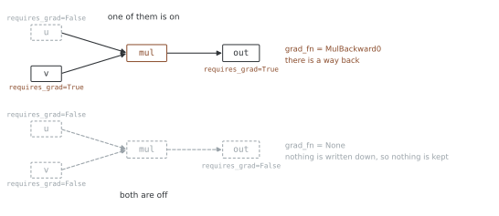
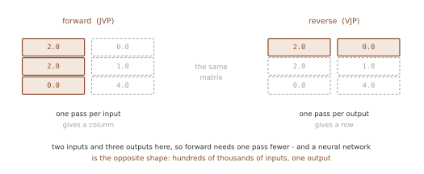
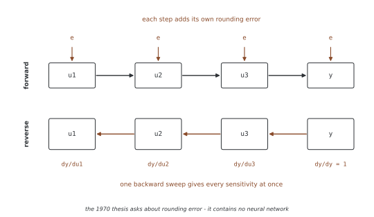
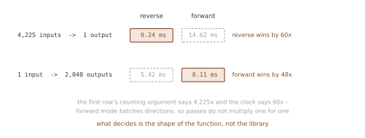

# 경사 계산

<div class="leadbox" markdown>

**들어가는 이야기** — 곱하는 차례를 고를 수 있다

여러 단계를 거쳐 나온 결과를 미분하려면 단계마다의 미분을 **차례로 곱한다.**
학교에서 배우는 연쇄 법칙 그대로다.

그런데 곱셈은 어느 쪽부터 묶어도 답이 같다. 셋을 곱할 때 앞의 둘을 먼저
곱하든 뒤의 둘을 먼저 곱하든 결과는 하나다. **답은 같은데 드는 일은 다르다.**

자동 미분의 두 방식이 바로 이 차례의 선택이다. 앞에서부터 묶어 가는 길과
뒤에서부터 묶어 오는 길. 둘은 같은 수를 내놓는다.

같은 수를 내놓는데 이 쪽의 측정에서는 **한쪽이 60배 느리다.** 그리고 함수의
모양을 뒤집으면 **승부도 뒤집혀** 이번에는 48배 차이로 반대쪽이 이긴다.
파라미터가 수백만인 요즘 모델이 학습 가능한 까닭이 이 선택 하나에 있다.

</div>

PyTorch의 autograd 엔진은 딥러닝에서 자동 미분의 토대이다. 텐서에 대한 연산을 기록하고 **후진 모드 자동 미분**(역전파)으로 경사를 계산하는 테이프 기반 체계를 제공한다. 이 절에서는 경사 계산의 수학적 틀, 전진 모드와 후진 모드 자동 미분의 구분, 그리고 PyTorch의 벡터-야코비안 곱(VJP) 기법이 연쇄 법칙을 어떻게 효율적으로 구현하는지를 다룬다.

---

## 1. 학습 목표

이 절을 마치면 다음을 할 수 있게 된다.

1. `.backward()`와 `torch.autograd.grad`로 경사를 계산한다
2. 야코비안 행렬과 벡터-야코비안 곱(VJP)의 틀을 이해한다
3. 전진 모드(JVP)와 후진 모드(VJP) 자동 미분을 구분한다
4. 뉴럴 네트워크 학습에 후진 모드가 선호되는 이유를 설명한다
5. 두 모드 모두로 전체 야코비안 행렬을 계산한다

---

## 2. 수학적 기초

<div class="defn" markdown>

### 정의 1. 야코비안 행렬 { .dfn }

미분 가능한 $f : \mathbb{R}^n \to \mathbb{R}^m$에 대해 모든 1차 편도함수를 모은 행렬

$$
J_f(x) = \frac{\partial f}{\partial x} = \begin{bmatrix}
\dfrac{\partial f_1}{\partial x_1} & \cdots & \dfrac{\partial f_1}{\partial x_n} \\
\vdots & \ddots & \vdots \\
\dfrac{\partial f_m}{\partial x_1} & \cdots & \dfrac{\partial f_m}{\partial x_n}
\end{bmatrix} \in \mathbb{R}^{m \times n}
$$

을 $f$의 **야코비안**이라 한다. $(i,j)$칸은 $j$번째 입력을 조금 흔들었을 때 $i$번째 출력이 얼마나 따라 움직이는지다.

</div>

<div class="thmbox" markdown>

### 정리 1. 연쇄 법칙 — 합성의 야코비안은 야코비안의 곱이다 { .thm }

$f = f_L \circ f_{L-1} \circ \cdots \circ f_1$이고 각 $f_\ell$이 미분 가능하면

$$
J_f(x) = J_L \, J_{L-1} \cdots J_1
$$

이다. 여기서 $z_0 = x$, $z_\ell = f_\ell(z_{\ell-1})$로 두고 $J_\ell = J_{f_\ell}(z_{\ell-1})$, 곧 $f_\ell$을 **그 자리의 입력**에서 잰 야코비안이다.

</div>

??? proof "증명"

    $L = 2$에서 보이면 나머지는 귀납이다. $f = f_2 \circ f_1$이라 두고, 값에 이름을 붙여 $z = f_1(x)$, $y = f_2(z)$라 하고 성분으로 적는다. 다변수 연쇄 법칙에서

    $$
    \frac{\partial y_i}{\partial x_j} = \sum_{k} \frac{\partial y_i}{\partial z_k}\,\frac{\partial z_k}{\partial x_j}
    $$

    이다. 오른쪽은 $(i,k)$칸이 $\partial y_i / \partial z_k$인 행렬과 $(k,j)$칸이 $\partial z_k / \partial x_j$인 행렬의 **곱의 $(i,j)$칸**과 정확히 같은 형태. 곧 $J_f = J_2 J_1$이다.

    $L-1$개까지 성립한다고 하면 $g = f_{L-1}\circ\cdots\circ f_1$에 대해 $J_g = J_{L-1}\cdots J_1$이고, 위의 두 겹 결과를 $f_L$과 $g$에 쓰면 $J_f = J_L J_g = J_L J_{L-1} \cdots J_1$이다. $\square$

<div class="exbox" markdown>

**보기 1.** <span class="diff easy" title="쉬움"></span> 두 겹을 손으로 끝까지 따라간다

$f_\theta(x) = \theta x + 1$과 $f_\varphi(h) = \varphi h + 1$을 이어 붙인다. 지금 $\theta = 2$, $\varphi = 6$이고 입력은 $x = 3$, 맞혀야 할 값은 $40$이다. 로스는 제곱오차, 러닝레이트는 $0.001$로 둔다.

$\partial \ell / \partial \theta$와 $\partial \ell / \partial \varphi$를 연쇄 법칙으로 구하고, 한 걸음 걸은 뒤 로스가 얼마가 되는지까지 적어라.

</div>

??? success "풀이"
    **순전파.** 두 층을 차례로 지난다.

    $$
    h = 2 \cdot 3 + 1 = 7, \qquad x_2 = 6 \cdot 7 + 1 = 43, \qquad
    \ell = (43 - 40)^2 = 9
    $$

    **역전파.** 끝에서 시작해 거꾸로 곱해 온다. 각 칸은 **그 자리의 값**으로 잰다.

    | 어디까지 왔는가 | 무엇을 곱하는가 | 쌓인 값 |
    |---|---|---|
    | $\partial \ell / \partial x_2$ | $2(x_2 - 40)$ | $6$ |
    | $\partial \ell / \partial \varphi$ | $\times\, h = 7$ | $\mathbf{42}$ |
    | $\partial \ell / \partial h$ | $\times\, \varphi = 6$ | $36$ |
    | $\partial \ell / \partial \theta$ | $\times\, x = 3$ | $\mathbf{108}$ |

    둘째 줄과 넷째 줄이 갈라지는 자리를 보라. $\varphi$로 가는 길은 **거기서 끝나고**, $\theta$로 가는 길은 $h$를 한 번 더 지난다. 정리 1이 말하는 곱의 사슬이 이 표다.

    곱하는 값이 모두 **순전파 때 지나간 수**라는 점도 눈여겨볼 만하다. $h = 7$도 $\varphi = 6$도 $x = 3$도 앞으로 갈 때 이미 손에 있던 것이고, 그래서 역전파가 그 값들을 들고 있어야 한다. 「계산 그래프 재사용」이 말한 **저장된 중간값**이 이것이다.

    **한 걸음.** $\lambda = 0.001$로 빼면

    $$
    \theta \leftarrow 2 - 0.001 \times 108 = 1.892, \qquad
    \varphi \leftarrow 6 - 0.001 \times 42 = 5.958
    $$

    **다시 통과시키면** $h = 1.892 \cdot 3 + 1 = 6.676$이고 $x_2 = 5.958 \cdot 6.676 + 1 = 40.775608$이므로 $\ell = 0.601568$이다. 9에서 0.6으로 내려갔다.

손으로 센 것을 파이토치에게 물어본다. 함수값만 두 번 재는 **유한차분**으로도 한 번 더 받는다.

```python
import torch

# 손으로 센 보기를 그대로 — f_t(x) = t*x + 1, f_p(h) = p*h + 1
t = torch.tensor(2.0, requires_grad=True)
p = torch.tensor(6.0, requires_grad=True)
x, target, lr = 3.0, 40.0, 1e-3

h = t * x + 1
x2 = p * h + 1
loss = (x2 - target) ** 2
loss.backward()

print(f"  순전파   h = {h.item():.3f}   x2 = {x2.item():.3f}   loss = {loss.item():.3f}")
print(f"  autograd dl/dt = {t.grad.item():.3f}   dl/dp = {p.grad.item():.3f}")
print(f"  손으로   dl/dt = {2*(43-40)*6*3:.3f}   dl/dp = {2*(43-40)*7:.3f}")

# 유한차분으로 한 번 더 — 미는 폭을 바꿔 가며
def loss_at(tv, pv):
    return ((pv * (tv * x + 1) + 1) - target) ** 2

print("  유한차분 [l(t+e) - l(t-e)] / 2e")
for e in (1e-1, 1e-3, 1e-5):
    g = (loss_at(2.0 + e, 6.0) - loss_at(2.0 - e, 6.0)) / (2 * e)
    print(f"    e = {e:<7} dl/dt = {g:11.6f}   어긋남 {abs(g - 108):.2e}")

with torch.no_grad():
    t -= lr * t.grad
    p -= lr * p.grad
print(f"  한 걸음  t = {t.item():.3f}   p = {p.item():.3f}")

with torch.no_grad():
    h2 = t * x + 1
    new = (p * h2 + 1 - target) ** 2
print(f"  다시     h = {h2.item():.3f}   x2 = {(p*h2+1).item():.6f}   "
      f"loss = {new.item():.6f}")
print(f"  로스가 {loss.item():.3f} 에서 {new.item():.6f} 으로 내려갔다")
```

**출력:**

```
  순전파   h = 7.000   x2 = 43.000   loss = 9.000
  autograd dl/dt = 108.000   dl/dp = 42.000
  손으로   dl/dt = 108.000   dl/dp = 42.000
  유한차분 [l(t+e) - l(t-e)] / 2e
    e = 0.1     dl/dt =  108.000000   어긋남 2.56e-13
    e = 0.001   dl/dt =  108.000000   어긋남 4.09e-12
    e = 1e-05   dl/dt =  108.000000   어긋남 1.75e-10
  한 걸음  t = 1.892   p = 5.958
  다시     h = 6.676   x2 = 40.775608   loss = 0.601568
  로스가 9.000 에서 0.601568 으로 내려갔다
```

**세 길이 같은 수를 준다.** 연쇄 법칙으로 손계산한 108과 42, `backward()`가 채운 `.grad`, 그리고 미분을 모르고 함수값만 두 번 재어 나눈 값이 모두 맞는다.

!!! warning "유한차분이 여기서 유난히 잘 맞는 까닭"
    미는 폭을 $0.1$로 크게 두었는데도 어긋남이 $10^{-13}$이다. 보통은 이렇지 않다 — [비선형 함수의 전체 야코비안](25_vector_backward_nonlinear_full_jacobian.md)에서는 `float64`를 써야 $10^{-8}$까지 간다.

    까닭은 **이 로스가 파라미터 하나하나에 대해 이차식**이기 때문이다. $\ell$을 $\theta$의 함수로만 보면 (일차식)$^2$이고, 중심차분은 이차식에서 **정확하다** — 틀리게 만드는 삼차 이상 항이 아예 없다. 게다가 위의 유한차분은 파이썬 실수, 곧 배정밀도로 셈했다.

    곧 이 줄은 「유한차분은 정확하다」가 아니라 **「이 보기에서는 셋이 맞는다」**까지만 말한다.

**곱하는 차례가 자동 미분의 모드를 가른다.** 행렬 곱은 결합법칙이 성립하므로 $J_L(J_{L-1}(\cdots J_1))$로 묶든 $((J_L J_{L-1})\cdots)J_1$로 묶든 **결과는 같다.** 그러나 드는 비용이 다르다. 오른쪽부터 묶는 것이 전진 모드, 왼쪽부터 묶는 것이 후진 모드이며, 로스처럼 출력이 스칼라 하나인 경우($m = 1$) 후진 모드가 훨씬 싸다. 딥러닝이 역전파를 쓰는 까닭이 이것이다.

---

## 3. PyTorch에서 경사 계산하기

### `requires_grad` — 그래프를 세울지 정하는 깃발

아래 코드들이 `requires_grad=True`로 시작한다. 그 한 마디가 무엇을 하는지부터
적어 둔다. **자동 미분에서 이것 하나만 알아야 한다면 이것이다.**

```python
import torch
import torch.nn as nn

torch.manual_seed(0)

# === 1. 기본은 꺼져 있고, 켜는 길이 셋이다 ==================================
made = torch.randn(3)
at_birth = torch.randn(3, requires_grad=True)
turned_on = torch.randn(3); turned_on.requires_grad_(True)
as_param = nn.Parameter(torch.randn(3))

print("  1. 깃발의 기본값과 켜는 길")
for name, obj in [("torch.randn(3)", made),
                  ("torch.randn(3, requires_grad=True)", at_birth),
                  (".requires_grad_(True) 로 켠 것", turned_on),
                  ("nn.Parameter(...)", as_param)]:
    print(f"     {name:36s} requires_grad={obj.requires_grad}")

print("     내장 층이 속에 두는 것도 그 셋째 길이다")
lin = nn.Linear(3, 2)
for name, w in lin.named_parameters():
    print(f"       nn.Linear 의 {name:8s} {type(w).__name__:10s} "
          f"requires_grad={w.requires_grad}")

# --- 내가 만든 텐서를 넘겨 보면 ---------------------------------------
plain = torch.randn(3)
handed = nn.Parameter(plain)
print("     맨 텐서를 넘기면")
print(f"       넘기기 전 plain  requires_grad={plain.requires_grad}")
print(f"       넘긴 뒤   handed requires_grad={handed.requires_grad}"
      f"  is_leaf={handed.is_leaf}")
print(f"       plain 은 그대로 꺼져 있다: {plain.requires_grad}"
      f"   그런데 저장소는 같다: {plain.data_ptr() == handed.data_ptr()}")
plain[0] = 99.0
print(f"       plain 을 고치면 handed 도 바뀐다: {handed[0].item()}"
      f"   <- 베낀 것이 아니다")


class Scale(nn.Module):
    """같은 모양의 텐서 둘 — 하나만 nn.Parameter 로 감쌌다."""

    def __init__(self, d):
        super().__init__()
        self.gain = nn.Parameter(torch.ones(d))   # 감쌌다
        self.shift = torch.zeros(d)                     # 안 감쌌다

    def forward(self, x):
        return x * self.gain + self.shift


scaler = Scale(3)
print("     저장소 공유는 nn.Parameter 만의 일이 아니다")
base = torch.randn(3, 4)
for tag, made in [("base.view(4, 3)", base.view(4, 3)),
                  ("base[0]", base[0]),
                  ("base.t()", base.t()),
                  ("base.detach()", base.detach()),
                  ("nn.Parameter(base)", nn.Parameter(base)),
                  ("base.clone()", base.clone())]:
    print(f"       {tag:20s} 저장소 공유 {base.data_ptr() == made.data_ptr()}")

print("     저장해 둔 값을 제자리에서 고치면")
for tag, fn in [("x ** 2  (입력을 저장)", lambda u: u ** 2),
                ("x.exp() (출력을 저장)", torch.exp)]:
    x = torch.tensor([2.0], requires_grad=True)
    y = fn(x)
    y.detach()[0] = 99.0          # 같은 저장소를 그래프 밖에서 덮어쓴다
    try:
        y.sum().backward()
        print(f"       {tag:22s} x.grad = {x.grad.item():.1f}  <- 아무 말이 없다")
    except RuntimeError as err:
        print(f"       {tag:22s} {str(err).splitlines()[0][:46]}")

print("     내 모듈에 둘을 나란히 두면")
print("       parameters():", [n for n, _ in scaler.named_parameters()])
print("       state_dict ():", list(scaler.state_dict()))
scaler(torch.tensor([[1.0, 2.0, 3.0], [4.0, 5.0, 6.0]])).sum().backward()
print("       gain.grad :", scaler.gain.grad.tolist())
print("       shift.grad:", scaler.shift.grad, "  <- 학습에서 조용히 빠진다")

# === 2. 깃발은 연산을 타고 앞으로 번진다 ====================================
print("\n  2. 입력 가운데 하나라도 켜져 있으면 출력이 켜진다")
print(f"     {'왼쪽':>6}{'오른쪽':>8}   {'출력':>6}   grad_fn")
for left_on in (False, True):
    for right_on in (False, True):
        u = torch.randn(3, requires_grad=left_on)
        v = torch.randn(3, requires_grad=right_on)
        out = u * v
        fn = type(out.grad_fn).__name__ if out.grad_fn is not None else "None"
        print(f"     {str(left_on):>6}{str(right_on):>8}   "
              f"{str(out.requires_grad):>6}   {fn}")

# === 3. 거는 것과 갖는 것과 받는 것은 서로 다르다 ==========================
print("\n  3. 잎만인 것과 아닌 것")
leaf = torch.randn(3, requires_grad=True)
grown = leaf * 2                      # 계산으로 생긴 것
print(f"     leaf   is_leaf={leaf.is_leaf}   requires_grad={leaf.requires_grad}")
print(f"     grown  is_leaf={grown.is_leaf}  requires_grad={grown.requires_grad}"
      f"   <- 잎이 아닌데 켜져 있다")

print("     requires_grad_() 로 바꿔 보면")
for tag, make, val in [("잎에 켜기  ", lambda: torch.randn(3), True),
                       ("잎에 끄기  ", lambda: torch.randn(3, requires_grad=True), False),
                       ("잎 아닌 것에 켜기", lambda: torch.randn(3, requires_grad=True) * 2, True),
                       ("잎 아닌 것에 끄기", lambda: torch.randn(3, requires_grad=True) * 2, False)]:
    try:
        print(f"       {tag:18s} 된다 -> {make().requires_grad_(val).requires_grad}")
    except RuntimeError as err:
        print(f"       {tag:18s} {str(err).splitlines()[0][:44]}")
print("     requires_grad=False 인 텐서는 언제나 잎이다 — 그래서 '잎이 아니다'")
print("     는 곧 '켜져 있다' 이고, 끄라는 요청만 거절당한다")

# === 4. 깃발이 하나도 없으면 그래프가 아예 안 세워진다 ======================
print("\n  4. 아무도 안 켜져 있으면")
cold_w = torch.randn(4, 3)
cold_x = torch.randn(3)
cold_out = (cold_w @ cold_x).sum()
print(f"     grad_fn          : {cold_out.grad_fn}")
try:
    cold_out.backward()
except RuntimeError as err:
    print(f"     backward()       : {str(err).splitlines()[0][:58]}")

# === 5. 경사는 어디에 어떤 모양으로 쌓이는가 ================================
print("\n  5. .grad 가 사는 자리")
warm_w = torch.randn(4, 3, requires_grad=True)
warm_x = torch.randn(3)
mid = warm_w @ warm_x
total = (mid ** 2).sum()
total.backward()
print(f"     warm_w 모양      : {tuple(warm_w.shape)}")
print(f"     warm_w.grad 모양  : {tuple(warm_w.grad.shape)}   같은가 "
      f"{warm_w.shape == warm_w.grad.shape}")
first = warm_w.grad[0, 0].item()
mid = warm_w @ warm_x
(mid ** 2).sum().backward()
print(f"     한 번 더 역전파하면 {first:.4f} 가 {warm_w.grad[0, 0].item():.4f} 로"
      f" — 덮어쓰지 않고 더한다")

# === 6. 깃발을 입력에 걸면 다른 것을 얻는다 =================================
print("\n  6. 같은 로스, 깃발만 옮기면")
fixed_w = torch.tensor([[1.0, 2.0], [3.0, 4.0]])
fixed_x = torch.tensor([1.0, 1.0])
target = torch.tensor([2.0, 2.0])

w_on = fixed_w.clone().requires_grad_(True)
((w_on @ fixed_x - target) ** 2).sum().backward()
print(f"     깃발이 W 에  dL/dW = {w_on.grad.flatten().tolist()}")

x_on = fixed_x.clone().requires_grad_(True)
((fixed_w @ x_on - target) ** 2).sum().backward()
print(f"     깃발이 x 에  dL/dx = {x_on.grad.tolist()}")
print("     앞엣것으로 모델을 고치고, 뒤엣것으로 입력을 고친다")
```

**출력:**

```
1. 깃발의 기본값과 켜는 길
     torch.randn(3)                       requires_grad=False
     torch.randn(3, requires_grad=True)   requires_grad=True
     .requires_grad_(True) 로 켠 것          requires_grad=True
     nn.Parameter(...)                    requires_grad=True
     내장 층이 속에 두는 것도 그 셋째 길이다
       nn.Linear 의 weight   Parameter  requires_grad=True
       nn.Linear 의 bias     Parameter  requires_grad=True
     맨 텐서를 넘기면
       넘기기 전 plain  requires_grad=False
       넘긴 뒤   handed requires_grad=True  is_leaf=True
       plain 은 그대로 꺼져 있다: False   그런데 저장소는 같다: True
       plain 을 고치면 handed 도 바뀐다: 99.0   <- 베낀 것이 아니다
     저장소 공유는 nn.Parameter 만의 일이 아니다
       base.view(4, 3)      저장소 공유 True
       base[0]              저장소 공유 True
       base.t()             저장소 공유 True
       base.detach()        저장소 공유 True
       nn.Parameter(base)   저장소 공유 True
       base.clone()         저장소 공유 False
     저장해 둔 값을 제자리에서 고치면
       x ** 2  (입력을 저장)       x.grad = 4.0  <- 아무 말이 없다
       x.exp() (출력을 저장)       one of the variables needed for gradient compu
     내 모듈에 둘을 나란히 두면
       parameters(): ['gain']
       state_dict (): ['gain']
       gain.grad : [5.0, 7.0, 9.0]
       shift.grad: None   <- 학습에서 조용히 빠진다

  2. 입력 가운데 하나라도 켜져 있으면 출력이 켜진다
         왼쪽     오른쪽       출력   grad_fn
      False   False    False   None
      False    True     True   MulBackward0
       True   False     True   MulBackward0
       True    True     True   MulBackward0

  3. 잎만인 것과 아닌 것
     leaf   is_leaf=True   requires_grad=True
     grown  is_leaf=False  requires_grad=True   <- 잎이 아닌데 켜져 있다
     requires_grad_() 로 바꿔 보면
       잎에 켜기              된다 -> True
       잎에 끄기              된다 -> False
       잎 아닌 것에 켜기         된다 -> True
       잎 아닌 것에 끄기         you can only change requires_grad flags of l
     requires_grad=False 인 텐서는 언제나 잎이다 — 그래서 '잎이 아니다'
     는 곧 '켜져 있다' 이고, 끄라는 요청만 거절당한다

  4. 아무도 안 켜져 있으면
     grad_fn          : None
     backward()       : element 0 of tensors does not require grad and does not ha

  5. .grad 가 사는 자리
     warm_w 모양      : (4, 3)
     warm_w.grad 모양  : (4, 3)   같은가 True
     한 번 더 역전파하면 1.9227 가 3.8454 로 — 덮어쓰지 않고 더한다

  6. 같은 로스, 깃발만 옮기면
     깃발이 W 에  dL/dW = [2.0, 2.0, 10.0, 10.0]
     깃발이 x 에  dL/dx = [32.0, 44.0]
     앞엣것으로 모델을 고치고, 뒤엣것으로 입력을 고친다
```

**기본은 꺼져 있고, 켜는 길이 셋이다.** `torch.randn(3)`으로 만든 텐서는 깃발이
**내려가 있다.** 켜는 길이 셋인데, 셋째가
평소에 가장 많이 쓰인다.

| | 어떻게 |
|---|---|
| 만들 때 | `torch.randn(3, requires_grad=True)` |
| 만든 뒤에 | `t.requires_grad_(True)` |
| **`nn.Parameter`로 두면** | **`nn.Parameter(torch.randn(3))` — 저절로 켜진다** |

마지막 줄이 모델의 가중치가 **전부 켜져 있는** 까닭이다. 층 하나를 열어 보면
그렇게 되어 있다.

```
내장 층이 속에 두는 것도 그 셋째 길이다
  nn.Linear 의 weight   Parameter  requires_grad=True
  nn.Linear 의 bias     Parameter  requires_grad=True
```

`nn.Linear`가 속에 두는 `weight`와 `bias`는 맨 텐서가 아니라 `nn.Parameter`이고,
`nn.Parameter`는 기본으로 깃발을 켠다. 그래서 **모델을 만드는 것만으로 학습
대상이 정해진다** — 어디에도 `requires_grad=True`를 적은 적이 없는데 옵티마이저에
`model.parameters()`를 넘기면 그대로 학습이 된다.

**내가 만든 텐서도 넘기면 된다.** 셋째 길은 내장 층만의 것이 아니다. 맨 텐서를
하나 만들어 `nn.Parameter`에 넘기면 그 자리에서 학습 대상이 된다.

```
맨 텐서를 넘기면
  넘기기 전 plain  requires_grad=False
  넘긴 뒤   handed requires_grad=True  is_leaf=True
  plain 은 그대로 꺼져 있다: False   그런데 저장소는 같다: True
  plain 을 고치면 handed 도 바뀐다: 99.0   <- 베낀 것이 아니다
```

두 가지가 같이 나오고, 둘이 **서로 반대 방향**이다.

**`requires_grad`는 복사되지 않는다.** `nn.Parameter`는 받은 텐서의 플래그를
뒤집는 것이 아니라, **플래그가 켜진 새 텐서 객체**를 만들어 돌려준다. 넘긴
쪽(`plain`)은 그대로 `False`다.

**그런데 데이터는 복사된다고 볼 수 없다.** `plain`과 `handed`는 **같은
저장소(storage)** 를 가리킨다. 그래서 넘긴 뒤에 `plain`을 고치면 파라미터가
따라 바뀐다.

이 둘이 어긋나는 까닭은 텐서가 **두 층**으로 되어 있기 때문이다.

| | 무엇이 들어 있나 | `nn.Parameter`를 거치면 |
|---|---|---|
| **텐서 객체** (메타데이터) | 형태(shape) · 보폭(stride) · 오프셋 · `requires_grad` · `grad_fn` · `.grad` | **새로 하나 생긴다** |
| **저장소** (storage) | 실제 수가 한 줄로 누워 있는 메모리 | **그대로 하나다** |

`plain`과 `handed`는 **객체는 둘, 저장소는 하나**다. 그래서 플래그는 따로 서고
숫자는 같이 움직인다. 이 모델을 세우는 쪽이
[메모리 배치와 스트라이드](../tensor_attrs/memory_layout_strides.md)다.

떼어 놓으려면 **저장소를 새로 잡아야** 한다 — `nn.Parameter(plain.clone())`.
`clone()`을 빼면 같은 `init` 하나로 파라미터 둘을 만들었을 때 둘이 **같은
메모리를 고친다.**

**저장소 공유는 `nn.Parameter`만의 일이 아니다.** 텐서를 거의 어떻게 건드려도
새 메타데이터만 생기고 저장소는 그대로다.

```
base.view(4, 3)      저장소 공유 True
base[0]              저장소 공유 True
base.t()             저장소 공유 True
base.detach()        저장소 공유 True
nn.Parameter(base)   저장소 공유 True
base.clone()         저장소 공유 False
```

**복사하는 것은 `clone()` 하나뿐이다.** 뷰(view)·슬라이스·전치·`detach()`·
`nn.Parameter`는 전부 공짜다 — 그러니까 역전파가 층마다 생기는 중간 텐서를
감당할 수 있다. `detach()`가 그래프만 끊고 저장소는 안 끊는다는 것은
[detach() 와 detach_()](09_detach_vs_detach_.md)가, numpy까지 같은 메모리를
나눠 쓴다는 것은 [텐서를 NumPy로 넘기기](12_converting_to_numpy.md)가 잰다.

!!! warning "공짜의 대가는 제자리 연산(in-place)이다"
    저장소가 하나이므로 `a[0] = 99`나 `a.add_(1)` 처럼 **제자리에서 고치면**
    그 저장소를 가리키는 모든 텐서에 보인다. 역전파가 저장해 둔 값이 거기
    있었다면 결과가 틀어진다.

    파이토치는 저장소마다 **버전 카운터**를 두어 이것을 잡는다. 다만 **늘
    잡지는 않는다.**

    ```
    x ** 2  (입력을 저장)       x.grad = 4.0  <- 아무 말이 없다
    x.exp() (출력을 저장)       one of the variables needed for gradient compu
    ```

    두 식 모두 출력 `y`를 제자리에서 덮어썼는데 한쪽만 막혔다. `x.exp()`는
    역전파에 **출력** $e^x$ 가 필요해서 그것을 저장해 두므로 버전이 어긋난
    것이 걸리고, `x ** 2`는 **입력** $x$ 만 저장하므로 `y`를 덮어쓴 것이
    아무 데도 안 걸린다. 무엇이 저장되는지는
    [retain_graph](03_retain_graph.md)가 재어 둔다.

    즉 **에러가 안 났다고 안전한 것이 아니다.** 역전파에 쓰일 텐서를
    제자리에서 고치지 않는 것이 규칙이고, 버전 카운터는 그물이지 보증이
    아니다.

**감싸는 것이 곧 등록이다.** 같은 모양의 텐서 둘을 내 모듈 안에 나란히 두되
하나만 감싸 보면, 둘이 어디서 갈리는지가 한눈에 보인다.

```python
class Scale(nn.Module):
    def __init__(self, d):
        super().__init__()
        self.gain = nn.Parameter(torch.ones(d))   # 감쌌다
        self.shift = torch.zeros(d)               # 안 감쌌다

    def forward(self, x):
        return x * self.gain + self.shift
```

```
내 모듈에 둘을 나란히 두면
  parameters(): ['gain']
  state_dict (): ['gain']
  gain.grad : [5.0, 7.0, 9.0]
  shift.grad: None   <- 학습에서 조용히 빠진다
```

`forward`는 둘을 똑같이 쓴다. 그런데 `shift`는 **세 군데에서 한꺼번에 빠진다** —
`parameters()`에 안 들고, `state_dict()`에 안 들고, `.grad`를 못 받는다.
옵티마이저에 `model.parameters()`를 넘기는 한 `shift`는 **영원히 `0`이다.**

!!! warning "이 실수는 에러를 내지 않는다"
    `self.shift = torch.zeros(d)`는 잘 돌아간다. 순전파도 되고 역전파도 되고
    로스도 내려간다. 다만 그 수 하나가 학습되지 않을 뿐이고, **그걸 알려 주는
    것이 아무것도 없다.** 저장했다 되살려도 조용히 초기값으로 돌아온다.

    그래서 커스텀 모듈을 쓸 때는 `print(list(m.named_parameters()))` 한 줄로
    **내가 둔 것이 거기 있는지** 확인하고 넘어가는 편이 낫다.
    [레이어 출력하기](13_print_layers.md)가 세는 법을 모아 둔다.

    학습은 안 되는데 **저장은 되어야 하는** 수라면 맨 텐서로 두지 말고
    `register_buffer`로 등록한다. 그것이 버퍼라는 갈래다.

거꾸로 **입력 데이터는 꺼져 있다.** 그냥 `torch.randn`이나 `ToTensor()`로 온
텐서이기 때문이고, 그것이 맞는 기본값이다. 왜 맞는지는 아래 「깃발을 어디에
거느냐」에서 본다.

**깃발은 연산을 타고 앞으로 번진다.**

```
   왼쪽     오른쪽       출력   grad_fn
  False   False    False   None
  False    True     True   MulBackward0
   True   False     True   MulBackward0
   True    True     True   MulBackward0
```

**입력 가운데 하나라도 켜져 있으면 출력이 켜지고 `grad_fn`을 받는다.** 켜진 것이
하나도 없으면 출력도 꺼지고 `grad_fn`이 `None`이다.



이 한 줄이 **그래프가 세워지는 기제 전부**다. 파이토치는 「이제부터 기록한다」는
스위치를 따로 두지 않는다. 연산을 할 때마다 입력들의 깃발을 보고, 하나라도
켜져 있으면 그 연산을 적어 둔다. 적어 둔 것들이 이어 붙어 그래프가 된다.

그래서 **$x$ 하나만 켜도 그 뒤의 모든 것이 따라 켜진다.** 로스까지 가는 길에
놓인 연산이 전부 기록되고, 그 기록을 거꾸로 걸어 내려오는 것이 `backward()`다.

**거는 것과 갖는 것과 받는 것이 서로 다르다.** 셋을 한자리에 놓으면 이렇다.

```
leaf   is_leaf=True   requires_grad=True
grown  is_leaf=False  requires_grad=True   <- 잎이 아닌데 켜져 있다

  잎에 켜기              된다 -> True
  잎에 끄기              된다 -> False
  잎 아닌 것에 켜기         된다 -> True
  잎 아닌 것에 끄기         you can only change requires_grad flags of l
```

| | 잎만인가 |
|---|---|
| 만들 때 주는 **인자** `requires_grad=` | **그렇다** — 텐서를 만드는 함수에만 달려 있고, 만든 것은 다 잎이다 |
| 나중에 부르는 **메서드** `requires_grad_()` | **끄는 것만** 그렇다 |
| `requires_grad`를 **갖는** 것 | **아니다** — 잎이 아니면 반드시 켜져 있다 |
| `.grad`를 **받는** 것 | **그렇다** |

둘째 줄과 셋째 줄은 같은 사실의 앞뒤다. **`requires_grad=False`인 텐서는 언제나
잎이므로**, 「잎이 아니다」는 곧 「켜져 있다」이다. 그래서 잎이 아닌 것에 켜라는
요청은 이미 켜져 있어 그냥 지나가고, **끄라는 요청만 거절당한다.**

그리고 기본값이 셋으로 갈린다.

| | `requires_grad` 기본값 |
|---|---|
| 그냥 만든 텐서, 입력 데이터 | **꺼짐** |
| `nn.Parameter` — 내장 층의 가중치 | **켜짐** |
| 버퍼 — 배치 정규화의 `running_mean` 같은 것 | 꺼짐 |

가운뎃줄이 **모델을 만드는 것만으로 학습 대상이 정해지는** 까닭이고, 윗줄이
**입력에 대한 경사는 따로 청하지 않으면 안 나오는** 까닭이다. 아랫줄은
[레이어 출력하기](13_print_layers.md)가 따로 다룬다.

**아무도 안 켜져 있으면 적히지 않는다.**

```
grad_fn          : None
backward()       : element 0 of tensors does not require grad and does not ha
```

곱셈과 덧셈은 **그대로 일어난다.** 값은 똑같이 나온다. 다른 것은 **적히지
않는다**는 것뿐이고, 적힌 것이 없으니 되짚어 갈 길도 없다. 그래서
`backward()`가 거절한다.

이것이 추론이 학습보다 싼 까닭이다 — 「경사 추적을 멈추는 시점」이 재어 보인
대로, 되짚지 않을 것이라면 **중간값을 들고 있을 까닭이 없다.**

**경사는 그 텐서 옆에, 같은 모양으로, 더해져 쌓인다.**

```
warm_w 모양      : (4, 3)
warm_w.grad 모양  : (4, 3)   같은가 True
한 번 더 역전파하면 -23.7315 가 -47.4629 로 — 덮어쓰지 않고 더한다
```

경사가 사는 자리는 **그 텐서의 `.grad` 속성**이고, 모양이 **텐서와 같다.**
$\partial L / \partial w_{ij}$가 $w_{ij}$가 있던 자리에 그대로 들어앉는다고
보면 된다. 그래서 갱신이 `w -= lr * w.grad` 한 줄로 적힌다.

그리고 **덮어쓰지 않고 더한다.** 두 번 역전파하면 두 배가 된다. 이 성질이
[경사 누적](02_gradient_accumulation.md)의 바탕이고, 학습 루프마다 지우는 줄이
있어야 하는 까닭이다.

다만 `.grad`가 **아무 텐서에나 쌓이지는 않는다.** 깃발이 켜져 있어도 계산으로
생긴 중간 텐서는 받지 않고, 내가 만든 **잎**만 받는다. 그 구별은
[스칼라 로스의 역전파](01_basic_scalar_backward.md)가 그림과 함께 다룬다.

**깃발을 어디에 거느냐가 무엇을 얻느냐를 정한다.**

```
깃발이 W 에  dL/dW = [2.0, 2.0, 10.0, 10.0]
깃발이 x 에  dL/dx = [32.0, 44.0]
```

**로스도 같고 수도 같은데 깃발만 옮겼더니 전혀 다른 것이 나온다.** 앞엣것은
가중치를 어느 쪽으로 고쳐야 로스가 주는지이고, 뒤엣것은 **입력을** 어느 쪽으로
고쳐야 로스가 주는지다.

학습에 필요한 것은 앞엣것이다. 그래서 입력 데이터의 깃발이 꺼져 있는 것이 맞고,
켜 두면 쓰지도 않을 경사를 셈하느라 값만 치른다.

뒤엣것이 쓸모없는 것은 아니다. **그 방향으로 입력을 밀면 로스가 커진다** — 모델이
틀리도록 그림을 고치는 것이고, 적대적 예제가 만들어지는 자리가 이 한 줄이다.
[`torch.no_grad`](10_with_torch_no_grad.md)가 그 경사를 평가 루프 한가운데서
어떻게 얻는지, 그리고 예측이 실제로 뒤집히는지를 재어 둔다.

### 스칼라 로스: `.backward()` 메서드

스칼라 로스 $L: \mathbb{R}^n \rightarrow \mathbb{R}$에 대해 `L.backward()`를 호출하면 `requires_grad=True`인 모든 잎 텐서 $x$에 대한 경사 $\nabla_x L$이 계산된다.

$$\nabla_x L = \left[\frac{\partial L}{\partial x_1}, \frac{\partial L}{\partial x_2}, \ldots, \frac{\partial L}{\partial x_n}\right]^T$$

```python
import torch

torch.manual_seed(0)

x = torch.randn(3, requires_grad=True)
print(f"x: {x}")

# 순전파: loss = sum(x²)
loss = (x ** 2).sum()
print("loss:", loss)   # f-string을 쓰면 0차원 텐서가 맨 실수로 찍혀 grad_fn이 사라진다

# 역전파: d(loss)/dx = 2x
loss.backward()

print(f"x.grad: {x.grad}")
print(f"Expected (2x): {2 * x.detach()}")
print(f"Match: {torch.allclose(x.grad, 2 * x.detach())}")
```

**출력:**
```
x: tensor([ 1.5410, -0.2934, -2.1788], requires_grad=True)
loss: tensor(7.2079, grad_fn=<SumBackward0>)
x.grad: tensor([ 3.0820, -0.5869, -4.3576])
Expected (2x): tensor([ 3.0820, -0.5869, -4.3576])
Match: True
```

### 경사 저장: 잎 텐서와 비잎 텐서

기본적으로 경사는 잎 텐서에 대해서**만** 저장된다.

```python
import torch

x = torch.tensor([1., 2., 3.], requires_grad=True)
y = 2 * x         # Non-leaf
z = (y ** 2).sum()

z.backward()

print(f"x.grad: {x.grad}")  # tensor([ 8., 16., 24.]) — stored
print(f"y.grad: {y.grad}")  # None — not stored by default
```

**출력:**

```
x.grad: tensor([ 8., 16., 24.])
y.grad: None
```

잎이 아닌 텐서의 경사를 저장하려면 역전파 전에 `.retain_grad()`를 쓴다.

```python
import torch

x = torch.tensor([1., 2., 3.], requires_grad=True)
y = 2 * x
y.retain_grad()       # Request gradient storage
z = (y ** 2).sum()

z.backward()

print(f"x.grad: {x.grad}")  # tensor([ 8., 16., 24.])
print(f"y.grad: {y.grad}")  # tensor([ 4.,  8., 12.])
```

**출력:**

```
x.grad: tensor([ 8., 16., 24.])
y.grad: tensor([ 4.,  8., 12.])
```

**검증:** $y = 2x = [2, 4, 6]$이고 $z = \sum y_i^2$일 때 다음과 같다.

- $\frac{\partial z}{\partial y_i} = 2y_i$이므로 $\nabla_y z = [4, 8, 12]$이다
- $\frac{\partial z}{\partial x_i} = \frac{\partial z}{\partial y_i} \cdot \frac{\partial y_i}{\partial x_i} = 2y_i \cdot 2 = 4y_i$이므로 $\nabla_x z = [8, 16, 24]$이다

### `torch.autograd.grad` 인터페이스

좀 더 세밀하게 제어하려면 `torch.autograd.grad`를 쓴다. `.grad` 속성을 채우지 않고 경사를 곧바로 반환한다.

```python
import torch

x = torch.tensor([2.0], requires_grad=True)
y = x ** 3

# 경사들의 튜플을 반환한다
(grad_y,) = torch.autograd.grad(y, x)
print(f"dy/dx = 3x² = {grad_y}")  # tensor([12.])
```

**출력:**

```
dy/dx = 3x² = tensor([12.])
```

이는 고계 도함수(고계 경사 참고)를 다룰 때, 그리고 `retain_grad()`를 호출하지 않고 잎이 아닌 텐서의 경사가 필요할 때 특히 유용하다.

---

## 4. 벡터-야코비안 곱의 틀

### 왜 VJP인가?

PyTorch의 역전파는 전체 야코비안 행렬을 계산하지 **않는다.** 고차원 파라메터 공간에서는 그 비용이 감당할 수 없이 크기 때문이다. 대신 경사 기반 최적화에 필요한 전부인 **벡터-야코비안 곱**(VJP)을 계산한다.

### 수학적 정의

야코비안이 $J \in \mathbb{R}^{m \times n}$인 함수 $f: \mathbb{R}^n \rightarrow \mathbb{R}^m$과 상류 경사(수반) $\bar{y} \in \mathbb{R}^m$이 주어졌을 때 다음과 같다.

$$\text{VJP:} \quad \bar{x} = J^T \bar{y} \in \mathbb{R}^n$$

동등하게 $\bar{x}^T = \bar{y}^T J$이다. 이것이 행렬 형태의 연쇄 법칙이다. $\bar{y}$가 하류에서 온 경사를 나르고, $J^T$를 곱하는 것이 그것을 한 단계 더 상류로 전파한다.

### 스칼라 출력에서의 암묵적 VJP

출력이 스칼라가면($m = 1$) 야코비안이 행벡터(즉 경사)로 줄어들고 상류 "벡터"는 스칼라 $\bar{y} = 1$이 된다. `loss.backward()`에 인수가 필요 없는 이유가 이것이다.

```python
import torch

x = torch.tensor([1., 2., 3.], requires_grad=True)
loss = (x ** 2).sum()

# 동등한 호출:
# loss.backward()
loss.backward(torch.tensor(1.0))   # Explicit v = 1

print(f"x.grad: {x.grad}")  # tensor([2., 4., 6.])
```

**출력:**

```
x.grad: tensor([2., 4., 6.])
```

### 스칼라가 아닌 출력에서의 명시적 VJP

스칼라가 아닌 출력에 대해서는 상류 경사 벡터 $\bar{y}$를 반드시 넘겨야 한다.

```python
import torch

x = torch.tensor([0.5, 1.0, -0.5], requires_grad=True)
y = torch.sin(x)   # y: R³ → R³, elementwise

# y와 같은 모양의 경사 벡터 v를 반드시 넘겨야 한다
v = torch.tensor([0.1, 1.0, 0.01])
y.backward(v)

# 원소별 sin에 대해 J = diag(cos(x))
# x.grad = J^T v = v ⊙ cos(x)
expected = v * torch.cos(x.detach())
print(f"x.grad:   {x.grad}")
print(f"Expected: {expected}")
print(f"Match: {torch.allclose(x.grad, expected)}")
```

**출력:**

```
x.grad:   tensor([0.0878, 0.5403, 0.0088])
Expected: tensor([0.0878, 0.5403, 0.0088])
Match: True
```

`v` 없이 스칼라가 아닌 텐서에 `.backward()`를 호출하면 `RuntimeError`가 발생한다.

```python
x = torch.randn(3, requires_grad=True)
y = torch.sin(x)

try:
    y.backward()  # Fails — non-scalar output
except RuntimeError as e:
    print(f"Error: {e}")
```

**출력:**

```
Error: grad can be implicitly created only for scalar outputs
```

### 선형 변환에서의 VJP

$A \in \mathbb{R}^{m \times n}$인 선형 사상 $y = Ax$에 대해 야코비안은 단순히 $J = A$이다.

```python
import torch

A = torch.tensor([[2.0, 0.0, -1.0],
                  [0.5, 3.0,  1.0]])   # (2, 3)
x = torch.tensor([1.0, -2.0, 0.5], requires_grad=True)
y = A @ x   # (2,)

v = torch.tensor([3.0, -1.0])
y.backward(v)

# x.grad = A^T @ v
expected = A.T @ v
print(f"x.grad: {x.grad}")
print(f"A^T @ v: {expected}")
print(f"Match: {torch.allclose(x.grad, expected)}")
```

**출력:**

```
x.grad: tensor([ 5.5000, -3.0000, -4.0000])
A^T @ v: tensor([ 5.5000, -3.0000, -4.0000])
Match: True
```

---

## 5. 전진 모드와 후진 모드 자동 미분

야코비안의 곱 $J_f = J_L \cdot J_{L-1} \cdot \ldots \cdot J_1$은 두 가지 순서로 계산할 수 있으며, 각각이 자동 미분의 한 모드를 정의한다.



### 전진 모드: 야코비-벡터 곱(JVP)

전진 모드는 도함수를 **입력에서 출력으로** 전파하며, 입력에서의 접벡터 $\dot{x}$에 대해 $\dot{y} = J \cdot \dot{x}$를 계산한다.

**계산 순서(오른쪽에서 왼쪽으로):**

$$J \cdot \dot{x} = J_L \cdot (J_{L-1} \cdot (\ldots \cdot (J_2 \cdot (J_1 \cdot \dot{x}))))$$

특정한 $\dot{x}$로 순전파를 한 번 하면 방향도함수 하나를 얻는다. 입력이 $n$개일 때 전체 야코비안을 얻으려면 **순전파 $n$번** 이 필요하다.

```python
import torch
from torch.autograd.functional import jvp

def f(x):
    """f(x) = [sin(x₁·x₂), x₁² + x₂]"""
    return torch.stack([
        torch.sin(x[0] * x[1]),
        x[0]**2 + x[1]
    ])

x = torch.tensor([1.0, 2.0])

# 접벡터 [1, 0]으로 JVP를 하면 야코비안의 첫 열을 얻는다
tangent = torch.tensor([1.0, 0.0])
output, jvp_result = jvp(f, (x,), (tangent,))

print(f"f(x) = {output}")
print(f"J @ [1,0] = {jvp_result}")  # First column of J
```

**출력:**

```
f(x) = tensor([0.9093, 3.0000])
J @ [1,0] = tensor([-0.8323,  2.0000])
```

### 후진 모드: 벡터-야코비안 곱(VJP)

후진 모드는 도함수를 **출력에서 입력으로** 전파하며 $\bar{x} = J^T \bar{y}$를 계산한다.

**계산 순서(왼쪽에서 오른쪽으로):**

$$\bar{x}^T = ((((\bar{y}^T \cdot J_L) \cdot J_{L-1}) \cdot \ldots) \cdot J_1)$$

일반적인 $\bar{y}$로는 $J$의 행들의 가중합을 얻는다. $\bar{y}=e_i$인 기저 벡터를 쓰면 $J^T$의 i번 열, 즉 $J$의 i번 행을 열벡터 형태로 얻는다. **스칼라** 출력($m = 1$)에서는 **역전파 한 번** 으로 전체 경사를 얻는다.

```python
import torch
from torch.autograd.functional import vjp

def f(x):
    return torch.stack([
        torch.sin(x[0] * x[1]),
        x[0]**2 + x[1]
    ])

x = torch.tensor([1.0, 2.0], requires_grad=True)

# 수반 벡터 [1, 0]으로 VJP를 하면 J의 첫 행을 얻는다
# torch.autograd.functional.vjp는 수반 벡터를 세 번째 인자로 직접 받고
# (출력, VJP 결과)를 돌려준다. 함수를 돌려주는 torch.func.vjp와 혼동하기 쉽다.
adjoint = torch.tensor([1.0, 0.0])
output, vjp_result = vjp(f, x, adjoint)

print(f"f(x) = {output}")
print(f"[1,0] @ J = {vjp_result}")
```

**출력:**

```
f(x) = tensor([0.9093, 3.0000])
[1,0] @ J = tensor([-0.8323, -0.4161])
```

### 뉴럴 네트워크에 후진 모드를 쓰는 이유

딥러닝의 전형적인 상황은 수백만 개의 파라메터($n \gg 1$)가 하나의 스칼라 로스($m = 1$)로 대응되는 것이다.

| 모드 | 필요한 통과 횟수 | 복잡도 |
|------|-----------------|------------|
| 전진 | $n$(파라메터마다 한 번) | $O(n \cdot T)$ |
| **후진** | $m = 1$ | $O(T)$ |

여기서 $T$는 순전파 한 번의 비용이다. 후진 모드가 **압도적으로 효율적** 이며, PyTorch가 역전파를 기본으로 삼는 이유가 이것이다.

```python
import torch
import torch.nn as nn

# 파라메터가 약 20만 개인 뉴럴 네트워크
model = nn.Sequential(
    nn.Linear(784, 256),
    nn.ReLU(),
    nn.Linear(256, 10)
)

x = torch.randn(32, 784)
y = torch.randint(0, 10, (32,))

logits = model(x)
loss = nn.functional.cross_entropy(logits, y)

# 한 번의 역전파가 모든 파라메터의 경사를 계산한다
loss.backward()

for name, param in model.named_parameters():
    print(f"{name}: grad shape = {param.grad.shape}")
```

**출력:**

```
0.weight: grad shape = torch.Size([256, 784])
0.bias: grad shape = torch.Size([256])
2.weight: grad shape = torch.Size([10, 256])
2.bias: grad shape = torch.Size([10])
```

<div class="storybox" markdown>

**그림으로 보는 AI 1.** 역전파는 반올림 오차를 좇다가 나왔다

1970년, 헬싱키 대학교의 석사 논문 한 편이 나온다. 제목은 「알고리즘의 누적 반올림 오차를 국소 반올림 오차의 테일러 전개로 나타내기」(*Algoritmin kumulatiivinen pyöristysvirhe yksittäisten pyöristysvirheiden Taylor-kehitelmänä*)다. 쓴 사람은 세포 리나인마다.

그가 풀려던 것은 학습 문제가 아니었다. **수치 계산의 신뢰도 문제** 였다. 연산을 수천 번 이어 붙이면 걸음마다 작은 반올림 오차가 생기는데, 그것들이 최종 결과에 얼마나 섞여 드는가. 답하려면 **최종 값이 중간 값 하나하나에 얼마나 민감한지** 를 전부 알아야 한다.



민감도를 하나씩 따로 구하면 중간 값의 수만큼 계산을 되풀이해야 한다. 리나인마가 보인 것은 **거꾸로 한 번만 훑으면 전부 한꺼번에 나온다** 는 것이었다. 이 절의 후진 모드가 바로 그것이고, 식도 같다.

**이 논문에는 뉴럴 네트워크가 한 번도 나오지 않는다.** 역전파라는 이름도, 학습이라는 말도 없다. 쓰인 자리가 전혀 달랐을 뿐 기계는 같았고, 뒤에 그 기계가 네트워크 학습에 쓰이게 된다.

**다만 이 논문이 말해 주지 않는 것도 분명하다.** 미분을 싸게 구하는 법은 최적화 방법이 아니다. 걸음 폭을 어떻게 고를지, 언제 멈출지, 어떤 최솟값에 닿을지는 여기에 없다 — 그 질문들이 이 장의 [경사 하강법 절](../gradient_descent/steepest_direction.md)에 있다. 거꾸로, 아무리 좋은 최적화 방법도 경사를 싸게 못 구하면 쓸 수 없다. 두 갈래가 따로 자라다 만난 셈이다.

이름을 한 사람에게 돌리기도 어렵다. 1962년에 로젠블랫이 이미 "back-propagating error correction"이라는 말을 썼지만 **구현할 줄은 몰랐다** 고 적혀 있고, 1950년대 최적제어의 수반 상태법(adjoint state method)이 연속 시간 판의 역전파로 꼽힌다. 같은 생각이 여러 곳에서 따로 자랐다.

_확인한 곳 — 영문 위키백과 "Seppo Linnainmaa"(논문 제목·연도·대학, 그리고 뉴럴 네트워크에 대한 언급이 없다는 서술), "Backpropagation"(로젠블랫 1962와 수반 상태법에 대한 서술)._

</div>

### 메모리와 계산의 절충

후진 모드는 역전파를 위해 **중간 엑티베이션을 저장해야** 하므로 뉴럴 네트워크 깊이에 비례하는 메모리 부담이 생긴다.

| 측면 | 전진 모드 | 후진 모드 |
|--------|--------------|--------------|
| **전파 방향** | 입력 → 출력 | 출력 → 입력 |
| **계산 대상** | JVP: $J \dot{x}$ | VJP: $J^T \bar{y}$ |
| **효율적인 경우** | $n \ll m$ | $m \ll n$ |
| **전체 야코비안** | $n$번 통과 | $m$번 통과 |
| **추가 메모리** | 한 방향의 접선과 현재 연산 상태 | 역전파용 저장 텐서(구조에 따라 다름) |

아주 깊은 뉴럴 네트워크에서는 **엑티베이션 체크포인팅** 이 엑티베이션을 저장하는 대신 역전파 중에 다시 계산함으로써 계산을 대가로 메모리를 아낀다.

```python
from torch.utils.checkpoint import checkpoint

def expensive_layer(x):
    return torch.relu(x @ x.T)

x = torch.randn(1000, 1000, requires_grad=True)

# 체크포인팅: 역전파 중에 엑티베이션을 다시 계산한다
y = checkpoint(expensive_layer, x, use_reentrant=False)
```

---

## 6. 셈을 재어 본다

위의 표는 후진 모드가 $O(T)$, 전진 모드가 $O(n \cdot T)$라고 적는다. 파라미터가
4,225개면 4,225배 차이가 나야 한다는 말이다. 재어 보면 **60배**다.

셈이 틀린 것이 아니라 **상수가 숨어 있다.** 아래 코드가 그것을 재어 본다.

```python
"""전진 모드와 후진 모드 — 셈으로 말고 재어 본다.

본문의 표는 후진 모드가 $O(T)$, 전진 모드가 $O(n \\cdot T)$ 라고
적는다. 파라미터가 4,225 개면 4,225 배 차이가 나야 한다는 말이다.

재어 보면 55 배다. 셈이 틀린 것이 아니라 **상수가 숨어 있다.**
전진 모드도 한 번에 여러 방향을 묶어 처리하므로 통과 횟수만큼
곱해지지 않는다.

그래도 자릿수가 같고, 방향을 뒤집으면 **정확히 거꾸로** 뒤집힌다.

실행: 이 쪽의 코드를 파일로 갈무리해 돌린다
"""
import time

import torch
import torch.nn as nn
import torch.nn.functional as F
from torch.func import functional_call, jacfwd, jacrev


def header(title):
    print(f"\n=== {title} ===")


def timeit(fn, rep=3):
    fn()                                   # 예열
    ts = []
    for _ in range(rep):
        t0 = time.perf_counter()
        fn()
        ts.append(time.perf_counter() - t0)
    return min(ts) * 1e3


# ========================================================================
# 1. 딥러닝의 형태 — 입력 많고 출력 하나
# ========================================================================

def deep_learning_shape():
    header("1. 파라미터는 많고 로스는 하나")
    torch.manual_seed(0)
    net = nn.Sequential(nn.Linear(64, 64), nn.Tanh(), nn.Linear(64, 1))
    n_param = sum(p.numel() for p in net.parameters())
    x, y = torch.randn(8, 64), torch.randn(8, 1)
    params = {k: v.detach() for k, v in net.named_parameters()}

    def loss_fn(p):
        return F.mse_loss(functional_call(net, p, (x,)), y)

    rev = timeit(lambda: jacrev(loss_fn)(params))
    fwd = timeit(lambda: jacfwd(loss_fn)(params))
    print(f"  파라미터 {n_param:,}개, 로스는 홑값 하나")
    print(f"  jacrev (후진) {rev:8.2f} ms")
    print(f"  jacfwd (전진) {fwd:8.2f} ms")
    print(f"  전진이 {fwd / rev:.0f} 배 느리다")
    print(f"  표의 셈으로는 {n_param:,} 배여야 하는데 {fwd / rev:.0f} 배다")
    print("  전진 모드도 여러 방향을 묶어 처리하므로 통과 횟수만큼 안 곱해진다")


# ========================================================================
# 2. 거꾸로 — 입력 하나에 출력 많기
# ========================================================================

def the_other_shape():
    header("2. 거꾸로 뒤집으면")
    torch.manual_seed(0)
    A = torch.randn(2048, 1)

    def h(t):
        return (A @ t.view(1, 1)).squeeze(1).tanh()

    xin = torch.randn(1)
    rev = timeit(lambda: jacrev(h)(xin))
    fwd = timeit(lambda: jacfwd(h)(xin))
    print(f"  입력 1 개 -> 출력 2048 개")
    print(f"  jacrev (후진) {rev:8.2f} ms")
    print(f"  jacfwd (전진) {fwd:8.2f} ms")
    print(f"  이번에는 전진이 {rev / fwd:.0f} 배 빠르다")
    print("  고르는 기준은 라이브러리가 아니라 함수의 모양이다")


# ========================================================================
# 3. 후진 모드가 치르는 값 — 활성값을 들고 있어야 한다
# ========================================================================

def the_memory_cost():
    header("3. 후진 모드가 치르는 값")
    torch.manual_seed(0)
    net = nn.Sequential(*[nn.Sequential(nn.Linear(256, 256), nn.ReLU())
                          for _ in range(8)])
    x = torch.randn(64, 256)
    with torch.no_grad():
        no_graph = net(x)
    with_graph = net(x)
    print("  no_grad 로 돌린 결과 grad_fn :", no_graph.grad_fn)
    print("  그냥 돌린 결과 grad_fn       :",
          type(with_graph.grad_fn).__name__)
    act = 64 * 256 * 4 * 8 * 2 / 1e6
    par = sum(p.numel() * 4 for p in net.parameters()) / 1e6
    print(f"  파라미터 {par:.2f} MB   층마다 저장되는 활성값 대략 {act:.2f} MB")
    print("  전진 모드는 활성값을 안 들고 있어도 된다 — 앞으로만 가니까")
    print("  후진 모드의 속도는 공짜가 아니라 메모리와 바꾼 것이다")


# ========================================================================
# 4. 야코비를 모으는 두 방향
# ========================================================================

def two_directions():
    header("4. 야코비를 줄로 모으기 vs 열로 모으기")

    def f(t):
        return torch.stack([t[0] ** 2, t[0] * t[1], t[1] ** 2])

    x = torch.tensor([1.0, 2.0])
    print("  f: R^2 -> R^3,  야코비는 3x2")
    print("  jacrev (줄 단위, 출력 3 번):")
    for r in jacrev(f)(x).tolist():
        print("    ", [round(v, 4) for v in r])
    print("  jacfwd (열 단위, 입력 2 번):")
    for r in jacfwd(f)(x).tolist():
        print("    ", [round(v, 4) for v in r])
    print("  같은가:", torch.allclose(jacrev(f)(x), jacfwd(f)(x)))
    print("  손으로: [[2x, 0], [y, x], [0, 2y]] = [[2,0],[2,1],[0,4]]")
    print("  출력 3 > 입력 2 이므로 여기서는 전진이 한 번 덜 돈다")


def main():
    deep_learning_shape()
    the_other_shape()
    the_memory_cost()
    two_directions()


if __name__ == "__main__":
    main()
```

**출력:**

```
=== 1. 파라미터는 많고 로스는 하나 ===
  파라미터 4,225개, 로스는 홑값 하나
  jacrev (후진)     0.24 ms
  jacfwd (전진)    14.62 ms
  전진이 60 배 느리다
  표의 셈으로는 4,225 배여야 하는데 60 배다
  전진 모드도 여러 방향을 묶어 처리하므로 통과 횟수만큼 안 곱해진다

=== 2. 거꾸로 뒤집으면 ===
  입력 1 개 -> 출력 2048 개
  jacrev (후진)     5.42 ms
  jacfwd (전진)     0.11 ms
  이번에는 전진이 48 배 빠르다
  고르는 기준은 라이브러리가 아니라 함수의 모양이다

=== 3. 후진 모드가 치르는 값 ===
  no_grad 로 돌린 결과 grad_fn : None
  그냥 돌린 결과 grad_fn       : ReluBackward0
  파라미터 2.11 MB   층마다 저장되는 활성값 대략 1.05 MB
  전진 모드는 활성값을 안 들고 있어도 된다 — 앞으로만 가니까
  후진 모드의 속도는 공짜가 아니라 메모리와 바꾼 것이다

=== 4. 야코비를 줄로 모으기 vs 열로 모으기 ===
  f: R^2 -> R^3,  야코비는 3x2
  jacrev (줄 단위, 출력 3 번):
     [2.0, 0.0]
     [2.0, 1.0]
     [0.0, 4.0]
  jacfwd (열 단위, 입력 2 번):
     [2.0, 0.0]
     [2.0, 1.0]
     [0.0, 4.0]
  같은가: True
  손으로: [[2x, 0], [y, x], [0, 2y]] = [[2,0],[2,1],[0,4]]
  출력 3 > 입력 2 이므로 여기서는 전진이 한 번 덜 돈다
```

### 읽기

```
파라미터 4,225개, 로스는 홑값 하나
jacrev (후진)     0.24 ms
jacfwd (전진)    14.62 ms      전진이 60 배 느리다

입력 1 개 -> 출력 2048 개
jacrev (후진)     5.42 ms
jacfwd (전진)     0.11 ms      전진이 48 배 빠르다
```



**방향이 정확히 뒤집힌다.** 같은 두 함수가 함수의 모양에 따라 60배 손해를 보기도
하고 48배 이득을 보기도 한다.

$n$배가 아니라 60배인 까닭은 전진 모드가 **여러 방향을 묶어** 처리하기 때문이다.
통과 횟수가 $n$이어도 각 통과가 통째로 되풀이되는 것은 아니다. 그래도 자릿수의
이야기는 맞는다 — 파라미터가 수백만 개인 실제 모델에서는 전진 모드로 학습하는
것이 불가능하다.

### 후진 모드가 치르는 값

```
파라미터 2.11 MB   층마다 저장되는 활성값 대략 1.05 MB
```

후진 모드가 빠른 것은 공짜가 아니다. **역전파가 쓸 중간값을 들고 있어야** 한다.
전진 모드는 앞으로만 가므로 그럴 필요가 없다.

「경사 추적을 멈추는 시점」에서 `no_grad`가 아끼는 메모리가 바로 이것이고,
위 출력의 `grad_fn: None`이 그 표시다.

---

## 7. 전체 야코비안 계산하기

### `torch.autograd.functional.jacobian` 사용하기

```python
import torch
from torch.autograd.functional import jacobian

def f(x):
    """f: R³ → R²"""
    return torch.stack([
        x[0] * x[1] + x[2],
        torch.sin(x[0]) + x[1]**2
    ])

x = torch.tensor([1.0, 2.0, 3.0])
J = jacobian(f, x)

print(f"Input dim:  {x.shape[0]}")
print(f"Output dim: {f(x).shape[0]}")
print(f"Jacobian shape: {J.shape}")
print(f"Jacobian:\n{J}")
```

**출력:**

```
Input dim:  3
Output dim: 2
Jacobian shape: torch.Size([2, 3])
Jacobian:
tensor([[2.0000, 1.0000, 1.0000],
        [0.5403, 4.0000, 0.0000]])
```

### VJP로 야코비안 직접 구하기(행 단위)

원핫 수반 벡터 $e_i$로 역전파를 하면 야코비안의 $i$번 행을 뽑아낼 수 있다.

```python
import torch

def compute_jacobian_via_vjp(f, x):
    """거꾸로 방식 벡터-야코비 곱으로 야코비를 한 줄씩 짓는다."""
    y = f(x.detach().requires_grad_(True))
    m, n = y.numel(), x.numel()
    J = torch.zeros(m, n)
    
    for i in range(m):
        x_copy = x.detach().requires_grad_(True)
        y_copy = f(x_copy)
        
        v = torch.zeros(m)
        v[i] = 1.0
        
        y_copy.backward(v)
        J[i] = x_copy.grad
    
    return J

def f(x):
    return torch.stack([x[0]**2, x[0]*x[1], x[1]**2])

x = torch.tensor([2.0, 3.0])
J = compute_jacobian_via_vjp(f, x)
print(f"Jacobian:\n{J}")
# [[4, 0],    d(x₁²)/d(x₁, x₂)
#  [3, 2],    d(x₁x₂)/d(x₁, x₂)
#  [0, 6]]    d(x₂²)/d(x₁, x₂)
```

**출력:**

```
Jacobian:
tensor([[4., 0.],
        [3., 2.],
        [0., 6.]])
```

### JVP로 야코비안 직접 구하기(열 단위)

원핫 접벡터 $e_j$로 순전파를 하면 $j$번 열을 뽑아낼 수 있다.

```python
import torch
from torch.autograd.functional import jvp

def f(x):
    return torch.stack([
        torch.sin(x[0] * x[1]),
        x[0]**2 + x[1]
    ])

x = torch.tensor([1.0, 2.0])

J_col0 = jvp(f, (x,), (torch.tensor([1.0, 0.0]),))[1]
J_col1 = jvp(f, (x,), (torch.tensor([0.0, 1.0]),))[1]
J_forward = torch.stack([J_col0, J_col1], dim=1)

print(f"Full Jacobian (forward mode):\n{J_forward}")
```

**출력:**

```
Full Jacobian (forward mode):
tensor([[-0.8323, -0.4161],
        [ 2.0000,  1.0000]])
```

---

## 8. 주요 속성과 메서드

| 속성 / 메서드 | 설명 |
|--------------------|-------------|
| `x.requires_grad` | `x`에 대한 연산이 미분을 위해 추적되는지 여부 |
| `x.grad` | 누적된 경사(`.backward()` 후에 채워진다) |
| `x.grad_fn` | `x`를 만든 역전파 함수(잎 텐서에서는 `None`) |
| `x.is_leaf` | `x`가 잎 텐서이면 `True` |
| `x.backward(v)` | VJP를 계산하여 `.grad`에 누적한다 |
| `x.retain_grad()` | 잎이 아닌 `x`의 경사를 저장하도록 요청한다 |
| `x.detach()` | 데이터는 공유하되 그래프에서 분리된 텐서를 반환한다 |
| `torch.autograd.grad(y, x)` | `.grad`를 채우지 않고 경사를 계산한다 |

---

## 연습문제

<div class="drillbox" markdown>

**연습문제 1.** <span class="diff easy" title="쉬움"></span>
$f(x_1, x_2) = (x_1^2, x_1 x_2, x_2^2)$의 $3 \times 2$ 야코비안을 손으로 적고
`jacrev`와 `jacfwd`로 각각 확인하라. 둘이 같은가?

</div>

??? success "풀이"
    $$
    J = \begin{bmatrix}
    2x_1 & 0 \\ x_2 & x_1 \\ 0 & 2x_2
    \end{bmatrix}
    \;\xrightarrow{(1,2)}\;
    \begin{bmatrix} 2 & 0 \\ 2 & 1 \\ 0 & 4 \end{bmatrix}
    $$

    ```python
    from torch.func import jacrev, jacfwd

    def f(t):
        return torch.stack([t[0] ** 2, t[0] * t[1], t[1] ** 2])

    x = torch.tensor([1.0, 2.0])
    print("  jacrev:", jacrev(f)(x).tolist())
    print("  jacfwd:", jacfwd(f)(x).tolist())
    print("  같은가:", torch.allclose(jacrev(f)(x), jacfwd(f)(x)))
    ```

    ```
      jacrev: [[2.0, 0.0], [2.0, 1.0], [0.0, 4.0]]
      jacfwd: [[2.0, 0.0], [2.0, 1.0], [0.0, 4.0]]
      같은가: True
    ```

    **값은 같고 구하는 길만 다르다.** `jacrev`는 출력 3개에 대해 VJP를 세 번,
    `jacfwd`는 입력 2개에 대해 JVP를 두 번 부른다.

    출력(3)이 입력(2)보다 많으니 **여기서는 전진이 한 번 덜 돈다.** 6절에서
    본 규칙 그대로다.

---

<div class="drillbox" markdown>

**연습문제 2.** <span class="diff med" title="중간"></span>
점 $(1, 2)$에서 $f(x_1, x_2) = (x_1^2 + x_2,\ x_1 x_2^3)$의 야코비안을 구하고,
$\bar{y} = (1, 1)$에 대한 VJP를 **손으로 셈한 뒤** 확인하라.

</div>

??? success "풀이"
    $$
    J = \begin{bmatrix} 2x_1 & 1 \\ x_2^3 & 3x_1 x_2^2 \end{bmatrix}
    \;\xrightarrow{(1,2)}\;
    \begin{bmatrix} 2 & 1 \\ 8 & 12 \end{bmatrix},
    \qquad
    J^\top \bar{y} = \begin{bmatrix} 2 & 8 \\ 1 & 12 \end{bmatrix}
    \begin{bmatrix} 1 \\ 1 \end{bmatrix}
    = \begin{bmatrix} 10 \\ 13 \end{bmatrix}
    $$

    ```python
    def f(t):
        return torch.stack([t[0] ** 2 + t[1], t[0] * t[1] ** 3])

    x = torch.tensor([1.0, 2.0], requires_grad=True)
    y = f(x)
    y.backward(torch.tensor([1.0, 1.0]))
    print("  야코비:", jacrev(f)(x.detach()).tolist())
    print("  VJP   :", x.grad.tolist())
    ```

    ```
      야코비: [[2.0, 1.0], [8.0, 12.0]]
      VJP   : [10.0, 13.0]
    ```

    손으로 센 것과 맞는다.

    VJP가 $J^\top \bar{y}$이지 $J \bar{y}$가 아니라는 것을 모양으로도 확인할 수
    있다. $J$가 $2 \times 2$라 여기서는 둘 다 되지만, $J$가 $3 \times 2$였다면
    $J\bar{y}$는 모양이 안 맞는다. 「선형 사상의 VJP」에서 본 그 점검이다.

---

<div class="drillbox" markdown>

**연습문제 3.** <span class="diff hard" title="어려움"></span>
6절에서 전진 모드가 60배 느렸다. **파라미터 수를 바꿔 가며** 그 배수가 어떻게
변하는지 재고, 이론의 $O(n)$과 견주어라.

</div>

??? success "풀이"
    ```python
    import time
    from torch.func import functional_call, jacfwd, jacrev

    def timeit(fn, rep=3):
        fn()
        ts = []
        for _ in range(rep):
            t0 = time.perf_counter(); fn(); ts.append(time.perf_counter() - t0)
        return min(ts) * 1e3

    print(f"  {'폭':>5} {'파라미터':>10} {'후진 ms':>9} {'전진 ms':>9} {'배수':>7}")
    for width in (8, 16, 32, 64):
        torch.manual_seed(0)
        net = nn.Sequential(nn.Linear(width, width), nn.Tanh(),
                            nn.Linear(width, 1))
        n = sum(p.numel() for p in net.parameters())
        x, y = torch.randn(8, width), torch.randn(8, 1)
        params = {k: v.detach() for k, v in net.named_parameters()}

        def loss_fn(p):
            return F.mse_loss(functional_call(net, p, (x,)), y)

        r = timeit(lambda: jacrev(loss_fn)(params))
        f = timeit(lambda: jacfwd(loss_fn)(params))
        print(f"  {width:>5} {n:>10,} {r:>9.2f} {f:>9.2f} {f / r:>7.1f}")
    ```

    ```
         폭     파라미터    후진 ms    전진 ms      배수
          8         81      0.23      0.33     1.4
         16        289      0.22      0.57     2.6
         32      1,089      0.22      1.78     8.2
         64      4,225      0.24     14.72    61.8
    ```

    **후진 쪽은 거의 일정하고(0.22~0.24 ms) 전진 쪽만 자란다.** 그것이 표가
    말하는 바다 — 후진은 $O(T)$, 전진은 $O(n \cdot T)$.

    배수를 보면 1.4 → 2.6 → 8.2 → 61.8이다. 파라미터가 네 배가 될 때마다
    대략 두 배, 세 배, 일곱 배씩 는다. **$n$에 비례하지는 않지만 $n$과 함께
    자라고, 커질수록 가팔라진다.**

    $n$에 못 미치는 까닭은 6절에서 적은 대로다. 그리고 작은 모델에서는 고정
    비용이 섞여 있어 배수가 더 눌린다 — 폭 8에서는 1.4배뿐이다.

    실제 모델로 외삽하면 뜻이 분명해진다. 파라미터가 백만 개면 이 추세로도
    수천 배이고, 그것이 **전진 모드로는 학습이 불가능하다**는 말의 내용이다.
    전진 모드가 쓰이는 자리는 입력이 적은 민감도 분석이나, 후진 모드와 섞어
    쓰는 고차 미분이다.

## 정리하며

| 개념 | 핵심 |
|---------|------------|
| **경사** | 스칼라 $L$에 대해 후진 모드 자동 미분으로 계산한 $\nabla_x L$ |
| **VJP** | $J^T \bar{y}$ — PyTorch가 역전파 중에 계산하는 것 |
| **JVP** | $J \dot{x}$ — 전진 모드. 입력이 적을 때 효율적이다 |
| **후진 모드** | 스칼라 로스에 대해 역전파 한 번. 비용 $O(T)$ |
| **전진 모드** | 전체 야코비안에 방향별 $n$번 통과. 현재 값과 접선의 메모리는 필요 |
| **전체 야코비안** | 역전파 $m$번(후진) 또는 순전파 $n$번 |
| **경사 저장** | 기본적으로 잎 텐서만 `.grad`를 저장한다 |

**참고 문헌**

- Baydin, A.G., et al. (2018). Automatic Differentiation in Machine Learning: A Survey. *JMLR*.
- Griewank, A. & Walther, A. (2008). *Evaluating Derivatives: Principles and Techniques of Algorithmic Differentiation*.
- PyTorch Autograd Documentation: [https://pytorch.org/docs/stable/autograd.html](https://pytorch.org/docs/stable/autograd.html)
