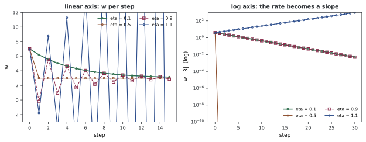
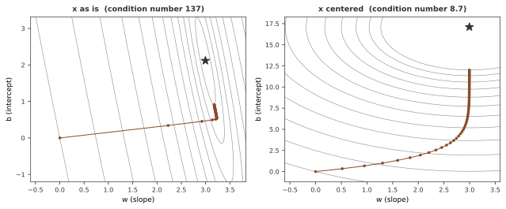
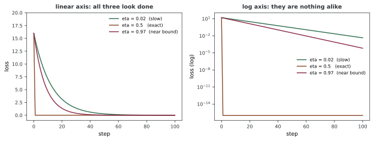

# 경사 하강법을 그림으로 보기

경사 하강법을 그린 그림은 흔하다. 대개 로스 곡선 하나이고, 그 곡선은 "로스가 내려간다"를 보여 준다. 그런데 그것은 이미 아는 사실이다.

이 쪽은 **무엇을 어떤 축에 그리면 무엇이 보이는가** 를 다룬다. 같은 학습을 세 가지 방식으로 그려 보면, 하나는 아무것도 못 보여 주고 하나는 수렴 속도를 숫자로 읽게 해 주며 하나는 로스 곡선이 뭉개 버린 구조를 드러낸다.

---

## 1. 선형 축과 로그 축

$L(w) = (w-3)^2$에서 $w_0 = 7$로 출발한다. 오차가 매 걸음 $(1-2\eta)$배가 되므로 네 러닝레이트의 운명을 미리 알 수 있다.

```
  eta    1-2*eta   30 걸음 뒤 |w-3|      판정
  0.1      +0.80       4.951760e-03   수렴
  0.5      +0.00       0.000000e+00   한 걸음에 끝
  0.9      -0.80       4.951760e-03   수렴
  1.1      -1.20       9.495053e+02   발산
```

**$\eta = 0.1$과 $\eta = 0.9$의 30걸음 뒤 오차가 같은 수다.** 소수점 아래 끝까지 4.951760e-03이다. $1-2\eta$가 각각 $+0.8$과 $-0.8$로 부호만 다르기 때문이다.

이 사실이 두 그림에서 어떻게 보이는지가 이 쪽의 핵심이다.



**왼쪽 — 선형 축.** 두 경로가 전혀 다르게 생겼다. 초록($\eta=0.1$)은 위에서 매끄럽게 내려오고 자주($\eta=0.9$)는 목표를 사이에 두고 좌우로 튕긴다. 이것만 보면 "매끄러운 쪽이 더 좋다"고 생각하게 된다.

**오른쪽 — 로그 축.** 두 선이 **포개진다.** 자주를 점선으로 그려야 둘 다 보일 정도다. 같은 속도라는 뜻이다.

선형 축이 보여 주는 것은 **가는 모양** 이고, 로그 축이 보여 주는 것은 **속도** 다. 둘은 다른 질문이다.

---

## 2. 로그 축의 기울기가 곧 수렴률이다

로그 축의 직선이 그냥 보기 좋은 것이 아니다. **기울기에 수렴률이 들어 있다.**

$|w_t - 3| = |1-2\eta|^t\,|w_0 - 3|$의 양변에 상용로그를 취하면

$$\log_{10}|w_t - 3| = t\log_{10}|1-2\eta| + \log_{10}|w_0 - 3|$$

이다. $t$에 대한 직선이고 **기울기가 $\log_{10}|1-2\eta|$** 다. 재어 본다.

```
  eta    잰 기울기      log10|1-2*eta|    차이
  0.1       -0.096910       -0.096910  1.94e-16
  0.5    (한 걸음에 끝나 직선이 없다)
  0.9       -0.096910       -0.096910  1.39e-16
```

여섯 자리까지 같다. 그리고 두 기울기가 서로도 같다 — 그래서 그림에서 포개진다.

**실무에서 쓸 수 있는 방법이 여기서 나온다.** 로그 축의 로스 곡선에서 직선 구간의 기울기를 자로 재면 "한 걸음에 몇 배씩 주는지"를 바로 읽을 수 있다. 기울기가 $-0.0969$면 한 걸음에 $10^{-0.0969} = 0.8$배다. 거기서 목표 정밀도까지 몇 걸음이 더 필요한지 계산할 수 있다.

선형 축에서는 이것이 불가능하다. 곡선이 금세 바닥에 붙어 기울기를 읽을 수가 없다.

---

## 3. 파라메터 공간의 경로

파라메터가 둘이면 **경로 자체를 그릴 수 있다.** 선형 회귀의 $w$와 $b$를 두 축으로 놓고 등고선 위에 60걸음을 찍는다.

```
  그대로   조건수   136.6   최적해 (2.9956, 2.1176)
           출발 거리  3.6685 -> 60 걸음 뒤  1.2193  (남은 비율 0.3324)
  중심화   조건수     8.7   최적해 (2.9956, 17.0957)
           출발 거리 17.3561 -> 60 걸음 뒤  5.0869  (남은 비율 0.2931)
```

!!! note "두 줄을 거리로 직접 견주면 안 된다"
    중심화하면 **절편의 뜻이 바뀐다.** 원래 $b$는 $x=0$에서의 값이고, 중심화한 $b$는 $x=\bar{x}=5$에서의 값이라 최적해가 2.12에서 17.10으로 옮겨 간다. 출발점 $(0,0)$에서의 거리도 3.67과 17.36으로 다르다. 그래서 **남은 비율** 로 견주었다.



두 판이 **비슷하게 생겼다.** 그것이 이 그림이 말해 주는 바다.

둘 다 같은 병을 앓는다. $w$ 쪽으로는 몇 걸음 만에 3.0 근처에 가 놓고, $b$ 쪽으로는 60걸음을 써도 최적점에 못 닿는다. **빠른 방향과 느린 방향이 따로 있다.**

중심화가 조건수를 136.6에서 8.7로 줄였는데도 60걸음에서는 차이가 크지 않다(0.3324 대 0.2931). 조건수가 정하는 것은 **끝까지 가는 데 드는 걸음 수** 이고, 그 차이는 더 뒤에서 벌어진다([선형 회귀 쪽](03_simple_linear_regression.md) 연습문제 3에서 1,000걸음에 150배로 갈라지는 것을 잰다).

**이것이 파라메터 공간의 경로를 그리는 까닭이다.** 로스 곡선은 두 방향을 수 하나로 뭉개 놓는다. "로스가 0.96에서 멈췄다"만 보면 $w$는 다 왔고 $b$만 못 왔다는 사실이 보이지 않는다.

---

## 4. 로스 곡선이 가리는 것

세 설정을 로스 곡선으로만 보면 어떻게 되는지 본다.

```
  설정              10 걸음 로스   30 걸음 로스   100 걸음 로스
  느림 (eta=0.02)       7.072039      1.381637   4.553723e-03
  딱 맞음(eta=0.5)       0.000000      0.000000   0.000000e+00
  거의 경계(0.97)       4.641700      0.390653   6.756017e-05
```



**왼쪽 — 선형 축.** 60걸음쯤부터 세 곡선이 전부 바닥에 붙어 있다. 거기서 학습을 멈추고 "수렴했다"고 판단하면 셋 중 어느 것을 골랐는지가 보이지 않는다.

**오른쪽 — 로그 축.** 전혀 다른 그림이다. $\eta=0.5$는 첫 걸음에 바닥까지 떨어지고, 나머지 둘은 기울기가 다른 직선으로 갈라진다. 100걸음에서 $4.55\times10^{-3}$과 $6.76\times10^{-5}$로 **67배** 차이다.

**로스 곡선은 로그 축으로 그린다.** 선형 축은 학습의 첫 몇 퍼센트만 보여 주고 나머지를 전부 버린다. 그리고 최적화에서 흥미로운 일은 대개 그 "나머지"에서 일어난다.

---

## 5. 무엇을 그릴지 고르는 법

| 보고 싶은 것 | 그릴 것 |
|---|---|
| 학습이 되고 있는가 | 로스 대 걸음, **로그 축** |
| 얼마나 빠른가 | 같은 그림의 직선 구간 기울기 |
| 러닝레이트가 큰가 작은가 | 파라메터 대 걸음, 선형 축 (튕기는지 본다) |
| 왜 느린가 | 파라메터 공간의 경로 (빠른 방향·느린 방향) |
| 모델의 꼴이 맞는가 | 잔차 대 입력 ([선형 회귀 쪽](03_simple_linear_regression.md) 6절) |

그리고 어느 그림이든 **축 범위 밖으로 나간 경로는 잘린다.** 1절의 $\eta=1.1$은 왼쪽 판에서 위아래로 뚫고 나가 있어, 눈으로는 "심하게 진동하지만 어쩌면 수렴할지도"처럼 보인다. 수로는 30걸음 뒤 949.5로 명백히 발산이다. **그림으로 판정하지 말고 수로 판정한다.**

---

## 6. 전체 코드와 출력

그림 셋을 만드는 코드이기도 하다. `figures/`에 SVG로 갈무리한다.

```python
"""경사 하강법을 그림으로 보기 — 무엇을 어떤 축에 그릴 것인가.

경사 하강법을 그린 그림은 흔하지만, 대개 '로스가 내려간다' 는 것만
보여 주고 끝난다. 그것은 이미 아는 사실이다.

이 쪽은 **축을 어떻게 고르면 무엇이 보이는가** 를 다룬다.

- 로그 축으로 바꾸면 수렴률이 직선의 기울기로 드러난다
- 선형 축은 첫 몇 걸음 뒤를 전부 가린다
- 파라메터 공간의 경로는 조건수를 눈으로 보여 준다
- 로스 곡선만으로는 발산과 느린 수렴을 가릴 수 없다

그림은 figures/ 에 SVG 로 갈무리한다.

실행: python 04_visualizing_gradient_descent.py
"""
from pathlib import Path

import matplotlib

matplotlib.use("Agg")
matplotlib.rcParams["svg.fonttype"] = "path"

import matplotlib.pyplot as plt
import numpy as np
import torch

FIG = Path(__file__).resolve().parent / "figures"
INK = "#2f3337"
COLORS = ["#2f6f4e", "#8a4b2a", "#8a2a4b", "#2a4b8a"]


def header(title):
    print(f"\n=== {title} ===")


# ========================================================================
# 1. 1차원 — 네 러닝레이트
# ========================================================================

def run_1d(lr, steps=30, w0=7.0):
    """L(w) = (w-3)^2,  dL/dw = 2(w-3)."""
    w, traj = w0, [w0]
    for _ in range(steps):
        w = w - lr * 2 * (w - 3)
        traj.append(w)
    return np.array(traj)


def one_dim():
    header("1. L(w) = (w-3)^2 에서 네 러닝레이트")
    print("  오차가 매 걸음 (1 - 2*eta) 배가 된다")
    print("  eta    1-2*eta   30 걸음 뒤 |w-3|      판정")
    runs = {}
    for lr in (0.1, 0.5, 0.9, 1.1):
        t = run_1d(lr)
        runs[lr] = t
        err = abs(t[-1] - 3)
        shown = f"{err:.6e}" if err < 1e30 else "넘침"
        verdict = ("한 걸음에 끝" if abs(1 - 2 * lr) < 1e-12
                   else "수렴" if abs(1 - 2 * lr) < 1 else "발산")
        print(f"  {lr:<6} {1-2*lr:+7.2f}   {shown:>16}   {verdict}")

    print("\n  0.1 과 0.9 는 |1-2*eta| 가 둘 다 0.8 이다")
    print(f"  30 걸음 뒤 오차:  0.1 -> {abs(runs[0.1][-1]-3):.6e}")
    print(f"                    0.9 -> {abs(runs[0.9][-1]-3):.6e}")
    print("  같은 수다. 가는 모양만 다르고 속도는 같다")
    print("  그림에서 이것은 로그 축으로 보아야 드러난다 —")
    print("  선형 축에서는 둘 다 '금세 0 에 붙는 선' 으로만 보인다")
    return runs


def figure_1d(runs):
    fig, (ax1, ax2) = plt.subplots(1, 2, figsize=(8.8, 3.5))

    # eta = 0.1 과 0.9 의 |오차| 는 정확히 같아서 로그 판에서 겹친다.
    # 뒤에 그리는 쪽을 점선 + 빈 네모로 두어야 둘 다 보인다.
    styles = {0.1: ("o-", 3, 1.6), 0.5: ("o-", 3, 1.1),
              0.9: ("s--", 4.5, 1.1), 1.1: ("o-", 3, 1.1)}
    for (lr, t), c in zip(runs.items(), COLORS):
        st, ms, lw = styles[lr]
        ax1.plot(t[:16], st, color=c, ms=ms, lw=lw, mfc="none",
                 label=f"eta = {lr}")
        err = np.abs(t - 3)
        err[err < 1e-16] = 1e-16            # 로그 축에 0 을 못 찍는다
        ax2.semilogy(err, st, color=c, ms=ms, lw=lw, mfc="none",
                     label=f"eta = {lr}")

    ax1.axhline(3, color=INK, ls="--", lw=0.8, alpha=0.6)
    ax1.set_ylim(-3, 12)
    ax1.set_xlabel("step", fontsize=9)
    ax1.set_ylabel("w", fontsize=9)
    ax1.set_title("linear axis: w per step", fontsize=9.5, weight="bold",
                  color=INK, pad=7)
    ax1.legend(fontsize=7.5, frameon=False, ncol=2)

    ax2.set_ylim(1e-10, 1e3)
    ax2.set_xlabel("step", fontsize=9)
    ax2.set_ylabel("|w - 3|  (log)", fontsize=9)
    ax2.set_title("log axis: the rate becomes a slope", fontsize=9.5,
                  weight="bold", color=INK, pad=7)
    ax2.legend(fontsize=7.5, frameon=False, ncol=2)

    for ax in (ax1, ax2):
        ax.tick_params(labelsize=8, colors=INK)
        for s in ax.spines.values():
            s.set_color(INK)
            s.set_linewidth(0.7)
    fig.tight_layout()
    fig.savefig(FIG / "gd_1d.svg", transparent=True, bbox_inches="tight")
    plt.close(fig)
    print("  figures/gd_1d.svg 를 썼다")


# ========================================================================
# 2. 로그 축의 기울기가 수렴률이다
# ========================================================================

def log_slope(runs):
    header("2. 로그 축의 기울기를 재어 본다")
    print("  |w_t - 3| = |1-2*eta|^t |w_0 - 3| 이므로")
    print("  log10|w_t - 3| 는 t 에 대해 직선이고 기울기가 log10|1-2*eta| 다")
    print("  eta    잰 기울기      log10|1-2*eta|    차이")
    for lr in (0.1, 0.5, 0.9):
        if abs(1 - 2 * lr) < 1e-12:
            print(f"  {lr:<6} (한 걸음에 끝나 직선이 없다)")
            continue
        t = run_1d(lr, steps=30)
        err = np.abs(t - 3)
        k = np.arange(5, 26)
        slope = np.polyfit(k, np.log10(err[k]), 1)[0]
        want = np.log10(abs(1 - 2 * lr))
        print(f"  {lr:<6} {slope:+12.6f}  {want:+14.6f}  "
              f"{abs(slope-want):.2e}")
    print("  두 기울기가 소수점 아래 여섯 자리까지 같다. 그림의 로그 판에서")
    print("  0.1 의 선과 0.9 의 선은 나란한 정도가 아니라 **포개진다** —")
    print("  그래서 0.9 를 점선으로 그려야 둘 다 보인다")
    print("  선형 판에서는 둘이 전혀 다르게 생겼다. 하나는 매끄럽게 내려오고")
    print("  하나는 좌우로 튕긴다. 같은 속도라는 것을 거기서는 알 수 없다")


# ========================================================================
# 3. 두 파라메터 — 경로가 조건수를 보여 준다
# ========================================================================

def two_dim():
    header("3. 파라메터 공간의 경로 (선형 회귀)")
    torch.manual_seed(42)
    N = 50
    x = torch.linspace(0, 10, N)
    y = 3 * x + 2 + torch.randn(N)

    def path(center, lr, steps=60, start=(0.0, 0.0)):
        xx = x - x.mean() if center else x
        w, b = start
        out = [(w, b)]
        for _ in range(steps):
            pred = w * xx + b
            gw = float((2 * xx * (pred - y)).mean())
            gb = float((2 * (pred - y)).mean())
            w, b = w - lr * gw, b - lr * gb
            out.append((w, b))
        return np.array(out), xx

    ratios, kappas = {}, {}
    for center, lab in ((False, "그대로  "), (True, "중심화  ")):
        A = torch.stack([x - x.mean() if center else x, torch.ones(N)], 1)
        sol = torch.linalg.lstsq(A, y.unsqueeze(1)).solution.flatten()
        H = 2 * (A.T @ A) / N
        ev = torch.linalg.eigvalsh(H)
        p, _ = path(center, 0.01)
        d0 = np.linalg.norm(p[0] - sol.numpy())
        d = np.linalg.norm(p[-1] - sol.numpy())
        ratios[center], kappas[center] = d / d0, float(ev[1] / ev[0])
        print(f"  {lab} 조건수 {ev[1]/ev[0]:7.1f}   최적해 "
              f"({sol[0]:.4f}, {sol[1]:.4f})")
        print(f"           출발 거리 {d0:7.4f} -> 60 걸음 뒤 {d:7.4f}  "
              f"(남은 비율 {d/d0:.4f})")
    print("  중심화하면 절편의 뜻이 바뀌어(x=0 이 아니라 x=xbar 에서의 값)")
    print("  출발 거리가 달라진다. 그러니 남은 비율로 견주어야 한다")
    print(f"  {ratios[False]:.4f} 대 {ratios[True]:.4f} — 중심화 쪽이 더 많이")
    print(f"  줄였다. 조건수 {kappas[False]:.1f} 대 {kappas[True]:.1f} 이 그 까닭이다")
    print("  다만 60 걸음에서의 차이는 크지 않다. 조건수가 정하는 것은")
    print("  끝까지 가는 데 드는 걸음 수이고, 그 차이는 더 뒤에 벌어진다")
    print("  그림의 두 판이 비슷해 보이는 것도 그 때문이다. 둘 다 같은")
    print("  병을 앓는다 — w 쪽으로는 몇 걸음에 가 놓고 b 쪽으로는 60")
    print("  걸음을 써도 못 닿는다. 빠른 방향과 느린 방향이 따로 있다")
    print("  이것이 파라메터 공간의 경로를 그리는 까닭이다. 로스 곡선은")
    print("  두 방향을 하나의 수로 뭉개 놓아 이 구조를 보여 주지 못한다")

    return path, x, y, N


def figure_2d(path, x, y, N):
    fig, axes = plt.subplots(1, 2, figsize=(9.0, 3.8))
    for ax, center, title in (
            (axes[0], False, "x as is  (condition number 137)"),
            (axes[1], True, "x centered  (condition number 8.7)")):
        p, xx = path(center, 0.01)
        A = torch.stack([xx, torch.ones(N)], 1)
        sol = torch.linalg.lstsq(A, y.unsqueeze(1)).solution.flatten().numpy()

        lo_w, hi_w = min(p[:, 0].min(), sol[0]) - 0.6, max(p[:, 0].max(), sol[0]) + 0.6
        lo_b, hi_b = min(p[:, 1].min(), sol[1]) - 1.2, max(p[:, 1].max(), sol[1]) + 1.2
        W, B = np.meshgrid(np.linspace(lo_w, hi_w, 200),
                           np.linspace(lo_b, hi_b, 200))
        xn, yn = xx.numpy(), y.numpy()
        Z = np.mean((W[..., None] * xn + B[..., None] - yn) ** 2, axis=-1)
        # 등고선 높이를 경로가 지나간 로스에서 뽑는다. 그러지 않으면
        # 선들이 일이 벌어지지 않는 자리에 몰린다.
        along = np.mean((p[:, 0:1] * xn + p[:, 1:2] - yn) ** 2, axis=1)
        lv = np.unique(np.geomspace(max(along.min(), Z.min() + 1e-6),
                                    along.max(), 12))
        ax.contour(W, B, Z, levels=lv,
                   colors=INK, linewidths=0.6, alpha=0.55, zorder=1)
        ax.plot(p[:, 0], p[:, 1], "o-", color=COLORS[1], ms=2.6, lw=1.0,
                zorder=3)
        ax.plot([sol[0]], [sol[1]], "*", color=INK, ms=11, zorder=4)
        ax.set_xlabel("w (slope)", fontsize=9)
        ax.set_ylabel("b (intercept)", fontsize=9)
        ax.set_title(title, fontsize=9.5, weight="bold", color=INK, pad=7)
        ax.tick_params(labelsize=8, colors=INK)
        for s in ax.spines.values():
            s.set_color(INK)
            s.set_linewidth(0.7)
    fig.tight_layout()
    fig.savefig(FIG / "gd_2d.svg", transparent=True, bbox_inches="tight")
    plt.close(fig)
    print("  figures/gd_2d.svg 를 썼다")


# ========================================================================
# 4. 로스 곡선이 가리는 것
# ========================================================================

def what_the_curve_hides():
    header("4. 로스 곡선만 보면 가려지는 것")
    print("  세 설정을 로스 곡선으로만 보면 모두 '잘 내려간다' 로 보인다")
    print("  설정              10 걸음 로스   30 걸음 로스   100 걸음 로스")
    rows = {}
    for lr, lab, tag in ((0.02, "느림 (eta=0.02) ", "eta = 0.02  (slow)"),
                         (0.5, "딱 맞음(eta=0.5) ", "eta = 0.5   (exact)"),
                         (0.97, "거의 경계(0.97) ", "eta = 0.97  (near bound)")):
        t = run_1d(lr, steps=100)
        ls = (t - 3) ** 2
        rows[tag] = ls          # 그림의 범례로 쓰므로 아스키라야 한다
        print(f"  {lab}  {ls[10]:12.6f}  {ls[30]:12.6f}  {ls[100]:13.6e}")
    print("  10 걸음에서 느린 쪽 7.07 과 거의 경계 쪽 4.64 는 둘 다 '아직")
    print("  내려가는 중' 으로 보인다. 30 걸음에서 1.38 과 0.39 다")
    print("  100 걸음에서 4.55e-03 과 6.76e-05 로 67 배 갈린다")
    print("  선형 축에서는 이 셋이 모두 바닥에 붙어 구별되지 않는다 —")
    print("  0.001 과 0.00001 이 눈으로 같은 자리다")
    print("  로그 축으로 바꾸면 세 직선의 기울기가 서로 다르게 드러난다")
    return rows


def figure_curve(rows):
    fig, (ax1, ax2) = plt.subplots(1, 2, figsize=(8.8, 3.4))
    for (lab, ls), c in zip(rows.items(), COLORS):
        ax1.plot(ls, color=c, lw=1.4, label=lab)
        v = np.maximum(ls, 1e-16)
        ax2.semilogy(v, color=c, lw=1.4, label=lab)
    ax1.set_ylim(-1, 20)
    ax1.set_xlabel("step", fontsize=9)
    ax1.set_ylabel("loss", fontsize=9)
    ax1.set_title("linear axis: all three look done", fontsize=9.5,
                  weight="bold", color=INK, pad=7)
    ax2.set_xlabel("step", fontsize=9)
    ax2.set_ylabel("loss (log)", fontsize=9)
    ax2.set_title("log axis: they are nothing alike", fontsize=9.5,
                  weight="bold", color=INK, pad=7)
    for ax in (ax1, ax2):
        ax.legend(fontsize=7.5, frameon=False)
        ax.tick_params(labelsize=8, colors=INK)
        for s in ax.spines.values():
            s.set_color(INK)
            s.set_linewidth(0.7)
    fig.tight_layout()
    fig.savefig(FIG / "gd_curves.svg", transparent=True, bbox_inches="tight")
    plt.close(fig)
    print("  figures/gd_curves.svg 를 썼다")


def main():
    FIG.mkdir(exist_ok=True)
    runs = one_dim()
    figure_1d(runs)
    log_slope(runs)
    path, x, y, N = two_dim()
    figure_2d(path, x, y, N)
    rows = what_the_curve_hides()
    figure_curve(rows)


if __name__ == "__main__":
    main()
```

**출력:**

```
=== 1. L(w) = (w-3)^2 에서 네 러닝레이트 ===
  오차가 매 걸음 (1 - 2*eta) 배가 된다
  eta    1-2*eta   30 걸음 뒤 |w-3|      판정
  0.1      +0.80       4.951760e-03   수렴
  0.5      +0.00       0.000000e+00   한 걸음에 끝
  0.9      -0.80       4.951760e-03   수렴
  1.1      -1.20       9.495053e+02   발산

  0.1 과 0.9 는 |1-2*eta| 가 둘 다 0.8 이다
  30 걸음 뒤 오차:  0.1 -> 4.951760e-03
                    0.9 -> 4.951760e-03
  같은 수다. 가는 모양만 다르고 속도는 같다
  그림에서 이것은 로그 축으로 보아야 드러난다 —
  선형 축에서는 둘 다 '금세 0 에 붙는 선' 으로만 보인다
  figures/gd_1d.svg 를 썼다

=== 2. 로그 축의 기울기를 재어 본다 ===
  |w_t - 3| = |1-2*eta|^t |w_0 - 3| 이므로
  log10|w_t - 3| 는 t 에 대해 직선이고 기울기가 log10|1-2*eta| 다
  eta    잰 기울기      log10|1-2*eta|    차이
  0.1       -0.096910       -0.096910  1.94e-16
  0.5    (한 걸음에 끝나 직선이 없다)
  0.9       -0.096910       -0.096910  1.39e-16
  두 기울기가 소수점 아래 여섯 자리까지 같다. 그림의 로그 판에서
  0.1 의 선과 0.9 의 선은 나란한 정도가 아니라 **포개진다** —
  그래서 0.9 를 점선으로 그려야 둘 다 보인다
  선형 판에서는 둘이 전혀 다르게 생겼다. 하나는 매끄럽게 내려오고
  하나는 좌우로 튕긴다. 같은 속도라는 것을 거기서는 알 수 없다

=== 3. 파라메터 공간의 경로 (선형 회귀) ===
  그대로   조건수   136.6   최적해 (2.9956, 2.1176)
           출발 거리  3.6685 -> 60 걸음 뒤  1.2193  (남은 비율 0.3324)
  중심화   조건수     8.7   최적해 (2.9956, 17.0957)
           출발 거리 17.3561 -> 60 걸음 뒤  5.0869  (남은 비율 0.2931)
  중심화하면 절편의 뜻이 바뀌어(x=0 이 아니라 x=xbar 에서의 값)
  출발 거리가 달라진다. 그러니 남은 비율로 견주어야 한다
  0.3324 대 0.2931 — 중심화 쪽이 더 많이
  줄였다. 조건수 136.6 대 8.7 이 그 까닭이다
  다만 60 걸음에서의 차이는 크지 않다. 조건수가 정하는 것은
  끝까지 가는 데 드는 걸음 수이고, 그 차이는 더 뒤에 벌어진다
  그림의 두 판이 비슷해 보이는 것도 그 때문이다. 둘 다 같은
  병을 앓는다 — w 쪽으로는 몇 걸음에 가 놓고 b 쪽으로는 60
  걸음을 써도 못 닿는다. 빠른 방향과 느린 방향이 따로 있다
  이것이 파라메터 공간의 경로를 그리는 까닭이다. 로스 곡선은
  두 방향을 하나의 수로 뭉개 놓아 이 구조를 보여 주지 못한다
  figures/gd_2d.svg 를 썼다

=== 4. 로스 곡선만 보면 가려지는 것 ===
  세 설정을 로스 곡선으로만 보면 모두 '잘 내려간다' 로 보인다
  설정              10 걸음 로스   30 걸음 로스   100 걸음 로스
  느림 (eta=0.02)       7.072039      1.381637   4.553723e-03
  딱 맞음(eta=0.5)       0.000000      0.000000   0.000000e+00
  거의 경계(0.97)       4.641700      0.390653   6.756017e-05
  10 걸음에서 느린 쪽 7.07 과 거의 경계 쪽 4.64 는 둘 다 '아직
  내려가는 중' 으로 보인다. 30 걸음에서 1.38 과 0.39 다
  100 걸음에서 4.55e-03 과 6.76e-05 로 67 배 갈린다
  선형 축에서는 이 셋이 모두 바닥에 붙어 구별되지 않는다 —
  0.001 과 0.00001 이 눈으로 같은 자리다
  로그 축으로 바꾸면 세 직선의 기울기가 서로 다르게 드러난다
  figures/gd_curves.svg 를 썼다
```

---

## 연습문제

<div class="drillbox" markdown>

**연습문제 1.** <span class="diff easy" title="쉬움"></span>
어떤 로스 곡선을 로그 축에 그렸더니 직선 구간의 기울기가 $-0.05$였다(상용로그, $x$축은 걸음). (a) 한 걸음에 로스가 몇 배가 되는가? (b) 로스를 100분의 1로 줄이려면 몇 걸음이 더 필요한가?

</div>

??? success "풀이"
    (a) 기울기가 $-0.05$라는 것은 한 걸음에 $\log_{10}(\text{로스})$가 0.05씩 준다는 뜻이다. 따라서 한 걸음에

    $$10^{-0.05} \approx 0.891$$

    배가 된다. 걸음마다 약 11%씩 준다.

    (b) 100분의 1은 $\log_{10}$으로 $-2$다. 기울기가 $-0.05$이므로

    $$\frac{-2}{-0.05} = 40\ \text{걸음}$$

    이다.

    **로그 축이 유용한 까닭이 이것이다.** 직선이면 자만 대면 "앞으로 얼마나 더 돌려야 하는지"가 나온다. 선형 축에서는 같은 곡선이 바닥에 붙어 있어 아무것도 읽을 수 없다.

    다만 직선이 **계속 직선일 때만** 쓸 수 있는 셈이다. 실제 학습에서는 평평해지거나 꺾이는 일이 흔하므로, 외삽한 걸음 수는 하한으로 보아야 한다.

---

<div class="drillbox" markdown>

**연습문제 2.** <span class="diff med" title="중간"></span>
본문 1절에서 $\eta = 0.5$의 30걸음 뒤 오차가 정확히 `0.000000e+00`이었다. 로그 축에 이 값을 그리려 하면 어떤 문제가 생기는가? 코드가 어떻게 피했는지 찾아보고, 다른 방법도 생각해 보라.

</div>

??? success "풀이"
    $\log(0) = -\infty$이므로 로그 축에 0을 찍을 수 없다. matplotlib은 그 점을 조용히 버리고, 그러면 선이 끊기거나 아예 사라진다.

    코드는 이렇게 피했다.

    ```python
    err = np.abs(t - 3)
    err[err < 1e-16] = 1e-16            # 로그 축에 0 을 못 찍는다
    ```

    바닥을 $10^{-16}$으로 깔아 둔 것이다. 그림에서 $\eta=0.5$의 선이 첫 걸음에 아래로 수직 낙하하는 것이 이 때문이다.

    **다른 방법들.**

    - **`symlog` 축을 쓴다.** 0 근처에서는 선형, 멀어지면 로그로 바뀌는 축이다. 0을 그대로 찍을 수 있지만 축을 읽기가 까다롭다
    - **작은 값을 더한다.** `np.log10(err + 1e-16)`. 결과는 비슷하지만, 바닥으로 깎는 쪽이 원래 값에 손을 대지 않으므로 더 정직하다
    - **아예 그리지 않는다.** 정확히 수렴한 경우는 "1걸음에 수렴"이라고 적는 편이 그림보다 분명하다

    **어느 쪽을 고르든 바닥값을 그림이나 설명에 밝혀야 한다.** 밝히지 않으면 $10^{-16}$이 실제로 도달한 정밀도처럼 읽힌다. float32를 쓰는 학습에서는 $10^{-7}$ 아래가 이미 의미 없는 수인데도 그림에는 그럴듯한 직선으로 나온다.

---

<div class="drillbox" markdown>

**연습문제 3.** <span class="diff med" title="중간"></span>
본문 4절의 $\eta = 0.97$이 $\eta = 0.02$보다 100걸음에서 67배 낮은 로스를 준다. 그렇다면 0.97이 더 좋은 러닝레이트인가? 수렴 경계와 함께 판단하라.

</div>

??? success "풀이"
    $L(w) = (w-3)^2$의 수렴 조건은 $|1-2\eta| < 1$, 곧 $0 < \eta < 1$이다.

    - $\eta = 0.02$: $1-2\eta = +0.96$. 한 걸음에 4%씩 준다
    - $\eta = 0.97$: $1-2\eta = -0.94$. 한 걸음에 6%씩 준다(부호가 바뀌며)

    **이 문제에서는 0.97이 실제로 더 빠르다.** 67배 차이가 그것이다.

    그러나 0.97을 고르는 것은 나쁜 선택이다. 경계가 1.0이므로 **여유가 3%뿐** 이다. 문제가 조금만 달라져도 — 자료를 더 모아 곡률이 커지거나, 입력의 척도가 바뀌거나, 미니배치라 경사가 흔들리면 — 바로 경계를 넘는다.

    0.02 역시 좋은 선택이 아니다. 최적값 0.5에서 25배나 떨어져 있다.

    **읽을 것은 이렇다. 로스 곡선의 높낮이만으로 러닝레이트를 고르면 안 된다.** 경계에 바짝 붙은 값이 짧은 실험에서는 가장 좋아 보이기 쉽다. 고를 때는 성능과 **여유** 를 함께 본다. $\eta = 0.5$가 좋은 까닭은 빨라서이기도 하지만 양쪽 경계(0과 1)에서 가장 멀어서이기도 하다.

---

<div class="drillbox" markdown>

**연습문제 4.** <span class="diff hard" title="어려움"></span>
본문 3절의 그림에서 두 경로가 모두 "오른쪽으로 달린 뒤 위로 기어오르는" 모양이었다. 이 모양이 헤세 행렬의 고유벡터와 어떤 관계인지 설명하고, 경로가 꺾이는 지점이 무엇을 뜻하는지 말하라.

</div>

??? success "풀이"
    이차 로스에서 오차 $e_t = \theta_t - \theta^*$는 갱신마다

    $$e_{t+1} = (I - \eta H)\,e_t$$

    를 따른다. $H$의 고유분해를 $H = \sum_i \lambda_i v_i v_i^\top$라 하면, 오차를 고유벡터로 분해한 성분 $c_i = v_i^\top e_t$ 각각이 **서로 섞이지 않고 따로** 간다.

    $$c_i^{(t)} = (1-\eta\lambda_i)^t\, c_i^{(0)}$$

    곧 $d$차원 문제가 $d$개의 1차원 문제로 쪼개진다. 1절에서 본 $(1-2\eta)^t$가 각 고유방향마다 하나씩 있는 셈이다.

    **경로의 모양이 여기서 나온다.** 큰 고윳값 $\lambda_{\max} = 68.5$ 방향은 $(1 - 0.01 \times 68.5) = 0.315$배씩 주므로 **몇 걸음 만에 사라진다.** 작은 고윳값 $\lambda_{\min} = 0.496$ 방향은 $(1 - 0.01 \times 0.496) = 0.995$배씩이라 **거의 안 준다.**

    그래서 경로가 두 토막이 된다.

    1. **처음 몇 걸음** — 큰 고윳값 성분이 빠르게 죽는다. 이 방향이 대체로 $w$ 축에 가까우므로 경로가 오른쪽으로 달린다
    2. **꺾인 뒤** — 큰 성분은 이미 0에 가깝고 작은 성분만 남는다. 남은 성분의 고유벡터 방향으로 천천히 기어간다

    **꺾이는 지점이 뜻하는 것.** 그 자리에서 빠른 방향의 오차가 느린 방향의 오차보다 작아진다. 그 뒤로는 **움직이는 방향이 거의 고정된다** — 가장 작은 고윳값의 고유벡터 방향이다. 그림에서 경로가 거의 직선으로 기어오르는 구간이 그것이다.

    수렴 속도를 정하는 것도 이 뒤쪽 구간이다. 전체 수렴률이 $\max_i |1-\eta\lambda_i|$인 까닭이 여기 있다 — 가장 늦게 죽는 성분이 전부를 기다리게 만든다.

    **실무에서 이 모양을 보면 할 일.** 로스가 빠르게 떨어지다가 갑자기 평평해지면 대개 모델이 수렴한 것이 아니라 이 꺾임에 들어선 것이다. 러닝레이트를 키우는 것은 답이 아니다 — 큰 고윳값 방향이 $|1-\eta\lambda_{\max}| > 1$이 되어 터진다. 조건수를 줄이거나(입력 정규화), 방향마다 걸음을 다르게 주거나(Adam), 관성을 쓰는(모멘텀) 쪽이 답이다.

---

## 정리하며

1. **선형 축은 모양을, 로그 축은 속도를 보여 준다**: $\eta=0.1$과 $0.9$는 선형 축에서 전혀 달라 보이지만 로그 축에서는 포개진다
2. **로그 축의 기울기가 곧 수렴률이다**: 잰 기울기 $-0.096910$이 $\log_{10}|1-2\eta|$와 여섯 자리까지 같고, 거기서 앞으로 몇 걸음이 더 필요한지가 나온다
3. **로스 곡선은 로그 축으로 그린다**: 선형 축에서는 100걸음의 67배 차이가 전부 바닥에 붙어 보이지 않는다
4. **파라메터 공간의 경로는 로스 곡선이 뭉갠 구조를 드러낸다**: $w$는 다 왔고 $b$만 못 왔다는 사실은 로스 하나로는 알 수 없다
5. **경로가 꺾이는 곳이 빠른 방향이 죽은 지점이다**: 그 뒤로는 가장 작은 고윳값의 고유벡터 방향으로만 기어간다
6. **그림으로 판정하지 말고 수로 판정한다**: 축 밖으로 나간 경로는 잘려서, 발산이 "심한 진동"처럼 보인다
7. **로그 축에 0을 찍을 수 없다**: 바닥값을 깔았다면 그 값을 반드시 밝힌다. 안 그러면 $10^{-16}$이 도달한 정밀도처럼 읽힌다

**참고 문헌**

- Goodfellow, I., Bengio, Y., & Courville, A. (2016). *Deep Learning*, Chapter 8.
- Li, H., et al. (2018). Visualizing the loss landscape of neural nets. *NeurIPS*.
