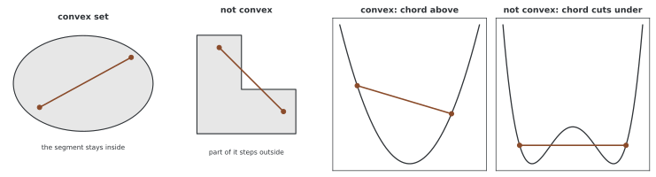

# 볼록 최적화와 비볼록 최적화

"볼록하면 국소 최솟값이 곧 전역 최솟값이다." 정의에서 몇 줄이면 나오는 말이고 외우기도 쉽다. 그런데 그 말이 **실제로 무엇을 달라지게 하는지** 는 잘 와닿지 않는다.

이 쪽은 그것을 한 가지 실험으로 드러낸다. **출발점만 바꿔 가며 같은 문제를 여러 번 푸는 것** 이다. 볼록한 문제에서는 다섯 번 모두 같은 점에 닿고, 비볼록한 문제에서는 닿는 곳이 다르다. 그 차이를 수로 보고 나면 나머지 이야기가 따라온다.

---

## 1. 볼록 집합과 볼록 함수

<div class="defn" markdown>

**정의 (볼록 집합).** 집합 $\mathcal{C} \subseteq \mathbb{R}^n$이 **볼록** 이라는 것은 임의의 $\mathbf{x}, \mathbf{y} \in \mathcal{C}$와 $\lambda \in [0, 1]$에 대해

$$\lambda \mathbf{x} + (1-\lambda)\mathbf{y} \in \mathcal{C}$$

가 성립한다는 뜻이다. 집합 안의 두 점을 잇는 선분이 온전히 그 집합 안에 놓인다는 말이다.

</div>

<div class="defn" markdown>

**정의 (볼록 함수).** 함수 $f: \mathbb{R}^n \rightarrow \mathbb{R}$이 **볼록** 이라는 것은 임의의 $\mathbf{x}, \mathbf{y}$와 $\lambda \in [0, 1]$에 대해

$$f(\lambda\mathbf{x} + (1-\lambda)\mathbf{y}) \leq \lambda f(\mathbf{x}) + (1-\lambda)f(\mathbf{y})$$

가 성립한다는 뜻이다. 그래프 위의 두 점을 잇는 현이 그래프보다 위에 놓인다는 말이다.

</div>



### 정의를 수로 확인한다

정의가 부등식이므로 직접 어겨 보면 된다. 함수마다 점 $x, y$와 비율 $t$를 2만 번 무작위로 뽑아 부등식이 깨지는지 센다.

```
  함수            어긴 비율    가장 크게 어긴 양
  x^2            0.00%      -1.497e-09
  |x|            0.00%      +0.000e+00
  exp(x)         0.00%      -3.987e-09
  log(1+e^x)     0.00%      -5.818e-11
  x^3           49.84%      +1.317e+01
  sin(x)        50.27%      +1.232e+00
  x^4-3x^2      20.75%      +2.237e+00
```

$x^3$과 $\sin x$는 **절반쯤** 어긴다. 두 함수 모두 구간에 따라 위로 휘기도 하고 아래로 휘기도 하므로, 두 점을 아무렇게나 뽑으면 반반이다. $x^4 - 3x^2$이 20.75%로 더 낮은 것은 바깥쪽이 넓게 볼록해서 두 점이 모두 바깥에 떨어지는 경우가 많기 때문이다.

!!! warning "어기는 쌍을 못 찾은 것은 증명이 아니다"
    위 넷은 2만 번 중 한 번도 어기지 않았지만, 그것으로 볼록임이 보인 것은 아니다. 이 방법은 **반례를 찾는 데** 쓸 수 있을 뿐이다. 볼록임을 보이려면 2차 조건 같은 것을 써야 한다.

    `|x|`의 최대 위반량이 정확히 $0$인 것도 눈여겨볼 만하다. $|x|$는 볼록이되 **엄격하게** 볼록하지 않아서, 같은 부호의 두 점에서는 부등식이 등호로 성립한다.

### 엄격한 볼록과 강볼록

<div class="defn" markdown>

**정의.** $\mathbf{x} \neq \mathbf{y}$이고 $\lambda \in (0,1)$일 때 볼록성 부등식이 **등호 없이** 성립하면 $f$는 **엄격히 볼록**(strictly convex)이다.

어떤 $\mu > 0$에 대해 $f(\mathbf{x}) - \frac{\mu}{2}\|\mathbf{x}\|^2$가 볼록이면 $f$는 **$\mu$-강볼록**(strongly convex)이다. 두 번 미분 가능하면 정의역 전체에서 $\nabla^2 f \succeq \mu I$인 것과 같다.

</div>

강볼록이면 엄격히 볼록하지만 **역은 성립하지 않는다.** $e^x$가 반례다. $(e^x)'' = e^x > 0$이므로 어디서나 엄격히 볼록인데, $x \to -\infty$에서 $e^x \to 0$이라 곡률의 양의 하한이 없다. 연습문제 2에서 다시 본다.

### 동치인 조건

볼록한 열린 정의역에서 미분 가능하면 다음이 볼록성과 동치다.

1. **1차 조건** — 접평면이 함수 아래에 놓인다

   $$f(\mathbf{y}) \geq f(\mathbf{x}) + \nabla f(\mathbf{x})^\top(\mathbf{y} - \mathbf{x})$$

2. **2차 조건**(두 번 미분 가능할 때) — 헤세 행렬이 어디서나 양의 준정부호다

   $$\nabla^2 f(\mathbf{x}) \succeq 0 \quad \forall \mathbf{x}$$

---

## 2. 볼록성이 주는 것

<div class="thmbox" markdown>

### 정리 1. 국소 최솟값이 곧 전역 최솟값 { .thm }

$f$가 볼록이면 $f$의 모든 국소 최솟값은 전역 최솟값이다. $f$가 엄격히 볼록이면 전역 최솟값은 존재할 경우 유일하다.

</div>

??? proof "증명"
    $\mathbf{x}^*$를 국소 최솟값이라 하자. 곧 어떤 $\delta > 0$이 있어 $\|\mathbf{x} - \mathbf{x}^*\| < \delta$인 모든 $\mathbf{x}$에 대해 $f(\mathbf{x}^*) \leq f(\mathbf{x})$다.

    전역 최솟값이 아니라고 가정하면 $f(\mathbf{y}) < f(\mathbf{x}^*)$인 $\mathbf{y}$가 있다. 볼록성에서 임의의 $t \in (0,1)$에 대해

    $$f\big(\mathbf{x}^* + t(\mathbf{y} - \mathbf{x}^*)\big) \leq (1-t)f(\mathbf{x}^*) + t f(\mathbf{y}) < f(\mathbf{x}^*)$$

    이다(마지막 부등호는 $f(\mathbf{y}) < f(\mathbf{x}^*)$와 $t > 0$에서 나온다).

    그런데 $t < \delta / \|\mathbf{y} - \mathbf{x}^*\|$로 잡으면 그 점이 $\mathbf{x}^*$의 $\delta$-공 안에 있으므로 $f(\mathbf{x}^*) \leq f(\cdot)$이어야 한다. 모순이다. $\square$

    유일성은 이렇다. 서로 다른 전역 최솟값 $\mathbf{x}_1 \neq \mathbf{x}_2$가 있고 둘 다 최솟값 $m$을 준다면, 엄격한 볼록성에서 중점의 값이 $\frac{1}{2}m + \frac{1}{2}m = m$보다 **작아야** 하는데 이는 $m$이 최솟값임에 어긋난다.

### 수렴 보장

최솟값 $\mathbf{x}^*$가 있고 경사가 $L$-립시츠인 볼록 함수에 $0 < \eta \leq 1/L$인 고정 러닝레이트의 전체 경사 하강법을 쓰면

$$f(\mathbf{x}_t) - f(\mathbf{x}^*) \leq \frac{\|\mathbf{x}_0 - \mathbf{x}^*\|^2}{2\eta t}$$

으로 $O(1/t)$ 속도가 보장된다. 여기에 $\mu$-강볼록이 더해지면

$$f(\mathbf{x}_t) - f(\mathbf{x}^*) \leq \left(1 - \frac{\mu}{L}\right)^t \big(f(\mathbf{x}_0) - f(\mathbf{x}^*)\big)$$

으로 지수적으로 줄어든다. 이것을 **선형 수렴** 이라 부른다(로그 눈금에서 직선이라는 뜻이다). 지수 안의 $\mu/L$이 [러닝레이트 쪽](learning_rate.md)에서 본 조건수의 역수 $1/\kappa$다.

---

## 3. 출발점을 바꿔 보면

### 볼록한 쪽 — 어디서 출발해도 같은 곳

선형 회귀는 볼록하다. 다섯 번 모두 **일부러 멀리 떨어뜨린** 서로 다른 자리에서 출발시켜 2,000걸음을 걷게 했다. 정규방정식으로 참 최솟값을 미리 구해 두고 견준다.

```
  정규방정식이 주는 최소 로스 0.00834288
  출발 씨앗   2000 걸음 뒤 로스   최솟값과의 차이   해와의 거리
  0           0.00834288        +3.73e-09        0.000001
  1           0.00834288        +3.73e-09        0.000001
  2           0.00834288        +2.79e-09        0.000001
  3           0.00834288        +1.86e-09        0.000001
  4           0.00834288        +3.73e-09        0.000001
  다섯 해 사이의 최대 거리 0.00000114
```

다섯 로스가 소수점 아래 여덟 자리까지 같다. 그리고 **로스만 같은 것이 아니라 파라메터 자체가 같다** — 다섯 해 사이의 최대 거리가 $1.1 \times 10^{-6}$이다. 정규방정식이 주는 해와의 거리도 모두 $10^{-6}$ 자리다.

이것이 "국소 최솟값이 곧 전역 최솟값"의 실질적인 뜻이다. 초기화를 고민할 필요가 없고, 여러 번 돌려 볼 필요도 없다.

### 비볼록한 쪽 — 닿는 곳이 다르다

같은 자료 크기, 같은 러닝레이트, 같은 걸음 수에서 모델만 작은 MLP로 바꾸고 목표를 $\sin$으로 바꾼다. 바꾸는 것은 **출발 씨앗 하나뿐** 이다.

```
  출발 씨앗   2000 걸음 뒤 로스
  0           0.28161690
  1           0.29395953
  2           0.30792013
  3           0.27322841
  4           0.31074196
  가장 좋은 것 0.273228, 가장 나쁜 것 0.310742, 비 1.14
  다섯 해의 예측값 사이 최대 거리 3.426902
```

로스가 0.273에서 0.311까지 흩어진다. 14% 차이다.

그런데 **더 중요한 것은 마지막 줄이다.** 다섯 모델이 200개 점에서 내놓는 예측값 벡터 사이의 거리가 3.43이다. 볼록한 쪽에서 이 자리의 수가 $10^{-6}$이었다. **로스가 조금 다른 것이 아니라 아예 다른 함수들이다.**

여기서 한 가지를 분명히 해 둘 필요가 있다. 로스가 비슷하다고 같은 해가 아니고, 로스가 다르다고 꼭 다른 국소 최솟값에 빠진 것도 아니다(2,000걸음으로 아직 못 내려갔을 수도 있다). **로스 값만으로는 최솟값의 개수를 셀 수 없다.** 연습문제 5에서 이 함정을 다시 본다.

---

## 4. 뉴럴 넷트웍은 왜 비볼록한가

비볼록성의 뿌리를 "비선형 활성화 때문"으로 뭉뚱그리기 쉽지만, 더 정확하고 **수로 확인할 수 있는** 까닭이 있다. 같은 함수를 내는 파라메터가 여럿이라는 것이다.

### 대칭 하나 — 숨은 유닛의 차례

숨은 유닛의 순서를 바꾸고, 뒷 레이어의 열도 같은 순서로 바꾸면 넷트웍의 함수가 변하지 않는다.

```
  (가) 유닛 차례 바꾸기: 출력 최대 차이 1.192e-07
       파라메터는 달라졌는가 True
       6개 유닛이면 같은 함수를 내는 자리가 6! = 720개다
```

차이 $1.2 \times 10^{-7}$은 float32의 반올림이다. 파라메터는 분명히 달라졌는데 함수는 같다.

### 대칭 둘 — ReLU의 양의 동차성

$\text{ReLU}(cz) = c\,\text{ReLU}(z)$가 $c > 0$에서 성립한다. 앞 레이어를 $c$배 하고 뒷 레이어를 $1/c$배 하면 상쇄된다.

```
  (나) 앞을 3.0배 뒤를 1/3.0배: 출력 최대 차이 1.192e-07
       웨이트 노름은 1.4379 -> 4.3137 로 바뀐다
       c 는 어떤 양수여도 되므로 같은 함수를 내는 자리가 무한히 많다
```

앞의 것은 유한한 대칭이고 이것은 **연속적인** 대칭이다. 같은 함수를 내는 파라메터가 끊김 없이 이어진 곡선을 이룬다.

같은 조작을 tanh에 하면 전혀 다른 함수가 된다.

```
  (다) 같은 조작을 tanh 에 하면: 출력 최대 차이 0.4382
```

척도 대칭은 ReLU처럼 **양의 동차** 인 활성화에만 있다. "뉴럴 넷트웍에는 척도 대칭이 있다"를 모든 활성화에 적용하면 안 된다.

### 대칭에서 비볼록성이 나온다

볼록 함수의 최솟값들은 **볼록집합** 을 이룬다. 두 최솟값을 이은 선분 위의 모든 점도 최솟값이어야 한다는 뜻이다. 넷트웍이 이 성질을 어기는지 바로 볼 수 있다. 유닛을 섞은 두 넷트웍은 같은 함수를 내므로 둘 다 최솟값인데, 그 **파라메터의 중간점** 은 어떤가.

```
  m 의 로스        0.000e+00
  m2(섞은 것) 로스 4.663e-16
  둘의 중간점 로스 0.014589
```

중간점의 로스가 0이 아니다. 최솟값 둘을 이은 선분의 가운데가 최솟값이 아니므로 **이 로스 함수는 볼록일 수 없다.** 비선형 활성화를 들먹일 필요 없이, 대칭의 존재만으로 비볼록성이 따라 나온다.

---

## 5. 헤세 행렬로 가려낼 수 있는가

2차 조건이 "헤세 행렬이 어디서나 양의 준정부호"이므로, 한 점에서 음의 고윳값을 찾으면 비볼록성이 **증명된다.**

```
  선형 회귀 (볼록)   고윳값 0.950992 ~ 3.138513
                     음수 고윳값 개수 0 / 4
  작은 MLP (비볼록)  고윳값 -0.395238 ~ 3.467971
                     음수 고윳값 개수 8 / 21
```

MLP는 21개 고윳값 가운데 8개가 음수다. 그 점에 서면 **아래로 휜 방향이 여덟 개** 있다는 뜻이다.

!!! warning "한 점에서 음수가 없다고 볼록인 것은 아니다"
    증거의 방향이 한쪽이다. 음수를 **찾으면** 비볼록이 확정되지만, 못 찾았다고 볼록인 것은 아니다. 볼록하려면 **모든** 점에서 그래야 한다.

    ```
      같은 MLP, 다른 자료  음수 고윳값 9 / 21
    ```

    같은 모델도 자료가 바뀌면 음수의 개수가 달라진다. 한 점에서의 검사는 그 점에 대한 이야기일 뿐이다.

### 볼록성을 보존하는 연산

반대로, 볼록함을 **보이는** 데는 조립 규칙이 유용하다. 각 $f_i$가 볼록이고 정의역 조건을 만족할 때 다음이 볼록이다.

1. **음이 아닌 가중합**: $\alpha_i \geq 0$일 때 $\sum_i \alpha_i f_i$
2. **아핀 함수와의 합성**: $f(\mathbf{Ax} + \mathbf{b})$
3. **점별 최댓값**: $\max(f_1, \ldots, f_n)$
4. **부분 최소화**: $f$가 $(\mathbf{x},\mathbf{y})$에 대해 공동으로 볼록하고 $\mathbf{y}$의 허용 영역이 고정된 볼록 집합이면, 적절한 유한값 조건 아래 $g(\mathbf{x}) = \inf_\mathbf{y} f(\mathbf{x},\mathbf{y})$가 볼록이다

로지스틱 회귀가 볼록인 것이 1과 2로 바로 나온다. 로스 $\log(1 + e^{-y \mathbf{w}^\top\mathbf{x}})$가 볼록 함수와 아핀 함수의 합성이고, 표본에 대한 합이 음이 아닌 가중합이다.

---

## 6. 안장점

$\nabla f = \mathbf{0}$인 점이 최솟값이라는 보장은 없다. 헤세 행렬의 고윳값에 양수와 음수가 섞여 있으면 **안장점** 이다.

$f(x,y) = x^2 - y^2$가 가장 간단한 보기다. 원점에서 경사가 $\mathbf{0}$이고 헤세는 $\text{diag}(2, -2)$다.

```
  x 쪽은 0.98 배씩 줄고 y 쪽은 1.02 배씩 는다 (eta = 0.01)

  출발점              200 걸음 뒤 (x, y)          로스
  (1.0, 0.0)          (1.759e-02, 0.000e+00)     +3.0934e-04
  (1.0, 1e-08)        (1.759e-02, 5.248e-07)     +3.0934e-04
  (1.0, 0.0001)       (1.759e-02, 5.248e-03)     +2.8179e-04
  (1.0, 0.5)          (1.759e-02, 2.624e+01)     -6.8867e+02
```

$y$를 정확히 0에서 출발시키면 경사의 $y$ 성분이 $-2y = 0$이라 영원히 0이다. 안장점으로 곧장 끌려가 갇힌다.

$y = 10^{-8}$에서 출발해도 200걸음 뒤 로스가 $y = 0$일 때와 **자릿수까지 같다.** 빠져나오는 중이기는 하지만 아직 안장점 근처다. 얼마나 걸리는지 세어 보자.

```
  |y| > 1 이 될 때까지 걸리는 걸음 수
  처음 y       걸음 수    log(1/y0)/log(1.02) 로 센 값
  5e-01             36            35.0
  1e-02            233           232.6
  1e-04            466           465.1
  1e-08            931           930.2
  1e-12           1396          1395.3
```

**걸음 수가 $y_0$에 반비례하지 않고 로그로 는다.** $y_0$를 $10^{-2}$에서 $10^{-8}$로, 곧 백만분의 1로 줄여도 걸음은 233에서 931로 네 배가 될 뿐이다. 측정값이 $\log(1/y_0)/\log(1.02)$와 한 걸음 안에서 맞는다.

$y$가 매 걸음 1.02배로 **지수적으로** 커지기 때문이다. 지수적으로 자라는 것을 거슬러 올라가는 데 드는 시간은 로그다.

여기서 안장점에 대한 실무적 결론이 나온다. **안장점은 '갇히는 곳'이 아니라 '느려지는 곳'이다.** 정확히 0인 방향 성분에서 출발하는 일은 실제로는 일어나지 않고(초기화가 무작위다), 조금만 어긋나 있으면 로그 시간에 빠져나온다. 미니배치의 경사 잡음이 이 "조금의 어긋남"을 계속 만들어 준다.

---

## 7. 실무적 함의

### 볼록 문제에서

- 초기화를 고민하지 않아도 된다 — 3절에서 본 대로 어디서 출발해도 같은 해에 닿는다
- 여러 번 다시 시작할 까닭이 없다
- 해석적 해가 있을 수 있다(선형 회귀의 정규방정식)
- 다만 **볼록성만으로 임의의 설정이 수렴하지는 않는다.** 최솟값의 존재, 매끄러움, 러닝레이트 조건이 따로 필요하다

### 비볼록 문제에서

- **여러 번 다시 시작하고 퍼짐을 함께 보고한다.** 한 번 돌린 결과는 측정이 아니다
- 초기화 방법이 결과를 바꾼다. He나 Xavier 초기화는 활성화와 경사의 척도를 맞추려는 것이지 전역 최적성의 보장이 아니다
- 안장점보다 **좁고 긴 골짜기** 가 더 흔한 걸림돌이다. 6절에서 본 대로 안장점은 로그 시간에 빠져나온다
- 적응적 옵티마이저가 쓸 만한 러닝레이트의 범위를 넓혀 준다

### 과파라메터화에 대해 조심할 것

파라메터가 많으면 학습 로스를 0으로 만드는 해가 많아지는 것은 사실이고, 그래서 최적화가 쉬워지는 경향이 보고되어 있다. 그러나 **파라메터가 많다는 사실만으로 최적화나 일반화가 보장되지는 않는다.** 로스 지형에 관한 연구 결과들은 대개 특정한 모델 구조와 가정 아래의 것이다.

미니배치 잡음도 마찬가지다. 특정 조건에서 정규화와 비슷하게 작용한다는 결과가 있지만, "항상 나쁜 최솟값에서 탈출시켜 주고 일반화가 좋은 해를 찾아 준다"로 읽으면 안 된다.

---

## 8. 다른 주제와의 연결

- **조건수와 수렴 속도**: [러닝레이트와 이동 폭](learning_rate.md)에서 $\mu/L$이 속도를 어떻게 묶는지 본다
- **경사의 방향**: [경사는 왜 가장 가파른 상승 방향인가](steepest_direction.md)
- **모멘텀**: [고전적 모멘텀](../../ch09/optimizers/momentum.md)이 좁고 긴 골짜기를 어떻게 다루는지

---

## 9. 전체 코드와 출력

지금까지 인용한 수는 모두 아래 한 프로그램에서 나온 것이다.

```python
"""볼록과 비볼록 — 무엇이 실제로 달라지는가.

"볼록하면 국소 최솟값이 전역 최솟값" 은 정의에서 바로 나오는 말이라
외우기 쉽지만, 그래서 무엇이 달라지는지는 잘 와닿지 않는다. 이 쪽은
**출발점을 바꿔 보는 것** 으로 그 차이를 드러낸다.

- 볼록한 문제는 어디서 출발해도 같은 곳에 닿는가
- 비볼록한 문제는 얼마나 달라지는가
- 뉴럴 넷트웍의 비볼록성은 어디서 오는가 (대칭을 수로 확인한다)
- 헤세 행렬의 고윳값으로 볼록성을 가려낼 수 있는가
- 안장점에서 경사 하강법은 정말 멈추는가

실행: python convex_nonconvex.py
"""
import numpy as np
import torch
import torch.nn as nn


def header(title):
    print(f"\n=== {title} ===")


# ========================================================================
# 1. 볼록성의 정의를 수로 확인한다
# ========================================================================

def jensen():
    header("1. 정의를 수로 — f(tx+(1-t)y) <= t f(x) + (1-t) f(y)")

    fns = {
        "x^2        ": lambda x: x ** 2,
        "|x|        ": lambda x: np.abs(x),
        "exp(x)     ": lambda x: np.exp(x),
        "log(1+e^x) ": lambda x: np.log1p(np.exp(x)),
        "x^3        ": lambda x: x ** 3,
        "sin(x)     ": lambda x: np.sin(x),
        "x^4-3x^2   ": lambda x: x ** 4 - 3 * x ** 2,
    }
    rng = np.random.default_rng(0)
    xs = rng.uniform(-3, 3, 20000)
    ys = rng.uniform(-3, 3, 20000)
    ts = rng.uniform(0, 1, 20000)

    print("  함수            어긴 비율    가장 크게 어긴 양")
    for name, f in fns.items():
        lhs = f(ts * xs + (1 - ts) * ys)
        rhs = ts * f(xs) + (1 - ts) * f(ys)
        gap = lhs - rhs                      # 양수면 어긴 것
        bad = gap > 1e-12
        print(f"  {name}  {bad.mean()*100:6.2f}%      {gap.max():+.3e}")
    print("  위 넷은 한 번도 어기지 않는다. 아래 셋은 어긴다")
    print("  주의: 어기는 쌍을 못 찾았다는 것이 증명은 아니다. 반례를 찾는")
    print("  데는 쓸 수 있어도 볼록임을 보이는 데는 쓸 수 없다")


# ========================================================================
# 2. 출발점을 바꿔 보면 — 볼록한 쪽
# ========================================================================

def convex_starts():
    header("2. 볼록한 문제: 출발점을 바꿔도 같은 곳에 닿는가")
    torch.manual_seed(0)
    X = torch.randn(200, 5)
    w_true = torch.randn(5, 1)
    Y = X @ w_true + 0.1 * torch.randn(200, 1)

    # 정규방정식으로 참 최솟값을 구해 둔다
    Xb = torch.cat([X, torch.ones(200, 1)], 1)
    opt_w = torch.linalg.lstsq(Xb, Y).solution
    opt_loss = ((Xb @ opt_w - Y) ** 2).mean().item()
    print(f"  정규방정식이 주는 최소 로스 {opt_loss:.8f}")

    print("  출발 씨앗   2000 걸음 뒤 로스   최솟값과의 차이   해와의 거리")
    sols = []
    for seed in range(5):
        torch.manual_seed(seed)
        m = nn.Linear(5, 1)
        with torch.no_grad():               # 일부러 멀리 떨어뜨려 출발
            m.weight.mul_(10).add_(seed * 3.0)
            m.bias.mul_(10).add_(seed * 3.0)
        o = torch.optim.SGD(m.parameters(), lr=0.05)
        for _ in range(2000):
            o.zero_grad()
            nn.functional.mse_loss(m(X), Y).backward()
            o.step()
        loss = nn.functional.mse_loss(m(X), Y).item()
        got = torch.cat([m.weight.detach().flatten(), m.bias.detach()])
        sols.append(got)
        print(f"  {seed:<11} {loss:.8f}        {loss-opt_loss:+.2e}"
              f"        {(got - opt_w.flatten()).norm():.6f}")
    stack = torch.stack(sols)
    print(f"  다섯 해 사이의 최대 거리 {torch.cdist(stack, stack).max():.8f}")
    print("  출발점이 달라도 같은 점에 닿는다. 볼록한 문제의 뜻이 이것이다")


# ========================================================================
# 3. 출발점을 바꿔 보면 — 비볼록한 쪽
# ========================================================================

def nonconvex_starts():
    header("3. 비볼록한 문제: 같은 데이터, 같은 설정, 출발만 다르게")
    torch.manual_seed(0)
    X = torch.randn(200, 5)
    Y = torch.sin(X.sum(1, keepdim=True) * 2)

    losses, sols = [], []
    print("  출발 씨앗   2000 걸음 뒤 로스")
    for seed in range(5):
        torch.manual_seed(seed)
        m = nn.Sequential(nn.Linear(5, 16), nn.Tanh(), nn.Linear(16, 1))
        o = torch.optim.SGD(m.parameters(), lr=0.05)
        for _ in range(2000):
            o.zero_grad()
            nn.functional.mse_loss(m(X), Y).backward()
            o.step()
        loss = nn.functional.mse_loss(m(X), Y).item()
        losses.append(loss)
        sols.append(m(X).detach().flatten())
        print(f"  {seed:<11} {loss:.8f}")
    print(f"  가장 좋은 것 {min(losses):.6f}, 가장 나쁜 것 {max(losses):.6f}, "
          f"비 {max(losses)/min(losses):.2f}")

    stack = torch.stack(sols)
    print(f"  다섯 해의 예측값 사이 최대 거리 "
          f"{torch.cdist(stack, stack).max():.6f}")
    print("  로스도 다르고 함수 자체도 다르다")
    print("  2절에서는 이 거리가 1e-6 자리였다. 그것이 두 세계의 차이다")


# ========================================================================
# 4. 비볼록성은 어디서 오는가 — 대칭을 수로 확인한다
# ========================================================================

def symmetries():
    header("4. 대칭 — 같은 함수를 내는 다른 파라메터")
    torch.manual_seed(0)
    X = torch.randn(50, 4)

    m = nn.Sequential(nn.Linear(4, 6), nn.ReLU(), nn.Linear(6, 1))
    base = m(X).detach()

    # (가) 숨은 유닛의 차례를 바꾼다
    perm = torch.tensor([3, 1, 5, 0, 4, 2])
    m2 = nn.Sequential(nn.Linear(4, 6), nn.ReLU(), nn.Linear(6, 1))
    with torch.no_grad():
        m2[0].weight.copy_(m[0].weight[perm])
        m2[0].bias.copy_(m[0].bias[perm])
        m2[2].weight.copy_(m[2].weight[:, perm])
        m2[2].bias.copy_(m[2].bias)
    print(f"  (가) 유닛 차례 바꾸기: 출력 최대 차이 "
          f"{(m2(X).detach() - base).abs().max():.3e}")
    print(f"       파라메터는 달라졌는가 "
          f"{not torch.equal(m2[0].weight, m[0].weight)}")
    import math
    print(f"       6개 유닛이면 같은 함수를 내는 자리가 6! = "
          f"{math.factorial(6)}개다")

    # (나) ReLU 의 양의 동차성 — 앞을 c 배, 뒤를 1/c 배
    c = 3.0
    m3 = nn.Sequential(nn.Linear(4, 6), nn.ReLU(), nn.Linear(6, 1))
    with torch.no_grad():
        m3[0].weight.copy_(m[0].weight * c)
        m3[0].bias.copy_(m[0].bias * c)
        m3[2].weight.copy_(m[2].weight / c)
        m3[2].bias.copy_(m[2].bias)
    print(f"  (나) 앞을 {c}배 뒤를 1/{c}배: 출력 최대 차이 "
          f"{(m3(X).detach() - base).abs().max():.3e}")
    print(f"       웨이트 노름은 {m[0].weight.norm():.4f} -> "
          f"{m3[0].weight.norm():.4f} 로 바뀐다")
    print("       c 는 어떤 양수여도 되므로 같은 함수를 내는 자리가 무한히 많다")

    # (다) tanh 는 양의 동차가 아니다
    t1 = nn.Sequential(nn.Linear(4, 6), nn.Tanh(), nn.Linear(6, 1))
    t2 = nn.Sequential(nn.Linear(4, 6), nn.Tanh(), nn.Linear(6, 1))
    with torch.no_grad():
        t2[0].weight.copy_(t1[0].weight * c)
        t2[0].bias.copy_(t1[0].bias * c)
        t2[2].weight.copy_(t1[2].weight / c)
        t2[2].bias.copy_(t1[2].bias)
    print(f"  (다) 같은 조작을 tanh 에 하면: 출력 최대 차이 "
          f"{(t2(X).detach() - t1(X).detach()).abs().max():.4f}")
    print("       전혀 다른 함수가 된다. 척도 대칭은 ReLU 류에만 있다")

    print("\n  최솟값이 여럿 있다는 것은 이런 뜻이다. 서로 떨어진 자리에")
    print("  똑같이 좋은 해가 있으므로 함수가 볼록할 수가 없다")
    print("  (볼록하면 최솟값의 모임이 볼록집합이라 둘 사이를 이은 선분도")
    print("  모두 최솟값이어야 하는데, 섞어 놓은 넷트웍은 그렇지 않다)")

    # 정말 그런지 — 두 해의 중간점을 보자
    with torch.no_grad():
        mid = nn.Sequential(nn.Linear(4, 6), nn.ReLU(), nn.Linear(6, 1))
        for a, b, c2 in zip(m.parameters(), m2.parameters(), mid.parameters()):
            c2.copy_((a + b) / 2)
    Y = base                                    # m 과 m2 가 내는 바로 그 값
    print(f"\n  m 의 로스        {nn.functional.mse_loss(m(X), Y).item():.3e}")
    print(f"  m2(섞은 것) 로스 {nn.functional.mse_loss(m2(X), Y).item():.3e}")
    print(f"  둘의 중간점 로스 {nn.functional.mse_loss(mid(X), Y).item():.6f}")
    print("  최솟값 둘을 이은 선분의 가운데가 최솟값이 아니다 — 비볼록이다")


# ========================================================================
# 5. 헤세 행렬로 가려낼 수 있는가
# ========================================================================

def hessians():
    header("5. 헤세 행렬의 고윳값")
    from torch.func import functional_call, hessian

    torch.manual_seed(0)
    X = torch.randn(40, 3)
    Y = torch.randn(40, 1)

    def eig_of(model, x, y):
        names = [n for n, _ in model.named_parameters()]
        flat = {n: p.detach().clone() for n, p in model.named_parameters()}

        def f(*vals):
            d = dict(zip(names, vals))
            return nn.functional.mse_loss(functional_call(model, d, (x,)), y)

        H = hessian(f, argnums=tuple(range(len(names))))(*flat.values())
        # 블록을 한 장의 행렬로 이어 붙인다
        sizes = [flat[n].numel() for n in names]
        rows = []
        for i in range(len(names)):
            rows.append(torch.cat([H[i][j].reshape(sizes[i], sizes[j])
                                   for j in range(len(names))], 1))
        full = torch.cat(rows, 0)
        return torch.linalg.eigvalsh((full + full.T) / 2)

    lin = nn.Linear(3, 1)
    ev = eig_of(lin, X, Y)
    print(f"  선형 회귀 (볼록)   고윳값 {ev.min():.6f} ~ {ev.max():.6f}")
    print(f"                     음수 고윳값 개수 {(ev < -1e-6).sum().item()}"
          f" / {len(ev)}")

    torch.manual_seed(0)
    mlp = nn.Sequential(nn.Linear(3, 4), nn.Tanh(), nn.Linear(4, 1))
    ev2 = eig_of(mlp, X, Y)
    print(f"  작은 MLP (비볼록)  고윳값 {ev2.min():.6f} ~ {ev2.max():.6f}")
    print(f"                     음수 고윳값 개수 "
          f"{(ev2 < -1e-6).sum().item()} / {len(ev2)}")
    print("  음수 고윳값이 하나라도 있으면 그 점에서 아래로 휜 방향이 있다")
    print("  주의: 한 점에서 음수가 없다고 볼록인 것은 아니다. 볼록하려면")
    print("  모든 점에서 그래야 한다. 아래 줄이 그 보기다")
    torch.manual_seed(5)
    ev3 = eig_of(mlp, torch.randn(40, 3), torch.randn(40, 1))
    print(f"  같은 MLP, 다른 자료  음수 고윳값 "
          f"{(ev3 < -1e-6).sum().item()} / {len(ev3)}")


# ========================================================================
# 6. 안장점에서 정말 멈추는가
# ========================================================================

def saddle():
    header("6. 안장점")
    # f(x, y) = x^2 - y^2, 원점이 안장점
    print("  f(x, y) = x^2 - y^2,  grad = (2x, -2y),  원점에서 grad = 0")
    print("  헤세 = diag(2, -2) 이므로 고윳값 +2 와 -2 — 안장점이다")
    print("  x 쪽은 0.98 배씩 줄고 y 쪽은 1.02 배씩 는다 (eta = 0.01)")

    print("\n  출발점              200 걸음 뒤 (x, y)          로스")
    for p0 in ((1.0, 0.0), (1.0, 1e-8), (1.0, 1e-4), (1.0, 0.5)):
        x, y = p0
        for _ in range(200):
            x, y = x - 0.01 * 2 * x, y - 0.01 * (-2 * y)
        print(f"  {str(p0):<19} ({x:.3e}, {y:.3e})     {x**2 - y**2:+.4e}")
    print("  200 걸음으로는 y = 0.5 만 빠져나왔다. 1e-8 은 5.2e-7 이 되었을")
    print("  뿐이고 로스는 y = 0 일 때와 자릿수까지 같다 — 아직 안장점이다")

    # 빠져나오는 데 몇 걸음이 드는가
    print("\n  |y| > 1 이 될 때까지 걸리는 걸음 수")
    print("  처음 y       걸음 수    log(1/y0)/log(1.02) 로 센 값")
    import math
    for y0 in (0.5, 1e-2, 1e-4, 1e-8, 1e-12):
        y, n = y0, 0
        while abs(y) < 1.0 and n < 10 ** 6:
            y = y * 1.02
            n += 1
        pred = math.log(1 / y0) / math.log(1.02)
        print(f"  {y0:<12.0e} {n:>7}    {pred:>12.1f}")
    print("  걸음 수가 y0 에 반비례하지 않고 **로그** 로 는다. y0 를 1e-2")
    print("  에서 1e-8 로, 곧 백만분의 1로 줄여도 걸음은 233 에서 931 로")
    print("  네 배가 될 뿐이다. y 가 지수적으로 커지기 때문이다")
    print("  그래서 안장점은 '갇히는 곳' 이 아니라 '느려지는 곳' 이다")
    print("  다만 y 가 정확히 0 이면 영원히 못 나온다. 경사가 그 방향으로")
    print("  정확히 0 이라 아무리 걸어도 0 에 0 을 곱할 뿐이다")
    print("  실제 학습에서는 경사 잡음이 이 정확한 0 을 깨뜨려 준다")


def main():
    jensen()
    convex_starts()
    nonconvex_starts()
    symmetries()
    hessians()
    saddle()


if __name__ == "__main__":
    main()
```

**출력:**

```
=== 1. 정의를 수로 — f(tx+(1-t)y) <= t f(x) + (1-t) f(y) ===
  함수            어긴 비율    가장 크게 어긴 양
  x^2            0.00%      -1.497e-09
  |x|            0.00%      +0.000e+00
  exp(x)         0.00%      -3.987e-09
  log(1+e^x)     0.00%      -5.818e-11
  x^3           49.84%      +1.317e+01
  sin(x)        50.27%      +1.232e+00
  x^4-3x^2      20.75%      +2.237e+00
  위 넷은 한 번도 어기지 않는다. 아래 셋은 어긴다
  주의: 어기는 쌍을 못 찾았다는 것이 증명은 아니다. 반례를 찾는
  데는 쓸 수 있어도 볼록임을 보이는 데는 쓸 수 없다

=== 2. 볼록한 문제: 출발점을 바꿔도 같은 곳에 닿는가 ===
  정규방정식이 주는 최소 로스 0.00834288
  출발 씨앗   2000 걸음 뒤 로스   최솟값과의 차이   해와의 거리
  0           0.00834288        +3.73e-09        0.000001
  1           0.00834288        +3.73e-09        0.000001
  2           0.00834288        +2.79e-09        0.000001
  3           0.00834288        +1.86e-09        0.000001
  4           0.00834288        +3.73e-09        0.000001
  다섯 해 사이의 최대 거리 0.00000114
  출발점이 달라도 같은 점에 닿는다. 볼록한 문제의 뜻이 이것이다

=== 3. 비볼록한 문제: 같은 데이터, 같은 설정, 출발만 다르게 ===
  출발 씨앗   2000 걸음 뒤 로스
  0           0.28161690
  1           0.29395953
  2           0.30792013
  3           0.27322841
  4           0.31074196
  가장 좋은 것 0.273228, 가장 나쁜 것 0.310742, 비 1.14
  다섯 해의 예측값 사이 최대 거리 3.426902
  로스도 다르고 함수 자체도 다르다
  2절에서는 이 거리가 1e-6 자리였다. 그것이 두 세계의 차이다

=== 4. 대칭 — 같은 함수를 내는 다른 파라메터 ===
  (가) 유닛 차례 바꾸기: 출력 최대 차이 1.192e-07
       파라메터는 달라졌는가 True
       6개 유닛이면 같은 함수를 내는 자리가 6! = 720개다
  (나) 앞을 3.0배 뒤를 1/3.0배: 출력 최대 차이 1.192e-07
       웨이트 노름은 1.4379 -> 4.3137 로 바뀐다
       c 는 어떤 양수여도 되므로 같은 함수를 내는 자리가 무한히 많다
  (다) 같은 조작을 tanh 에 하면: 출력 최대 차이 0.4382
       전혀 다른 함수가 된다. 척도 대칭은 ReLU 류에만 있다

  최솟값이 여럿 있다는 것은 이런 뜻이다. 서로 떨어진 자리에
  똑같이 좋은 해가 있으므로 함수가 볼록할 수가 없다
  (볼록하면 최솟값의 모임이 볼록집합이라 둘 사이를 이은 선분도
  모두 최솟값이어야 하는데, 섞어 놓은 넷트웍은 그렇지 않다)

  m 의 로스        0.000e+00
  m2(섞은 것) 로스 4.663e-16
  둘의 중간점 로스 0.014589
  최솟값 둘을 이은 선분의 가운데가 최솟값이 아니다 — 비볼록이다

=== 5. 헤세 행렬의 고윳값 ===
  선형 회귀 (볼록)   고윳값 0.950992 ~ 3.138513
                     음수 고윳값 개수 0 / 4
  작은 MLP (비볼록)  고윳값 -0.395238 ~ 3.467971
                     음수 고윳값 개수 8 / 21
  음수 고윳값이 하나라도 있으면 그 점에서 아래로 휜 방향이 있다
  주의: 한 점에서 음수가 없다고 볼록인 것은 아니다. 볼록하려면
  모든 점에서 그래야 한다. 아래 줄이 그 보기다
  같은 MLP, 다른 자료  음수 고윳값 9 / 21

=== 6. 안장점 ===
  f(x, y) = x^2 - y^2,  grad = (2x, -2y),  원점에서 grad = 0
  헤세 = diag(2, -2) 이므로 고윳값 +2 와 -2 — 안장점이다
  x 쪽은 0.98 배씩 줄고 y 쪽은 1.02 배씩 는다 (eta = 0.01)

  출발점              200 걸음 뒤 (x, y)          로스
  (1.0, 0.0)          (1.759e-02, 0.000e+00)     +3.0934e-04
  (1.0, 1e-08)        (1.759e-02, 5.248e-07)     +3.0934e-04
  (1.0, 0.0001)       (1.759e-02, 5.248e-03)     +2.8179e-04
  (1.0, 0.5)          (1.759e-02, 2.624e+01)     -6.8867e+02
  200 걸음으로는 y = 0.5 만 빠져나왔다. 1e-8 은 5.2e-7 이 되었을
  뿐이고 로스는 y = 0 일 때와 자릿수까지 같다 — 아직 안장점이다

  |y| > 1 이 될 때까지 걸리는 걸음 수
  처음 y       걸음 수    log(1/y0)/log(1.02) 로 센 값
  5e-01             36            35.0
  1e-02            233           232.6
  1e-04            466           465.1
  1e-08            931           930.2
  1e-12           1396          1395.3
  걸음 수가 y0 에 반비례하지 않고 **로그** 로 는다. y0 를 1e-2
  에서 1e-8 로, 곧 백만분의 1로 줄여도 걸음은 233 에서 931 로
  네 배가 될 뿐이다. y 가 지수적으로 커지기 때문이다
  그래서 안장점은 '갇히는 곳' 이 아니라 '느려지는 곳' 이다
  다만 y 가 정확히 0 이면 영원히 못 나온다. 경사가 그 방향으로
  정확히 0 이라 아무리 걸어도 0 에 0 을 곱할 뿐이다
  실제 학습에서는 경사 잡음이 이 정확한 0 을 깨뜨려 준다
```

---

## 연습문제

<div class="drillbox" markdown>

**연습문제 1.** <span class="diff easy" title="쉬움"></span>
$f(x, y) = x^2 - y^2$의 헤세 행렬을 구하고 고윳값을 계산해 원점의 임계점을 분류하라.

</div>

??? success "풀이"
    $\nabla f = (2x, -2y)^\top$이므로 유일한 임계점은 $(0,0)$이다.

    $$H = \begin{bmatrix} 2 & 0 \\ 0 & -2 \end{bmatrix}$$

    이미 대각행렬이므로 고윳값은 $\lambda_1 = 2$와 $\lambda_2 = -2$다. 부호가 섞여 있어 $H$는 **부정부호** 이고 원점은 **안장점** 이다.

    이 함수는 볼록도 오목도 아니다. $x$축을 따라 보면 위로 휜 포물선이고 $y$축을 따라 보면 아래로 휜 포물선이다. 6절이 바로 이 함수에서 경사 하강법이 어떻게 움직이는지 재어 본 것이다.

---

<div class="drillbox" markdown>

**연습문제 2.** <span class="diff med" title="중간"></span>
$f(x) = e^x$가 $\mathbb{R}$에서 엄격히 볼록임을 보여라. 그런데 강볼록은 아니다. 왜인가?

</div>

??? success "풀이"
    $f'(x) = e^x$, $f''(x) = e^x$다. 모든 $x \in \mathbb{R}$에서 $e^x > 0$이므로 2차 조건이 **엄격하게** 성립하고 $f$는 엄격히 볼록이다.

    강볼록이려면 어떤 $\mu > 0$이 있어 **모든** $x$에서 $f''(x) \geq \mu$여야 한다. 그런데

    $$\inf_{x \in \mathbb{R}} e^x = 0$$

    이므로 그런 $\mu > 0$은 없다. 어떤 $\mu$를 가져와도 $x < \ln\mu$인 자리에서 $e^x < \mu$가 된다. $\square$

    **이것이 실무에서 뜻하는 바.** 2절의 두 수렴 보장을 다시 보라. 볼록만으로는 $O(1/t)$이고 강볼록이어야 지수적으로 준다. $e^x$ 같은 함수는 최솟값 쪽으로 갈수록 평평해져서 뒤로 갈수록 느려진다.

    정의역을 $[a, \infty)$로 제한하면 $f'' \geq e^a > 0$이므로 그 위에서는 $e^a$-강볼록이 된다. 강볼록성은 함수만이 아니라 **정의역에 딸린** 성질이다.

---

<div class="drillbox" markdown>

**연습문제 3.** <span class="diff med" title="중간"></span>
4절에서 ReLU 넷트웍의 앞 레이어를 $c$배, 뒷 레이어를 $1/c$배 해도 함수가 변하지 않음을 보았다. 그렇다면 **웨이트 감쇠**(L2 벌점)를 쓰면 어떻게 되는가? $c$를 바꿔 가며 벌점을 재고, 벌점을 가장 작게 하는 $c$를 구하라.

</div>

??? success "풀이"
    ```python
    import numpy as np
    import torch
    import torch.nn as nn

    torch.manual_seed(0)
    X = torch.randn(50, 4)
    m = nn.Sequential(nn.Linear(4, 6), nn.ReLU(), nn.Linear(6, 1))
    base = m(X).detach()

    def l2(mod):
        return sum((p ** 2).sum() for p in mod.parameters()).item()

    print(f"  원래      출력 최대차 0.000e+00   L2 벌점 {l2(m):.6f}")
    for c in (0.5, 1.0, 2.0, 3.0):
        m2 = nn.Sequential(nn.Linear(4, 6), nn.ReLU(), nn.Linear(6, 1))
        with torch.no_grad():
            m2[0].weight.copy_(m[0].weight * c)
            m2[0].bias.copy_(m[0].bias * c)
            m2[2].weight.copy_(m[2].weight / c)
            m2[2].bias.copy_(m[2].bias)
        d = (m2(X).detach() - base).abs().max().item()
        print(f"  c = {c:<5} 출력 최대차 {d:.3e}   L2 벌점 {l2(m2):.6f}")

    # 벌점은 c^2 * W1 + W2 / c^2 + b2 꼴이다. 최소를 찾는다.
    W1 = (m[0].weight ** 2).sum().item() + (m[0].bias ** 2).sum().item()
    W2 = (m[2].weight ** 2).sum().item()
    b2 = (m[2].bias ** 2).sum().item()
    cs = np.linspace(0.3, 3.0, 2701)
    vals = cs ** 2 * W1 + W2 / cs ** 2 + b2
    i = int(np.argmin(vals))
    print(f"  L2 벌점을 가장 작게 하는 c = {cs[i]:.4f}, "
          f"그때 벌점 {vals[i]:.6f}")
    print(f"  이론값 (W2/W1)^(1/4) = {(W2 / W1) ** 0.25:.4f}")
    ```

    ```
      원래      출력 최대차 0.000e+00   L2 벌점 2.930556
      c = 0.5   출력 최대차 0.000e+00   L2 벌점 1.774645
      c = 1.0   출력 최대차 0.000e+00   L2 벌점 2.930556
      c = 2.0   출력 최대차 0.000e+00   L2 벌점 10.423796
      c = 3.0   출력 최대차 1.192e-07   L2 벌점 23.195944
      L2 벌점을 가장 작게 하는 c = 0.5620, 그때 벌점 1.730604
      이론값 (W2/W1)^(1/4) = 0.5617
    ```

    **함수는 그대로인데 벌점은 2.93에서 23.20까지 열세 배 넘게 달라진다.** $c = 3$에서 벌점이 커지는 것은 앞 레이어가 $c^2 = 9$배로 늘어나는 양이 뒷 레이어가 $1/c^2$로 주는 양보다 크기 때문이다.

    최적 $c$는 손으로도 나온다. 벌점이

    $$P(c) = c^2 W_1 + \frac{W_2}{c^2} + b_2$$

    꼴이므로 $P'(c) = 2cW_1 - 2W_2/c^3 = 0$에서 $c^4 = W_2/W_1$, 곧 $c^* = (W_2/W_1)^{1/4}$다. 측정값 0.5620과 이론값 0.5617이 세 자리까지 맞는다.

    **여기서 읽을 것.** 웨이트 감쇠는 척도 대칭을 **깬다.** 대칭이 있을 때는 무한히 많던 동등한 해들이, 벌점을 더하는 순간 그중 하나만 최적이 된다. 정규화가 "최솟값을 줄여 준다"는 말의 한 가지 구체적인 뜻이 이것이다.

    대칭이 깨지는 것이 늘 반가운 일은 아니다. 배치 정규화를 쓰면 앞 레이어의 척도가 출력에 영향을 주지 않으므로, 그 레이어에 걸린 웨이트 감쇠는 함수를 바꾸지 않으면서 **유효 러닝레이트만** 바꾸는 역할을 하게 된다.

---

<div class="drillbox" markdown>

**연습문제 4.** <span class="diff hard" title="어려움"></span>
볼록 함수의 모든 국소 최솟값이 전역 최솟값임을 증명하라. 증명에서 볼록성을 쓰는 자리가 정확히 어디인지 짚어라.

</div>

??? success "풀이"
    정리 1의 증명과 같다. 요지만 다시 적는다.

    $\mathbf{x}^*$가 국소 최솟값이고 전역 최솟값이 아니라고 하자. 그러면 $f(\mathbf{y}) < f(\mathbf{x}^*)$인 $\mathbf{y}$가 있다. $t \in (0,1)$에 대해

    $$f\big((1-t)\mathbf{x}^* + t\mathbf{y}\big) \underbrace{\leq}_{\text{볼록성}} (1-t)f(\mathbf{x}^*) + tf(\mathbf{y}) \underbrace{<}_{f(\mathbf{y}) < f(\mathbf{x}^*)} f(\mathbf{x}^*)$$

    이고, $t$를 충분히 작게 잡으면 그 점이 $\mathbf{x}^*$의 $\delta$-공 안에 들어오므로 국소 최소성에 어긋난다. $\square$

    **볼록성을 쓰는 자리는 첫 번째 부등호 하나뿐이다.** 그 부등호가 하는 일은 "더 좋은 점 $\mathbf{y}$가 어딘가 멀리 있다면, $\mathbf{x}^*$에서 그쪽으로 **아주 조금만** 가도 이미 더 좋아진다"는 것을 보장하는 일이다.

    볼록하지 않으면 바로 이것이 무너진다. $\mathbf{y}$가 더 낮더라도 $\mathbf{x}^*$와 $\mathbf{y}$ 사이에 언덕이 있을 수 있고, 그러면 $\mathbf{x}^*$ 근처에서는 어느 쪽으로 가도 올라간다. 그것이 갇힌다는 말의 뜻이다.

---

<div class="drillbox" markdown>

**연습문제 5.** <span class="diff hard" title="어려움"></span>
합성 2차원 분류 과제에 은닉 레이어 둘짜리 넷트웍을 서로 다른 초기화 20개로 학습시켜라. 최종 로스의 퍼짐과 **예측 함수** 의 퍼짐을 함께 재고, 로스 값만으로 국소 최솟값의 개수를 셀 수 없는 까닭을 설명하라.

</div>

??? success "풀이"
    ```python
    import numpy as np
    import torch
    import torch.nn as nn

    torch.manual_seed(0)
    X = torch.randn(300, 2)
    Y = ((X[:, 0] ** 2 + X[:, 1] ** 2) < 1.2).float().unsqueeze(1)

    losses, fns = [], []
    for seed in range(20):
        torch.manual_seed(seed)
        m = nn.Sequential(nn.Linear(2, 32), nn.ReLU(),
                          nn.Linear(32, 32), nn.ReLU(), nn.Linear(32, 1))
        o = torch.optim.Adam(m.parameters(), lr=0.01)
        for _ in range(1000):
            o.zero_grad()
            nn.functional.binary_cross_entropy_with_logits(m(X), Y).backward()
            o.step()
        with torch.no_grad():
            losses.append(nn.functional.binary_cross_entropy_with_logits(
                m(X), Y).item())
            fns.append(torch.sigmoid(m(X)).flatten())

    losses = np.array(losses)
    S = torch.stack(fns)
    D = torch.cdist(S, S)
    acc = [((S[i] > 0.5).float() == Y.flatten()).float().mean().item() * 100
           for i in range(20)]
    print(f"  로스  최소 {losses.min():.6f}  최대 {losses.max():.6f}  "
          f"중앙값 {np.median(losses):.6f}")
    print(f"  예측 함수 사이 거리  최소 {D[D > 0].min():.4f}  "
          f"최대 {D.max():.4f}")
    print(f"  훈련 정확도  최소 {min(acc):.2f}%  최대 {max(acc):.2f}%")
    ```

    ```
      로스  최소 0.000098  최대 0.000289  중앙값 0.000199
      예측 함수 사이 거리  최소 0.0017  최대 0.0216
      훈련 정확도  최소 100.00%  최대 100.00%
    ```

    **본문 3절의 결과와 반대로 나온다.** 거기서는 다섯 해의 예측 함수 사이 거리가 3.43이었는데 여기서는 최대 0.0216이다. 스무 번 모두 사실상 같은 함수에 닿았고 정확도도 전부 100%다.

    까닭은 두 가지다. 이 과제는 **분리 가능** 하고, 넷트웍이 300개 표본에 비해 **과파라메터화** 되어 있다(파라메터가 1,000개를 넘는다). 로스를 0에 가깝게 만드는 해가 널려 있고 Adam이 그중 아무 데나 닿으면 되므로, 어디로 가든 결과가 비슷하다.

    **그러니 "비볼록 = 돌릴 때마다 다른 답"은 틀린 요약이다.** 비볼록성은 다른 답이 **가능하다** 는 뜻이지 반드시 그렇다는 뜻이 아니다. 어느 쪽이 되는지는 문제의 난이도와 모델의 크기에 달려 있다.

    **로스 값으로 최솟값을 셀 수 없는 까닭**은 두 방향 모두에서다.

    - **로스가 같아도 다른 해일 수 있다.** 4절의 대칭이 바로 그 보기다. 유닛을 섞은 720개의 파라메터가 **완전히 같은 로스** 를 주지만 파라메터 공간에서는 서로 떨어진 720개의 점이다. 로스 히스토그램에서는 막대 하나로 겹쳐 보인다
    - **로스가 달라도 같은 해로 가는 중일 수 있다.** 본문 3절에서 로스가 0.273과 0.311로 갈린 것이 서로 다른 최솟값 때문인지, 아니면 둘 다 같은 곳으로 가는데 2,000걸음에서 끊어서 그런 것인지 그 수만으로는 알 수 없다

    최솟값을 세려면 로스가 아니라 **파라메터 공간에서** 보아야 하고, 그러려면 대칭으로 같아지는 것들을 먼저 하나로 묶어야 한다. 간단한 일이 아니라서 활발한 연구 주제다.

---

## 정리하며

1. **볼록성의 실질적 뜻은 "출발점이 중요하지 않다"는 것이다**: 선형 회귀는 다섯 출발점에서 모두 $10^{-6}$ 안에 들어오는 같은 해에 닿았다
2. **비볼록성의 실질적 뜻은 "닿는 함수가 다르다"는 것이다**: 같은 자료, 같은 설정, 씨앗만 바꾸었는데 예측 함수 사이 거리가 3.43이었다
3. **그러나 반드시 그렇지는 않다**: 과파라메터화된 넷트웍이 쉬운 과제를 풀 때는 스무 번이 모두 같은 함수에 닿았다(거리 0.02). 비볼록은 가능성이지 필연이 아니다
4. **뉴럴 넷트웍의 비볼록성은 대칭에서 나온다**: 유닛 차례(유한)와 ReLU의 척도(연속). 최솟값 둘의 중간점이 최솟값이 아님을 수로 확인했다
5. **척도 대칭은 ReLU 류에만 있다**: tanh에 같은 조작을 하면 함수가 바뀐다
6. **웨이트 감쇠는 대칭을 깬다**: 같은 함수의 벌점이 $c$에 따라 열세 배까지 달라지고, 최적 $c$가 $(W_2/W_1)^{1/4}$와 세 자리까지 맞는다
7. **안장점은 갇히는 곳이 아니라 느려지는 곳이다**: 빠져나오는 걸음 수가 어긋남의 로그로 는다. $10^{-12}$에서도 1,396걸음이면 된다
8. **로스 값으로 최솟값을 셀 수 없다**: 대칭 때문에 같은 로스가 다른 점일 수 있고, 덜 수렴해서 다른 로스가 같은 점일 수 있다

**참고 문헌**

- Boyd, S., & Vandenberghe, L. (2004). *Convex Optimization*. Cambridge University Press.
- Choromanska, A., et al. (2015). The loss surfaces of multilayer networks. *AISTATS*.
- Dauphin, Y., et al. (2014). Identifying and attacking the saddle point problem in high-dimensional non-convex optimization. *NeurIPS*.
- Li, H., et al. (2018). Visualizing the loss landscape of neural nets. *NeurIPS*.
