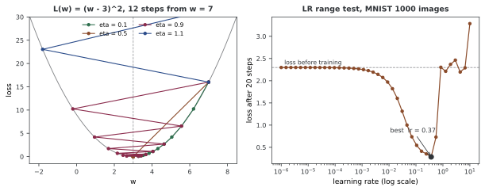

# 러닝레이트와 이동 폭

**러닝레이트**(보통 $\eta$, $\alpha$, 코드에서는 `lr`)는 경사를 얼마나 믿고 걸을지를 정하는 수다.

$$\theta_{t+1} = \theta_t - \eta \nabla_\theta L(\theta_t)$$

러닝레이트에 대한 조언은 대개 "너무 크면 발산하고 너무 작으면 느리다"로 끝난다. 맞는 말이지만 쓸 수 있는 말은 아니다. **너무 크다는 것이 얼마부터인가**, **가장 좋은 값은 무엇인가**, 그것을 **어떻게 찾는가** 에 답해야 쓸 수 있다. 이 쪽은 그 셋을 수로 바꾼다.

한 가지 미리 짚어 둘 것이 있다. 러닝레이트에 보편적인 "작다"와 "크다"는 없다. 적절한 크기는 로스의 척도, 입력 정규화, 모델과 옵티마이저에 따라 달라진다. **1보다 작다는 이유만으로 작은 러닝레이트라고 판단할 수 없다.**

---

## 1. 수렴 경계는 어디인가

### 이차함수에서는 정확히 답할 수 있다

$a > 0$인 이차 로스 $L(\theta) = \frac{1}{2}a(\theta - \theta^*)^2$를 보자. 경사가 $a(\theta - \theta^*)$이므로 갱신은

$$\theta_{t+1} - \theta^* = (1 - \eta a)(\theta_t - \theta^*)$$

이다. 오차에 매 걸음 $(1 - \eta a)$가 곱해진다는 뜻이다. 따라서

- $|1 - \eta a| < 1$, 곧 $0 < \eta < \dfrac{2}{a}$ 이면 수렴하고
- $1 - \eta a = 0$, 곧 $\eta = \dfrac{1}{a}$ 이면 **한 걸음에** 끝나며
- $|1 - \eta a| > 1$ 이면 발산한다

### 경계가 정말 그곳에 있는가

$a = 4$로 두면 경계는 $2/a = 0.5$, 최적은 $1/a = 0.25$다. 50걸음을 걸어 본다.

```
  a = 4.0,  1/a = 0.25,  2/a = 0.5
  eta      50 걸음 뒤 |x - x*|     1-eta*a
  0.05          1.427248e-05   +0.8000
  0.25          0.000000e+00   +0.0000
  0.45          1.427248e-05   -0.8000
  0.49          1.298858e-01   -0.9600
  0.5           1.000000e+00   -1.0000
  0.51          7.106683e+00   -1.0400
  0.6           2.024892e+07   -1.4000
```

$\eta = 0.25$에서 오차가 **정확히 0** 이다. 50걸음이 아니라 첫 걸음에 그렇게 되었고 나머지 49걸음은 할 일이 없었다.

$\eta = 0.05$와 $\eta = 0.45$가 **같은 값** 1.427248e-05로 끝난 것이 눈에 띈다. $1 - \eta a$가 각각 $+0.8$과 $-0.8$이기 때문이다. 부호만 다르고 크기가 같으니 50번 곱한 결과의 절댓값도 같다. **최적값의 양쪽으로 같은 거리만큼 떨어지면 같은 속도로 수렴한다** — 다만 한쪽은 한 방향으로 미끄러져 내려가고 다른 쪽은 좌우로 튕기며 내려간다.

경계인 $\eta = 0.5$에서는 오차가 처음 그대로인 1.0이다. 다섯 걸음을 들여다보면 무슨 일이 벌어지는지 알 수 있다.

```
  eta = 0.5 에서 x 가 어떻게 되는지 다섯 걸음만:
    걸음 1: x = -1.0000
    걸음 2: x = +1.0000
    걸음 3: x = -1.0000
    걸음 4: x = +1.0000
    걸음 5: x = -1.0000
    부호만 뒤집으며 제자리다. 로스도 그대로다
```

최솟값을 사이에 두고 정확히 같은 거리만큼 건너뛰기를 되풀이한다. 로스는 영원히 줄지 않지만 커지지도 않는다. 이 자리를 한 걸음만 넘기면($\eta = 0.51$) 50걸음 만에 오차가 7.1이 되고, 조금 더 넘기면($\eta = 0.6$) $2 \times 10^7$으로 터진다.



왼쪽 그림의 $\eta = 0.1$(초록)과 $\eta = 0.9$(자주)를 견주어 보라. $L(w) = (w-3)^2$에서 경사가 $2(w-3)$이므로 $1 - 2\eta$가 각각 $+0.8$과 $-0.8$이다. 열두 걸음 뒤 두 점은 바닥에서 **같은 거리** 에 있다. 가는 모양은 전혀 다른데 수렴 속도는 같다.

---

## 2. "최적 러닝레이트는 $1/L$"은 어디까지 참인가

### 교과서의 $1/L$

$L$-매끄러운(경사가 $L$-립시츠인) 볼록 함수에 대해

$$\|\nabla f(\mathbf{x}) - \nabla f(\mathbf{y})\| \leq L\|\mathbf{x} - \mathbf{y}\|$$

일 때 $0 < \eta \leq 1/L$이면 경사 하강법이 수렴한다. 여기서 $L$은 로스의 이름이 아니라 **경사의 립시츠 상수** 다. 이차형식이라면 헤세 행렬의 가장 큰 고윳값이다.

앞 절의 1차원에서는 $L = a$였고 $\eta^* = 1/a = 1/L$이 한 걸음에 끝내는 값이었다. 그래서 "$1/L$이 최적"이라고 기억하기 쉽다. **차원이 둘 이상이 되면 이 기억이 틀린다.**

### 조건수가 끼어든다

고윳값이 $\mu$와 $L$인 2차원 이차형식을 보자. 갱신은 좌표마다 따로 일어나고, 각 좌표의 축소 비율은 $1 - \eta\mu$와 $1 - \eta L$이다. 전체 수렴 속도는 **둘 중 나쁜 쪽** 이 정한다.

$$\text{수렴률} = \max\big(|1 - \eta\mu|,\ |1 - \eta L|\big)$$

이 최댓값을 가장 작게 만드는 $\eta$는 두 항이 같아지는 곳, 곧 $1 - \eta\mu = -(1 - \eta L)$을 풀어

$$\eta^* = \frac{2}{L + \mu}, \qquad \text{그때의 수렴률} = \frac{\kappa - 1}{\kappa + 1}, \quad \kappa = \frac{L}{\mu}$$

이다. $\mu = 1$, $L = 20$으로 재어 본다.

```
  고윳값 1.0 와 20.0,  조건수 kappa = 20.0
  책에 흔한 1/L = 0.050000
  참 최적 2/(L+mu) = 0.095238

  eta         200 걸음 뒤 ||x||      수렴률 max|1-eta*lam|
  0.010000          1.339797e-01   0.990000
  0.050000          3.505267e-05   0.950000
  0.095200          2.666845e-09   0.904800
  0.095238          2.866660e-09   0.904762
  0.095300          3.331408e-09   0.906000
  0.100000          1.000000e+00   1.000000
  0.110000          6.858817e+15   1.200000

  이론이 말하는 최적 수렴률 (kappa-1)/(kappa+1) = 0.904762
  2/(L+mu) 에서의 수렴률 = 0.904762  — 같다
  1/L 에서의 수렴률       = 0.950000  — 더 나쁘다
```

$1/L = 0.05$에서 200걸음 뒤 오차가 $3.5 \times 10^{-5}$인데, $2/(L+\mu) = 0.0952$에서는 $2.9 \times 10^{-9}$다. **만 배 넘게 차이가 난다.** $1/L$은 "발산하지 않음"을 보장하는 안전한 값이지 가장 빠른 값이 아니다.

경계는 여기서도 정확하다. $2/L = 0.1$에서 $\|x\|$가 정확히 1.0으로 제자리이고, 0.11에서는 $7 \times 10^{15}$로 터진다.

!!! note "0.095238이 0.0952보다 아주 조금 나쁘게 나온 것"
    표에서 참 최적값 0.095238의 결과($2.87 \times 10^{-9}$)가 0.0952의 결과($2.67 \times 10^{-9}$)보다 근소하게 크다. 수렴률 열을 보면 0.904762 < 0.904800으로 이론대로 0.095238이 더 좋다. 어긋나 보이는 까닭은 **200걸음이 짝수** 라서다. 수렴률은 걸음 수가 무한히 많을 때의 점근적인 양이고, 유한한 걸음에서는 두 좌표의 부호가 맞물리는 방식이 끼어든다. 차이는 7%고, 걸음을 늘리면 사라진다.

### 조건수가 커질수록 벌어진다

```
  조건수를 바꿔 가며 1/L 과 2/(L+mu) 가 걸리는 걸음 수:
  kappa   1/L 로 1e-6 까지   2/(L+mu) 로 1e-6 까지
  2                  20                   13
  10                132                   69
  100              1375                  691
  1000            13809                 6908
```

조건수가 커지면 두 값의 비가 2에 가까워진다. $\kappa = 1000$에서 $1/L$을 쓰면 꼭 두 배의 걸음이 든다.

**이것이 실무에서 뜻하는 바**는 이렇다. 손실 곡면의 조건수를 모르면 최적 러닝레이트도 모른다. 그리고 어떤 $\eta$를 골라도 수렴 속도의 상한은 $\frac{\kappa-1}{\kappa+1}$에 묶여 있다 — **러닝레이트를 잘 고르는 것만으로는 나쁜 조건수를 고칠 수 없다.** 그래서 모멘텀, 전처리, 정규화 같은 것들이 따로 필요하다.

---

## 3. 러닝레이트 탐색기

조건수를 알 수 없는 실제 문제에서는 재어서 찾는 수밖에 없다. **러닝레이트 탐색기**(LR range test)는 러닝레이트를 로그 눈금으로 늘려 가며 짧게 학습해 보고, 로스가 잘 내려가는 구간과 터지는 구간을 눈으로 보는 방법이다.

MNIST 1,000장에 작은 MLP를 올리고, 러닝레이트마다 **똑같이 20걸음씩** 걸은 뒤의 로스를 찍었다.

```
  시작 로스 2.2976  (20 걸음 전)
  lr          20 걸음 뒤 로스
  1.000e-06       2.2975  
  1.512e-06       2.2975  
  2.285e-06       2.2975  
  3.455e-06       2.2974  
  5.223e-06       2.2973  
  7.897e-06       2.2972  
  1.194e-05       2.2971  
  1.805e-05       2.2968  
  2.728e-05       2.2964  
  4.125e-05       2.2958  
  6.236e-05       2.2949  
  9.427e-05       2.2935  
  1.425e-04       2.2914  
  2.154e-04       2.2883  
  3.257e-04       2.2836  
  4.924e-04       2.2766  
  7.444e-04       2.2660  
  1.125e-03       2.2504  
  1.701e-03       2.2272  
  2.572e-03       2.1931  
  3.888e-03       2.1437  
  5.878e-03       2.0728  
  8.886e-03       1.9701  
  1.343e-02       1.8198  
  2.031e-02       1.6019  
  3.070e-02       1.3124  
  4.642e-02       1.0008  
  7.017e-02       0.7373  
  1.061e-01       0.5446  
  1.604e-01       0.4121  
  2.424e-01       0.3512  
  3.665e-01       0.2840  
  5.541e-01       0.7300  
  8.377e-01       2.3028  나빠짐
  1.266e+00       2.2121  
  1.914e+00       2.3673  나빠짐
  2.894e+00       2.4632  나빠짐
  4.375e+00       2.1952  
  6.615e+00       2.2904  
  1.000e+01       3.2858  나빠짐

  가장 낮은 로스 0.2840 가 lr = 3.665e-01 에서 나왔다
  로스가 시작값보다 나빠지기 시작한 가장 작은 lr = 8.377e-01
```

곡선이 세 구간으로 나뉜다. 그림의 오른쪽 판에 그 모양이 있다.

1. **$10^{-6}$에서 $10^{-3}$까지 — 평평하다.** 로스가 2.2975에서 2.2504로 겨우 0.05 줄었다. 걸음이 너무 작아 20걸음으로는 아무 일도 일어나지 않는다
2. **$10^{-2}$에서 $0.37$까지 — 가파르게 내려간다.** 쓸 만한 구간이다
3. **$0.55$를 넘으면 — 치솟는다.** 0.2840에서 0.7300으로, 다시 2.3028로

!!! warning "절벽 너머의 수는 읽지 말 것"
    표에서 $1.266$의 로스 2.2121이 시작값 2.2976보다 낮다고 해서 그 러닝레이트가 쓸 만한 것이 아니다. 그 지점에서 모델은 이미 무너져 **모든 입력에 같은 답** 을 내고 있고, 10개 분류에서 그 상태의 로스가 $\ln 10 = 2.303$ 근처다. 절벽 오른쪽의 수들이 2.2와 3.3 사이에서 오르내리는 것은 학습이 아니라 잡음이다. 탐색기의 곡선은 **처음 치솟는 자리까지만** 읽는다.

### 흔한 조언을 재어 보면

탐색기 사용법으로 자주 인용되는 것은 "로스가 터지는 지점보다 한 자릿수 아래를 골라라"다. 이 곡선에 적용하면 $0.838 / 10 = 0.084$다.

그런데 실제로 가장 낮은 로스를 준 값은 **0.37** 이다. 조언을 따르면 최적의 4분의 1에 못 미치는 값을 고르게 된다. 조언이 틀렸다기보다, **안전 쪽으로 치우쳐 있다.** 20걸음짜리 탐색은 짧은 구간만 보는 것이고 긴 학습에서는 절벽 근처가 불안정해지므로 여유를 두는 것이 합당하다. 다만 그 여유가 얼마인지는 조언이 말해 주지 않으므로, 고른 값을 본 학습에서 다시 확인해야 한다.

!!! note "탐색은 모델을 더럽힌다"
    탐색은 실제로 파라메터를 갱신한다. 본 학습 전에 **초기 상태를 복원** 해야 한다. 위 측정은 러닝레이트마다 `torch.manual_seed(0)`으로 모델을 새로 만들어 이 문제를 피했다.

---

## 4. 러닝레이트 스케줄

고정 러닝레이트는 처음에는 너무 작고 끝에는 너무 크기 쉽다. 그래서 학습이 진행되면서 줄인다. PyTorch의 스케줄러들이 실제로 내놓는 값을 찍어 보면 각각의 성격이 분명해진다.

```
  에폭      StepLR(5, 0.5)  Exponential(0.9)      Cosine(T=20)   Linear warmup 5
     0          0.100000          0.100000          0.100000          0.020000
     1          0.100000          0.090000          0.099384          0.040000
     2          0.100000          0.081000          0.097553          0.060000
     3          0.100000          0.072900          0.094550          0.080000
     4          0.100000          0.065610          0.090451          0.100000
     5          0.050000          0.059049          0.085355          0.100000
     6          0.050000          0.053144          0.079389          0.100000
     7          0.050000          0.047830          0.072700          0.100000
     8          0.050000          0.043047          0.065451          0.100000
     9          0.050000          0.038742          0.057822          0.100000
    10          0.025000          0.034868          0.050000          0.100000
    11          0.025000          0.031381          0.042178          0.100000
    12          0.025000          0.028243          0.034549          0.100000
    13          0.025000          0.025419          0.027300          0.100000
    14          0.025000          0.022877          0.020611          0.100000
    15          0.012500          0.020589          0.014645          0.100000
    16          0.012500          0.018530          0.009549          0.100000
    17          0.012500          0.016677          0.005450          0.100000
    18          0.012500          0.015009          0.002447          0.100000
    19          0.012500          0.013509          0.000616          0.100000
  StepLR(5, 0.5)     마지막 0.012500  처음 대비 0.1250
  Exponential(0.9)   마지막 0.013509  처음 대비 0.1351
  Cosine(T=20)       마지막 0.000616  처음 대비 0.0062
  Linear warmup 5    마지막 0.100000  처음 대비 5.0000
```

읽을 거리가 몇 가지 있다.

**StepLR과 Exponential이 거의 같은 곳에 도착한다.** 0.0125와 0.0135로 마지막 값이 비슷하다. $0.5^4 = 0.0625$와 $0.9^{19} = 0.135$가 다른 경로를 거쳐 비슷한 자리에 온 것이다. 가는 모양은 다르다 — StepLR은 다섯 에폭마다 계단을 내려가고 Exponential은 매끄럽게 미끄러진다.

**코사인만 0에 닿는다.** 0.000616으로 처음의 0.6%다. 마지막 몇 에폭 동안 사실상 멈춰 서서 자리를 다듬는 셈이다. 이것이 코사인 스케줄이 널리 쓰이는 까닭의 하나인데, **$T_{max}$를 실제 학습 길이에 맞춰야** 한다. 20에폭으로 설정하고 40에폭을 돌리면 뒤쪽 절반은 러닝레이트가 다시 올라간다.

**워밍업은 줄이는 것이 아니라 키우는 것이다.** 0.02에서 시작해 다섯 에폭에 걸쳐 0.1에 닿은 뒤 그대로 간다. 학습 초기에 파라메터가 무작위라 경사가 믿을 만하지 않은 구간을 조심스럽게 지나가려는 것이다.

---

## 5. 러닝레이트와 배치 크기

### 선형 비례 규칙

배치 크기를 $k$배로 늘릴 때 러닝레이트도 $k$배로 늘려 보는 경험적 규칙이 있다.

$$\eta_{\text{new}} = k \cdot \eta_{\text{old}}$$

직관은 이렇다. 작은 배치로 $k$번 갱신하는 동안 경사가 거의 변하지 않는다면, 그 $k$번은 $k$배 큰 한 걸음으로 근사된다. 법칙이 아니라 요령이고, 어디까지 통하는지 재어 보는 수밖에 없다.

MNIST 6,000장, 3에폭, 씨앗 셋으로 쟀다. 기준은 배치 32에 러닝레이트 0.05다.

```
  배치   걸음   lr(k배)   정확도 평균  퍼짐         lr 그대로일 때
  32     564    0.050      89.02%  87.90~89.65    89.02% (87.90~89.65)
  64     282    0.100      89.57%  89.25~89.80    88.43% (88.40~88.45)
  128    141    0.200      89.32%  88.90~89.90    87.15% (86.80~87.50)
  256    72     0.400      88.45%  87.95~88.80    84.83% (84.40~85.20)
  512    36     0.800      47.47%  38.70~59.80    80.68% (79.25~81.95)
```

$k = 8$까지는 러닝레이트를 함께 키운 쪽이 낫다. 배치 256에서 88.45% 대 84.83%로 3.6%p 차이이고, 퍼짐(87.95~88.80과 84.40~85.20)이 겹치지 않으므로 실제 차이다.

$k = 16$에서 뒤집힌다. 47.47%에 퍼짐이 38.70~59.80으로 20%p가 넘는다. 비례 규칙이 깨진 것처럼 보인다.

### 그런데 걸음 수도 함께 줄었다

표의 두 번째 열을 보라. 배치를 16배 키우면 같은 에폭 수에서 **갱신 횟수가 16배 준다.** 564걸음이 36걸음이 되었다. 배치 512에서 본 참사가 "러닝레이트 0.8이 너무 커서"인지 "36걸음으로는 어차피 못 배워서"인지 이 표만으로는 가를 수 없다. 갈라 보자.

```
  배치 512 에서 걸음 수를 맞춰 주면 (씨앗 3개)
     3 에폭 ( 36 걸음)  lr 0.8    47.47%  퍼짐 38.70~59.80
     3 에폭 ( 36 걸음)  lr 0.05   80.68%  퍼짐 79.25~81.95
    48 에폭 (576 걸음)  lr 0.8    89.02%  퍼짐 88.30~89.65
    48 에폭 (576 걸음)  lr 0.05   89.67%  퍼짐 89.50~89.95
```

**답이 나온다.** 걸음을 576으로(배치 32의 564걸음과 거의 같게) 맞추면 러닝레이트 0.8도 89.02%까지 올라온다. 퍼짐도 88.30~89.65로 멀쩡하다. $k=16$의 참사는 비례 규칙이 깨져서가 아니라 **36걸음밖에 돌지 않아서** 였다.

동시에 두 번째 결론도 나온다. 걸음을 맞춘 뒤에는 러닝레이트를 키운 쪽이 **더 낫지 않다**(89.02% 대 89.67%, 퍼짐 88.30~89.65와 89.50~89.95가 거의 겹치지 않는다). 이 문제 크기에서 선형 비례의 이득은 없고, 굳이 따지면 손해다.

!!! warning "배치를 키우면 에폭 수를 다시 생각해야 한다"
    "배치만 바꾸고 에폭은 그대로"는 **학습량을 줄이는 변경** 이다. 큰 배치의 실험이 나쁘게 나올 때 가장 흔한 원인이 러닝레이트가 아니라 이것이다. 비교하려면 에폭이 아니라 갱신 횟수나 처리한 표본 수를 맞춰야 한다.

### 이 측정이 말하지 않는 것

여기서 본 것은 MNIST 6,000장에 2층 MLP, 배치 512까지다. 실제로 선형 비례 규칙이 인용되는 자리(ImageNet에 배치 8,192 같은)와는 규모가 다르고, 그런 자리에서는 워밍업이 함께 쓰인다. **이 표로 선형 비례 규칙 자체를 판정할 수는 없다.** 말할 수 있는 것은 두 가지다 — 이 크기에서는 $k=8$까지 쓸 만했고, 걸음 수를 맞추지 않은 비교는 러닝레이트에 대해 아무것도 말해 주지 않는다.

---

## 6. 적응적 러닝레이트

**Adam**, **RMSprop**, **AdaGrad** 는 경사의 통계를 써서 파라메터 성분별로 걸음을 다르게 준다. 대략의 꼴은 이렇다.

$$\theta_{j,t+1} = \theta_{j,t} - \frac{\eta}{\sqrt{v_{j,t}} + \epsilon} \cdot m_{j,t}$$

정확한 규칙에는 이동 평균의 바이어스 보정이 더 들어간다. 자세한 것은 [Adam 옵티마이저](../../ch09/optimizers/adam.md)에서 다룬다.

2절의 관점에서 보면 이 방법들이 무엇을 하는지가 분명해진다. 좌표마다 걸음을 다르게 준다는 것은 **좌표계를 다시 재는 것** 이고, 곧 조건수를 낮추려는 시도다. 2절에서 본 대로 러닝레이트를 아무리 잘 골라도 수렴률이 $\frac{\kappa-1}{\kappa+1}$에 묶여 있으므로, 그 벽을 넘으려면 $\kappa$ 자체를 건드려야 한다.

적응적 방법을 쓴다고 러닝레이트를 안 골라도 되는 것은 아니다. 위 식의 $\eta$가 여전히 남아 있다. 다만 **쓸 만한 범위가 넓어진다.**

---

## 7. 진단

### 너무 클 때

- 로스가 늘거나 심하게 진동한다
- `nan`이나 `inf`가 나타난다
- 경사 노름이 폭발한다
- 여러 씨앗 사이의 퍼짐이 커진다 — 5절의 배치 512, lr 0.8이 38.70~59.80이었던 것이 그 예다

### 너무 작을 때

- 로스가 거의 평평하다 — 3절 곡선의 $10^{-6} \sim 10^{-3}$ 구간처럼
- 학습이 비합리적으로 오래 걸린다

### 진단할 때 조심할 것

러닝레이트는 로스가 안 내려가는 **여러 원인 가운데 하나일 뿐이다.** 경사 단절, 모델 용량 부족, 잘못된 로스 구현, 정규화 누락, 데이터 문제가 모두 비슷하게 보인다. 러닝레이트를 두세 자릿수 바꿔 보아도 그림이 그대로라면 원인은 다른 데 있다.

5절이 보여 준 함정도 기억해 둘 만하다. **배치 크기를 바꾸면서 에폭을 그대로 두면** 러닝레이트와 무관한 이유로 결과가 나빠지고, 그것을 러닝레이트 탓으로 오해하기 쉽다.

---

## 8. 다른 주제와의 연결

- **스케줄러**: 러닝레이트 스케줄러를 다루는 절에서 더 자세히 본다
- **Adam**: [Adam 옵티마이저](../../ch09/optimizers/adam.md)의 파라메터별 러닝레이트
- **배치 크기**: [배치, 미니배치, SGD](batch_minibatch_sgd.md)
- **조건수와 곡률**: 모멘텀이 왜 필요한지는 [고전적 모멘텀](../../ch09/optimizers/momentum.md)에서 다룬다

---

## 9. 전체 코드와 출력

지금까지 인용한 수는 모두 아래 한 프로그램에서 나온 것이다. MNIST를 읽으므로 저장소 뿌리에서 돌린다.

```python
"""러닝레이트 — 얼마나 걸을 것인가.

러닝레이트에 대한 조언은 대개 "너무 크면 발산하고 너무 작으면 느리다" 로
끝난다. 맞는 말이지만 쓸 수 있는 말은 아니다. 이 쪽은 수로 바꾼다.

- 수렴 경계 eta < 2/a 가 정말 경계인가
- "최적 러닝레이트는 1/L" 은 어디까지 참인가 (조건수가 1이 아니면 틀리다)
- 러닝레이트 탐색기가 그리는 곡선은 어떻게 생겼나
- 흔한 스케줄들이 실제로 내놓는 값
- 배치를 k 배 키우면 러닝레이트도 k 배인가

MNIST 를 쓰는 부분은 저장소 뿌리에서 돌리는 것을 전제로 한다 (./data).

실행: 이 쪽의 코드를 파일로 갈무리해 돌린다
"""
import math

import numpy as np
import torch
import torch.nn as nn

DEV = "mps" if torch.backends.mps.is_available() else "cpu"


def header(title):
    print(f"\n=== {title} ===")


# ========================================================================
# 1. 1차원 이차함수 — 경계가 정말 2/a 인가
# ========================================================================

def one_dim_boundary():
    header("1. L = a(x-x*)^2 / 2 에서 수렴 경계")
    a, x0 = 4.0, 1.0           # 2/a = 0.5, 1/a = 0.25
    print(f"  a = {a},  1/a = {1/a},  2/a = {2/a}")
    print("  eta      50 걸음 뒤 |x - x*|     1-eta*a")
    for eta in (0.05, 0.25, 0.45, 0.49, 0.5, 0.51, 0.6):
        x = x0
        for _ in range(50):
            x = x - eta * a * x
        r = 1 - eta * a
        shown = f"{abs(x):.6e}" if abs(x) < 1e30 else "넘침"
        print(f"  {eta:<7} {shown:>18}   {r:+.4f}")
    print("  eta = 0.25 에서 한 걸음 만에 정확히 0 이 된다 (1-eta*a = 0)")
    print("  eta = 0.5 에서 |1-eta*a| = 1 — 줄지도 늘지도 않고 튕긴다")
    print("  eta = 0.51 부터 늘어난다. 경계는 식이 말한 그대로 2/a 다")

    print("\n  eta = 0.5 에서 x 가 어떻게 되는지 다섯 걸음만:")
    x = x0
    for t in range(5):
        x = x - 0.5 * a * x
        print(f"    걸음 {t+1}: x = {x:+.4f}")
    print("    부호만 뒤집으며 제자리다. 로스도 그대로다")


# ========================================================================
# 2. 조건수가 1이 아니면 1/L 은 최적이 아니다
# ========================================================================

def condition_number():
    header("2. 2차원 — 최적 러닝레이트는 1/L 이 아니다")
    # L(x) = (mu x1^2 + L x2^2) / 2,  고윳값 mu 와 L
    mu, LL = 1.0, 20.0
    kappa = LL / mu
    print(f"  고윳값 {mu} 와 {LL},  조건수 kappa = {kappa}")
    print(f"  책에 흔한 1/L = {1/LL:.6f}")
    print(f"  참 최적 2/(L+mu) = {2/(LL+mu):.6f}")

    def run(eta, steps=200):
        x = np.array([1.0, 1.0])
        for _ in range(steps):
            x = x - eta * np.array([mu * x[0], LL * x[1]])
            if not np.isfinite(x).all():
                return float("inf")
        return float(np.linalg.norm(x))

    print("\n  eta         200 걸음 뒤 ||x||      수렴률 max|1-eta*lam|")
    # 1/L = 0.05 이고 2/L = 0.1 이라 겹치는 값은 한 번만 적는다
    for eta in (0.01, 1 / LL, 0.0952, 2 / (LL + mu), 0.0953, 2 / LL, 0.11):
        rate = max(abs(1 - eta * mu), abs(1 - eta * LL))
        v = run(eta)
        shown = f"{v:.6e}" if math.isfinite(v) else "넘침"
        print(f"  {eta:<11.6f} {shown:>18}   {rate:.6f}")

    best = (kappa - 1) / (kappa + 1)
    print(f"\n  이론이 말하는 최적 수렴률 (kappa-1)/(kappa+1) = {best:.6f}")
    print(f"  2/(L+mu) 에서의 수렴률 = "
          f"{max(abs(1-2/(LL+mu)*mu), abs(1-2/(LL+mu)*LL)):.6f}  — 같다")
    print(f"  1/L 에서의 수렴률       = "
          f"{max(abs(1-1/LL*mu), abs(1-1/LL*LL)):.6f}  — 더 나쁘다")
    print("  1/L 은 '발산하지 않음' 을 보장하는 값이지 가장 빠른 값이 아니다")
    print("  두 값의 차이는 조건수가 클수록 벌어진다")

    print("\n  조건수를 바꿔 가며 1/L 과 2/(L+mu) 가 걸리는 걸음 수:")
    print("  kappa   1/L 로 1e-6 까지   2/(L+mu) 로 1e-6 까지")
    for k in (2, 10, 100, 1000):
        m2, l2 = 1.0, float(k)
        out = []
        for eta in (1 / l2, 2 / (l2 + m2)):
            rate = max(abs(1 - eta * m2), abs(1 - eta * l2))
            out.append(math.ceil(math.log(1e-6) / math.log(rate)))
        print(f"  {k:<7} {out[0]:>13}   {out[1]:>18}")


# ========================================================================
# 3. 러닝레이트 탐색기
# ========================================================================

def lr_finder():
    header("3. 러닝레이트 탐색기 (MNIST 1000장, MLP)")
    from torchvision import datasets, transforms

    tf = transforms.Compose([transforms.ToTensor(),
                             transforms.Normalize((0.1307,), (0.3081,))])
    train = datasets.MNIST("./data", train=True, download=False, transform=tf)
    idx = torch.arange(1000)
    X = torch.stack([train[i][0] for i in idx]).view(1000, -1).to(DEV)
    Y = torch.tensor([train[i][1] for i in idx]).to(DEV)

    def fresh():
        torch.manual_seed(0)
        return nn.Sequential(nn.Linear(784, 128), nn.ReLU(),
                             nn.Linear(128, 10)).to(DEV)

    lrs = np.logspace(-6, 1, 40)
    losses = []
    for lr in lrs:
        m = fresh()
        opt = torch.optim.SGD(m.parameters(), lr=float(lr))
        for _ in range(20):                    # 같은 20 걸음씩만
            opt.zero_grad()
            loss = nn.functional.cross_entropy(m(X), Y)
            loss.backward()
            opt.step()
        losses.append(float(loss.item()))

    start = float(nn.functional.cross_entropy(fresh()(X), Y).item())
    print(f"  시작 로스 {start:.4f}  (20 걸음 전)")
    print("  lr          20 걸음 뒤 로스")
    for lr, l in zip(lrs, losses):
        if not math.isfinite(l):
            mark, shown = "발산", "nan"
        elif l > start:
            mark, shown = "나빠짐", f"{l:.4f}"
        else:
            mark, shown = "", f"{l:.4f}"
        print(f"  {lr:<11.3e} {shown:>10}  {mark}")

    fin = [(lr, l) for lr, l in zip(lrs, losses) if math.isfinite(l)]
    best_lr, best_l = min(fin, key=lambda p: p[1])
    print(f"\n  가장 낮은 로스 {best_l:.4f} 가 lr = {best_lr:.3e} 에서 나왔다")
    diverged = [lr for lr, l in zip(lrs, losses)
                if not math.isfinite(l) or l > start]
    if diverged:
        print(f"  로스가 시작값보다 나빠지기 시작한 가장 작은 lr = "
              f"{min(diverged):.3e}")
    print("  흔한 조언은 '발산 지점보다 한 자릿수 아래' 를 고르라는 것이다")
    print("  이 곡선에서 그 값은 대략", f"{min(diverged)/10:.3e}" if diverged
          else "(발산 지점 없음)")
    return lrs, losses, start      # figures/make_figures.py 가 이 값을 쓴다


# ========================================================================
# 4. 스케줄이 실제로 내놓는 값
# ========================================================================

def schedules():
    header("4. 스케줄이 내놓는 값 (lr0 = 0.1, 20 에폭)")
    p = nn.Parameter(torch.zeros(1))

    def trace(make, n=20):
        opt = torch.optim.SGD([p], lr=0.1)
        sch = make(opt)
        out = []
        for _ in range(n):
            out.append(opt.param_groups[0]["lr"])
            opt.step()
            sch.step()
        return out

    rows = {
        "StepLR(5, 0.5)": trace(
            lambda o: torch.optim.lr_scheduler.StepLR(o, 5, 0.5)),
        "Exponential(0.9)": trace(
            lambda o: torch.optim.lr_scheduler.ExponentialLR(o, 0.9)),
        "Cosine(T=20)": trace(
            lambda o: torch.optim.lr_scheduler.CosineAnnealingLR(o, 20)),
        "Linear warmup 5": trace(
            lambda o: torch.optim.lr_scheduler.LambdaLR(
                o, lambda e: min(1.0, (e + 1) / 5))),
    }
    print("  에폭  " + "  ".join(f"{k:>16}" for k in rows))
    for e in range(20):
        print(f"  {e:>4}  " + "  ".join(f"{v[e]:>16.6f}"
                                        for v in rows.values()))
    for k, v in rows.items():
        print(f"  {k:<18} 마지막 {v[-1]:.6f}  처음 대비 "
              f"{v[-1]/v[0]:.4f}")
    print("  코사인은 마지막에 0 으로 간다. 워밍업은 5 에폭에 제값에 닿는다")


# ========================================================================
# 5. 배치를 k 배 키우면 러닝레이트도 k 배인가
# ========================================================================

def linear_scaling():
    header("5. 선형 비례 규칙 (MNIST 6000장, 3 에폭, 씨앗 3개)")
    from torchvision import datasets, transforms

    tf = transforms.Compose([transforms.ToTensor(),
                             transforms.Normalize((0.1307,), (0.3081,))])
    train = datasets.MNIST("./data", train=True, download=False, transform=tf)
    test = datasets.MNIST("./data", train=False, download=False, transform=tf)
    Xtr = torch.stack([train[i][0] for i in range(6000)]).view(6000, -1).to(DEV)
    Ytr = torch.tensor([train[i][1] for i in range(6000)]).to(DEV)
    Xte = torch.stack([test[i][0] for i in range(2000)]).view(2000, -1).to(DEV)
    Yte = torch.tensor([test[i][1] for i in range(2000)]).to(DEV)

    def run(batch, lr, seed, epochs=3):
        torch.manual_seed(seed)
        m = nn.Sequential(nn.Linear(784, 128), nn.ReLU(),
                          nn.Linear(128, 10)).to(DEV)
        opt = torch.optim.SGD(m.parameters(), lr=lr)
        g = torch.Generator().manual_seed(seed)
        steps = 0
        for _ in range(epochs):
            perm = torch.randperm(6000, generator=g).to(DEV)
            for i in range(0, 6000, batch):
                b = perm[i:i + batch]
                opt.zero_grad()
                nn.functional.cross_entropy(m(Xtr[b]), Ytr[b]).backward()
                opt.step()
                steps += 1
        with torch.no_grad():
            acc = (m(Xte).argmax(1) == Yte).float().mean().item() * 100
        return acc, steps

    base_b, base_lr = 32, 0.05
    print(f"  기준: 배치 {base_b}, lr {base_lr}")
    print("  배치   걸음   lr(k배)   정확도 평균  퍼짐         lr 그대로일 때")
    for k in (1, 2, 4, 8, 16):
        b = base_b * k
        scaled = [run(b, base_lr * k, s) for s in (0, 1, 2)]
        same = [run(b, base_lr, s) for s in (0, 1, 2)]
        acc_s = [a for a, _ in scaled]
        acc_m = [a for a, _ in same]
        print(f"  {b:<6} {scaled[0][1]:<6} {base_lr*k:<9.3f} "
              f"{np.mean(acc_s):6.2f}%  {min(acc_s):5.2f}~{max(acc_s):5.2f}   "
              f"{np.mean(acc_m):6.2f}% ({min(acc_m):5.2f}~{max(acc_m):5.2f})")
    print("  k = 8 까지는 lr 을 함께 키운 쪽이 낫다. k = 16 에서 뒤집힌다 —")
    print("  비례한 lr 0.8 의 퍼짐이 20%p 를 넘고 평균도 한참 낮다")

    # 그런데 걸음 수가 함께 줄었다. 둘을 갈라 놓고 다시 본다.
    print("\n  배치 512 에서 걸음 수를 맞춰 주면 (씨앗 3개)")
    for ep in (3, 48):
        for lr in (0.8, 0.05):
            v = [run(512, lr, s, epochs=ep) for s in (0, 1, 2)]
            acc = [a for a, _ in v]
            print(f"    {ep:>2} 에폭 ({v[0][1]:>3} 걸음)  lr {lr:<5} "
                  f"{np.mean(acc):6.2f}%  퍼짐 {min(acc):5.2f}~{max(acc):5.2f}")
    print("  576 걸음으로 (배치 32 의 564 걸음과 거의 같게) 맞추면")
    print("  lr 0.8 도 89.02% 까지 올라온다")
    print("  k = 16 의 참사는 비례 규칙이 깨져서가 아니라 36 걸음밖에")
    print("  돌지 않아서였다. 배치를 16배 키우면 에폭당 걸음이 16배 준다")
    print("  다만 걸음을 맞춘 뒤에도 lr 을 키운 쪽이 더 낫지는 않다")
    print("  (89.02% 대 89.67%). 이 문제 크기에서 비례 규칙의 이득은 없다")


def main():
    one_dim_boundary()
    condition_number()
    lr_finder()
    schedules()
    linear_scaling()


if __name__ == "__main__":
    main()
```

??? note "전체 출력 (148줄)"

    ```
    === 1. L = a(x-x*)^2 / 2 에서 수렴 경계 ===
      a = 4.0,  1/a = 0.25,  2/a = 0.5
      eta      50 걸음 뒤 |x - x*|     1-eta*a
      0.05          1.427248e-05   +0.8000
      0.25          0.000000e+00   +0.0000
      0.45          1.427248e-05   -0.8000
      0.49          1.298858e-01   -0.9600
      0.5           1.000000e+00   -1.0000
      0.51          7.106683e+00   -1.0400
      0.6           2.024892e+07   -1.4000
      eta = 0.25 에서 한 걸음 만에 정확히 0 이 된다 (1-eta*a = 0)
      eta = 0.5 에서 |1-eta*a| = 1 — 줄지도 늘지도 않고 튕긴다
      eta = 0.51 부터 늘어난다. 경계는 식이 말한 그대로 2/a 다

      eta = 0.5 에서 x 가 어떻게 되는지 다섯 걸음만:
        걸음 1: x = -1.0000
        걸음 2: x = +1.0000
        걸음 3: x = -1.0000
        걸음 4: x = +1.0000
        걸음 5: x = -1.0000
        부호만 뒤집으며 제자리다. 로스도 그대로다

    === 2. 2차원 — 최적 러닝레이트는 1/L 이 아니다 ===
      고윳값 1.0 와 20.0,  조건수 kappa = 20.0
      책에 흔한 1/L = 0.050000
      참 최적 2/(L+mu) = 0.095238

      eta         200 걸음 뒤 ||x||      수렴률 max|1-eta*lam|
      0.010000          1.339797e-01   0.990000
      0.050000          3.505267e-05   0.950000
      0.095200          2.666845e-09   0.904800
      0.095238          2.866660e-09   0.904762
      0.095300          3.331408e-09   0.906000
      0.100000          1.000000e+00   1.000000
      0.110000          6.858817e+15   1.200000

      이론이 말하는 최적 수렴률 (kappa-1)/(kappa+1) = 0.904762
      2/(L+mu) 에서의 수렴률 = 0.904762  — 같다
      1/L 에서의 수렴률       = 0.950000  — 더 나쁘다
      1/L 은 '발산하지 않음' 을 보장하는 값이지 가장 빠른 값이 아니다
      두 값의 차이는 조건수가 클수록 벌어진다

      조건수를 바꿔 가며 1/L 과 2/(L+mu) 가 걸리는 걸음 수:
      kappa   1/L 로 1e-6 까지   2/(L+mu) 로 1e-6 까지
      2                  20                   13
      10                132                   69
      100              1375                  691
      1000            13809                 6908

    === 3. 러닝레이트 탐색기 (MNIST 1000장, MLP) ===
      시작 로스 2.2976  (20 걸음 전)
      lr          20 걸음 뒤 로스
      1.000e-06       2.2975  
      1.512e-06       2.2975  
      2.285e-06       2.2975  
      3.455e-06       2.2974  
      5.223e-06       2.2973  
      7.897e-06       2.2972  
      1.194e-05       2.2971  
      1.805e-05       2.2968  
      2.728e-05       2.2964  
      4.125e-05       2.2958  
      6.236e-05       2.2949  
      9.427e-05       2.2935  
      1.425e-04       2.2914  
      2.154e-04       2.2883  
      3.257e-04       2.2836  
      4.924e-04       2.2766  
      7.444e-04       2.2660  
      1.125e-03       2.2504  
      1.701e-03       2.2272  
      2.572e-03       2.1931  
      3.888e-03       2.1437  
      5.878e-03       2.0728  
      8.886e-03       1.9701  
      1.343e-02       1.8198  
      2.031e-02       1.6019  
      3.070e-02       1.3124  
      4.642e-02       1.0008  
      7.017e-02       0.7373  
      1.061e-01       0.5446  
      1.604e-01       0.4121  
      2.424e-01       0.3512  
      3.665e-01       0.2840  
      5.541e-01       0.7300  
      8.377e-01       2.3028  나빠짐
      1.266e+00       2.2121  
      1.914e+00       2.3673  나빠짐
      2.894e+00       2.4632  나빠짐
      4.375e+00       2.1952  
      6.615e+00       2.2904  
      1.000e+01       3.2858  나빠짐

      가장 낮은 로스 0.2840 가 lr = 3.665e-01 에서 나왔다
      로스가 시작값보다 나빠지기 시작한 가장 작은 lr = 8.377e-01
      흔한 조언은 '발산 지점보다 한 자릿수 아래' 를 고르라는 것이다
      이 곡선에서 그 값은 대략 8.377e-02

    === 4. 스케줄이 내놓는 값 (lr0 = 0.1, 20 에폭) ===
      에폭    StepLR(5, 0.5)  Exponential(0.9)      Cosine(T=20)   Linear warmup 5
         0          0.100000          0.100000          0.100000          0.020000
         1          0.100000          0.090000          0.099384          0.040000
         2          0.100000          0.081000          0.097553          0.060000
         3          0.100000          0.072900          0.094550          0.080000
         4          0.100000          0.065610          0.090451          0.100000
         5          0.050000          0.059049          0.085355          0.100000
         6          0.050000          0.053144          0.079389          0.100000
         7          0.050000          0.047830          0.072700          0.100000
         8          0.050000          0.043047          0.065451          0.100000
         9          0.050000          0.038742          0.057822          0.100000
        10          0.025000          0.034868          0.050000          0.100000
        11          0.025000          0.031381          0.042178          0.100000
        12          0.025000          0.028243          0.034549          0.100000
        13          0.025000          0.025419          0.027300          0.100000
        14          0.025000          0.022877          0.020611          0.100000
        15          0.012500          0.020589          0.014645          0.100000
        16          0.012500          0.018530          0.009549          0.100000
        17          0.012500          0.016677          0.005450          0.100000
        18          0.012500          0.015009          0.002447          0.100000
        19          0.012500          0.013509          0.000616          0.100000
      StepLR(5, 0.5)     마지막 0.012500  처음 대비 0.1250
      Exponential(0.9)   마지막 0.013509  처음 대비 0.1351
      Cosine(T=20)       마지막 0.000616  처음 대비 0.0062
      Linear warmup 5    마지막 0.100000  처음 대비 5.0000
      코사인은 마지막에 0 으로 간다. 워밍업은 5 에폭에 제값에 닿는다

    === 5. 선형 비례 규칙 (MNIST 6000장, 3 에폭, 씨앗 3개) ===
      기준: 배치 32, lr 0.05
      배치   걸음   lr(k배)   정확도 평균  퍼짐         lr 그대로일 때
      32     564    0.050      89.02%  87.90~89.65    89.02% (87.90~89.65)
      64     282    0.100      89.57%  89.25~89.80    88.43% (88.40~88.45)
      128    141    0.200      89.32%  88.90~89.90    87.15% (86.80~87.50)
      256    72     0.400      88.45%  87.95~88.80    84.83% (84.40~85.20)
      512    36     0.800      47.47%  38.70~59.80    80.68% (79.25~81.95)
      k = 8 까지는 lr 을 함께 키운 쪽이 낫다. k = 16 에서 뒤집힌다 —
      비례한 lr 0.8 의 퍼짐이 20%p 를 넘고 평균도 한참 낮다

      배치 512 에서 걸음 수를 맞춰 주면 (씨앗 3개)
         3 에폭 ( 36 걸음)  lr 0.8    47.47%  퍼짐 38.70~59.80
         3 에폭 ( 36 걸음)  lr 0.05   80.68%  퍼짐 79.25~81.95
        48 에폭 (576 걸음)  lr 0.8    89.02%  퍼짐 88.30~89.65
        48 에폭 (576 걸음)  lr 0.05   89.67%  퍼짐 89.50~89.95
      576 걸음으로 (배치 32 의 564 걸음과 거의 같게) 맞추면
      lr 0.8 도 89.02% 까지 올라온다
      k = 16 의 참사는 비례 규칙이 깨져서가 아니라 36 걸음밖에
      돌지 않아서였다. 배치를 16배 키우면 에폭당 걸음이 16배 준다
      다만 걸음을 맞춘 뒤에도 lr 을 키운 쪽이 더 낫지는 않다
      (89.02% 대 89.67%). 이 문제 크기에서 비례 규칙의 이득은 없다
    ```

---

## 연습문제

<div class="drillbox" markdown>

**연습문제 1.** <span class="diff easy" title="쉬움"></span>
$L(\theta) = \frac{1}{2} \cdot 10 \cdot (\theta - 2)^2$에 대해 (a) 수렴하는 러닝레이트의 범위, (b) 한 걸음에 끝내는 러닝레이트, (c) $\eta = 0.2$일 때 걸음마다 오차에 곱해지는 수를 구하라. (d) $\eta = 0.2$에서 로스는 어떻게 되는가?

</div>

??? success "풀이"
    $a = 10$이다.

    (a) $0 < \eta < 2/a = 0.2$

    (b) $\eta = 1/a = 0.1$

    (c) $1 - \eta a = 1 - 0.2 \times 10 = -1$

    (d) 곱해지는 수의 절댓값이 정확히 1이므로 오차의 크기가 변하지 않는다. $\theta$는 $2 + e$와 $2 - e$를 영원히 오가고, 로스 $\frac{1}{2} \cdot 10 \cdot e^2$도 그대로다. 줄지도 늘지도 않는다.

    (a)의 부등식이 $\leq$가 아니라 $<$인 까닭이 바로 (d)다. 경계값은 수렴하지 않는다.

---

<div class="drillbox" markdown>

**연습문제 2.** <span class="diff med" title="중간"></span>
$a$를 1, 4, 25로 바꾸어 가며 경계의 0.9배·1.0배·1.1배인 러닝레이트로 100걸음을 걸어 보라. 세 $a$에서 결과가 어떻게 다른가?

</div>

??? success "풀이"
    ```python
    import math

    for a in (1.0, 4.0, 25.0):
        print(f"  a = {a:<5} 경계 2/a = {2/a:.4f},  최적 1/a = {1/a:.4f}")
        for eta in (0.9 * 2 / a, 2 / a, 1.1 * 2 / a):
            x = 1.0
            for _ in range(100):
                x = x - eta * a * x
                if not math.isfinite(x):
                    break
            shown = (f"{abs(x):.4e}" if math.isfinite(x) and abs(x) < 1e30
                     else "넘침")
            print(f"    eta = {eta:<8.4f} ({eta*a/2:.1f} x 경계)  "
                  f"100 걸음 뒤 {shown}")
    ```

    ```
      a = 1.0   경계 2/a = 2.0000,  최적 1/a = 1.0000
        eta = 1.8000   (0.9 x 경계)  100 걸음 뒤 2.0370e-10
        eta = 2.0000   (1.0 x 경계)  100 걸음 뒤 1.0000e+00
        eta = 2.2000   (1.1 x 경계)  100 걸음 뒤 8.2818e+07
      a = 4.0   경계 2/a = 0.5000,  최적 1/a = 0.2500
        eta = 0.4500   (0.9 x 경계)  100 걸음 뒤 2.0370e-10
        eta = 0.5000   (1.0 x 경계)  100 걸음 뒤 1.0000e+00
        eta = 0.5500   (1.1 x 경계)  100 걸음 뒤 8.2818e+07
      a = 25.0  경계 2/a = 0.0800,  최적 1/a = 0.0400
        eta = 0.0720   (0.9 x 경계)  100 걸음 뒤 2.0370e-10
        eta = 0.0800   (1.0 x 경계)  100 걸음 뒤 1.0000e+00
        eta = 0.0880   (1.1 x 경계)  100 걸음 뒤 8.2818e+07
    ```

    **세 $a$에서 결과가 조금도 다르지 않다.** 러닝레이트는 1.8에서 0.072까지 25배 차이가 나는데 100걸음 뒤의 오차는 셋 다 똑같다.

    까닭은 갱신식이 $\eta$와 $a$를 따로 보지 않고 **곱 $\eta a$ 로만** 쓰기 때문이다. $x \leftarrow (1 - \eta a)x$이므로 경계의 0.9배라는 말은 $\eta a = 1.8$이라는 뜻이고, 그러면 축소율이 $|1 - 1.8| = 0.8$로 $a$와 무관하게 정해진다.

    실무에서 이 사실이 뜻하는 바는 **러닝레이트 하나만으로는 크고 작음을 말할 수 없다** 는 것이다. $\eta = 1.8$이 안전하고 $\eta = 0.088$이 발산한다. 로스의 곡률과 짝지어 보아야 의미가 생긴다. 로스를 합으로 쓰느냐 평균으로 쓰느냐만 바꿔도 $a$가 배치 크기만큼 달라지고, 그러면 같은 러닝레이트가 전혀 다른 뜻이 된다.

---

<div class="drillbox" markdown>

**연습문제 3.** <span class="diff med" title="중간"></span>
PyTorch의 `CosineAnnealingLR`이 내놓는 값이 $\eta_t = \frac{\eta_0}{2}\left(1 + \cos\frac{\pi t}{T}\right)$와 같은지 확인하라.

</div>

??? success "풀이"
    ```python
    import math
    import torch
    import torch.nn as nn

    p = nn.Parameter(torch.zeros(1))
    opt = torch.optim.SGD([p], lr=0.1)
    sch = torch.optim.lr_scheduler.CosineAnnealingLR(opt, T_max=20)

    print("  에폭   PyTorch      손으로 0.05*(1+cos(pi*t/20))   차이")
    for t in range(0, 21, 4):
        while sch.last_epoch < t:
            opt.step()
            sch.step()
        got = opt.param_groups[0]["lr"]
        hand = 0.1 * (1 + math.cos(math.pi * t / 20)) / 2
        print(f"  {t:>4}   {got:.8f}   {hand:.8f}             "
              f"{abs(got - hand):.2e}")
    ```

    ```
      에폭   PyTorch      손으로 0.05*(1+cos(pi*t/20))   차이
         0   0.10000000   0.10000000             0.00e+00
         4   0.09045085   0.09045085             1.39e-17
         8   0.06545085   0.06545085             1.39e-17
        12   0.03454915   0.03454915             6.94e-18
        16   0.00954915   0.00954915             0.00e+00
        20   0.00000000   0.00000000             0.00e+00
    ```

    열여덟 자리까지 같다. $t = T$에서 $\cos\pi = -1$이므로 러닝레이트가 정확히 0이 된다.

    본문 표의 에폭 19 값 0.000616은 0이 아니었다. $t = 19$이지 $t = 20$이 아니기 때문이다. 20에폭을 돌리면 마지막으로 **쓰이는** 러닝레이트가 $t=19$의 값이고, $t=20$의 0은 쓰이지 않는다.

    `T_max`를 실제 학습 길이와 다르게 주면 어떻게 되는지도 식에서 바로 읽을 수 있다. $t > T$이면 $\cos$이 다시 올라가므로 러닝레이트가 **되올라간다.**

---

<div class="drillbox" markdown>

**연습문제 4.** <span class="diff hard" title="어려움"></span>
고윳값이 $\mu \leq L$인 이차형식에서 $\max(|1-\eta\mu|, |1-\eta L|)$을 최소화하는 $\eta$가 $\frac{2}{L+\mu}$임을 보이고, 그때의 값이 $\frac{\kappa-1}{\kappa+1}$임을 보여라.

</div>

??? success "풀이"
    $g(\eta) = \max(|1-\eta\mu|,\ |1-\eta L|)$라 두자.

    $\eta > 0$에서 $1 - \eta\mu$는 $\eta$에 대해 감소하는 일차함수이고 $1-\eta L$은 더 가파르게 감소한다. $\mu \leq L$이므로 항상 $1 - \eta L \leq 1 - \eta\mu$다.

    $\eta$가 작을 때는 둘 다 양수이고 $|1-\eta\mu| = 1-\eta\mu$가 더 크다. $\eta$가 클 때는 $1-\eta L$이 음수로 깊이 내려가 $|1-\eta L| = \eta L - 1$이 더 크다. 앞의 것은 $\eta$에 대해 감소하고 뒤의 것은 증가하므로, 두 조각의 최댓값인 $g$는 **아래로 볼록한 V자** 꼴이고 최소는 두 조각이 만나는 곳에 있다.

    $$1 - \eta\mu = \eta L - 1 \quad\Longrightarrow\quad 2 = \eta(L + \mu) \quad\Longrightarrow\quad \eta^* = \frac{2}{L+\mu}$$

    그 값은

    $$g(\eta^*) = 1 - \frac{2\mu}{L+\mu} = \frac{L + \mu - 2\mu}{L+\mu} = \frac{L-\mu}{L+\mu}$$

    이고, 분자와 분모를 $\mu$로 나누면 $\kappa = L/\mu$에 대해

    $$g(\eta^*) = \frac{\kappa - 1}{\kappa + 1}$$

    이다. $\square$

    **덧붙임.** 이 식에서 두 가지가 바로 읽힌다. $\kappa = 1$이면 $g = 0$이고 $\eta^* = 1/L$이다 — 1절의 한 걸음 수렴이 이 경우다. 그리고 $\kappa \to \infty$이면 $g \to 1$로, 아무리 러닝레이트를 잘 골라도 수렴이 한없이 느려진다. 본문 표에서 $\kappa = 1000$일 때 6,908걸음이 든 것이 그 모습이다.

---

<div class="drillbox" markdown>

**연습문제 5.** <span class="diff hard" title="어려움"></span>
본문 5절에서 배치 512에 러닝레이트 0.8이 47.47%로 무너졌고, 걸음 수를 맞추면 89.02%로 회복되었다. 그렇다면 **걸음 수는 그대로 두고 워밍업만** 붙이면 얼마나 회복되는가? 재어 보고, 그 결과를 해석할 때 조심해야 할 점을 적어라.

</div>

??? success "풀이"
    ```python
    def run(batch, lr, seed, warm=0):
        torch.manual_seed(seed)
        m = nn.Sequential(nn.Linear(784, 128), nn.ReLU(),
                          nn.Linear(128, 10)).to(DEV)
        opt = torch.optim.SGD(m.parameters(), lr=lr)
        g = torch.Generator().manual_seed(seed)
        step = 0
        for _ in range(3):
            perm = torch.randperm(6000, generator=g).to(DEV)
            for i in range(0, 6000, batch):
                if warm:
                    for pg in opt.param_groups:
                        pg["lr"] = lr * min(1.0, (step + 1) / warm)
                b = perm[i:i + batch]
                opt.zero_grad()
                nn.functional.cross_entropy(m(Xtr[b]), Ytr[b]).backward()
                opt.step()
                step += 1
        with torch.no_grad():
            return (m(Xte).argmax(1) == Yte).float().mean().item() * 100

    for warm in (0, 20, 50):
        v = [run(512, 0.8, s, warm) for s in (0, 1, 2)]
        lab = "워밍업 없음" if warm == 0 else f"워밍업 {warm} 걸음"
        print(f"  배치 512, lr 0.8, {lab:<14} {np.mean(v):6.2f}%  "
              f"퍼짐 {min(v):5.2f}~{max(v):5.2f}")
    ```

    ```
      배치 512, lr 0.8, 워밍업 없음          47.47%  퍼짐 38.70~59.80
      배치 512, lr 0.8, 워밍업 20 걸음       48.10%  퍼짐 41.20~56.85
      배치 512, lr 0.8, 워밍업 50 걸음       62.33%  퍼짐 53.25~70.25
    ```

    워밍업 20걸음은 47.47%를 48.10%로 바꿨을 뿐이다. 퍼짐이 38.70~59.80과 41.20~56.85로 거의 완전히 겹치므로 **차이라고 말할 수 없다.** 50걸음은 62.33%로 올렸지만 89.02%에는 한참 못 미친다.

    **조심할 점이 여기 있다.** 이 설정의 전체 걸음 수는 3에폭 × 12걸음 = **36걸음** 이다. 워밍업 50걸음은 36걸음짜리 학습보다 길다. 즉 "워밍업 50"은 사실상 **러닝레이트가 0.8에 한 번도 닿지 않는 실험** 이고, 실제로 쓰인 최대 러닝레이트는 $0.8 \times 36/50 = 0.576$이다.

    그러니 62.33%라는 수를 "워밍업이 도움이 된다"로 읽으면 안 된다. 올바른 읽기는 **"이 구간에서는 더 작은 러닝레이트가 낫다"** 이고, 그것은 이미 본문 표가 말해 준 것이다(lr 0.05에서 80.68%).

    결론은 이렇다. 36걸음이라는 예산에서는 무엇을 해도 안 된다. 워밍업은 러닝레이트가 큰 구간을 안전하게 지나가게 해 주는 장치이지, **걸음 수가 모자란 것을 메워 주지는 않는다.**

---

## 정리하며

1. **수렴 경계는 곡률이 정한다**: 이차함수에서 $0 < \eta < 2/a$이고, 경계값에서는 최솟값을 사이에 두고 영원히 튕긴다
2. **러닝레이트 하나만으로는 크고 작음을 말할 수 없다**: 갱신은 곱 $\eta a$로만 결정된다. $\eta = 1.8$이 안전하고 $\eta = 0.088$이 발산한다
3. **$1/L$은 최적이 아니다**: 조건수가 1이 아니면 최적은 $2/(L+\mu)$이고, $\kappa = 20$에서 두 값의 200걸음 결과가 만 배 넘게 차이 났다
4. **러닝레이트로 조건수를 고칠 수는 없다**: 어떤 $\eta$를 골라도 수렴률이 $\frac{\kappa-1}{\kappa+1}$에 묶인다. 그래서 모멘텀과 적응적 방법이 따로 있다
5. **탐색기 곡선은 처음 치솟는 자리까지만 읽는다**: 절벽 너머의 수는 무너진 모델이 내는 잡음이다
6. **"터지는 지점의 10분의 1"은 안전 쪽으로 치우쳐 있다**: 이 측정에서 최적은 0.37이고 조언이 가리킨 값은 0.084였다
7. **배치를 바꿀 때는 걸음 수를 먼저 맞춘다**: 배치 512의 47.47%는 러닝레이트 탓이 아니라 36걸음 탓이었고, 576걸음에서 89.02%로 돌아왔다

**참고 문헌**

- Smith, L. N. (2017). Cyclical Learning Rates for Training Neural Networks. *WACV*. arXiv:1506.01186.
- Goyal, P. et al. (2017). Accurate, Large Minibatch SGD: Training ImageNet in 1 Hour. arXiv:1706.02677.
- Loshchilov, I., & Hutter, F. (2017). SGDR: Stochastic Gradient Descent with Warm Restarts. *ICLR*. arXiv:1608.03983.
- Nesterov, Y. (2004). *Introductory Lectures on Convex Optimization*, Chapter 2.
