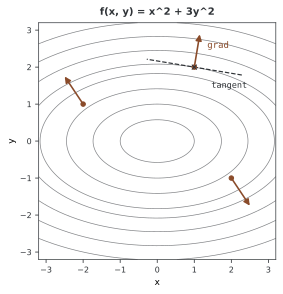
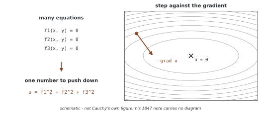

# 경사는 왜 가장 가파른 상승 방향인가

"경사 하강법"이라는 이름은 경사가 **가장 가파른 상승 방향** 을 가리킨다는 사실에서 왔다. 그래서 그 반대로 걸으면 가장 빠르게 내려간다는 것이다.

증명은 세 줄이면 끝난다. 그런데 정작 쓸 때 걸리는 자리는 그 세 줄 안에 없다. 이 쪽은 정리를 증명한 다음, 증명이 말하지 않는 네 가지를 **재어** 본다.

- 방향을 한 바퀴 돌려 보면 정말 경사 쪽이 가장 큰가
- 1차 테일러가 약속한 감소와 실제 감소는 언제 갈라지는가
- "가장 가파름"은 길이를 어떻게 재느냐에 딸려 있다
- 경사 클리핑은 방향을 지키는가

---

## 1. 경사: 정의와 표기

<div class="defn" markdown>

**정의 (경사).** 미분 가능한 스칼라 함수 $f: \mathbb{R}^n \rightarrow \mathbb{R}$에 대해 점 $\mathbf{x}$에서의 **경사** 는 모든 편도함수를 모은 벡터이다.

$$\nabla f(\mathbf{x}) = \begin{bmatrix} \dfrac{\partial f}{\partial x_1} \\[4pt] \dfrac{\partial f}{\partial x_2} \\[2pt] \vdots \\[2pt] \dfrac{\partial f}{\partial x_n} \end{bmatrix}$$

</div>

경사에는 서로 다른 표기가 쓰인다. 같은 것을 가리키므로 책마다 다른 표기를 보더라도 놀랄 필요가 없다.

| 표기 | 의미 |
|----------|---------|
| $\nabla f$ | $f$의 경사(나블라 표기) |
| $\nabla_\theta L$ | $\theta$에 대한 $L$의 경사 |
| $\frac{\partial L}{\partial \theta}$ | 편도함수 표기 |
| $\text{grad } f$ | 경사의 다른 표기 |
| $f'(\mathbf{x})$ | 도함수 표기(1차원) |

<div class="exbox" markdown>

**보기 1.** <span class="diff easy" title="쉬움"></span>
$f(x, y) = x^2 + 3y^2$에 대해

$$\nabla f = \begin{bmatrix} \dfrac{\partial f}{\partial x} \\[4pt] \dfrac{\partial f}{\partial y} \end{bmatrix} = \begin{bmatrix} 2x \\ 6y \end{bmatrix}, \qquad \nabla f(1, 2) = \begin{bmatrix} 2 \\ 12 \end{bmatrix}$$

이다. 이 함수와 이 점을 아래에서 계속 쓴다.

</div>

---

## 2. 왜 최급상승인가

### 방향도함수

**방향도함수** 는 단위 벡터 $\mathbf{u}$ 쪽으로 움직일 때 $f$가 얼마나 빠르게 변하는지를 잰다.

$$D_\mathbf{u} f(\mathbf{x}) = \lim_{h \to 0} \frac{f(\mathbf{x} + h\mathbf{u}) - f(\mathbf{x})}{h}$$

$f$가 미분 가능하면 이것은 경사와 방향의 **내적** 으로 계산된다.

$$D_\mathbf{u} f(\mathbf{x}) = \nabla f(\mathbf{x}) \cdot \mathbf{u} = \|\nabla f\| \, \|\mathbf{u}\| \cos\theta = \|\nabla f\| \cos\theta$$

여기서 $\theta$는 $\nabla f$와 $\mathbf{u}$ 사이의 각이다. 마지막 등호는 $\|\mathbf{u}\| = 1$이기 때문이다.

이 식이 이미 답을 품고 있다. $\|\nabla f\|$는 점이 정해지면 고정된 수이므로, $D_\mathbf{u} f$를 키우는 길은 $\cos\theta$를 키우는 것뿐이다. $\cos\theta$의 최댓값은 $\theta = 0$일 때의 $1$이다.

<div class="thmbox" markdown>

### 정리 1. 최급상승 방향으로서의 경사 { .thm }

$f: \mathbb{R}^n \rightarrow \mathbb{R}$이 $\mathbf{x}$에서 미분 가능하고 $\nabla f(\mathbf{x}) \neq \mathbf{0}$이라 하자. 유클리드 노름으로 $\|\mathbf{u}\| = 1$인 방향 $\mathbf{u}$ 가운데

1. $D_\mathbf{u} f$를 **최대** 로 만드는 방향은 $\mathbf{u}^* = \dfrac{\nabla f}{\|\nabla f\|}$이고,
2. 그때의 최대 증가율은 $\|\nabla f(\mathbf{x})\|$이며,
3. $D_\mathbf{u} f$를 **최소** 로 만드는 방향은 $-\mathbf{u}^*$이다.

</div>

??? proof "증명"
    임의의 단위 벡터 $\mathbf{u}$에 대해 코시-슈바르츠 부등식에서

    $$D_\mathbf{u} f = \nabla f \cdot \mathbf{u} \leq \|\nabla f\| \cdot \|\mathbf{u}\| = \|\nabla f\|$$

    이다. 즉 $\|\nabla f\|$는 $D_\mathbf{u} f$의 상계이다.

    코시-슈바르츠에서 등호는 두 벡터가 같은 방향으로 평행할 때, 곧 $\mathbf{u} = \lambda \nabla f$ ($\lambda > 0$)일 때 성립한다. $\|\mathbf{u}\| = 1$이라는 조건이 $\lambda = 1/\|\nabla f\|$로 $\lambda$를 묶으므로 그런 $\mathbf{u}$는 $\mathbf{u}^* = \nabla f / \|\nabla f\|$ 하나뿐이다. 이때

    $$D_{\mathbf{u}^*} f = \nabla f \cdot \frac{\nabla f}{\|\nabla f\|} = \frac{\|\nabla f\|^2}{\|\nabla f\|} = \|\nabla f\|$$

    이므로 상계가 실제로 달성된다. 이것이 1과 2이다.

    3은 $-\mathbf{u}$에 대해 $D_{-\mathbf{u}} f = -D_{\mathbf{u}} f$이므로 최대를 주는 방향의 반대가 최소를 준다는 것이다. $\square$

### 정말 그런가 — 방향을 한 바퀴 돌려 본다

증명을 믿더라도 한 번 재어 보는 편이 낫다. $f(x,y) = x^2 + 3y^2$의 점 $(1,2)$에서 방향을 30도씩 돌려 가며, 내적으로 구한 $\nabla f \cdot \mathbf{u}$와 **차분으로 직접 잰** 방향도함수를 나란히 찍는다.

```
  grad = [2.0, 12.0]   ||grad|| = 12.165525
  각도   grad.u      차분으로 잰 값
    0   +2.000000   +2.000001
   30   +7.732051   +7.732052
   60   +11.392305   +11.392307
   90   +12.000000   +12.000003
  120   +9.392305   +9.392307
  150   +4.267949   +4.267951
  180   -2.000000   -1.999999
  210   -7.732051   -7.732049
  240   -11.392305   -11.392302
  270   -12.000000   -11.999997
  300   -9.392305   -9.392302
  330   -4.267949   -4.267948
  30도 간격 중 가장 큰 각도: 90도  (+12.000000)
  경사 자신의 각도: 80.5377도 — 격자에 없어 30도가 가장 가깝다
  0.01도 간격으로 다시 고르면: 80.54도
  최대 증가율 = ||grad|| = 12.165525
```

두 열이 소수점 아래 다섯 자리까지 맞는다. 내적 공식이 맞다는 뜻이다.

그런데 30도 격자에서 고른 최대는 **90도** 이고, 경사 자신의 각도는 80.54도이다. 격자가 성긴 탓이다. 0.01도로 촘촘히 하면 정확히 80.54도가 나오고, 그때의 값 12.165525가 $\|\nabla f\|$와 같다. 정리가 말한 그대로다.

90도에서의 값 12.000000이 최대 12.165525와 겨우 1.4% 차이라는 점도 눈여겨볼 만하다. **최적 방향 근처에서는 방향이 조금 틀려도 손해가 작다.** $\cos\theta$가 $\theta = 0$ 근처에서 평평하기 때문이다. 미니배치 경사가 참 경사와 꽤 어긋나 있어도 학습이 굴러가는 까닭이 여기에 있다.

---

## 3. 기하학적 해석 — 등고선에 수직이다

$f$의 **등위집합**(등고선)은 $f$가 같은 값을 갖는 점들의 모임 $\{\mathbf{x} : f(\mathbf{x}) = c\}$이다.

경사가 0이 아닌 점에서 경사는 그 점을 지나는 매끄러운 등위집합에 **수직** 이다. 까닭은 간단하다. 등위집합을 따라 움직이면 $f$가 변하지 않으므로, 접벡터 $\mathbf{t}$ 쪽의 방향도함수가 0이다. 그런데 그 방향도함수는 $\nabla f \cdot \mathbf{t}$이므로 $\nabla f \perp \mathbf{t}$이다.



그림을 그린 코드는 `figures/make_figures.py`에 있다.

### 수로 확인한다

말로 하면 당연해 보이지만 수로 보면 더 분명하다. $f(x,y) = x^2 + 4y^2$의 점 $(2,1)$을 잡자. 이 점에서 $f = 8$이므로 등위곡선은 타원 $x^2 + 4y^2 = 8$이다. 이 타원을 $x = \sqrt{8}\cos s$, $y = \sqrt{2}\sin s$로 매개화해 접벡터를 차분으로 구하고, 경사와 내적한다.

```
  f(2,1) = 8.0,  grad = [4.0, 8.0]
  되찾은 점: [2.0, 1.0]
  단위 접벡터: [-0.894427, 0.447214]
  grad . tangent = -1.986e-10  <- 0 이다
  접선으로 1e-03 만큼 가면 f = 8.00000160 (차이 +1.60e-06)
  접선으로 1e-02 만큼 가면 f = 8.00016000 (차이 +1.60e-04)
  접선으로 1e-01 만큼 가면 f = 8.01600000 (차이 +1.60e-02)
  1차로는 변화가 없고, 남는 것은 2차 항이다 (걸음의 제곱으로 준다)
```

내적이 $-2 \times 10^{-10}$이다. 0이 아니라 이 정도 크기인 것은 접벡터를 차분으로 구했기 때문이고, 부동소수점 계산에서 기대할 수 있는 오차다.

마지막 세 줄이 **수직의 뜻을 정확히 한정해 준다.** 접선 방향으로 걸음 $h$만큼 가면 $f$가 그대로일 것 같지만, 실제로는 $1.6 h^2$만큼 **늘어난다.** 걸음을 10배 줄이면 차이가 100배 줄어드는 것이 바로 $h^2$의 표시다. 등위집합을 따라가도 $f$가 변하지 않는 것은 **1차까지** 의 이야기이고, 곡면의 휘어짐은 2차 항에 남아 있다.

---

## 4. 최급상승에서 경사 하강법으로

$\nabla f$가 최급상승을 가리키므로 $-\nabla f$는 최급강하를 가리킨다. $f$를 최소화하려면 그쪽으로 걸으면 된다.

$$\mathbf{x}_{t+1} = \mathbf{x}_t - \eta \nabla f(\mathbf{x}_t)$$

이것이 **경사 하강법의 갱신 규칙** 이다. 여기서 $\eta > 0$을 러닝레이트라 부른다.

<div class="storybox" markdown>

**그림으로 보는 AI 5.** 코시가 연립방정식을 풀려다

1847년, 오귀스탱 루이 코시가 프랑스 과학원 회보에 세 쪽짜리 짧은 글을 싣는다. 제목은 「연립방정식 계의 해법에 관한 일반적 방법」(*Méthode générale pour la résolution des systèmes d'équations simultanées*)이다.

그가 풀려던 것은 최소화 문제가 아니었다. **연립방정식** 이었다. $f_1 = f_2 = \cdots = 0$을 한꺼번에 만족시키는 점을 찾아야 하는데, 식이 여럿이면 어디로 가야 할지가 정해지지 않는다. 코시는 식들의 제곱을 더해 $u = f_1^2 + f_2^2 + \cdots$라는 **수 하나** 를 만들었다. 수가 하나면 "내려간다"는 말에 뜻이 생기고, 내려갈 방향은 $-\nabla u$다.



이 무렵 코시의 손에는 큰 연립방정식이 실제로 놓여 있었다. 1838년 이후 그는 연구를 천체역학 쪽으로 돌렸고, 1840년에는 그 주제로만 열두 편을 과학원에 냈다.

**다만 이 글이 말해 주지 않는 것이 더 많다.** 코시의 세 쪽에는 걸음 폭을 얼마로 할지, 언제 멈출지, 과연 수렴하는지에 대한 답이 없다. 그 질문들은 뒤에 온다 — 아다마르가 1907년에 같은 생각에 따로 닿았고, 해스켈 커리가 1944년에 비선형 문제에서의 수렴을 다룬다. 이 쪽의 4절과 6절이 재어 보는 것이 바로 코시가 비워 둔 자리다.

코시가 천체의 궤도를 계산하려고 이 방법을 고안했다는 이야기가 자주 되풀이되지만, 여기서 확인한 자료에는 그 연결이 적혀 있지 않다. 1847년의 글과 천체역학 연구가 같은 시기라는 것까지가 확인된 사실이다.

_확인한 곳 — Cauchy, A. (1847). Méthode générale pour la résolution des systèmes d'équations simultanées. *Comptes Rendus de l'Académie des Sciences de Paris*, 25, 536–538 · 영문 위키백과 "Gradient descent", "Augustin-Louis Cauchy"._

</div>

### 하강이 함숫값을 줄이는 이유, 그리고 그 약속의 유효 기간

1차 테일러 근사는 이렇게 말한다.

$$f(\mathbf{x} + \Delta\mathbf{x}) \approx f(\mathbf{x}) + \nabla f(\mathbf{x})^\top \Delta\mathbf{x}$$

$\Delta\mathbf{x} = -\eta \nabla f$를 넣으면

$$f(\mathbf{x} - \eta\nabla f) \approx f(\mathbf{x}) - \eta \|\nabla f\|^2$$

이다. $\|\nabla f\|^2 \geq 0$이므로 $\eta$가 충분히 작기만 하면 로스가 준다.

문제는 "충분히 작기만 하면"이다. 이 약속이 언제 깨지는지 재어 보자. 같은 $f(x,y) = x^2 + 3y^2$, 같은 점 $(1,2)$에서 $\eta$를 키워 가며 **예측 감소** $\eta\|\nabla f\|^2$와 **실제 감소** 를 견준다.

```
  시작 f = 13.000000,  ||grad||^2 = 148.000000
  eta      예측 감소     실제 감소     줄었는가
  0.0001     0.014800     +0.014796   예
  0.0010     0.148000     +0.147564   예
  0.0100     1.480000     +1.436400   예
  0.1000    14.800000    +10.440000   예
  0.1667    24.666667    +12.555556   예
  0.2000    29.600000    +12.160000   예
  0.3400    50.320000    -0.081600   아니오
  0.4000    59.200000    -10.560000   아니오
```

셋을 읽을 수 있다.

**첫째, 작은 $\eta$에서는 예측이 거의 맞는다.** $\eta = 10^{-4}$에서 0.014800과 0.014796으로 네 자리가 맞다. 1차 근사가 좋은 근사라는 뜻이다.

**둘째, 예측은 $\eta$에 비례해 끝없이 커지지만 실제 감소는 그렇지 않다.** $\eta = 0.1667$에서 예측은 24.67인데 실제는 12.56으로 절반에 그친다. 예측이 선형이라 무한정 좋아진다고 말하는 것이 애초에 믿을 수 없는 말이다. 그 말을 믿고 $\eta$를 키우는 것이 러닝레이트를 잘못 고르는 전형이다.

**셋째, 어느 지점을 넘으면 아예 늘어난다.** $\eta = 0.34$에서 실제 감소가 음수가 된다. 경계는 $y$축 곡률에 있다. $f$의 $y$ 방향 2차 계수가 3이므로 그쪽 갱신은 $y \leftarrow y(1 - 6\eta)$이고, $|1 - 6\eta| \geq 1$, 곧 $\eta \geq 2/6 = 0.3333$에서 $y$가 줄지 않는다. 재어 본 경계가 식과 맞는다.

!!! warning "매 걸음 로스가 주는 것은 보장이 아니다"
    위 표의 $\eta$는 **고정** 이고 경사는 **참 경사** 다. 미니배치를 쓰면 경사 자체가 흔들리므로, 적당한 $\eta$에서도 어떤 걸음은 로스를 키운다. 걸음마다 로스가 주기를 기대하지 말고 평균적인 흐름을 보아야 한다.

---

## 5. '가장 가파름'은 길이를 재는 법에 딸려 있다

정리 1의 조건을 다시 읽어 보자. "**유클리드 노름으로** $\|\mathbf{u}\| = 1$인 방향 가운데"라고 적혀 있다. 이 단서를 빼면 정리가 틀린다.

"가장 가파른 방향"이란 **걸음의 길이를 묶어 놓고** $f$를 가장 많이 줄이는 방향이라는 뜻이다. 그런데 길이를 재는 법은 하나가 아니다. 노름을 바꾸면 묶이는 집합이 달라지고, 그 안에서 가장 좋은 방향도 달라진다.

$\nabla f = (2, 12)$에서 세 노름 각각에 대해 $\|\mathbf{d}\| \leq 1$ 중 $\nabla f \cdot \mathbf{d}$를 가장 작게 하는 $\mathbf{d}$를 구했다.

```
  grad = [2.0, 12.0]
  L2   아래 최급강하 [-0.164399, -0.986394]   grad.d = -12.165525   L2 해와   0.0도 차이
  L1   아래 최급강하 [0.0, -1.0]   grad.d = -12.000000   L2 해와   9.5도 차이
  Linf 아래 최급강하 [-1.0, -1.0]   grad.d = -14.000000   L2 해와  35.5도 차이
```

세 방향이 모두 다르다. $L_1$ 아래에서는 **좌표 하나만** 움직이는 것이 답이고(경사가 가장 큰 좌표를 고른다), $L_\infty$ 아래에서는 **모든 좌표를 같은 크기로** 움직이는 것이 답이다. 둘 다 경사의 방향이 아니다.

!!! note "세 줄의 `grad.d`를 서로 견주면 안 된다"
    $L_\infty$ 행의 $-14$가 $L_2$ 행의 $-12.17$보다 작다고 해서 $L_\infty$ 방향이 더 좋은 것이 아니다. 각 행은 **서로 다른 집합** 위에서 최소를 구한 것이다. $\|\mathbf{d}\|_\infty \leq 1$인 정사각형은 $\|\mathbf{d}\|_2 \leq 1$인 원을 품고 있어(꼭짓점의 유클리드 길이가 $\sqrt{2}$다) 더 긴 걸음이 허용될 뿐이다. 비교할 수 있는 것은 **같은 행 안에서의 방향** 뿐이다.

이것이 그저 수학적 호기심이 아니다. **변수의 척도를 바꾸는 것도 같은 일이다.**

```
  변수를 y' = y/10 으로 바꿔 재면
    새 좌표의 grad = [2.0, 120.0]
    예전 방향 [-0.1644, -0.9864], 새 방향 [-0.0167, -0.9999]
    같은 점, 같은 함수인데 '가장 가파른 방향' 이 달라졌다
```

함수도 점도 그대로인데 좌표만 바꾸었더니 최급강하 방향이 달라졌다. 경사는 좌표에 딸린 양이고, "가장 가파른"이라는 말은 그 좌표에서 길이를 재는 방식에 딸려 있다.

여기서 두 가지가 나온다. 하나는 **입력 정규화가 왜 중요한가** 이다. 특징들의 척도가 제각각이면 경사 방향이 척도에 끌려다닌다. 다른 하나는 뒤에 나올 **적응적 옵티마이저들이 무엇을 하는가** 이다. Adam 같은 방법은 좌표마다 걸음을 다르게 주는데, 이는 사실상 노름을 바꿔 끼우는 일이다.

---

## 6. 경사 계산하기

### 직접 유도하기

로스 $L(w) = \frac{1}{N}\sum_{i=1}^N (wx_i - y_i)^2$에 대해 전개하면

$$L(w) = \frac{1}{N}\sum_{i=1}^N (w^2x_i^2 - 2wx_iy_i + y_i^2)$$

이고, 항별로 미분하면

$$\frac{dL}{dw} = \frac{1}{N}\sum_{i=1}^N (2wx_i^2 - 2x_iy_i) = \frac{2}{N}\sum_{i=1}^N x_i(wx_i - y_i)$$

이다.

### 자동 미분과 맞춰 본다

$x = (1,2,3,4,5)$, $y = 2x$, $w = 0.5$를 넣어 PyTorch가 구한 값과 위 식이 주는 값을 견준다.

```
  loss      = 24.750000
  w.grad    = -33.000000
  손으로 민 식 = -33.000000
  같은가      = True
```

손으로도 확인된다. 잔차가 $wx_i - y_i = 0.5x_i - 2x_i = -1.5x_i$이므로

$$\frac{dL}{dw} = \frac{2}{5}\sum_i x_i(-1.5x_i) = -\frac{3}{5}\sum_i x_i^2 = -\frac{3}{5} \times 55 = -33$$

이다. 여기서 $\sum_i x_i^2 = 1 + 4 + 9 + 16 + 25 = 55$이다.

### 심층 뉴럴 넷트웍에서의 연쇄 법칙

중간값을 $h_1=f_1(\theta)$, $h_2=f_2(h_1)$, 로스를 $L=\ell(h_2)$라 두자. 열벡터 경사 표기를 쓰면 연쇄 법칙은

$$\nabla_\theta L = J_{f_1}(\theta)^\top J_{f_2}(h_1)^\top \nabla_{h_2}\ell$$

이다. 벡터 중간값에서는 각 도함수가 야코비안이므로 곱의 순서와 전치를 함께 확인해야 한다. 이것이 **역전파** 의 토대이다.

---

## 7. 실무적 함의

### 경사를 정규화하면

때로는 크기를 버리고 방향만 쓴다.

$$\mathbf{x}_{t+1} = \mathbf{x}_t - \eta \frac{\nabla f}{\|\nabla f\|}$$

이동 폭이 경사의 크기와 무관하게 일정해진다는 장점이 있고, 그 대신 최솟값 근처에서 경사가 작아져도 걸음이 줄지 않아 지나치기 쉽다는 단점이 있다. $\|\nabla f\| = 0$인 자리를 따로 다루어야 한다는 것도 실무에서 걸리는 지점이다.

### 경사 클리핑 — 노름이냐 원소냐

경사 폭발을 막는 두 가지 방법이 방향에 대해 서로 다르게 행동한다.

```
  경사 노름 1.047189,  원소 최대 0.499921
  노름 클리핑 뒤 노름 0.100000   원래와의 코사인 1.0000000000
  원소별 클리핑 뒤 노름 0.077460   원래와의 코사인 0.8477803469
  노름 클리핑은 방향을 그대로 둔다 (코사인 1). 원소별은 방향을 바꾼다
  경사가 모두 0 일 때 clip_grad_norm_ 은 0.0 을 주고 나누지 않는다
  손으로 g/||g|| 를 적으면: [nan, nan, nan] <- 0 으로 나누어 NaN 이 된다
```

`clip_grad_norm_`은 전체 경사 벡터에 같은 비율을 곱하므로 방향이 그대로다. 원래 경사와의 코사인이 정확히 1.0이다. 반면 `clip_grad_value_`는 원소마다 다른 양을 자르므로 코사인이 0.848로 내려간다. **약 32도 틀어진 방향으로 걷게 된다.**

고르는 기준은 이렇다. 경사의 크기만 억누르고 방향은 믿고 싶으면 노름 클리핑을, 특정 원소가 튀는 것을 막고 싶으면 원소별 클리핑을 쓴다. 순환 넷트웍에서 흔히 쓰는 것은 노름 클리핑이다.

마지막 두 줄은 PyTorch가 0으로 나누는 자리를 어떻게 피했는지 보여 준다. 경사가 전부 0일 때 `clip_grad_norm_`은 노름 0을 돌려주고 나누기를 건너뛴다. 같은 식을 직접 적으면 NaN이 나온다. 경사 정규화를 손으로 구현한다면 이 자리를 잊지 말아야 한다.

---

## 8. 흔한 오해

**오해 1: "경사 하강법은 언제나 전역 최솟값을 찾는다"**

볼록 문제에서도 최솟값의 존재와 적절한 러닝레이트 같은 수렴 조건이 필요하다. 4절의 표가 그 예다 — 볼록하기 짝이 없는 $x^2 + 3y^2$에서도 $\eta = 0.4$면 발산한다. 비볼록 문제에서는 정류점에 접근하거나 진동·발산할 수 있고, 국소 최솟값에 도달한다는 보장조차 일반적으로 없다.

**오해 2: "경사가 클수록 빠르게 수렴한다"**

큰 경사는 큰 걸음을 뜻하고 큰 걸음은 지나침과 발산을 부른다. 4절에서 예측 감소가 $\eta$에 비례해 커지는데도 실제 감소는 $\eta = 0.1667$ 부근에서 꼭대기를 찍고 돌아서는 것이 그 모습이다.

**오해 3: "경사는 최솟값을 곧바로 가리킨다"**

경사는 **국소적인** 최급상승 방향일 뿐이다. 3절 그림에서 $(1,2)$의 화살표는 원점 반대쪽을 향하고 있지만, 그 반대 방향의 직선이 원점을 지나지는 않는다. 등고선이 늘어난 타원이기 때문이다. 경로는 굽는다.

**오해 4: "가장 가파른 방향은 하나로 정해진다"**

5절에서 본 대로 노름과 좌표 척도에 딸려 있다. "경사가 최급강하 방향"이라는 말에는 "유클리드 노름으로 길이를 잴 때"라는 단서가 늘 붙어 있다.

---

## 9. 다른 주제와의 연결

- **계산 그래프와 역전파**: 이 장의 자동 미분 절에서 연쇄 법칙이 어떻게 구현되는지 다룬다
- **임계점**: 국소 최솟값, 안장점, 고원을 다루는 절에서 $\nabla f = \mathbf{0}$인 점들을 가른다
- **모멘텀**: [고전적 모멘텀](../../ch09/optimizers/momentum.md)에서 최급강하를 변형한다

---

## 10. 전체 코드와 출력

지금까지 인용한 수는 모두 아래 한 프로그램에서 나온 것이다.

```python
"""경사가 가장 가파른 방향인가 — 재어 본다.

최급상승 정리는 증명이 세 줄이라 믿기 쉽지만, 정작 쓸 때 걸리는 자리는
증명 안에 없다. 이 쪽은 다섯 가지를 재어 본다.

- 방향을 한 바퀴 돌려 보면 정말 경사 쪽이 가장 큰가
- 경사는 등위곡선에 수직인가
- 1차 테일러가 말하는 감소와 실제 감소가 언제 갈라지는가
- "가장 가파름" 은 길이를 어떻게 재느냐에 딸려 있다 (L2 / L1 / L-inf)
- 경사 클리핑은 방향을 지키는가

실행: python steepest_direction.py
"""
import numpy as np
import torch

torch.manual_seed(0)
np.random.seed(0)


def header(title):
    print(f"\n=== {title} ===")


# ========================================================================
# 1. 방향을 한 바퀴 돌려 본다
# ========================================================================

def sweep_directions():
    header("1. 방향을 한 바퀴 돌려 본다")
    # f(x, y) = x^2 + 3y^2, 점 (1, 2) 에서 grad = (2, 12)
    def f(p):
        return p[0] ** 2 + 3 * p[1] ** 2

    p = np.array([1.0, 2.0])
    g = np.array([2 * p[0], 6 * p[1]])
    print(f"  grad = {g.tolist()}   ||grad|| = {np.linalg.norm(g):.6f}")

    h = 1e-6
    rows = []
    for deg in range(0, 360, 30):
        t = np.deg2rad(deg)
        u = np.array([np.cos(t), np.sin(t)])
        numeric = (f(p + h * u) - f(p)) / h     # 차분으로 잰 방향도함수
        rows.append((deg, float(g @ u), float(numeric)))

    print("  각도   grad.u      차분으로 잰 값")
    for deg, dot, num in rows:
        print(f"  {deg:3d}   {dot:+9.6f}   {num:+9.6f}")

    best = max(rows, key=lambda r: r[1])
    print(f"  30도 간격 중 가장 큰 각도: {best[0]}도  ({best[1]:+.6f})")
    ang = np.rad2deg(np.arctan2(g[1], g[0]))
    print(f"  경사 자신의 각도: {ang:.4f}도 — 격자에 없어 30도가 가장 가깝다")

    # 격자를 촘촘히 하면 경사 각도로 수렴한다
    fine = max(np.linspace(0, 360, 36001)[:-1],
               key=lambda d: g @ np.array([np.cos(np.deg2rad(d)),
                                           np.sin(np.deg2rad(d))]))
    print(f"  0.01도 간격으로 다시 고르면: {fine:.2f}도")
    u_star = g / np.linalg.norm(g)
    print(f"  최대 증가율 = ||grad|| = {g @ u_star:.6f}")


# ========================================================================
# 2. 등위곡선에 수직인가
# ========================================================================

def perpendicular():
    header("2. 등위곡선에 수직인가")
    # f = x^2 + 4y^2, 점 (2, 1), 등위곡선 x^2 + 4y^2 = 8
    p = np.array([2.0, 1.0])
    g = np.array([2 * p[0], 8 * p[1]])
    print(f"  f(2,1) = {p[0]**2 + 4*p[1]**2:.1f},  grad = {g.tolist()}")

    # 등위곡선을 매개화해 접벡터를 수로 구한다
    def on_level(s):
        # x = sqrt(8) cos s, y = sqrt(2) sin s 이면 x^2 + 4y^2 = 8
        return np.array([np.sqrt(8) * np.cos(s), np.sqrt(2) * np.sin(s)])

    s0 = np.arctan2(p[1] / np.sqrt(2), p[0] / np.sqrt(8))
    print(f"  되찾은 점: {on_level(s0).round(6).tolist()}")
    h = 1e-6
    tangent = (on_level(s0 + h) - on_level(s0 - h)) / (2 * h)
    tangent = tangent / np.linalg.norm(tangent)
    print(f"  단위 접벡터: {tangent.round(6).tolist()}")
    print(f"  grad . tangent = {g @ tangent:+.3e}  <- 0 이다")

    # 접선 방향으로 움직이면 f 가 정말 그대로인가
    for step in (1e-3, 1e-2, 1e-1):
        q = p + step * tangent
        val = q[0] ** 2 + 4 * q[1] ** 2
        print(f"  접선으로 {step:5.0e} 만큼 가면 f = {val:.8f} "
              f"(차이 {val - 8:+.2e})")
    print("  1차로는 변화가 없고, 남는 것은 2차 항이다 (걸음의 제곱으로 준다)")


# ========================================================================
# 3. 1차 테일러가 말하는 감소와 실제 감소
# ========================================================================

def taylor_vs_actual():
    header("3. 1차 테일러 vs 실제 감소")
    # f = x^2 + 3y^2 에서 x <- x - eta * grad
    def f(p):
        return p[0] ** 2 + 3 * p[1] ** 2

    p = np.array([1.0, 2.0])
    g = np.array([2 * p[0], 6 * p[1]])
    f0 = f(p)
    print(f"  시작 f = {f0:.6f},  ||grad||^2 = {g @ g:.6f}")
    print("  eta      예측 감소     실제 감소     줄었는가")
    for eta in (1e-4, 1e-3, 1e-2, 0.1, 1 / 6, 0.2, 0.34, 0.4):
        pred = eta * (g @ g)                 # eta * ||grad||^2
        actual = f0 - f(p - eta * g)
        print(f"  {eta:<7.4f} {pred:11.6f}  {actual:+12.6f}   "
              f"{'예' if actual > 0 else '아니오'}")
    print("  작은 eta 에서는 둘이 맞고, 커지면 실제가 예측에서 떨어진다")
    print("  y 축 곡률이 6 이라 eta >= 2/6 = 0.3333 에서 y 쪽이 발산한다")


# ========================================================================
# 4. '가장 가파름' 은 길이를 재는 법에 딸려 있다
# ========================================================================

def which_norm():
    header("4. 노름을 바꾸면 가장 가파른 방향도 바뀐다")
    g = np.array([2.0, 12.0])
    print(f"  grad = {g.tolist()}")

    # 각 노름 아래 ||d|| <= 1 에서 grad.d 를 가장 작게 하는 d
    l2 = -g / np.linalg.norm(g)
    l1 = np.zeros(2)
    l1[np.argmax(np.abs(g))] = -np.sign(g[np.argmax(np.abs(g))])
    linf = -np.sign(g)

    for name, d in (("L2  ", l2), ("L1  ", l1), ("Linf", linf)):
        ang = np.rad2deg(np.arccos(d @ l2 / (np.linalg.norm(d))))
        print(f"  {name} 아래 최급강하 {d.round(6).tolist()}   "
              f"grad.d = {g @ d:+9.6f}   L2 해와 {ang:5.1f}도 차이")
    print("  L1 아래에서는 좌표 하나만 움직인다 — 경사의 방향이 아니다")
    print("  '경사가 가장 가파르다' 는 유클리드 길이로 잴 때의 이야기다")

    # 척도를 바꾸는 것도 같은 일이다
    print("\n  변수를 y' = y/10 으로 바꿔 재면")
    # f = x^2 + 3y^2 = x^2 + 300 y'^2
    g2 = np.array([2.0, 600.0 * 0.2])        # y' = 0.2 일 때
    print(f"    새 좌표의 grad = {g2.tolist()}")
    print(f"    예전 방향 {( -g/np.linalg.norm(g)).round(4).tolist()}, "
          f"새 방향 {(-g2/np.linalg.norm(g2)).round(4).tolist()}")
    print("    같은 점, 같은 함수인데 '가장 가파른 방향' 이 달라졌다")


# ========================================================================
# 5. 클리핑은 방향을 지키는가
# ========================================================================

def clipping():
    header("5. 노름 클리핑과 원소별 클리핑")
    import torch.nn as nn
    torch.manual_seed(0)
    m = nn.Linear(4, 3)
    nn.functional.mse_loss(m(torch.randn(8, 4)), torch.randn(8, 3)).backward()
    flat = torch.cat([p.grad.flatten() for p in m.parameters()])
    before = flat.clone()
    print(f"  경사 노름 {before.norm():.6f},  원소 최대 "
          f"{before.abs().max():.6f}")

    def cos(a, b):
        return (a @ b / (a.norm() * b.norm())).item()

    nn.utils.clip_grad_norm_(m.parameters(), max_norm=0.1)
    after_norm = torch.cat([p.grad.flatten() for p in m.parameters()]).clone()
    print(f"  노름 클리핑 뒤 노름 {after_norm.norm():.6f}   "
          f"원래와의 코사인 {cos(before, after_norm):.10f}")

    for p, chunk in zip(m.parameters(),
                        before.split([p.numel() for p in m.parameters()])):
        p.grad = chunk.view_as(p).clone()     # 되돌린다
    nn.utils.clip_grad_value_(m.parameters(), clip_value=0.02)
    after_val = torch.cat([p.grad.flatten() for p in m.parameters()])
    print(f"  원소별 클리핑 뒤 노름 {after_val.norm():.6f}   "
          f"원래와의 코사인 {cos(before, after_val):.10f}")
    print("  노름 클리핑은 방향을 그대로 둔다 (코사인 1). 원소별은 방향을 바꾼다")

    zero = nn.Linear(2, 1)
    for p in zero.parameters():
        p.grad = torch.zeros_like(p)
    n = nn.utils.clip_grad_norm_(zero.parameters(), max_norm=1.0)
    print(f"  경사가 모두 0 일 때 clip_grad_norm_ 은 {n.item():.1f} 을 주고 "
          "나누지 않는다")
    g0 = torch.zeros(3)
    print("  손으로 g/||g|| 를 적으면:", (g0 / g0.norm()).tolist(),
          "<- 0 으로 나누어 NaN 이 된다")


# ========================================================================
# 6. 손으로 민 식과 autograd 가 같은가
# ========================================================================

def by_hand_and_autograd():
    header("6. 손으로 민 식 vs autograd")
    x = torch.tensor([1., 2., 3., 4., 5.])
    y = torch.tensor([2., 4., 6., 8., 10.])
    w = torch.tensor(0.5, requires_grad=True)

    loss = torch.mean((w * x - y) ** 2)
    loss.backward()
    print(f"  loss      = {loss.item():.6f}")
    print(f"  w.grad    = {w.grad.item():.6f}")

    # dL/dw = (2/N) * sum x_i (w x_i - y_i)
    hand = (2 / len(x) * (x * (0.5 * x - y)).sum()).item()
    print(f"  손으로 민 식 = {hand:.6f}")
    print(f"  같은가      = {abs(hand - w.grad.item()) < 1e-6}")


def main():
    sweep_directions()
    perpendicular()
    taylor_vs_actual()
    which_norm()
    clipping()
    by_hand_and_autograd()


if __name__ == "__main__":
    main()
```

**출력:**

```
=== 1. 방향을 한 바퀴 돌려 본다 ===
  grad = [2.0, 12.0]   ||grad|| = 12.165525
  각도   grad.u      차분으로 잰 값
    0   +2.000000   +2.000001
   30   +7.732051   +7.732052
   60   +11.392305   +11.392307
   90   +12.000000   +12.000003
  120   +9.392305   +9.392307
  150   +4.267949   +4.267951
  180   -2.000000   -1.999999
  210   -7.732051   -7.732049
  240   -11.392305   -11.392302
  270   -12.000000   -11.999997
  300   -9.392305   -9.392302
  330   -4.267949   -4.267948
  30도 간격 중 가장 큰 각도: 90도  (+12.000000)
  경사 자신의 각도: 80.5377도 — 격자에 없어 30도가 가장 가깝다
  0.01도 간격으로 다시 고르면: 80.54도
  최대 증가율 = ||grad|| = 12.165525

=== 2. 등위곡선에 수직인가 ===
  f(2,1) = 8.0,  grad = [4.0, 8.0]
  되찾은 점: [2.0, 1.0]
  단위 접벡터: [-0.894427, 0.447214]
  grad . tangent = -1.986e-10  <- 0 이다
  접선으로 1e-03 만큼 가면 f = 8.00000160 (차이 +1.60e-06)
  접선으로 1e-02 만큼 가면 f = 8.00016000 (차이 +1.60e-04)
  접선으로 1e-01 만큼 가면 f = 8.01600000 (차이 +1.60e-02)
  1차로는 변화가 없고, 남는 것은 2차 항이다 (걸음의 제곱으로 준다)

=== 3. 1차 테일러 vs 실제 감소 ===
  시작 f = 13.000000,  ||grad||^2 = 148.000000
  eta      예측 감소     실제 감소     줄었는가
  0.0001     0.014800     +0.014796   예
  0.0010     0.148000     +0.147564   예
  0.0100     1.480000     +1.436400   예
  0.1000    14.800000    +10.440000   예
  0.1667    24.666667    +12.555556   예
  0.2000    29.600000    +12.160000   예
  0.3400    50.320000     -0.081600   아니오
  0.4000    59.200000    -10.560000   아니오
  작은 eta 에서는 둘이 맞고, 커지면 실제가 예측에서 떨어진다
  y 축 곡률이 6 이라 eta >= 2/6 = 0.3333 에서 y 쪽이 발산한다

=== 4. 노름을 바꾸면 가장 가파른 방향도 바뀐다 ===
  grad = [2.0, 12.0]
  L2   아래 최급강하 [-0.164399, -0.986394]   grad.d = -12.165525   L2 해와   0.0도 차이
  L1   아래 최급강하 [0.0, -1.0]   grad.d = -12.000000   L2 해와   9.5도 차이
  Linf 아래 최급강하 [-1.0, -1.0]   grad.d = -14.000000   L2 해와  35.5도 차이
  L1 아래에서는 좌표 하나만 움직인다 — 경사의 방향이 아니다
  '경사가 가장 가파르다' 는 유클리드 길이로 잴 때의 이야기다

  변수를 y' = y/10 으로 바꿔 재면
    새 좌표의 grad = [2.0, 120.0]
    예전 방향 [-0.1644, -0.9864], 새 방향 [-0.0167, -0.9999]
    같은 점, 같은 함수인데 '가장 가파른 방향' 이 달라졌다

=== 5. 노름 클리핑과 원소별 클리핑 ===
  경사 노름 1.047189,  원소 최대 0.499921
  노름 클리핑 뒤 노름 0.100000   원래와의 코사인 1.0000000000
  원소별 클리핑 뒤 노름 0.077460   원래와의 코사인 0.8477803469
  노름 클리핑은 방향을 그대로 둔다 (코사인 1). 원소별은 방향을 바꾼다
  경사가 모두 0 일 때 clip_grad_norm_ 은 0.0 을 주고 나누지 않는다
  손으로 g/||g|| 를 적으면: [nan, nan, nan] <- 0 으로 나누어 NaN 이 된다

=== 6. 손으로 민 식 vs autograd ===
  loss      = 24.750000
  w.grad    = -33.000000
  손으로 민 식 = -33.000000
  같은가      = True
```

---

## 연습문제

<div class="drillbox" markdown>

**연습문제 1.** <span class="diff easy" title="쉬움"></span>
$f(x,y) = x^2 - xy + y^2$에 대해 점 $(1,1)$에서 (a) 경사를 구하고, (b) 방향 $(1,0)$의 방향도함수를 구하고, (c) 최급상승 방향과 최대 증가율을 구하라.

</div>

??? success "풀이"
    (a) $\nabla f = (2x - y,\; -x + 2y)$이므로 $(1,1)$에서 $\nabla f = (1, 1)$이다.

    (b) $\mathbf{u} = (1,0)$은 이미 단위 벡터이므로 $D_\mathbf{u} f = \nabla f \cdot \mathbf{u} = 1 \cdot 1 + 1 \cdot 0 = 1$이다.

    (c) 최급상승 방향은 $\dfrac{\nabla f}{\|\nabla f\|} = \dfrac{1}{\sqrt{2}}(1, 1)$이고 최대 증가율은 $\|\nabla f\| = \sqrt{2} \approx 1.414$이다.

    (b)의 1과 (c)의 $\sqrt{2}$를 견주어 보라. $(1,0)$은 최적 방향에서 45도 틀어져 있고, 그 대가가 $\cos 45° = 0.707$배다.

---

<div class="drillbox" markdown>

**연습문제 2.** <span class="diff med" title="중간"></span>
$w_1 = 0.5$, $w_2 = -0.3$, $x_1 = 2$, $x_2 = 3$, $y = 1$에서 $L = (w_1 x_1 + w_2 x_2 - y)^2$의 경사를 PyTorch autograd로 구하고, 손으로 민 식과 맞는지 확인하라.

</div>

??? success "풀이"
    ```python
    import torch

    w1 = torch.tensor(0.5, requires_grad=True)
    w2 = torch.tensor(-0.3, requires_grad=True)
    x1, x2, y = 2.0, 3.0, 1.0

    L = (w1 * x1 + w2 * x2 - y) ** 2
    L.backward()

    r = 0.5 * 2 + (-0.3) * 3 - 1                 # 잔차
    print(f"L        = {L.item():.4f}")
    print(f"w1.grad  = {w1.grad.item():.4f}   손으로 2*r*x1 = {2 * r * x1:.4f}")
    print(f"w2.grad  = {w2.grad.item():.4f}   손으로 2*r*x2 = {2 * r * x2:.4f}")
    print(f"잔차 r   = {r:.4f}")
    ```

    ```
    L        = 0.8100
    w1.grad  = -3.6000   손으로 2*r*x1 = -3.6000
    w2.grad  = -5.4000   손으로 2*r*x2 = -5.4000
    잔차 r   = -0.9000
    ```

    잔차를 $r = w_1x_1 + w_2x_2 - y$라 두면 $L = r^2$이고 $\dfrac{\partial L}{\partial w_j} = 2r \cdot x_j$이다. $r = 1 - 0.9 - 1 = -0.9$이므로 $\partial L/\partial w_1 = 2(-0.9)(2) = -3.6$, $\partial L/\partial w_2 = 2(-0.9)(3) = -5.4$다.

    경사가 둘 다 음수라는 것은 두 가중치를 **키워야** 로스가 준다는 뜻이고, 실제로 예측 $0.1$이 목표 $1$보다 작으니 맞는 방향이다. $w_2$ 쪽 경사가 1.5배 큰 것은 $x_2$가 $x_1$의 1.5배이기 때문이다 — 입력이 큰 특징이 더 큰 경사를 받는다는, 5절에서 본 척도 이야기가 여기서도 나온다.

---

<div class="drillbox" markdown>

**연습문제 3.** <span class="diff med" title="중간"></span>
작은 넷트웍 하나에서 경사를 구한 뒤, `clip_grad_norm_`을 여러 `max_norm`으로 적용해 보라. 원래 경사와의 코사인 유사도가 어떻게 되는가? `clip_grad_value_`와 견주어라.

</div>

??? success "풀이"
    ```python
    import torch
    import torch.nn as nn

    torch.manual_seed(1)
    m = nn.Sequential(nn.Linear(10, 20), nn.ReLU(), nn.Linear(20, 1))
    nn.functional.mse_loss(m(torch.randn(16, 10)), torch.randn(16, 1)).backward()

    g0 = torch.cat([p.grad.flatten() for p in m.parameters()]).clone()
    sizes = [p.numel() for p in m.parameters()]

    def cos(a, b):
        return (a @ b / (a.norm() * b.norm())).item()

    def restore():                      # 잘라 낸 경사를 되돌린다
        for p, c in zip(m.parameters(), g0.split(sizes)):
            p.grad = c.view_as(p).clone()

    print(f"원래 노름 {g0.norm():.6f}")
    for mx in (2.0, 0.5, 0.05):
        restore()
        nn.utils.clip_grad_norm_(m.parameters(), mx)
        a = torch.cat([p.grad.flatten() for p in m.parameters()])
        print(f"  max_norm={mx:<5} 뒤 노름 {a.norm():.6f}  코사인 {cos(g0, a):.8f}")

    restore()
    nn.utils.clip_grad_value_(m.parameters(), 0.01)
    a = torch.cat([p.grad.flatten() for p in m.parameters()])
    print(f"  clip_value=0.01 뒤 노름 {a.norm():.6f}  코사인 {cos(g0, a):.8f}")
    ```

    ```
    원래 노름 1.273598
      max_norm=2.0   뒤 노름 1.273598  코사인 1.00000000
      max_norm=0.5   뒤 노름 0.500000  코사인 1.00000012
      max_norm=0.05  뒤 노름 0.050000  코사인 1.00000000
      clip_value=0.01 뒤 노름 0.146159  코사인 0.63752514
    ```

    `max_norm=2.0`은 **아무 일도 하지 않았다.** 원래 노름 1.2736이 이미 2보다 작기 때문이다. 클리핑은 문턱을 넘을 때만 작동한다.

    나머지 두 `max_norm`에서는 노름이 정확히 문턱으로 맞춰지고 코사인은 1이다. `max_norm=0.5`에서 1.00000012가 나온 것은 float32의 반올림 때문이다 — 코사인이 1을 넘을 수 없으므로, 이 값은 "1이고 계산 오차가 $10^{-7}$"로 읽어야 한다.

    `clip_grad_value_`는 코사인 0.638, 곧 **약 50도** 틀어진 방향을 준다. 노름도 0.146으로 제각각 줄어 예측할 수 없다. 자르는 문턱 0.01이 작아 많은 원소가 걸렸기 때문이다.

---

<div class="drillbox" markdown>

**연습문제 4.** <span class="diff hard" title="어려움"></span>
$f(x,y) = x^2 + 4y^2$에 대해 점 $(2, 1)$에서 $\nabla f$가 등위곡선에 수직임을 손으로 보여라.

</div>

??? success "풀이"
    $(2,1)$에서 $f = 4 + 4 = 8$이므로 등위곡선은 $x^2 + 4y^2 = 8$이다.

    곡선 위를 $\mathbf{r}(t) = (x(t), y(t))$로 매개화하고 $x(t)^2 + 4y(t)^2 = 8$을 $t$로 미분하면

    $$2x x' + 8y y' = 0$$

    이다. $(2,1)$을 넣으면 $4x' + 8y' = 0$, 곧 $x' = -2y'$이다. 접벡터 하나를 $y' = 1$로 잡으면 $(-2, 1)$이다.

    경사는 $\nabla f = (2x, 8y) = (4, 8)$이다. 내적은

    $$(-2)(4) + (1)(8) = -8 + 8 = 0$$

    이므로 $\nabla f$는 접벡터에 수직이다. $\square$

    이 풀이는 3절에서 수로 확인한 것과 같은 계산이다. 단위 접벡터로 고치면 $(-2,1)/\sqrt{5} = (-0.894427, 0.447214)$로, 3절 출력의 접벡터와 자릿수까지 같다.

    일반화하면 이렇다. 등위집합 위에서 $f$가 상수이므로 그 위를 움직일 때 $\frac{d}{dt}f(\mathbf{r}(t)) = 0$이고, 연쇄 법칙에 따라 이 값이 $\nabla f \cdot \mathbf{r}'(t)$이다. 따라서 모든 접벡터에 대해 내적이 0이다 — 특정 함수의 성질이 아니라 등위집합의 정의에서 바로 따라 나온다.

---

<div class="drillbox" markdown>

**연습문제 5.** <span class="diff hard" title="어려움"></span>
$\nabla f = (3, -4)$라 하자. $\|\mathbf{d}\| \leq 1$에서 $\nabla f \cdot \mathbf{d}$를 최소화하는 $\mathbf{d}$를 $L_2$, $L_1$, $L_\infty$ 세 노름 각각에 대해 구하라. 세 답이 다른 까닭을 설명하고, 세 `grad.d` 값을 서로 견주는 것이 왜 잘못인지 적어라.

</div>

??? success "풀이"
    ```python
    import itertools
    import numpy as np

    g = np.array([3.0, -4.0])
    print("grad =", g.tolist(), "  ||g||_2 =", np.linalg.norm(g))
    for name, d in (("L2", -g / np.linalg.norm(g)),
                    ("L1", np.array([0.0, 1.0])),
                    ("Linf", -np.sign(g))):
        ds = str(np.round(d, 4).tolist())
        print(f"  {name:<5} d = {ds:<18} grad.d = {g @ d:+.4f}")

    # 꼭짓점을 전부 재어 확인한다
    best1 = min([np.array(v, dtype=float)
                 for v in ([1, 0], [-1, 0], [0, 1], [0, -1])], key=lambda v: g @ v)
    print("  L1 공의 꼭짓점 네 개 중 가장 작은 것:", best1.tolist(), g @ best1)
    cands = [np.array(v, dtype=float) for v in itertools.product([-1, 1], repeat=2)]
    best2 = min(cands, key=lambda v: g @ v)
    print("  Linf 공의 꼭짓점 네 개 중 가장 작은 것:", best2.tolist(), g @ best2)
    ```

    ```
    grad = [3.0, -4.0]   ||g||_2 = 5.0
      L2    d = [-0.6, 0.8]        grad.d = -5.0000
      L1    d = [0.0, 1.0]         grad.d = -4.0000
      Linf  d = [-1.0, 1.0]        grad.d = -7.0000
      L1 공의 꼭짓점 네 개 중 가장 작은 것: [0, 1] -4.0
      Linf 공의 꼭짓점 네 개 중 가장 작은 것: [-1.0, 1.0] -7.0
    ```

    **$L_2$**: 정리 1에 따라 $\mathbf{d} = -\nabla f/\|\nabla f\| = (-0.6, 0.8)$이고 값은 $-\|\nabla f\| = -5$다.

    **$L_1$**: $\|\mathbf{d}\|_1 \leq 1$인 집합은 꼭짓점이 $(\pm 1, 0), (0, \pm 1)$인 마름모다. 선형 함수의 최소는 볼록 집합의 꼭짓점에서 나므로 넷만 재면 된다. $\nabla f \cdot \mathbf{d}$가 $3, -3, -4, 4$이므로 $(0,1)$이 답이고 값은 $-4$다. 일반적으로 $|\nabla f|$가 가장 큰 **좌표 하나** 를 고르고 경사의 반대 부호를 준다.

    **$L_\infty$**: $\|\mathbf{d}\|_\infty \leq 1$인 집합은 꼭짓점이 $(\pm 1, \pm 1)$인 정사각형이다. 역시 넷을 재면 $(-1, 1)$이 답이고 값은 $-7$이다. 일반적으로 $\mathbf{d} = -\text{sign}(\nabla f)$이고 값은 $-\|\nabla f\|_1$이다.

    **세 답이 다른 까닭**은 세 문제가 서로 다른 집합 위의 최소화이기 때문이다. 묶는 집합이 원·마름모·정사각형으로 다르니 꼭지가 닿는 자리도 다르다.

    **세 값을 견주면 안 되는 까닭**은 그 집합들이 서로 포함 관계에 있기 때문이다. 마름모 $\subset$ 원 $\subset$ 정사각형이다. 정사각형의 꼭짓점 $(-1,1)$은 유클리드 길이가 $\sqrt{2}$라서 $L_2$ 문제에서는 애초에 **허용되지 않는** 걸음이다. $-7$이 $-5$보다 작은 것은 더 좋은 방향을 찾았기 때문이 아니라 더 긴 걸음을 허락했기 때문이다.

    같은 길이로 맞춰 견주면 바로 보인다. $(-1,1)$을 단위 길이로 줄이면 $(-0.707, 0.707)$이고 $\nabla f \cdot \mathbf{d} = -4.95$로, $L_2$의 답 $-5$보다 **크다**(덜 좋다). 정리 1이 말한 대로다.

---

## 정리하며

1. **경사의 정의**: 편도함수를 모아 놓은 벡터다
2. **최급상승**: 유클리드 노름으로 길이를 잴 때, 경사는 최대 증가 방향을 가리키고 최대 증가율은 $\|\nabla f\|$다. 코시-슈바르츠 부등식에서 바로 나온다
3. **최적 근처는 평평하다**: 80.54도가 최적인데 90도에서도 1.4%밖에 손해 보지 않는다. 미니배치 경사가 흔들려도 학습이 굴러가는 까닭이다
4. **등고선에 수직**: 다만 **1차까지** 다. 접선을 따라 $h$만큼 가면 $f$가 $h^2$에 비례해 변한다
5. **테일러의 약속에는 유효 기간이 있다**: 예측 감소는 $\eta$에 비례해 끝없이 커지지만 실제 감소는 꼭대기를 찍고 돌아선다. $x^2+3y^2$에서는 $\eta \geq 1/3$에서 발산한다
6. **'가장 가파름'은 상대적이다**: 노름을 바꾸거나 변수의 척도를 바꾸면 최급강하 방향이 달라진다. 입력 정규화와 적응적 옵티마이저가 여기에 닿아 있다
7. **클리핑은 두 종류다**: 노름 클리핑은 방향을 지키고(코사인 1.0), 원소별 클리핑은 바꾼다(코사인 0.85)

**참고 문헌**

- Cauchy, A. (1847). Méthode générale pour la résolution des systèmes d'équations simultanées. *Comptes Rendus de l'Académie des Sciences de Paris*, 25, 536–538.
- Stewart, J. (2015). *Calculus: Early Transcendentals*, Chapter 14.
- Boyd, S., & Vandenberghe, L. (2004). *Convex Optimization*, Chapter 9.
- Ruder, S. (2016). An overview of gradient descent optimization algorithms. arXiv:1609.04747.
