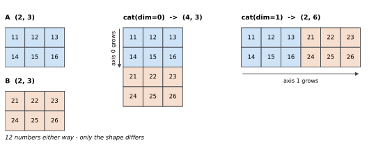
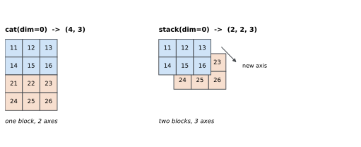

# cat 시각화 — 어느 축이 길어지는가

`torch.cat`에서 헷갈리는 것은 `dim`이 **무엇을 가리키는지**다. "0이면 세로"로
외우면 3차원에서 막히고, 축 번호만 보면 결과 모양이 그려지지 않는다.

규칙 자체는 한 줄이다. **`dim`으로 준 축만 길어지고 나머지 축은 그대로다.** 그
한 줄이 눈에 보이도록 A는 10번대, B는 20번대 숫자로 채워 두었다. 결과에서 어느
칸이 어디서 왔는지 값만 보고 알 수 있다.

이어 붙이는 함수를 두루 훑는 것은 「이어 붙이기와 나누기」 쪽이고, 여기서는 `cat`
하나만 본다. 그리고 마지막에 **루프에서 `cat`을 쓰면 생기는 일**을 잰다.



## 1. 코드

```python
"""torch.cat 이 어느 축을 늘리는지 — 그리고 루프에서 쓰면 생기는 일.

이어 붙이는 함수들을 두루 훑는 것은 「이어 붙이기와 나누기」 쪽이고,
여기서는 `cat` 한 가지를 눈으로 본다. 값만 보고도 어디서 왔는지
알도록 A 는 10번대, B 는 20번대로 채운다.

마지막 절이 이 쪽의 값이다. `cat` 은 언제나 새 메모리에 베끼므로,
루프를 돌며 결과에 하나씩 이어 붙이면 이미 모은 것을 매번 다시
베낀다. 얼마나 되는지 재어 본다.

실행: python 06_cat_visualization.py
"""
import time

import torch


def header(title):
    print(f"\n=== {title} ===")


A = torch.tensor([[11, 12, 13],
                  [14, 15, 16]])
B = torch.tensor([[21, 22, 23],
                  [24, 25, 26]])


# ========================================================================
# 1. 어느 축이 길어지는가
# ========================================================================

def axes():
    header("1. dim 이 정하는 것")
    print("A =");  print(A);  print("  A.shape =", tuple(A.shape))
    print("B =");  print(B);  print("  B.shape =", tuple(B.shape))

    cat0 = torch.cat([A, B], dim=0)
    print("\ntorch.cat([A, B], dim=0) — 세로로 길어진다")
    print(cat0)
    print(f"  {tuple(A.shape)} + {tuple(B.shape)} -> {tuple(cat0.shape)}")

    cat1 = torch.cat([A, B], dim=1)
    print("\ntorch.cat([A, B], dim=1) — 가로로 길어진다")
    print(cat1)
    print(f"  {tuple(A.shape)} + {tuple(B.shape)} -> {tuple(cat1.shape)}")
    print(f"  원소 수는 둘 다 {cat0.numel()}개로 같다")


# ========================================================================
# 2. cat 과 stack
# ========================================================================

def cat_vs_stack():
    header("2. cat 은 늘리고 stack 은 만든다")
    cat0 = torch.cat([A, B], dim=0)
    st = torch.stack([A, B], dim=0)
    print("  cat  (dim=0):", tuple(cat0.shape), " 축 2개 그대로")
    print("  stack(dim=0):", tuple(st.shape), " 축 3개로 늘었다")
    same = torch.cat([A.unsqueeze(0), B.unsqueeze(0)], dim=0)
    print("  stack 은 unsqueeze 하고 cat 한 것과 같은가:",
          torch.equal(st, same))
    try:
        torch.stack([A, torch.zeros(2, 4, dtype=torch.long)], dim=0)
    except RuntimeError as e:
        print("  모양이 다르면 stack:", str(e).splitlines()[0][:66])


# ========================================================================
# 3. 이어 붙일 수 없는 경우
# ========================================================================

def refusals():
    header("3. 이어 붙일 수 없는 경우")
    C = torch.zeros(2, 4, dtype=torch.long)
    try:
        torch.cat([A, C], dim=0)
    except RuntimeError as e:
        print("  cat([A(2,3), C(2,4)], dim=0):")
        print("   ", str(e).splitlines()[0])
    print("  같은 둘을 dim=1 로는 이을 수 있다:",
          tuple(torch.cat([A, C], dim=1).shape))
    print("  이어 붙이는 축만 더해지고 나머지는 같아야 한다")


# ========================================================================
# 4. cat 은 베낀다 — 루프에서 쓰면
# ========================================================================

def copies_every_time():
    header("4. cat 은 언제나 베낀다")
    cat0 = torch.cat([A, B], dim=0)
    print("  A 와 결과가 저장소를 나눠 쓰는가:",
          A.untyped_storage().data_ptr() == cat0.untyped_storage().data_ptr())
    cat0[0, 0] = 999
    print("  결과를 999 로 고친 뒤 A[0,0] =", A[0, 0].item(), "(그대로다)")


def loop_cost():
    header("5. 루프마다 이어 붙이면")

    def loop_cat(n, width=256):
        out = torch.zeros(0, width)
        for _ in range(n):
            out = torch.cat([out, torch.randn(1, width)], dim=0)
        return out

    def collect_then_cat(n, width=256):
        parts = [torch.randn(1, width) for _ in range(n)]
        return torch.cat(parts, dim=0)

    print("  256 짜리 줄을 n 번 모은다")
    for n in (500, 1000, 2000, 4000):
        times = {}
        for name, fn in (("loop", loop_cat), ("once", collect_then_cat)):
            ts = []
            for _ in range(3):
                t0 = time.perf_counter()
                r = fn(n)
                ts.append(time.perf_counter() - t0)
            times[name] = min(ts) * 1e3
        print(f"  n={n:5d}  루프마다 cat {times['loop']:8.1f} ms   "
              f"모아서 한 번 {times['once']:6.1f} ms   "
              f"배수 {times['loop'] / times['once']:5.1f}")
    print("  n 을 두 배 하면 루프 쪽은 네 배에 가깝게 는다")
    print("  이미 모은 것을 매번 다시 베끼기 때문이다")


# ========================================================================
# 6. 경사는 제 몫만 간다
# ========================================================================

def gradients():
    header("6. cat 의 경사")
    a = torch.tensor([[1.0, 2.0]], requires_grad=True)
    b = torch.tensor([[3.0, 4.0]], requires_grad=True)
    g = torch.tensor([[10.0, 20.0], [30.0, 40.0]])
    (torch.cat([a, b], dim=0) * g).sum().backward()
    print("  위에서 내려온 경사 =", g.tolist())
    print("  a.grad =", a.grad.tolist())
    print("  b.grad =", b.grad.tolist())
    print("  이어 붙인 자리대로 잘라 나눠 준다")


def main():
    axes()
    cat_vs_stack()
    refusals()
    copies_every_time()
    loop_cost()
    gradients()


if __name__ == "__main__":
    main()
```

**출력:**

```
=== 1. dim 이 정하는 것 ===
A =
tensor([[11, 12, 13],
        [14, 15, 16]])
  A.shape = (2, 3)
B =
tensor([[21, 22, 23],
        [24, 25, 26]])
  B.shape = (2, 3)

torch.cat([A, B], dim=0) — 세로로 길어진다
tensor([[11, 12, 13],
        [14, 15, 16],
        [21, 22, 23],
        [24, 25, 26]])
  (2, 3) + (2, 3) -> (4, 3)

torch.cat([A, B], dim=1) — 가로로 길어진다
tensor([[11, 12, 13, 21, 22, 23],
        [14, 15, 16, 24, 25, 26]])
  (2, 3) + (2, 3) -> (2, 6)
  원소 수는 둘 다 12개로 같다

=== 2. cat 은 늘리고 stack 은 만든다 ===
  cat  (dim=0): (4, 3)  축 2개 그대로
  stack(dim=0): (2, 2, 3)  축 3개로 늘었다
  stack 은 unsqueeze 하고 cat 한 것과 같은가: True
  모양이 다르면 stack: stack expects each tensor to be equal size, but got [2, 3] at entr

=== 3. 이어 붙일 수 없는 경우 ===
  cat([A(2,3), C(2,4)], dim=0):
    Sizes of tensors must match except in dimension 0. Expected size 3 but got size 4 for tensor number 1 in the list.
  같은 둘을 dim=1 로는 이을 수 있다: (2, 7)
  이어 붙이는 축만 더해지고 나머지는 같아야 한다

=== 4. cat 은 언제나 베낀다 ===
  A 와 결과가 저장소를 나눠 쓰는가: False
  결과를 999 로 고친 뒤 A[0,0] = 11 (그대로다)

=== 5. 루프마다 이어 붙이면 ===
  256 짜리 줄을 n 번 모은다
  n=  500  루프마다 cat      4.1 ms   모아서 한 번    1.3 ms   배수   3.1
  n= 1000  루프마다 cat     12.1 ms   모아서 한 번    2.7 ms   배수   4.5
  n= 2000  루프마다 cat     63.1 ms   모아서 한 번    5.8 ms   배수  10.9
  n= 4000  루프마다 cat    388.3 ms   모아서 한 번   12.5 ms   배수  31.0
  n 을 두 배 하면 루프 쪽은 네 배에 가깝게 는다
  이미 모은 것을 매번 다시 베끼기 때문이다

=== 6. cat 의 경사 ===
  위에서 내려온 경사 = [[10.0, 20.0], [30.0, 40.0]]
  a.grad = [[10.0, 20.0]]
  b.grad = [[30.0, 40.0]]
  이어 붙인 자리대로 잘라 나눠 준다
```

## 2. `dim`은 "길어질 축"이다

| | 결과 | 어느 축이 변했나 |
|---|---|---|
| `cat([A, B], dim=0)` | `(4, 3)` | 0번 축 2 → 4 |
| `cat([A, B], dim=1)` | `(2, 6)` | 1번 축 3 → 6 |

둘 다 숫자는 열두 개로 같다. 담기는 모양만 다르다. 위 그림에서 파란 칸이 A,
주황 칸이 B인데, `dim=0`에서는 주황이 아래로 붙고 `dim=1`에서는 오른쪽으로 붙는다.

그래서 축을 외울 필요가 없다. **"`dim`으로 준 축의 길이를 더하고 나머지는 그대로
둔다."** 3차원이든 4차원이든 같다 — 연습문제 1에서 `(8,3,32,32)` 두 개로 확인한다.

이어 붙일 수 없는 경우도 같은 규칙에서 나온다.

```
Sizes of tensors must match except in dimension 0.
Expected size 3 but got size 4 for tensor number 1 in the list.
```

`(2,3)`과 `(2,4)`를 `dim=0`으로 이으려면 1번 축이 3과 4로 어긋난다. 그런데 같은
둘을 `dim=1`로는 이을 수 있다 — `(2, 7)`이 된다. **이을 수 있느냐는 축마다 따로
묻는 물음**이다.

## 3. `cat`은 늘리고 `stack`은 만든다



`cat`은 **있는 축을 늘리고** `stack`은 **없던 축을 만든다.**

```
cat  (dim=0): (4, 3)      축 2개 그대로
stack(dim=0): (2, 2, 3)   축 3개로 늘었다
```

둘은 바꿔 쓸 수 있다. `stack`은 각 텐서에 길이 1인 축을 끼우고 `cat`하는 것과
같다.

```
stack 은 unsqueeze 하고 cat 한 것과 같은가: True
```

다만 `stack`은 모양이 **완전히** 같아야 한다. `cat`은 이어 붙이는 축만 달라도
되지만, `stack`은 새 축을 만들어 나란히 세우는 것이라 나머지가 전부 맞아야 한다.

```
stack expects each tensor to be equal size, but got [2, 3] at entry 0
```

고르는 기준은 이렇다. **표본을 더 모으는 것이면 `cat(dim=0)`, 같은 모양 여럿을
한 묶음으로 세우는 것이면 `stack`.** 배치 안의 예측을 모을 때는 각 조각이 이미
`(배치, 클래스)`이므로 `cat`이고, 같은 모양의 그림 여러 장으로 배치를 만들 때는
`stack`이다.

## 4. `cat`은 언제나 베낀다

`cat`은 뷰가 아니다. 결과를 담을 메모리를 새로 잡고 입력을 거기 베껴 넣는다.

```
A 와 결과가 저장소를 나눠 쓰는가: False
결과를 999 로 고친 뒤 A[0,0] = 11 (그대로다)
```

평소에는 고마운 성질이다. 결과를 마음대로 고쳐도 원본이 안전하다. 그런데 루프
안에 들어가면 값을 치른다.

## 5. 루프에서 이어 붙이면

예측을 모으는 코드는 흔히 이렇게 생긴다.

```python
out = torch.zeros(0, width)
for batch in loader:
    out = torch.cat([out, model(batch)], dim=0)   # 매번 전부 다시 베낀다
```

`cat`이 베낀다는 것을 생각하면 무슨 일이 나는지 보인다. $k$번째 바퀴에서 이미
$k-1$줄이 모여 있는데, 거기 한 줄을 더하려고 **$k$줄 전부를 새 메모리에 옮겨
적는다.**

| $n$ | 루프마다 `cat` | 모아서 한 번 | 배수 |
|---|---|---|---|
| 500 | 4.1 ms | 1.3 ms | 3.1 |
| 1,000 | 12.1 ms | 2.7 ms | 4.5 |
| 2,000 | 63.1 ms | 5.8 ms | 10.9 |
| 4,000 | **388.3 ms** | 12.5 ms | **31.0** |

오른쪽 칸은 $n$을 두 배 할 때마다 꼭 두 배씩 는다(1.3 → 2.7 → 5.8 → 12.5).
왼쪽 칸은 3배, 5배, 6배로 늘어 **네 배 쪽으로 향한다.** 네 배라는 것이
$n^2$의 모양이다.

고치는 법은 한 줄이다.

```python
parts = []
for batch in loader:
    parts.append(model(batch))
out = torch.cat(parts, dim=0)      # 한 번만 베낀다
```

리스트에 붙이는 것은 텐서를 옮기지 않고 가리키기만 하므로 공짜고, 마지막 `cat`
한 번이 전부를 한 번씩만 베낀다.

> 기록용으로 모으는 것이라면 `model(batch).detach()`를 붙여야 한다. 안 그러면
> 모아 둔 텐서마다 그래프가 딸려 와서 메모리가 배치 수만큼 쌓인다. 「메모리
> 관리」에서 본 것과 같은 자리다.

## 6. 경사는 제 몫만 간다

```
위에서 내려온 경사 = [[10.0, 20.0], [30.0, 40.0]]
a.grad = [[10.0, 20.0]]
b.grad = [[30.0, 40.0]]
```

`cat`의 역전파는 위에서 온 경사를 **이어 붙인 자리대로 잘라** 각 입력에 돌려준다.
더해지지도, 섞이지도 않는다. 「메모리와 저장소」의 `expand`가 경사를 **더해서**
돌려준 것과 반대다 — 거기서는 한 입력이 여러 자리에 쓰였고, 여기서는 각 입력이
한 자리씩만 차지했다.

## 연습문제

<div class="drillbox" markdown>

**연습문제 1.** <span class="diff easy" title="쉬움"></span>
`(8, 3, 32, 32)` 영상 배치 두 개가 있다. `dim`을 0부터 3까지 바꿔 가며 이어 붙이고
결과 모양을 적어라. 각각이 **무엇을 뜻하는지** 한 줄로 설명하라.

</div>

??? success "풀이"
    ```python
    x = torch.randn(8, 3, 32, 32)
    y = torch.randn(8, 3, 32, 32)
    for d in (0, 1, 2, 3):
        print(f"  dim={d} -> {tuple(torch.cat([x, y], dim=d).shape)}")
    print("  dim=-1 은 dim=3 과 같은가:",
          torch.equal(torch.cat([x, y], dim=-1), torch.cat([x, y], dim=3)))
    ```

    ```
      dim=0 -> (16, 3, 32, 32)
      dim=1 -> (8, 6, 32, 32)
      dim=2 -> (8, 3, 64, 32)
      dim=3 -> (8, 3, 32, 64)
      dim=-1 은 dim=3 과 같은가: True
    ```

    축 이름이 `(N, C, H, W)`이므로 뜻이 바로 읽힌다.

    | | 뜻 |
    |---|---|
    | `dim=0` | **표본이 16장**으로 늘었다 — 배치를 합친 것 |
    | `dim=1` | **채널이 6개**가 되었다 — 두 특징맵을 겹친 것 |
    | `dim=2` | 세로로 두 배 — 그림을 위아래로 붙인 것 |
    | `dim=3` | 가로로 두 배 — 나란히 붙인 것 |

    실전에서 쓰는 것은 앞의 둘이다. `dim=0`은 배치를 모을 때, `dim=1`은 U-Net의
    스킵 연결처럼 **서로 다른 특징을 한 텐서에 담을 때** 쓴다. 뒤의 둘은 그림을
    이어 붙여 한 장으로 보여 줄 때나 쓴다.

    음수 축도 된다. `dim=-1`은 마지막 축이므로 `dim=3`과 같다. 차원 수가 바뀌어도
    "마지막 축"을 가리키고 싶을 때 `-1`이 안전하다.

---

<div class="drillbox" markdown>

**연습문제 2.** <span class="diff med" title="중간"></span>
5절은 "모아서 한 번 `cat`"을 권했다. 그런데 결과 크기를 미리 안다면 `torch.empty`로
자리를 잡아 두고 한 줄씩 채우는 쪽이 더 빠를 것 같다. 재어서 확인하라.

</div>

??? success "풀이"
    ```python
    import time

    def collect_then_cat(n, w=256):
        return torch.cat([torch.randn(1, w) for _ in range(n)], dim=0)

    def preallocate(n, w=256):
        out = torch.empty(n, w)
        for i in range(n):
            out[i] = torch.randn(w)
        return out

    for n in (1000, 4000):
        row = []
        for name, fn in (("모아서 cat", collect_then_cat),
                         ("미리 잡고 채우기", preallocate)):
            ts = []
            for _ in range(3):
                t0 = time.perf_counter(); fn(n); ts.append(time.perf_counter() - t0)
            row.append((name, min(ts) * 1e3))
        print(f"  n={n:5d}  " + "   ".join(f"{a} {b:6.1f} ms" for a, b in row))
    ```

    ```
      n= 1000  모아서 cat    2.9 ms   미리 잡고 채우기    3.4 ms
      n= 4000  모아서 cat   11.7 ms   미리 잡고 채우기   14.1 ms
    ```

    **짐작이 틀렸다.** 미리 잡아 두는 쪽이 조금 느리다.

    까닭은 베끼는 양이 둘 다 같기 때문이다. 어느 쪽이든 원소는 한 번씩만 옮겨진다.
    그렇다면 남는 것은 **연산을 몇 번 부르느냐**인데, 미리 잡는 쪽은 슬라이스
    대입을 $n$번 하고, 모아서 `cat`하는 쪽은 리스트에 붙이기 $n$번(이건 거의
    공짜다)에 `cat` 한 번이다. 파이썬에서 텐서 연산을 한 번 부르는 값이 작지 않아서
    그 차이가 그대로 나온다.

    5절의 루프 `cat`과 가른 것은 **$n^2$이냐 $n$이냐**였지, 미리 잡느냐가 아니었다.
    둘 다 $n$에 비례하므로 어느 쪽을 써도 된다. 읽기 쉬운 쪽을 쓰면 된다.

    다만 결과가 아주 커서 메모리가 빠듯하면 미리 잡는 쪽에 값이 있다. `cat`은
    잠깐이나마 입력 조각들과 결과를 **동시에** 들고 있어야 하므로 꼭짓점에서
    두 배를 쓴다.

---

<div class="drillbox" markdown>

**연습문제 3.** <span class="diff hard" title="어려움"></span>
루프 `cat`이 베끼는 원소의 **총 개수**를 $n$으로 적어라. 그 수를 "한 번만 베끼는"
경우와 견주면 배수가 얼마인가? 그 배수를 5절의 **잰 시간**과 나란히 놓고, 둘이
크게 어긋나는 까닭을 설명하라.

</div>

??? success "풀이"
    $k$번째 바퀴에서 이미 $k-1$줄이 모여 있고 거기에 한 줄을 더해 $k$줄짜리를 새로
    만든다. 그러니 그 바퀴에서 옮겨 적는 원소는 $kw$개다. 전부 더하면

    $$
    \sum_{k=1}^{n} kw = \frac{n(n+1)}{2}\,w
    $$

    한 번만 베끼면 $nw$개이므로, 배수는 $\dfrac{n+1}{2}$이다.

    ```python
    w = 256
    for n in (500, 1000, 2000, 4000):
        total = sum(i * w for i in range(1, n + 1))
        once = n * w
        print(f"  n={n:5d}  루프 누적 복사 {total:>12,} 개   "
              f"한 번이면 {once:>9,} 개   배수 {total / once:7.1f}")
    ```

    ```
      n=  500  루프 누적 복사   32,064,000 개   한 번이면   128,000 개   배수   250.5
      n= 1000  루프 누적 복사  128,128,000 개   한 번이면   256,000 개   배수   500.5
      n= 2000  루프 누적 복사  512,256,000 개   한 번이면   512,000 개   배수  1000.5
      n= 4000  루프 누적 복사 2,048,512,000 개   한 번이면 1,024,000 개   배수  2000.5
    ```

    여기서 물음의 핵심이 나온다. 셈은 $n=4000$에서 **2,000배**를 베낀다고 하는데,
    5절에서 잰 시간은 **31배**밖에 차이 나지 않았다.

    | $n$ | 복사량 배수 | 잰 시간 배수 |
    |---|---|---|
    | 500 | 250.5 | 3.1 |
    | 1,000 | 500.5 | 4.5 |
    | 2,000 | 1,000.5 | 10.9 |
    | 4,000 | 2,000.5 | 31.0 |

    어긋나는 까닭은 **원소 하나를 베끼는 값이 연산 하나를 부르는 값보다 훨씬 싸서**다.
    두 방식 모두 `cat`을 $n$번 또는 1번 부르는데, 작은 $n$에서는 그 **부르는 값**이
    시간을 다 차지한다. 복사량이 250배여도 그 복사가 잇달아 붙은 메모리를 통째로
    옮기는 일이라 거의 공짜에 가깝다.

    그러나 $n$이 커지면 복사량이 $n^2$로 자라므로 결국 그쪽이 이긴다. 표에서 시간
    배수가 3.1 → 4.5 → 10.9 → 31.0으로 **점점 빨리** 벌어지는 것이 그 장면이다.
    복사가 값을 치르기 시작한 자리가 $n \approx 2000$쯤이다.

    그래서 두 가지를 같이 기억해야 한다. **점근적인 셈은 어느 쪽이 결국 이기는지를
    말해 주지만, 언제부터 이기는지는 말해 주지 않는다.** 그것은 재어야 안다.
