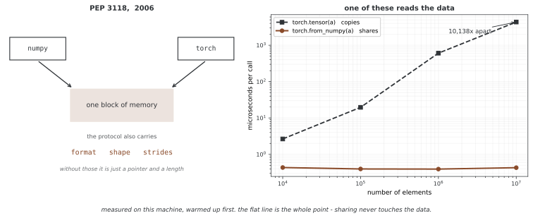

# NumPy 배열을 텐서로

NumPy 배열을 텐서로 바꾸는 길이 셋인데, 겉보기 결과는 모두 같고 **메모리를 공유하는지**가 다르다. 공유하면 한쪽을 고치면 다른 쪽도 바뀐다. 그래서 어느 것을 골랐는지가 나중에 멀리 떨어진 자리에서 티가 난다. 이 절에서는 셋을 가려 쓰는 기준을 세운다.

## 1. 코드

```python
"""넘파이 배열에서 텐서로."""
import numpy as np
import torch

# ========================================================================
# 메인
# ========================================================================

def header(title: str):
    print("\n" + "=" * 80)
    print(title)
    print("=" * 80)

def ptr_numpy(a: np.ndarray) -> int:
    """넘파이 배열의 밑 데이터 가리개를 (파이썬 정수로) 돌려준다.
    Notes:
      • 보기라면 밑 버퍼의 가운데를 가리킬 수도 있다.
      • 이 주소와 스텝/모양이 원소가 어디에 있는지를 온전히 밝힌다.
    """
    return a.__array_interface__['data'][0]

def ptr_torch(t: torch.Tensor) -> int:
    """PyTorch 텐서 저장소의 밑 데이터 가리개를 (파이썬 정수로) 돌려준다.
    Notes:
      • C++의 Tensor.untyped_storage().data_ptr()과 같다.
      • 두 객체가 같은 밑 버퍼를 가리키면 "기억 자리를 나눠 쓴다"고 하지만,
        논리상 첫 원소는 서로 다른 자리(스텝)에서 비롯할 수 있다.
    """
    return t.untyped_storage().data_ptr()


def main():
    # ------------------------------------------------------------------------------
    # 1) from_numpy: **SHARE**(변경이 양쪽으로 전파된다)
    # ------------------------------------------------------------------------------
    header("1) torch.from_numpy(np_array) → SHARE (no copy)")
    # 참고(포트란 순서 NumPy):
    # `arr`이 포트란 순서라면(예: arr = np.asfortranarray(arr_2d)),
    # torch.from_numpy(arr)는 여전히 메모리를 **공유한다**. 결과 텐서는
    # 포트란 방식(열 우선) 스트라이드를 가지며 대개
    # PyTorch의 행 우선 기준으로는 비연속적이다:
    #     t_shared.is_contiguous()  # 아마 False
    #     t_shared.stride()         # 열 우선 방식의 스트라이드를 보여준다
    #
    # 많은 연산이 비연속 텐서에서도 잘 동작하지만, 연속성을 요구하는 연산은
    # 다음 중 하나를 한다:
    #   • 내부적으로 연속 복사본을 만들거나,
    #   • 다음 호출을 요구한다:  t_shared = t_shared.contiguous()   # **COPY**(공유가 끊긴다)
    #
    # 처음부터 행 우선으로 공유하고 싶다면:
    #     arr_c = np.ascontiguousarray(arr)  # 필요하면 **COPY**
    #     t_shared = torch.from_numpy(arr_c)  # 행 우선 배치로 SHARE
    #
    # 참고: 음수/특이한 스트라이드를 가진 배치(예: arr[::-1])는 지원되지 않는다
    # 공유에는 쓸 수 없다. torch.as_tensor(arr)를 쓰거나(**COPY**할 수 있다) 먼저 연속 뷰를 만든다.

    arr = np.array([1.0, 2.0, 3.0], dtype=np.float32)   # CPU, dense, writable, contiguous
    t_shared = torch.from_numpy(arr)                    # **SHARE** storage with arr

    print("arr (before):", arr)
    print("t_shared (before):", t_shared)
    # 주소 자체는 돌릴 때마다 달라지므로 찍지 않는다. 뜻이 있는 것은 "같은가"다.
    print("같은 메모리를 보는가:", ptr_numpy(arr) == ptr_torch(t_shared), "→ 공유")

    # 어느 쪽을 바꾸어도 다른 쪽이 갱신된다(같은 저장소를 가리킨다):
    arr[0] = 99.0
    print("arr (after arr[0]=99):      ", arr)
    print("t_shared (after arr change):", t_shared)

    t_shared[1] = -7.0
    print("arr (after t_shared[1]=-7): ", arr)
    print("t_shared (after):           ", t_shared)

    # ------------------------------------------------------------------------------
    # 2) as_tensor(np_array): **공유 시도**(가능하면 공유, 아니면 복사)
    # ------------------------------------------------------------------------------
    header("2) torch.as_tensor(np_array) → TRY TO SHARE (fallback COPY)")
    # as_tensor의 공유 규칙:
    # • C 순서(행 우선) ndarray이고 수치형이며 쓰기 가능하면 → **SHARE**(복사 없음).
    # • 포트란 순서(열 우선) ndarray이고 수치형이며 쓰기 가능하면 → **SHARE**(복사 없음),
    #   그러나 결과 텐서는 대개 PyTorch의 행 우선 기준으로 비연속적이다
    #   (스트라이드가 열 우선 배치를 반영한다). 많은 연산이 잘 동작하지만, 연속성을
    #   요구하는 연산은 내부적으로 복사하거나 t_as = t_as.contiguous()를 요구한다  # **COPY**
    # • **COPY**하는 경우는 사실 하나다 — dtype이나 device를 바꿔 달라고 했을 때다:
    #         · as_tensor(ndarray, dtype=...)는 dtype이 다르면 COPY한다
    #         · as_tensor(..., device=...)는 해당 장치에 새로 만든다 → COPY
    # • 다음은 복사하지 **않는다.** 흔히 복사할 것이라 짐작하는 자리이니 눈여겨볼 만하다:
    #     - **읽기 전용 ndarray도 공유한다.** 복사해서 지켜 주지 않고, 대신
    #       "쓰기 불가 배열은 지원하지 않는다"는 UserWarning을 띄운 뒤 그냥 공유한다.
    #       그 텐서에 쓰면 무엇이 일어날지 정해져 있지 않다. 지키고 싶으면
    #       내가 arr.copy()를 하거나 torch.tensor(arr)를 써야 한다.
    #     - 비연속 ndarray도 공유한다(예: arr2d[:, 0] 같은 열 슬라이스).
    # • 음수 스트라이드(예: arr[::-1])는 복사가 아니라 **ValueError**다. 음수
    #   스트라이드 텐서를 PyTorch가 아직 못 다루므로, arr[::-1].copy()로 넘긴다.
    #
    # from_numpy(ndarray)에 대한 참고:
    #   - from_numpy는 주어진 CPU ndarray와 **항상 공유한다**(수치형, 쓰기 가능, 호환 스트라이드).
    #   - from_numpy에는 dtype/device를 넘길 수 없다.
    #   - 다른 dtype이 필요하면 먼저: arr2 = arr.astype(np.float32, copy=True/False)
    #       그다음: t = torch.from_numpy(arr2)  # arr2와 공유한다(arr2 자체는 복사본일 수 있다)
    #   - GPU/MPS가 필요하면: t_cpu = torch.from_numpy(arr); t = t_cpu.to('cuda')  # 장치 이동 = **COPY**

    arr3 = np.array([1.1, 2.2, 3.3], dtype=np.float64)
    # as_tensor는 가능하면 복사를 피한다. CPU에서 수치형, 쓰기 가능, 호환되는 스트라이드/배치일 때이다.
    t_as = torch.as_tensor(arr3)  # usually **SHARE**; may **COPY** if incompatible
    print("arr3 (before):", arr3)
    print("t_as (before): ", t_as)

    arr3[1] = 222.0
    print("arr3 (after arr3[1]=222):", arr3)
    print("t_as (after):            ", t_as)

    print("같은 메모리를 보는가:", ptr_numpy(arr3) == ptr_torch(t_as),
          "→ 공유(자료형과 장치를 그대로 두었으므로)")

    # ------------------------------------------------------------------------------
    # 3) tensor(np_array): **COPY**(독립적인 메모리)
    # ------------------------------------------------------------------------------
    header("3) torch.tensor(np_array) → COPY (independent)")
    # ---------------------------------------------------------------------------
    # NumPy ndarray → PyTorch 텐서: 어떤 생성자를 쓸 것인가?
    #
    # 1) torch.tensor(ndarray)  → 베낌
    #    • 가장 안전하고 방어적이다. 항상 새로운 독립 텐서를 할당한다.
    #    • ndarray의 공유/스트라이드를 무시한다. 이후 NumPy 변경으로 놀랄 일이 없다.
    #    • dtype/device를 직접 지정할 수 있다(예: device="cuda").
    #    • 비용: 추가 할당과 데이터 복사.
    #
    # 2) torch.from_numpy(ndarray)  → SHARE(복사 없음)
    #    • 무복사: 텐서가 CPU NumPy 배열과 저장소를 공유한다.
    #    • 요구조건: 수치형 dtype, 양수 스트라이드. 읽기 전용이어도 공유한다(경고만 난다).
    #    • 공유를 끊기 전까지는(예: .clone(), .contiguous(), .to('cuda')) 변경이 양쪽에 반영된다.
    #    • dtype/device를 넘길 수 없다. dtype은 ndarray에서 얻고 device는 CPU이다.
    #
    # 3) torch.as_tensor(ndarray)  → 공유 시도(안 되면 COPY)
    #    • from_numpy처럼 무복사를 선호한다. **dtype이나 device를 바꿔야 할 때만**
    #      조용히 COPY한다. 읽기 전용이거나 비연속이어도 공유한다.
    #    • 수동 확인 없이 "가능하면 공유"를 해 주는 편리한 선택.
    #
    # 어림 규칙:
    #   • 안전성/독립성이 필요하면 → torch.tensor(...)를 쓴다
    #   • 속도/무복사가 필요하고 공유 메모리의 주의사항을 감수할 수 있으면 → torch.from_numpy(...)
    #   • 번거로움 없이 최대한 공유하고 싶으면 → torch.as_tensor(...)
    #
    # 요령:
    #   • 많은 연산이 비연속 텐서에서 동작한다. 연속성을 요구하는 연산은 내부적으로 복사하거나
    #     또는 t = t.contiguous()가 필요하다  # COPY(공유가 끊긴다)
    #   • 장치 이동(CPU→CUDA/MPS)은 항상 복사하며 공유를 끊는다.
    #   • 공유 전에 dtype을 바꿔야 한다면: arr2 = arr.astype(np.float32, copy=True/False);
    #     t = torch.from_numpy(arr2)  # arr2와 공유한다(arr2 자체는 복사본일 수 있다)
    # ---------------------------------------------------------------------------

    arr2 = np.array([10, 20, 30], dtype=np.int64)
    t_copy = torch.tensor(arr2)  # **COPY** from NumPy → independent buffer
    print("arr2 (before):", arr2)
    print("t_copy (before):", t_copy)

    arr2[0] = 123
    print("arr2 (after arr2[0]=123):", arr2)
    print("t_copy (unchanged):       ", t_copy)  # separate storage

    print("같은 메모리를 보는가:", ptr_numpy(arr2) == ptr_torch(t_copy), "→ 베낌")

    # ------------------------------------------------------------------------------
    # 4) from_numpy/as_tensor가 흔히 지원하는 dtype 대응
    # ------------------------------------------------------------------------------
    header("4) Dtype mappings (float32, float64, int64, int32, uint8, bool)")
    # CPU에서의 흔한 NumPy→Torch 대응:
    #   float32 → torch.float32     float64 → torch.float64
    #   int64   → torch.int64       int32   → torch.int32
    #   uint8   → torch.uint8       bool_   → torch.bool
    for np_dtype in [np.float32, np.float64, np.int64, np.int32, np.uint8, np.bool_]:
        a = np.array([0, 1, 2], dtype=np_dtype)
        t = torch.from_numpy(a)
        # 다음 중 어느 쪽이든 동작한다:
        print(f"NumPy dtype {a.dtype.name:>8} → Torch dtype {t.dtype}")
        # 또는
        # print(f"넘파이 dtype {str(a.dtype):>8} → 토치 dtype {t.dtype}")

    # ------------------------------------------------------------------------------
    # 5) 비연속/스트라이드 뷰(양수 스트라이드)도 여전히 **공유한다**
    # ------------------------------------------------------------------------------
    header("5) Strided NumPy views (positive step) → SHARE")

    base = np.arange(10, dtype=np.float32)     # [0,1,2,3,4,5,6,7,8,9]
    view = base[::2]                           # [0,2,4,6,8] (non-contiguous view)
    t_view = torch.from_numpy(view)            # **SHARE** with view (and base)

    print("base:", base)
    print("view:", view)
    print("t_view:", t_view)
    # 보기(view)는 밑바탕 배열의 버퍼를 가리킨다
    print("base와 view가 같은 메모리:", ptr_numpy(base) == ptr_numpy(view))
    print("view와 텐서가 같은 메모리:", ptr_numpy(view) == ptr_torch(t_view), "→ 공유")

    # 변경이 모든 별칭에 반영된다:
    view[0] = 999.0
    print("After view[0]=999 → base:", base)
    print("After view[0]=999 → t_view:", t_view)

    # ------------------------------------------------------------------------------
    # 6) 읽기 전용 NumPy 배열: from_numpy는 쓰기 가능한 배열을 필요로 한다
    # ------------------------------------------------------------------------------
    header("6) Read-only NumPy arrays → from_numpy may error")

    ro = np.array([1.0, 2.0, 3.0], dtype=np.float32)
    ro.setflags(write=False)  # make array read-only
    try:
        _ = torch.from_numpy(ro)  # often errors: cannot write to read-only array
        print("from_numpy(readonly) succeeded (behavior may vary)")
    except Exception as e:
        print("from_numpy(readonly) error:", repr(e))

    # 안전한 대안: 먼저 쓰기 가능한 복사본을 만든다(공유가 끊긴다):
    t_ro_copy = torch.from_numpy(np.array(ro, copy=True))  # **COPY**
    print("Fallback via copy:", t_ro_copy)

    # ------------------------------------------------------------------------------
    # 7) 지원되지 않거나 까다로운 dtype의 예: 복소수
    # ------------------------------------------------------------------------------
    header("7) Complex dtype example: may need explicit conversion")
    cplx = np.array([1+2j, 3+4j], dtype=np.complex128)
    try:
        # 버전/빌드에 따라 from_numpy(complex128)을 바로 쓰면 오류가 날 수 있다.
        torch.from_numpy(cplx)  # if unsupported → exception
        print("from_numpy(complex128) succeeded on this setup")
    except Exception as e:
        print("from_numpy(complex128) error:", repr(e))
        # 흔한 우회책: 실수부/허수부로 나누거나 직접 변환한다.
        t_real = torch.from_numpy(np.real(cplx).astype(np.float64))  # **SHARE** after astype copy
        t_imag = torch.from_numpy(np.imag(cplx).astype(np.float64))  # **SHARE** after astype copy
        print("Real part tensor:", t_real)
        print("Imag part tensor:", t_imag)

    # ------------------------------------------------------------------------------
    # 8) 간단 요약 도우미: 어떤 것이 메모리를 공유하는가?
    # ------------------------------------------------------------------------------
    header("8) Summary: SHARE → TRY-TO-SHARE → COPY")
    print("from_numpy(np_array)   → **SHARE** (no copy; requires numeric, writable, compatible strides)")
    print("as_tensor(np_array)    → **TRY TO SHARE** (shares if possible; else **COPY**)")
    print("tensor(np_array)       → **COPY** (always independent)")

    # ------------------------------ 참고 / 요령 ------------------------------
    # • Autograd: NumPy에서 만든 텐서는 기본적으로 requires_grad=False이다.
    #   경사가 필요하면 (실수/복소수 dtype에) requires_grad=True를 설정한다.
    # • Device: from_numpy/as_tensor는 CPU 텐서를 만든다. CUDA/MPS로 옮기면 **COPY**가 일어난다:
    #       t_cpu = torch.from_numpy(arr)   # CPU에서 SHARE
    #       t_gpu = t_cpu.to('cuda')        # GPU로 COPY(프레임워크/장치를 넘어선 공유는 없다)
    # • 음수/특이한 스트라이드: 일부 NumPy 뷰(예: 뒤집힌 배열 a[::-1])는 호환되지 않아
    #   from_numpy와 함께 쓴다. 그러면 as_tensor는 공유 대신 **COPY**한다.
    # • 공유한 뒤에도 독립성이 필요한가? 텐서에 .clone()을 쓴다.

if __name__ == "__main__":
    main()
```

**출력:**

```

================================================================================
1) torch.from_numpy(np_array) → SHARE (no copy)
================================================================================
arr (before): [1. 2. 3.]
t_shared (before): tensor([1., 2., 3.])
같은 메모리를 보는가: True → 공유
arr (after arr[0]=99):       [99.  2.  3.]
t_shared (after arr change): tensor([99.,  2.,  3.])
arr (after t_shared[1]=-7):  [99. -7.  3.]
t_shared (after):            tensor([99., -7.,  3.])

================================================================================
2) torch.as_tensor(np_array) → TRY TO SHARE (fallback COPY)
================================================================================
arr3 (before): [1.1 2.2 3.3]
t_as (before):  tensor([1.1000, 2.2000, 3.3000], dtype=torch.float64)
arr3 (after arr3[1]=222): [  1.1 222.    3.3]
t_as (after):             tensor([  1.1000, 222.0000,   3.3000], dtype=torch.float64)
같은 메모리를 보는가: True → 공유(자료형과 장치를 그대로 두었으므로)

================================================================================
3) torch.tensor(np_array) → COPY (independent)
================================================================================
arr2 (before): [10 20 30]
t_copy (before): tensor([10, 20, 30])
arr2 (after arr2[0]=123): [123  20  30]
t_copy (unchanged):        tensor([10, 20, 30])
같은 메모리를 보는가: False → 베낌

================================================================================
4) Dtype mappings (float32, float64, int64, int32, uint8, bool)
================================================================================
NumPy dtype  float32 → Torch dtype torch.float32
NumPy dtype  float64 → Torch dtype torch.float64
NumPy dtype    int64 → Torch dtype torch.int64
NumPy dtype    int32 → Torch dtype torch.int32
NumPy dtype    uint8 → Torch dtype torch.uint8
NumPy dtype     bool → Torch dtype torch.bool

================================================================================
5) Strided NumPy views (positive step) → SHARE
================================================================================
base: [0. 1. 2. 3. 4. 5. 6. 7. 8. 9.]
view: [0. 2. 4. 6. 8.]
t_view: tensor([0., 2., 4., 6., 8.])
base와 view가 같은 메모리: True
view와 텐서가 같은 메모리: True → 공유
After view[0]=999 → base: [999.   1.   2.   3.   4.   5.   6.   7.   8.   9.]
After view[0]=999 → t_view: tensor([999.,   2.,   4.,   6.,   8.])

================================================================================
6) Read-only NumPy arrays → from_numpy may error
================================================================================
from_numpy(readonly) succeeded (behavior may vary)
Fallback via copy: tensor([1., 2., 3.])

================================================================================
7) Complex dtype example: may need explicit conversion
================================================================================
from_numpy(complex128) succeeded on this setup

================================================================================
8) Summary: SHARE → TRY-TO-SHARE → COPY
================================================================================
from_numpy(np_array)   → **SHARE** (no copy; requires numeric, writable, compatible strides)
as_tensor(np_array)    → **TRY TO SHARE** (shares if possible; else **COPY**)
tensor(np_array)       → **COPY** (always independent)
```

## 2. 논의

세 함수가 하는 일은 **복사할지 공유할지**로 갈린다.

| | 메모리를 | 복사하는 때 |
|---|---|---|
| `torch.tensor(arr)` | 늘 **복사한다** | 언제나 |
| `torch.from_numpy(arr)` | 늘 **공유한다** | 복사하지 않는다 — 못 하면 오류다 |
| `torch.as_tensor(arr)` | 되도록 **공유한다** | 지원되는 NumPy 배열에서는 dtype이나 device를 바꿔야 할 때 |

**`as_tensor`가 복사하는 경우는 생각보다 적다.** 자료형과 장치를 그대로 두면 거의 늘 공유한다. 짐작과 어긋나는 자리가 둘 있다.

- **읽기 전용 배열도 공유한다.** `arr.flags.writeable = False`로 잠가 두어도 `as_tensor`는 복사해서 지켜 주지 않는다. "쓰기 불가 배열은 지원하지 않는다"는 경고를 한 번 띄우고 그냥 공유한다. 그 텐서에 쓰면 무슨 일이 생길지 정해져 있지 않다. 지키려면 `arr.copy()`를 하거나 `torch.tensor(arr)`를 쓴다.
- **비연속 배열도 공유한다.** `arr2d[:, 0]`처럼 띄엄띄엄 놓인 열도 스트라이드를 그대로 받아 공유한다.

반대로 **음수 스트라이드는 복사가 아니라 오류다.** `arr[::-1]`을 넘기면 `ValueError`가 난다. PyTorch가 음수 스트라이드 텐서를 아직 다루지 못하기 때문이다. `arr[::-1].copy()`로 넘겨야 한다.

**고르는 기준.** 배열이 뒤에서 바뀔 수 있고 텐서는 그대로여야 하면 `torch.tensor`로 끊는다. 큰 배열을 옮기는 값이 아까우면 `from_numpy`로 공유하고, 공유한다는 사실을 기억한다. 둘 중 무엇이든 상관없으면 `as_tensor`가 알아서 한다.

!!! warning "`.numpy()`는 경사를 좇는 텐서에서 막힌다"
    일반적인 `.numpy()`는 경사를 추적하는 텐서에서 오류를 낸다. `detach()`로 분리하고 필요하면 `cpu()`로 옮겨 변환한다. 다만 분리해도 저장 공간은 공유될 수 있으므로 NumPy 배열을 수정하면 원래 값과 역전파에 필요한 중간값에 영향을 줄 수 있다. 독립적인 배열이 필요하면 `detach().clone().cpu().numpy()`처럼 복사까지 수행한다.

<div class="storybox" markdown>

**그림으로 보는 AI 1.** 서로 모르는 두 라이브러리가 같은 덩어리를 보는 법

조금 이상한 일이다. NumPy와 PyTorch는 따로 만들어진 남남이고 서로의 자료 구조를 알지 못한다. 그런데 `from_numpy` 는 복사도 변환도 없이 **같은 메모리를 그대로 읽는다.** 어떻게 가능한가.

운이 아니라 **약속**이 있어서다. 2006년 8월 28일에 트래비스 올리펀트(Travis Oliphant)와 칼 뱅크스(Carl Banks)가 낸 PEP 3118 「Revising the buffer protocol」이 그 약속이다. 제안서는 그때까지의 버퍼 인터페이스가 왜 모자란지를 이렇게 적었다 — "Memory is just a pointer with a length. There is no way to describe what is 'in' the memory", 그리고 "There is no shape information provided for the memory". 포인터와 길이만으로는 **무엇이 들어 있는지도, 어떤 모양인지도** 알 수 없다는 것이다.



그래서 이 약속에 **자료형·모양·스트라이드**가 함께 실리게 되었고, 바로 그 덕분에 위에서 본 일들이 가능하다. `arr2d[:, 0]` 처럼 띄엄띄엄 놓인 열까지 공유할 수 있는 것은 스트라이드가 약속 안에 들어 있기 때문이다. 반대로 `arr[::-1]` 이 복사가 아니라 **오류**인 것도 설명된다 — 음수 스트라이드는 약속으로는 적을 수 있는데 PyTorch가 아직 받아들이지 못한다. 약속의 한계가 아니라 받는 쪽의 한계다.

값의 차이는 오른쪽 그림이 보여 준다. 원소 수를 열 배로 늘리면 복사하는 쪽은 걸리는 시간도 열 배가 되는데, 공유하는 쪽은 **그대로다.** 자료를 한 번도 건드리지 않고 설명만 넘겨받기 때문이다. 그림의 마이크로초는 이 기계에서 잰 값이라 다른 기계에서는 다른 수가 나오지만, 한쪽만 기울어진다는 **모양**은 남는다.

**다만 이 약속이 정한 것은 메모리를 어떻게 설명하는가까지다.** 누가 그 메모리의 임자인지, 언제까지 살아 있는지, 써도 되는지는 말해 주지 않는다. 위에서 본 두 가지가 그 틈이다 — 읽기 전용으로 잠가 둔 배열을 `as_tensor` 가 경고 한 번 띄우고 그냥 공유해 버리는 것, 그리고 그 텐서에 쓰면 무슨 일이 생길지 정해져 있지 않은 것. 설명을 표준으로 만든 것이지 **보증을 표준으로 만든 것이 아니다.** 공유를 고를 때 "공유한다는 사실을 기억한다"가 그냥 권고가 아닌 까닭이 여기에 있다.

_확인한 곳 — PEP 3118 "Revising the buffer protocol", Travis Oliphant·Carl Banks, 2006년 8월 28일, 상태 Final. 인용한 두 문장은 그 제안서의 근거 항에 있고, 약속이 format·shape·strides·suboffsets 를 실어 나른다는 것도 같은 문서다. 오른쪽 그림의 시간은 그림을 그리는 코드가 워밍업을 거쳐 이 기계에서 직접 잰다._

</div>

## 연습문제

<div class="drillbox" markdown>

**연습문제 1.** <span class="diff med" title="중간"></span>
NumPy 배열을 만들고 `torch.from_numpy()`로 PyTorch 텐서로 변환한 뒤, 원래 배열을 수정하여 텐서도 함께 바뀌는지 확인하라.

</div>

??? success "풀이"
    ```python
    import numpy as np, torch

    arr = np.array([1.0, 2.0, 3.0])
    t = torch.from_numpy(arr)
    arr[0] = 99.0          # NumPy 쪽만 고친다
    print("arr:", arr)
    print("t:  ", t)
    ```

    ```
    arr: [99.  2.  3.]
    t:   tensor([99.,  2.,  3.], dtype=torch.float64)
    ```

    텐서를 건드리지 않았는데 텐서가 바뀌었다. `from_numpy`는 메모리를 공유하므로 둘이
    같은 숫자를 들여다보고 있는 것이다.

    출력에 딸려 나온 `dtype=torch.float64`도 눈여겨볼 만하다. `torch.tensor([1., 2., 3.])`는
    `float32`가 되는데, 여기서는 NumPy의 기본 자료형인 `float64`가 그대로 넘어왔다.
    공유하려면 자료형을 바꿀 수 없으니 당연한 일이다. 곧 **NumPy에서 온 텐서는 흔히
    `float64`**이고, `float32`를 기대하는 모델에 그대로 넣으면 자료형이 어긋난다.

---


<div class="drillbox" markdown>

**연습문제 2.** <span class="diff med" title="중간"></span>
`torch.as_tensor()`가 언제 공유하고 언제 복사하는지 **재어서** 밝혀라. 아래 다섯 경우를 모두 확인하고, 복사 여부는 `arr.__array_interface__['data'][0] == t.data_ptr()`로 판정하라.

1. 보통의 `float64` 배열
2. 읽기 전용 배열 (`arr.flags.writeable = False`)
3. `dtype=torch.float32`를 함께 요청한 `float64` 배열
4. 비연속 열 슬라이스 (`arr2d[:, 0]`)
5. 거꾸로 뒤집은 배열 (`arr[::-1]`)

</div>

??? success "풀이"
    ```python
    import numpy as np, torch

    def shares(a, t):
        return a.__array_interface__['data'][0] == t.data_ptr()

    a = np.array([1., 2., 3.])
    print("보통            :", shares(a, torch.as_tensor(a)))

    ro = np.array([1., 2., 3.]); ro.flags.writeable = False
    print("읽기 전용       :", shares(ro, torch.as_tensor(ro)))

    f = np.array([1., 2., 3.])
    print("dtype 바꿔 달라면:", shares(f, torch.as_tensor(f, dtype=torch.float32)))

    col = np.array([[1., 2.], [3., 4.]])[:, 0]
    print("비연속 열       :", shares(col, torch.as_tensor(col)))

    try:
        torch.as_tensor(np.array([1., 2., 3.])[::-1])
    except ValueError as e:
        print("뒤집은 배열     : ValueError -", str(e)[:48])
    ```

    ```
    보통            : True
    읽기 전용       : True
    dtype 바꿔 달라면: False
    비연속 열       : True
    뒤집은 배열     : ValueError - At least one stride in the given numpy array
    ```

    재어 보면 규칙이 짧다. **`as_tensor`는 지원되는 NumPy 배열에서는 dtype이나 device를 바꿔야 할 때 복사한다.**

    짐작과 어긋나는 것이 둘이다. 읽기 전용 배열은 복사해서 지켜 줄 것 같지만 **공유한다** — 경고만 한 번 띄우고 넘어가므로, 그 텐서에 쓰는 동작은 정의되지 않으므로 실제 수정 결과에 의존해서는 안 된다. 비연속 배열도 복사할 것 같지만 스트라이드를 그대로 받아 공유한다.

    그리고 뒤집은 배열은 복사가 아니라 **오류**다. 복사 여부를 묻는 문제에 답이 셋이라는 뜻이다 — 공유, 복사, 그리고 거절.

---


<div class="drillbox" markdown>

**연습문제 3.** <span class="diff hard" title="어려움"></span>
`requires_grad=True`인 텐서에 `.numpy()`를 호출하면 오류가 나는 이유는 무엇인가? 올바른 변환 방법을 보여라.

</div>

??? success "풀이"
    ```python
    import torch

    torch.manual_seed(0)
    x = torch.randn(3, requires_grad=True)
    try:
        x.numpy()
    except RuntimeError as e:
        print(e)

    x_np = x.detach().cpu().numpy()   # 그래프에서 떼어 낸 뒤 넘긴다
    print(x_np)
    ```

    ```
    Can't call numpy() on Tensor that requires grad. Use tensor.detach().numpy() instead.
    [ 1.5409961 -0.2934289 -2.1787894]
    ```

    까닭은 공유 때문이다. `.numpy()`는 복사하지 않고 메모리를 **공유한다.** 그래서 NumPy 쪽에서 값을 고치면 텐서의 값이 autograd가 모르는 사이에 바뀐다. 순전파 때 쓴 값과 역전파 때 있는 값이 달라지면 경사가 틀리는데, 틀렸다는 표시는 어디에도 남지 않는다. 그래서 PyTorch는 조용히 틀리게 두는 대신 아예 막는다.

    `.detach()`는 그래프와 연결을 끊지만 저장소는 공유한다. 따라서 NumPy에서 값을 수정하면 원래 텐서도 바뀌고, 원래 그래프의 역전파를 손상시킬 수 있다. 독립적인 배열이 필요하면 복사해야 한다. `.cpu()`는 GPU 텐서를 CPU로 옮기며, 이미 CPU에 있으면 복사를 만들지 않을 수 있다.

## 정리하며

NumPy 배열에서 텐서를 얻는 세 길은 **메모리를 공유하는지**로 갈린다.

- `torch.tensor(arr)` — 늘 복사한다. 끊어 두고 싶을 때.
- `torch.from_numpy(arr)` — 늘 공유한다. 복사를 못 하므로 자료형도 바꿀 수 없고, 그래서 NumPy의 `float64`가 그대로 넘어온다.
- `torch.as_tensor(arr)` — 되도록 공유한다. **지원되는 NumPy 배열에서는 dtype이나 device를 바꿔야 할 때** 복사한다.

`as_tensor`가 복사하는 경우는 생각보다 적다. 읽기 전용 배열도, 비연속 배열도 공유한다. 읽기 전용은 특히 조심할 자리다 — 지켜 주지 않고 경고만 띄운다. 음수 스트라이드는 복사가 아니라 `ValueError`다.

반대 방향인 `.numpy()`도 공유한다. 그래서 `requires_grad=True`인 텐서에서는 막힌다. 공유된 메모리로 값이 바뀌면 autograd가 모르는 채 경사가 틀어지기 때문이다. `.detach()`로 떼어 낸 뒤에 넘긴다.

공유는 값이 아니라 **메모리를 함께 쓰는 일**이다. 그러므로 어느 함수를 썼는지가 멀리 떨어진 자리에서 티가 난다.
