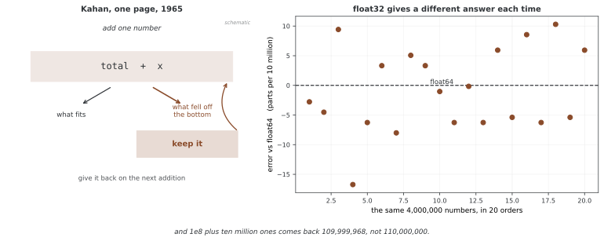

# 산술 연산

텐서의 산술은 파이썬의 수 계산과 거의 같아 보인다. 그래서 다른 자리가 눈에 띄지 않는다. **자료형이 바뀌고**, **0으로 나누어도 멈추지 않고**, **정수가 넘쳐도 아무 말이 없다.** 이 절에서는 그 세 자리를 본다.

## 1. 코드

```python
"""
튜토리얼 10: 셈 연산
===================================

PyTorch에서 원소별 셈과 텐서 셈을 익힌다.

핵심 개념:
- 원소별 셈(+, -, *, /, **)
- 제자리 셈(add_, mul_ 따위)
- 수학 함수(sqrt, exp, log 따위)
- 모으기와 원소별 셈 견주기
- 펴 맞추기 기초
"""

import torch

# ========================================================================
# 메인
# ========================================================================


def header(title: str):
    print("\n" + "=" * 70)
    print(title)
    print("=" * 70)


def main():
    # -------------------------------------------------------------------------
    # 1. 기본 원소별 산술
    # -------------------------------------------------------------------------
    header("1. Basic Element-wise Arithmetic")
    
    a = torch.tensor([1.0, 2.0, 3.0, 4.0])
    b = torch.tensor([5.0, 6.0, 7.0, 8.0])
    
    print(f"a = {a}")
    print(f"b = {b}\n")
    
    # 덧셈
    c_add = a + b
    print(f"a + b = {c_add}")  # tensor([6., 8., 10., 12.])
    
    # 또한: torch.add(a, b)
    c_add_fn = torch.add(a, b)
    print(f"torch.add(a, b) = {c_add_fn}")
    
    # 뺄셈
    c_sub = a - b
    print(f"\na - b = {c_sub}")  # tensor([-4., -4., -4., -4.])
    
    # 곱셈(원소별이며 행렬 곱이 아니다)
    c_mul = a * b
    print(f"a * b = {c_mul}")  # tensor([5., 12., 21., 32.])
    
    # 나눗셈
    c_div = b / a
    print(f"b / a = {c_div}")  # tensor([5., 3., 2.3333, 2.])
    
    # 내림 나눗셈
    c_floordiv = b // a
    print(f"b // a = {c_floordiv}")  # tensor([5., 3., 2., 2.])
    
    # 나머지 연산
    c_mod = b % a
    print(f"b % a = {c_mod}")  # tensor([0., 0., 1., 0.])
    
    # 거듭제곱
    c_pow = a ** 2
    print(f"a ** 2 = {c_pow}")  # tensor([1., 4., 9., 16.])
    
    # -------------------------------------------------------------------------
    # 2. 제자리 연산(메모리에서 텐서를 직접 수정)
    # -------------------------------------------------------------------------
    header("2. In-place Operations")
    
    x = torch.tensor([1.0, 2.0, 3.0])
    before = id(x)
    print(f"Original x = {x}")

    # 제자리 연산은 밑줄(_)로 끝난다
    x.add_(10)  # x = x + 10
    print(f"After x.add_(10) = {x}")
    # 번지 자체는 찍지 않는다. 프로세스마다 달라서 이 쪽에 실어 두어도 읽는 이가
    # 다시 얻을 수 없고, 그 수가 가르치는 것도 없다. 가르치는 것은 **같은가**이다.
    print(f"같은 객체인가: {id(x) == before}  ← 새 텐서를 만들지 않았다")
    
    x.mul_(2)  # x = x * 2
    print(f"After x.mul_(2) = {x}")
    
    x.div_(4)  # x = x / 4
    print(f"After x.div_(4) = {x}")
    
    # 주의: 경사가 필요한 텐서에 제자리 연산을 하면 오류가 날 수 있다!
    # y = torch.tensor([1.0], requires_grad=True)
    # y.add_(1)  # RuntimeError: 경사를 가진 잎 변수에는 제자리 연산을 할 수 없다
    
    # -------------------------------------------------------------------------
    # 3. 스칼라 연산
    # -------------------------------------------------------------------------
    header("3. Scalar Operations")
    
    vec = torch.tensor([1, 2, 3, 4, 5])
    print(f"vec = {vec}")
    
    # 스칼라는 자동으로 브로드캐스팅된다
    vec_plus_10 = vec + 10
    print(f"vec + 10 = {vec_plus_10}")
    
    vec_times_2 = vec * 2
    print(f"vec * 2 = {vec_times_2}")
    
    vec_pow_2 = vec ** 2
    print(f"vec ** 2 = {vec_pow_2}")
    
    # -------------------------------------------------------------------------
    # 4. 수학 함수
    # -------------------------------------------------------------------------
    header("4. Mathematical Functions")
    
    x = torch.tensor([0.0, 1.0, 4.0, 9.0])
    print(f"x = {x}\n")
    
    # 제곱근
    sqrt_x = torch.sqrt(x)
    print(f"sqrt(x) = {sqrt_x}")
    
    # 지수함수
    exp_x = torch.exp(x)
    print(f"exp(x) = {exp_x}")
    
    # 자연로그(밑이 e인 로그)
    x_pos = torch.tensor([1.0, 2.718, 7.389])
    log_x = torch.log(x_pos)
    print(f"\nlog({x_pos}) = {log_x}")
    
    # 밑이 10인 로그
    log10_x = torch.log10(x_pos)
    print(f"log10({x_pos}) = {log10_x}")
    
    # 절댓값
    x_neg = torch.tensor([-3.0, -1.0, 0.0, 2.0, 5.0])
    abs_x = torch.abs(x_neg)
    print(f"\nabs({x_neg}) = {abs_x}")
    
    # 부호 함수
    sign_x = torch.sign(x_neg)
    print(f"sign({x_neg}) = {sign_x}")
    
    # 반올림 연산
    x_float = torch.tensor([1.2, 2.5, -3.7, 4.9])
    print(f"\nx = {x_float}")
    print(f"round(x) = {torch.round(x_float)}")
    print(f"floor(x) = {torch.floor(x_float)}")
    print(f"ceil(x) = {torch.ceil(x_float)}")
    print(f"trunc(x) = {torch.trunc(x_float)}")  # Remove decimal part
    
    # -------------------------------------------------------------------------
    # 5. 삼각함수
    # -------------------------------------------------------------------------
    header("5. Trigonometric Functions")
    
    angles = torch.tensor([0.0, torch.pi/4, torch.pi/2, torch.pi])
    print(f"angles = {angles}")
    
    sin_angles = torch.sin(angles)
    cos_angles = torch.cos(angles)
    tan_angles = torch.tan(angles)
    
    print(f"sin(angles) = {sin_angles}")
    print(f"cos(angles) = {cos_angles}")
    print(f"tan(angles) = {tan_angles}")
    
    # 역삼각함수
    values = torch.tensor([0.0, 0.5, 1.0])
    print(f"\nvalues = {values}")
    print(f"arcsin(values) = {torch.asin(values)}")
    print(f"arccos(values) = {torch.acos(values)}")
    print(f"arctan(values) = {torch.atan(values)}")
    
    # -------------------------------------------------------------------------
    # 6. 자르기와 범위 제한
    # -------------------------------------------------------------------------
    header("6. Clipping and Clamping")
    
    x = torch.tensor([-5.0, -2.0, 0.0, 3.0, 10.0])
    print(f"x = {x}")
    
    # 값을 [min, max] 범위로 제한
    clamped = torch.clamp(x, min=-3.0, max=5.0)
    print(f"clamp(x, -3, 5) = {clamped}")  # [-3., -2., 0., 3., 5.]
    
    # 최솟값만
    clamped_min = torch.clamp(x, min=0.0)
    print(f"clamp(x, min=0) = {clamped_min}")  # ReLU-like behavior
    
    # 최댓값만
    clamped_max = torch.clamp(x, max=2.0)
    print(f"clamp(x, max=2) = {clamped_max}")
    
    # -------------------------------------------------------------------------
    # 7. 비교 연산
    # -------------------------------------------------------------------------
    header("7. Comparison Operations")
    
    a = torch.tensor([1, 2, 3, 4, 5])
    b = torch.tensor([5, 4, 3, 2, 1])
    
    print(f"a = {a}")
    print(f"b = {b}\n")
    
    print(f"a == b: {a == b}")
    print(f"a != b: {a != b}")
    print(f"a > b: {a > b}")
    print(f"a >= b: {a >= b}")
    print(f"a < b: {a < b}")
    print(f"a <= b: {a <= b}")
    
    # 원소별 최댓값/최솟값
    print(f"\ntorch.max(a, b) (element-wise): {torch.max(a, b)}")
    print(f"torch.min(a, b) (element-wise): {torch.min(a, b)}")
    
    # -------------------------------------------------------------------------
    # 8. 행렬 연산(2차원 텐서)
    # -------------------------------------------------------------------------
    header("8. Matrix Operations")
    
    A = torch.tensor([[1, 2], [3, 4]], dtype=torch.float32)
    B = torch.tensor([[5, 6], [7, 8]], dtype=torch.float32)
    
    print(f"A =\n{A}\n")
    print(f"B =\n{B}\n")
    
    # 원소별 곱
    C_elem = A * B
    print(f"A * B (element-wise) =\n{C_elem}")
    
    # 행렬 곱
    C_matmul = A @ B  # or torch.matmul(A, B)
    print(f"\nA @ B (matrix multiplication) =\n{C_matmul}")
    
    # 또한: 2차원 행렬 곱에는 torch.mm()
    C_mm = torch.mm(A, B)
    print(f"torch.mm(A, B) =\n{C_mm}")
    
    # -------------------------------------------------------------------------
    # 9. 축약 연산
    # -------------------------------------------------------------------------
    header("9. Reduction Operations")
    
    x = torch.tensor([[1.0, 2.0, 3.0],
                      [4.0, 5.0, 6.0]])
    print(f"x =\n{x}\n")
    
    # 모든 원소의 합
    total = torch.sum(x)
    print(f"sum(x) = {total}")
    
    # 0번 차원을 따라 합(행을 접는다)
    sum_dim0 = torch.sum(x, dim=0)
    print(f"sum(x, dim=0) = {sum_dim0}")  # [5., 7., 9.]
    
    # 1번 차원을 따라 합(열을 접는다)
    sum_dim1 = torch.sum(x, dim=1)
    print(f"sum(x, dim=1) = {sum_dim1}")  # [6., 15.]
    
    # 평균
    mean_all = torch.mean(x)
    print(f"\nmean(x) = {mean_all}")
    
    mean_dim0 = torch.mean(x, dim=0)
    print(f"mean(x, dim=0) = {mean_dim0}")
    
    # 최솟값과 최댓값
    print(f"\nmin(x) = {torch.min(x)}")
    print(f"max(x) = {torch.max(x)}")
    
    # argmin과 argmax(인덱스를 반환)
    print(f"argmin(x) = {torch.argmin(x)}")  # Flattened index
    print(f"argmax(x) = {torch.argmax(x)}")
    
    # -------------------------------------------------------------------------
    # 10. 흔한 패턴과 요령
    # -------------------------------------------------------------------------
    header("10. Common Patterns and Tips")
    
    print("""
    핵심 학습:
    
    1. **원소별 셈**
       - 셈 기호(+, -, *, /)는 대개 원소별로 움직인다
       - 행렬 곱에는 @이나 torch.matmul()을 써라
    
    2. **제자리 셈**
       - 밑줄로 끝난다: add_(), mul_() 따위
       - 기억 자리에서 텐서를 고친다(새 텐서를 만들지 않는다)
       - requires_grad=True인 텐서에는 쓸 수 없다
    
    3. **Broadcasting**
       - 홑값은 텐서 꼴에 절로 펴 맞춰진다
       - 자세한 펴 맞추기 규칙은 튜토리얼 11을 보아라
    
    4. **함수와 방법 견주기**
       - torch.add(a, b) == a.add(b) == a + b
       - 코드가 가장 읽기 좋은 것을 써라
    
    5. **Performance**
       - 제자리 셈은 기억 자리를 아끼지만 그래디언트에 조심하라
       - 더 잘 다듬어질 수 있도록 torch.* 함수를 써라
    """)
    
    # -------------------------------------------------------------------------
    # 연습 문제
    # -------------------------------------------------------------------------
    header("Practice Exercises")
    
    print("""
    다음을 해 보아라.
    
    1. x = [0, 1, 2, 3, 4]에 대해 (x^2 + 2*x + 1)을 셈하여라
    2. 값을 [0, 1] 범위로 맞추어라: (x - min) / (max - min)
    3. 벡터의 L2 노름(유클리드 길이)을 셈하여라
    4. 텐서 셋의 원소별 최댓값
    5. 시그모이드 함수: 1 / (1 + exp(-x))
    """)
    
    # 해답
    x = torch.tensor([0.0, 1.0, 2.0, 3.0, 4.0])
    ex1 = x**2 + 2*x + 1
    print(f"\n1. (x^2 + 2*x + 1) = {ex1}")
    
    x2 = torch.tensor([3.0, 5.0, 1.0, 9.0])
    ex2 = (x2 - x2.min()) / (x2.max() - x2.min())
    print(f"2. Normalized = {ex2}")
    
    vec = torch.tensor([3.0, 4.0])
    ex3 = torch.sqrt(torch.sum(vec ** 2))
    print(f"3. L2 norm = {ex3}")
    
    t1 = torch.tensor([1, 5, 3])
    t2 = torch.tensor([2, 4, 6])
    t3 = torch.tensor([3, 3, 3])
    ex4 = torch.max(torch.max(t1, t2), t3)
    print(f"4. Element-wise max = {ex4}")
    
    x5 = torch.tensor([-2.0, -1.0, 0.0, 1.0, 2.0])
    ex5 = 1 / (1 + torch.exp(-x5))
    print(f"5. Sigmoid = {ex5}")


if __name__ == "__main__":
    main()
```

??? note "전체 출력 (178줄)"

    ```

    ======================================================================
    1. Basic Element-wise Arithmetic
    ======================================================================
    a = tensor([1., 2., 3., 4.])
    b = tensor([5., 6., 7., 8.])

    a + b = tensor([ 6.,  8., 10., 12.])
    torch.add(a, b) = tensor([ 6.,  8., 10., 12.])

    a - b = tensor([-4., -4., -4., -4.])
    a * b = tensor([ 5., 12., 21., 32.])
    b / a = tensor([5.0000, 3.0000, 2.3333, 2.0000])
    b // a = tensor([5., 3., 2., 2.])
    b % a = tensor([0., 0., 1., 0.])
    a ** 2 = tensor([ 1.,  4.,  9., 16.])

    ======================================================================
    2. In-place Operations
    ======================================================================
    Original x = tensor([1., 2., 3.])
    After x.add_(10) = tensor([11., 12., 13.])
    같은 객체인가: True  ← 새 텐서를 만들지 않았다
    After x.mul_(2) = tensor([22., 24., 26.])
    After x.div_(4) = tensor([5.5000, 6.0000, 6.5000])

    ======================================================================
    3. Scalar Operations
    ======================================================================
    vec = tensor([1, 2, 3, 4, 5])
    vec + 10 = tensor([11, 12, 13, 14, 15])
    vec * 2 = tensor([ 2,  4,  6,  8, 10])
    vec ** 2 = tensor([ 1,  4,  9, 16, 25])

    ======================================================================
    4. Mathematical Functions
    ======================================================================
    x = tensor([0., 1., 4., 9.])

    sqrt(x) = tensor([0., 1., 2., 3.])
    exp(x) = tensor([1.0000e+00, 2.7183e+00, 5.4598e+01, 8.1031e+03])

    log(tensor([1.0000, 2.7180, 7.3890])) = tensor([0.0000, 0.9999, 2.0000])
    log10(tensor([1.0000, 2.7180, 7.3890])) = tensor([0.0000, 0.4342, 0.8686])

    abs(tensor([-3., -1.,  0.,  2.,  5.])) = tensor([3., 1., 0., 2., 5.])
    sign(tensor([-3., -1.,  0.,  2.,  5.])) = tensor([-1., -1.,  0.,  1.,  1.])

    x = tensor([ 1.2000,  2.5000, -3.7000,  4.9000])
    round(x) = tensor([ 1.,  2., -4.,  5.])
    floor(x) = tensor([ 1.,  2., -4.,  4.])
    ceil(x) = tensor([ 2.,  3., -3.,  5.])
    trunc(x) = tensor([ 1.,  2., -3.,  4.])

    ======================================================================
    5. Trigonometric Functions
    ======================================================================
    angles = tensor([0.0000, 0.7854, 1.5708, 3.1416])
    sin(angles) = tensor([ 0.0000e+00,  7.0711e-01,  1.0000e+00, -8.7423e-08])
    cos(angles) = tensor([ 1.0000e+00,  7.0711e-01, -4.3711e-08, -1.0000e+00])
    tan(angles) = tensor([ 0.0000e+00,  1.0000e+00, -2.2877e+07,  8.7423e-08])

    values = tensor([0.0000, 0.5000, 1.0000])
    arcsin(values) = tensor([0.0000, 0.5236, 1.5708])
    arccos(values) = tensor([1.5708, 1.0472, 0.0000])
    arctan(values) = tensor([0.0000, 0.4636, 0.7854])

    ======================================================================
    6. Clipping and Clamping
    ======================================================================
    x = tensor([-5., -2.,  0.,  3., 10.])
    clamp(x, -3, 5) = tensor([-3., -2.,  0.,  3.,  5.])
    clamp(x, min=0) = tensor([ 0.,  0.,  0.,  3., 10.])
    clamp(x, max=2) = tensor([-5., -2.,  0.,  2.,  2.])

    ======================================================================
    7. Comparison Operations
    ======================================================================
    a = tensor([1, 2, 3, 4, 5])
    b = tensor([5, 4, 3, 2, 1])

    a == b: tensor([False, False,  True, False, False])
    a != b: tensor([ True,  True, False,  True,  True])
    a > b: tensor([False, False, False,  True,  True])
    a >= b: tensor([False, False,  True,  True,  True])
    a < b: tensor([ True,  True, False, False, False])
    a <= b: tensor([ True,  True,  True, False, False])

    torch.max(a, b) (element-wise): tensor([5, 4, 3, 4, 5])
    torch.min(a, b) (element-wise): tensor([1, 2, 3, 2, 1])

    ======================================================================
    8. Matrix Operations
    ======================================================================
    A =
    tensor([[1., 2.],
            [3., 4.]])

    B =
    tensor([[5., 6.],
            [7., 8.]])

    A * B (element-wise) =
    tensor([[ 5., 12.],
            [21., 32.]])

    A @ B (matrix multiplication) =
    tensor([[19., 22.],
            [43., 50.]])
    torch.mm(A, B) =
    tensor([[19., 22.],
            [43., 50.]])

    ======================================================================
    9. Reduction Operations
    ======================================================================
    x =
    tensor([[1., 2., 3.],
            [4., 5., 6.]])

    sum(x) = 21.0
    sum(x, dim=0) = tensor([5., 7., 9.])
    sum(x, dim=1) = tensor([ 6., 15.])

    mean(x) = 3.5
    mean(x, dim=0) = tensor([2.5000, 3.5000, 4.5000])

    min(x) = 1.0
    max(x) = 6.0
    argmin(x) = 0
    argmax(x) = 5

    ======================================================================
    10. Common Patterns and Tips
    ======================================================================

        핵심 학습:
        
        1. **원소별 셈**
           - 셈 기호(+, -, *, /)는 대개 원소별로 움직인다
           - 행렬 곱에는 @이나 torch.matmul()을 써라
        
        2. **제자리 셈**
           - 밑줄로 끝난다: add_(), mul_() 따위
           - 기억 자리에서 텐서를 고친다(새 텐서를 만들지 않는다)
           - requires_grad=True인 텐서에는 쓸 수 없다
        
        3. **Broadcasting**
           - 홑값은 텐서 꼴에 절로 펴 맞춰진다
           - 자세한 펴 맞추기 규칙은 튜토리얼 11을 보아라
        
        4. **함수와 방법 견주기**
           - torch.add(a, b) == a.add(b) == a + b
           - 코드가 가장 읽기 좋은 것을 써라
        
        5. **Performance**
           - 제자리 셈은 기억 자리를 아끼지만 그래디언트에 조심하라
           - 더 잘 다듬어질 수 있도록 torch.* 함수를 써라
        

    ======================================================================
    Practice Exercises
    ======================================================================

        다음을 해 보아라.
        
        1. x = [0, 1, 2, 3, 4]에 대해 (x^2 + 2*x + 1)을 셈하여라
        2. 값을 [0, 1] 범위로 맞추어라: (x - min) / (max - min)
        3. 벡터의 L2 노름(유클리드 길이)을 셈하여라
        4. 텐서 셋의 원소별 최댓값
        5. 시그모이드 함수: 1 / (1 + exp(-x))
        

    1. (x^2 + 2*x + 1) = tensor([ 1.,  4.,  9., 16., 25.])
    2. Normalized = tensor([0.2500, 0.5000, 0.0000, 1.0000])
    3. L2 norm = 5.0
    4. Element-wise max = tensor([3, 5, 6])
    5. Sigmoid = tensor([0.1192, 0.2689, 0.5000, 0.7311, 0.8808])
    ```
## 2. 논의

**나눗셈은 자료형을 바꾼다.** 정수 둘을 나누어도 결과는 실수다.

```python
i = torch.tensor([7, 8]); j = torch.tensor([2, 2])
i / j      # tensor([3.5000, 4.0000])  dtype=float32  ← int64였는데
i // j     # tensor([3, 4])            dtype=int64    ← 정수로 남는다
```

`7 / 2`가 3.5여야 하므로 당연한 일이지만, 색인이나 개수로 쓸 값을 `/`로 계산하면 그 자리에서 실수가 되어 색인에 쓸 수 없게 된다. 정수를 지키려면 `//`나 `torch.div(..., rounding_mode=...)`를 쓴다.

**정수 나눗계산이 두 가지다.** 내림과 버림이 음수에서 갈린다.

| | $-7 \div 2$ | 하는 일 |
|---|---|---|
| `//`, `rounding_mode='floor'` | $-4$ | 작은 쪽으로 **내린다** |
| `rounding_mode='trunc'` | $-3$ | 0 쪽으로 **버린다** |

양수에서는 둘이 같으므로 시험해 보고 넘어가기 쉽다. 음수가 섞이는 자리에서만 갈린다. `//`는 파이썬과 같은 내림이고, C의 정수 나눗셈은 0 방향 버림이지만 NumPy의 `//`는 내림이므로 다른 언어의 코드를 옮길 때 어긋난다.

**실수형 텐서의 0 나눗셈은 특별한 값을 반환할 수 있다.** 파이썬의 일반적인 실수 나눗셈과 달리, 여기의 텐서 연산은 IEEE 754의 `inf`와 `nan`을 사용한다. 정수 나눗셈 등은 동작이 다를 수 있다.

```python
torch.tensor([1., 0., -1.]) / 0     # tensor([inf, nan, -inf])
```

$1/0$은 `inf`, $0/0$은 `nan`, $-1/0$은 `-inf`다. 예외가 없다는 것이 요점이다. IEEE 754 실수 규약을 그대로 따르기 때문이고, 이는 실수 연산의 동작 규약이지, 텐서라서 예외를 낼 수 없기 때문은 아니다.

문제는 그 뒤다. 일반적인 덧셈과 곱셈에서 `nan`은 결과로 전파되므로, 한 원소의 문제가 합이나 평균을 통해 전체 로스에 영향을 줄 수 있다. 그래서 로스가 `nan`이 되었을 때 원인은 이미 멀리 있다. 나누기 전에 분모의 조건을 확인한다. 작은 상수를 더하는 방법은 계산의 의미를 바꾸므로 문제에 맞는 안정화 방식인지 판단해야 한다.

```python
x / (denom + 1e-8)                       # 흔히 쓰는 방법
torch.where(denom != 0, x / denom, 0.0)  # 뜻을 밝혀 적는 방법
```

`torch.isnan(t).any()`와 `torch.isinf(t).any()`로 중간에 확인할 수 있다.

**정수가 넘쳐도 아무 말이 없다.** 좁은 정수형은 한 바퀴 돌아 반대쪽으로 넘어간다.

```python
torch.tensor([127], dtype=torch.int8) + 1    # tensor([-128])
```

`int8`이 담을 수 있는 가장 큰 수가 127이므로 1을 더하면 -128이 된다. 오류도 경고도 없다. 그림 데이터를 `uint8`로 다루다가 더하거나 곱하는 자리에서 이것을 만나므로, 계산 전에 `.float()`으로 넓혀 두는 것이 안전하다.

**실수 함수는 정의 밖에서 `nan`을 준다.** `(-8.0) ** (1/3)`은 $-2$가 아니라 `nan`이다. 실수 거듭제곱은 음수 밑과 정수가 아닌 지수를 이 실수형 연산에서 처리하지 않기 때문이다. 정수 지수의 음수 밑은 계산할 수 있다. `torch.log`의 음수 입력, `torch.sqrt`의 음수 입력도 마찬가지로 조용히 `nan`이 된다.

규칙으로 묶으면 하나다. **일부 수치 오류는 예외 대신 특별한 값으로 나타난다.** 파이썬이 예외로 알려 주던 것을 `inf`와 `nan`과 넘침으로 돌려주므로, 확인하는 일이 내 몫으로 넘어온다.

<div class="storybox" markdown>

**그림으로 보는 AI 1.** 표시조차 남기지 않는 쪽

위 규칙에는 더 조용한 친척이 하나 있다. `inf`도 `nan`도 넘침도 **아무것도 남기지 않고** 틀리는 쪽이다. 그냥 더하기다.

실수는 자릿수가 정해져 있어서, 큰 수에 작은 수를 더하면 작은 쪽의 아랫자리가 **반올림으로 사라진다.** `float32`에서 $2^{24}$ 에 1을 더하면 그대로 $2^{24}$ 다. 한 번은 티끌이지만 천만 번 쌓이면 티끌이 아니다. 그리고 사라진 자리에는 표시가 남지 않는다.

1965년에 윌리엄 카핸(William Kahan)이 《Communications of the ACM》에 이 문제의 처방을 냈다. 8권 1호 **40쪽 한 쪽**이 전부다. 생각은 간단하다 — 더할 때마다 **아래로 떨어져 나간 몫을 따로 들고 있다가** 다음 번 덧셈에 돌려준다. 자릿수를 두 배로 쓴 것과 비슷한 정확도가 나온다.



얼마나 어긋나는지 재어 보자. $10^8$ 에 1을 천만 번 더하면 참값은 110,000,000 인데 `float32` 합은 **109,999,968** 이다. 32가 사라졌고 `nan` 도 경고도 없다. 더 성가신 것은 오른쪽 그림이다. 같은 수 사백만 개를 **차례만 바꿔** 스무 번 더하면 답이 스무 가지로 흩어진다. 더하기에는 결합법칙이 없으므로 **어떤 차례로 묶느냐가 곧 답의 일부**다.

**여기서 세워 두었던 짐작 하나가 깨졌다.** `float32` 로 1을 이천만 번 더하면 $2^{24}$ 에서 멈춰야 할 것 같은데, `torch.sum` 도 `cumsum` 도 멈추지 않고 정확한 값을 준다. 차례대로 쌓지 않고 **쌍으로 묶어** 더하기 때문이다. 그래서 라이브러리의 합은 소박한 누적보다 훨씬 낫다 — 다만 위에서 본 대로 **정확하지는 않다.**

그러니 이 쪽의 규칙을 한 칸 넓혀야 한다. `isnan` 과 `isinf` 로 잡히는 것은 티가 나는 실패뿐이고, **합이 조금 틀리는 일에는 잡을 표시가 없다.** 확인하려면 같은 셈을 `float64` 로 한 번 더 해 보는 수밖에 없다. 차례에 따라 답이 달라진다는 사실은 또한, 같은 코드를 같은 자료에 돌려도 **묶는 방식이 바뀌면 결과가 비트 단위로 달라질 수 있다**는 뜻이다. 재현을 요구하는 자리에서 씨앗만으로는 모자란 까닭이 여기에도 있다.

_확인한 곳 — W. Kahan, "Pracniques: further remarks on reducing truncation errors", *Communications of the ACM* **8**(1), 40쪽 (1965). 보정 합산이 그 한 쪽에 있다. 그림과 본문의 수는 그림을 그리는 코드가 이 기계에서 직접 재며, `float32` 합이 참값과 다르다는 것과 차례를 바꾸면 답이 달라진다는 것을 먼저 확인한 뒤에만 그린다._

</div>

## 연습문제

<div class="drillbox" markdown>

**연습문제 1.** <span class="diff easy" title="쉬움"></span>
`i = torch.tensor([7, 8])`과 `j = torch.tensor([2, 2])`에 대해 `i / j`와 `i // j`의 값과 `dtype`을 출력하라. 둘의 `dtype`이 다른 까닭을 적고, 색인으로 쓸 값을 계산할 때 어느 것을 써야 하는지 답하라.

</div>

??? success "풀이"
    ```python
    import torch

    i = torch.tensor([7, 8])
    j = torch.tensor([2, 2])
    print("i        :", i, i.dtype)
    print("i / j    :", i / j, (i / j).dtype)
    print("i // j   :", i // j, (i // j).dtype)
    ```

    ```
    i        : tensor([7, 8]) torch.int64
    i / j    : tensor([3.5000, 4.0000]) torch.float32
    i // j   : tensor([3, 4]) torch.int64
    ```

    `/`는 참값을 돌려주려 한다. $7 \div 2 = 3.5$는 정수가 아니므로 자료형을 실수로
    올려야 한다. 그래서 정수를 넣어도 `float32`가 나온다. `//`는 몫만 돌려주겠다고
    약속하므로 정수로 남는다.

    색인이나 개수로 쓸 값은 **`//`로 계산한다.** `/`를 쓰면 그 자리에서 실수가 되어
    색인에 넣을 수 없고, 오류 메시지는 색인하는 줄에서 나므로 원인이 한 줄 위에 있다.

---


<div class="drillbox" markdown>

**연습문제 2.** <span class="diff med" title="중간"></span>
`torch.tensor([1., 0., -1.]) / 0`을 찍어 보라. 파이썬에서 `1 / 0`을 하면 무엇이 일어나는지와 견주고, 텐서가 예외를 내지 **않는** 까닭을 설명하라. 그리고 이것이 왜 로스가 `nan`이 되는 버그를 찾기 어렵게 만드는지 밝혀라.

</div>

??? success "풀이"
    ```python
    import torch

    print(torch.tensor([1., 0., -1.]) / 0)
    try:
        1 / 0
    except ZeroDivisionError as e:
        print("파이썬:", type(e).__name__, "-", e)
    ```

    ```
    tensor([inf, nan, -inf])
    파이썬: ZeroDivisionError - division by zero
    ```

    이 실수형 연산은 IEEE 754 규약에 따라 `inf`, `nan`, `-inf`를 반환한다. 원소별 결과가 다르다는 이유로 예외를 낼 수 없는 것은 아니다. 정수 나눗셈 등 다른 연산은 0인 분모에 오류를 낼 수 있으므로 연산과 자료형을 구별해야 한다.

    찾기 어려워지는 까닭은 `nan`이 **번진다**는 데 있다. `nan`은 무엇과 더하거나 곱해도
    `nan`이므로, 원소 하나에서 생긴 것이 평균이나 합을 지나는 순간 텐서 전체를 물들인다.

    ```python
    x = torch.tensor([1., float('nan'), 3.])
    print("합:", x.sum().item(), " 평균:", x.mean().item())
    ```

    ```
    합: nan  평균: nan
    ```

    그러므로 로스가 `nan`으로 찍힌 자리는 `nan`이 **생긴** 자리가 아니라 **닿은** 자리다.
    막는 길은 나누기 전에 손을 쓰는 것이다.

    ```python
    denom = torch.tensor([1., 0., -1.])
    x = torch.ones(3)
    print(x / (denom + 1e-8))
    print(torch.where(denom != 0, x / denom, torch.zeros(3)))
    ```

    ```
    tensor([ 1.0000e+00,  1.0000e+08, -1.0000e+00])
    tensor([ 1.,  0., -1.])
    ```

    앞은 손쉽지만 $10^8$처럼 큰 수가 남는다. 뒤는 0으로 둘지를 내가 밝혀 적으므로 뜻이
    분명하다.

---


<div class="drillbox" markdown>

**연습문제 3.** <span class="diff hard" title="어려움"></span>
두 가지를 확인하라.

1. $-7 \div 2$를 `//`로, 그리고 `torch.div(..., rounding_mode='trunc')`로 계산하라. 답이 다르다. 양수에서는 왜 이 차이가 드러나지 않는지 설명하라.
2. `torch.tensor([127], dtype=torch.int8) + 1`을 출력하라. 결과를 설명하고, 그림 데이터를 다룰 때 왜 이것이 문제가 되는지 밝혀라.

</div>

??? success "풀이"
    ```python
    import torch

    a = torch.tensor([-7]); b = torch.tensor([2])
    print("-7 // 2        :", (a // b).item())
    print("trunc(-7 / 2)  :", torch.div(a, b, rounding_mode='trunc').item())
    print("7 // 2         :", (torch.tensor([7]) // b).item())
    print("trunc(7 / 2)   :", torch.div(torch.tensor([7]), b, rounding_mode='trunc').item())
    print()
    print("int8 127 + 1   :", (torch.tensor([127], dtype=torch.int8) + 1).item())
    ```

    ```
    -7 // 2        : -4
    trunc(-7 / 2)  : -3
    7 // 2         : 3
    trunc(7 / 2)   : 3
    ```

    ```
    int8 127 + 1   : -128
    ```

    **1.** 참값은 $-3.5$다. `//`는 **작은 쪽으로 내리므로** $-4$가 되고, `trunc`는
    **0 쪽으로 버리므로** $-3$이 된다. 양수에서는 $3.5$를 내려도 버려도 3이므로 둘이
    같다 — 그래서 양수로만 시험해 보면 차이를 못 보고 지나간다. 음수가 섞이는 자리에서만
    갈린다.

    `//`는 파이썬과 같은 내림이고, C의 정수 나눗셈은 0 방향 버림이고 NumPy의 `//`는 내림이다. 다른 언어의
    코드를 옮길 때 어긋나는 자리가 여기다.

    **2.** `int8`이 담는 가장 큰 수가 127이므로 1을 더하면 한 바퀴 돌아 $-128$이 된다.
    **오류도 경고도 없다.**

    그림 데이터가 문제가 되는 까닭은 화소가 흔히 `uint8`(0~255)로 들어오기 때문이다.
    밝기를 올리려고 더하거나 두 장을 더하는 순간 255를 넘는 화소가 **0 쪽으로 돌아가서**,
    밝게 만들려 한 자리가 검게 나온다. 계산 전에 넓혀 두면 생기지 않는다.

    ```python
    px = torch.tensor([200, 250], dtype=torch.uint8)
    print("그대로 더하면:", px + 50)
    print("넓혀서 더하면:", px.float() + 50)
    ```

    ```
    그대로 더하면: tensor([250,  44], dtype=torch.uint8)
    넓혀서 더하면: tensor([250., 300.])
    ```

    250은 멀쩡하고 300이 되어야 할 자리가 44가 되었다.

## 정리하며

텐서의 산술은 파이썬의 수 계산과 비슷해 보이지만 **멈추지 않는다.** 파이썬이 예외로 알려 주던 것을 값으로 돌려주므로, 확인하는 일이 내 몫이 된다.

- **나눗셈은 자료형을 올린다.** `/`는 정수끼리라도 실수를 준다. 색인으로 쓸 값은 `//`로 계산한다.
- **정수 나눗계산이 둘이다.** `//`는 내리고 `trunc`는 버린다. 음수에서만 갈리므로 양수로 시험하면 못 본다.
- **0으로 나누어도 예외가 없다.** `inf`, `nan`, `-inf`가 나온다. 원소마다 답이 다르니 예외를 던질 자리가 없다.
- **정수는 조용히 넘친다.** `int8`의 127에 1을 더하면 $-128$이다.
- **실수 함수는 정의 밖에서 `nan`을 준다.** 음수의 세제곱근, 음수의 로그, 음수의 제곱근 모두.

이 가운데 가장 성가신 것이 `nan`이다. **무엇과 셈해도 `nan`**이므로 원소 하나에서 생긴 것이 합과 평균을 지나며 전체로 퍼진다. 그래서 로스가 `nan`으로 찍힌 자리는 생긴 자리가 아니라 닿은 자리다. `torch.isnan(t).any()`로 중간에서 잡는 편이 거슬러 올라가는 것보다 싸다.
