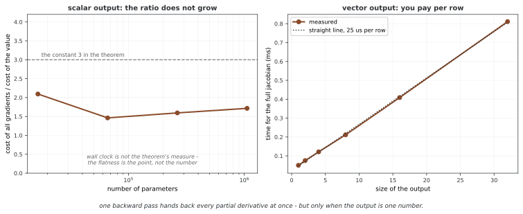

# 야코비안과 고차 미분

`loss.backward()` 한 줄로 끝나지 않는 경우가 있다. **미분을 두 번** 해야 하거나, 출력이 스칼라가 아니어서 **야코비안 전체**가 필요하거나, 손으로 적은 미분이 맞는지 **확인**해야 할 때다. 셋 모두 기본 설정으로는 막히고, 막는 까닭이 저마다 다르다.

## 1. 코드

```python
"""튜토리얼 19: 그래디언트 셈 - 앞선 그래디언트 셈"""
import torch
# 무작위로 뽑는 값이 아래에 나온다. 씨앗을 고정해야 이 쪽에 실린
# 수가 다시 나온다 — 고정하지 않으면 돌릴 때마다 다른 수가 찍힌다
torch.manual_seed(0)

# ========================================================================
# 메인
# ========================================================================

def header(title): print(f"\n{'='*70}\n{title}\n{'='*70}")

def main():
    header("1. Higher-Order Gradients")
    x = torch.tensor(2.0, requires_grad=True)
    y = x ** 3  # y = x^3
    print(f"y = x^3 where x = {x}")
    grad_y = torch.autograd.grad(y, x, create_graph=True)[0]
    print(f"dy/dx = 3x^2 = {grad_y}")
    grad2_y = torch.autograd.grad(grad_y, x)[0]
    print(f"d²y/dx² = 6x = {grad2_y}")
    
    header("2. Gradient of Multiple Outputs")
    x = torch.tensor([1.0, 2.0], requires_grad=True)
    y1 = x[0] ** 2
    y2 = x[1] ** 3
    print(f"x = {x}")
    print(f"y1 = x[0]^2 = {y1}")
    print(f"y2 = x[1]^3 = {y2}")
    grad_x = torch.autograd.grad([y1, y2], x, grad_outputs=[torch.tensor(1.0), torch.tensor(1.0)])[0]
    print(f"Gradient: {grad_x}")
    
    header("3. Jacobian Matrix")
    def f(x):
        return torch.stack([x[0]**2, x[1]**2, x[0]*x[1]])
    x = torch.tensor([2.0, 3.0], requires_grad=True)
    y = f(x)
    print(f"x = {x}")
    print(f"f(x) = {y}")
    jacobian = torch.autograd.functional.jacobian(f, x)
    print(f"Jacobian:\n{jacobian}")
    
    header("4. Gradient Checking")
    def numerical_gradient(f, x, eps=1e-5):
        grad = torch.zeros_like(x)
        for i in range(x.numel()):
            x_plus = x.clone()
            x_plus.view(-1)[i] += eps
            x_minus = x.clone()
            x_minus.view(-1)[i] -= eps
            grad.view(-1)[i] = (f(x_plus) - f(x_minus)) / (2 * eps)
        return grad
    x = torch.tensor([1.0, 2.0], requires_grad=True)
    def f(x): return (x**2).sum()
    y = f(x)
    y.backward()
    auto_grad = x.grad.clone()
    x.grad.zero_()
    num_grad = numerical_gradient(f, x)
    print(f"Autograd: {auto_grad}")
    print(f"Numerical: {num_grad}")
    print(f"Close? {torch.allclose(auto_grad, num_grad)}")
    
    header("5. Gradient Accumulation Pattern")
    model_output = torch.tensor(0.0, requires_grad=True)
    accumulated_loss = 0
    for i in range(3):
        loss = (model_output - i) ** 2
        loss.backward()
        accumulated_loss += loss.item()
        print(f"Step {i+1}: grad = {model_output.grad}")
    print(f"Total accumulated loss: {accumulated_loss}")
    
    header("6. Gradient Masking")
    x = torch.randn(5, requires_grad=True)
    y = x ** 2
    mask = torch.tensor([1.0, 0.0, 1.0, 0.0, 1.0])
    y.backward(mask)
    print(f"x = {x}")
    print(f"Gradient (masked): {x.grad}")
    print("Only positions with mask=1.0 get gradients!")
    
    header("7. Practical: L2 Regularization")
    weights = torch.randn(10, requires_grad=True)
    predictions = weights.sum()
    target = torch.tensor(5.0)
    loss = (predictions - target) ** 2
    reg_lambda = 0.01
    regularization = reg_lambda * (weights ** 2).sum()
    total_loss = loss + regularization
    print(f"Loss: {loss.item():.4f}")
    print(f"Regularization: {regularization.item():.4f}")
    print(f"Total: {total_loss.item():.4f}")
    total_loss.backward()
    print(f"Gradient includes regularization term!")

if __name__ == "__main__":
    main()
```

**출력:**

```

======================================================================
1. Higher-Order Gradients
======================================================================
y = x^3 where x = 2.0
dy/dx = 3x^2 = 12.0
d²y/dx² = 6x = 12.0

======================================================================
2. Gradient of Multiple Outputs
======================================================================
x = tensor([1., 2.], requires_grad=True)
y1 = x[0]^2 = 1.0
y2 = x[1]^3 = 8.0
Gradient: tensor([ 2., 12.])

======================================================================
3. Jacobian Matrix
======================================================================
x = tensor([2., 3.], requires_grad=True)
f(x) = tensor([4., 9., 6.], grad_fn=<StackBackward0>)
Jacobian:
tensor([[4., 0.],
        [0., 6.],
        [3., 2.]])

======================================================================
4. Gradient Checking
======================================================================
Autograd: tensor([2., 4.])
Numerical: tensor([2.0027, 4.0054], grad_fn=<CopySlices>)
Close? False

======================================================================
5. Gradient Accumulation Pattern
======================================================================
Step 1: grad = 0.0
Step 2: grad = -2.0
Step 3: grad = -6.0
Total accumulated loss: 5.0

======================================================================
6. Gradient Masking
======================================================================
x = tensor([ 1.5410, -0.2934, -2.1788,  0.5684, -1.0845], requires_grad=True)
Gradient (masked): tensor([ 3.0820, -0.0000, -4.3576,  0.0000, -2.1690])
Only positions with mask=1.0 get gradients!

======================================================================
7. Practical: L2 Regularization
======================================================================
Loss: 56.5757
Regularization: 0.0698
Total: 56.6455
Gradient includes regularization term!
```

## 2. 논의

**기본 역전파는 재사용에 필요한 저장 텐서를 해제하며, 그래디언트 계산 자체도 기본적으로 새 그래프로 기록하지 않는다.** 그래서 경사를 다시 미분하려 하면 미분할 그래프가 남아 있지 않다. 2차 미분을 하려면 **경사를 셀 때 그 계산 자체도 그래프에 남겨 두라**고 말해 주어야 한다.

```python
g,  = torch.autograd.grad(y, x, create_graph=True)   # g도 미분할 수 있게 둔다
g2, = torch.autograd.grad(g, x)                       # 2차 미분
```

`create_graph=True`를 빼면 `g`는 그냥 숫자가 되어 `grad_fn`이 없고, 그것을 다시 미분하려 하면 `element 0 of tensors does not require grad`가 난다. 메시지가 "경사가 필요 없다"고 말하는데 정작 내가 요청한 것은 경사이므로 읽기에 혼란스럽다. 뜻은 "이 텐서는 그래프에 매달려 있지 않다"는 것이다.

공짜가 아니다. `create_graph=True`는 역전파 과정 자체를 그래프로 쌓으므로 메모리를 더 쓴다. 그래서 기본값이 꺼져 있다.

**원소가 여러 개인 출력에는 경사 인수가 필요하다.**

```python
d = c * 2          # 모양 (2,)
d.backward()       # RuntimeError: grad can be implicitly created only for scalar outputs
```

까닭은 경사가 **무엇에 대한** 경사인지 정해지지 않았기 때문이다. 출력이 둘이면 미분도 둘이고, 그것을 하나의 `c.grad`에 담으려면 **둘을 어떤 비율로 섞을지** 알려 주어야 한다. 그 비율이 `grad_outputs`다.

```python
d.backward(torch.ones_like(d))     # 출력을 모두 1배로 더한다 = d.sum() 을 미분한 것
```

그래서 일반적인 학습 로스를 스칼라로 줄이는 것이다. `loss.mean()`이나 `loss.sum()`을 거치면 섞는 비율이 거기서 정해지므로 `backward()`에 아무것도 넘기지 않아도 된다.

**야코비안은 이 비율을 모든 방향으로 한 번씩 물어 얻는다.** 출력이 $m$개, 입력이 $n$개면 야코비안은 $m \times n$이고, 역전파 한 번은 일반적으로 행들의 가중합인 VJP를 준다. 출력 한 성분만 선택하는 기저 벡터를 주면 한 행을 얻는다. 출력 기저 벡터를 하나씩 쓰는 단순한 역방향 구현에서는 $m$개의 방향을 계산한다. 실제 API는 벡터화나 전방향 모드 등의 선택에 따라 처리 방식과 비용이 달라질 수 있다.

$$
f(v) = \begin{bmatrix} v_0^2 \\ v_0 v_1 \\ v_1^3 \end{bmatrix}, \qquad
J = \begin{bmatrix} 2v_0 & 0 \\ v_1 & v_0 \\ 0 & 3v_1^2 \end{bmatrix}
$$

$v = (2, 3)$에서 $J = \begin{bmatrix} 4 & 0 \\ 3 & 2 \\ 0 & 27 \end{bmatrix}$이다. 비용이 큰 계산이므로 작은 함수를 확인할 때만 쓴다. 학습에서는 야코비안을 통째로 만들지 않고 벡터를 곱한 결과만 얻는다.

<div class="storybox" markdown>

**그림으로 보는 AI 1.** 스칼라로 줄이는 것이 그렇게 중요한 까닭

"야코비안은 비싸다"는 말은 어림짐작이 아니라 **정리로 적힌 비대칭**이다. 그리고 그 비대칭이 이 쪽 전체의 까닭이다.

1983년에 발터 바우어(Walter Baur)와 폴커 슈트라센(Volker Strassen)이 취리히에서 「편미분의 복잡도」를 냈다. 정리는 한 줄이다 — 출력이 **하나**인 함수 $f$ 에 대해, $f$ 와 **모든** 편미분을 함께 셈하는 값이 $f$ 하나를 셈하는 값의 세 배를 넘지 않는다.

$$
L\bigl(f,\ \partial f/\partial x_1,\ \dots,\ \partial f/\partial x_n\bigr) \;\le\; 3\,L(f)
$$

놀라운 곳은 $n$ 이 식에 없다는 것이다. 파라메터가 백만 개든 천만 개든 **같은 세 배**다. 미분을 하나씩 세면 $n$ 배가 들 것 같은데 그렇지 않다. `loss.backward()` 한 줄이 모든 웨이트의 경사를 한꺼번에 돌려주는 일이 공짜처럼 보이는 까닭이 여기에 있다.



왼쪽이 그것을 잰 것이다. 파라메터를 만 육천에서 백만으로 **예순네 배** 늘려도 비는 1.5와 2 사이에 머문다. 늘지 않는다는 것이 요점이다.

**그런데 이 선물에는 조건이 하나 붙어 있고, 그것이 출력이 스칼라여야 한다는 것이다.** 출력이 $m$ 개면 야코비안은 $m$ 개의 행이고, 역전파 한 번이 주는 것은 행 하나가 아니라 행들의 가중합(VJP)이다. 행을 따로 받으려면 기저 벡터를 하나씩 넣어 $m$ 번 물어야 한다. 오른쪽 그림이 그 값이다 — 점들이 거의 완전한 직선 위에 놓인다. 출력 하나가 늘 때마다 **일정한 값이 그대로 더 든다.**

그래서 위에서 `d.backward()` 가 거절당하고 `grad_outputs` 를 요구한 것은 까다로움이 아니었다. 출력이 여럿이면 바우어와 슈트라센이 보장한 자리 밖으로 나가는 것이고, 라이브러리는 **어느 가중합을 원하는지** 물어 다시 스칼라로 데려오려 한 것이다. 학습 로스를 `mean()` 이나 `sum()` 으로 줄이는 것도 같은 이유다. 비용이 $n$ 을 타지 않는 자리에 머무르기 위해서다.

**다만 상수 3은 벽시계 시간이 아니다.** 정리가 재는 것은 **비스칼라 복잡도**, 곧 상수가 아닌 곱셈과 나눗셈의 수이고, 메모리도 캐시도 파이썬 호출 비용도 세지 않는다. 그림의 비가 3보다 작게 나오는 것도, 다른 기계에서 다르게 나올 것도 그래서다. 왼쪽 그림에서 읽을 것은 **그 비가 평평하다는 것**이지 특정한 수가 아니다. 그리고 `create_graph=True` 로 한 번 더 미분하기 시작하면 그 역전파 자체가 다시 그래프가 되므로, 위에서 적은 대로 메모리는 따로 치러야 한다.

_확인한 곳 — W. Baur, V. Strassen, "The complexity of partial derivatives", *Theoretical Computer Science* **22**, 317–330 (1983), 1982년 1월 접수, 취리히 대학. 초록의 부등식이 $L(f, \partial f/\partial x_1, \dots, \partial f/\partial x_n) \le 3L(f)$ 이고 $L$ 은 비스칼라 복잡도다. 논문 끝에서 저자들이 "상수 3을 개선하고 싶은 독자"에게 보기를 권하는 대목이 있어 그 3이 정리의 상수임을 확인했다. 그림의 수는 그림을 그리는 코드가 이 기계에서 직접 잰다._

</div>

!!! warning "`gradcheck`의 기본 설정은 이중 정밀도를 전제로 한다"
    `torch.autograd.gradcheck`는 autograd가 낸 경사를 **수치 미분**과 비교하여 확인한다. 수치 미분은 $\frac{f(x+h) - f(x-h)}{2h}$인데, 여기에 자료형이 걸린다.

    `float32`는 유효숫자가 일곱 자리 남짓이다. $h$를 작게 잡으면 $f(x+h)$와 $f(x-h)$의 **차이가 유효숫자 밖으로 밀려나** 정보가 사라지고, $h$를 크게 잡으면 수치 미분 자체가 참값에서 멀어진다. 기본 허용오차에서 두 오차를 충분히 작게 만들기 어려울 수 있다.

    ```python
    a = torch.tensor([1., 2.], dtype=torch.float32, requires_grad=True)
    gradcheck(fn, (a,))     # GradcheckError — 코드는 맞는데도 실패한다
    ```

    그래서 경고가 먼저 뜬다 — `Input #0 requires gradient and is not a double precision floating point`. 제공된 예제는 `float64`에서 통과한 기록이다. 다만 이중 정밀도로 바꾼다고 잘못된 미분이나 비미분점의 문제가 해결되는 것은 아니다.

    ```python
    b = torch.tensor([1., 2.], dtype=torch.float64, requires_grad=True)
    gradcheck(fn, (b,))     # True
    ```

    곧 **`gradcheck`가 실패했다고 해서 내 미분이 틀린 것이 아니다.** 자료형부터 확인한다. 확인용으로만 `float64`를 쓰고 학습은 `float32`로 하는 것이 보통이다.

## 연습문제

<div class="drillbox" markdown>

**연습문제 1.** <span class="diff easy" title="쉬움"></span>
$y = x^3$의 1차·2차 미분을 $x = 3$에서 autograd로 구하라. `create_graph=True`를 **빼면** 무슨 일이 생기는지 확인하고, 오류 메시지가 왜 읽기에 혼란스러운지 적어라.

</div>

??? success "풀이"
    ```python
    import torch

    x = torch.tensor([3.], requires_grad=True)
    y = x ** 3
    g,  = torch.autograd.grad(y, x, create_graph=True)
    g2, = torch.autograd.grad(g, x)
    print("y'  =", g.item(),  "(3x^2 = 27)")
    print("y'' =", g2.item(), "(6x  = 18)")

    x2 = torch.tensor([3.], requires_grad=True)
    g_, = torch.autograd.grad(x2 ** 3, x2)       # create_graph 없이
    try:
        torch.autograd.grad(g_, x2)
    except RuntimeError as e:
        print("2차 시도:", e)
    ```

    ```
    y'  = 27.0 (3x^2 = 27)
    y'' = 18.0 (6x  = 18)
    2차 시도: element 0 of tensors does not require grad and does not have a grad_fn
    ```

    역전파는 끝나면 그래프를 버린다. `create_graph=True`는 **경사를 계산하는 과정 자체를
    그래프로 남겨** 그 결과를 다시 미분할 수 있게 한다. 빼면 `g_`는 그래프에 매달리지
    않은 숫자가 되므로 미분할 거리가 없다.

    메시지가 혼란스러운 까닭은 "경사가 필요하지 않다"(`does not require grad`)고 말하는
    데 있다. 내가 요청한 것이 바로 경사이므로, 읽으면 요청이 무시된 것처럼 들린다. 실제
    뜻은 **"내가 넘긴 그 텐서가 그래프에 이어져 있지 않다"**는 것이다. 고칠 자리는
    `grad`를 부른 이 줄이 아니라 그 **앞의** 줄이다.

---


<div class="drillbox" markdown>

**연습문제 2.** <span class="diff med" title="중간"></span>
`c = torch.tensor([1., 2.], requires_grad=True)`에 대해 `d = c * 2`를 만들고 `d.backward()`를 불러 보라. 오류가 나는 까닭을 **"경사를 하나의 `c.grad`에 담아야 한다"**는 사실로 설명하고, `grad_outputs`를 주어 고쳐라. 로스를 늘 스칼라로 줄이는 관행이 이것과 어떻게 이어지는지 밝혀라.

</div>

??? success "풀이"
    ```python
    import torch

    c = torch.tensor([1., 2.], requires_grad=True)
    d = c * 2
    try:
        d.backward()
    except RuntimeError as e:
        print(e)

    c2 = torch.tensor([1., 2.], requires_grad=True)
    d2 = c2 * 2
    d2.backward(torch.ones_like(d2))
    print("grad_outputs=ones ->", c2.grad)

    c3 = torch.tensor([1., 2.], requires_grad=True)
    (c3 * 2).sum().backward()
    print("sum() 뒤 backward ->", c3.grad)
    ```

    ```
    grad can be implicitly created only for scalar outputs
    grad_outputs=ones -> tensor([2., 2.])
    sum() 뒤 backward -> tensor([2., 2.])
    ```

    `d`는 원소가 둘이므로 미분도 둘이다. 그런데 결과를 담을 `c.grad`는 `c`와 같은 모양
    하나뿐이다. 그러므로 **두 출력의 미분을 어떤 비율로 섞어 담을지** 정해야 하는데,
    PyTorch가 그것을 대신 정할 수는 없다. 그래서 "스칼라가 아니면 암묵적으로 만들 수
    없다"고 한다.

    `grad_outputs`가 그 비율이다. `torch.ones_like(d)`를 주면 둘을 1배씩 더하라는 뜻이고,
    그것은 `d.sum()`을 미분한 것과 같다. 위에서 두 결과가 같은 까닭이다.

    로스를 늘 스칼라로 줄이는 관행이 여기서 나온다. `loss.mean()`이나 `loss.sum()`을
    거치면 **섞는 비율이 그 줄에서 이미 정해지므로** `backward()`에 아무것도 넘길 필요가
    없다. 곧 `mean()`은 편의가 아니라 비율을 밝히는 일이다. `mean()`과 `sum()`이 경사의
    크기를 $N$배 다르게 만드는 까닭도 같다.

---


<div class="drillbox" markdown>

**연습문제 3.** <span class="diff hard" title="어려움"></span>
`fn = lambda t: (t**3).sum()`에 대해 `torch.autograd.gradcheck`를 `float32` 입력과 `float64` 입력으로 각각 돌려라. 제공된 기록에서는 `float32` 검사가 실패한다. **미분 식이 맞아도 검사가 실패할 수 있는** 까닭을 수치 미분의 계산식으로 설명하라.

</div>

??? success "풀이"
    ```python
    import torch
    from torch.autograd import gradcheck

    fn = lambda t: (t ** 3).sum()

    a = torch.tensor([1., 2.], dtype=torch.float32, requires_grad=True)
    try:
        gradcheck(fn, (a,))
    except Exception as e:
        print("float32 ->", type(e).__name__)

    b = torch.tensor([1., 2.], dtype=torch.float64, requires_grad=True)
    print("float64 ->", gradcheck(fn, (b,)))
    ```

    ```
    float32 -> GradcheckError
    float64 -> True
    ```

    (`float32` 쪽은 그 앞에 `Input #0 requires gradient and is not a double precision
    floating point` 경고도 함께 뜬다.)

    `gradcheck`는 autograd가 낸 경사를 **수치 미분**과 견준다.

    $$
    f'(x) \approx \frac{f(x+h) - f(x-h)}{2h}
    $$

    여기에 자료형이 끼어든다. 기본 설정은 double 정밀도를 전제로 하므로 float32에서는 올바른 미분도 실패할 수 있다. 모든 함수와 허용오차에서 실패한다는 뜻은 아니다.

    - $h$를 **작게** 잡으면 $f(x+h)$와 $f(x-h)$가 거의 같아진다. 유효숫자가 일곱 자리뿐이니 그 차이가 자리 밖으로 밀려나 **없어진다.** 0에 가까운 수를 아주 작은 $2h$로 나누면 결과가 널뛴다.
    - $h$를 **크게** 잡으면 차이는 살아남지만, 그 비가 더 이상 도함수가 아니다. 근사 자체가 어긋난다.

    `float64`는 유효숫자가 열여섯 자리 남짓이라 두 요구 사이에 쓸 만한 $h$가 존재한다.
    그래서 `gradcheck`가 `float64`를 전제로 만들어졌고, 아니면 경고부터 띄운다.

    요점은 이것이다. **`gradcheck`의 실패는 내 미분이 틀렸다는 증거가 아니다.** 먼저
    자료형을 본다. 확인은 `float64`로 하고 학습은 `float32`로 하는 것이 보통이다 —
    확인은 한 번이고 학습은 수없이 반복하므로 값이 다르다.

## 정리하며

`loss.backward()` 한 줄로 끝나지 않는 세 경우가 있고, 막히는 까닭이 저마다 다르다.

- **2차 미분** — 역전파가 끝나면 그래프를 버리므로, 경사를 셀 때 `create_graph=True`로 그 계산까지 남겨 두어야 한다. 메모리를 더 쓰기에 기본값이 꺼져 있다. 오류 메시지가 "경사가 필요 없다"고 말하지만 뜻은 "그 텐서가 그래프에 이어져 있지 않다"이고, 고칠 자리는 앞 줄이다.
- **스칼라가 아닌 출력** — 출력이 여럿이면 미분도 여럿인데 담을 자리는 하나다. 그래서 **섞을 비율**(`grad_outputs`)을 밝혀야 한다. 로스를 `mean()`이나 `sum()`으로 줄이는 관행이 바로 그 비율을 정하는 일이고, 그래서 둘이 경사의 크기를 다르게 만든다.
- **야코비안** — 역전파 한 번은 VJP를 준다. 기저 벡터로 선택하면 야코비안 한 행이 된다. 전체가 필요하면 출력 수만큼 반복해야 하므로 비싸고, 작은 함수를 확인할 때만 쓴다.

확인에는 `gradcheck`를 쓰되 **`float64`로** 쓴다. 수치 미분은 두 값의 차이를 아주 작은 수로 나누는 계산이라, `float32`의 유효숫자로는 쓸 만한 $h$가 없다. 그래서 코드가 맞아도 실패한다 — **실패를 보면 자료형부터 확인한다.**
