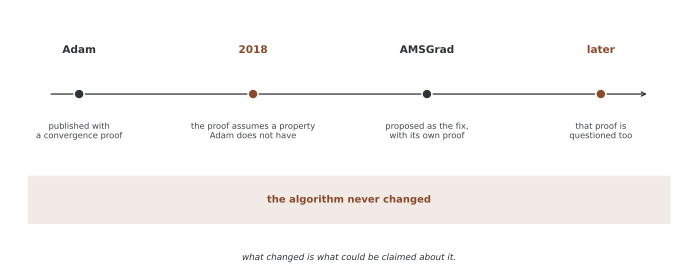

# 최적화 기초 — 그래디언트를 받아 파라메터를 옮긴다

[앞 쪽](21_simple_neural_network.md)이 학습 한 걸음을 `w - \eta \cdot \text{grad}`로 확인했다. 옵티마이저는 그 한 줄을 대신해 주는 물건이고, 종류에 따라 **그 한 줄을 다르게 적는다.**

이 쪽은 손으로 따라갈 수 있는 SGD부터 시작해 자르기와 스케줄러를 보고, 마지막에 SGD와 Adam을 같은 문제에 걸어 **어느 쪽이 얼마나 다른지 재어 본다.** 흔히 하는 말 대신 수로 본다.

## 1. 코드

```python
"""튜토리얼 22: 최적화 기초 — 그래디언트를 받아 파라메터를 옮기는 일."""
import torch
import torch.nn as nn
import torch.optim as optim

torch.manual_seed(0)


def header(title):
    print(f"\n{'='*70}\n{title}\n{'='*70}")


def main():
    header("1. SGD 한 걸음은 손으로 따라갈 수 있다")
    p = torch.tensor([2.0], requires_grad=True)
    opt = optim.SGD([p], lr=0.1)
    print(f"{'':4s}{'p':>8s}{'grad':>9s}{'loss':>9s}{'다음 p':>10s}")
    for i in range(3):
        opt.zero_grad()
        loss = (p - 1.0) ** 2
        loss.backward()
        g, cur = p.grad.item(), p.item()
        opt.step()
        print(f"{i+1:<4d}{cur:8.4f}{g:9.4f}{loss.item():9.4f}{p.item():10.4f}")
    print("grad = 2(p - 1) 이고, 다음 p = p - 0.1 * grad 다.")

    header("2. 그래디언트 자르기 — 넘을 때만 줄인다")
    def clip_demo(vec, max_norm):
        q = nn.Parameter(torch.zeros(len(vec)))
        q.grad = torch.tensor(vec)
        before = q.grad.norm().item()
        direction_before = q.grad / q.grad.norm()
        torch.nn.utils.clip_grad_norm_([q], max_norm=max_norm)
        after = q.grad.norm().item()
        same_dir = torch.allclose(q.grad / q.grad.norm(), direction_before, atol=1e-6)
        print(f"  {str(vec):22s} 노름 {before:6.3f} -> {after:6.3f}   방향 그대로? {same_dir}")

    print(f"max_norm = 1.0")
    clip_demo([3.0, 4.0], 1.0)        # 노름 5 — 줄어든다
    clip_demo([0.3, 0.4], 1.0)        # 노름 0.5 — 그대로다
    print("자르기는 **줄이기만** 한다. 작은 그래디언트를 키워 주지 않는다.")

    header("3. 러닝레이트 스케줄러")
    opt = optim.SGD([torch.zeros(1, requires_grad=True)], lr=1.0)
    sched = optim.lr_scheduler.StepLR(opt, step_size=3, gamma=0.1)
    lrs = []
    for _ in range(10):
        opt.step()
        sched.step()
        lrs.append(opt.param_groups[0]["lr"])
    print("에포크:", list(range(1, 11)))
    print("러닝레이트:", [f"{v:g}" for v in lrs])
    print("step_size=3 마다 gamma=0.1 을 곱한다.")

    header("4. SGD 와 Adam 을 같은 문제에서 견준다")
    # 배울 것이 있는 문제를 만든다 — y = Xw* + 잡음
    torch.manual_seed(0)
    X = torch.randn(200, 10)
    w_true = torch.randn(10, 1)
    y = X @ w_true + 0.1 * torch.randn(200, 1)

    def train(make_opt, steps=100):
        torch.manual_seed(1)                      # 같은 초깃값에서 출발한다
        m = nn.Linear(10, 1)
        o = make_opt(m.parameters())
        hist = []
        for _ in range(steps):
            o.zero_grad()
            loss = nn.MSELoss()(m(X), y)
            loss.backward()
            o.step()
            hist.append(loss.item())
        return hist

    runs = {
        "SGD  lr=0.01": train(lambda p: optim.SGD(p, lr=0.01)),
        "SGD  lr=0.1 ": train(lambda p: optim.SGD(p, lr=0.1)),
        "Adam lr=0.01": train(lambda p: optim.Adam(p, lr=0.01)),
        "Adam lr=0.1 ": train(lambda p: optim.Adam(p, lr=0.1)),
    }
    print(f"{'':14s}{'1 스텝':>10s}{'10':>10s}{'50':>10s}{'100':>10s}")
    for name, h in runs.items():
        print(f"{name:14s}{h[0]:10.4f}{h[9]:10.4f}{h[49]:10.4f}{h[99]:10.4f}")
    s01, a01 = runs["SGD  lr=0.01"][-1], runs["Adam lr=0.01"][-1]
    s10, a10 = runs["SGD  lr=0.1 "][-1], runs["Adam lr=0.1 "][-1]
    print(f"\nlr 을 고정하고 옵티마이저만 바꾸면   {a01/s01:.1f}배 (0.01), {a10/s10:.1f}배 (0.1)")
    print(f"옵티마이저를 고정하고 lr 만 바꾸면  {s01/s10:.1f}배 (SGD), {a01/a10:.1f}배 (Adam)")
    print("이 문제에서는 옵티마이저보다 lr 이 훨씬 크게 가른다.")


if __name__ == "__main__":
    main()
```

**출력:**

```
======================================================================
1. SGD 한 걸음은 손으로 따라갈 수 있다
======================================================================
           p     grad     loss      다음 p
1     2.0000   2.0000   1.0000    1.8000
2     1.8000   1.6000   0.6400    1.6400
3     1.6400   1.2800   0.4096    1.5120
grad = 2(p - 1) 이고, 다음 p = p - 0.1 * grad 다.

======================================================================
2. 그래디언트 자르기 — 넘을 때만 줄인다
======================================================================
max_norm = 1.0
  [3.0, 4.0]             노름  5.000 ->  1.000   방향 그대로? True
  [0.3, 0.4]             노름  0.500 ->  0.500   방향 그대로? True
자르기는 **줄이기만** 한다. 작은 그래디언트를 키워 주지 않는다.

======================================================================
3. 러닝레이트 스케줄러
======================================================================
에포크: [1, 2, 3, 4, 5, 6, 7, 8, 9, 10]
러닝레이트: ['1', '1', '0.1', '0.1', '0.1', '0.01', '0.01', '0.01', '0.001', '0.001']
step_size=3 마다 gamma=0.1 을 곱한다.

======================================================================
4. SGD 와 Adam 을 같은 문제에서 견준다
======================================================================
                    1 스텝        10        50       100
SGD  lr=0.01      6.9654    5.0504    1.2616    0.2446
SGD  lr=0.1       6.9654    0.2557    0.0085    0.0085
Adam lr=0.01      6.9654    5.9070    2.6194    0.7972
Adam lr=0.1       6.9654    0.7057    0.0237    0.0086

lr 을 고정하고 옵티마이저만 바꾸면   3.3배 (0.01), 1.0배 (0.1)
옵티마이저를 고정하고 lr 만 바꾸면  28.7배 (SGD), 92.4배 (Adam)
이 문제에서는 옵티마이저보다 lr 이 훨씬 크게 가른다.
```

## 2. 자르기는 줄이기만 한다

`clip_grad_norm_(params, max_norm)`은 그래디언트 **전체를 한 덩어리로 보아** 그 노름이 `max_norm`을 넘으면 넘는 만큼 **비례해서 줄인다.** 출력의 2절이 두 경우를 나란히 보인다.

| 그래디언트 | 노름 | 자른 뒤 | 방향 |
|---|---|---|---|
| $(3, 4)$ | 5.000 | **1.000** | 그대로 |
| $(0.3, 0.4)$ | 0.500 | **0.500** | 그대로 |

두 가지를 읽어 둔다.

- **작은 것을 키우지 않는다.** 둘째 줄이 0.5에 머문다. 이름이 "clip"인 까닭이다.
- **방향은 건드리지 않는다.** 모든 성분에 같은 수를 곱하므로 어느 파라메터가 더 크게 움직일지는 그대로다. 바뀌는 것은 **보폭뿐**이다.

그래서 자르기는 러닝레이트를 낮추는 것과 다르다. 러닝레이트는 **늘** 줄이고, 자르기는 **튀는 스텝에서만** 줄인다.

## 3. 스케줄러는 `lr`을 바꿀 뿐이다

`StepLR(step_size=3, gamma=0.1)`은 `scheduler.step()`이 세 번 불릴 때마다 `lr`에 $0.1$을 곱한다. 출력의 3절이 $1 \to 0.1 \to 0.01 \to 0.001$로 세 걸음마다 한 자리씩 내려가는 것을 보인다.

`optimizer.step()`과 `scheduler.step()`은 **다른 일**이다. 앞의 것이 파라메터를 옮기고, 뒤의 것이 다음 번에 얼마나 옮길지를 정한다. 차례도 그 순서다.

## 4. 옵티마이저와 러닝레이트, 어느 쪽이 더 가르는가

4절이 $y = Xw^{*} + \varepsilon$로 **배울 것이 있는** 문제를 만들고, 같은 초깃값에서 출발해 100 스텝을 돌린다. 끝의 로스는 이렇다.

| | lr = 0.01 | lr = 0.1 |
|---|---|---|
| SGD | 0.2446 | **0.0085** |
| Adam | 0.7972 | 0.0086 |

읽을 것이 셋이다.

**하나, 같은 `lr`에서 Adam이 빠르지 않다.** `lr = 0.01`에서 SGD가 0.2446, Adam이 0.7972로 **SGD가 3.3배 낫다.** Adam이 늘 빠르다는 말은 적어도 이 문제에서는 서지 않는다.

**둘, `lr`을 올리면 둘이 같아진다.** 0.0085와 0.0086으로 사실상 구별되지 않는다.

**셋, 그래서 더 크게 가르는 것은 `lr`이다.** 옵티마이저만 바꾸면 1.0~3.3배가 움직이는데, `lr`만 바꾸면 **28.7배(SGD)와 92.4배(Adam)**가 움직인다. 고를 것이 하나뿐이라면 옵티마이저가 아니라 `lr`이다.

!!! note "이 표가 말하지 않는 것"
    문제가 하나다. $y = Xw^{*} + \varepsilon$는 **선형이고 조건이 좋은** 문제이며, Adam이 잘한다고 알려진 자리 — 좌표마다 스케일이 크게 다르거나, 그래디언트가 성기거나, 손실면이 험한 경우 — 가 아니다. 딥 넷트웍에서 Adam을 기본값으로 두는 관행이 이 표로 반박되지는 않는다.

    **말할 수 있는 것은 "옵티마이저 이름만으로는 정해지지 않는다"까지다.** 그리고 그것만으로도 쓸모가 있다 — 바꿔 보고 재지 않은 채 "Adam이니까 괜찮다"고 적을 수는 없다는 뜻이기 때문이다.

<div class="storybox" markdown>

**그림으로 보는 AI 1.** 재어서는 알 수 없었던 것

바로 위 상자가 이 표로 **말할 수 없는 것**을 적어 두었다. 그런데 Adam에는 이 쪽의 표가 아무리 커져도 가릴 수 없는 종류의 물음이 하나 더 있었다. 그리고 그것이 몇 해 동안 틀린 채로 있었다.

Adam은 **수렴 증명과 함께** 세상에 나왔다. 2018년에 사샹크 레디(Sashank Reddi)·사티엔 케일(Satyen Kale)·산지브 쿠마르(Sanjiv Kumar)가 그 증명이 틀렸음을 보였다. 증명이 어떤 양이 늘 양수라고 가정했는데 Adam에는 그 성질이 없었다 — 과거 그래디언트를 **오래 기억하는** AdaGrad처럼 다루었지만, Adam의 $v$ 는 지수 이동평균이라 기억이 짧다. 두 사람 몫의 차이가 증명 한 줄에 숨어 있었던 셈이다. 그들은 **볼록 문제인데도** Adam이 최적해에 닿지 못하는 보기를 만들어 보였고, 그 조건 $\beta_1 < \sqrt{\beta_2}$ 는 기본값이 그대로 만족한다.



고치려고 내놓은 것이 AMSGrad다 — $v$ 의 **최댓값을 들고 다녀** 기억을 길게 만든다. `torch.optim.Adam(..., amsgrad=True)` 가 그것이다. 그런데 뒷날 그 AMSGrad의 증명에도 문제가 지적되었다.

**여기서 중요한 것은 알고리즘이 한 번도 바뀌지 않았다는 점이다.** 2018년 전후로 Adam의 코드는 같았고, 잘 돌던 학습이 갑자기 망가지지도 않았다. 바뀐 것은 **그것을 두고 할 수 있는 말**이다.

**그리고 이 쪽의 방식으로는 그 일을 알아챌 수 없었다.** 솔직히 적자면, 이 상자를 쓰면서 그 반례를 여기서 재현해 보려 했고 **실패했다.** 기본 $\beta$ 로도, 논문처럼 걸음폭을 $1/\sqrt{t}$ 로 줄여 가며 돌려도 Adam은 매번 옳은 답에 닿았다. 그 결과는 마지막 반복값이 아니라 **온라인 후회(regret)** 가 줄지 않는다는 이야기여서, 장난감 문제를 몇 번 돌려 보는 것으로는 드러나지 않는다.

그러니 위 상자의 조심스러움에 한 줄을 더해야 한다. 표는 "이름만으로는 정해지지 않는다"까지 말해 주고, **표로는 아예 닿지 못하는 물음도 따로 있다.** 재는 일과 증명하는 일은 서로를 대신하지 못한다. 그 둘이 갈라진 자리에서 몇 해가 지나갔고, 그동안 Adam은 멀쩡히 돌아가고 있었다.

_확인한 곳 — S. J. Reddi, S. Kale, S. Kumar, "On the Convergence of Adam and Beyond", ICLR 2018 (최우수 논문). 증명이 가정한 성질, 짧은 기억과 긴 기억의 차이, $\beta_1 < \sqrt{\beta_2}$ 조건의 볼록 반례, AMSGrad 의 제안이 모두 그 논문이다. AMSGrad 증명에 제기된 문제는 arXiv:1904.03590 "On the Convergence Proof of AMSGrad and a New Version". 반례를 재현하지 못했다는 것은 이 기계에서 직접 돌려 본 결과이며, 그 실패를 반례에 대한 반박으로 읽어서는 안 된다._

</div>

## 연습문제

<div class="drillbox" markdown>

**연습문제 1.** <span class="diff easy" title="쉬움"></span>
출력 1절의 네 줄을 보지 않고 손으로 채워라. $p_0 = 2$, 로스는 $(p-1)^2$, `lr = 0.1`이다. 세 걸음 뒤의 $p$는 얼마인가? 그리고 걸음마다 **줄어드는 폭이 작아지는** 까닭은 무엇인가?

</div>

??? success "풀이"
    $\partial L/\partial p = 2(p-1)$이므로 $p \leftarrow p - 0.1 \cdot 2(p-1) = p - 0.2(p-1)$이다.

    | 걸음 | $p$ | grad | 다음 $p$ |
    |---|---|---|---|
    | 1 | 2.0000 | 2.0000 | 1.8000 |
    | 2 | 1.8000 | 1.6000 | 1.6400 |
    | 3 | 1.6400 | 1.2800 | 1.5120 |

    줄어드는 폭이 작아지는 까닭은 **그래디언트가 거리에 비례**하기 때문이다. $p - 1$을 $d$라 두면 한 걸음이 $d \leftarrow d - 0.2d = 0.8d$이므로, 남은 거리가 걸음마다 **0.8배**가 된다. 1.0 → 0.8 → 0.64 → 0.512가 그것이고, 표의 $p$에서 1을 빼면 그대로 나온다.

    곧 이 문제에서 SGD는 **기하적으로** 다가간다. 결코 정확히 1에 닿지 않고 한없이 가까워질 뿐이다.

---

<div class="drillbox" markdown>

**연습문제 2.** <span class="diff med" title="중간"></span>
그래디언트 자르기를 러닝레이트를 낮추는 것으로 흉내 낼 수 있는가? $(3, 4)$와 $(0.3, 0.4)$ 두 그래디언트가 **번갈아** 나오는 상황을 생각하고, (가) `max_norm = 1`로 자르는 것과 (나) `lr`을 5분의 1로 낮추는 것이 각각 어떻게 다른지 수로 보여라.

</div>

??? success "풀이"
    `lr = 0.1`로 두고 실제 보폭을 재어 본다.

    ```python
    import torch

    for g in ([3.0, 4.0], [0.3, 0.4]):
        v = torch.tensor(g)
        clipped = v * min(1.0, 1.0 / v.norm())      # max_norm = 1
        print(f"{str(g):12s} 자르기 {(0.1 * clipped).norm():.4f}   "
              f"lr 1/5 {(0.02 * v).norm():.4f}")
    ```

    ```
    [3.0, 4.0]   자르기 0.1000   lr 1/5 0.1000
    [0.3, 0.4]   자르기 0.0500   lr 1/5 0.0100
    ```

    **큰 그래디언트에서는 둘이 같고, 작은 그래디언트에서는 다르다.** 자르기는 작은 쪽을 건드리지 않으므로 보폭이 0.05로 남는데, `lr`을 낮추면 작은 쪽까지 0.01로 함께 줄어든다.

    그러니 흉내 낼 수 없다. 자르기가 하려는 일은 **튀는 스텝 하나를 막는 것**이지 전체를 느리게 하는 것이 아니다. `lr`을 낮추면 튀는 스텝도 잡히지만 멀쩡한 스텝까지 느려진다. 바꾸어 말하면, 자르기는 **그래디언트의 크기에 따라 달라지는** 처치이고 `lr`은 **한결같은** 처치다.

---

<div class="drillbox" markdown>

**연습문제 3.** <span class="diff hard" title="어려움"></span>
본문 4절의 표는 "옵티마이저보다 `lr`이 더 크게 가른다"고 읽었다. 이 읽기가 **옳지 않게 되는** 경우를 하나 만들어 보라. 힌트 — 그 문제는 좌표마다 스케일이 비슷하다. 스케일을 크게 어긋나게 하면 무엇이 달라지는가?

</div>

??? success "풀이"
    입력의 한 열만 1000배로 키우면 좌표마다 적당한 보폭이 크게 달라진다. SGD는 **모든 좌표에 같은 `lr`**을 쓰므로 큰 쪽에 맞추면 작은 쪽이 기지 않고, 작은 쪽에 맞추면 큰 쪽이 튄다.

    ```python
    import torch, torch.nn as nn, torch.optim as optim

    torch.manual_seed(0)
    X = torch.randn(200, 10)
    X[:, 0] *= 1000.0                       # 한 열만 스케일이 다르다
    w_true = torch.randn(10, 1)
    y = X @ w_true + 0.1 * torch.randn(200, 1)

    def train(make_opt, steps=100):
        torch.manual_seed(1)
        m = nn.Linear(10, 1)
        o = make_opt(m.parameters())
        for _ in range(steps):
            o.zero_grad()
            loss = nn.MSELoss()(m(X), y)
            loss.backward()
            o.step()
        return loss.item()

    for name, mk in [("SGD  lr=1e-7 ", lambda p: optim.SGD(p, lr=1e-7)),
                     ("SGD  lr=1e-6 ", lambda p: optim.SGD(p, lr=1e-6)),
                     ("Adam lr=0.01 ", lambda p: optim.Adam(p, lr=0.01)),
                     ("Adam lr=0.1  ", lambda p: optim.Adam(p, lr=0.1))]:
        print(f"{name} {train(mk):12.2f}")
    ```

    ```
    SGD  lr=1e-7          6.96
    SGD  lr=1e-6         97.15
    Adam lr=0.01          3.23
    Adam lr=0.1           0.29
    ```

    **읽기가 뒤집힌다.** 본문에서는 `lr`이 28.7~92.4배를 가르고 옵티마이저는 1.0~3.3배였는데, 여기서는 반대다.

    | | 가장 좋은 결과 | 무엇을 바꾼 효과인가 |
    |---|---|---|
    | SGD | 6.96 (`lr`=1e-7) | `lr`만 바꾸면 6.96 ↔ 97.15, **14배** |
    | Adam | **0.29** (`lr`=0.1) | `lr`만 바꾸면 3.23 ↔ 0.29, **11배** |
    | 둘 사이 | | 저마다 최선끼리 **24배** |

    곧 **옵티마이저가 더 크게 가른다.** 그리고 SGD 쪽은 `lr`을 $10^{-7}$까지 내려야 하며, 한 자리만 올려도(=$10^{-6}$) 97로 발산한다 — 쓸 수 있는 `lr`의 폭 자체가 좁다.

    까닭은 Adam이 **좌표마다 보폭을 따로 잡기** 때문이다. 1000배 큰 열은 그래디언트도 크게 나오는데, SGD는 모든 좌표에 같은 `lr`을 곱하므로 그 열에 맞추면 나머지가 기고 나머지에 맞추면 그 열이 튄다. Adam은 좌표별로 최근 그래디언트 크기로 나누어 그 어긋남을 상당히 지운다.

    그러므로 본문의 읽기는 **그 문제에 딸린 말**이었다. 좌표의 스케일이 고르면 `lr`이 지배하고, 어긋나면 옵티마이저가 지배한다. 어느 쪽인지는 **재어 보기 전에는 모른다.**

    (덧붙여 진짜 처방은 옵티마이저가 아니라 **입력을 정규화하는 것**이다. 열마다 평균과 표준편차를 맞추면 이 문제 자체가 사라지고, 그때는 본문의 읽기로 돌아간다.)

## 정리하며

옵티마이저가 하는 일은 `step()` 한 줄이고, 그 줄이 어떻게 적히는지가 SGD와 Adam을 가른다. 그 둘레에 자르기와 스케줄러가 붙는데 셋은 서로 다른 손잡이다 — **스케줄러는 늘 줄이고, 자르기는 넘을 때만 줄이고, 옵티마이저는 좌표마다 다르게 줄인다.**

그리고 4절이 재어 보인 것이 하나 있다. 이 문제에서 끝의 로스를 가른 것은 옵티마이저 이름(1.0~3.3배)이 아니라 **러닝레이트(28.7~92.4배)**였다. 다른 문제에서는 다를 수 있고, 연습문제 3이 그런 자리를 하나 만든다. 어느 쪽이든 **고르기 전에 두 가지를 다 재어 보는 것**이 이 쪽이 권하는 전부다.
