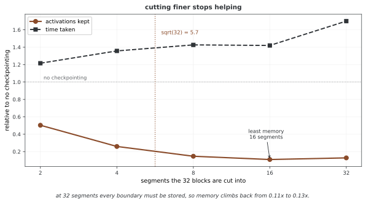

# 기억 자리 다루기 — 무엇이 자리를 잡고 있는가

텐서 하나가 잡는 자리는 셈으로 나온다. 그런데 학습 중에 터지는 것은 대개 텐서가 아니라 **역전파가 쥐고 있는 중간값**이다. 이 쪽은 그 둘을 가르고, 자리를 줄이는 두 가지 — 그래디언트 쌓기와 체크포인트 — 가 무엇을 값으로 치르는지 **재어 본다.**

## 1. 코드

```python
"""튜토리얼 25: 기억 자리 다루기 — 무엇이 자리를 잡고 있는가."""
import time

import torch
import torch.nn as nn
from torch.utils.checkpoint import checkpoint

torch.manual_seed(0)


def header(title):
    print(f"\n{'='*70}\n{title}\n{'='*70}")


class Deep(nn.Module):
    """같은 블록을 n 번 쌓은 것. 체크포인트를 켜고 끌 수 있다."""

    def __init__(self, n=16, width=256):
        super().__init__()
        self.blocks = nn.ModuleList(
            [nn.Sequential(nn.Linear(width, width), nn.ReLU()) for _ in range(n)])

    def forward(self, x, every=0):
        for i, b in enumerate(self.blocks):
            use = every and (i % every == 0)
            x = checkpoint(b, x, use_reentrant=False) if use else b(x)
        return x


def saved_kb(net, x, every):
    """역전파가 끝날 때까지 **저장해 둔** 텐서의 크기를 센다."""
    sizes = []
    with torch.autograd.graph.saved_tensors_hooks(
            lambda t: (sizes.append(t.numel()), t)[1], lambda t: t):
        net(x, every=every).sum().backward()
    return sum(sizes) * 4 / 1024


def ms(net, x, every, reps=5):
    for _ in range(2):
        net(x, every=every).sum().backward()      # 데우기
    t0 = time.perf_counter()
    for _ in range(reps):
        net.zero_grad()
        net(x, every=every).sum().backward()
    return (time.perf_counter() - t0) / reps * 1e3


def main():
    header("1. 텐서 하나가 잡는 자리는 셈으로 나온다")
    x = torch.randn(1000, 1000)
    print(f"모양 {tuple(x.shape)}  원소 {x.nelement():,}개  하나당 {x.element_size()} 바이트")
    print(f"= {x.element_size() * x.nelement() / 1024**2:.2f} MB")
    print(f"float16 이면 {torch.randn(1000, 1000, dtype=torch.float16).element_size() * x.nelement() / 1024**2:.2f} MB")

    header("2. 제자리 연산은 새 자리를 잡지 않는다")
    x = torch.randn(1000, 1000)
    ptr, first = x.data_ptr(), x[0, 0].item()
    y = x + 1
    print(f"x + 1   -> 같은 저장소인가 {y.data_ptr() == ptr}   x 가 바뀌었나 {x[0,0].item() != first}")
    x.add_(1)
    print(f"x.add_(1) -> 같은 저장소인가 {x.data_ptr() == ptr}   x 가 바뀌었나 {x[0,0].item() != first}")

    header("3. 그래프를 들고 있는 것이 자리를 잡는다")
    x = torch.randn(100, 100, requires_grad=True)
    y = x ** 2
    print(f"y            requires_grad {y.requires_grad}  grad_fn {y.grad_fn is not None}")
    print(f"y.detach()   requires_grad {y.detach().requires_grad}  grad_fn {y.detach().grad_fn is not None}")
    with torch.no_grad():
        z = x ** 2
    print(f"no_grad 안   requires_grad {z.requires_grad}  grad_fn {z.grad_fn is not None}")

    header("4. 그래디언트 쌓기는 같은 값을 준다")
    m = nn.Linear(8, 1)
    X, y = torch.randn(32, 8), torch.randn(32, 1)
    m.zero_grad()
    nn.MSELoss()(m(X), y).backward()
    full = m.weight.grad.clone()
    m.zero_grad()
    for i in range(4):
        (nn.MSELoss()(m(X[i*8:(i+1)*8]), y[i*8:(i+1)*8]) / 4).backward()
    acc = m.weight.grad.clone()
    print(f"32 를 한 번에  {full[0, :3].tolist()}")
    print(f"8 씩 네 번     {acc[0, :3].tolist()}")
    print(f"같은가 {torch.allclose(full, acc, atol=1e-6)}   가장 큰 차이 {(full-acc).abs().max():.2e}")
    print("로스를 쌓는 횟수로 나누어 두는 것이 조건이다. 안 나누면 네 배가 된다.")

    header("5. 체크포인트 — 자리를 셈으로 바꾼다")
    net = Deep()
    x = torch.randn(64, 256, requires_grad=True)
    base_kb, base_ms = saved_kb(net, x, 0), ms(net, x, 0)
    print(f"{'체크포인트':>14}{'저장 KB':>10}{'자리':>9}{'ms':>9}{'셈':>9}")
    print(f"{'안 쓴다':>14}{base_kb:>10.0f}{'1.0배':>9}{base_ms:>9.2f}{'1.0배':>9}")
    for every, name in [(4, "네 블록마다"), (2, "두 블록마다"), (1, "모든 블록")]:
        k, t = saved_kb(net, x, every), ms(net, x, every)
        print(f"{name:>14}{k:>10.0f}{base_kb/k:>8.1f}배{t:>9.2f}{t/base_ms:>8.1f}배")

    header("6. 그 값은 모델 크기에 딸려 있다")
    print("5절의 '모든 블록'을 너비와 배치를 키워 가며 다시 잰다.")
    print(f"{'너비':>7}{'배치':>7}{'그냥 ms':>12}{'체크포인트 ms':>16}{'셈':>9}")
    for w, b in [(256, 64), (1024, 256), (2048, 512)]:
        torch.manual_seed(0)
        n2 = Deep(width=w)
        x2 = torch.randn(b, w, requires_grad=True)
        a, c = ms(n2, x2, 0, reps=3), ms(n2, x2, 1, reps=3)
        print(f"{w:>7}{b:>7}{a:>12.2f}{c:>16.2f}{c/a:>8.2f}배")


if __name__ == "__main__":
    main()
```

**출력:**

```
======================================================================
1. 텐서 하나가 잡는 자리는 셈으로 나온다
======================================================================
모양 (1000, 1000)  원소 1,000,000개  하나당 4 바이트
= 3.81 MB
float16 이면 1.91 MB

======================================================================
2. 제자리 연산은 새 자리를 잡지 않는다
======================================================================
x + 1   -> 같은 저장소인가 False   x 가 바뀌었나 False
x.add_(1) -> 같은 저장소인가 True   x 가 바뀌었나 True

======================================================================
3. 그래프를 들고 있는 것이 자리를 잡는다
======================================================================
y            requires_grad True  grad_fn True
y.detach()   requires_grad False  grad_fn False
no_grad 안   requires_grad False  grad_fn False

======================================================================
4. 그래디언트 쌓기는 같은 값을 준다
======================================================================
32 를 한 번에  [-0.44626450538635254, 0.12163355946540833, 0.7158703207969666]
8 씩 네 번     [-0.4462644159793854, 0.12163357436656952, 0.7158703804016113]
같은가 True   가장 큰 차이 8.94e-08
로스를 쌓는 횟수로 나누어 두는 것이 조건이다. 안 나누면 네 배가 된다.

======================================================================
5. 체크포인트 — 자리를 셈으로 바꾼다
======================================================================
         체크포인트     저장 KB       자리       ms        셈
          안 쓴다      6144     1.0배     1.30     1.0배
        네 블록마다      4864     1.3배     1.93     1.5배
        두 블록마다      3584     1.7배     2.67     2.1배
         모든 블록      1024     6.0배     3.66     2.8배

======================================================================
6. 그 값은 모델 크기에 딸려 있다
======================================================================
5절의 '모든 블록'을 너비와 배치를 키워 가며 다시 잰다.
     너비     배치       그냥 ms        체크포인트 ms        셈
    256     64        1.38            4.52    3.28배
   1024    256       34.16           38.03    1.11배
   2048    512      208.11          282.61    1.36배
```

## 2. 자리를 잡는 것은 둘이다

**값**과 **그래프**다.

1절의 $1000 \times 1000$ 텐서는 3.81 MB다 — 원소 수 곱하기 원소 하나의 크기이고, `float16`으로 두면 정확히 반이다. 여기까지는 셈이다.

3절이 보이는 것이 나머지다. `y = x ** 2`는 값만 들고 있는 것이 아니라 **역전파에 쓸 길**을 함께 들고 있다(`grad_fn`). 그 길에 매달린 중간값들이 풀려나지 않는 한 자리가 비지 않는다. `detach()`는 그 길을 끊은 사본을 주고, `no_grad()`는 애초에 길을 만들지 않는다.

그래서 추론할 때 `no_grad()`를 쓰는 까닭이 속도만이 아니다. **쌓지 않은 그래프는 자리를 잡지 않는다.**

## 3. 그래디언트 쌓기는 어림이 아니다

배치 32가 들어가지 않으면 8씩 네 번 돌리고 그래디언트를 더한다. 흔히 "비슷한 효과"라고 말하지만 4절이 보이듯 **같은 값**이다.

| | 첫 세 성분 |
|---|---|
| 32를 한 번에 | $-0.44626450,\ 0.12163356,\ 0.71587032$ |
| 8씩 네 번 | $-0.44626442,\ 0.12163357,\ 0.71587038$ |

가장 큰 차이가 $8.9 \times 10^{-8}$로 `float32`의 반올림 수준이다. 까닭은 간단하다 — 평균의 그래디언트는 그래디언트의 평균이고, `.backward()`가 `.grad`에 **더하기**로 쌓기 때문이다.

**조건이 하나 있다.** 로스를 쌓는 횟수로 나누어 두어야 한다. 안 나누면 네 조각의 평균이 아니라 합이 되어 그래디언트가 네 배가 되고, 러닝레이트를 네 배로 키운 것과 같아진다.

## 4. 체크포인트는 자리를 셈으로 바꾼다

중간값을 들고 있지 않고 **필요할 때 다시 셈한다.** 5절이 그 맞바꿈을 잰다.

| 체크포인트 | 저장 KB | 자리 | ms | 셈 |
|---|---|---|---|---|
| 안 쓴다 | 6144 | 1.0배 | 1.30 | 1.0배 |
| 네 블록마다 | 4864 | 1.3배 | 1.93 | 1.5배 |
| 두 블록마다 | 3584 | 1.7배 | 2.67 | 2.1배 |
| 모든 블록 | **1024** | **6.0배** | 3.66 | **2.8배** |

자리는 6배로 줄고 셈은 2.8배로 는다. **공짜가 아니고, 값이 싸지도 않다.**

## 5. 그런데 그 값은 모델 크기에 딸려 있다

체크포인트를 두고 흔히 "셈을 30%쯤 더 하는 대신 자리를 크게 줄인다"고 말한다. 4절의 2.8배와 맞지 않는다. 6절이 같은 측정을 너비와 배치를 키워 가며 되풀이한다.

| 너비 | 배치 | 그냥 | 체크포인트 | 셈 |
|---|---|---|---|---|
| 256 | 64 | 1.38 ms | 4.52 ms | **3.28배** |
| 1024 | 256 | 34.16 ms | 38.03 ms | **1.11배** |
| 2048 | 512 | 208.11 ms | 282.61 ms | **1.36배** |

**크기가 커지면 그 어림이 맞는다.** 작은 모델에서 3.28배가 나오는 까닭은 다시 셈하는 비용보다 **다시 부르는 비용**이 크기 때문이다 — 레이어 하나를 돌리는 데 드는 고정 비용(파이썬 호출, 디스패치)이 실제 곱셈보다 크면, 다시 셈하는 일은 거의 전부가 그 고정 비용이다.

여기에 읽을 것이 하나 있다. **장난감 크기에서 재고 "체크포인트는 세 배 느리다"고 적으면 틀린다.** 쓸 자리는 자리가 모자랄 만큼 큰 모델인데, 바로 그 크기에서 값이 싸진다.

<div class="storybox" markdown>

**그림으로 보는 AI 1.** 몇 군데 둘 것인가는 1992년에 풀린 문제다

`torch.utils.checkpoint` 는 딥러닝에서 생각해 낸 수가 아니다. 역전파가 **셈의 길이에 비례해 메모리를 먹는다**는 문제는 자동 미분에서 오래전부터 알려져 있었고, 거기서는 **재계산(rematerialization)** 이라 불렀다. 안드레아스 그리방크(Andreas Griewank)가 1990년대 초에 보인 것은 단순한 맞바꿈이 아니라 더 센 결과다 — 체크포인트를 **잘 고르면** 시간과 자리가 둘 다 셈 길이의 **로그**로만 자란다. 그 최적 일정을 구현한 것이 `revolve` 이고, 뒤에 ACM 수학 소프트웨어 학회지의 알고리즘 799로 실렸다.

여기서 "잘 고르면"이 핵심이다. 4절의 표는 **구간을 잘게 쪼갤수록 자리가 준다**는 쪽으로 읽히기 쉬운데, 끝까지 쪼개면 그렇지 않다.



블록 서른두 개를 구간 수를 바꿔 가며 재어 보았다. 자리는 구간 둘에서 0.50배, 넷에서 0.26배, 여덟에서 0.15배, 열여섯에서 **0.11배**까지 내려간다. 그런데 **서른둘 — 블록마다 하나씩 — 에서는 0.13배로 되올라간다.** 구간을 늘리면 구간 **경계 자체를 저장**해야 하고, 어느 지점을 지나면 그 비용이 아껴지는 양을 앞지른다. 시간은 그 사이에도 꾸준히 나빠진다.

그러니 체크포인트에는 **최적점이 있고, 끝까지 쪼개는 것은 그 점을 지나치는 것**이다. 그리방크의 결과가 가리키는 자리가 블록 수의 제곱근 언저리인데, 여기서는 $\sqrt{32} \approx 5.7$ 이고 잰 최저점이 열여섯이다. 정확히 겹치지는 않는다 — 이 쪽이 재는 것은 그 이론이 가정한 균일한 시간 단계가 아니라 파이썬 호출 비용이 섞인 실제 레이어이기 때문이다.

**그리고 그것이 이 상자의 한계다.** `torch.utils.checkpoint` 가 하는 일은 `revolve` 의 최적 일정이 아니라 **가장 단순한 일정** — 구간 안의 것은 전부 버리고 한 번 다시 셈한다 — 이다. 그래서 위 두 절이 잰 "값"은 체크포인트의 값이 아니라 **그 단순한 일정의 값**이다. 더 잘할 수 있다는 것이 1990년대에 이미 알려져 있었고, 우리가 흔히 부르는 한 줄은 그중 가장 쉬운 쪽을 고른 것이다.

_확인한 곳 — A. Griewank, "Achieving logarithmic growth of temporal and spatial complexity in reverse automatic differentiation" 이 체크포인트를 잘 고르면 시간·공간이 로그로 자란다는 결과를 담고 있고, A. Griewank·A. Walther 의 `revolve` 가 그 일정을 구현해 *ACM Transactions on Mathematical Software* 의 Algorithm 799 로 실렸다. 그림의 수는 그림을 그리는 코드가 이 기계에서 직접 재며, 끝까지 쪼갰을 때 자리가 되올라가는지를 먼저 확인한 뒤에만 그린다._

</div>

## 연습문제

<div class="drillbox" markdown>

**연습문제 1.** <span class="diff easy" title="쉬움"></span>
4절은 로스를 쌓는 횟수로 나눈다. **나누지 않으면** 그래디언트가 어떻게 되는가? 재어 보고, 그것이 러닝레이트와 어떤 관계인지 말하라.

</div>

??? success "풀이"
    정확히 **쌓은 횟수 배**가 된다.

    ```python
    import torch, torch.nn as nn
    torch.manual_seed(0)

    m = nn.Linear(8, 1)
    X, y = torch.randn(32, 8), torch.randn(32, 1)

    m.zero_grad(); nn.MSELoss()(m(X), y).backward()
    full = m.weight.grad.clone()

    for div in (4, 1):
        m.zero_grad()
        for i in range(4):
            loss = nn.MSELoss()(m(X[i*8:(i+1)*8]), y[i*8:(i+1)*8]) / div
            loss.backward()
        r = (m.weight.grad / full)
        print(f"÷{div} 로 쌓으면 한 번에 잰 것의 {r.mean():.4f} 배")
    ```

    ```
    ÷4 로 쌓으면 한 번에 잰 것의 1.0000 배
    ÷1 로 쌓으면 한 번에 잰 것의 4.0000 배
    ```

    **나누지 않으면 네 배다.** 그리고 그 네 배는 러닝레이트를 네 배로 키운 것과 **구별되지 않는다** — 옵티마이저가 보는 것은 `.grad` 하나뿐이기 때문이다.

    그래서 이 실수는 조용하다. 터지지 않고, 로스도 내려간다. 다만 적어 둔 러닝레이트가 실제 러닝레이트가 아니게 되고, 쌓는 횟수를 바꾸면 학습률이 함께 바뀐다. 쌓는 횟수를 실험 변수로 두었다면 결과를 읽을 수 없게 된다.

---

<div class="drillbox" markdown>

**연습문제 2.** <span class="diff med" title="중간"></span>
3절은 `detach()`와 `no_grad()`가 둘 다 `grad_fn`을 없앤다고 보였다. 그렇다면 둘은 같은 것인가? **자리를 잡는 관점에서** 무엇이 다른지 밝혀라.

</div>

??? success "풀이"
    같지 않다. **`detach()`는 이미 쌓은 그래프를 끊고, `no_grad()`는 쌓지 않는다.**

    ```python
    import torch

    x = torch.randn(1000, 1000, requires_grad=True)

    sizes = []
    with torch.autograd.graph.saved_tensors_hooks(
            lambda t: (sizes.append(t.numel()), t)[1], lambda t: t):
        y = (x ** 2).sin().exp()          # 중간값이 쌓인다
        z = y.detach()                    # 끊는 것은 z 뿐이다
        y.sum().backward()
    print(f"detach 를 써도 쌓인 중간값 {sum(sizes)*4/1024:.0f} KB")

    sizes = []
    with torch.autograd.graph.saved_tensors_hooks(
            lambda t: (sizes.append(t.numel()), t)[1], lambda t: t):
        with torch.no_grad():
            y = (x ** 2).sin().exp()
    print(f"no_grad 안에서 쌓인 중간값 {sum(sizes)*4/1024:.0f} KB")
    ```

    ```
    detach 를 써도 쌓인 중간값 11719 KB
    no_grad 안에서 쌓인 중간값 0 KB
    ```

    **`detach()`를 불러도 그 앞에서 쌓인 것은 이미 쌓여 있다.** 끊어진 사본을 하나 더 얻을 뿐이고, 원래 텐서가 살아 있는 한 그래프도 산다.

    그러므로 추론에서 자리를 아끼려면 `no_grad()`(또는 `inference_mode()`)가 답이고, `detach()`는 **그래프를 흘려보내고 싶지 않은 한 지점**에 쓰는 물건이다 — 이를테면 타깃 넷트웍의 출력처럼 그래디언트가 거슬러 올라가면 안 되는 자리다.

---

<div class="drillbox" markdown>

**연습문제 3.** <span class="diff hard" title="어려움"></span>
5절은 체크포인트를 **모든 블록**에 걸면 자리가 6배 줄고 셈이 2.8배 는다고 했다. 네 블록마다 걸면 자리가 1.3배밖에 줄지 않는데 셈은 1.5배 는다 — **자리보다 셈이 더 는다.** 이 설정이 손해인가? 어떤 경우에 그래도 쓸 만한지 말하라.

</div>

??? success "풀이"
    비만 보면 손해로 보이지만, **고르는 기준이 비가 아니다.**

    자리는 **넘치느냐 아니냐**의 문제다. 가진 것이 5 GB인데 모델이 6 GB를 쓰면 학습이 아예 돌지 않는다. 1.3배만 줄여도 4.6 GB가 되어 **돌아간다.** 이때 1.5배 느려지는 것은 치를 만한 값이다 — 돌지 않던 것이 도니까.

    반대로 자리가 넉넉하면 1.3배를 줄일 까닭이 없다. 그러므로 읽는 법은 이렇다.

    | 형편 | 고를 것 |
    |---|---|
    | 자리가 넉넉하다 | 쓰지 않는다 |
    | 조금 모자란다 | 일부 블록에만 — 넘치지 않을 만큼만 |
    | 많이 모자란다 | 모든 블록에 |

    **값을 가장 적게 치르면서 넘치지 않는 자리**를 고르는 것이고, 비가 1을 넘는지는 그 판단에 들어오지 않는다.

    덧붙여 5절의 수가 **모델의 어느 쪽을 체크포인트하느냐**에 따라서도 달라진다. 활성화가 큰 레이어(넓은 쪽, 배치가 큰 쪽)를 고르면 같은 셈 비용으로 자리를 더 줄인다. 블록을 고르게 건너뛰며 거는 것은 가장 단순한 규칙일 뿐 가장 좋은 규칙은 아니다.

## 정리하며

자리를 잡는 것은 **값과 그래프**이고, 줄이는 길도 그 둘에 하나씩 있다. 값 쪽은 자료형(`float16`이면 반)과 배치 크기이고, 그래프 쪽은 `no_grad`·`detach`·체크포인트다.

둘을 줄이는 두 수법은 성격이 다르다. **그래디언트 쌓기는 공짜다** — 같은 값을 주고 스텝 수만 늘어난다(단, 쌓는 횟수로 나눌 것). **체크포인트는 값을 치른다** — 자리 6배에 셈 2.8배였다가, 모델이 커지면 1.1~1.4배로 싸진다.

그 마지막 줄이 이 쪽에서 가장 조심할 자리다. **장난감 크기에서 잰 값으로 큰 모델을 판단하면 안 된다.** 체크포인트를 쓸 자리는 자리가 모자랄 만큼 큰 모델이고, 값은 바로 그 크기에서 싸진다.
