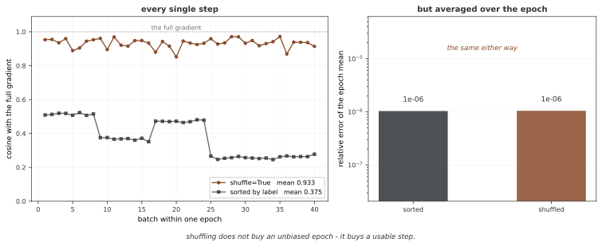

# 자료 먹이기 — Dataset 과 DataLoader

`Dataset`은 **하나를 꺼내는 법**을 적는 것이고 `DataLoader`는 그것을 **묶고 섞고 미리 가져오는** 물건이다. 앞은 세 함수로 끝나고, 뒤는 손잡이가 여럿이라 잘못 돌리기 쉽다.

이 쪽은 기본을 보고, 흔히 하는 말 셋 — 2의 거듭제곱, 일꾼을 늘려라, 미리 가져오게 하라 — 을 **재어서** 확인한다. 셋 가운데 둘이 이 자리에서는 서지 않는다.

!!! note "이 쪽의 밀리초는 이 기계의 것이다"
    `num_workers`가 치르는 값은 운영체제가 프로세스를 어떻게 띄우는지에 크게 딸려 있다. macOS와 윈도는 **spawn**이라 일꾼마다 파이썬과 torch를 새로 불러오고, 리눅스는 **fork**라 그 값이 훨씬 싸다. 그러니 아래의 비는 모양으로 읽을 것이고, 쓰는 기계에서 한 번 재어 보는 것이 옳다.

## 1. 코드

```python
"""튜토리얼 26: 자료 먹이기 — Dataset 과 DataLoader.

num_workers 를 쓰는 측정이 들어 있어 이 쪽의 코드는 반드시
`if __name__ == "__main__":` 아래에서 돌아야 한다. 까닭은 5절에 적었다.
"""
import time

import torch
from torch.utils.data import Dataset, DataLoader, TensorDataset, random_split

torch.manual_seed(0)


def header(title):
    print(f"\n{'='*70}\n{title}\n{'='*70}")


class Points(Dataset):
    """세 가지만 있으면 Dataset 이다 — __init__, __len__, __getitem__."""

    def __init__(self, n=100):
        self.x = torch.randn(n, 4)
        self.y = (self.x.sum(1) > 0).long()

    def __len__(self):
        return len(self.x)

    def __getitem__(self, i):
        return self.x[i], self.y[i]


class IoDataset(Dataset):
    """__getitem__ 이 기다리는 자료 — 디스크에서 읽어 오는 일을 흉내 낸다."""

    def __init__(self, n=1000, wait=0.002):
        self.n, self.wait = n, wait

    def __len__(self):
        return self.n

    def __getitem__(self, i):
        time.sleep(self.wait)              # 기다리는 동안 CPU 를 놓아준다
        return torch.zeros(64), 0


def main():
    header("1. Dataset 은 세 함수다")
    ds = Points(100)
    print(f"len(ds)  {len(ds)}")
    x0, y0 = ds[0]
    print(f"ds[0]    x {x0.tolist()}  y {y0.item()}")

    header("2. DataLoader 는 묶고 섞는다")
    dl = DataLoader(ds, batch_size=32, shuffle=True)
    print(f"표본 100개를 32씩 -> 배치 {len(dl)}개")
    for i, (xb, yb) in enumerate(dl):
        print(f"  배치 {i}: {tuple(xb.shape)}")
    print("마지막 배치가 4개다. drop_last=True 로 두면 버린다.")
    print(f"drop_last=True 면 배치 {len(DataLoader(ds, batch_size=32, drop_last=True))}개")

    header("3. 나누기")
    tr, va = random_split(ds, [80, 20], generator=torch.Generator().manual_seed(0))
    print(f"학습 {len(tr)}  검증 {len(va)}")
    print("검증 쪽은 섞지 않는다 — 섞어도 점수는 같고, 같은 차례로 두면 견주기 쉽다.")

    header("4. 배치 크기가 2의 거듭제곱이어야 하는가")
    X, y = torch.randn(20000, 64), torch.randint(0, 10, (20000,))
    big = TensorDataset(X, y)
    print(f"{'배치 크기':>10}{'한 에포크':>12}{'배치 수':>10}")
    for bs in (100, 128, 200, 256):
        d = DataLoader(big, batch_size=bs, shuffle=False)
        for _ in d:
            break
        t0 = time.perf_counter()
        for _ in range(3):
            for xb, yb in d:
                pass
        print(f"{bs:>10}{(time.perf_counter()-t0)/3*1e3:>10.1f} ms{len(d):>10}")
    print("이 자료에서는 2의 거듭제곱이라고 더 빠르지 않다.")

    header("5. num_workers — 늘리면 빨라지는가")
    print("(가) 이미 메모리에 올라온 자료")
    for nw in (0, 2, 4):
        d = DataLoader(big, batch_size=128, shuffle=True, num_workers=nw)
        for _ in d:
            break
        t0 = time.perf_counter()
        for _ in range(2):
            for xb, yb in d:
                pass
        print(f"  num_workers={nw}:  한 에포크 {(time.perf_counter()-t0)/2*1e3:8.1f} ms")
    print("  -> 느려진다. 자료를 가져오는 데 드는 일이 없으니 얻을 것이 없고,")
    print("     일꾼을 띄우는 값만 치른다.")

    header("6. 그러면 일꾼은 언제 버는가")
    print("__getitem__ 이 2 ms 를 기다리는 자료 1,000개, 세 에포크")

    def run(nw, persistent):
        d_kw = dict(batch_size=64, num_workers=nw)
        if nw:
            d_kw["persistent_workers"] = persistent
        d = DataLoader(IoDataset(), **d_kw)
        t0 = time.perf_counter()
        for _ in range(3):
            for xb, yb in d:
                pass
        return time.perf_counter() - t0

    a = run(0, False)
    b = run(4, False)
    c = run(4, True)
    print(f"  num_workers=0                      {a:6.2f} 초")
    print(f"  num_workers=4                      {b:6.2f} 초   {b/a:.1f}배 느리다")
    print(f"  num_workers=4, persistent_workers  {c:6.2f} 초   {a/c:.1f}배 빠르다")
    print(f"  -> 같은 일꾼 넷인데 한 줄 차이로 {b/c:.0f} 배가 갈린다.")


if __name__ == "__main__":
    main()
```

**출력:**

```
======================================================================
1. Dataset 은 세 함수다
======================================================================
len(ds)  100
ds[0]    x [-1.1258398294448853, -1.152360200881958, -0.2505785822868347, -0.4338788390159607]  y 0

======================================================================
2. DataLoader 는 묶고 섞는다
======================================================================
표본 100개를 32씩 -> 배치 4개
  배치 0: (32, 4)
  배치 1: (32, 4)
  배치 2: (32, 4)
  배치 3: (4, 4)
마지막 배치가 4개다. drop_last=True 로 두면 버린다.
drop_last=True 면 배치 3개

======================================================================
3. 나누기
======================================================================
학습 80  검증 20
검증 쪽은 섞지 않는다 — 섞어도 점수는 같고, 같은 차례로 두면 견주기 쉽다.

======================================================================
4. 배치 크기가 2의 거듭제곱이어야 하는가
======================================================================
     배치 크기       한 에포크      배치 수
       100      30.1 ms       200
       128      29.4 ms       157
       200      30.0 ms       100
       256      34.2 ms        79
이 자료에서는 2의 거듭제곱이라고 더 빠르지 않다.

======================================================================
5. num_workers — 늘리면 빨라지는가
======================================================================
(가) 이미 메모리에 올라온 자료
  num_workers=0:  한 에포크     29.8 ms
  num_workers=2:  한 에포크    937.3 ms
  num_workers=4:  한 에포크   1184.6 ms
  -> 느려진다. 자료를 가져오는 데 드는 일이 없으니 얻을 것이 없고,
     일꾼을 띄우는 값만 치른다.

======================================================================
6. 그러면 일꾼은 언제 버는가
======================================================================
__getitem__ 이 2 ms 를 기다리는 자료 1,000개, 세 에포크
  num_workers=0                        9.03 초
  num_workers=4                       65.78 초   7.3배 느리다
  num_workers=4, persistent_workers    3.40 초   2.7배 빠르다
  -> 같은 일꾼 넷인데 한 줄 차이로 19 배가 갈린다.
```

## 2. `Dataset`은 세 함수다

`__init__`으로 들고, `__len__`으로 몇 개인지 알리고, `__getitem__`으로 **하나**를 돌려준다. 묶는 일은 하지 않는다 — 그것은 `DataLoader`의 몫이다.

이 분업이 뒤의 모든 것을 정한다. `__getitem__`이 **한 번 불릴 때 하는 일**이 자료 먹이기의 값이고, 5절과 6절이 갈리는 까닭도 거기에 있다.

<div class="storybox" markdown>

**그림으로 보는 AI 1.** `shuffle=True` 가 사 주는 것은 생각하던 그것이 아니다

`DataLoader` 의 손잡이 가운데 가장 당연해 보이는 것이 `shuffle` 이다. 왜 섞어야 하는가. 흔히 듣는 답은 "섞어야 배치 그래디언트가 전체 그래디언트의 **편향 없는** 추정이 되기 때문"이다. 재어 보면 그 답은 틀렸다.

작은 분류 문제를 레이블 순으로 **정렬해** 두고 배치 50씩 한 에포크를 돌려 보았다.



오른쪽부터 보자. **한 에포크를 통째로 평균하면 두 경우가 똑같다** — 상대오차가 나란히 $10^{-6}$ 이다. 당연한 일이다. 섞든 안 섞든 한 에포크는 모든 표본을 꼭 한 번씩 보므로, 배치 그래디언트의 합은 어느 쪽이든 전체 그래디언트다. **섞는다고 편향이 없어지는 것이 아니다. 애초에 없었다.**

달라지는 것은 왼쪽이다. 섞으면 배치마다 전체 그래디언트와 코사인 0.93 언저리를 꾸준히 유지하는데, 정렬해 두면 평균 0.375까지 떨어지고 클래스가 바뀌는 자리마다 턱이 진다. 한 배치가 거의 한 클래스로만 차 있으니 그 걸음은 "이 클래스 쪽으로" 가는 걸음이고, 다음 블록에서는 또 다른 쪽으로 간다. **옵티마이저는 에포크 평균을 밟지 않는다. 걸음을 하나씩 밟는다.** 섞는 것이 사 주는 것은 편향 없는 에포크가 아니라 **쓸 만한 한 걸음**이다.

이 생각 자체는 딥러닝보다 한참 앞선다. 1951년에 허버트 로빈스(Herbert Robbins)와 서턴 먼로(Sutton Monro)가 쓴 「A Stochastic Approximation Method」가 그것이다. 함수를 정확히 알지 못하고 **잡음 섞인 값만 볼 수 있어도** 그 근에 다가갈 수 있다는 것을 보였고, 그러려면 걸음폭 $a_n$ 이 두 조건을 지켜야 한다고 했다 — $\sum a_n = \infty$ 이되 $\sum a_n^2 < \infty$ 여야 한다. 너무 일찍 멈추지도, 잡음에 끝없이 흔들리지도 않게 하는 조건이다.

**그런데 오늘 우리가 하는 일은 그 정리의 조건 밖에 있다.** 러닝레이트를 상수로 두면 $\sum a_n^2$ 도 발산하므로 두 번째 조건이 깨진다. 거기에 `shuffle=True` 는 **되돌려 놓지 않고 뽑는** 것이라 — 한 에포크 안에서 이미 쓴 표본은 다시 나오지 않는다 — 로빈스와 먼로가 가정한 독립 추출도 아니다. 그래서 이 쪽의 손잡이들은 정리가 보증해 주는 자리가 아니라 **재어 보고 고르는 자리**에 있다. 아래 4절부터 6절이 전부 그런 이야기다.

_확인한 곳 — H. Robbins, S. Monro, "A Stochastic Approximation Method", *Annals of Mathematical Statistics* **22**(3), 400–407 (1951년 9월). 걸음폭의 두 조건이 그 논문의 것이다. 그림의 수는 그림을 그리는 코드가 씨앗 0으로 직접 재어 얻는다._

</div>

## 3. 마지막 배치는 작다

표본 100개를 32씩 묶으면 32·32·32·**4**다. 그 4개짜리를 어떻게 할 것인가가 `drop_last`다.

버리는 쪽이 좋은 경우가 있다. 배치 정규화는 배치 안의 통계를 쓰므로 4개짜리에서 흔들리고, 배치 크기를 고정으로 가정한 코드는 모양이 달라지면 깨진다. 반대로 버리면 그 에포크에서 **4개를 아예 안 본다.**

## 4. 2의 거듭제곱은 이 자리에서 듣지 않는다

흔히 배치 크기를 $2^k$로 두라고 한다. 4절이 재어 보면 100·128·200·256이 29~35 ms로 사실상 같고, 가장 큰 256이 오히려 조금 느리다.

그 말이 나온 자리는 **GPU 커널**이다 — 워프나 타일 크기에 맞아떨어지면 이득이 있다. CPU에서 텐서를 슬라이스해 묶는 일에는 그런 구조가 없으므로 효과도 없다. **규칙을 옮겨 쓸 때는 그 규칙이 어디서 나왔는지 함께 옮겨야 한다.**

## 5. 일꾼을 늘리면 느려질 수 있다

5절이 이미 메모리에 있는 텐서를 읽는다. `num_workers`를 0에서 2로 올리면 30 ms가 **935 ms**가 된다.

까닭은 단순하다. 일꾼은 **`__getitem__`을 대신 돌리려고** 있는 것인데, 여기서 `__getitem__`은 메모리 한 조각을 가리키는 일이라 나눌 일거리가 없다. 남는 것은 프로세스를 띄우고 텐서를 프로세스 사이로 실어 나르는 값뿐이다.

## 6. 그리고 한 줄이 19배를 가른다

6절이 `__getitem__`을 느리게 만들었다 — 한 번에 2 ms를 기다리게 해서 파일을 읽는 일을 흉내 낸다. 이제는 나눌 일거리가 있다.

| 세 에포크 | |
|---|---|
| `num_workers=0` | 9.03 초 |
| `num_workers=4` | **65.78 초** |
| `num_workers=4, persistent_workers=True` | **3.40 초** |

**일꾼을 넷 두고도 7배 느렸다가, 한 줄을 더하니 2.7배 빨라진다.** 둘 사이가 19배다.

`persistent_workers`가 없으면 **에포크마다** 일꾼 넷을 새로 띄우고, spawn 방식에서는 그때마다 파이썬과 torch를 처음부터 불러온다. 그 값이 자료를 읽는 값보다 크면 일꾼은 손해만 낸다. 켜 두면 일꾼이 에포크 사이에 살아남아 그 값을 한 번만 치른다.

!!! warning "이 쪽의 코드가 `if __name__` 아래에 있는 까닭"
    `num_workers > 0`이고 spawn 방식이면, 일꾼 프로세스가 **본문 모듈을 다시 불러온다.** 가드가 없으면 그 불러오기가 `main()`을 다시 부르고, 그 안에서 또 일꾼을 띄우려 한다.

    실제로 가드 없이 돌리면 `DataLoader worker exited unexpectedly`로 죽는데, 메시지가 까닭을 가리키지 않아 찾기 어렵다. 이 장의 다른 쪽들이 가드를 두는 것은 버릇 때문이지만, 이 쪽에서는 **없으면 돌지 않는다.**

## 연습문제

<div class="drillbox" markdown>

**연습문제 1.** <span class="diff easy" title="쉬움"></span>
표본 100개를 배치 32로 묶으면 마지막 배치가 4개다. 이 배치에서 로스를 재면 다른 배치와 **같은 무게**로 평균에 들어가는가? `nn.MSELoss()`의 기본 설정으로 따져 보라.

</div>

??? success "풀이"
    들어가지 않는다. **표본 하나의 무게가 배치마다 달라진다.**

    ```python
    import torch, torch.nn as nn

    loss = nn.MSELoss()                    # reduction="mean" 이 기본이다
    big = loss(torch.zeros(32, 1), torch.ones(32, 1))
    small = loss(torch.zeros(4, 1), torch.ones(4, 1))
    print(f"32개짜리 배치의 로스 {big.item()}")
    print(f" 4개짜리 배치의 로스 {small.item()}")
    ```

    ```
    32개짜리 배치의 로스 1.0
     4개짜리 배치의 로스 1.0
    ```

    로스 값은 같다 — 둘 다 **배치 안에서 평균**을 내기 때문이다. 그래서 스텝 하나가 미치는 크기도 비슷하고, 결과적으로 4개짜리 배치의 표본 하나는 32개짜리 배치의 표본 하나보다 **여덟 배 센 발언권**을 갖는다.

    대개는 대수롭지 않다. 그러나 배치 크기가 들쭉날쭉하거나(가변 길이 자료), 마지막 배치가 아주 작으면 마지막 스텝이 유난히 튄다. `drop_last=True`가 그것을 막는 가장 싼 방법이고, 정확히 하려면 `reduction="sum"`으로 모아 전체 표본 수로 나눈다.

---

<div class="drillbox" markdown>

**연습문제 2.** <span class="diff med" title="중간"></span>
5절은 메모리에 있는 자료에서 일꾼이 손해라고 했다. 그렇다면 **일꾼 없이** 이 자료를 더 빨리 먹이는 길이 있는가? `TensorDataset` + `DataLoader` 대신 할 수 있는 일을 하나 들고 재어라.

</div>

??? success "풀이"
    자료가 이미 텐서 하나로 메모리에 있다면 **`DataLoader`를 쓰지 않고 직접 자르는 것**이 가장 빠르다.

    ```python
    import torch, time
    from torch.utils.data import TensorDataset, DataLoader

    torch.manual_seed(0)
    X, y = torch.randn(20000, 64), torch.randint(0, 10, (20000,))

    dl = DataLoader(TensorDataset(X, y), batch_size=128, shuffle=True)
    for _ in dl: break
    t0 = time.perf_counter()
    for _ in range(3):
        for xb, yb in dl: pass
    a = (time.perf_counter() - t0) / 3

    t0 = time.perf_counter()
    for _ in range(3):
        perm = torch.randperm(len(X))
        for i in range(0, len(X), 128):
            idx = perm[i:i+128]
            xb, yb = X[idx], y[idx]
    b = (time.perf_counter() - t0) / 3

    print(f"DataLoader   {a*1e3:7.1f} ms")
    print(f"직접 자르기   {b*1e3:7.1f} ms   {a/b:.1f}배")
    ```

    ```
    DataLoader     30.3 ms
    직접 자르기      1.3 ms   23.2배
    ```

    **스무 배 넘게 빠르다**(다시 돌리면 21~34배로 흔들리지만 자릿수는 그대로다). `DataLoader`는 표본을 하나씩 꺼내 리스트에 모았다가 `torch.stack`으로 쌓는데, 이미 한 덩어리인 텐서에서는 그 과정이 전부 군더더기다. 인덱스로 한 번에 긁어 오면 복사 한 번으로 끝난다.

    그러므로 `DataLoader`는 **자료가 메모리에 다 들어가지 않거나, 꺼낼 때 할 일이 있을 때**를 위한 물건이다. MNIST처럼 통째로 올려 둘 수 있는 자료라면 쓰지 않는 쪽이 빠를 수 있다 — 이 책의 3장과 5장이 `materialize()`로 텐서를 펼쳐 두는 까닭이기도 하다.

---

<div class="drillbox" markdown>

**연습문제 3.** <span class="diff hard" title="어려움"></span>
6절은 `persistent_workers=True` 하나로 19배가 갈린다고 했다. 그렇다면 **언제나 켜 두면 되는가?** 켜 두었을 때 생기는 일을 둘 들고, 그래도 켜는 것이 기본인 까닭을 말하라.

</div>

??? success "풀이"
    언제나는 아니다. 둘이 따라온다.

    **하나, 일꾼이 계속 살아 있다.** 학습이 끝나거나 다른 일을 하는 동안에도 프로세스 넷이 메모리를 쥐고 있다. 일꾼마다 자료셋 객체의 사본을 들고 있으므로, `Dataset`이 큰 것을 `__init__`에 담아 두었다면 그만큼이 **일꾼 수만큼 곱해져** 남는다.

    **둘, 에포크 사이에 자료셋이 바뀌지 않는다.** 일꾼은 처음 받은 자료셋 사본을 계속 쓰므로, 본체에서 자료셋의 속성을 바꾸어도(커리큘럼 학습처럼 에포크마다 난이도를 올리는 경우) 일꾼 쪽에는 전해지지 않는다. 조용히 옛 자료로 학습한다.

    그래도 기본으로 켜는 까닭은 **값의 크기가 다르기 때문**이다. 위에서 본 것이 62초와 3초의 차이이고, 위의 두 가지는 둘 다 **알고 있으면 피할 수 있다** — 자료셋을 가볍게 두고(경로만 들고 `__getitem__`에서 읽는다), 에포크마다 바뀌어야 하는 것은 자료셋 속성이 아니라 샘플러로 넘긴다.

    곧 "켜면 안 되는 경우"가 있다기보다 **켜고 쓸 수 있게 자료셋을 짜는 것**이 맞다. 그리고 `num_workers=0`이면 이 손잡이 자체가 뜻이 없다.

## 정리하며

`Dataset`은 하나를 꺼내는 법이고 `DataLoader`는 그것을 묶는 법이다. 그리고 `DataLoader`의 손잡이들은 **자료가 어떤 것이냐에 따라** 반대로 듣는다.

| 흔히 하는 말 | 이 자리에서 재어 보면 |
|---|---|
| 배치 크기는 2의 거듭제곱 | 차이 없다 — GPU 커널 이야기다 |
| 일꾼을 늘리면 빨라진다 | 메모리 자료에서는 **31배 느려진다** |
| 미리 가져오게 하라 | 맞다 — 다만 `persistent_workers` 없이는 되레 손해다 |

세 줄의 공통점이 있다. **규칙만 옮겨 오고 그 규칙이 선 조건을 두고 오면 뒤집힌다.** 어느 것이든 쓰는 자리에서 한 번 재어 보는 값이 가장 싸다.
