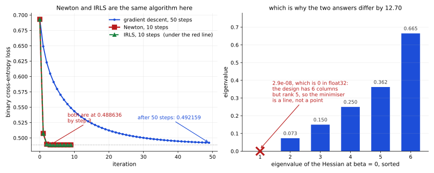

# 그래디언트 계산

로지스틱 BCE의 그래디언트는 예측 확률과 정답의 차이에 피처를 곱한 형태다. 이 식과 헤세 행렬을 유도하고, 볼록성이 보장하는 것과 보장하지 않는 것을 확인한다.

---

## 1. 학습 목표

이 절을 마치면 다음을 할 수 있게 된다.

- 모델 파라메터에 대한 BCE 로스의 그래디언트 유도하기
- 로지스틱 회귀의 그래디언트를 간단하게 만드는 우아한 상쇄 이해하기
- 헤세 행렬을 유도하고 로스의 볼록성 증명하기
- 이차 최적화로서의 뉴턴 방법과 IRLS 알고리즘 이해하기
- 경사 하강법, 뉴턴 방법, IRLS를 구현하고 비교하기

---

## 2. 최적화 문제

우리는 BCE 로스를 최소화하는 파라메터 $\boldsymbol{\beta}$을 찾고자 한다.

$$
\mathcal{L}(\boldsymbol{\beta}) = -\frac{1}{n}\sum_{i=1}^{n} \left[ y_i \log(\sigma(z_i)) + (1-y_i) \log(1-\sigma(z_i)) \right]
$$

여기서 $z_i = \mathbf{x}_i^\top \boldsymbol{\beta}$은 선형 예측자이고 $\sigma(z) = \frac{1}{1+e^{-z}}$은 시그모이드 함수이다.

---

## 3. 단계별 그래디언트 유도

### 1단계: 연쇄 법칙 준비

표본 하나 $i$가 로스에 기여하는 몫은 다음과 같다.

$$
\ell_i = -y_i \log(p_i) - (1-y_i) \log(1-p_i)
$$

여기서 $p_i = \sigma(z_i)$이고 $z_i = \mathbf{x}_i^\top \boldsymbol{\beta}$이다. 연쇄 법칙에 의해 다음과 같다.

$$
\frac{\partial \ell_i}{\partial \boldsymbol{\beta}} = \frac{\partial \ell_i}{\partial p_i} \cdot \frac{\partial p_i}{\partial z_i} \cdot \frac{\partial z_i}{\partial \boldsymbol{\beta}}
$$

### 2단계: 확률에 대한 로스의 도함수

$$
\frac{\partial \ell_i}{\partial p_i} = -\frac{y_i}{p_i} + \frac{1-y_i}{1-p_i} = \frac{-y_i(1-p_i) + (1-y_i)p_i}{p_i(1-p_i)} = \frac{p_i - y_i}{p_i(1-p_i)}
$$

### 3단계: 시그모이드의 도함수

시그모이드에는 아름다운 도함수 성질이 있다.

$$
\frac{\partial p_i}{\partial z_i} = \sigma'(z_i) = \sigma(z_i)(1-\sigma(z_i)) = p_i(1-p_i)
$$

### 4단계: 선형 예측자의 도함수

$$
\frac{\partial z_i}{\partial \boldsymbol{\beta}} = \frac{\partial}{\partial \boldsymbol{\beta}}\left(\mathbf{x}_i^\top \boldsymbol{\beta}\right) = \mathbf{x}_i
$$

### 5단계: 우아한 상쇄

연쇄 법칙으로 합치면 다음과 같다.

$$
\frac{\partial \ell_i}{\partial \boldsymbol{\beta}} = \frac{p_i - y_i}{p_i(1-p_i)} \cdot p_i(1-p_i) \cdot \mathbf{x}_i
$$

$p_i(1-p_i)$ 항들이 **상쇄된다**.

$$
\boxed{\frac{\partial \ell_i}{\partial \boldsymbol{\beta}} = (p_i - y_i)\mathbf{x}_i = (\sigma(\mathbf{x}_i^\top \boldsymbol{\beta}) - y_i)\mathbf{x}_i}
$$

이 상쇄는 우연이 아니다. GLM의 틀에서 **정준 연결**을 쓴 결과이다. 베르누이 반응에 로짓 연결을 쓰면 그래디언트가 이 우아한 형태로 간단해진다.

---

## 4. 전체 그래디언트

### 평균 로스에 대해

평균 BCE 로스의 그래디언트는 다음과 같다.

$$
\nabla_{\boldsymbol{\beta}} \mathcal{L} = \frac{1}{n}\sum_{i=1}^{n} (\sigma(\mathbf{x}_i^\top \boldsymbol{\beta}) - y_i)\mathbf{x}_i
$$

### 행렬 형태

$\mathbf{X} \in \mathbb{R}^{n \times d}$을 설계 행렬(행이 표본), $\mathbf{p} = \sigma(\mathbf{X}\boldsymbol{\beta}) \in \mathbb{R}^n$을 예측 확률, $\mathbf{y} \in \{0,1\}^n$을 정답 라벨이라 하자. 그러면 다음이 성립한다.

$$
\boxed{\nabla_{\boldsymbol{\beta}} \mathcal{L} = \frac{1}{n}\mathbf{X}^\top(\mathbf{p} - \mathbf{y})}
$$

이 우아한 형태는 **오차로 가중된 피처**이다. 각 표본의 피처 벡터 $\mathbf{x}_i$에 예측 오차 $(p_i - y_i)$이 곱해진다.

### 선형 회귀와의 비교

| 모델 | 그래디언트 (표본당) |
|-------|----------------------|
| 선형 회귀(절반 제곱오차) | $(\hat{y}_i-y_i)\mathbf{x}_i$ |
| 로지스틱 회귀 | $(\hat{p}_i - y_i)\mathbf{x}_i$ |

두 행 모두 하강법에 사용하는 그래디언트의 부호를 맞춘 표기다. 연속적인 예측 $\hat{y}_i$ 대신 확률 $\hat{p}_i$을 쓴다는 점만 빼면 형태가 동일하다.

---

## 5. 그래디언트의 해석

### 오차 신호

$(p_i - y_i)$ 항이 **예측 오차**이다.

| 상황 | $y_i$ | $p_i$ | $p_i - y_i$ | 그래디언트에 미치는 영향 |
|----------|-------|-------|-------------|-------------------|
| 맞고 확신함 | 1 | 0.99 | -0.01 | 작은 갱신 |
| 맞지만 불확실함 | 1 | 0.6 | -0.4 | 중간 갱신 |
| 틀렸는데 확신함 | 0 | 0.99 | +0.99 | **큰 갱신** |
| 틀렸고 불확실함 | 0 | 0.6 | +0.6 | 중간 갱신 |

### 그래디언트의 성질

1. **유계인 오차**: $p \in (0, 1)$이고 $y \in \{0, 1\}$이므로 오차는 유계이다. $|p - y| < 1$
2. **피처의 스케일이 중요하다**: 큰 피처 → 큰 그래디언트 → 학습이 불안정해질 수 있다
3. **최적점 근처에서 그래디언트가 사라진다**: $p \approx y$이면 그래디언트가 작다

---

## 6. 경사 하강법의 갱신 규칙

### 표준 (배치) 경사 하강법

$$
\boldsymbol{\beta}^{(t+1)} = \boldsymbol{\beta}^{(t)} - \frac{\eta}{n}\mathbf{X}^\top(\mathbf{p}^{(t)} - \mathbf{y})
$$

### 확률적 경사 하강법

표본 하나 $i$에 대해 다음과 같다.

$$
\boldsymbol{\beta}^{(t+1)} = \boldsymbol{\beta}^{(t)} - \eta (p_i^{(t)} - y_i)\mathbf{x}_i
$$

### 미니배치 SGD

크기가 $B$인 배치 $\mathcal{B}$에 대해 다음과 같다.

$$
\boldsymbol{\beta}^{(t+1)} = \boldsymbol{\beta}^{(t)} - \frac{\eta}{B}\sum_{i \in \mathcal{B}} (p_i^{(t)} - y_i)\mathbf{x}_i
$$

---

## 7. 헤세 행렬의 유도

### 표본별 이계도함수

표본 $i$이 그래디언트에 기여하는 몫은 $(p_i - y_i)\mathbf{x}_i$이다. $y_i$은 상수이므로 $p_i$ 항만 미분한다.

$$
\frac{\partial^2 \mathcal{L}}{\partial \boldsymbol{\beta} \partial \boldsymbol{\beta}^{\top}} \bigg|_{\text{sample } i} = \mathbf{x}_i \frac{\partial p_i}{\partial \boldsymbol{\beta}^{\top}} = p_i(1-p_i) \, \mathbf{x}_i \mathbf{x}_i^{\top}
$$

### 전체 헤세 행렬

여기서는 합 로스 $S=n\mathcal L$의 헤세 행렬 $H_S$를 $\mathbf H$로 표기한다. 평균 로스의 헤세 행렬은 $H_S/n$이다. 그래디언트와 헤세의 배율을 일치시켜야 하며, 뉴턴 업데이트에서는 같은 배율이 상쇄된다.

$$
\mathbf{H} = \nabla^2_{\boldsymbol{\beta}} S = \sum_{i=1}^{n} p_i(1-p_i) \, \mathbf{x}_i \mathbf{x}_i^{\top}
$$

대각 웨이트 행렬 $\mathbf{B} = \operatorname{diag}(p_1(1-p_1), \ldots, p_n(1-p_n))$을 정의하자. 그러면 다음이 성립한다.

$$
\boxed{\mathbf{H} = \mathbf{X}^{\top} \mathbf{B} \mathbf{X}}
$$

### 양의 준정부호성과 볼록성

임의의 벡터 $\mathbf{v} \in \mathbb{R}^d$에 대해 다음이 성립한다.

$$
\mathbf{v}^{\top} \mathbf{H} \mathbf{v} = \mathbf{v}^{\top} \mathbf{X}^{\top} \mathbf{B} \mathbf{X} \mathbf{v} = (\mathbf{X}\mathbf{v})^{\top} \mathbf{B} (\mathbf{X}\mathbf{v}) = \sum_{i=1}^{n} p_i(1-p_i)(\mathbf{x}_i^{\top}\mathbf{v})^2
$$

$p_i \in (0, 1)$이므로 $p_i(1-p_i) > 0$이고 $(\mathbf{x}_i^{\top}\mathbf{v})^2 \geq 0$이므로, 모든 항이 음이 아니다.

$$
\mathbf{v}^{\top} \mathbf{H} \mathbf{v} \geq 0 \quad \forall \, \mathbf{v}
$$

따라서 $\mathbf{H}$은 **양의 준정부호**이며, 이는 음의 로그가능도(log-likelihood, 로그우도라고도 한다)가 **볼록**함을 뜻한다. $\mathbf{X}$이 열 전체 랭크를 가지면 헤세 행렬이 엄격히 양의 정부호가 되어 로스가 엄격히 볼록해지고, 유한한 최솟값이 존재한다면 유일하다. 완전히 분리되는 데이터에서는 열 전체 랭크여도 유한 MLE가 없을 수 있다.

---

## 8. 뉴턴 방법

### 갱신 규칙

이하 뉴턴 식의 그래디언트와 헤세 행렬은 모두 합 로스에서 계산한다. 뉴턴 방법은 곡률을 이용해 방향을 정하지만, 선형계를 풀 수 있는 조건과 감쇠·선 탐색을 함께 고려해야 한다. 이차 수렴은 유한한 비퇴화 최적점 근처 등 추가 조건에서 성립한다.

$$
\boldsymbol{\beta}^{(t+1)} = \boldsymbol{\beta}^{(t)} - \mathbf{H}^{-1} \mathbf{g}
$$

그래디언트와 헤세 행렬을 대입하면 다음과 같다.

$$
\boldsymbol{\beta}^{(t+1)} = \boldsymbol{\beta}^{(t)} - (\mathbf{X}^{\top}\mathbf{B}\mathbf{X})^{-1} \mathbf{X}^{\top}(\mathbf{p} - \mathbf{y})
$$

### 경사 하강법과의 비교

| 성질 | 경사 하강법 | 뉴턴 방법 |
|----------|-----------------|-----------------|
| 갱신 | $\boldsymbol{\beta} - \eta \mathbf{g}$ | $\boldsymbol{\beta} - \mathbf{H}^{-1}\mathbf{g}$ |
| 수렴 속도 | 선형 | 이차 (최적점 근처에서) |
| 단계당 비용 | $O(nd)$ | $O(nd^2 + d^3)$ |
| 하이퍼파라메터 | 러닝레이트 $\eta$ | 없음 (또는 감쇠 인수) |
| 메모리 | $O(d)$ | 헤세 행렬에 $O(d^2)$ |

뉴턴 방법은 훨씬 적은 반복으로 수렴하지만, 헤세 행렬 계산과 행렬 역변환 때문에 반복마다 비용이 더 크다.

---

## 9. 반복 재가중 최소제곱 (IRLS)

### 뉴턴 방법으로부터의 유도

뉴턴 갱신에서 출발하여 정규 방정식의 형태로 정리한다. 양변에 $(\mathbf{X}^{\top}\mathbf{B}\mathbf{X})$을 곱한다.

$$
(\mathbf{X}^{\top}\mathbf{B}\mathbf{X})\boldsymbol{\beta}^{(t+1)} = (\mathbf{X}^{\top}\mathbf{B}\mathbf{X})\boldsymbol{\beta}^{(t)} - \mathbf{X}^{\top}(\mathbf{p} - \mathbf{y})
$$

우변에서 $\mathbf{X}^{\top}$을 묶어내면 다음과 같다.

$$
(\mathbf{X}^{\top}\mathbf{B}\mathbf{X})\boldsymbol{\beta}^{(t+1)} = \mathbf{X}^{\top}\bigl[\mathbf{B}\mathbf{X}\boldsymbol{\beta}^{(t)} - (\mathbf{p} - \mathbf{y})\bigr]
$$

$\mathbf{B}$은 가역이므로 $(\mathbf{p} - \mathbf{y}) = \mathbf{B}\mathbf{B}^{-1}(\mathbf{p} - \mathbf{y})$으로 쓴다.

$$
(\mathbf{X}^{\top}\mathbf{B}\mathbf{X})\boldsymbol{\beta}^{(t+1)} = \mathbf{X}^{\top}\mathbf{B}\bigl[\mathbf{X}\boldsymbol{\beta}^{(t)} - \mathbf{B}^{-1}(\mathbf{p} - \mathbf{y})\bigr]
$$

### 작업 반응

**작업 반응**(또는 조정된 종속 변수)을 다음과 같이 정의한다.

$$
\mathbf{z} = \mathbf{X}\boldsymbol{\beta}^{(t)} - \mathbf{B}^{-1}(\mathbf{p} - \mathbf{y})
$$

그러면 갱신은 다음이 된다.

$$
\boxed{\boldsymbol{\beta}^{(t+1)} = (\mathbf{X}^{\top}\mathbf{B}\mathbf{X})^{-1}\mathbf{X}^{\top}\mathbf{B}\mathbf{z}}
$$

### 가중 최소제곱과의 관계

이는 정확히 다음 가중 최소제곱 문제의 **정규 방정식**이다.

$$
\min_{\boldsymbol{\beta}} \; (\mathbf{z} - \mathbf{X}\boldsymbol{\beta})^{\top} \mathbf{B} (\mathbf{z} - \mathbf{X}\boldsymbol{\beta})
$$

매 반복마다 다음과 같은 가중 최소제곱 문제를 푼다.

- **반응** $\mathbf{z}$은 비선형 모델을 선형화한 것이다
- **웨이트** $\mathbf{B}$은 현재 파라메터 아래에서 각 관측의 분산을 반영한다
- $\mathbf{z}$과 $\mathbf{B}$은 모두 $\boldsymbol{\beta}^{(t)}$에 의존하므로 반복마다 다시 계산해야 한다

웨이트 행렬 $\mathbf{B}$이 매 단계 바뀌므로 이 절차를 **반복 재가중 최소제곱(IRLS)**이라 부른다.

### IRLS 알고리즘

1. $\boldsymbol{\beta}^{(0)}$을 초기화한다 (예: 0)
2. 수렴할 때까지 **반복한다**.
    - 예측을 계산한다: $\mathbf{p} = \sigma(\mathbf{X}\boldsymbol{\beta}^{(t)})$
    - 웨이트를 계산한다: $\mathbf{B} = \operatorname{diag}(p_i(1-p_i))$
    - 작업 반응을 계산한다: $\mathbf{z} = \mathbf{X}\boldsymbol{\beta}^{(t)} - \mathbf{B}^{-1}(\mathbf{p} - \mathbf{y})$
    - 푼다: $\boldsymbol{\beta}^{(t+1)} = (\mathbf{X}^{\top}\mathbf{B}\mathbf{X})^{-1}\mathbf{X}^{\top}\mathbf{B}\mathbf{z}$
3. $\boldsymbol{\beta}^{(t+1)}$을 반환한다

### 작업 반응의 해석

관측 $i$에 대한 작업 반응은 다음과 같다.

$$
z_i = \mathbf{x}_i^{\top}\boldsymbol{\beta}^{(t)} - \frac{p_i - y_i}{p_i(1-p_i)}
$$

이는 평균 $p_i$ 주변에서 연결 함수 $g(p)=\log(p/(1-p))$를 일차 근사해 만든 작업 반응이다. $g\prime(p_i)=1/[p_i(1-p_i)]$는 시그모이드 도함수의 역수다. $y_i$ 자체에 로그 오즈를 대입하면 0·1에서 발산하므로 그 식을 직접 계산하는 절차로 해석하지 않는다.

### GLM의 관점

IRLS은 로지스틱 회귀에만 국한되지 않는다. **일반화 선형 모델(GLM)** 전체에 적용된다. 정준 연결을 쓰는 어떤 GLM에서든 다음이 성립한다.

$$
\boldsymbol{\beta}^{(t+1)} = (\mathbf{X}^{\top}\mathbf{W}\mathbf{X})^{-1}\mathbf{X}^{\top}\mathbf{W}\mathbf{z}
$$

여기서 $\mathbf{W}$과 $\mathbf{z}$은 구체적인 분포와 연결 함수에 따라 달라진다.

---

## 10. PyTorch 구현

```python
"""
로지스틱 회귀의 그래디언트, 헤세, IRLS
=====================================================

Demonstrates:
- 직접 계산한 그래디언트와 자동 미분의 비교
- 헤세 행렬 계산과 양의 준정부호성 확인
- 이차 수렴하는 뉴턴 방법
- IRLS 알고리즘과 뉴턴 방법의 동치
- 세 방법의 수렴 비교

지은이: 딥러닝 기초
"""

import torch
import torch.nn as nn
import numpy as np
import matplotlib.pyplot as plt
from sklearn.datasets import make_classification
from sklearn.model_selection import train_test_split
from sklearn.preprocessing import StandardScaler

torch.manual_seed(42)
np.random.seed(42)

print("=" * 70)
print("GRADIENT, HESSIAN, AND IRLS FOR LOGISTIC REGRESSION")
print("=" * 70)

# ============================================================================
# 1부: 핵심 함수들
# ============================================================================

def sigmoid(z):
    return 1.0 / (1.0 + torch.exp(-z))

def compute_loss(X, y, beta):
    p = sigmoid(X @ beta)
    eps = 1e-12
    return -(y * torch.log(p + eps) + (1 - y) * torch.log(1 - p + eps)).mean()

def compute_gradient(X, y, beta):
    """g = (1/n) X^T (p - y)"""
    p = sigmoid(X @ beta)
    return (1.0 / len(y)) * X.T @ (p - y)

def compute_hessian(X, beta):
    """H = (1/n) X^T B X이며 여기서 B = diag(p_i(1-p_i))이다"""
    p = sigmoid(X @ beta)
    b = p * (1 - p)  # (n, 1)
    return (1.0 / len(p)) * (X * b).T @ X

# ============================================================================
# 2부: Autograd로 그래디언트 확인하기
# ============================================================================

print("\n1. Verifying Gradient Computation")
print("-" * 50)

n_samples, n_features = 100, 5
X = torch.randn(n_samples, n_features)
y = torch.randint(0, 2, (n_samples, 1)).float()
beta = torch.randn(n_features, 1, requires_grad=True)

# 직접 계산한 그래디언트
with torch.no_grad():
    manual_grad = compute_gradient(X, y, beta)

# Autograd가 계산한 그래디언트
loss = compute_loss(X, y, beta)
loss.backward()
autograd_grad = beta.grad

print(f"Manual gradient (first 3):    {manual_grad[:3].flatten().tolist()}")
print(f"Autograd gradient (first 3):  {autograd_grad[:3].flatten().tolist()}")
print(f"Max difference: {(manual_grad - autograd_grad).abs().max().item():.2e}")
print(f"Gradients match: {torch.allclose(manual_grad, autograd_grad, atol=1e-6)}")

# ============================================================================
# 3부: 그래디언트의 성분 분해
# ============================================================================

print("\n" + "=" * 70)
print("GRADIENT COMPONENTS BREAKDOWN")
print("=" * 70)

X_small = torch.tensor([[1.0, 2.0], [3.0, 4.0], [5.0, 6.0]])
y_small = torch.tensor([[1.0], [0.0], [1.0]])
beta_small = torch.tensor([[0.5], [-0.3]])

z_small = X_small @ beta_small
p_small = sigmoid(z_small)
error_small = p_small - y_small

print("\nStep-by-step gradient calculation:")
print("-" * 50)
print(f"Linear predictor z = Xβ:  {z_small.T.tolist()}")
print(f"Predictions p = σ(z):     {[f'{v:.3f}' for v in p_small.flatten().tolist()]}")
print(f"True labels y:            {y_small.T.tolist()}")
print(f"Errors (p - y):           {[f'{v:.3f}' for v in error_small.flatten().tolist()]}")

print("\nPer-sample gradient contributions:")
for i in range(len(X_small)):
    contrib = error_small[i] * X_small[i : i + 1].T
    print(
        f"  Sample {i+1}: error={error_small[i].item():.3f} "
        f"× features={X_small[i].tolist()} = {[f'{v:.3f}' for v in contrib.flatten().tolist()]}"
    )

gradient_small = (1 / 3) * X_small.T @ error_small
print(f"\nTotal gradient (averaged): {[f'{v:.3f}' for v in gradient_small.flatten().tolist()]}")

# ============================================================================
# 4부: 헤세 행렬과 볼록성 확인
# ============================================================================

print("\n" + "=" * 70)
print("HESSIAN AND CONVEXITY")
print("=" * 70)

# n_informative + n_redundant + n_repeated 는 n_features 이하여야 한다.
# n_redundant의 기본값이 2라 따로 지정하지 않으면 4 + 2 > 5 로 어긋난다.
X_raw, y_raw = make_classification(
    n_samples=200, n_features=5, n_informative=4, n_redundant=1, random_state=42
)
X_train, X_test, y_train, y_test = train_test_split(
    X_raw, y_raw, test_size=0.2, random_state=42
)

scaler = StandardScaler()
X_train = torch.FloatTensor(scaler.fit_transform(X_train))
X_test = torch.FloatTensor(scaler.transform(X_test))
y_train = torch.FloatTensor(y_train).reshape(-1, 1)
y_test = torch.FloatTensor(y_test).reshape(-1, 1)

# 바이어스 열을 추가한다
X_train = torch.cat([torch.ones(len(X_train), 1), X_train], dim=1)
X_test = torch.cat([torch.ones(len(X_test), 1), X_test], dim=1)

n, d = X_train.shape
print(f"Training data: n={n}, d={d}")

beta_init = torch.zeros(d, 1)
H = compute_hessian(X_train, beta_init)
eigenvalues = torch.linalg.eigvalsh(H)

print(f"Hessian eigenvalues: {eigenvalues.numpy().round(6)}")
print(f"All non-negative: {(eigenvalues >= -1e-10).all().item()}")
print(f"Smallest eigenvalue: {eigenvalues.min().item():.6f}")
print("=> Loss is convex (PSD Hessian confirmed)")

# ============================================================================
# 5부: 수렴 비교 — GD 대 뉴턴 대 IRLS
# ============================================================================

print("\n" + "=" * 70)
print("CONVERGENCE COMPARISON")
print("=" * 70)

# --- 경사 하강법 ---
beta_gd = torch.zeros(d, 1)
lr = 1.0
gd_losses = []

for epoch in range(50):
    loss = compute_loss(X_train, y_train, beta_gd)
    gd_losses.append(loss.item())
    g = compute_gradient(X_train, y_train, beta_gd)
    beta_gd = beta_gd - lr * g

# --- 뉴턴 방법 ---
beta_newton = torch.zeros(d, 1)
newton_losses = []

for epoch in range(10):
    loss = compute_loss(X_train, y_train, beta_newton)
    newton_losses.append(loss.item())
    g = compute_gradient(X_train, y_train, beta_newton)
    H = compute_hessian(X_train, beta_newton)
    beta_newton = beta_newton - torch.linalg.solve(H, g)

# --- IRLS ---
beta_irls = torch.zeros(d, 1)
irls_losses = []

for epoch in range(10):
    loss = compute_loss(X_train, y_train, beta_irls)
    irls_losses.append(loss.item())
    p = sigmoid(X_train @ beta_irls)
    B_diag = p * (1 - p)
    z = X_train @ beta_irls - (p - y_train) / B_diag  # working response
    XtBX = (X_train * B_diag).T @ X_train
    XtBz = (X_train * B_diag).T @ z
    beta_irls = torch.linalg.solve(XtBX, XtBz)

print(f"GD final loss (50 iters):     {gd_losses[-1]:.6f}")
print(f"Newton final loss (10 iters): {newton_losses[-1]:.6f}")
print(f"IRLS final loss (10 iters):   {irls_losses[-1]:.6f}")

# 뉴턴 == IRLS임을 확인한다
print(f"\nNewton ≈ IRLS: {torch.allclose(beta_newton, beta_irls, atol=1e-5)}")
print(f"Max difference: {(beta_newton - beta_irls).abs().max().item():.2e}")

# ============================================================================
# 6부: 시각화
# ============================================================================

fig, axes = plt.subplots(1, 3, figsize=(15, 4))

# 그림 1: 수렴 비교
ax = axes[0]
ax.plot(gd_losses, "b-o", ms=3, label=f"Gradient Descent ({len(gd_losses)} iters)")
ax.plot(newton_losses, "r-s", ms=5, label=f"Newton ({len(newton_losses)} iters)")
ax.plot(irls_losses, "g--^", ms=5, label=f"IRLS ({len(irls_losses)} iters)")
ax.set_xlabel("Iteration")
ax.set_ylabel("Loss")
ax.set_title("Convergence Comparison")
ax.legend()
ax.grid(True, alpha=0.3)

# 그림 2: 로그 척도 수렴 (이차 대 선형)
ax = axes[1]
loss_star = min(newton_losses[-1], gd_losses[-1])
gd_gap = [abs(l - loss_star) + 1e-16 for l in gd_losses]
newton_gap = [abs(l - loss_star) + 1e-16 for l in newton_losses]
ax.semilogy(gd_gap, "b-o", ms=3, label="GD (linear)")
ax.semilogy(newton_gap, "r-s", ms=5, label="Newton (quadratic)")
ax.set_xlabel("Iteration")
ax.set_ylabel("$|\\mathcal{L} - \\mathcal{L}^*|$")
ax.set_title("Convergence Rate (log scale)")
ax.legend()
ax.grid(True, alpha=0.3)

# 그림 3: GD 학습 중 그래디언트의 노름
beta_gd2 = torch.zeros(d, 1)
grad_norms = []
for epoch in range(50):
    g = compute_gradient(X_train, y_train, beta_gd2)
    grad_norms.append(torch.norm(g).item())
    beta_gd2 = beta_gd2 - lr * g

ax = axes[2]
ax.plot(grad_norms, "g-", linewidth=2)
ax.set_xlabel("Epoch")
ax.set_ylabel("||∇L||")
ax.set_title("Gradient Norm During Training")
ax.grid(True, alpha=0.3)

plt.tight_layout()
plt.savefig("gradient_hessian_irls.png", dpi=150, bbox_inches="tight")
plt.show()

print("\n✓ Visualization saved!")
```

**출력:**

```
======================================================================
GRADIENT, HESSIAN, AND IRLS FOR LOGISTIC REGRESSION
======================================================================

1. Verifying Gradient Computation
--------------------------------------------------
Manual gradient (first 3):    [-0.1961383819580078, -0.18451640009880066, 0.08944062143564224]
Autograd gradient (first 3):  [-0.196138396859169, -0.18451640009880066, 0.08944057673215866]
Max difference: 4.47e-08
Gradients match: True

======================================================================
GRADIENT COMPONENTS BREAKDOWN
======================================================================

Step-by-step gradient calculation:
--------------------------------------------------
Linear predictor z = Xβ:  [[-0.10000002384185791, 0.2999999523162842, 0.6999999284744263]]
Predictions p = σ(z):     ['0.475', '0.574', '0.668']
True labels y:            [[1.0, 0.0, 1.0]]
Errors (p - y):           ['-0.525', '0.574', '-0.332']

Per-sample gradient contributions:
  Sample 1: error=-0.525 × features=[1.0, 2.0] = ['-0.525', '-1.050']
  Sample 2: error=0.574 × features=[3.0, 4.0] = ['1.723', '2.298']
  Sample 3: error=-0.332 × features=[5.0, 6.0] = ['-1.659', '-1.991']

Total gradient (averaged): ['-0.154', '-0.248']

======================================================================
HESSIAN AND CONVEXITY
======================================================================
Training data: n=160, d=6
Hessian eigenvalues: [0.       0.073101 0.149802 0.25     0.362199 0.664898]
All non-negative: True
Smallest eigenvalue: 0.000000
=> Loss is convex (PSD Hessian confirmed)

======================================================================
CONVERGENCE COMPARISON
======================================================================
GD final loss (50 iters):     0.492159
Newton final loss (10 iters): 0.488636
IRLS final loss (10 iters):   0.488636

Newton ≈ IRLS: False
Max difference: 1.27e+01

✓ Visualization saved!
```

### 10.1 같은 로스, 다른 답

출력의 마지막 두 줄이 이상하다. 9절은 IRLS가 뉴턴 방법을 **대수적으로 다시 쓴 것**임을 보였는데, 두 $\boldsymbol\beta$가 12.7만큼 다르다. 그런데 바로 윗줄에서 둘이 도달한 로스는 소수점 여섯 자리까지 같은 0.488636이다.



까닭은 같은 출력의 윗줄에 이미 적혀 있다. **헤세 행렬의 가장 작은 고윳값이 0이다.**

데이터를 만든 줄을 보자. `make_classification(..., n_informative=4, n_redundant=1, ...)`에서 **`n_redundant=1`은 다른 열들의 선형 결합인 열을 하나 만든다.** 여기에 바이어스 열을 붙였으므로 $\mathbf X$는 열이 6개인데 랭크가 5다. 실제로 특잇값을 구하면 20.63, 15.23, 12.65, 9.79, 6.84, 그리고 **0**이다.

7절은 이 경우를 미리 적어 두었다. 「$\mathbf{X}$이 열 전체 랭크를 가지면 헤세 행렬이 엄격히 양의 정부호가 되어 로스가 엄격히 볼록해지고, 유한한 최솟값이 존재한다면 유일하다.」 **여기서는 열 전체 랭크가 아니다.** 그래서 최솟값은 점이 아니라 **직선**이고, 그 직선 위의 어느 점이든 똑같이 좋은 답이다.

뉴턴과 IRLS는 그 직선 위의 서로 다른 점에 멈췄을 뿐이다. 확인하는 방법은 간단하다. 두 답의 차이를 $\mathbf X$에 통과시켜 보면 된다.

$$
\|\mathbf{X}(\boldsymbol\beta_{\text{Newton}} - \boldsymbol\beta_{\text{IRLS}})\| = 1.1 \times 10^{-5}
$$

**차이가 전부 $\mathbf X$의 영공간 안에 있다.** 파라메터는 12.7만큼 다른데 **예측은 한 표본도 다르지 않다.** 로스가 같은 것이 우연이 아니라 당연한 까닭이 이것이다.

그러니 `torch.allclose(beta_newton, beta_irls)`가 `False`라는 것은 9절의 유도가 틀렸다는 뜻이 아니다. **파라메터를 비교한 것이 잘못된 비교**다. 랭크가 부족한 설계에서 두 해법이 같은지 보려면 파라메터가 아니라 예측 $\mathbf X\boldsymbol\beta$을 견주어야 한다. 열 하나를 빼거나 작은 L2를 더해 랭크를 채우면 최솟값이 유일해지고 두 답도 일치한다.

**왼쪽 그림이 9절의 다른 주장은 그대로 확인해 준다.** 뉴턴과 IRLS는 **세 스텝** 만에 최솟값에 닿아 두 선이 포개어지는 반면, 러닝레이트 1.0의 경사 하강법은 50스텝을 걸어도 0.492159로 아직 0.0035만큼 위에 있다. 8절의 비교 표에서 「수렴 속도: 선형 대 이차」가 이 간격이다.

---

## 연습문제

<div class="drillbox" markdown>

**연습문제 1.** <span class="diff hard" title="어려움"></span>
데이터가 선형 분리 가능하면 $\|\boldsymbol{\beta}\| \to \infty$이 되어 MLE가 존재하지 않음을 보여라.

</div>

??? success "풀이"
    데이터가 선형 분리 가능하면 모든 $i$에 대해 $(2y_i-1)\mathbf{x}_i^\top\boldsymbol{\beta} > 0$인 $\boldsymbol{\beta}$이 존재한다. 로그가능도는 다음과 같다.

    $$
    \ell(\boldsymbol{\beta}) = \sum_i [y_i \mathbf{x}_i^\top\boldsymbol{\beta} - \log(1+e^{\mathbf{x}_i^\top\boldsymbol{\beta}})]
    $$

    $c \to \infty$으로 $\boldsymbol{\beta} \to c\boldsymbol{\beta}$처럼 배율을 키우면 각 $\sigma(c \cdot \mathbf{x}_i^\top\boldsymbol{\beta}) \to y_i$이 되어 $\ell \to 0$(상한)이다. 그러나 유한한 $\boldsymbol{\beta}$에서는 $\ell = 0$에 결코 도달하지 못하므로 MLE가 존재하지 않는다. 모든 $i$에 대해 $\sigma_i(1-\sigma_i) \to 0$이 되면서 헤세 행렬은 특이해진다. $\square$

---

<div class="drillbox" markdown>

**연습문제 2.** <span class="diff hard" title="어려움"></span>
정준 로그 연결을 쓰는 포아송 회귀에 대한 IRLS 갱신을 유도하라.

</div>

??? success "풀이"
    $\mu_i = e^{\mathbf{x}_i^\top\boldsymbol{\beta}}$(로그 연결)인 포아송의 경우, $\text{Var}(y_i) = \mu_i$이고 $\frac{d\mu}{d\eta} = \mu$이므로 웨이트 행렬은 $\mathbf{B} = \text{diag}(\mu_1, \ldots, \mu_n)$이다.

    작업 반응은 $z_i = \mathbf{x}_i^\top\boldsymbol{\beta} + \frac{y_i - \mu_i}{\mu_i}$이다.

    IRLS 갱신은 다음과 같다.

    $$
    \boldsymbol{\beta}^{(t+1)} = (\mathbf{X}^\top\mathbf{B}\mathbf{X})^{-1}\mathbf{X}^\top\mathbf{B}\mathbf{z}
    $$

    여기서 $\mathbf{B} = \text{diag}(\hat{\mu}_1^{(t)}, \ldots, \hat{\mu}_n^{(t)})$이다.

---

<div class="drillbox" markdown>

**연습문제 3.** <span class="diff med" title="중간"></span>
예측의 확신이 커짐에 따라 그래디언트의 크기 $\|(\sigma(\mathbf{x}^\top\boldsymbol{\beta}) - y)\mathbf{x}\|$이 어떻게 변하는지 분석하고, 이를 그래디언트 소실과 연결하라.

</div>

??? success "풀이"
    예측이 맞고 확신에 차 있으면 $\sigma(z) \approx y$이므로 잔차 $\sigma(z) - y \approx 0$이 되고 그래디언트가 사라진다. 잘 분류된 점에서는 이것이 바람직하다.

    깊은 뉴럴 네트워크의 그래디언트는 활성화 도함수와 웨이트 행렬의 곱을 포함한다. 시그모이드 국소 도함수는 최대 1/4여서 포화가 그래디언트 소실에 기여할 수 있지만, 웨이트 노름을 제외한 채 전체 그래디언트가 항상 $(1/4)^L$ 이하라고 단정할 수는 없다. 틀렸는데 확신한 단일 로짓 BCE의 그래디언트는 오히려 큰 잔차를 갖는다는 점도 구분한다.

---

<div class="drillbox" markdown>

**연습문제 4.** <span class="diff hard" title="어려움"></span>
로지스틱 회귀에 대해 백트래킹 직선 탐색(backtracking line search)을 쓰는 뉴턴 방법을 구현하고, 경사 하강법과 수렴 속도를 비교하라.

</div>

??? success "풀이"
    ```python
    import torch

    def newton_logistic(X, y, max_iter=20, tol=1e-8):
        n, d = X.shape
        beta = torch.zeros(d, dtype=torch.float64)
        for t in range(max_iter):
            z = X @ beta
            p = torch.sigmoid(z)
            g = X.T @ (p - y) / n  # gradient
            B = torch.diag(p * (1 - p))
            H = X.T @ B @ X / n    # Hessian
            direction = torch.linalg.solve(H, -g)
            # 백트래킹 직선 탐색
            step = 1.0
            while True:
                beta_new = beta + step * direction
                loss_new = -(y * (X @ beta_new) - torch.log(1 + torch.exp(X @ beta_new))).mean()
                loss_old = -(y * z - torch.log(1 + torch.exp(z))).mean()
                if loss_new < loss_old + 0.5 * step * g @ direction:
                    break
                step *= 0.5
            beta = beta_new
            if torch.norm(g) < tol:
                break
        return beta
    # 뉴턴은 약 5-10회 반복에 수렴하지만 경사 하강법은 수백 회가 필요하다
    ```

## 정리하며

| 양 | 공식 |
|----------|---------|
| 표본별 그래디언트 | $(p_i - y_i)\mathbf{x}_i$ |
| 배치 그래디언트 | $\frac{1}{n}\mathbf{X}^\top(\mathbf{p} - \mathbf{y})$ |
| 핵심 상쇄 | $\frac{p-y}{p(1-p)} \cdot p(1-p) = p - y$ |
| 헤세 행렬 | $\mathbf{H} = \mathbf{X}^{\top}\mathbf{B}\mathbf{X}$ |
| 웨이트 행렬 | $\mathbf{B} = \operatorname{diag}(p_i(1-p_i))$ |
| 뉴턴 갱신 | $\boldsymbol{\beta}^{(t+1)} = \boldsymbol{\beta}^{(t)} - \mathbf{H}^{-1}\mathbf{g}$ |
| IRLS 갱신 | $\boldsymbol{\beta}^{(t+1)} = (\mathbf{X}^{\top}\mathbf{B}\mathbf{X})^{-1}\mathbf{X}^{\top}\mathbf{B}\mathbf{z}$ |
| 작업 반응 | $\mathbf{z} = \mathbf{X}\boldsymbol{\beta}^{(t)} - \mathbf{B}^{-1}(\mathbf{p} - \mathbf{y})$ |

BCE의 그래디언트와 헤세 행렬을 같은 합·평균 기준으로 맞추면 GD와 뉴턴·IRLS를 비교할 수 있다. 볼록성은 유한 MLE의 존재나 모든 업데이트 설정의 수렴까지 보장하지 않는다.

---

**참고 문헌**

1. Bishop, C. M. (2006). *Pattern Recognition and Machine Learning*, Section 4.3.3
2. McCullagh, P. & Nelder, J. A. (1989). *Generalized Linear Models*, 2nd ed.
3. Green, P. J. (1984). Iteratively reweighted least squares for maximum likelihood estimation, and some robust and resistant alternatives. *JRSS-B*, 46(2), 149–192.
