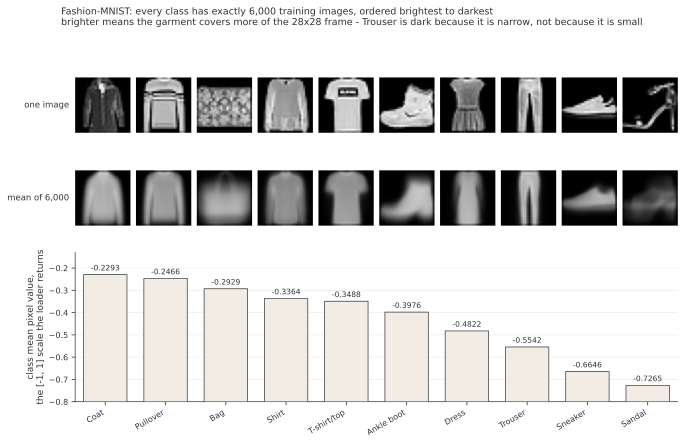

# Fashion-MNIST 데이터셋 시각화

Fashion-MNIST는 의류·신발 등의 10개 클래스로 구성된 28×28 회색조 이미지 데이터셋이다. 학습 60000장·테스트 10000장과 이미지 모양이 MNIST와 같아 같은 데이터 인터페이스로 비교할 수 있다.

## 1. 코드

```python
"""
02_fashion_mnist_dataset.py
============================
Fashion-MNIST 데이터셋 시각화

Fashion-MNIST는 MNIST를 대신하는 더 까다로운 요즘 데이터셋이다!
손으로 쓴 숫자 대신 옷가지의 회색조 이미지가 들어 있다.

왜 Fashion-MNIST인가?
- MNIST와 형식이 같다 (28x28 회색조)
- 더 까다롭고 현실적이다
- 모델의 일반화를 시험하기에 낫다
- 요즘 연구와 교육에서 쓰인다

배울 내용:
- 형식이 같은 여러 데이터셋 다루기
- 숫자가 아닌 데이터의 부류 이름표 이해하기
- 데이터셋의 난이도 견주기
- 뜻있는 이름이 붙은 범주형 데이터 다루기

난이도: 쉬움
예상 시간: 30분

지은이: PyTorch CNN 실습
날짜: 2025년 11월
"""

import matplotlib.pyplot as plt
import argparse
import torch
import torch.nn as nn
import torch.nn.functional as F
from torchvision import datasets, transforms
from torch.utils.data import DataLoader
import numpy as np
import random

# --- cnn_utils 에서 이 쪽이 쓰는 것만 ---
def parse_args():
    parser = argparse.ArgumentParser(description='PyTorch CNN Training')
    parser.add_argument('--batch-size', type=int, default=64)
    parser.add_argument('--test-batch-size', type=int, default=1000)
    parser.add_argument('--epochs', type=int, default=14)
    parser.add_argument('--lr', type=float, default=0.01)
    parser.add_argument('--momentum', type=float, default=0.5)
    parser.add_argument('--gamma', type=float, default=0.7)
    parser.add_argument('--no-cuda', action='store_true', default=False)
    parser.add_argument('--no-mps', action='store_true', default=False)
    parser.add_argument('--dry-run', action='store_true', default=False)
    parser.add_argument('--seed', type=int, default=1)
    parser.add_argument('--log-interval', type=int, default=10)
    parser.add_argument('--save-model', action='store_true', default=False)
    parser.add_argument('--path', type=str, default='./model.pth')
    args = parser.parse_args()
    use_cuda = not args.no_cuda and torch.cuda.is_available()
    use_mps = not args.no_mps and torch.backends.mps.is_available()
    if use_cuda:
        args.device = torch.device("cuda")
    elif use_mps:
        args.device = torch.device("mps")
    else:
        args.device = torch.device("cpu")
    return args


def set_seed(seed=1):
    torch.manual_seed(seed)
    torch.cuda.manual_seed_all(seed)
    np.random.seed(seed)
    random.seed(seed)
    torch.backends.cudnn.deterministic = True
    torch.backends.cudnn.benchmark = False


def load_data(train_kwargs, test_kwargs, fashion_mnist=False, cifar10=False):
    if cifar10:
        transform = transforms.Compose([
            transforms.ToTensor(),
            transforms.Normalize((0.5, 0.5, 0.5), (0.5, 0.5, 0.5))
        ])
        train_dataset = datasets.CIFAR10(root='./data', train=True, download=True, transform=transform)
        test_dataset = datasets.CIFAR10(root='./data', train=False, download=True, transform=transform)
    else:
        transform = transforms.Compose([
            transforms.ToTensor(),
            transforms.Normalize((0.5,), (0.5,))
        ])
        dataset_class = datasets.FashionMNIST if fashion_mnist else datasets.MNIST
        train_dataset = dataset_class(root='./data', train=True, download=True, transform=transform)
        test_dataset = dataset_class(root='./data', train=False, download=True, transform=transform)
    train_loader = DataLoader(train_dataset, **train_kwargs)
    test_loader = DataLoader(test_dataset, **test_kwargs)
    return train_loader, test_loader

# =============================================================================
# 1절: Fashion-MNIST 부류 이름표
# =============================================================================

print("=" * 70)
print("Fashion-MNIST Dataset Exploration")
print("=" * 70)

FASHION_MNIST_LABELS = {
    0: "T-shirt/top",
    1: "Trouser",
    2: "Pullover",
    3: "Dress",
    4: "Coat",
    5: "Sandal",
    6: "Shirt",
    7: "Sneaker",
    8: "Bag",
    9: "Ankle boot"
}

print("\nFashion-MNIST Classes:")
print("-" * 40)
for idx, name in FASHION_MNIST_LABELS.items():
    print(f"  Class {idx}: {name}")

# =============================================================================
# 2절: 설정과 데이터 적재
# =============================================================================

cfg = parse_args()
set_seed(seed=cfg.seed)

train_kwargs = {'batch_size': cfg.batch_size, 'shuffle': True}
test_kwargs = {'batch_size': cfg.test_batch_size, 'shuffle': False}

# MNIST를 부르던 줄에 fashion_mnist=True 하나만 더 준 것이다.
# 뒤의 코드는 한 줄도 고치지 않는다.
# - 학습 집합: 이미지 60,000장 (부류마다 6,000장)
# - 시험 집합: 이미지 10,000장 (부류마다 1,000장)
# - 이미지마다: 28x28 회색조 (채널 1개)
trainloader, testloader = load_data(
    train_kwargs, test_kwargs, fashion_mnist=True
)

print("\nDataset loaded successfully!")
# 배치 수 x 배치 크기로 세면 안 된다 -- 938 x 64 = 60032 가 되어,
# 32장뿐인 마지막 배치를 64장으로 쳐서 32장을 더 세게 된다.
# 실제 장 수는 데이터셋에서 직접 읽는다.
print(f"  Training images: {len(trainloader.dataset)}")
print(f"  Test images: {len(testloader.dataset)}")
print(f"  Training batches: {len(trainloader)}")

# 살펴볼 표본 배치 하나 가져오기
sample_images, sample_labels = next(iter(trainloader))
print("\nSample batch shape:")
print(f"  Images: {sample_images.shape}")  # (배치 크기, 채널, 높이, 너비)
print(f"  Labels: {sample_labels.shape}")  # (배치 크기,)

# =============================================================================
# 3절: 시각화
# =============================================================================

fig, axes = plt.subplots(8, 8, figsize=(12, 12))
fig.suptitle('Fashion-MNIST Clothing Items Sample', fontsize=16)

for images, labels in trainloader:
    for ax, image, label in zip(axes.reshape(-1), images, labels):
        # matplotlib은 (H, W) 또는 (H, W, C)를 받는데 텐서는 (C, H, W)이다
        # 회색조는 C = 1 이므로 자리를 바꿀 것 없이 채널 축을 짜내면 (H, W)가 된다
        img_display = image.squeeze().cpu().numpy()

        # 더 잘 보이도록 [-1, 1]에서 [0, 1]로 되돌리기
        img_display = img_display / 2 + 0.5

        ax.imshow(img_display, cmap="gray")
        ax.axis("off")
        class_name = FASHION_MNIST_LABELS[label.item()]
        ax.set_title(class_name, fontsize=8)

    # 첫 배치만 처리
    break

plt.tight_layout()
plt.show()

# =============================================================================
# 4절: 데이터셋 통계
# =============================================================================

class_counts = [0] * 10
for _, labels in trainloader:
    for label in labels:
        class_counts[label.item()] += 1

print("\nClass distribution:")
total = sum(class_counts)
for class_id, count in enumerate(class_counts):
    percentage = 100.0 * count / total
    name = FASHION_MNIST_LABELS[class_id]
    print(f"  {name:15s} (Class {class_id}): {count} ({percentage:.2f}%)")


if __name__ == "__main__":
    pass
```

**출력:**

```
======================================================================
Fashion-MNIST Dataset Exploration
======================================================================

Fashion-MNIST Classes:
----------------------------------------
  Class 0: T-shirt/top
  Class 1: Trouser
  Class 2: Pullover
  Class 3: Dress
  Class 4: Coat
  Class 5: Sandal
  Class 6: Shirt
  Class 7: Sneaker
  Class 8: Bag
  Class 9: Ankle boot

Dataset loaded successfully!
  Training images: 60000
  Test images: 10000
  Training batches: 938

Sample batch shape:
  Images: torch.Size([64, 1, 28, 28])
  Labels: torch.Size([64])

Class distribution:
  T-shirt/top     (Class 0): 6000 (10.00%)
  Trouser         (Class 1): 6000 (10.00%)
  Pullover        (Class 2): 6000 (10.00%)
  Dress           (Class 3): 6000 (10.00%)
  Coat            (Class 4): 6000 (10.00%)
  Sandal          (Class 5): 6000 (10.00%)
  Shirt           (Class 6): 6000 (10.00%)
  Sneaker         (Class 7): 6000 (10.00%)
  Bag             (Class 8): 6000 (10.00%)
  Ankle boot      (Class 9): 6000 (10.00%)
```

!!! note "처음 돌릴 때만 나오는 줄"
    데이터가 아직 `./data`에 없으면 위 출력의 클래스 목록과 `Dataset loaded successfully!` 사이에 `Downloading ...` / `Extracting ...` 열두 줄이 더 찍힌다. 내려받기가 한 번 끝나면 다시 나오지 않으므로 여기에는 싣지 않았다.

3절의 격자가 보여 주는 것과 연습문제 2가 재는 것을 한자리에 모으면 다음과 같다.



밝은 쪽부터 코트($-0.2293$)·풀오버·가방 차례이고 어두운 끝은 샌들($-0.7265$)이다. 평균 이미지 줄을 함께 보면 밝기가 무엇을 따라가는지 보인다. 옷감이 28×28 테두리를 넓게 덮을수록 밝고, 신발처럼 아래쪽에만 걸치면 어둡다. 바지가 $-0.5542$로 어두운 쪽에 앉은 것도 작아서가 아니라 좁고 길어서이다. 평균 이미지는 부류마다 남는 것이 다르다. 바지와 운동화는 6,000장을 겹쳐도 윤곽이 또렷하지만, 코트와 풀오버와 셔츠의 평균은 소매 달린 윗옷 한 덩어리로 서로 닮아 간다. 이 닮음이 [Fashion-MNIST 분류기](05_fashion_mnist_classifier.md)에서 오분류로 되돌아온다.

## 2. 논의

Fashion-MNIST는 MNIST와 텐서의 구조가 같아 이미지마다 단일 채널 $28 \times 28$ 회색조이지만, 시각적으로는 훨씬 복잡하다. 손으로 쓴 숫자는 획의 모양이 뚜렷한 반면 옷가지는 같은 클래스 안의 변화가 크다. 티셔츠 하나만 해도 방향과 질감과 맵시가 여러 가지이다. 그래서 Fashion-MNIST가 실제 분류의 어려움을 더 잘 흉내 낸다.

티셔츠/윗옷과 셔츠, 풀오버와 코트처럼 비슷한 윤곽의 클래스를 구분해야 한다. [MNIST CNN](../../ch03/mnist/04_cnn.md)의 99.21%와 [Fashion-MNIST 분류기](05_fashion_mnist_classifier.md)의 85.84%는 각각 기록된 실험값이다. 옵티마이저와 학습 기간 등이 달라 그 차이를 데이터셋만의 효과로 분리할 수 없다. 데이터셋의 난이도는 같은 구조·조율 예산과 반복 평가를 사용해 비교해야 한다.

이 예제의 load_data는 fashion_mnist=True일 때 FashionMNIST를 선택한다. 공통 API 덕분에 로딩 코드를 재사용하기 쉽지만 클래스 의미, 어그멘테이션의 타당성과 전처리 통계까지 같아지는 것은 아니다. 인터페이스가 같다는 사실만으로 비교가 공정해지는 것도 아니다.

## 연습문제

<div class="drillbox" markdown>

**연습문제 1.** <span class="diff easy" title="쉬움"></span>
클래스가 정확히 균형적인 Fashion-MNIST와 대략 균형적인 MNIST에서 상수 분류기의 정확도를 비교하라. 정확도 해석의 한계도 적어라.

</div>

??? success "풀이"
    Fashion-MNIST 테스트셋은 클래스당 1000장이므로 한 클래스만 예측하면 10%이다. MNIST 테스트셋에서 1만 예측하면 1135/10000=11.35%이다. 10%는 무작위·상수 기준선이지 정확도의 수학적 최솟값이 아니다. 균형 데이터에서도 클래스별 실패가 전체 평균에 가려질 수 있다.

---

<div class="drillbox" markdown>

**연습문제 2.** <span class="diff med" title="중간"></span>
Fashion-MNIST의 10개 클래스마다 평균 픽셀 밝기를 계산하라. 평균 밝기가 가장 높은 클래스와 가장 낮은 클래스는 무엇인가? 그것이 물리적으로 말이 되는 까닭을 설명하라.

</div>

??? success "풀이"
    ```python
    class_pixel_sums = [0.0] * 10
    class_counts = [0] * 10
    for images, labels in trainloader:
        for img, lbl in zip(images, labels):
            class_pixel_sums[lbl.item()] += img.mean().item()
            class_counts[lbl.item()] += 1
    for i in range(10):
        avg = class_pixel_sums[i] / class_counts[i]
        print(f"{FASHION_MNIST_LABELS[i]:15s}: {avg:.4f}")
    ```

    ```
    T-shirt/top    : -0.3488
    Trouser        : -0.5542
    Pullover       : -0.2466
    Dress          : -0.4822
    Coat           : -0.2293
    Sandal         : -0.7265
    Shirt          : -0.3364
    Sneaker        : -0.6646
    Bag            : -0.2929
    Ankle boot     : -0.3976
    ```

    이 값들은 [-1,1] 범위에서의 평균이다. [0,1] 범위로 되돌리려면 (x′+1)/2를 적용한다. 평균 밝기는 배경 비율뿐 아니라 물체 내부의 회색조·질감과 영상 전처리에도 영향을 받으므로 물체 면적의 직접 측정값은 아니다.

    기록된 값에서 코트의 평균은 −0.2293, 풀오버는 −0.2466이고 샌들은 −0.7265이다. 코트류가 더 넓게 보이고 샌들에 배경이 많은 것은 가능한 해석이지만 이 평균만으로 원인을 분리할 수는 없다. 실제 이미지와 영역을 함께 확인해야 한다.

    바지의 평균 −0.5542도 관찰값이다. 좁은 윤곽과 배경 비율이 영향을 줄 수 있지만 밝기 차이만으로 형태나 데이터 생성 원인을 입증한 것은 아니다.

---

<div class="drillbox" markdown>

**연습문제 3.** <span class="diff med" title="중간"></span>
티셔츠/윗옷과 셔츠를 혼동하는 이유로 어떤 가설을 세울 수 있으며 무엇을 추가로 확인해야 하는가?

</div>

??? success "풀이"
    낮은 해상도에서 윤곽과 소매·목선 같은 피처가 비슷하게 보일 수 있다. 그러나 평균 밝기가 비슷하다는 사실만으로 모델의 오분류 원인이 확인되지는 않는다. 혼동 행렬과 실제 오분류 표본, 전처리와 클래스 정의를 함께 확인한다. 깊이나 필터 수 증가가 반드시 해결책은 아니다.

---

<div class="drillbox" markdown>

**연습문제 4.** <span class="diff hard" title="어려움"></span>
무작위 좌우 뒤집기와 작은 회전의 효과를 검증하는 실험을 설계하라. 아래 픽셀 차이 통계가 무엇을 측정하는지 설명하고, 이 값만으로 레이블 보존이나 성능 개선을 판단할 수 있는지 논하라.

</div>

??? success "풀이"
    ```python
    from torchvision import transforms

    augmented_transform = transforms.Compose([
        transforms.RandomHorizontalFlip(p=0.5),
        transforms.RandomRotation(degrees=10),
        transforms.ToTensor(),
        transforms.Normalize((0.5,), (0.5,))
    ])
    ```

    아래 파이프라인은 기하 변환을 ToTensor() 앞에서 PIL 이미지에 적용한다. 이 위치는 해당 예제의 선택이며 torchvision의 지원 변환은 텐서에도 적용할 수 있다. 어그멘테이션은 학습에 사용하고, 비교용 검증·테스트 전처리는 고정한다.

    원본과 뒤집은 이미지의 평균 절대 차이는 픽셀 수준의 좌우 비대칭을 잰다. 0부터 세는 인덱스에서는 $\frac1{784}\sum_{i,j=0}^{27}|x_{i,j}-x_{i,27-j}|$이다. 큰 차이가 레이블이 바뀐다는 뜻도, 작은 차이가 안전한 어그멘테이션이라는 증명도 아니다.

    ```
    Ankle boot      (Class 9): 0.3269
    Sandal          (Class 5): 0.1554
    Sneaker         (Class 7): 0.1284
    Bag             (Class 8): 0.1017
    Trouser         (Class 1): 0.0903
    Shirt           (Class 6): 0.0823
    Pullover        (Class 2): 0.0787
    Coat            (Class 4): 0.0774
    Dress           (Class 3): 0.0715
    T-shirt/top     (Class 0): 0.0707
    ```

    기록된 통계에서 윗옷은 차이가 작고 앵클부츠는 0.3269로 크다. 이는 평균적인 좌우 비대칭의 차이이다. 신발이 특정 방향으로 정렬된 경향과 관련될 수 있지만, 반대 방향 이미지가 잘못된 클래스가 되는 것은 아니다. 배포 분포와 어그멘테이션이 만드는 변화의 적합성을 따로 판단해야 한다.

    어그멘테이션 없음, 모든 클래스에 뒤집기, 클래스별 선택적 뒤집기를 같은 조건에서 비교할 수 있다. 후자는 학습 때 레이블을 사용하는 조건부 어그멘테이션임을 명시한다. 설정은 검증셋에서 고르고 여러 시드의 변동을 보고한다. 픽셀 차이 표만으로 어떤 클래스가 성능 이득을 얻는지는 알 수 없다.

---

## 정리하며

Fashion-MNIST는 MNIST와 입력 모양은 같지만 클래스 의미와 분포가 다르다. 클래스 균형은 해석을 돕지만 클래스별 평가를 대체하지 않는다. 밝기·좌우 비대칭의 통계와 어그멘테이션의 레이블 보존·성능 효과도 구분해야 한다.
