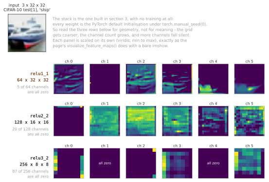

# 피처 맵

피처 맵은 컨볼루션이나 활성화 같은 레이어가 계산한 중간 텐서이다. 채널·공간 차원을 구분하면 레이어 사이의 연결과 메모리 사용량을 분석하고, 훅으로 엑티베이션을 관찰해 모델을 디버깅할 수 있다.

한 채널을 특정 의미의 검출기로 해석하는 것은 유용한 관점이지만 모든 채널이 독립적이고 명확한 의미 하나에 대응하는 것은 아니다.

## 1. 피처 맵의 기하

### 텐서 모양의 관행

PyTorch에서 피처 맵 텐서의 모양은 $(N, C, H, W)$이다.

| 차원 | 기호 | 뜻 |
|-----------|--------|---------|
| 배치 | $N$ | 한꺼번에 처리하는 표본의 수 |
| 채널 | $C$ | 피처 맵의 수 (깊이) |
| 높이 | $H$ | 공간적 높이 |
| 너비 | $W$ | 공간적 너비 |

```python
import torch
import torch.nn as nn

# 크기가 224×224인 RGB 이미지 8장의 배치
x = torch.randn(8, 3, 224, 224)

# 첫 컨볼루션 레이어 뒤: 크기가 224×224인 피처 맵 64개
conv1 = nn.Conv2d(3, 64, kernel_size=3, padding=1)
feat1 = conv1(x)
print(f"Input:  N={x.shape[0]}, C={x.shape[1]}, H={x.shape[2]}, W={x.shape[3]}")
print(f"After conv1: N={feat1.shape[0]}, C={feat1.shape[1]}, H={feat1.shape[2]}, W={feat1.shape[3]}")
# 입력:  N=8, C=3, H=224, W=224
# conv1 뒤: N=8, C=64, H=224, W=224
```

**출력:**

```
Input:  N=8, C=3, H=224, W=224
After conv1: N=8, C=64, H=224, W=224
```

### 공간 차원과 채널 차원

피처 맵은 서로 다른 두 종류의 정보를 담는다.

- **공간 차원** ($H \times W$): 피처가 이미지의 *어디*에 있는가
- **채널 차원** ($C$): 자리마다 *어떤* 피처가 잡혔는가

채널마다 서로 다른 학습된 필터에 대응하여 저마다 다른 무늬를 잡는다. 공간 격자는 잡아낸 피처들의 상대적인 자리를 지켜 준다.

```
Feature Map Stack (C×H×W):

Channel 0 (e.g., horizontal edges):    Channel 1 (e.g., vertical edges):
┌─────────────────┐                    ┌─────────────────┐
│ 0.0  0.0  0.0   │                    │ 0.0  0.8  0.0   │
│ 0.9  0.8  0.7   │                    │ 0.0  0.9  0.0   │
│ 0.0  0.0  0.0   │                    │ 0.0  0.7  0.0   │
└─────────────────┘                    └─────────────────┘

At each spatial position (i,j), the vector across channels
forms a local feature descriptor.
```

---

## 2. 뉴럴 넷트웍을 지나며 피처 맵이 달라지는 방식

### 피처의 위계

데이터가 CNN을 지나면 피처 맵이 특유의 변화를 겪는다.

```
Input Image (3×224×224)
        │
        ▼
    Conv Block 1 ──→ 64 × 224 × 224   (edges, colors, simple textures)
        │
        ▼ (downsample)
    Conv Block 2 ──→ 128 × 112 × 112  (corners, texture combinations)
        │
        ▼ (downsample)
    Conv Block 3 ──→ 256 × 56 × 56    (parts: eyes, wheels, windows)
        │
        ▼ (downsample)
    Conv Block 4 ──→ 512 × 28 × 28    (objects, semantic concepts)
        │
        ▼ (downsample)
    Conv Block 5 ──→ 512 × 14 × 14    (scene-level, abstract)
        │
        ▼ (global average pooling)
    Feature Vector ──→ 512 × 1 × 1
```

많은 분류용 CNN은 단계가 깊어질수록 공간 해상도를 줄이고 채널 수를 늘린다. 그러나 모든 CNN의 규칙은 아니며 세그멘테이션 모델의 디코더나 고해상도 분기는 해상도를 다시 높이거나 유지할 수 있다.

### 해상도와 의미 사이의 트레이드오프

| 성질 | 앞쪽 레이어 | 깊은 레이어 |
|----------|-------------|-------------|
| 공간 해상도 | 높음 ($224 \times 224$) | 낮음 ($7 \times 7$) |
| 채널 수 | 적음 (64) | 많음 (512 이상) |
| 피처의 종류 | 저수준 (모서리, 질감) | 고수준 (물체, 장면) |
| 위치 정보 | 비교적 세밀한 격자 | 구조와 다운샘플링에 따라 거친 격자 |
| 이론적 리셉티브 필드 | 대체로 작음 | 레이어 구성에 따라 넓어짐 |

---

## 3. 파라메터와 메모리 분석

### 레이어마다의 파라메터 수

groups=1이고 바이어스가 있는 정사각 커널 K의 컨볼루션 레이어는 다음 파라메터 수를 갖는다. 그룹 컨볼루션에서는 웨이트 항을 groups로 나누고, bias=False이면 바이어스 항을 제외한다.

$$\text{Parameters} = C_{out} \times C_{in} \times K^2 + C_{out}$$

### 레이어마다의 엑티베이션 메모리

피처 맵 하나를 저장하는 데 드는 메모리는 다음과 같다.

$$\text{Memory (elements)} = N \times C \times H \times W$$

$$\text{Memory (bytes)} = N \times C \times H \times W \times \text{bytes per element}$$

float32(원소당 4바이트)에서는 $64 \times 224 \times 224$ 피처 맵 하나가 $64 \times 224 \times 224 \times 4 = 12{,}845{,}056$바이트, 곧 약 **12.85MB**를 쓴다. 아래 표가 찍는 값과 같은 셈법이다($10^6$바이트를 1MB로 센다). $2^{20}$바이트를 1MiB로 세면 12.25MiB가 되므로, 어느 쪽으로 세는지를 밝혀 두는 편이 낫다.

### 레이어별 분석

아래 분석 함수는 자식 모듈을 차례로 실행할 수 있는 Sequential 형태를 가정한다. 임의의 분기·잔차 모델의 forward를 재현하지는 않는다. 원소당 4바이트로 각 출력을 합한 수치도 최대 GPU 메모리가 아니다. in-place 레이어의 공유 저장 공간을 중복 계산할 수 있고, 역전파 저장 텐서·워크스페이스·그래디언트·옵티마이저 상태와 할당기 비용은 별도로 고려해야 한다.

```python
import torch
import torch.nn as nn

def analyze_feature_maps(model, input_shape=(1, 3, 224, 224)):
    """
    모델을 지나며 피처 맵의 모양과 파라메터와 메모리를 분석한다.
    """
    x = torch.randn(*input_shape)
    
    print(f"{'Layer':<30} {'Output Shape':<25} {'Params':>12} {'Memory (MB)':>12}")
    print("-" * 82)
    print(f"{'Input':<30} {str(list(x.shape)):<25} {'—':>12} {x.numel()*4/1e6:>12.2f}")
    
    total_params = 0
    total_memory = x.numel() * 4  # 입력 메모리
    
    for name, layer in model.named_children():
        x = layer(x)
        params = sum(p.numel() for p in layer.parameters())
        mem_mb = x.numel() * 4 / 1e6
        total_params += params
        total_memory += x.numel() * 4
        
        print(f"{name:<30} {str(list(x.shape)):<25} {params:>12,} {mem_mb:>12.2f}")
    
    print("-" * 82)
    print(f"{'Total':<30} {'':25} {total_params:>12,} {total_memory/1e6:>12.2f}")
    
    return x

# 예: VGG 방식 피처 추출기
model = nn.Sequential(
    nn.Conv2d(3, 64, 3, padding=1),    # 블록 1
    nn.ReLU(inplace=True),
    nn.Conv2d(64, 64, 3, padding=1),
    nn.ReLU(inplace=True),
    nn.MaxPool2d(2, 2),
    
    nn.Conv2d(64, 128, 3, padding=1),  # 블록 2
    nn.ReLU(inplace=True),
    nn.Conv2d(128, 128, 3, padding=1),
    nn.ReLU(inplace=True),
    nn.MaxPool2d(2, 2),
    
    nn.Conv2d(128, 256, 3, padding=1), # 블록 3
    nn.ReLU(inplace=True),
    nn.Conv2d(256, 256, 3, padding=1),
    nn.ReLU(inplace=True),
    nn.MaxPool2d(2, 2),
)

# 출력을 깔끔하게 하려고 이름 붙인 Sequential 사용
named_model = nn.Sequential()
names = ['conv1_1', 'relu1_1', 'conv1_2', 'relu1_2', 'pool1',
         'conv2_1', 'relu2_1', 'conv2_2', 'relu2_2', 'pool2',
         'conv3_1', 'relu3_1', 'conv3_2', 'relu3_2', 'pool3']
for name, layer in zip(names, model):
    named_model.add_module(name, layer)

analyze_feature_maps(named_model)
```

**출력:**

```
Layer                          Output Shape                    Params  Memory (MB)
----------------------------------------------------------------------------------
Input                          [1, 3, 224, 224]                     —         0.60
conv1_1                        [1, 64, 224, 224]                1,792        12.85
relu1_1                        [1, 64, 224, 224]                    0        12.85
conv1_2                        [1, 64, 224, 224]               36,928        12.85
relu1_2                        [1, 64, 224, 224]                    0        12.85
pool1                          [1, 64, 112, 112]                    0         3.21
conv2_1                        [1, 128, 112, 112]              73,856         6.42
relu2_1                        [1, 128, 112, 112]                   0         6.42
conv2_2                        [1, 128, 112, 112]             147,584         6.42
relu2_2                        [1, 128, 112, 112]                   0         6.42
pool2                          [1, 128, 56, 56]                     0         1.61
conv3_1                        [1, 256, 56, 56]               295,168         3.21
relu3_1                        [1, 256, 56, 56]                     0         3.21
conv3_2                        [1, 256, 56, 56]               590,080         3.21
relu3_2                        [1, 256, 56, 56]                     0         3.21
pool3                          [1, 256, 28, 28]                     0         0.80
----------------------------------------------------------------------------------
Total                                                       1,145,408        96.14
```

---

## 4. "채널은 두 배, 해상도는 절반" 방식

해상도가 절반인 단계에서 채널을 두 배로 늘리는 설계는 여러 CNN에서 사용된다. 아래 계산은 같은 커널 크기에서 입력·출력 채널이 모두 두 배가 되고 출력 높이·너비가 각각 절반이 되는 두 밀집 컨볼루션을 비교한 근사이다. 단계 전환의 한 레이어나 모든 연산이 같은 비용을 갖는다는 뜻은 아니다.

$$\text{FLOPs} \propto C \times C \times K^2 \times H \times W$$

$C$을 두 배로 하고 $H$과 $W$을 각각 절반으로 하면 다음과 같다.

$$2C \times 2C \times K^2 \times \frac{H}{2} \times \frac{W}{2} = C^2 K^2 HW$$

이 가정에서는 주요 곱셈·누적 수가 같아진다. 바이어스, 활성화, 메모리 접근과 라이브러리 구현의 비용은 포함하지 않으므로 실제 실행 시간은 별도로 측정한다.

```python
import torch.nn as nn

# ResNet 방식의 채널 변화
stages = [
    ("Stage 1", 64,  56, 56),   # 줄기 뒤
    ("Stage 2", 128, 28, 28),   # 채널 2배, 해상도 0.5배
    ("Stage 3", 256, 14, 14),   # 채널 4배, 해상도 0.25배
    ("Stage 4", 512, 7,  7),    # 채널 8배, 해상도 0.125배
]

print(f"{'Stage':<12} {'Channels':>8} {'Resolution':>12} {'Elements':>12} {'Relative':>10}")
print("-" * 60)
base_elements = None
for name, c, h, w in stages:
    elements = c * h * w
    if base_elements is None:
        base_elements = elements
    print(f"{name:<12} {c:>8} {f'{h}×{w}':>12} {elements:>12,} {elements/base_elements:>10.2f}×")
```

**출력:**

```
Stage        Channels   Resolution     Elements   Relative
------------------------------------------------------------
Stage 1            64        56×56      200,704       1.00×
Stage 2           128        28×28      100,352       0.50×
Stage 3           256        14×14       50,176       0.25×
Stage 4           512          7×7       25,088       0.12×
```

---

## 5. 피처 맵 시각화

### 학습된 피처 그려 보기

피처 맵 시각화는 특정 입력에 대한 레이어의 반응을 보여 준다. 채널의 밝기만으로 모델의 판단 근거나 인과적 중요성을 확정할 수는 없다. 훅을 걸 레이어의 이름이 존재하는지, 입력과 모델의 장치·자료형이 같은지 확인하고 필요가 끝난 훅은 제거한다.

```python
import torch
import torch.nn as nn
import matplotlib.pyplot as plt
import numpy as np

def visualize_feature_maps(model, image, layer_name, max_channels=16):
    """
    특정 레이어의 피처 맵을 그린다.
    
    인수:
        model: CNN 모델
        image: 입력 텐서 (1, C, H, W)
        layer_name: 그릴 레이어의 이름
        max_channels: 보일 채널의 최대 개수
    """
    # 피처 맵을 붙잡으려고 훅 등록
    features = {}
    def hook(module, input, output):
        features['output'] = output.detach()
    
    # 대상 레이어를 찾아 훅 걸기
    for name, module in model.named_modules():
        if name == layer_name:
            handle = module.register_forward_hook(hook)
            break
    
    # 순전파
    model.eval()
    with torch.no_grad():
        _ = model(image)
    
    handle.remove()
    
    # 시각화한다
    feat = features['output'].squeeze(0)  # 배치 차원 없애기
    num_channels = min(feat.shape[0], max_channels)
    
    rows = int(np.ceil(num_channels / 4))
    fig, axes = plt.subplots(rows, 4, figsize=(12, 3 * rows))

    # atleast_1d 를 거쳐 펴는 까닭: subplots 는 줄이 하나면 (4,) 짜리 배열을,
    # 여럿이면 (rows, 4) 짜리 배열을 준다. 줄이 하나일 때 이것을 [axes] 로
    # 감싸면 원소가 **하나뿐인** 목록이 되어 axes[1] 에서 IndexError 가 난다.
    # max_channels 를 4 이하로 주면 바로 그 자리에 걸린다.
    axes = np.atleast_1d(axes).flatten()
    
    for i in range(num_channels):
        axes[i].imshow(feat[i].cpu().numpy(), cmap='viridis')
        axes[i].set_title(f'Channel {i}')
        axes[i].axis('off')
    
    # 쓰지 않는 부분 그림 감추기
    for i in range(num_channels, len(axes)):
        axes[i].axis('off')
    
    plt.suptitle(f'Feature Maps at {layer_name} ({feat.shape[0]} channels, '
                 f'{feat.shape[1]}×{feat.shape[2]})')
    plt.tight_layout()
    plt.savefig(f'feature_maps_{layer_name}.png', dpi=150, bbox_inches='tight')
    plt.close(fig)   # 화면이 없는 자리에서 plt.show() 는 멈춘다. 파일로 남겼으니 닫는다
```

이 함수가 실제로 무엇을 내놓는지 한 번 돌려 보자. 3절에서 세운 VGG 방식 스택에 **학습을 전혀 시키지 않고** — 모든 웨이트가 `torch.manual_seed(0)` 아래의 PyTorch 기본 초기값이다 — CIFAR-10 시험셋 1번 이미지를 넣고 `relu1_1`, `relu2_2`, `relu3_2` 세 자리에 훅을 걸어 앞 여섯 채널씩 그린 것이다.



첫 줄 `relu1_1`의 여러 채널이 선체와 수평선의 경계를 그대로 따라 그린다. 무작위 3×3 커널도 이웃 화소의 차를 재는 필터이므로 모서리 비슷한 반응은 학습 없이도 나온다. 둘째 줄에서 격자가 절반으로 줄며 반응이 덩어리로 뭉치고, 셋째 줄 `relu3_2`에서는 256채널 가운데 87개가 통째로 0이며 살아남은 채널도 테두리만 밝은 것이 있다 — 제로 패딩 자리의 통계가 안쪽과 다른 탓으로 보인다. 학습하지 않은 웨이트이므로 이 세 줄에서 읽을 것은 **기하**뿐이다. 깊어질수록 해상도가 떨어지고 채널이 늘고 침묵하는 채널의 비율이 8%에서 16%, 34%로 커진다는 것이지, 어떤 채널이 무엇을 뜻하는지가 아니다.

### 채널의 통계량

아래 통계 함수는 데이터셋 전체가 아니라 최대 num_batches개 배치를 관찰한다. 99% 이상 0인 채널도 이 표본에서 드물게 활성화된 채널이라는 뜻이며 모든 입력에서 죽었다는 증명은 아니다. detach()는 자동 미분 연결을 끊지만 저장 공간을 반드시 복사하지 않으므로 후속 in-place 연산의 영향도 고려한다.

```python
def feature_map_statistics(model, loader, layer_name, num_batches=10):
    """
    데이터셋 전체에 대해 한 레이어의 엑티베이션 통계를 계산한다.
    죽은 뉴런, 포화, 분포 문제를 살피는 데 쓸모가 있다.
    """
    features_list = []
    
    def hook(module, input, output):
        features_list.append(output.detach())
    
    for name, module in model.named_modules():
        if name == layer_name:
            handle = module.register_forward_hook(hook)
            break
    
    model.eval()
    with torch.no_grad():
        for i, (images, _) in enumerate(loader):
            if i >= num_batches:
                break
            _ = model(images)
    
    handle.remove()
    
    # 이어 붙인 뒤 분석
    all_features = torch.cat(features_list, dim=0)
    
    # 채널별 통계량
    channel_means = all_features.mean(dim=(0, 2, 3))
    channel_stds = all_features.std(dim=(0, 2, 3))
    channel_sparsity = (all_features == 0).float().mean(dim=(0, 2, 3))
    
    print(f"Layer: {layer_name}")
    print(f"  Feature map shape: {list(all_features.shape[1:])}")
    print(f"  Mean activation: {channel_means.mean():.4f} ± {channel_means.std():.4f}")
    print(f"  Std activation: {channel_stds.mean():.4f}")
    print(f"  Sparsity (% zeros): {channel_sparsity.mean():.1%}")
    print(f"  Dead channels (>99% zero): {(channel_sparsity > 0.99).sum().item()}")
    
    return channel_means, channel_stds, channel_sparsity
```

---

## 6. 다채널 컨볼루션에서의 피처 맵

### 컨볼루션 하나가 피처 맵을 만드는 방식

출력 채널마다 모든 입력 채널에 걸친 서로 다른 3차원 커널이 그것을 만든다. 커널이 공간 차원 위를 미끄러지며 자리마다 내적을 계산한다.

$$\text{Feature Map}[o, i, j] = \sum_{c=0}^{C_{in}-1} \sum_{m,n} X[c, i+m, j+n] \cdot W[o, c, m, n] + b[o]$$

$C_{out}$개의 커널은 저마다 모든 입력 채널에 걸친 서로 다른 공간 무늬를 한꺼번에 잡는 법을 배운다.

### 채널을 섞는 1×1 컨볼루션

$1 \times 1$ 컨볼루션은 공간적인 거르기를 전혀 하지 않고 공간 위치마다 채널 차원에만 작용한다.

$$Y[o, i, j] = \sum_{c=0}^{C_{in}-1} X[c, i, j] \cdot W[o, c] + b[o]$$

이는 공간 위치마다 공유된 완전 연결 레이어를 따로 적용하는 것과 같다. 쓰임새는 다음과 같다.

- **채널 줄이기**: $C_{in}$을 더 작은 $C_{out}$으로 줄인다 (병목)
- **채널 늘리기**: 채널 차원을 키운다
- **채널 사이의 학습**: 피처 맵에 걸친 정보를 엮는다
- **비선형 더하기**: 뒤에 엑티베이션 함수를 붙일 때

```python
# 1×1 컨볼루션: 채널만 섞기
channel_mixer = nn.Conv2d(256, 64, kernel_size=1)  # 채널 256 → 64개

x = torch.randn(1, 256, 14, 14)
out = channel_mixer(x)
print(f"Channel reduction: {x.shape} → {out.shape}")
# 채널 줄이기: [1, 256, 14, 14] → [1, 64, 14, 14]

params = sum(p.numel() for p in channel_mixer.parameters())
print(f"Parameters: {params:,}")  # 256×64 + 64 = 16,448
```

**출력:**

```
Channel reduction: torch.Size([1, 256, 14, 14]) → torch.Size([1, 64, 14, 14])
Parameters: 16,448
```

---

## 7. 피처 맵 다시 쓰기: 건너뛰기 연결

건너뛰기(잔차) 연결은 앞쪽 레이어의 피처 맵이 중간 레이어를 건너뛰어 뒤쪽 피처 맵에 더해지거나 이어 붙게 해 준다.

### 더하는 건너뛰기 (ResNet)

$$\mathbf{Y} = F(\mathbf{X}) + \mathbf{X}$$

공간 차원과 채널 수가 맞아야 한다.

### 이어 붙이는 건너뛰기 (DenseNet, U-Net)

$$\mathbf{Y} = [\mathbf{X}, F(\mathbf{X})]$$

이어 붙이기는 공간 차원이 같아야 하며 채널 수는 합쳐진다. 더하기는 대응 원소의 모양이 맞아야 하고 필요하면 투영으로 채널이나 공간 크기를 정렬한다. 이런 연결이 정보나 성능을 항상 개선한다는 보장은 없다.

```python
import torch
import torch.nn as nn

class ResidualBlock(nn.Module):
    """더하는 건너뛰기: 피처 맵의 차원을 지킨다."""
    def __init__(self, channels):
        super().__init__()
        self.conv1 = nn.Conv2d(channels, channels, 3, padding=1, bias=False)
        self.bn1 = nn.BatchNorm2d(channels)
        self.conv2 = nn.Conv2d(channels, channels, 3, padding=1, bias=False)
        self.bn2 = nn.BatchNorm2d(channels)
    
    def forward(self, x):
        identity = x
        out = torch.relu(self.bn1(self.conv1(x)))
        out = self.bn2(self.conv2(out))
        return torch.relu(out + identity)  # 피처 맵 다시 쓰기

class DenseBlock(nn.Module):
    """이어 붙이는 건너뛰기: 피처 맵이 쌓인다."""
    def __init__(self, in_channels, growth_rate, num_layers):
        super().__init__()
        self.layers = nn.ModuleList()
        for i in range(num_layers):
            self.layers.append(nn.Sequential(
                nn.BatchNorm2d(in_channels + i * growth_rate),
                nn.ReLU(inplace=True),
                nn.Conv2d(in_channels + i * growth_rate, growth_rate, 3, padding=1, bias=False),
            ))
    
    def forward(self, x):
        features = [x]
        for layer in self.layers:
            out = layer(torch.cat(features, dim=1))
            features.append(out)
        return torch.cat(features, dim=1)  # 모든 피처 맵을 이어 붙임
```

---

## 8. 핵심 정리

1. 표본 하나의 피처 텐서는 C×H×W, 배치를 포함하면 N×C×H×W로 표현한다.
2. 채널과 해상도의 변화는 구조가 정하며 의미의 위계는 학습 결과에 대한 해석이다.
3. 채널 두 배·해상도 절반은 특정 밀집 컨볼루션의 연산량을 비슷하게 유지하는 설계 규칙이다.
4. 1×1 컨볼루션의 채널 연결과 공간 크기는 groups와 stride에 따라서도 달라진다.
5. 출력 텐서 크기의 합과 실제 최대 학습 메모리는 다르다.
6. 시각화와 표본 통계는 디버깅 자료이며 의미·중요성을 자동으로 증명하지 않는다.

---

## 연습문제

<div class="drillbox" markdown>

**연습문제 1.** <span class="diff med" title="중간"></span>
CNN의 앞쪽 레이어와 깊은 레이어의 피처를 해석할 때 어떤 경향과 한계를 고려해야 하는가?

</div>

??? success "풀이"
    앞쪽 레이어는 좁은 범위의 경계·질감 등에, 뒤쪽 레이어는 더 넓은 조합 피처에 반응하는 경향이 있다. 실제 표현은 학습 데이터와 과제·구조에 의존하며 채널 하나를 항상 물체 하나의 검출기로 해석할 수 없다. 깊은 레이어도 위치에 완전히 불변이라고 가정하지 않는다.

---

<div class="drillbox" markdown>

**연습문제 2.** <span class="diff easy" title="쉬움"></span>
모양이 $(3, 224, 224)$인 입력이 필터 64개, 커널 $7\times7$, 스트라이드 2, 패딩 3인 컨볼루션 레이어를 지난 뒤의 출력 피처 맵 차원을 계산하라.

</div>

??? success "풀이"
    출력: $(64, \lfloor(224+6-7)/2\rfloor+1, \lfloor(224+6-7)/2\rfloor+1) = (64, 112, 112)$.

---

<div class="drillbox" markdown>

**연습문제 3.** <span class="diff hard" title="어려움"></span>
아래 순전파 훅 조각을 실제 CNN에 연결하는 방법을 설명하라. 모델·입력 정의, 레이어 이름, 장치와 훅 제거를 점검하라.

</div>

??? success "풀이"
    아래 조각은 model과 img, plt 등이 준비되었다는 가정이다. 시각화 전에 eval()과 no_grad()를 적용하고 GPU 텐서는 cpu()로 옮겨 NumPy로 변환한다. 등록된 핸들을 보관해 remove()를 호출한다. 한 입력의 엑티베이션은 학습된 의미 전체를 설명하지 않는다.
    ```python
    activations = {}
    def hook(name):
        def fn(module, input, output):
            activations[name] = output.detach()
        return fn
    model.layer1.register_forward_hook(hook('layer1'))
    model(img)
    plt.imshow(activations['layer1'][0, 0].numpy())
    ```

---

<div class="drillbox" markdown>

**연습문제 4.** <span class="diff easy" title="쉬움"></span>
1×1 컨볼루션의 공간 크기와 채널 혼합을 결정하는 조건을 설명하라.

</div>

??? success "풀이"
    groups=1이면 각 위치에서 모든 입력 채널을 선형 변환한다. 스트라이드 1·패딩 0일 때 공간 크기가 유지된다. 스트라이드를 키우면 공간 크기도 줄고 그룹을 나누면 채널 간 연결이 제한된다. 이 레이어 자체는 아핀 함수이며 비선형성은 엑티베이션 함수를 추가해야 생긴다.

---

## 정리하며

피처 맵의 모양을 읽는 것이 레이어 연결과 메모리 분석의 출발점이다. 파라메터·엑티베이션·최대 실행 메모리를 구분하고, 훅으로 관찰한 값은 특정 입력과 평가 모드에서의 결과로 해석한다. 채널 수나 밝기만으로 표현의 의미와 모델의 품질을 판단하지 않는다.

**참고 문헌**

1. Zeiler, M. D., & Fergus, R. (2014). "Visualizing and Understanding Convolutional Networks." *ECCV*.

2. He, K., Zhang, X., Ren, S., & Sun, J. (2016). "Deep Residual Learning for Image Recognition." *CVPR*.

3. Huang, G., Liu, Z., van der Maaten, L., & Weinberger, K. Q. (2017). "Densely Connected Convolutional Networks." *CVPR*.

4. Lin, M., Chen, Q., & Yan, S. (2014). "Network In Network." *ICLR*. (위치별 채널 변환과 비선형 피처 추출을 다룬 논문)

5. Simonyan, K., & Zisserman, A. (2015). "Very Deep Convolutional Networks for Large-Scale Image Recognition." *ICLR*.
