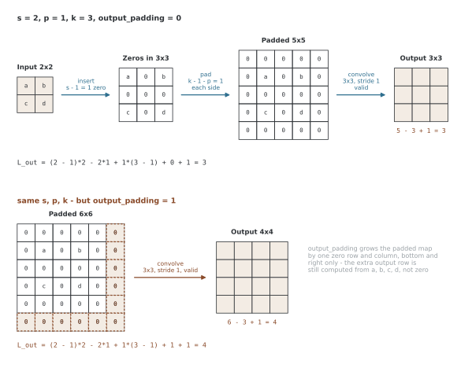

# 전치 컨볼루션

전치 컨볼루션은 고정된 컨볼루션의 선형 연산 행렬을 전치한 연산으로 이해할 수 있다. 대응하는 컨볼루션의 입력 그래디언트 계산에 나타나며, 디코더에서 학습 가능한 업샘플링으로도 사용한다.

출력 크기는 커널·스트라이드·패딩에 따라 정해지므로 언제나 커지는 것은 아니다. 전치가 역행렬은 아니며 출력 크기를 맞췄다고 입력 정보가 복원되는 것도 아니다. 디코더는 보간 뒤 컨볼루션이나 PixelShuffle 같은 다른 방식으로도 구성할 수 있다.

## 1. 수학적 기초

<div class="defn" markdown>

### 정의 1. 컨볼루션 행렬과 전치 컨볼루션 { .dfn }

웨이트와 스트라이드·경계 규약을 정하면 컨볼루션은 **선형 사상**이므로 행렬 하나로 적을 수 있다. 1차원 입력 $\mathbf{x} \in \mathbb{R}^5$과 커널 $\mathbf{k} = [k_0, k_1, k_2]$의 스트라이드 1 valid 상호상관 $\mathbf{y} = \mathbf{C}\mathbf{x}$에서

$$
\mathbf{C} = \begin{bmatrix}
k_0 & k_1 & k_2 & 0 & 0 \\
0 & k_0 & k_1 & k_2 & 0 \\
0 & 0 & k_0 & k_1 & k_2
\end{bmatrix} \in \mathbb{R}^{3 \times 5}
$$

을 **컨볼루션 행렬**이라 한다($\mathbb{R}^5 \to \mathbb{R}^3$, 경계에서 줄어든 것이며 스트라이드에 의한 부분표집과는 구분한다). 같은 웨이트로 만든 $\mathbf{C}^\top$을 쓰는 연산

$$
\mathbf{C}^\top = \begin{bmatrix}
k_0 & 0 & 0 \\
k_1 & k_0 & 0 \\
k_2 & k_1 & k_0 \\
0 & k_2 & k_1 \\
0 & 0 & k_2
\end{bmatrix} \in \mathbb{R}^{5 \times 3}
$$

을 **전치 컨볼루션**이라 한다. $\mathbb{R}^3 \to \mathbb{R}^5$으로 보내므로 업샘플링이며, 웨이트는 같고 이어지는 방식만 뒤집힌다.

</div>

<div class="thmbox" markdown>

### 정리 1. 전치 컨볼루션은 컨볼루션의 역이 아니다 { .thm }

어떤 커널 $\mathbf{k}$에 대해서도

$$
\mathbf{C}^\top \mathbf{C} \ne I_5
$$

이다. 곧 **모양은 $\mathbb{R}^5$으로 돌아와도 값은 돌아오지 않는다.**

</div>

??? proof "증명"

    $\mathbf{C}$가 $3 \times 5$이므로 $\operatorname{rank}(\mathbf{C}) \le 3$이다. 행렬 곱의 계수는 두 인수의 계수를 넘지 못하므로

    $$
    \operatorname{rank}(\mathbf{C}^\top \mathbf{C}) \le \operatorname{rank}(\mathbf{C}) \le 3
    $$

    인데 $I_5$의 계수는 5다. $3 < 5$이므로 둘은 같을 수 없다. $\square$

    차원만으로 끝나는 논증이라 **커널 값과 무관**하다. $\mathbf{C}$는 정사각이 아니어서 애초에 역행렬을 가질 수 없고, 다섯 수를 세 수로 줄이는 사상이 잃어버린 2차원은 어떤 커널로도 되살릴 수 없다.

<div class="thmbox" markdown>

### 정리 2. 컨볼루션의 입력 그래디언트가 곧 전치 컨볼루션이다 { .thm }

$\mathbf{y} = \mathbf{C}\mathbf{x}$이고 $L$이 $\mathbf{y}$의 함수이면

$$
\frac{\partial L}{\partial \mathbf{x}} = \mathbf{C}^\top \frac{\partial L}{\partial \mathbf{y}}
$$

이다. 전치 컨볼루션은 억지로 끌어온 연산이 아니라 **컨볼루션을 역전파할 때 저절로 나오는 것**이다.

</div>

??? proof "증명"

    성분으로 적는다. $y_i = \sum_j C_{ij} x_j$이므로 $\partial y_i / \partial x_j = C_{ij}$이고, 연쇄 법칙에서

    $$
    \frac{\partial L}{\partial x_j}
      = \sum_i \frac{\partial L}{\partial y_i}\,\frac{\partial y_i}{\partial x_j}
      = \sum_i C_{ij}\,\frac{\partial L}{\partial y_i}
      = \sum_i (\mathbf{C}^\top)_{ji}\,\frac{\partial L}{\partial y_i}
    $$

    이다. 오른쪽은 $\mathbf{C}^\top (\partial L/\partial \mathbf{y})$의 $j$번째 성분이다. $\square$

다만 따로 만든 `ConvTranspose` 레이어가 제 웨이트와 바이어스를 가지면, 특정 `Conv` 레이어의 입력 그래디언트 연산과 **자동으로 같아지지는 않는다.** 같아지려면 웨이트를 공유해야 한다. 아래 코드는 이것을 확인한 뒤, 이어서 같은 커널로 되돌려 보아 **크기는 돌아와도 값은 돌아오지 않는다**는 것까지 잰다.

```python
import torch
import torch.nn.functional as F

torch.manual_seed(0)

# 순전파: conv2d
x = torch.randn(1, 3, 8, 8, requires_grad=True)
w = torch.randn(16, 3, 3, 3, requires_grad=True)
y = F.conv2d(x, w, padding=1)

# 역전파: conv_transpose2d와 같다
grad_output = torch.randn_like(y)
y.backward(grad_output)

# 손수 확인
grad_input_manual = F.conv_transpose2d(grad_output, w, padding=1)
print(f"Gradient match: {torch.allclose(x.grad, grad_input_manual, atol=1e-5)}")

# 전치는 역행렬이 아니다: 같은 커널으로 되돌려도 값은 돌아오지 않는다
torch.manual_seed(0)
a = torch.randn(1, 1, 8, 8)
k = torch.randn(1, 1, 3, 3)
b = F.conv2d(a, k, padding=1)
a_back = F.conv_transpose2d(b, k, padding=1)
print(f"Shape restored:  {tuple(a.shape) == tuple(a_back.shape)}")
print(f"Values restored: {torch.allclose(a, a_back, atol=1e-4)}")
print(f"Relative error:  {(a_back - a).norm() / a.norm():.4f}")
```

**출력:**

```
Gradient match: True
Shape restored:  True
Values restored: False
Relative error:  6.6400
```

예제의 상대 복원 오차는 약 6.64로, 오차의 노름을 원래 입력의 노름으로 나눈 값이다. 크기가 8×8로 맞더라도 값의 복원은 보장되지 않는다는 관찰이다. 이 비율은 입력·웨이트와 오차 정의에 따른 예제값이다.

---

## 2. 전치 컨볼루션이 움직이는 방식

### 업샘플링 장치

팽창률 1, output_padding=0인 경우 전치 컨볼루션을 다음 단계로 이해할 수 있다. 커널 크기 k, 스트라이드 s, 패딩 p로 두고, k−1−p가 음수이면 패딩 대신 해당 경계의 자르기로 해석한다. 채널이 여럿이면 전치에 맞는 채널 축의 대응도 필요하다.

1. (스트라이드가 1보다 크면) 입력 원소 사이에 **0을 $s-1$개씩 끼워 넣는다** — $i \times i$ 입력이 $\big(s(i-1)+1\big) \times \big(s(i-1)+1\big)$이 된다
2. 각 변에 **0을 $k-1-p$개 덧댄다**
3. 뒤집은 커널로 **스트라이드 1 표준 컨볼루션**을 적용한다

2번의 패딩 양에 주의하라. 패딩가 $p$가 아니라 $k-1-p$이므로, `padding`을 **키우면 출력이 작아진다** — 보통 컨볼루션과 정반대다. 전치 컨볼루션의 `padding` 인자는 "0을 더 넣어라"가 아니라 "가장자리를 그만큼 잘라내라"에 가깝다.

3×3 커널을 쓰는 스트라이드 2, 패딩 1 전치 컨볼루션에서는 다음과 같다. 패딩 양은 $k-1-p = 3-1-1 = 1$이므로 각 변에 한 줄씩이다.



위쪽 줄이 세 걸음이다. 0을 끼우는 1번이 맵을 2×2에서 3×3으로 키우고, 2번이 각 변에 $k-1-p=1$줄씩 덧대어 5×5를 만든다. 여기에 3×3 valid 컨볼루션을 씌우므로 출력은 $5-3+1=3$, 곧 **3×3이다**. 2×2를 꼭 두 배인 4×4로 키우고 싶다면 아래쪽 줄처럼 `output_padding=1`이 더 있어야 한다.

그 한 줄이 어디에 붙는지도 눈여겨보라. 점선으로 그린 0의 행과 열은 **덧댄 맵의 오른쪽과 아래쪽에만** 붙는다. 출력에 0을 덧대는 것이 아니므로 늘어난 마지막 행과 열의 값도 $a, b, c, d$에서 계산된 값이지 0이 아니다.

세 스텝이 정말 `conv_transpose2d`와 같은 값을 내는지 손으로 만들어 비교하여 보자.

```python
import torch
import torch.nn.functional as F

torch.manual_seed(0)


def transposed_by_hand(x, w, stride, padding):
    """0 끼워 넣기 → 덧대기 → 보통 컨볼루션, 세 스텝으로 손수 만든 전치 컨볼루션."""
    i, k = x.shape[-1], w.shape[-1]

    # 1. 원소 사이에 0을 stride - 1개씩 끼워 넣는다
    n = stride * (i - 1) + 1
    z = torch.zeros(x.shape[0], x.shape[1], n, n)
    z[:, :, ::stride, ::stride] = x

    # 2. 각 변에 k - 1 - padding개의 0을 덧댄다 (padding이 클수록 적게 덧댄다)
    pad = k - 1 - padding
    z = F.pad(z, (pad, pad, pad, pad))

    # 3. 뒤집은 커널으로 스트라이드 1 보통 컨볼루션
    return F.conv2d(z, torch.flip(w, [-1, -2]).transpose(0, 1)), z.shape[-1]


x = torch.randn(1, 2, 4, 4)
w = torch.randn(2, 3, 3, 3)

for stride, padding in [(1, 0), (2, 0), (2, 1), (3, 1)]:
    ref = F.conv_transpose2d(x, w, stride=stride, padding=padding)
    got, padded = transposed_by_hand(x, w, stride, padding)
    print(f"s={stride} p={padding}: 0 끼운 뒤 덧댄 크기 {padded}×{padded}"
          f" → 출력 {got.shape[-1]}×{got.shape[-1]}"
          f" (conv_transpose2d와 같은가: {torch.allclose(ref, got, atol=1e-5)})")

# 그림의 2×2 입력: p=1이면 3×3, output_padding=1을 더해야 4×4가 된다
x22 = torch.randn(1, 1, 2, 2)
w33 = torch.randn(1, 1, 3, 3)
for op in (0, 1):
    out = F.conv_transpose2d(x22, w33, stride=2, padding=1, output_padding=op)
    print(f"2×2 입력, k=3 s=2 p=1 output_padding={op} → {out.shape[-1]}×{out.shape[-1]}")
```

**출력:**

```
s=1 p=0: 0 끼운 뒤 덧댄 크기 8×8 → 출력 6×6 (conv_transpose2d와 같은가: True)
s=2 p=0: 0 끼운 뒤 덧댄 크기 11×11 → 출력 9×9 (conv_transpose2d와 같은가: True)
s=2 p=1: 0 끼운 뒤 덧댄 크기 9×9 → 출력 7×7 (conv_transpose2d와 같은가: True)
s=3 p=1: 0 끼운 뒤 덧댄 크기 12×12 → 출력 10×10 (conv_transpose2d와 같은가: True)
2×2 입력, k=3 s=2 p=1 output_padding=0 → 3×3
2×2 입력, k=3 s=2 p=1 output_padding=1 → 4×4
```

$p$를 0에서 1로 키우자 덧댄 크기가 11에서 9로 줄고 출력도 9에서 7로 줄었다. 앞에서 말한 "패딩를 키우면 출력이 작아진다"가 이것이다.

### 출력 크기 공식

전치 컨볼루션에 대해 다음과 같다.

$$H_{out} = (H_{in} - 1) \times s - 2p + d(K - 1) + p_{out} + 1$$

여기서 각 기호는 다음과 같다.

- $H_{in}$: 입력의 높이
- $s$: 스트라이드
- $p$: 패딩
- $d$: 팽창률
- $K$: 커널 크기
- $p_{out}$: 출력 패딩 (모호함을 없앤다)

3×3 커널로 스트라이드 2 업샘플링을 하는 흔한 경우($s = 2$, $p = 1$, $d = 1$, $K = 3$)에 항을 하나씩 넣으면 다음과 같다.

$$H_{out} = (H_{in} - 1) \times 2 - 2 \times 1 + 1 \times (3 - 1) + p_{out} + 1 = 2 H_{in} - 1 + p_{out}$$

즉 이 설정만으로는 **정확히 두 배가 되지 않는다**. $p_{out} = 0$이면 $2H_{in} - 1$이고, $p_{out} = 1$을 주어야 비로소 $2H_{in}$이다. 다음 절에서 16×16이 각각 31×31과 32×32로 가는 것이 이 두 경우다.

---

## 3. PyTorch 구현

### 기본 사용법

```python
import torch
import torch.nn as nn

torch.manual_seed(0)

# 보통 컨볼루션 (하향 표본화)
conv = nn.Conv2d(64, 32, kernel_size=3, stride=2, padding=1)

# 전치 컨볼루션 (상향 표본화)
conv_transpose = nn.ConvTranspose2d(32, 64, kernel_size=3, stride=2,
                                    padding=1, output_padding=1)

x = torch.randn(1, 64, 32, 32)

# 하향 표본화
y = conv(x)
print(f"Conv: {x.shape} → {y.shape}")  # [1, 64, 32, 32] → [1, 32, 16, 16]

# 상향 표본화
z = conv_transpose(y)
print(f"ConvT: {y.shape} → {z.shape}")  # [1, 32, 16, 16] → [1, 64, 32, 32]
```

**출력:**

```
Conv: torch.Size([1, 64, 32, 32]) → torch.Size([1, 32, 16, 16])
ConvT: torch.Size([1, 32, 16, 16]) → torch.Size([1, 64, 32, 32])
```

### `output_padding` 파라메터

스트라이드가 1보다 크면 보통 컨볼루션에서 여러 입력 크기가 같은 출력 크기를 낼 수 있다. 이를테면 $K=3$, $s=2$, $p=1$에서는 31×31 입력과 32×32 입력이 모두 16×16 출력을 낸다. 거꾸로 갈 때 둘 중 어느 것을 돌려줄지 정해 주는 것이 `output_padding`이다.

```python
# output_padding이 없으면 2 × 16 - 1 = 31×31이 된다
conv_t_no_op = nn.ConvTranspose2d(32, 64, 3, stride=2, padding=1)
# output_padding=1이면 2 × 16 = 32×32가 보장된다
conv_t_with_op = nn.ConvTranspose2d(32, 64, 3, stride=2, padding=1, output_padding=1)

y = torch.randn(1, 32, 16, 16)
print(f"Without output_padding: {conv_t_no_op(y).shape}")     # [1, 64, 31, 31]
print(f"With output_padding=1: {conv_t_with_op(y).shape}")    # [1, 64, 32, 32]
```

**출력:**

```
Without output_padding: torch.Size([1, 64, 31, 31])
With output_padding=1: torch.Size([1, 64, 32, 32])
```

`output_padding`은 스트라이드 때문에 생기는 출력 크기의 모호함을 해소한다. 추가된 위치도 연산의 경계 규약에 따라 값을 가지며, 기존 결과 끝에 0만 덧붙이는 방식이 아니다. [공식 ConvTranspose2d 문서](https://docs.pytorch.org/docs/stable/generated/torch.nn.ConvTranspose2d)는 이를 출력 모양 선택과 실제 0 패딩의 차이로 설명한다.

### 파라메터의 수

groups=G인 ConvTranspose2d의 웨이트는 $(C_{in},C_{out}/G,K_H,K_W)$ 모양이며 개수는 $C_{in}C_{out}K_HK_W/G$이다. bias=True이면 출력 채널 수 $C_{out}$만큼 더한다. 입출력 채널을 맞바꾼 Conv2d와 웨이트 수는 같지만 바이어스 수는 달라질 수 있다.

```python
# 보통: 채널 64개 → 32개
conv = nn.Conv2d(64, 32, 3, bias=False)
print(f"Conv2d params: {sum(p.numel() for p in conv.parameters()):,}")
# 32 × 64 × 3 × 3 = 18,432

# 전치: 채널 32개 → 64개
conv_t = nn.ConvTranspose2d(32, 64, 3, bias=False)
print(f"ConvTranspose2d params: {sum(p.numel() for p in conv_t.parameters()):,}")
# 32 × 64 × 3 × 3 = 18,432 (같다!)
```

**출력:**

```
Conv2d params: 18,432
ConvTranspose2d params: 18,432
```

---

## 4. 체커보드 아티팩트 문제

### 무엇이 문제인가

스트라이드가 1보다 큰 전치 컨볼루션은 **체커보드 아티팩트**를 만드는 것으로 악명 높다. 까닭은 출력의 자리마다 입력에서 값을 받는 횟수가 다르기 때문이다. 이 횟수는 재기 쉽다 — 커널과 입력을 모두 1로 두면 출력의 값이 곧 받은 횟수다.

```python
import torch
import torch.nn.functional as F


def overlap_counts(kernel_size, stride, padding=0, in_size=3):
    """출력의 각 자리가 입력에서 몇 번 값을 받는지 센다.

    커널을 모두 1로, 입력도 모두 1로 두면 출력의 값이 곧 받은 횟수다.
    """
    w = torch.ones(1, 1, kernel_size, kernel_size)
    x = torch.ones(1, 1, in_size, in_size)
    return F.conv_transpose2d(x, w, stride=stride,
                              padding=padding).squeeze().int()


for k, s, p in [(3, 2, 0), (4, 2, 0), (2, 2, 0)]:
    c = overlap_counts(k, s, p)
    print(f"kernel={k}, stride={s}  (K % s = {k % s})  →  출력 {tuple(c.shape)}")
    print(c.numpy())
    print()
```

**출력:**

```
kernel=3, stride=2  (K % s = 1)  →  출력 (7, 7)
[[1 1 2 1 2 1 1]
 [1 1 2 1 2 1 1]
 [2 2 4 2 4 2 2]
 [1 1 2 1 2 1 1]
 [2 2 4 2 4 2 2]
 [1 1 2 1 2 1 1]
 [1 1 2 1 2 1 1]]

kernel=4, stride=2  (K % s = 0)  →  출력 (8, 8)
[[1 1 2 2 2 2 1 1]
 [1 1 2 2 2 2 1 1]
 [2 2 4 4 4 4 2 2]
 [2 2 4 4 4 4 2 2]
 [2 2 4 4 4 4 2 2]
 [2 2 4 4 4 4 2 2]
 [1 1 2 2 2 2 1 1]
 [1 1 2 2 2 2 1 1]]

kernel=2, stride=2  (K % s = 0)  →  출력 (6, 6)
[[1 1 1 1 1 1]
 [1 1 1 1 1 1]
 [1 1 1 1 1 1]
 [1 1 1 1 1 1]
 [1 1 1 1 1 1]
 [1 1 1 1 1 1]]
```

$K=3$, $s=2$에서는 안쪽이 2와 4를 한 칸 걸러 오간다 — 이것이 바둑판 무늬다. $K=4$, $s=2$에서는 안쪽이 모두 4로 고르고, $K=2$, $s=2$에서는 겹침이 아예 없어 모든 자리가 1이다. 앞의 두 경우는 가장자리 두 줄이 값을 덜 받는데, 이는 어느 커널 크기에서나 생기는 테두리 효과일 뿐 바둑판 무늬와는 다른 이야기다($K=2$에서는 그마저 없다). 무늬인지 테두리인지는 **안쪽**을 보면 갈린다.

팽창률 1인 내부 영역에서 커널 크기가 스트라이드로 나누어떨어지지 않으면 기하학적 겹침 횟수가 불균일해질 수 있다. 이것은 체커보드 아티팩트의 한 원인이며 필요충분조건은 아니다. 균일한 겹침에서도 학습된 웨이트나 다른 연산 때문에 패턴이 생길 수 있다.

### 해법 1: 커널 크기를 스트라이드의 배수로

스트라이드로 딱 나누어떨어지는 커널 크기를 쓴다. 위에서 센 횟수가 그대로 근거다.

```python
import torch.nn as nn

# 나쁨: stride=2, kernel=3 → 안쪽이 2와 4를 오간다 (3 % 2 = 1)
bad = nn.ConvTranspose2d(64, 32, kernel_size=3, stride=2, padding=1, output_padding=1)

# 나음: stride=2, kernel=4 → 안쪽이 모두 4 (4 % 2 = 0)
better = nn.ConvTranspose2d(64, 32, kernel_size=4, stride=2, padding=1)

# 이것도 좋음: stride=2, kernel=2 → 겹침 없음 (2 % 2 = 0)
good = nn.ConvTranspose2d(64, 32, kernel_size=2, stride=2)
```

다만 이 해법이 없애는 것은 **기하학적인** 원인뿐이다. 겹침 횟수가 고르더라도 학습된 웨이트가 자리마다 다르면 약한 무늬가 남을 수 있다.

### 해법 2: 크기 조정 뒤 컨볼루션 (권장)

보간으로 공간 크기를 먼저 높인 뒤 컨볼루션을 적용하면 전치 컨볼루션의 불균일한 겹침을 피하는 설계를 만들 수 있다. 경계 처리와 보간의 스케일·좌표 규약도 결과에 영향을 주므로 어떤 아티팩트도 생기지 않는다고 보장할 수는 없다.

```python
import torch
import torch.nn as nn

torch.manual_seed(0)


class UpsampleConv(nn.Module):
    """
    보간 뒤 컨볼루션으로 상향 표본화한다.
    전치 컨볼루션에서 오는 바둑판 무늬 흠을 피한다.
    """

    def __init__(self, in_channels, out_channels, kernel_size=3,
                 scale_factor=2, mode='bilinear'):
        super().__init__()
        self.upsample = nn.Upsample(scale_factor=scale_factor, mode=mode,
                                    align_corners=False if mode != 'nearest' else None)
        self.conv = nn.Conv2d(in_channels, out_channels, kernel_size,
                              padding=kernel_size // 2)

    def forward(self, x):
        x = self.upsample(x)
        return self.conv(x)


# 비교
x = torch.randn(1, 64, 16, 16)

# 전치 컨볼루션
conv_t = nn.ConvTranspose2d(64, 32, 4, stride=2, padding=1)

# 크기 조정 뒤 컨볼루션 (흠 없음)
resize_conv = UpsampleConv(64, 32, scale_factor=2)

print(f"ConvTranspose: {conv_t(x).shape}")     # [1, 32, 32, 32]
print(f"Resize+Conv:   {resize_conv(x).shape}")  # [1, 32, 32, 32]
```

**출력:**

```
ConvTranspose: torch.Size([1, 32, 32, 32])
Resize+Conv:   torch.Size([1, 32, 32, 32])
```

### 해법 3: 서브픽셀 컨볼루션 (PixelShuffle)

PixelShuffle은 채널을 공간 위치로 재배열한다. 이 재배열 자체에는 학습 파라메터가 없고, 앞의 컨볼루션이 확대 배율 r에 대해 r²배 출력 채널을 만든다. 출력의 서로 다른 공간 위상에 해당하는 채널이 다르게 학습되면 이 방식에서도 주기적 패턴이 생길 수 있다.

```python
class SubPixelUpsample(nn.Module):
    """
    효율적인 상향 표본화를 위한 부화소 컨볼루션(PixelShuffle).

    보통 컨볼루션으로 채널을 r²개 만든 뒤 다시 늘어놓아
    공간 해상도를 r배로 키운다.
    """

    def __init__(self, in_channels, out_channels, upscale_factor=2):
        super().__init__()
        self.conv = nn.Conv2d(in_channels, out_channels * upscale_factor**2,
                              kernel_size=3, padding=1)
        self.shuffle = nn.PixelShuffle(upscale_factor)

    def forward(self, x):
        x = self.conv(x)
        return self.shuffle(x)


# 예
sub_pixel = SubPixelUpsample(64, 32, upscale_factor=2)
x = torch.randn(1, 64, 16, 16)
out = sub_pixel(x)
print(f"Sub-pixel: {x.shape} → {out.shape}")  # [1, 64, 16, 16] → [1, 32, 32, 32]
```

**출력:**

```
Sub-pixel: torch.Size([1, 64, 16, 16]) → torch.Size([1, 32, 32, 32])
```

---

## 5. 인코더-디코더 구조

디코더는 낮은 해상도 표현을 출력 해상도로 변환한다. 전치 컨볼루션은 그 수단 중 하나이며, 인코더 연산을 수학적으로 역산한다는 뜻은 아니다.

### 단순한 오토인코더

```python
import torch
import torch.nn as nn

torch.manual_seed(0)


class ConvAutoencoder(nn.Module):
    """
    복호에 전치 컨볼루션을 쓰는 컨볼루션 오토인코더.
    """

    def __init__(self):
        super().__init__()

        # 인코더: 차츰 하향 표본화
        self.encoder = nn.Sequential(
            nn.Conv2d(3, 64, 3, stride=2, padding=1),    # 224 → 112
            nn.BatchNorm2d(64),
            nn.ReLU(inplace=True),
            nn.Conv2d(64, 128, 3, stride=2, padding=1),   # 112 → 56
            nn.BatchNorm2d(128),
            nn.ReLU(inplace=True),
            nn.Conv2d(128, 256, 3, stride=2, padding=1),  # 56 → 28
            nn.BatchNorm2d(256),
            nn.ReLU(inplace=True),
        )

        # 디코더: 차츰 상향 표본화 (K=4, s=2 이므로 겹침이 고르다)
        self.decoder = nn.Sequential(
            nn.ConvTranspose2d(256, 128, 4, stride=2, padding=1),  # 28 → 56
            nn.BatchNorm2d(128),
            nn.ReLU(inplace=True),
            nn.ConvTranspose2d(128, 64, 4, stride=2, padding=1),   # 56 → 112
            nn.BatchNorm2d(64),
            nn.ReLU(inplace=True),
            nn.ConvTranspose2d(64, 3, 4, stride=2, padding=1),     # 112 → 224
            nn.Sigmoid(),  # 출력은 [0, 1]
        )

    def forward(self, x):
        z = self.encoder(x)
        return self.decoder(z)


model = ConvAutoencoder()
x = torch.randn(2, 3, 224, 224)
reconstruction = model(x)
print(f"Input: {x.shape}")
print(f"Reconstruction: {reconstruction.shape}")
print(f"Parameters: {sum(p.numel() for p in model.parameters()):,}")
```

**출력:**

```
Input: torch.Size([2, 3, 224, 224])
Reconstruction: torch.Size([2, 3, 224, 224])
Parameters: 1,030,723
```

디코더의 세 레이어는 모두 $K=4$, $s=2$, $p=1$이므로 $(H-1) \times 2 - 2 + 3 + 0 + 1 = 2H$, 곧 정확히 두 배다. $K=3$을 썼다면 `output_padding=1`이 따로 필요했을 것이다.

### U-Net 방식 (스킵 연결이 있는)

오토인코더는 병목을 지나면서 위치 정보를 잃는다. U-Net은 인코더의 피처를 같은 해상도의 디코더로 곧장 건네주어 이를 메운다.

```python
class UNetDecoder(nn.Module):
    """
    인코더에서 오는 건너뛰기 연결이 있는 U-Net 디코더 블록.

    피처 맵을 상향 표본화하여 짝이 되는 인코더 피처와 이어 붙인 뒤
    컨볼루션을 적용한다.
    """

    def __init__(self, in_channels, skip_channels, out_channels):
        super().__init__()

        # 상향 표본화 (전치 컨볼루션 또는 크기 조정 뒤 컨볼루션)
        self.up = nn.ConvTranspose2d(in_channels, in_channels // 2,
                                     kernel_size=4, stride=2, padding=1)

        # 이어 붙인 뒤: (in_channels//2 + skip_channels) → out_channels
        self.conv = nn.Sequential(
            nn.Conv2d(in_channels // 2 + skip_channels, out_channels, 3, padding=1),
            nn.BatchNorm2d(out_channels),
            nn.ReLU(inplace=True),
            nn.Conv2d(out_channels, out_channels, 3, padding=1),
            nn.BatchNorm2d(out_channels),
            nn.ReLU(inplace=True),
        )

    def forward(self, x, skip):
        x = self.up(x)

        # 공간 크기가 어긋나는 경우 처리 (차원이 홀수일 때 생길 수 있다).
        # 채널 수는 일부러 다를 수 있으므로 shape 전체가 아니라 shape[2:]만 견준다.
        if x.shape[2:] != skip.shape[2:]:
            x = nn.functional.interpolate(x, size=skip.shape[2:])

        x = torch.cat([x, skip], dim=1)  # 채널을 따라 이어 붙이기
        return self.conv(x)


torch.manual_seed(0)
block = UNetDecoder(in_channels=256, skip_channels=128, out_channels=128)
deep = torch.randn(1, 256, 28, 28)     # 더 깊은 레이어에서 올라온 피처
skip = torch.randn(1, 128, 56, 56)     # 짝이 되는 인코더 피처
out = block(deep, skip)

upsampled = block.up(deep)
print(f"up:     {tuple(deep.shape)} → {tuple(upsampled.shape)}")
print(f"concat: {upsampled.shape[1]} + {skip.shape[1]} = "
      f"{upsampled.shape[1] + skip.shape[1]} 채널")
print(f"out:    {tuple(out.shape)}")
print(f"params: {sum(p.numel() for p in block.parameters()):,}")
```

**출력:**

```
up:     (1, 256, 28, 28) → (1, 128, 56, 56)
concat: 128 + 128 = 256 채널
out:    (1, 128, 56, 56)
params: 967,552
```

28×28이 56×56으로 올라가 같은 해상도의 스킵 피처와 만나고, 채널이 128 + 128 = 256으로 합쳐졌다가 컨볼루션을 지나 128로 줄어든다.

위 `forward`에서 크기를 견줄 때 `x.shape`이 아니라 `x.shape[2:]`를 쓰는 것이 중요하다. 올려 보낸 쪽의 채널 수(`in_channels // 2`)와 스킵 쪽의 채널 수(`skip_channels`)는 일반적으로 다르므로, `shape` 전체를 견주면 공간 크기가 멀쩡한데도 늘 다르다고 판정되어 쓸데없는 보간이 매번 일어난다.

---

## 6. 업샘플링 방법 비교

| 방법 | 학습되는 부분 | 주의할 점 |
|---|---|---|
| ConvTranspose2d | 커널과 선택적 바이어스 | 겹침과 학습된 웨이트에 따른 아티팩트 |
| 보간 뒤 컨볼루션 | 컨볼루션 | 보간·경계 규약과 고해상도 계산 비용 |
| PixelShuffle | 앞의 컨볼루션 | 채널 재배열은 무파라메터, 위상별 출력 차이 가능 |
| 보간만 사용 | 없음 | 고정된 재표집 규약, 세부 정보 복원의 한계 |

속도와 파라메터는 채널·커널·배율과 장치에 따라 달라진다. 아래 예제의 파라메터 순위는 선택한 구성에 대한 결과이다.

```python
import torch
import torch.nn as nn

torch.manual_seed(0)

# 모든 방법: 채널 64개, 16×16 → 32×32

x = torch.randn(1, 64, 16, 16)

methods = {
    'ConvTranspose (K=4, s=2)': nn.ConvTranspose2d(64, 32, 4, stride=2, padding=1),
    'ConvTranspose (K=2, s=2)': nn.ConvTranspose2d(64, 32, 2, stride=2),
    'PixelShuffle': nn.Sequential(
        nn.Conv2d(64, 32 * 4, 3, padding=1),
        nn.PixelShuffle(2)
    ),
    'Bilinear + Conv': nn.Sequential(
        nn.Upsample(scale_factor=2, mode='bilinear', align_corners=False),
        nn.Conv2d(64, 32, 3, padding=1)
    ),
}

for name, module in methods.items():
    out = module(x)
    params = sum(p.numel() for p in module.parameters())
    print(f"{name:<30}: {x.shape} → {out.shape}, params: {params:,}")
```

**출력:**

```
ConvTranspose (K=4, s=2)      : torch.Size([1, 64, 16, 16]) → torch.Size([1, 32, 32, 32]), params: 32,800
ConvTranspose (K=2, s=2)      : torch.Size([1, 64, 16, 16]) → torch.Size([1, 32, 32, 32]), params: 8,224
PixelShuffle                  : torch.Size([1, 64, 16, 16]) → torch.Size([1, 32, 32, 32]), params: 73,856
Bilinear + Conv               : torch.Size([1, 64, 16, 16]) → torch.Size([1, 32, 32, 32]), params: 18,464
```

네 구성은 모두 16×16을 32×32로 보내지만 커널 크기와 채널 계산이 달라 파라메터 수가 다르다. 이 비교에서 PixelShuffle 앞의 컨볼루션은 r²배 채널을 출력한다. 이것만으로 모든 서브픽셀 구조가 항상 더 무겁거나 느리다고 결론 내리지는 않는다.

---

## 7. 1차원 전치 컨볼루션

이미지만이 아니라 소리나 시계열처럼 축이 하나인 데이터에도 같은 연산이 그대로 쓰인다.

```python
torch.manual_seed(0)

# 시간 방향 상향 표본화를 위한 1차원 전치 컨볼루션
conv_t1d = nn.ConvTranspose1d(
    in_channels=64,
    out_channels=32,
    kernel_size=4,
    stride=2,
    padding=1
)

x = torch.randn(1, 64, 50)  # 시각 50개
out = conv_t1d(x)
print(f"1D ConvTranspose: {x.shape} → {out.shape}")  # [1, 32, 100]
```

**출력:**

```
1D ConvTranspose: torch.Size([1, 64, 50]) → torch.Size([1, 32, 100])
```

공식은 그대로다: $(50 - 1) \times 2 - 2 \times 1 + 1 \times (4-1) + 0 + 1 = 100$.

---

## 8. 핵심 정리

1. 전치 컨볼루션은 대응하는 선형 컨볼루션의 전치이며 역연산은 아니다.
2. 출력 크기는 $(H_{in}-1)s-2p+d(K-1)+p_{out}+1$이다.
3. output_padding은 출력 모양을 선택하며 0 행·열을 단순히 붙이지 않는다.
4. 커널·스트라이드의 불균일한 겹침은 아티팩트의 한 원인이지만, 균일한 겹침도 무결점 결과를 보장하지 않는다.
5. 보간 뒤 컨볼루션과 PixelShuffle은 다른 업샘플링 설계이며 계산 비용과 출력 품질을 함께 비교한다.

---

## 연습문제

<div class="drillbox" markdown>

**연습문제 1.** <span class="diff hard" title="어려움"></span>
전치 컨볼루션의 출력 크기 공식 $o = (i-1) \times s - 2p + k + p_{out}$을 유도하라. 여기서 $i$는 전치 컨볼루션의 입력 크기, $o$는 그 출력 크기이고 $d = 1$로 둔다.

</div>

??? success "풀이"
    보통 컨볼루션과 전치 컨볼루션은 크기를 서로 반대로 옮긴다. 헷갈리지 않도록 보통 컨볼루션 쪽 이름을 따로 두자. 보통 컨볼루션이 크기 $n$을 크기 $m$으로 보낸다고 하면

    $$m = \left\lfloor \frac{n + 2p - k}{s} \right\rfloor + 1$$

    이다. 전치 컨볼루션은 이 대응을 거꾸로 밟으므로 그 입력은 $i = m$, 그 출력은 $o = n$이다. 바닥 함수를 잠시 떼고 $n$에 대해 풀면

    $$n = (m - 1)s - 2p + k$$

    이므로 $o = (i-1)s - 2p + k$을 얻는다.

    바닥 함수를 떼면서 잃은 것이 $p_{out}$이다. $n + 2p - k$가 $s$로 나누어떨어지지 않으면 나머지 $r \in \{0, 1, \dots, s-1\}$만큼 서로 다른 $n$이 같은 $m$으로 간다. 이를테면 $k=3$, $s=2$, $p=1$일 때 $n = 31$과 $n = 32$가 모두 $m = 16$이 된다. 거꾸로 갈 때는 그 가운데 어느 것을 돌려줄지 정해 주어야 하고, 그 선택이 곧

    $$o = (i-1)s - 2p + k + p_{out}, \qquad 0 \le p_{out} < s$$

    의 $p_{out}$이다. 팽창률 $d$까지 넣으면 커널의 실효 크기가 $d(k-1)+1$이 되므로 $k$를 그것으로 바꾸어 본문의 공식이 된다. $\square$

---

<div class="drillbox" markdown>

**연습문제 2.** <span class="diff med" title="중간"></span>
전치 컨볼루션의 체커보드 아티팩트와 완화 방법의 한계를 설명하라.

</div>

??? success "풀이"
    커널이 스트라이드로 나누어떨어지지 않으면 내부 출력 위치별 겹침 횟수가 달라질 수 있다. 배수인 커널을 사용하면 이 기하학적 원인을 줄일 수 있으나 학습 웨이트에 따른 주기적 패턴은 남을 수 있다. 보간 뒤 컨볼루션이나 PixelShuffle도 비교할 수 있지만 모든 아티팩트를 항상 없애는 방법은 아니다.

---

<div class="drillbox" markdown>

**연습문제 3.** <span class="diff hard" title="어려움"></span>
(a) 전치 컨볼루션과 (b) 바이리니어 보간 뒤 컨볼루션으로 업샘플링 모듈을 각각 구현하고, 출력 크기·파라메터 수·겹침의 고르기를 비교하여라.

</div>

??? success "풀이"
    ```python
    import torch
    import torch.nn as nn

    torch.manual_seed(0)

    x = torch.randn(1, 64, 16, 16)

    # 방법 (a): 전치 컨볼루션 — 상향 표본화 필터까지 배운다
    up_a = nn.ConvTranspose2d(64, 32, kernel_size=4, stride=2, padding=1)

    # 방법 (b): 쌍선형 보간 뒤 컨볼루션 — 상향 표본화는 고정, 컨볼루션만 배운다
    up_b = nn.Sequential(
        nn.Upsample(scale_factor=2, mode='bilinear', align_corners=False),
        nn.Conv2d(64, 32, kernel_size=3, padding=1)
    )

    for name, m in [("(a) ConvTranspose", up_a), ("(b) Bilinear+Conv", up_b)]:
        out = m(x)
        print(f"{name:<22}: → {tuple(out.shape)}, "
              f"params {sum(p.numel() for p in m.parameters()):,}")

    # 겹침이 고른지: 커널을 1로 두고 받은 횟수를 센다
    ones = torch.ones(1, 1, 8, 8)
    counts_a = nn.functional.conv_transpose2d(
        ones, torch.ones(1, 1, 4, 4), stride=2, padding=1).squeeze()
    print(f"(a) 받은 횟수 — 안쪽 최소 {counts_a[1:-1, 1:-1].min():.0f}, "
          f"최대 {counts_a[1:-1, 1:-1].max():.0f}")
    print("(b) 받은 횟수 — 보간은 모든 자리를 똑같이 채우므로 고르다")
    ```

    **출력:**

    ```
    (a) ConvTranspose     : → (1, 32, 32, 32), params 32,800
    (b) Bilinear+Conv     : → (1, 32, 32, 32), params 18,464
    (a) 받은 횟수 — 안쪽 최소 4, 최대 4
    (b) 받은 횟수 — 보간은 모든 자리를 똑같이 채우므로 고르다
    ```

    두 구성은 같은 공간 크기를 내지만 커널 크기가 달라 파라메터가 32800개와 18464개이다. 차이를 단순히 업샘플링 필터의 학습 여부로 설명할 수는 없다. 겹침 시각화는 입력·웨이트를 모두 1로 두었을 때의 기하학적 비교이고 실제 생성 품질의 평가가 아니다. 구조 선택은 목표 품질과 장치에서의 지연·메모리를 기준으로 비교한다.

---

<div class="drillbox" markdown>

**연습문제 4.** <span class="diff med" title="중간"></span>
전치 컨볼루션은 어떤 구조에서 흔히 쓰이는가?

</div>

??? success "풀이"
    디코더 뉴럴 넷트웍에서 쓰인다. U-Net(분할), 오토인코더, GAN(생성기의 업샘플링), 초해상도 뉴럴 넷트웍이 그 예이다. 고정된 업샘플링 방법의 학습 가능한 짝으로, 뉴럴 넷트웍이 알맞은 업샘플링 필터를 배우게 해 준다.

---

## 정리하며

전치 컨볼루션은 출력 공간 크기를 조절하는 학습 가능한 연산이며, 입력 정보를 자동 복원하지 않는다. 출력 크기와 값 계산을 구분하고 output_padding·채널 축·바이어스를 정확히 해석한다. 아티팩트와 실제 성능은 겹침 그림이나 파라메터 수만으로 판단할 수 없다.

**참고 문헌**

1. Dumoulin, V., & Visin, F. (2016). "A guide to convolution arithmetic for deep learning." *arXiv preprint arXiv:1603.07285*.

2. Long, J., Shelhamer, E., & Darrell, T. (2015). "Fully Convolutional Networks for Semantic Segmentation." *CVPR*.

3. Odena, A., Dumoulin, V., & Olah, C. (2016). "Deconvolution and Checkerboard Artifacts." *Distill*. https://distill.pub/2016/deconv-checkerboard/

4. Shi, W., et al. (2016). "Real-Time Single Image and Video Super-Resolution Using an Efficient Sub-Pixel Convolutional Neural Network." *CVPR*.

5. Ronneberger, O., Fischer, P., & Brox, T. (2015). "U-Net: Convolutional Networks for Biomedical Image Segmentation." *MICCAI*.
