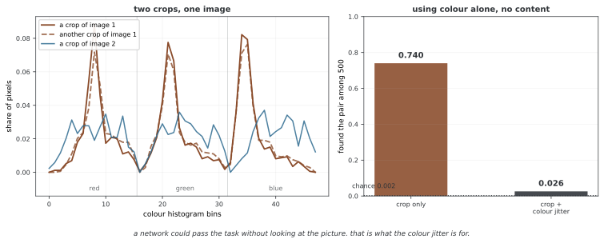

# 데이터 어그멘테이션

자기 지도 학습의 어그멘테이션은 어떤 입력 변화에 대해 표현을 비슷하게 만들지 정하는 설계다. 이미지 자르기·색 변화·흐리기와 여러 크기의 뷰를 비교한다. 변화가 항상 의미·정답을 보존하거나 특정 어그멘테이션이 붕괴를 단독으로 막는다고 가정하지 않는다.

## 1. 코드

```python
"""
자기 지도 학습을 위한 데이터 불리기 방법
SimCLR, MoCo를 비롯한 대조 방법이 쓰는 불리기를 담는다.
"""

import torch
import torchvision.transforms as transforms
import torchvision.transforms.functional as TF
import random
from PIL import ImageFilter, ImageOps
import numpy as np

# ========================================================================
# 메인
# ========================================================================


class GaussianBlur:
    """가우스 흐리기 불리기"""
    def __init__(self, sigma=[.1, 2.]):
        self.sigma = sigma

    def __call__(self, x):
        sigma = random.uniform(self.sigma[0], self.sigma[1])
        x = x.filter(ImageFilter.GaussianBlur(radius=sigma))
        return x


class Solarization:
    """태양화 불리기"""
    def __init__(self, threshold=128):
        self.threshold = threshold

    def __call__(self, img):
        return ImageOps.solarize(img, self.threshold)


class SimCLRAugmentation:
    """
    SimCLR가 쓰는 데이터 불리기 파이프라인
    같은 그림의 서로 얽힌 시야 둘을 만든다
    """
    def __init__(self, image_size=224, s=1.0):
        """
        인수:
            image_size: 마지막 그림 크기
            s: 색 뒤틀기의 세기
        """
        # 색 흔들기 파라메터
        color_jitter = transforms.ColorJitter(0.8 * s, 0.8 * s, 0.8 * s, 0.2 * s)

        self.transform = transforms.Compose([
            transforms.RandomResizedCrop(size=image_size, scale=(0.2, 1.0)),
            transforms.RandomHorizontalFlip(p=0.5),
            transforms.RandomApply([color_jitter], p=0.8),
            transforms.RandomGrayscale(p=0.2),
            GaussianBlur(sigma=[.1, 2.]),
            transforms.ToTensor(),
            transforms.Normalize(mean=[0.485, 0.456, 0.406], std=[0.229, 0.224, 0.225])
        ])

    def __call__(self, x):
        """시야 둘을 만들려고 불리기를 두 번 적용한다"""
        return self.transform(x), self.transform(x)


class MoCoAugmentation:
    """
    MoCo v2가 쓰는 데이터 불리기 파이프라인
    """
    def __init__(self, image_size=224):
        # 질의 불리기 (더 세다)
        self.query_transform = transforms.Compose([
            transforms.RandomResizedCrop(image_size, scale=(0.2, 1.)),
            transforms.RandomApply([
                transforms.ColorJitter(0.4, 0.4, 0.4, 0.1)
            ], p=0.8),
            transforms.RandomGrayscale(p=0.2),
            transforms.RandomApply([GaussianBlur([.1, 2.])], p=0.5),
            transforms.RandomHorizontalFlip(),
            transforms.ToTensor(),
            transforms.Normalize(mean=[0.485, 0.456, 0.406], std=[0.229, 0.224, 0.225])
        ])

        # 열쇠 불리기 (MoCo v2에서는 질의와 같다)
        self.key_transform = self.query_transform

    def __call__(self, x):
        """질의와 열쇠를 만들려고 불리기를 적용한다"""
        return self.query_transform(x), self.key_transform(x)


class MoCoV3Augmentation:
    """
    MoCo v3이 쓰는 데이터 불리기 파이프라인
    불리기를 더 담는다
    """
    def __init__(self, image_size=224):
        self.transform1 = transforms.Compose([
            transforms.RandomResizedCrop(image_size, scale=(0.2, 1.)),
            transforms.RandomApply([
                transforms.ColorJitter(0.4, 0.4, 0.2, 0.1)
            ], p=0.8),
            transforms.RandomGrayscale(p=0.2),
            transforms.RandomApply([GaussianBlur([.1, 2.])], p=1.0),
            transforms.RandomHorizontalFlip(),
            transforms.ToTensor(),
            transforms.Normalize(mean=[0.485, 0.456, 0.406], std=[0.229, 0.224, 0.225])
        ])

        self.transform2 = transforms.Compose([
            transforms.RandomResizedCrop(image_size, scale=(0.2, 1.)),
            transforms.RandomApply([
                transforms.ColorJitter(0.4, 0.4, 0.2, 0.1)
            ], p=0.8),
            transforms.RandomGrayscale(p=0.2),
            transforms.RandomApply([GaussianBlur([.1, 2.])], p=0.1),
            transforms.RandomApply([Solarization()], p=0.2),
            transforms.RandomHorizontalFlip(),
            transforms.ToTensor(),
            transforms.Normalize(mean=[0.485, 0.456, 0.406], std=[0.229, 0.224, 0.225])
        ])

    def __call__(self, x):
        """서로 다른 불리기 둘을 적용한다"""
        return self.transform1(x), self.transform2(x)


class BYOLAugmentation:
    """
    BYOL이 쓰는 데이터 불리기 파이프라인
    비대칭 불리기를 쓴다
    """
    def __init__(self, image_size=224):
        # 시야 1: 더 센 불리기
        self.transform1 = transforms.Compose([
            transforms.RandomResizedCrop(image_size, scale=(0.08, 1.0)),
            transforms.RandomHorizontalFlip(p=0.5),
            transforms.RandomApply([
                transforms.ColorJitter(0.4, 0.4, 0.2, 0.1)
            ], p=0.8),
            transforms.RandomGrayscale(p=0.2),
            GaussianBlur(sigma=[.1, 2.]),
            transforms.ToTensor(),
            transforms.Normalize(mean=[0.485, 0.456, 0.406], std=[0.229, 0.224, 0.225])
        ])

        # 시야 2: 더 약한 불리기
        self.transform2 = transforms.Compose([
            transforms.RandomResizedCrop(image_size, scale=(0.08, 1.0)),
            transforms.RandomHorizontalFlip(p=0.5),
            transforms.RandomApply([
                transforms.ColorJitter(0.4, 0.4, 0.2, 0.1)
            ], p=0.8),
            transforms.RandomGrayscale(p=0.2),
            transforms.ToTensor(),
            transforms.Normalize(mean=[0.485, 0.456, 0.406], std=[0.229, 0.224, 0.225])
        ])

    def __call__(self, x):
        """비대칭 불리기를 적용한다"""
        return self.transform1(x), self.transform2(x)


class MAEAugmentation:
    """
    MAE의 데이터 불리기
    MAE는 대조 방법에 견주어 불리기를 아주 적게 쓴다
    """
    def __init__(self, image_size=224):
        self.transform = transforms.Compose([
            transforms.RandomResizedCrop(image_size, scale=(0.2, 1.0), interpolation=3),
            transforms.RandomHorizontalFlip(),
            transforms.ToTensor(),
            transforms.Normalize(mean=[0.485, 0.456, 0.406], std=[0.229, 0.224, 0.225])
        ])

    def __call__(self, x):
        """간단한 불리기를 적용한다"""
        return self.transform(x)


class MultiCropAugmentation:
    """
    SwAV와 DINO가 쓰는 여러 조각 불리기
    크기가 다른 조각 여럿을 만든다
    """
    def __init__(
        self,
        image_size=224,
        n_global_crops=2,
        n_local_crops=6,
        global_scale=(0.4, 1.0),
        local_scale=(0.05, 0.4)
    ):
        self.n_global_crops = n_global_crops
        self.n_local_crops = n_local_crops

        # 전역 조각 불리기
        self.global_transform = transforms.Compose([
            transforms.RandomResizedCrop(image_size, scale=global_scale),
            transforms.RandomHorizontalFlip(p=0.5),
            transforms.RandomApply([
                transforms.ColorJitter(0.4, 0.4, 0.2, 0.1)
            ], p=0.8),
            transforms.RandomGrayscale(p=0.2),
            GaussianBlur(sigma=[.1, 2.]),
            transforms.ToTensor(),
            transforms.Normalize(mean=[0.485, 0.456, 0.406], std=[0.229, 0.224, 0.225])
        ])

        # 국소 조각 불리기
        local_size = int(image_size * 0.4)  # 국소 조각은 더 작은 크기
        self.local_transform = transforms.Compose([
            transforms.RandomResizedCrop(local_size, scale=local_scale),
            transforms.RandomHorizontalFlip(p=0.5),
            transforms.RandomApply([
                transforms.ColorJitter(0.4, 0.4, 0.2, 0.1)
            ], p=0.8),
            transforms.RandomGrayscale(p=0.2),
            GaussianBlur(sigma=[.1, 2.]),
            transforms.ToTensor(),
            transforms.Normalize(mean=[0.485, 0.456, 0.406], std=[0.229, 0.224, 0.225])
        ])

    def __call__(self, x):
        """전역 조각과 국소 조각을 만든다"""
        crops = []

        # 전역 조각
        for _ in range(self.n_global_crops):
            crops.append(self.global_transform(x))

        # 국소 조각
        for _ in range(self.n_local_crops):
            crops.append(self.local_transform(x))

        return crops


class TwoCropsTransform:
    """
    불린 시야 둘을 만드는 두루 쓰는 감싸개
    """
    def __init__(self, base_transform):
        self.base_transform = base_transform

    def __call__(self, x):
        return self.base_transform(x), self.base_transform(x)


def get_augmentation(method='simclr', image_size=224):
    """
    정한 방법의 불리기 파이프라인을 얻는다

    인수:
        method: 'simclr', 'moco', 'mocov3', 'byol', 'mae', 'multicrop'
        image_size: 그림 크기

    반환값:
        불리기 변환
    """
    if method == 'simclr':
        return SimCLRAugmentation(image_size)
    elif method == 'moco':
        return MoCoAugmentation(image_size)
    elif method == 'mocov3':
        return MoCoV3Augmentation(image_size)
    elif method == 'byol':
        return BYOLAugmentation(image_size)
    elif method == 'mae':
        return MAEAugmentation(image_size)
    elif method == 'multicrop':
        return MultiCropAugmentation(image_size)
    else:
        raise ValueError(f"Unknown method: {method}")


if __name__ == "__main__":
    from PIL import Image

    # 임시 그림을 만든다
    img = Image.new('RGB', (256, 256), color='red')

    # SimCLR 불리기를 시험한다
    print("Testing SimCLR augmentation...")
    simclr_aug = SimCLRAugmentation(image_size=224)
    view1, view2 = simclr_aug(img)
    print(f"View 1 shape: {view1.shape}")
    print(f"View 2 shape: {view2.shape}")

    # MoCo 불리기를 시험한다
    print("\nTesting MoCo augmentation...")
    moco_aug = MoCoAugmentation(image_size=224)
    query, key = moco_aug(img)
    print(f"Query shape: {query.shape}")
    print(f"Key shape: {key.shape}")

    # MAE 불리기를 시험한다
    print("\nTesting MAE augmentation...")
    mae_aug = MAEAugmentation(image_size=224)
    aug_img = mae_aug(img)
    print(f"Augmented image shape: {aug_img.shape}")

    # 여러 조각 불리기를 시험한다
    print("\nTesting Multi-crop augmentation...")
    multicrop_aug = MultiCropAugmentation(image_size=224, n_global_crops=2, n_local_crops=4)
    crops = multicrop_aug(img)
    print(f"Number of crops: {len(crops)}")
    print(f"Global crop shapes: {[crops[i].shape for i in range(2)]}")
    print(f"Local crop shapes: {[crops[i].shape for i in range(2, 6)]}")

    print("\nAll augmentation tests passed!")
```

**출력:**

```
Testing SimCLR augmentation...
View 1 shape: torch.Size([3, 224, 224])
View 2 shape: torch.Size([3, 224, 224])

Testing MoCo augmentation...
Query shape: torch.Size([3, 224, 224])
Key shape: torch.Size([3, 224, 224])

Testing MAE augmentation...
Augmented image shape: torch.Size([3, 224, 224])

Testing Multi-crop augmentation...
Number of crops: 6
Global crop shapes: [torch.Size([3, 224, 224]), torch.Size([3, 224, 224])]
Local crop shapes: [torch.Size([3, 89, 89]), torch.Size([3, 89, 89]), torch.Size([3, 89, 89]), torch.Size([3, 89, 89])]

All augmentation tests passed!
```

## 2. 논의

SimCLRAugmentation은 같은 PIL 이미지를 두 번 독립적으로 변환한다. 이 구현은 RandomResizedCrop·좌우 뒤집기·확률적 색 변화·흑백 변환과 항상 적용되는 GaussianBlur를 사용한다. 같은 변환 객체를 두 번 호출해도 난수가 새로 뽑혀 두 결과가 같다는 뜻은 아니다. MoCoAugmentation의 query_transform과 key_transform도 같은 객체를 공유하며 매 호출 별도 표본을 만든다.

MoCoV3Augmentation은 두 뷰의 흐리기 확률과 둘째 뷰의 솔라리제이션을 다르게 한다. BYOLAugmentation은 둘째 뷰의 흐리기를 생략한다. 이는 이 페이지의 레시피이며 모든 공식 구현·버전과 동일한 것은 아니다. MoCo v3는 음성 없는 방식도 아니며 어그멘테이션의 비대칭만으로 붕괴 방지가 보장되지는 않는다.

MAEAugmentation은 자르기·뒤집기·정규화 뒤 텐서 하나를 반환한다. 패치 마스킹은 이 변환이 아니라 모델에서 수행한다. 다른 클래스가 반환하는 두 뷰 튜플·여러 크롭 목록과 배치 인터페이스가 다르므로 학습 함수와 맞춰야 한다.

RandomResizedCrop의 scale은 원본 면적의 비율이며 한 변 길이의 비율이 아니다. aspect ratio와 이미지 크기 조건 때문에 최종 뷰의 의미·중첩이 보장되지는 않는다. 작은 물체가 크롭 밖으로 빠지거나 색이 중요한 정답을 색 변화가 지울 수도 있다. 분야와 목표에 맞는 변화를 선택한다.

<div class="storybox" markdown>

**그림으로 보는 AI 1.** 색을 흔드는 줄은 멋으로 들어간 것이 아니다

위 레시피들에서 색 변화는 자르기 다음에 당연한 듯 붙어 있다. 그런데 그 줄이 빠지면 대조 학습이 **그림을 아예 보지 않고도** 과제를 풀 수 있다. SimCLR 논문이 그 까닭을 한 문장으로 적어 두었다 — "color histograms alone suffice to distinguish images."

같은 그림에서 뜯어낸 두 조각은 자리가 달라도 **색 분포가 거의 같다.** 그러니 "이 둘이 한 그림에서 나왔는가"를 색만 세어서 맞힐 수 있다. 신경망이 그 지름길을 찾아내면 양성 쌍은 척척 맞히면서 내용은 하나도 배우지 않는다.



CIFAR-10 으로 재어 보았다. 그림 500장에서 두 조각씩 뜯고, **색 히스토그램만** 써서 각 조각의 짝을 나머지 499개 후보 가운데 고르게 했다. 자르기만 하면 **0.740** 을 맞힌다. 찍어서 맞힐 확률이 0.002 이니 거의 다 맞히는 셈이다. 여기에 색 변화를 더하면 **0.026** 으로 주저앉는다.

그러니 색 변화는 "뷰를 더 다양하게" 만드는 장식이 아니라 **지름길 하나를 막는 장치**다. 위 문단이 적은 대로 색이 중요한 정답을 지울 위험을 감수하면서까지 넣는 까닭이 거기에 있다.

**다만 지름길을 하나 막았다는 것이 좋은 표현을 얻었다는 뜻은 아니다.** 이 셈이 보여 주는 것은 색이라는 길이 막혔다는 것뿐이고, 남은 길 가운데 또 다른 지름길이 없다는 보장은 어디에도 없다. 이 쪽 맨 앞이 "특정 어그멘테이션이 붕괴를 단독으로 막는다고 가정하지 않는다"고 적어 둔 것과 같은 이야기다. 어그멘테이션을 고르는 일은 **무엇을 같게 볼 것인가**를 정하는 일이고, 무엇을 막았는지는 재어 보아야 알 수 있다.

_확인한 곳 — T. Chen, S. Kornblith, M. Norouzi, G. Hinton, "A Simple Framework for Contrastive Learning of Visual Representations" (arXiv:2002.05709) 3.1절. 인용한 문장과 어떤 변환 하나만으로는 모자라다는 결과가 그 절에 있다. 그림과 본문의 수는 그림을 그리는 코드가 CIFAR-10 으로 직접 재며, 색만으로 짝이 찾아지는지와 색 변화가 그것을 막는지를 먼저 확인한 뒤에만 그린다._

</div>

MultiCropAugmentation은 기본 두 전역 224와 여섯 국소 int(224×0.4)=89 해상도의 텐서를 반환한다. 서로 크기가 달라 전부 하나의 텐서로 바로 stack할 수 없다. 고정 위치 표 ViT에 넣으려면 해상도·패치 격자를 처리해야 하며 이 코드만으로 DINO의 교사·학생 로스가 완성되지 않는다. main의 단색 PIL 이미지와 “passed” 메시지는 어그멘테이션 품질·학습 성공 평가가 아니다. Python·NumPy·PyTorch 난수가 섞여 있어 재현 시 모두 관리해야 한다.

## 연습문제

<div class="drillbox" markdown>

**연습문제 1.** <span class="diff med" title="중간"></span>
이 구현에서 SimCLR와 MAE 변환의 출력과 학습 신호를 비교하라.

</div>

??? success "풀이"
    SimCLR는 같은 이미지의 두 어그멘테이션 뷰를 반환하며 색 변화·흑백·흐리기도 사용한다. MAE는 자르기·뒤집기·정규화한 텐서 하나를 반환하고 마스킹은 모델에서 한다. 두 방법은 목표가 달라 같은 어그멘테이션 강도가 최적이라는 규칙이 없다. 높은 마스크 비율이 의미 이해를 반드시 강제하는 것도 아니다.

---

<div class="drillbox" markdown>

**연습문제 2.** <span class="diff med" title="중간"></span>
scale 범위와 최종 출력 해상도를 구분하고 정해진 범위의 의미를 설명하라.

</div>

??? success "풀이"
    scale=(0.2,1.0)은 원본 면적의 20~100% 크롭을 요청하며 그 결과를 image_size로 리사이즈한다. BYOL의 0.08이나 국소 크롭의 0.05는 이 페이지 설정이지 해당 방법에 필수적인 상수는 아니다. 뷰의 의미·물체 포함·해상도에 맞춰 검증한다.

---

<div class="drillbox" markdown>

**연습문제 3.** <span class="diff hard" title="어려움"></span>
아래 CutMix 조각의 입력 모양과 실제 혼합 비율, 대조 학습 적용의 한계를 설명하라.

</div>

??? success "풀이"
    ```python
    class CutMixAugmentation:
        """대조 학습을 위한 CutMix 불리기."""

        def __init__(self, image_size=224, beta=1.0):
            self.image_size = image_size
            self.beta = beta

        def _rand_bbox(self, lam):
            """무작위 테두리 상자를 만든다."""
            W, H = self.image_size, self.image_size
            cut_ratio = np.sqrt(1.0 - lam)
            cut_w = int(W * cut_ratio)
            cut_h = int(H * cut_ratio)

            cx = np.random.randint(W)
            cy = np.random.randint(H)

            x1 = np.clip(cx - cut_w // 2, 0, W)
            y1 = np.clip(cy - cut_h // 2, 0, H)
            x2 = np.clip(cx + cut_w // 2, 0, W)
            y2 = np.clip(cy + cut_h // 2, 0, H)

            return x1, y1, x2, y2

        def __call__(self, img1, img2):
            """
            그림 둘 사이에 CutMix를 적용한다.

            반환값:
                mixed1: img2의 조각을 넣은 img1
                mixed2: img1의 조각을 넣은 img2
                lam: 섞음 비율 (mixed1에서 img1 화소의 비율)
            """
            lam = np.random.beta(self.beta, self.beta)
            x1, y1, x2, y2 = self._rand_bbox(lam)

            mixed1 = img1.clone()
            mixed2 = img2.clone()

            mixed1[:, y1:y2, x1:x2] = img2[:, y1:y2, x1:x2]
            mixed2[:, y1:y2, x1:x2] = img1[:, y1:y2, x1:x2]

            # 잘라 낸 뒤의 실제 섞음 비율
            actual_lam = 1 - (x2 - x1) * (y2 - y1) / (self.image_size ** 2)

            return mixed1, mixed2, actual_lam
    ```

    이 클래스는 정사각 이미지 두 개의 (C,H,W) 텐서와 image_size가 일치함을 가정한다. (B,C,H,W) 배치를 그대로 넣으면 인덱싱 축이 다르다. beta>0이어야 하며 사각형이 경계에서 잘려 원래 뽑은 lam과 actual_lam이 달라질 수 있다. 크기가 다르면 반환 비율도 맞지 않는다. 면적 비율만으로 대조 목표를 선형 혼합하는 것이 정당화되지는 않아 양성 관계·레이블 목표를 별도로 정해야 한다.

## 정리하며

어그멘테이션은 학습할 불변성과 입력 인터페이스의 일부다. 면적·출력 해상도·확률과 뷰 반환 형식을 확인하고 의미 보존을 검증한다. 두 뷰·멀티크롭·패치 마스킹을 구분하며 레시피를 품질·붕괴 방지의 보장으로 해석하지 않는다.
