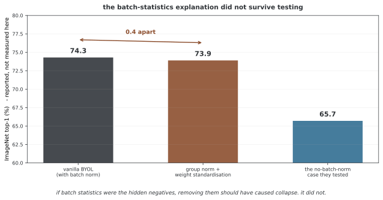

# 14장: 자기 지도 학습

자기 지도 학습은 입력 데이터에서 예측·일치·복원 목표를 구성해 표현을 배운다. 과제별 레이블 없이 사전 학습할 수 있지만 데이터·어그멘테이션·목표 설계의 가정은 남는다. 학습 로스와 실제 다운스트림 품질을 구분하며 대조 학습, 마스크 복원과 교사·학생 방식을 살펴본다.

## 1. 대조 학습

같은 입력의 어그멘테이션 뷰를 양성으로 두고 다른 후보와 구분하는 표현을 학습한다. 배치 후보와 큐, 온도·투영 공간의 역할을 구분한다.

- [SimCLR](contrastive_learning/contrastive_simclr.md): 배치 안 두 뷰와 NT-Xent 로스
- [MoCo](contrastive_learning/contrastive_moco.md): 모멘텀 인코더·피처 큐와 버전별 차이
- [데이터 어그멘테이션](contrastive_learning/data_augmentation.md): 뷰의 의미·해상도·반환 규약

## 2. 마스크 복원

일부 입력을 감추고 제거된 내용을 예측한다. 양성·음성을 구분하는 대조 학습과는 다른 목표다.

- [MAE](contrastive_learning/mae_vision_transformer.md): 보이는 패치 인코더, 순서 복원과 가린 위치 로스

## 3. 증류와 EMA 교사

이미 학습한 모델의 출력으로 학생을 지도하는 증류와, 학습 중 학생 계수를 평균하는 EMA 목표를 구분한다. 지식 증류 전체가 레이블 없는 자기 지도 방식인 것은 아니다.

- [지식 증류의 기초](self_distillation/distillation_basics.md): 온도·KL 방향·로스 웨이트
- [EMA 교사](self_distillation/ema_teacher.md): 초기화·시간 평균·경사 분리·버퍼 처리

## 4. 표현 평가

동결한 피처의 선형 분류·최근접 이웃·검색과 전체 미세 조정은 서로 다른 평가다. 원문·어그멘테이션 사본과 검색 자기 항목이 평가에 섞이지 않게 하고, 레이블·데이터 분할·분류기 학습 예산을 명시한다. 소규모 무작위 순전파나 낮은 사전 학습 로스만으로 좋은 표현을 입증할 수 없다.

**그림으로 보는 AI 1.** 왜 안 무너지는지를 두고 한 번 틀린 적이 있다

이 장은 "붕괴"라는 말을 여러 번 쓴다. 모든 입력을 같은 벡터로 보내 버리면 로스는 낮아지고 배운 것은 없다. 오랫동안 그것을 막는 장치는 **음성**이라고 여겨졌다 — 서로 밀어내는 항이 있어야 한 점으로 모이지 않는다는 것이다.

2020년에 BYOL이 음성 없이도 무너지지 않는다는 것을 보이면서 그 믿음이 깨졌다. 그러자 자연스러운 물음이 따라왔다. **그럼 무엇이 막고 있는가?**

널리 읽힌 설명이 하나 나왔다. 배치 정규화가 범인이라는 것이다. 배치 정규화는 각 표본을 배치의 통계로 나누므로, 결국 **배치 안의 다른 표본들과 견주는 셈**이고 그것이 숨은 음성 노릇을 한다는 그럴듯한 이야기였다.

BYOL을 만든 쪽이 이 가설을 시험했다. 결과가 논문 제목에 그대로 들어갔다 — 「BYOL works even without batch statistics」.

배치 통계를 쓰지 않는 정규화(그룹 정규화와 웨이트 표준화)로 바꾸자 **73.9% 대 74.3%**, 거의 차이가 없었다. 배치 통계가 숨은 음성이었다면 그것을 없앴을 때 무너져야 했는데 무너지지 않았다.

**이 일이 이 장을 읽는 자세를 정해 준다.** 어떤 장치가 붙어 있고 결과가 좋다는 사실만으로는 그 장치가 **왜** 듣는지 알 수 없다. 그럴듯한 설명은 빨리 퍼지고, 시험해 보면 틀려 있을 수 있으며, 틀렸다는 것을 보이는 데에도 논문 한 편이 든다.

아래 각 쪽에서 큐·모멘텀·높은 마스크 비율·EMA가 나올 때마다 두 가지를 갈라 보는 편이 좋다 — **무엇이 측정되었는가**와 **왜 그렇게 되는지에 대한 이야기**다. 앞의 것은 대개 확인할 수 있고, 뒤의 것은 이 보기처럼 바뀔 수 있다.

_확인한 곳 — P. H. Richemond, J.-B. Grill, F. Altché 외, "BYOL works even without batch statistics" (arXiv:2010.10241, 2020년 10월). 배치 정규화가 붕괴를 막는 데 결정적이라는 가설이 제기되었다는 서술, 배치와 무관한 정규화로 바꾸어도 73.9% 대 74.3% 로 비슷하다는 결과가 초록에 있다. 그림의 수는 모두 그 논문이 보고한 것을 옮긴 것이고 여기서 재지 않았다._

## 정리하며

방법별 입력 뷰·목표·갱신 규칙과 평가를 연결한다. 큐·큰 배치·EMA·높은 마스크 비율은 각각의 설계 요소이며 좋은 표현이나 붕괴 방지를 단독으로 보장하지 않는다.
