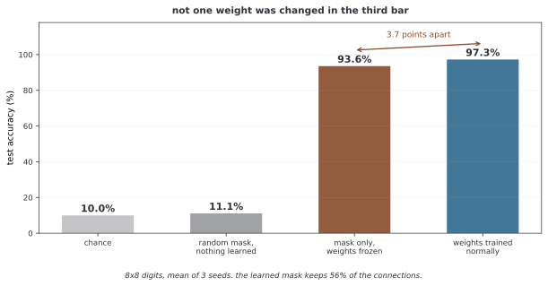

# Supermask를 이용한 지속 학습

Supermask는 고정된 기본 웨이트에 과제별 이진 마스크를 곱해 부분 네트워크를 선택한다. 새 과제의 마스크를 학습하면서 이전 마스크와 기본 모델을 유지하면 기존 부분 네트워크를 변경하지 않을 수 있다. Supermasks in Superposition(SupSup)은 이런 구조와 과제 추론을 다룬 방법이며, 아래 확률적 마스크 설명은 일반화한 별도 설계다.

## 1. 핵심 개념

- **고정 기본 웨이트**: 모든 과제가 재사용하는 웨이트
- **과제별 마스크**: 사용할 연결을 선택하는 이진 벡터
- **마스크 점수**: 이산 선택을 학습하기 위한 연속 변수
- **과제 선택**: 추론 시 어떤 마스크를 사용할지 결정하는 단계
- **추가 저장**: 기본 웨이트와 별도로 누적되는 마스크
- **보존 조건**: 웨이트·마스크·버퍼·전처리와 선택 경로의 유지

## 2. 수학적 틀

과제 t의 예측은 다음처럼 정의할 수 있다.

$$f_t(x)=\operatorname{Net}(x;W\odot m_t),\qquad m_t\in\{0,1\}^P$$

W는 고정되고 새 과제의 마스크만 바뀐다. SupSup에서는 연속 점수에서 일부 연결을 선택하는 마스크 학습과 과제 추론을 사용한다. 모든 Supermask가 추론 시 베르누이 표본을 뽑는 것은 아니다.

<div class="storybox" markdown>

**그림으로 보는 AI 1.** 웨이트를 한 번도 고치지 않고

위 식에서 $W$ 가 고정이라는 말은 가볍게 읽힌다. 그런데 이 방법이 성립하려면 **고르기만 해도 배운 것과 비슷해진다**는 사실이 먼저 참이어야 한다. 그 사실이 따로 발견된 적이 있다.

2019년에 해티 저우(Hattie Zhou) 등이 로터리 티켓 가설을 뜯어보다가, 학습을 **한 번도 하지 않은** 무작위 초기화 그물에 마스크만 씌워도 우연보다 한참 잘 맞는 부분망이 있다는 것을 보았다. 그들은 그런 마스크에 **supermask** 라는 이름을 붙였다. 이 쪽의 이름이 거기서 왔다.

같은 일을 작은 자료로 직접 해 보았다. 8×8 숫자 그림을 열 갈래로 가르는 문제에서, 웨이트는 무작위로 뽑은 뒤 **손대지 않고** 마스크 점수만 배운다.



마스크를 배우기 전에는 11.1%로 우연과 다름없다. 마스크만 배우면 **93.6%** 가 된다. 웨이트를 제대로 배운 쪽이 97.5% 이니 **3.9%포인트 차이**다. 그 사이에 바뀐 웨이트는 **하나도 없다.** 바뀐 것은 어느 연결을 쓸지 고른 것뿐이고, 고른 결과는 전체의 56% 다.

그래서 위 식의 $W\odot m_t$ 는 "배운 그물을 잘라 쓴다"가 아니라 **"고르는 일 자체가 배우는 일"** 이라는 뜻에 가깝다. 과제마다 마스크만 새로 배워도 쓸 만한 까닭이 여기에 있고, 이전 과제의 마스크와 $W$ 를 건드리지 않으면 그 과제가 그대로 남는다는 이 쪽 5절의 주장도 여기에 기댄다.

**다만 고르기가 배우기를 대신하지는 못한다.** 위에서도 3.9%포인트가 남았고, 원 논문이 보고한 값도 우연보다 한참 높다는 쪽이지 제대로 학습한 그물과 같다는 쪽이 아니다. 그리고 이 쪽 9절이 적어 둔 대로 **마스크는 과제마다 쌓인다** — 웨이트를 아낀 자리에 마스크 저장이 들어선다. 공짜로 얻은 것이 아니라 저장할 것의 종류를 바꾼 것이다.

_확인한 곳 — H. Zhou 외, "Deconstructing Lottery Tickets: Zeros, Signs, and the Supermask", *NeurIPS* (2019) 가 supermask 라는 이름과, 학습하지 않은 무작위 그물에 마스크만 씌워 우연보다 한참 높은 성능을 얻는다는 결과를 냈다. 그림의 수는 그림을 그리는 코드가 sklearn 의 8×8 digits 로 씨앗 3개를 직접 돌려 얻었고, 마스크만 배운 쪽이 우연보다 한참 높은지를 먼저 확인한 뒤에만 그린다._

</div>

확률적 마스크를 별도로 설계한다면 $m_{t,i}\sim\operatorname{Bernoulli}(p_{t,i})$로 두고 기대 과제 로스를 최적화할 수 있다. 이산 표본을 거치는 경사는 별도의 추정 방식이 필요하다.

## 3. 마스크 학습하기 전략

### 이산 선택의 경사

top-k·임계값·베르누이 표본은 보통의 미분으로 그대로 학습할 수 없다. 직선 통과 추정기나 연속 완화 등 어떤 근사를 사용하는지 명시한다. 근사 경사는 원래 이산 목표의 정확한 경사와 다를 수 있다.

이진 Concrete 완화는 다음처럼 로지스틱 잡음을 사용할 수 있다.

$$\tilde m_i=\sigma\left(\frac{\log p_i-\log(1-p_i)+\log u_i-\log(1-u_i)}T\right),\quad u_i\sim U(0,1)$$

단일 Gumbel 잡음을 그대로 넣는 식과 구분한다. T>0이며 p는 경계의 로그 발산을 피하도록 처리한다.

### 희소성 목표

베르누이 마스크의 활성 개수 기대값은 $\mathbb E\|m\|_0=\sum_ip_i$다. 여기에 벌점을 주는 것과 연속 확률 벡터 p의 L0 노름에 벌점을 주는 것은 다르다. 활성 확률은 학습한 선택 경향이며 그 자체가 보편적인 파라메터 중요도는 아니다.

## 4. 기초 망 설계

무작위 고정 웨이트에서 유용한 부분 네트워크를 찾는 방법도 있고 사전 학습 웨이트를 사용하는 방법도 있다. 기본 모델의 너비·초기화·활성화와 과제에 따라 성능이 달라진다. 2~3배 큰 모델이면 항상 충분하다는 규칙은 없다.

복권 가설은 초기화된 부분 네트워크의 훈련 가능성을 다루는 관점이고, 웨이트를 끝까지 고정한 채 마스크만 학습하는 설정과 정확히 같지는 않다.

## 5. Supermask를 쓰는 지속 학습

### 확률적 마스크 학습 도식

아래 의사 코드는 베르누이 표본을 뽑은 뒤 p에 대한 경사를 직접 구한다고 적지만 경사 추정·완화 방식이 빠져 있다. 또한 ||p||_0는 연속 확률의 0이 아닌 성분 수이므로 본문의 기대 활성 수 Σp와 다르다. p의 범위를 유지할 파라메터화도 정해야 한다. 원 SupSup의 완성 구현으로 사용할 수 없다.

```
Input: Frozen network W, previous masks m^(1:t-1)
for each epoch:
    for each batch (x, y) from task t:
        m^(t) ~ Bernoulli(p^(t))
        logits = Net_frozen(x, m^(t) ⊙ W)
        loss = L_t(logits, y) + λ * ||p^(t)||_0
        ∇p^(t) = ∂loss / ∂p^(t)
        p^(t) ← p^(t) - α * ∇p^(t)
Output: Learned mask p^(t)
```

### 이전 함수가 유지되는 조건

기존 W와 마스크뿐 아니라 바이어스·정규화 통계·전처리 등 추론 상태를 모두 유지하고 같은 마스크를 선택하면 기존 함수는 유지된다. 공유 BatchNorm 통계나 출력 레이어가 바뀌면 이 조건이 깨질 수 있다. 과제 선택을 잘못하면 고정된 부분 네트워크가 있어도 전체 성능은 달라진다.

---

## 6. 실용적인 고려

### 희소성과 실행 비용

활성 연결 비율은 검증으로 선택한다. 마스크를 곱해 0으로 만든 웨이트를 일반 밀집 연산으로 계산하면 실행 시간이 자동으로 줄지는 않는다. 비정형 희소성을 실제 연산 절감으로 연결하는 별도 구현이 필요할 수 있다.

### 마스크 겹침

활성 연결 집합의 자카드 유사도 $|M_t\cap M_s|/|M_t\cup M_s|$로 겹침을 요약할 수 있다. 두 마스크가 모두 비면 분모 처리 규칙이 필요하다. 큰 겹침이 곧 의미적으로 같은 과제를 뜻하지 않으며, 고정 W에서 별도 마스크가 겹친다는 이유만으로 학습 간섭이 생기는 것도 아니다.

### 추론 규칙

고정 이진 마스크를 사용할지 확률 표본을 평균할지 정한다. 비선형 네트워크에서는 $\mathbb E[f(x;W\odot m)]$와 $f(x;W\odot\mathbb E[m])$가 일반적으로 다르다. 확률 벡터를 그대로 쓰는 것은 이진 부분 네트워크와도 구별한다.

## 7. 다른 방법과의 비교

P개 고정 웨이트와 T개 과제별 마스크를 저장하면 일반적인 비트 마스크 저장은 O(TP) 비트다. 기본 웨이트는 고정 크기지만 전체 저장은 과제 수에 따라 늘어난다. 학습용 연속 점수를 보관하면 과제별 실수 텐서 비용도 추가된다.

어댑터·독립 전문가·마스크는 과제별 저장 구조와 선택 비용이 다르다. 같은 정확도·모델 크기 조건에서 실제 바이트·연산량을 비교하고 망각 없음의 상태·선택 조건도 명시한다.

## 8. 이점

기본 웨이트를 공유하면서 과제별 선택만 바꿀 수 있고, 이전 부분 네트워크를 고정하는 구조가 명확하다. 비트 압축을 사용하면 과제별 마스크 저장을 실수 모델 사본보다 줄일 수 있다. 다만 마스크 학습과 추론이 항상 빠르다는 보장은 없다.

## 9. 한계

좋은 마스크를 찾는 최적화와 기본 모델의 표현력이 제한 요인이다. 과제별 마스크와 선택 정보의 저장도 누적된다. 테스트에서 과제 ID가 없다면 별도의 마스크 추론이나 선택 성능을 평가해야 한다.

새 마스크가 이전 마스크를 건드리지 않는 설정에서 이전 함수가 바뀌는 문제와, 새 과제에 적합한 마스크를 찾지 못하는 문제는 구분한다.

## 10. 금융에서의 쓰임

자산·시기별 예측 과제에 다른 마스크를 적용하는 설계를 검토할 수 있다. 입력 차원과 예측 목표가 맞아야 하며, 추론 시 선택할 마스크를 과거 관측 정보만으로 정해야 한다.

상승장·하락장 같은 사후 국면 라벨을 실제 시점에 아는 것으로 처리하면 정보 누수가 된다. 모델과 마스크의 고정 조건 및 시간 순서를 지킨 검증에서 새 과제·이전 과제를 함께 평가한다.

## 11. 연구의 방향

- 기본 모델의 초기화·크기와 학습 가능한 과제 범위
- 마스크 저장의 압축과 실제 희소 연산
- 과제 ID가 없을 때 마스크 추론
- 공유 버퍼·출력 공간 변화의 처리

## 12. 관련 주제

- [Expert Gate](expert_gate.md)
- [망각의 기초](../continual_learning/catastrophic_forgetting.md)
- [평가 지표](../continual_learning/evaluation_metrics.md)

## 연습문제

<div class="drillbox" markdown>

**연습문제 1.** <span class="diff med" title="중간"></span>
이전 마스크를 바꾸지 않으면 언제 이전 출력이 그대로 유지되는가?

</div>

??? success "풀이"
    기본 웨이트·바이어스·정규화 버퍼·전처리를 유지하고 같은 마스크와 출력 규칙을 선택해야 한다. 마스크만 고정해도 공유 상태나 과제 선택이 바뀌면 최종 출력이 달라질 수 있다.

---

<div class="drillbox" markdown>

**연습문제 2.** <span class="diff easy" title="쉬움"></span>
기본 웨이트가 고정이면 전체 메모리도 고정인가?

</div>

??? success "풀이"
    과제별 마스크와 선택 정보는 누적된다. P개 웨이트의 이진 마스크 T개를 단순 저장하면 TP비트가 필요하고 학습용 점수는 실수 텐서 비용이 든다. 기본 웨이트 고정과 전체 저장량 고정은 다른 주장이다.

---

<div class="drillbox" markdown>

**연습문제 3.** <span class="diff med" title="중간"></span>
Σp_i와 ||p||_0가 다른 이유를 설명하라.

</div>

??? success "풀이"
    Σp_i는 독립 베르누이 마스크의 기대 활성 개수다. 연속 확률의 L0 노름은 0이 아닌 확률의 개수여서 0.01도 0.99도 한 개로 센다. 서로 다른 정규화 목표다.

---

<div class="drillbox" markdown>

**연습문제 4.** <span class="diff hard" title="어려움"></span>
베르누이 표본을 뽑은 뒤 자동 미분으로 p를 직접 갱신할 수 있는가?

</div>

??? success "풀이"
    일반적인 이산 샘플링 경로는 p에 대한 보통의 경사를 제공하지 않는다. 점수함수 추정, 연속 완화나 직선 통과 근사 등 선택한 방식을 정의해야 한다. p 범위를 유지하고 훈련·추론 마스크의 차이도 평가한다.

## 정리하며

고정 웨이트와 과제별 마스크로 부분 네트워크를 유지할 수 있다. 보존에는 모든 추론 상태와 마스크 선택의 유지가 필요하며, 추가 마스크 저장과 실제 실행 비용은 별도로 계산한다. 이산 선택의 학습 근사와 확률적 변형을 원 SupSup와 구분한다.

**참고**: [Wortsman 등, Supermasks in Superposition](https://arxiv.org/abs/2006.14769).
