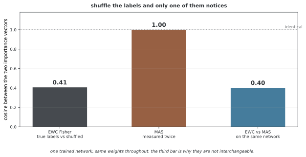

# 정규화 방법의 비교(EWC, SI, MAS)

EWC·SI·MAS는 이전 웨이트에서 멀어지는 변화를 제한한다는 공통점이 있지만 중요도를 추정하는 정보가 다르다. 수식의 근사와 데이터 요구, 저장·계산 비용을 구분해 비교한다. 특정 방법이 모든 과제에서 더 정확하거나 안정적이라는 고정 순위는 없다.

## 1. 방법의 자세한 비교

### 공통 벌점

$$L(\theta)=L_{\mathrm{task}}(\theta)+\frac\lambda2\sum_i\Omega_i(\theta_i-\theta_i^*)^2$$

Ω_i는 각 방법이 정의하는 비음수 중요도다. 같은 λ라도 중요도의 스케일과 누적 방식에 따라 제약의 크기가 다르다.

### EWC

이전 예측 분포의 로그확률 경사 제곱을 평균 내는 피셔 정보를 활용한다. 모델 분포에서 라벨을 추출하는 피셔와 실제 정답을 사용하는 경험적 피셔를 구분한다. 대각 피셔는 국소 민감도를 나타내며 자연 경사법의 역피셔 갱신을 수행하는 것은 아니다.

### SI

학습 경로의 로스 감소에 대한 파라메터 기여를 누적한다. 한 과제에서 기여 $w_i\approx-\sum_tg_i(t)\Delta\theta_i(t)$를 계산하고 과제 시작·끝의 총 변화량 제곱에 안정화 항을 더해 정규화한다. 절댓값 이동이나 경사·갱신 곱의 절댓값만 누적하는 것과 다르다.

### MAS

출력 민감도를 입력 데이터에서 평균 내어 중요도를 추정한다. 출력 제곱 노름의 미분 크기를 이용하는 방식이 대표적이다. 정답 없이 계산할 수 있지만 선택한 입력 분포와 출력 스케일에 영향을 받는다.

## 2. 두루 갖춘 비교 표

| 항목 | EWC | SI | MAS |
|---|---|---|---|
| 주 정보 | 로그확률 경사 제곱 | 경사·갱신의 학습 경로 | 출력 민감도 |
| 정답의 역할 | 추정량에 따라 다름 | 감독 로스로 학습할 때 사용 | 중요도 계산 자체에는 불필요 |
| 대표 시점 | 이전 해에서 추정 | 학습 중 기여를 누적 | 선택한 입력으로 추정 |
| 기본 추가 저장 | 기준점·중요도 | 기준점·중요도·경로 누적 상태 | 기준점·중요도 |

과제별 통계를 모두 저장할지 병합할지에 따라 메모리는 달라진다. 이 표는 정확도의 순위를 뜻하지 않는다.

## 3. 성질의 자세한 분석

### EWC의 국소 근사

이전 해 근처의 예측 민감도를 제약한다. 웨이트가 멀리 이동하거나 파라메터 상호작용이 중요하면 대각 근사가 충분하지 않을 수 있다. 추정 표본 수와 배치·표본별 경사 규약이 비용과 값에 영향을 준다.

### SI의 경로 의존성

학습 과정에서 이미 계산한 경사와 갱신을 활용할 수 있지만 그 경로와 옵티마이저·러닝레이트에 의존한다. 추가 역전파 횟수만으로 전체 비용을 판단하지 말고 좌표별 상태 누적과 메모리도 포함한다.

### MAS의 입력 선택

라벨 없는 입력에서도 중요도를 계산할 수 있어 검증셋이 반드시 필요한 것은 아니다. 반면 어떤 입력 분포의 출력을 보존할지 정해야 한다. 모델 선택에 쓸 검증 데이터와 중요도 추정 데이터의 역할을 구분한다.

## 4. 중요도 재기 사이의 관계

세 방법의 중요도를 이론적으로 연결하는 연구가 있지만 일반적으로 EWC≥MAS 같은 순위나 부등식을 쓸 수는 없다. 각 통계의 단위·스케일·가정이 다르며 중요도 값의 크기가 곧 예측 성능의 우열을 뜻하지 않는다.

<div class="storybox" markdown>

**그림으로 보는 AI 1.** 라벨을 보는 중요도와 보지 않는 중요도

세 방법이 "중요도를 추정하는 정보가 다르다"는 말은 추상적으로 들린다. 그런데 그 차이를 드러내는 아주 간단한 시험이 있다. **라벨을 섞어 보는 것**이다.

2018년에 라하프 알준디(Rahaf Aljundi) 등이 MAS를 내놓으면서 내세운 것이 바로 이 점이었다. EWC의 피셔는 로그확률의 경사를 쓰므로 **정답이 있어야** 셈한다. MAS는 그 대신 **출력의 크기**가 파라메터에 얼마나 민감한지를 보므로, 라벨을 아예 쓰지 않는다. 그래서 라벨이 없는 자료로도, 심지어 배치할 환경에서 모은 자료로도 중요도를 다시 잴 수 있다는 것이 그 논문의 주장이었다.

같은 그물에서 둘을 재어 보았다.



라벨을 뒤섞어 다시 재면 **EWC의 중요도는 코사인 0.41까지 틀어진다.** 같은 웨이트, 같은 입력인데 정답만 바꿔 놓았을 뿐이다. MAS는 두 번 재어도 **1.00** 이다 — 라벨을 애초에 보지 않으니 섞든 말든 달라질 것이 없다.

**그리고 셋째 막대가 이 쪽의 요점이다.** 같은 그물에서 EWC와 MAS가 서로 일치하는 정도가 **0.40** 밖에 되지 않는다. 둘은 같은 것을 조금 다르게 재는 것이 아니라 **다른 것을 재고 있다.** EWC는 "정답을 맞히는 데 쓰이는 방향"을, MAS는 "출력 자체를 흔드는 방향"을 가리킨다.

그래서 위 문단이 EWC≥MAS 같은 순위를 쓸 수 없다고 적은 것은 겸양이 아니다. **순위를 매기려면 먼저 같은 축 위에 있어야 하는데 그렇지 않다.** 둘 가운데 무엇을 고를지는 정확도 비교표보다 **라벨을 쓸 수 있는가, 중요도를 언제 다시 재고 싶은가** 쪽에서 먼저 갈린다.

_확인한 곳 — R. Aljundi 외, "Memory Aware Synapses: Learning what (not) to forget", *ECCV* (2018) 이 라벨 없이, 예측 함수가 파라메터 변화에 얼마나 민감한지로 중요도를 셈한다. 그림의 수는 그림을 그리는 코드가 한 자리 덧셈 사실로 학습한 같은 그물에서 직접 재며, MAS 가 두 번 재어 같은지와 피셔가 라벨을 섞으면 달라지는지를 먼저 확인한 뒤에만 그린다._

</div>

## 5. 잇단 과제에서의 성능 비교

측정 조건이 없는 정확도·시간 배수 표로 방법을 비교할 수 없다. 같은 과제 분할·출력 공간·초기화·순서·표본 노출 예산에서 설정을 검증하고 여러 번 반복한다.

추가 저장 벡터 수, 중요도 계산에 쓰는 표본과 역전파 횟수, 벌점 계산 시간을 별도로 기록한다. 전체 피셔의 O(P²) 저장 비용을 대각 피셔 EWC의 비용으로 보고하지 않는다. P는 모델 파라메터 수다.

## 6. 방법 고르기 틀

### 방법 선택 도식

아래 도식은 개략적인 탐색 아이디어다. 계산 예산이나 과제 복잡도만으로 방법을 결정할 수는 없다. 실제 구현의 라벨·입력 접근 조건과 측정 비용을 확인한 뒤 검증 과제에서 비교한다.

```
Computational Budget Available?
├─ Very Limited (< 10% overhead)
│  └─> Use MAS
├─ Moderate (10-50% overhead)
│  └─> Use SI or MAS
└─ Generous (> 50% overhead)
   └─> Use EWC or SI

Task Sequence Length?
├─ Short (< 5 tasks)
│  └─> EWC sufficient
├─ Medium (5-20 tasks)
│  └─> SI preferred
└─> Long (> 20 tasks)
   └─> SI with decay recommended

Task Relationship?
├─ Unrelated
│  └─> SI (weight-based importance)
├─ Related
│  └─> EWC (preserves relationships)
└─> Unknown
   └─> MAS (safe choice)
```

---

## 7. 하이퍼파라미터 손질

λ와 중요도의 스케일, 누적·감쇠 규칙을 함께 조율한다. SI의 안정화 상수는 전체 과제 갱신량으로 나눌 때 작은 분모를 완화한다. 모든 구현에 같은 감쇠 계수나 λ 범위가 있는 것은 아니다.

각 후보를 같은 초기 상태에서 독립 실행하고 과제별 검증셋으로 새 학습 성능·망각을 함께 평가한다. 최종 테스트셋은 설정 선택에 사용하지 않는다.

## 8. 튼튼함 분석

과제 순서·데이터 분포·추정 표본 수와 λ를 변화시켜 민감도를 측정한다. 비슷한 과제는 전이를 도울 수도 있고 출력 관계가 충돌하면 간섭할 수도 있다.

특정 λ 오차가 정확도를 몇 퍼센트포인트 낮추는지는 실험 조건에 의존한다. 과제 유사도만으로 SI나 MAS가 더 강건하다고 단정하지 않는다.

## 9. 금융에서의 쓰임새

자산·시장·시간이 바뀌는 예측 모델의 순차 학습에 적용해 볼 수 있다. 보존할 이전 목표와 적응할 새 목표를 먼저 정의하고 시간 순서에 맞춘 검증으로 비교한다.

시장이 다르다는 이유만으로 EWC를, 실시간이라는 이유만으로 MAS를 선택할 근거는 없다. 정답 확정 시점과 라벨 없는 입력의 가용성, 중요도 추정 비용과 이전 관계의 유효성을 기준으로 설계한다.

## 10. 혼합형 접근

서로 다른 중요도를 조합할 수도 있다.

$$L=L_{\mathrm{task}}+\frac12\sum_i(\lambda_FF_i+\lambda_\Omega\Omega_i)(\theta_i-\theta_i^*)^2$$

기준점이 같으면 두 벌점은 중요도의 가중 합으로 정리된다. 기준점이 다르면 그대로 합산한 목적함수를 해석해야 한다. 혼합은 더 많은 선택 변수를 만들며 자동으로 더 좋은 보존을 보장하지 않는다. 계수를 메타 학습한다면 그 외부 학습·검증 데이터도 최종 테스트와 분리한다.

## 11. 연구의 앞머리

- 중요도 추정량 사이의 이론적 관계
- 과제 누적과 큰 모델에서의 계산·저장 비용
- 규칙적인 과제 경계가 없는 스트림
- 독립적인 데이터에 의한 하이퍼파라미터 선택

## 12. 관련 주제

- [정규화 기반 지속 학습](overview.md)
- [EWC](ewc.md)
- [온라인 EWC](online_ewc.md)
- [평가 지표](../continual_learning/evaluation_metrics.md)

## 연습문제

<div class="drillbox" markdown>

**연습문제 1.** <span class="diff med" title="중간"></span>
EWC·SI·MAS가 공통으로 보존하려는 것과 중요도 정의의 차이를 설명하라.

</div>

??? success "풀이"
    이전 웨이트 주변에서 유용한 모델 동작을 유지하도록 변화에 벌점을 준다. EWC는 로그확률 민감도, SI는 로스 감소에 대한 경로 기여, MAS는 출력 민감도를 사용한다. 어느 중요도가 적절한지는 보존 목표와 데이터 조건에 달려 있다.

---

<div class="drillbox" markdown>

**연습문제 2.** <span class="diff easy" title="쉬움"></span>
대각 중요도를 쓰면 모든 방법의 메모리가 항상 같아지는가?

</div>

??? success "풀이"
    아니다. 기본 중요도와 기준점은 O(P)이지만 경로 누적 상태, 과제별 저장 또는 병합 여부, 옵티마이저 상태에 따라 실제 양이 다르다. 같은 자료형에서 모든 추가 텐서의 바이트 수를 계산해 보고한다.

---

<div class="drillbox" markdown>

**연습문제 3.** <span class="diff med" title="중간"></span>
EWC의 중요도 값이 MAS보다 크면 더 좋은 방법이라고 볼 수 있는가?

</div>

??? success "풀이"
    중요도는 단위와 스케일이 달라 직접 크기를 비교할 수 없다. λ와 함께 형성하는 벌점 및 실제 검증 성능을 비교해야 한다. 값의 부등식만으로 정확도나 망각 순위가 정해지지 않는다.

---

<div class="drillbox" markdown>

**연습문제 4.** <span class="diff hard" title="어려움"></span>
같은 기준점의 두 이차 벌점을 합치면 무엇이 되는가?

</div>

??? success "풀이"
    좌표별 중요도를 가중 합한 하나의 이차 벌점이 된다. 기준점이 다르면 중심과 상수항을 고려해야 한다. 서로 다른 추정량을 합산한다는 이유만으로 새 정보나 일반화 성능이 자동 추가되는 것은 아니다.

## 정리하며

중요도를 어떤 데이터와 경로에서 계산하는지, 과제별 통계를 어떻게 보관하는지 비교한다. 정규화 기반 방법의 성능은 추정 근사와 학습·평가 조건에 의존한다. 고정 순위 대신 같은 자원·검증 예산에서 보존과 새 학습을 함께 평가한다.
