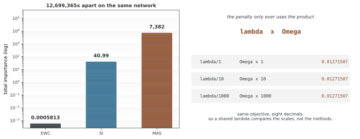

# 정규화 기반 지속 학습

정규화 기반 지속 학습은 이전 과제에 중요한 파라메터의 변화를 제한해 망각을 줄인다. 기준 웨이트와 중요도를 저장한 뒤 새 과제 로스에 가중 거리 벌점을 더하는 방식이 대표적이다. 중요도 추정, 저장 비용과 새 과제에 대한 적응을 함께 고려해야 한다.

## 1. 핵심 개념

- **기준 웨이트**: 이전 학습을 마친 모델의 파라메터
- **중요도**: 이전 예측이나 로스가 파라메터 변화에 얼마나 민감한지 나타내는 근사
- **가중 거리 벌점**: 중요한 파라메터의 큰 변화를 더 강하게 제한
- **안정성과 가소성**: 이전 성능을 유지하면서 새 과제도 학습해야 하는 요구
- **누적 방식**: 과제별 통계를 보관하거나 하나의 요약 통계로 병합하는 선택

## 2. 근본 틀

### 가중 이차 벌점

새 과제 t의 로스와 이전 웨이트에 대한 벌점을 함께 최적화한다.

$$L_t(\theta)=L_{\mathrm{task},t}(\theta)+\frac\lambda2\sum_i\Omega_i(\theta_i-\theta_i^*)^2$$

중요도 Ω_i와 λ는 음이 아니어야 한다. 변화량을 제곱하지 않은 선형항은 양방향 이동을 제한하는 거리 벌점이 아니므로 구분한다. 여러 이전 과제를 별도로 보관하면 과제별 벌점을 합산할 수 있다.

<div class="storybox" markdown>

**그림으로 보는 AI 1.** 같은 λ 로 견주면 방법이 아니라 눈금을 견주게 된다

위 식을 다시 보면 $\lambda$ 와 $\Omega$ 는 **언제나 곱으로만** 나타난다. 그러면 따라 나오는 것이 하나 있다. $\lambda$ 를 $c$ 로 나누고 $\Omega$ 를 $c$ 배 하면 **완전히 같은 목적함수**다. 곧 이 식은 $\lambda$ 와 $\Omega$ 를 따로 정해 주지 않는다 — 정해지는 것은 둘의 곱뿐이다.

말로는 당연해 보이는데, 이것이 아래 3절의 비교에 무엇을 뜻하는지가 문제다.



오른쪽이 그 곱 이야기다. $\lambda$ 를 1000으로 나누고 $\Omega$ 를 1000배 해도 벌점 값은 소수점 여덟 자리까지 같다.

왼쪽이 그 결과다. 같은 그물, 같은 자료에서 세 방법의 중요도 총합을 재면 EWC 가 0.00058, SI 가 41.0, MAS 가 7,382 다. **가장 큰 것과 가장 작은 것이 1269만 배 벌어져 있다.** 셋은 서로 다른 양을 재므로 단위도 눈금도 같을 까닭이 없고, 실제로 같지 않다.

**그러니 세 방법에 같은 $\lambda$ 를 주고 견주는 비교는 방법을 견주는 것이 아니다.** $\lambda$ 가 같으면 실제 제약의 세기는 $\Omega$ 의 눈금이 정하고, 그 눈금은 1269만 배까지 벌어진다. 그렇게 얻은 표에서 한 방법이 "더 잘 지켰다"고 나온다면 그것은 벌점을 더 세게 걸었다는 뜻일 수 있다. 아래 3절이 어떤 방법에도 고정 순위를 주지 않는 까닭이고, 공정하게 견주려면 **방법마다 $\lambda$ 를 따로 맞추거나 $\Omega$ 를 먼저 정규화해야** 한다.

그러면 무엇이 남아서 비교되는가. 곱으로만 정해진다는 말을 뒤집으면, **크기는 비교 대상이 아니고 방향만 비교 대상**이라는 뜻이다. 어느 파라메터를 상대적으로 더 중요하게 보는가 — 그 모양이 세 방법이 실제로 다른 자리이고, 이 장의 비교 쪽이 세 중요도 벡터 사이의 각을 재는 것도 그래서다.

_확인한 곳 — 수는 그림을 그리는 코드가 한 자리 덧셈 사실로 학습한 같은 그물에서 세 중요도를 직접 재며, $(\lambda/c,\ c\Omega)$ 가 같은 벌점 값을 주는지와 세 눈금이 자릿수로 다른지를 먼저 확인한 뒤에만 그린다. SI 의 중요도는 위 3절에 적힌 경로 누적 식을 그대로 썼다._

</div>

### 중요도 추정

예측 분포의 민감도, 학습 중 로스 감소에 대한 기여와 출력의 민감도는 서로 다른 중요도 정의다. 단순 그래디언트 절댓값이나 웨이트 이동량 자체가 보편적인 중요도 척도는 아니다. 어떤 데이터와 시점에서 측정했는지 기록한다.

## 3. 정규화 방법의 클래스

### EWC: 피셔 정보 기반 중요도

EWC는 이전 과제의 피셔 정보 대각 성분으로 웨이트 변화를 제한한다. 중요도가 큰 방향의 변화에 더 큰 벌점을 준다. 대각 근사는 파라메터 간 상호작용을 생략한다.

### SI: 학습 경로의 로스 기여

Synaptic Intelligence는 내부 학습 경로에서 파라메터 변화가 로스 감소에 기여한 양을 누적한다. 과제 k에서 작은 갱신의 기여를 $w_i^{(k)}\approx-\sum_t g_i(t)\Delta\theta_i(t)$로 적으면 다음과 같은 정규화 중요도를 구성한다.

$$\Omega_i\leftarrow\Omega_i+\frac{w_i^{(k)}}{(\theta_{i,\mathrm{end}}^{(k)}-\theta_{i,\mathrm{start}}^{(k)})^2+\xi}$$

ξ는 작은 분모를 완화한다. 실제 구현의 비음수 처리와 경로 누적 규칙을 명시해야 하며 단순 절대 이동량만으로 SI가 정의되지는 않는다.

### MAS: 출력 민감도 기반 중요도

Memory Aware Synapses는 모델 출력의 변화에 대한 파라메터 민감도를 이용한다. 예를 들어 출력 제곱 노름의 파라메터별 미분 크기를 입력 표본에서 평균 내어 중요도를 추정한다. 정답 라벨 없이도 계산할 수 있지만 입력 분포의 선택에 영향을 받는다.

## 4. 비교 분석

| 방법 | 중요도에 사용하는 정보 | 추가 작업 |
|---|---|---|
| EWC | 예측 로그확률의 그래디언트 제곱 | 과제 후 피셔 추정 또는 온라인 추정 |
| SI | 학습 경로의 경사와 웨이트 변화 | 갱신 단계별 기여 누적 |
| MAS | 입력에 대한 출력 민감도 | 출력 기준 중요도 계산 |
| 균등 거리 벌점 | 모든 파라메터에 같은 웨이트 | 기준 웨이트 저장 |

정확도의 고정 순위는 없다. 같은 과제·모델·학습 예산에서 중요도 추정 비용과 최종 성능을 비교한다.

## 5. 장점과 한계

과거 표본을 계속 저장하지 않고도 파라메터 수준의 제약을 적용할 수 있다는 장점이 있다. 다만 저장된 중요도는 근사이며 현재 웨이트에서 멀어지거나 과제가 누적되면 이전 성능을 충분히 나타내지 못할 수 있다.

큰 정규화는 새 과제의 학습을 제한할 수 있다. 웨이트가 덜 바뀐다고 함수 전체가 보존되는 것도 아니며, BatchNorm 통계나 출력 레이어 확장 같은 상태 변화도 관리해야 한다. 원본 데이터를 저장하지 않는다는 사실만으로 모델이나 통계의 개인정보 보호가 보장되지는 않는다.

## 6. 정보 이론의 기초

### 피셔 정보와 경험적 근사

모델 피셔 정보는 입력 분포와 현재 예측 분포에서의 기대값이다.

$$F=\mathbb E_{x,\,y\sim p_\theta(y\mid x)}[\nabla_\theta\log p_\theta(y\mid x)\nabla_\theta\log p_\theta(y\mid x)^\top]$$

실제 정답 y를 사용하는 경험적 피셔는 일반적으로 이 모델 피셔와 다르다. 음의 로그 우도 경사의 제곱을 표본별로 구한 뒤 평균 내면 경험적 대각 근사를 얻는다.

$$\hat F_i=\frac1n\sum_{k=1}^n\left(\frac{\partial\ell(x_k,y_k;\theta)}{\partial\theta_i}\right)^2$$

평균 경사를 먼저 구해 제곱하는 것은 이 식과 다르다. 경사 부호가 상쇄될 수 있기 때문이다. 대각 근사는 교차 성분을 버리는 계산상의 선택이며 파라메터가 통계적으로 독립이라는 사실을 증명하지 않는다.

## 7. 학습의 액션

### 정규화를 적용한 순차 학습

아래 의사 코드는 과제마다 중요도와 기준 웨이트를 저장하는 흐름이다. 실제 구현에서는 중요도를 어떤 데이터로 계산하고 과거 과제 항을 모두 합산할지 또는 병합할지 정해야 한다.

```
for each task t:
    Compute importance Ω_{t-1} from previous task
    Initialize θ from θ_{t-1}
    for each epoch:
        for each batch (x, y) from task t:
            L_task = task_loss(θ, x, y)
            L_reg = λ * Σ_i Ω_i (θ_i - θ_{i-1}*)²
            L_total = L_task + L_reg
            θ ← θ - α ∇L_total
    θ_t* ← θ (store learned parameters)
    Ω_t ← compute_importance(θ)
```

### 안정성과 가소성

λ를 키우면 중요 파라메터의 이동을 더 강하게 제한한다. 이전 성능을 유지하는 데 도움이 될 수 있지만 새 과제 학습이 어려워질 수 있다. 각 과제의 학습 직후 성능과 이후 성능을 함께 검증하며 선택한다.

---

## 8. 금융에서의 쓰임

서로 다른 자산·기간의 예측 과제를 순차 학습할 때 이전 과제에서 추정한 중요도를 활용해 볼 수 있다. 그러나 특정 웨이트가 시장 미시구조나 자산 상관을 단독으로 저장한다고 가정하기는 어렵다.

이전 관계가 유지되는 상황과 시장 구조가 바뀌는 상황을 구분한다. 보존 목표와 새 환경 적응 목표를 정의하고 시간 순서에 따라 분리한 검증 데이터에서 정규화 효과를 평가한다.

## 9. 하이퍼파라미터 선택

| 설정 | 역할 | 확인할 점 |
|---|---|---|
| λ | 벌점의 상대 크기 | 중요도 스케일과 함께 검증 |
| 중요도 데이터 수 | 추정 비용과 변동 | 표본별 추정 여부와 분포 |
| 학습 단계 수 | 새 과제의 적응 예산 | 모든 방법의 표본 노출 비교 |
| 누적·감쇠 규칙 | 이전 과제의 보존 범위 | 과제가 늘어날 때 메모리·바이어스 |

### 정규화 계수 선택

아래 탐색의 평가는 최종 테스트가 아닌 별도 검증셋에서 수행한다. 각 후보는 같은 초기화와 과제 순서로 독립 실행해야 하며 한 후보의 학습 상태를 다음 후보로 이어 쓰지 않는다.

```
for λ in [0.1, 0.5, 1.0, 2.0, 5.0]:
    for t in 1 to T_tasks:
        Train task t with regularization λ
        Evaluate on all tasks 1:t
    Score[λ] = weighted average accuracy
λ* = argmax Score[λ]
```

---

## 10. 한 스텝 나아간 넓히기

### 공유 파라메터와 과제별 파라메터

구조가 두 종류의 파라메터를 제공하면 다른 강도의 제약을 적용할 수 있다. 공유 여부만으로 중요도가 결정되지는 않으며, 과제별 경로를 고를 때 테스트 과제 ID가 필요한지도 명시한다.

### 온라인 EWC

온라인 EWC는 일반적으로 이전 중요도를 하나의 누적 대각 통계로 병합하고 기준점을 최근 학습 웨이트로 이동한다. 과제별 통계를 모두 저장하는 방식과 메모리 요구가 다르다. 매 미니배치 경사 제곱의 이동평균만을 온라인 EWC의 전체 정의로 보아서는 안 된다.

## 11. 연구의 방향

- 중요도 추정의 정확도와 계산 비용
- 많은 과제에서 누적 통계를 유지하는 방식
- 모델 상태·출력 공간 변화의 처리
- 이전 지식 유지와 분포 변화 적응의 균형

## 12. 관련 주제

- [EWC](ewc.md)
- [온라인 EWC](online_ewc.md)
- [경험 리플레이](../replay_methods/experience_replay.md)
- [지속 학습 평가 지표](../continual_learning/evaluation_metrics.md)

## 연습문제

<div class="drillbox" markdown>

**연습문제 1.** <span class="diff med" title="중간"></span>
가중 이차 벌점이 정규화 기반 지속 학습에서 하는 역할을 설명하라.

</div>

??? success "풀이"
    이전 기준 웨이트에서 멀어지는 변화에 벌점을 주되 중요한 파라메터에 더 큰 웨이트를 둔다. 새 과제 로스와 함께 최적화하므로 보존과 적응을 조절한다. 중요도가 근사이므로 이전 성능을 완전히 보장하지는 않는다.

---

<div class="drillbox" markdown>

**연습문제 2.** <span class="diff easy" title="쉬움"></span>
파라메터 수 P일 때 과제별 통계를 저장하는 방법과 병합하는 방법의 메모리를 비교하라.

</div>

??? success "풀이"
    기준 웨이트와 중요도 벡터는 각각 O(P)다. 모든 과제의 두 벡터를 저장하면 과제 수 T에 대해 O(TP)까지 늘어난다. 하나의 누적 중요도와 최근 기준점으로 병합하면 O(P)로 유지할 수 있으나 보존하는 근사가 달라진다.

---

<div class="drillbox" markdown>

**연습문제 3.** <span class="diff med" title="중간"></span>
표본별 경사 제곱의 평균과 평균 경사의 제곱이 다른 예를 들라.

</div>

??? success "풀이"
    두 표본의 한 좌표 경사가 +1과 −1이면 제곱 평균은 1이지만 평균의 제곱은 0이다. 미니배치 평균 로스를 역전파한 경사를 제곱하는 것만으로 표본별 경험적 피셔를 계산했다고 할 수 없다.

---

<div class="drillbox" markdown>

**연습문제 4.** <span class="diff hard" title="어려움"></span>
구현에서 기준 웨이트와 중요도를 어떻게 보관해야 하는가?

</div>

??? success "풀이"
    기준 웨이트는 현재 파라메터와 저장 공간을 공유하지 않도록 복사하고 미분 그래프에서 분리한다. 중요도는 비음수 벡터로 같은 이름·모양·장치에 대응시킨다. 과제 종료 시점에 통계를 갱신하고 새 학습 로스에 가중 제곱 차이를 더한다. 출력 레이어가 바뀌면 기존 좌표의 매핑도 정해야 한다.

## 정리하며

정규화 기반 방법은 기준 웨이트와 중요도로 새 과제의 갱신을 제한한다. EWC·SI·MAS는 중요도에 쓰는 정보와 추정 절차가 다르다. 표본별 경사, 과제 누적과 저장 비용을 명시하고 독립적인 검증 데이터에서 보존·적응 성능을 함께 비교한다.

**참고**: [SI 원 논문](https://arxiv.org/abs/1703.04200), [MAS 원 논문](https://arxiv.org/abs/1711.09601).
