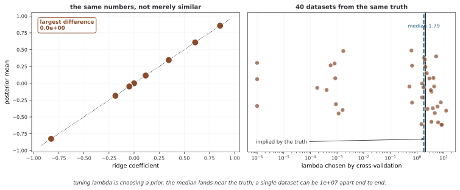

# 베이즈 선형 회귀

정규 사전분포와 가우시안 선형 우도를 사용하면 계수의 사후분포를 해석적으로 구할 수 있다. 알려진 잡음 분산을 기준으로 사후평균·공분산과 예측분포를 유도하고, 미지 분산으로의 확장 및 수치 구현의 조건을 살펴본다.

## 1. 모델 명세

### 1.1 선형 모델

**우도:**

$$
y = X\beta + \varepsilon, \quad \varepsilon \sim \mathcal{N}(0, \sigma^2 I)
$$

같은 말로 다음과 같다.

$$
y | X, \beta, \sigma^2 \sim \mathcal{N}(X\beta, \sigma^2 I)
$$

### 1.2 기호

| 기호 | 차원 | 설명 |
|--------|-----------|-------------|
| $y$ | $n \times 1$ | 반응 벡터 |
| $X$ | $n \times p$ | 설계 행렬 |
| $\beta$ | $p \times 1$ | 회귀 계수 |
| $\sigma^2$ | 스칼라 | 잡음의 분산 |
| $n$ | — | 관찰 수 |
| $p$ | — | 예측자 수(절편 포함) |

### 1.3 사전확률 명세

**계수의 사전확률:**

$$
\beta \sim \mathcal{N}(m_0, V_0)
$$

여기서 각 기호는 다음과 같다.

- $m_0$은 사전확률의 평균이다(흔히 $\mathbf{0}$)
- $V_0$은 사전확률의 공분산이다(흔히 큰 $\tau$에 대해 $\tau^2 I$)

---

## 2. 사후분포

### 2.1 켤레 갱신(시그마 제곱을 알 때)

$\sigma^2$을 알면 사후확률도 정규 분포이다.

$$
\boxed{\beta | y, X, \sigma^2 \sim \mathcal{N}(m_n, V_n)}
$$

### 2.2 사후확률의 파라메터

**사후확률의 공분산:**

$$
V_n = \left( V_0^{-1} + \frac{1}{\sigma^2} X^\top X \right)^{-1}
$$

**사후확률의 평균:**

$$
m_n = V_n \left( V_0^{-1} m_0 + \frac{1}{\sigma^2} X^\top y \right)
$$

### 2.3 정밀도 꼴

정밀도 행렬($\Lambda = V^{-1}$)을 쓰면 다음과 같다.

$$
\Lambda_n = \Lambda_0 + \frac{1}{\sigma^2} X^\top X
$$

$$
m_n = V_n \left( \Lambda_0 m_0 + \frac{1}{\sigma^2} X^\top y \right)
$$

### 2.4 특별한 경우

**정보 없는 사전확률**($V_0^{-1} \to 0$):

$$
m_n \to (X^\top X)^{-1} X^\top y = \hat{\beta}_{\text{OLS}}
$$

$$
V_n \to \sigma^2 (X^\top X)^{-1}
$$

이 극한은 X가 열 완전계수여서 XᵀX가 가역인 경우다. 그렇지 않으면 평탄 사전 아래 사후분포가 적절하지 않을 수 있다. 양의 정부호인 유한 사전 공분산은 데이터가 식별하지 못하는 방향에도 제약을 준다.

**릿지 회귀와의 관계**: 평균이 0이고 공분산이 τ²I인 사전분포를 가정한다. 사전평균이 0이 아니면 아래 해에 그 중심의 항도 포함해야 한다.

$$
m_n = \left( X^\top X + \frac{\sigma^2}{\tau^2} I \right)^{-1} X^\top y
$$

이는 $\lambda = \sigma^2/\tau^2$인 릿지 회귀의 해와 꼭 같다.

<div class="storybox" markdown>

**그림으로 보는 AI 1.** 릿지를 만든 사람들은 사전분포를 생각하고 있지 않았다

바로 위 "꼭 같다"는 비유가 아니다. 그런데 릿지 회귀를 만든 사람들은 베이즈를 하고 있지 않았다.

1970년 아서 호얼(Arthur Hoerl)과 로버트 케너드(Robert Kennard)가 《Technometrics》에 실은 글의 제목은 「Ridge Regression: Biased Estimation for Nonorthogonal Problems」다. **비직교 문제를 위한 편향 추정**이라는 뜻이고, 그들이 풀던 것은 수치 문제였다. 설명변수들이 서로 비슷하면 $X^\top X$ 가 거의 특이해져서 역행렬이 폭주한다. 그러면 대각선에 작은 수 $k$ 를 더해 조건수를 낮추자는 것이다. 편향이 조금 생기지만 분산이 크게 줄어드니 남는 장사라는 논증이었다. 사전분포라는 말은 동기에 없다.

같은 식이 두 길에서 나온 것인데, 정말 같은지 확인해 보면 이렇다.



**가장 큰 차이가 $0.0 \times 10^{0}$ 이다.** 비슷한 것이 아니라 비트 단위로 같은 수다.

그래서 따라 나오는 결론이 하나 있다 — **$\lambda$ 를 고르는 일은 사전분포를 고르는 일이다.** 교차검증으로 $\lambda$ 를 튜닝해 본 사람은 자기도 모르게 사전분포의 폭을 고르고 있었던 셈이고, $\tau = \sigma/\sqrt{\lambda}$ 로 되읽으면 그 폭이 얼마였는지도 나온다.

**다만 그 되읽기를 얼마나 믿을 수 있는지가 오른쪽 그림이다.** 같은 참값에서 자료를 마흔 벌 만들어 교차검증에 $\lambda$ 를 고르게 하면, **중앙값은 1.79 로 참값이 함축하는 2.04 가까이 간다.** 평균적으로는 어지간히 맞는 것이다. 그런데 한 벌 한 벌을 보면 고른 값이 $10^{-6}$ 에서 12 까지 흩어진다 — **끝에서 끝까지 일곱 자릿수다.** 어떤 판에서는 교차검증이 사실상 정규화를 하지 말라고 말한다.

그러니 둘을 오가며 읽을 때 조심할 자리는 분명하다. 식이 같으니 릿지 결과를 베이즈로 **해석하는 것**은 정당하지만, 교차검증이 고른 $\lambda$ 를 "자료가 알려 준 사전분포"로 삼아 그 위에서 신용구간까지 읽어 내는 것은 다른 일이다. 그 구간의 폭은 $\tau$ 에 달려 있는데, $\tau$ 자체가 이만큼 흔들리기 때문이다. 아래 3절의 예측 분포가 계수 불확실성과 관측 잡음을 애써 갈라 두는 까닭도 결국 같다 — **어느 양이 어디서 왔는지를 흐리지 않는 것이다.**

_확인한 곳 — A. E. Hoerl, R. W. Kennard, "Ridge Regression: Biased Estimation for Nonorthogonal Problems", *Technometrics* **12**, 55–67 (1970). 다중공선성으로 $X^\top X$ 가 나빠지는 문제를 대각선에 상수를 더해 다루고, 편향을 감수해 분산을 줄인다는 논증이 그 글의 것이다. 그림의 수는 그림을 그리는 코드가 직접 셈하며, 두 해가 정말 기계 정밀도까지 같은지를 스스로 확인한 뒤에만 그린다. 교차검증 쪽은 처음에 격자를 좁게 잡아 "참값과 몇 자릿수 어긋난다"는 잘못된 결과를 얻었고, 격자를 넓혀 마흔 벌로 다시 재어 중앙값은 맞는다는 것을 확인했다._

</div>

---

## 3. 예측 분포

### 3.1 사후확률 예측

새 입력 $x_*$에 대한 예측 분포는 다음과 같다.

$$
\boxed{y_* | y, X, x_* \sim \mathcal{N}\left( x_*^\top m_n, \; \sigma^2 + x_*^\top V_n x_* \right)}
$$

### 3.2 예측 분산의 성분

예측 분산은 두 성분으로 이루어진다.

$$
\text{Var}(y_* | y) = \underbrace{\sigma^2}_{\text{noise}} + \underbrace{x_*^\top V_n x_*}_{\text{parameter uncertainty}}
$$

| 성분 | 의미 | 조건 |
|---|---|---|
| σ² | 새 관측 잡음 | 이 모형에서는 입력과 무관한 상수 |
| x_*ᵀV_nx_* | 잠재 평균의 파라메터 불확실성 | 설계벡터와 사후공분산에 의존 |

### 3.3 입력 위치와 불확실성

단순 절편·그래디언트 회귀에서는 보통 입력 중심에서 멀어질수록 불확실성이 커진다. 일반적인 피처 공간에서는 가장 가까운 데이터와의 거리만으로 x_*ᵀV_nx_*의 크기를 결정할 수 없다. 특히 선형 모형 자체가 틀린 외삽 영역에서 분산이 실제 오차를 자동으로 보정하지는 않는다.

---

## 4. 구현

### 4.1 핵심 함수

X와 X_test는 각각 (n,p), (m,p), y와 m0는 1차원이며 σ²>0, V0는 양의 정부호여야 한다. y를 (n,1)로 전달하면 1차원 사전 항과의 브로드캐스팅이 잘못된 결과를 만들 수 있다. 이 함수는 입력 모양·유한성을 자동 검증하지 않는다. 큰 문제에서는 역행렬 대신 분해와 선형 시스템 풀이를 사용한다.

```python
import numpy as np

def bayesian_linear_regression(X, y, sigma_sq, m0=None, V0=None):
    """
    정규 앞확률을 쓴 베이즈 선형 회귀.
    
    파라메터
    ----------
    X : array (n, p)
        설계 행렬
    y : array (n,)
        반응 벡터
    sigma_sq : float
        아는 잡음 흩어짐
    m0 : array (p,), 있어도 되고 없어도 됨
        앞확률 평균(기본값: 0)
    V0 : array (p, p), 있어도 되고 없어도 됨
        앞확률 공분산(기본값: 100 * I)
    
    반환값
    -------
    mn : array (p,)
        뒤확률 평균
    Vn : array (p, p)
        뒤확률 공분산
    """
    n, p = X.shape
    
    # 기본 앞확률
    if m0 is None:
        m0 = np.zeros(p)
    if V0 is None:
        V0 = np.eye(p) * 100
    
    # 뒤확률 공분산
    V0_inv = np.linalg.inv(V0)
    Vn_inv = V0_inv + (1/sigma_sq) * X.T @ X
    Vn = np.linalg.inv(Vn_inv)
    
    # 뒤확률 평균
    mn = Vn @ (V0_inv @ m0 + (1/sigma_sq) * X.T @ y)
    
    return mn, Vn

def predictive_distribution(X_test, mn, Vn, sigma_sq):
    """
    예측 평균과 흩어짐을 셈한다.
    
    파라메터
    ----------
    X_test : array (m, p)
        시험 설계 행렬
    mn : array (p,)
        뒤확률 평균
    Vn : array (p, p)
        뒤확률 공분산
    sigma_sq : float
        잡음 흩어짐
    
    반환값
    -------
    pred_mean : array (m,)
        예측 평균
    pred_var : array (m,)
        예측 흩어짐
    """
    pred_mean = X_test @ mn
    
    # 예측 흩어짐 = 잡음 + 파라메터 불확실함
    pred_var = sigma_sq + np.sum((X_test @ Vn) * X_test, axis=1)
    
    return pred_mean, pred_var
```

### 4.2 쓰는 보기

```python
# 데이터를 생성한다
np.random.seed(42)
n = 30
X = np.linspace(0, 10, n)
y = 2.0 + 1.5 * X + np.random.normal(0, 2.0, n)

# 절편이 있는 설계 행렬
X_design = np.column_stack([np.ones(n), X])

# 모형 맞추기
sigma_sq = 4.0  # 아는 잡음 흩어짐
mn, Vn = bayesian_linear_regression(X_design, y, sigma_sq)

print(f"Posterior mean: β₀ = {mn[0]:.3f}, β₁ = {mn[1]:.3f}")
print(f"Posterior std:  β₀ = {np.sqrt(Vn[0,0]):.3f}, β₁ = {np.sqrt(Vn[1,1]):.3f}")
```

**출력:**
```
Posterior mean: β₀ = 1.847, β₁ = 1.534
Posterior std:  β₀ = 0.687, β₁ = 0.115
```

---

## 5. 그려 보기

### 5.1 예측 구간

아래 음영에는 관측 잡음이 포함된다. 정규 예측분포의 ±2표준편차는 약 95.45% 구간으로, 정확한 95% 분위수 구간의 근사다. 잠재 평균 함수의 신용구간과 구분한다.

```python
import matplotlib.pyplot as plt

# 시험 점
X_test = np.linspace(-1, 11, 200)
X_test_design = np.column_stack([np.ones(len(X_test)), X_test])

# 예측
pred_mean, pred_var = predictive_distribution(X_test_design, mn, Vn, sigma_sq)
pred_std = np.sqrt(pred_var)

# 그림
plt.scatter(X, y, alpha=0.6, label='Data')
plt.plot(X_test, pred_mean, 'r-', linewidth=2, label='Posterior mean')
plt.fill_between(X_test, 
                 pred_mean - 2*pred_std, 
                 pred_mean + 2*pred_std,
                 alpha=0.3, color='red', label='95% Predictive interval')
plt.xlabel('X')
plt.ylabel('y')
plt.legend()
plt.title('Bayesian Linear Regression')
```

### 5.2 사후확률 표본

사후확률에서 회귀 직선을 뽑아 불확실성을 그려 본다.

```python
# 뒤확률에서 표집
for _ in range(20):
    beta_sample = np.random.multivariate_normal(mn, Vn)
    y_sample = X_test_design @ beta_sample
    plt.plot(X_test, y_sample, 'r-', alpha=0.2, linewidth=1)
```

이는 데이터와 사전확률에 어긋나지 않는 그럴듯한 회귀 직선의 무리를 보여 준다.

---

## 6. 빈도주의 회귀와의 비교

베이즈 회귀는 선택한 사전분포와 우도에 조건부인 계수 사후분포를 구한다. 빈도주의 최소제곱도 표준오차·신뢰구간·예측구간을 계산할 수 있으므로 불확실성을 다루지 않는 점 추정만의 방법으로 설명하지 않는다.

모형과 잡음 조건이 같고 X가 열 완전계수일 때 평탄 사전 극한에서 사후평균은 최소제곱에, 사후공분산은 알려진 잡음 분산의 최소제곱 공분산에 대응한다. 유용한 사전정보는 작은 자료에서 도움을 줄 수 있지만 부적절한 사전은 바이어스를 만들 수 있다.

## 7. 넓히기

### 7.1 분산을 모를 때

$\sigma^2$을 모르면 정규-역감마 켤레 사전분포를 쓴다.

$$
\beta | \sigma^2 \sim \mathcal{N}(m_0, \sigma^2 V_0)
$$

$$
\sigma^2 \sim \text{Inverse-Gamma}(a_0, b_0)
$$

사후확률도 정규-역감마이며, $\sigma^2$을 주변화하면 $\beta$에 대한 다변량 $t$ 분포가 나온다.

### 7.2 베이즈 릿지 회귀

사전확률 $\beta \sim \mathcal{N}(0, \tau^2 I)$이면 다음과 같다.

$$
m_n = \left( X^\top X + \lambda I \right)^{-1} X^\top y, \quad \lambda = \sigma^2/\tau^2
$$

정규화 파라메터 $\lambda$은 잡음 분산과 사전확률 분산의 비로 베이즈식 풀이를 얻는다.

### 7.3 관련도 자동 판정(ARD)

계수마다 사전확률 분산을 따로 쓴다.

$$
\beta_j \sim \mathcal{N}(0, \tau_j^2)
$$

ARD는 계수별 사전 정밀도·분산을 데이터에서 추정하거나 계층적으로 추론해 불필요한 계수를 강하게 수축시키는 방법이다. 단순히 분산을 각각 선언하는 것만으로 자동 선택이 완성되지는 않는다.

---

## 추가 탐구

- 사전분산과 피처 스케일을 바꿔 사후평균의 민감도를 비교한다.
- 같은 모형에서 독립적인 반복 데이터로 예측구간의 포함 비율을 평가한다.
- 미지 잡음 분산의 정규·역감마 모형을 유도한다.
- BayesianRidge는 잡음·사전 정밀도를 추정하므로 고정된 σ²·V0 예제와 조건을 맞춰 비교한다.

## 연습문제

<div class="drillbox" markdown>

**연습문제 1.** <span class="diff med" title="중간"></span>
사후 정밀도에 사전 정밀도와 데이터 항이 더해지는 의미를 설명하라.

</div>

??? success "풀이"
    V_n⁻¹=V_0⁻¹+XᵀX/σ²다. 고정된 알려진 잡음 아래 데이터는 계수 방향의 정보에 양의 준정부호 항을 더한다. 사전이 양의 정부호이면 데이터가 계수를 완전히 식별하지 못해도 사후 정밀도는 가역이다.

---

<div class="drillbox" markdown>

**연습문제 2.** <span class="diff med" title="중간"></span>
잠재 평균과 새 관측의 분산을 비교하라.

</div>

??? success "풀이"
    잠재 평균 x_*ᵀβ의 사후분산은 x_*ᵀV_nx_*다. 새 관측에는 독립 잡음 σ²가 추가된다. 여러 새 입력의 결합 공분산은 X_*V_nX_*ᵀ이며 코드 함수는 그 대각 성분에 잡음을 더한 값만 반환한다.

---

<div class="drillbox" markdown>

**연습문제 3.** <span class="diff med" title="중간"></span>
평탄 사전 극한에서 최소제곱 해를 얻기 위한 조건은 무엇인가?

</div>

??? success "풀이"
    설계 행렬의 열이 독립이어야 XᵀX가 가역이다. 잡음 분산도 양수로 알려져 있다고 가정한다. 계수 수가 표본보다 많거나 공선성이 있으면 이 역행렬 공식을 그대로 쓸 수 없다.

---

<div class="drillbox" markdown>

**연습문제 4.** <span class="diff hard" title="어려움"></span>
아래 import만 있는 풀이가 회귀 구현을 완성하는가? 필요한 계산을 설명하라.

</div>

??? success "풀이"
    구현이 아니라 임포트 한 줄이다. 입력 모양과 양의 분산을 검사하고, 사후 정밀도를 구성한 뒤 선형 시스템으로 평균·공분산을 계산해야 한다. 새 입력에서 잠재 분산과 관측 예측 분산을 구분해 반환한다.

    ```python
    import numpy as np
    # 구현은 주제에 따라 달라진다.
    # 켤레 모형: 닫힌 꼴 뒤확률 새로 고치기.
    # 켤레가 아닌 모형: MCMC 또는 변분 추론.
    # 핵심 스텝: 앞확률 정하기, 가능도 셈하기, 뒤확률 이끌어 내기/어림하기.
    ```

## 정리하며

가우시안 선형 모형은 알려진 잡음 분산에서 해석적 사후분포를 제공한다. 사전 중심·공분산과 설계 행렬의 조건을 명시하고 잠재 함수·관측의 불확실성을 구분한다. 사후분산은 모형에 조건부이며 외삽 오차의 자동 보장은 아니다.

**참고 문헌**

- Bishop, C. *Pattern Recognition and Machine Learning*, 3장
- Murphy, K. *Machine Learning: A Probabilistic Perspective*, 7장
- Gelman, A., et al. *Bayesian Data Analysis* (3rd ed.), 14장
