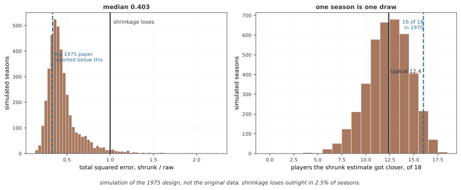

# 계층 모델

계층 모델은 그룹별 파라메터가 공통 모집단 분포에서 나온다고 가정해 정보를 공유한다. 그룹을 모두 같게 보는 완전 풀링과 그룹별로 따로 추정하는 비풀링 사이의 부분 풀링을 설명한다. 이 예제는 가상 학교 데이터를 이용한 플러그인 수축이며 완전한 계층 베이즈 사후추론은 수행하지 않는다.

## 1. 코드

```python
"""
베이즈 추론 — 모듈 7: 레이어 베이즈 모형
수준: 나아간 단계
주제: 레이어 모형, 얼마쯤 어울림, 오그라들기, 여러 레이어 추론

레이어 모형은 파라메터가 무리마다 달라지도록 하면서도 얼마쯤 어울림으로
무리끼리 통계적 힘을 나눈다.

지은이: 연세대학교 이성철 교수
전자우편: sungchulyonsei@gmail.com
"""

import numpy as np
import matplotlib.pyplot as plt
from scipy import stats
import seaborn as sns

# ========================================================================
# 메인
# ========================================================================

sns.set_style("whitegrid")
plt.rcParams["figure.figsize"] = (12, 8)

"""
레이어 모형의 짜임:

레이어 1(자료): y_ij | θ_i ~ N(θ_i, σ²)
레이어 2(무리): θ_i | μ, τ ~ N(μ, τ²)
레이어 3(웃파라메터): μ ~ N(μ₀, σ₀²), τ ~ 반코시(눈금)

이렇게 하면 다음이 만들어진다:
- 어울림 없음: θ_i마다 따로 어림한다(무리 짜임을 무시한다)
- 온전한 어울림: 모든 θ_i = μ이라고 놓는다(무리 차이를 무시한다)
- 얼마쯤 어울림: θ_i을 μ 쪽으로 오그라뜨린다(두 극단의 균형을 잡는다)

쓰임새:
- 학교 안의 학생
- 병원 안의 환자
- 클래스 안의 제품
- 피험자 안의 되풀이 측정
"""

def demonstrate_pooling():
    """
    어울림 없음, 온전한 어울림, 얼마쯤 어울림을 견주어 보인다.
    """
    print("="*70)
    print("HIERARCHICAL MODELS: POOLING STRATEGIES")
    print("="*70)
    
    # 자료 흉내내기: 표본 크기가 다른 학교 8곳
    np.random.seed(42)
    true_mu = 8.0
    true_tau = 5.0
    
    n_schools = 8
    true_effects = np.random.normal(true_mu, true_tau, n_schools)
    sample_sizes = np.array([28, 8, 23, 20, 12, 44, 6, 11])
    sigma = 15.0  # 아는 표준 오차
    
    observed_means = []
    for i, n in enumerate(sample_sizes):
        obs = np.random.normal(true_effects[i], sigma/np.sqrt(n))
        observed_means.append(obs)
    observed_means = np.array(observed_means)
    
    print(f"\nTrue population mean: {true_mu:.2f}")
    print(f"True between-school std: {true_tau:.2f}")
    print(f"Within-school std: {sigma:.2f}")
    
    # 어울림 없음: 따로따로 어림
    no_pool_estimates = observed_means
    
    # 온전한 어울림: 큰 평균
    complete_pool_estimate = np.mean(observed_means)
    complete_pool_estimates = np.full(n_schools, complete_pool_estimate)
    
    # 얼마쯤 어울림: 큰 평균 쪽으로 오그라뜨리기
    # 무게 = n_i / (n_i + σ²/τ²)
    tau_est = np.std(observed_means)  # 단순 어림값
    weights = sample_sizes / (sample_sizes + sigma**2 / tau_est**2)
    partial_pool_estimates = (weights * observed_means + 
                             (1 - weights) * complete_pool_estimate)
    
    # 결과 보이기
    print("\n" + "-"*70)
    print(f"{'School':<8} {'n':<5} {'True':<8} {'Observed':<12} {'No Pool':<12} {'Partial Pool':<15} {'Complete Pool':<12}")
    print("-"*70)
    for i in range(n_schools):
        print(f"{i+1:<8} {sample_sizes[i]:<5} {true_effects[i]:<8.2f} {observed_means[i]:<12.2f} "
              f"{no_pool_estimates[i]:<12.2f} {partial_pool_estimates[i]:<15.2f} {complete_pool_estimates[i]:<12.2f}")
    
    # 시각화
    fig, axes = plt.subplots(1, 2, figsize=(15, 6))
    
    # 그림 1: 어림값 견줌
    x = np.arange(n_schools) + 1
    axes[0].plot(x, true_effects, 'ko-', label='True effects', linewidth=2, markersize=8)
    axes[0].plot(x, observed_means, 'b^--', label='Observed (No pooling)', linewidth=2, markersize=8, alpha=0.7)
    axes[0].plot(x, partial_pool_estimates, 'ro-', label='Partial pooling', linewidth=2, markersize=8)
    axes[0].axhline(complete_pool_estimate, color='green', linestyle=':', linewidth=2, label='Complete pooling')
    axes[0].set_xlabel('School', fontsize=12)
    axes[0].set_ylabel('Effect Estimate', fontsize=12)
    axes[0].set_title('Comparing Pooling Strategies', fontsize=13, fontweight='bold')
    axes[0].legend()
    axes[0].grid(True, alpha=0.3)
    
    # 그림 2: 오그라들기 그려 보기
    for i in range(n_schools):
        axes[1].plot([observed_means[i], partial_pool_estimates[i]], 
                    [i+1, i+1], 'r-', linewidth=2, alpha=0.7)
        axes[1].plot(observed_means[i], i+1, 'bo', markersize=10, label='Observed' if i==0 else '')
        axes[1].plot(partial_pool_estimates[i], i+1, 'ro', markersize=10, label='Partial pool' if i==0 else '')
    axes[1].axvline(complete_pool_estimate, color='green', linestyle=':', linewidth=2, label='Grand mean')
    axes[1].set_xlabel('Estimate', fontsize=12)
    axes[1].set_ylabel('School', fontsize=12)
    axes[1].set_title('Shrinkage Toward Grand Mean', fontsize=13, fontweight='bold')
    axes[1].legend()
    axes[1].grid(True, alpha=0.3, axis='x')
    axes[1].set_yticks(range(1, n_schools+1))
    
    plt.tight_layout()
    plt.savefig('hierarchical_pooling.png', dpi=300, bbox_inches='tight')
    plt.show()
    
    print("\nKey Insight:")
    print("  - Schools with smaller samples are shrunk more toward the grand mean")
    print("  - Partial pooling 'borrows strength' across groups")
    print("  - Provides better estimates than complete or no pooling")

if __name__ == "__main__":
    print("\n" + "="*70)
    print("BAYESIAN INFERENCE - MODULE 7: HIERARCHICAL MODELS")
    print("="*70)
    
    demonstrate_pooling()
    
    print("\n" + "="*70)
    print("MODULE 7 COMPLETE")
    print("="*70)
    print("\nKey takeaways:")
    print("1. Hierarchical models share information across groups")
    print("2. Partial pooling balances group-specific and population estimates")
    print("3. Small groups benefit most from pooling")
    print("4. Shrinkage is automatic and data-driven")
    print("\nNext: Module 8 - Empirical Bayes")
    print("="*70)
```

**출력:**

```

======================================================================
BAYESIAN INFERENCE - MODULE 7: HIERARCHICAL MODELS
======================================================================
======================================================================
HIERARCHICAL MODELS: POOLING STRATEGIES
======================================================================

True population mean: 8.00
True between-school std: 5.00
Within-school std: 15.00

----------------------------------------------------------------------
School   n     True     Observed     No Pool      Partial Pool    Complete Pool
----------------------------------------------------------------------
1        28    10.48    9.15         9.15         8.88            8.52        
2        8     7.31     10.19        10.19        8.97            8.52        
3        23    11.24    9.79         9.79         9.17            8.52        
4        20    15.62    14.05        14.05        11.17           8.52        
5        12    6.83     7.88         7.88         8.29            8.52        
6        44    6.83     2.50         2.50         4.49            8.52        
7        6     15.90    5.33         5.33         7.83            8.52        
8        11    11.84    9.29         9.29         8.78            8.52        

Key Insight:
  - Schools with smaller samples are shrunk more toward the grand mean
  - Partial pooling 'borrows strength' across groups
  - Provides better estimates than complete or no pooling

======================================================================
MODULE 7 COMPLETE
======================================================================

Key takeaways:
1. Hierarchical models share information across groups
2. Partial pooling balances group-specific and population estimates
3. Small groups benefit most from pooling
4. Shrinkage is automatic and data-driven

Next: Module 8 - Empirical Bayes
======================================================================
```

## 2. 논의

그룹 i의 표본평균을 $\bar y_i\mid\theta_i\sim N(\theta_i,\sigma^2/n_i)$, 그룹 평균을 $\theta_i\mid\mu,\tau\sim N(\mu,\tau^2)$로 두자. μ·τ·σ가 알려졌다면 조건부 사후평균은 $w_i\bar y_i+(1-w_i)\mu$, 데이터 웨이트는 다음과 같다.

$$w_i=\frac{n_i\tau^2}{n_i\tau^2+\sigma^2}$$

작은 표본의 평균은 μ 쪽으로 더 수축한다. w_i 자체는 수축량이 아닌 데이터에 주는 웨이트이며 수축 비율은 1−w_i다.

코드는 μ를 관측 학교평균의 단순 평균, τ를 그 표준편차로 대입한다. 표본 수가 다른데도 완전 풀링을 단순 학교평균으로 계산하므로 원시 표본을 모두 합친 평균과 다르다. τ 추정에는 학교평균의 관측 잡음도 섞여 있다. 코드 문자열에 적힌 μ·τ의 하이퍼사전분포를 실제로 추론하지 않으므로 그 불확실성도 포함하지 않는다. 고전적인 실측 여덟 학교 자료를 재현한 것도 아니다.

<div class="storybox" markdown>

**그림으로 보는 AI 1.** 수축을 세상에 납득시킨 것은 정리가 아니라 야구였다

제임스와 스타인이 1961년에 수축 추정량을 적어 준 뒤로도 한동안 그것은 "이상한 정리"였다. 서로 상관없는 양들을 서로 끌어당겨 추정하는 쪽이 낫다는 말이 실무자에게는 받아들이기 어려웠다.

이 쪽이 하는 것과 똑같은 계산으로 그것을 납득시킨 것이 1975년 브래들리 에프런(Bradley Efron)과 칼 모리스(Carl Morris)의 글이다. 그들은 1970년 메이저리그 시즌의 **첫 45타석**만 보고 선수 **18명**의 타율을 받아, 전체 평균 **0.265** 쪽으로 수축시킨 값과 날 타율을 각각 그 선수의 **시즌 나머지 성적**과 견주었다. 결과는 수축 쪽이 18명 가운데 **16명**에서 더 가까웠고, 총 제곱오차는 날 타율의 **3분의 1에도 못 미쳤다.**

그 설계를 그대로 되풀이해 시늉해 보면 이렇다.



**전형적인 시즌은 1970년만큼 극적이지 않다.** 시늉한 시즌에서 수축이 더 가까웠던 선수는 평균 **12.4명**이고, 총 제곱오차 비의 중앙값은 **0.403** 이다. 에프런과 모리스가 보고한 16명과 3분의 1은 오른쪽 꼬리에 있는 좋은 판이었다. 그리고 **2.5% 의 시즌에서는 수축이 아예 졌다.**

이 두 가지를 함께 읽는 것이 이 상자의 요점이다. 수축은 평균적으로 크게 이긴다 — 중앙값 0.403 이면 오차를 60% 줄인 것이다. 그러나 **유명한 한 번의 결과를 방법의 성능으로 읽으면 안 된다.** 바로 아래 문단이 "부분 풀링의 MSE가 항상 가장 작은 것은 아니다"라고 적어 둔 것의 크기가 2.5% 이고, 위 코드의 출력 하나도 마찬가지로 한 번의 추출이다.

_확인한 곳 — B. Efron, C. Morris, "Data Analysis Using Stein's Estimator and its Generalizations", *Journal of the American Statistical Association* (1975). 1970년 시즌 첫 45타석, 선수 18명, 전체 평균 0.265 로 수축했을 때 18명 중 16명에서 더 가까웠고 총 제곱오차가 날 타율의 3분의 1 미만이었다는 것이 그 글의 보고다. **원 자료를 구하지 못했으므로 그림은 그 설계를 따라 시늉한 것이고, 그림 안에 그렇게 적어 두었다** — 16/18 과 3분의 1 은 논문의 값이고, 12.4 와 0.403 과 2.5% 는 시늉에서 나온 값이다._

</div>

부분 풀링의 MSE가 항상 가장 작은 것은 아니다. 그룹 구조가 적절한지와 수축 정도를 검증해야 한다. 출력과 그림은 주어진 가상 자료의 예시로 읽는다.

## 연습문제

<div class="drillbox" markdown>

**연습문제 1.** <span class="diff med" title="중간"></span>
아래 학교 예제에서 계산하는 세 MSE의 비교 대상과 한계를 설명하라.

</div>

??? success "풀이"

    비풀링·완전 풀링·부분 풀링의 추정값을 시뮬레이션의 true_effects와 비교한다. p=0.4인 도박 문제와는 관계가 없다. 한 번의 가상 자료에서 부분 풀링이 좋더라도 모든 참 효과나 데이터셋에서 우월하다는 보장은 아니다.

    ```python
    np.random.seed(42)
    true_mu = 8.0
    true_tau = 5.0
    n_schools = 8
    true_effects = np.random.normal(true_mu, true_tau, n_schools)
    sample_sizes = np.array([28, 8, 23, 20, 12, 44, 6, 11])
    sigma = 15.0

    observed_means = np.array([
        np.random.normal(true_effects[i], sigma / np.sqrt(n))
        for i, n in enumerate(sample_sizes)
    ])

    grand_mean = np.mean(observed_means)
    tau_est = np.std(observed_means)
    weights = sample_sizes / (sample_sizes + sigma**2 / tau_est**2)
    partial = weights * observed_means + (1 - weights) * grand_mean

    mse_no_pool = np.mean((observed_means - true_effects)**2)
    mse_complete = np.mean((grand_mean - true_effects)**2)
    mse_partial = np.mean((partial - true_effects)**2)

    print(f"MSE No Pooling:       {mse_no_pool:.4f}")
    print(f"MSE Complete Pooling: {mse_complete:.4f}")
    print(f"MSE Partial Pooling:  {mse_partial:.4f}")
    ```


---

<div class="drillbox" markdown>

**연습문제 2.** <span class="diff med" title="중간"></span>
σ²>0, τ²>0를 고정할 때 w_i의 표본 수에 따른 극한을 설명하라.

</div>

??? success "풀이"

    n_i가 커지면 1로 가서 데이터 평균의 비중이 커지고, 0에 가까워지면 0으로 가서 모집단 평균에 의존한다. 실제 표본이 0개면 표본평균을 계산할 수 없으므로 조건부 사전분포를 사용해야 한다. τ=0인 퇴화 경우도 별도로 처리한다.


---

<div class="drillbox" markdown>

**연습문제 3.** <span class="diff hard" title="어려움"></span>
아래 신용구간 계산의 올바른 조건부 분산과 누락된 불확실성을 설명하라.

</div>

??? success "풀이"

    μ와 τ를 고정하면 분산은 $(n_i/\sigma^2+1/\tau^2)^{-1}$이며 코드가 사용하는 식이다. 원래 문제의 다른 분산식과 혼동하지 않는다. 추정한 μ·τ를 대입한 구간은 그 하이퍼파라미터의 불확실성을 제외하므로 완전한 계층 모형의 주변 신용구간이 아니다.

    ```python
    import numpy as np
    from scipy import stats

    np.random.seed(42)
    true_mu, true_tau, sigma = 8.0, 5.0, 15.0
    n_schools = 8
    true_effects = np.random.normal(true_mu, true_tau, n_schools)
    sample_sizes = np.array([28, 8, 23, 20, 12, 44, 6, 11])
    observed_means = np.array([
        np.random.normal(true_effects[i], sigma / np.sqrt(n))
        for i, n in enumerate(sample_sizes)
    ])

    grand_mean = np.mean(observed_means)
    tau_est = np.std(observed_means)
    weights = sample_sizes / (sample_sizes + sigma**2 / tau_est**2)
    partial = weights * observed_means + (1 - weights) * grand_mean

    for i in range(n_schools):
        posterior_var = 1.0 / (sample_sizes[i] / sigma**2 + 1.0 / tau_est**2)
        posterior_std = np.sqrt(posterior_var)
        ci_low = partial[i] - 1.96 * posterior_std
        ci_high = partial[i] + 1.96 * posterior_std
        width = ci_high - ci_low
        print(f"School {i+1} (n={sample_sizes[i]}): "
              f"[{ci_low:.2f}, {ci_high:.2f}], width={width:.2f}")
    ```


## 정리하며

부분 풀링은 그룹별 데이터와 모집단 정보를 결합한다. 데이터 웨이트와 수축 비율을 구분하고, 관측 평균에 하이퍼파라미터를 대입하는 예제를 완전한 계층 베이즈 추론과 구별한다.
