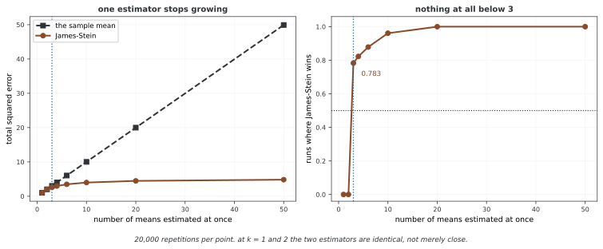

# 경험적 베이즈

경험적 베이즈는 관측 데이터에서 사전분포의 하이퍼파라미터를 추정한 뒤 그 값을 사후 계산에 대입한다. 그룹·선수처럼 관련된 모수를 함께 추정할 때 수축을 구현하는 방법이다. 하이퍼파라미터도 분포로 추론하는 완전한 베이즈 방법과는 불확실성 처리 범위가 다르다.

## 1. 코드

```python
"""
베이즈 추론 — 모듈 8: 경험 베이즈
수준: 나아간 단계
주제: 경험 베이즈 방법, 자료에서 웃파라메터 어림하기

경험 베이즈는 웃파라메터를 자료 그 자체에서 어림하여, 온전한 베이즈와
빈도주의 사이의 실전적인 가운뎃길을 준다.

지은이: 연세대학교 이성철 교수
전자우편: sungchulyonsei@gmail.com
"""

import numpy as np
import matplotlib.pyplot as plt
from scipy import stats
import seaborn as sns

# ========================================================================
# 메인
# ========================================================================

sns.set_style("whitegrid")
plt.rcParams["figure.figsize"] = (12, 8)

"""
경험 베이즈 방법론:

표준 베이즈: 앞확률 파라메터를 자료를 보기 전에 붙박아 둔다
경험 베이즈: 앞확률 파라메터를 자료에서 어림한다

절차:
1. 자료의 주변 분포에서 웃파라메터를 어림한다
2. 이 어림값을 낱낱의 추론을 위한 "앞확률"로 쓴다
3. 표준 베이즈 추론을 이어 간다

이름난 보기: 제임스-스타인 어림자
파라메터가 3개 이상이면 오그라들기 어림자가 MLE를 누름을 보인다
"""

def baseball_empirical_bayes_demo():
    """
    경험 베이즈의 고전적인 야구 타율 보기.
    """
    print("="*70)
    print("EMPIRICAL BAYES: Baseball Batting Averages")
    print("="*70)
    
    # 자료 흉내내기: 시즌 초 타율
    np.random.seed(42)
    n_players = 20
    true_abilities = np.random.beta(80, 220, n_players)  # 참된 타율
    at_bats = np.random.randint(20, 100, n_players)
    hits = np.array([np.random.binomial(ab, ta) for ab, ta in zip(at_bats, true_abilities)])
    
    observed_avg = hits / at_bats
    
    print(f"\nNumber of players: {n_players}")
    print(f"At-bats range: {at_bats.min()}-{at_bats.max()}")
    
    # 경험 베이즈: 관측된 타율에서 베타 앞확률 어림하기
    # 적률법
    mean_obs = np.mean(observed_avg)
    var_obs = np.var(observed_avg)
    
    # 베타 분포: 평균 = α/(α+β), 흩어짐 = αβ/[(α+β)²(α+β+1)]
    # α, β 풀기
    alpha_eb = mean_obs * (mean_obs * (1 - mean_obs) / var_obs - 1)
    beta_eb = (1 - mean_obs) * (mean_obs * (1 - mean_obs) / var_obs - 1)
    
    print(f"\nEmpirical Bayes prior: Beta({alpha_eb:.2f}, {beta_eb:.2f})")
    print(f"  Prior mean: {alpha_eb/(alpha_eb+beta_eb):.4f}")
    
    # 오그라들기 쓰기
    eb_estimates = (hits + alpha_eb) / (at_bats + alpha_eb + beta_eb)
    
    # MLE와 견주기
    mse_mle = np.mean((observed_avg - true_abilities)**2)
    mse_eb = np.mean((eb_estimates - true_abilities)**2)
    
    print(f"\nMean Squared Error:")
    print(f"  MLE:            {mse_mle:.6f}")
    print(f"  Empirical Bayes: {mse_eb:.6f}")
    print(f"  Improvement:     {(1 - mse_eb/mse_mle)*100:.1f}%")
    
    # 시각화
    plt.figure(figsize=(14, 6))
    
    plt.subplot(1, 2, 1)
    plt.scatter(observed_avg, true_abilities, s=at_bats, alpha=0.6, label='MLE')
    plt.scatter(eb_estimates, true_abilities, s=at_bats, alpha=0.6, label='Empirical Bayes')
    plt.plot([0, 0.5], [0, 0.5], 'k--', alpha=0.5)
    plt.xlabel('Estimate', fontsize=12)
    plt.ylabel('True Ability', fontsize=12)
    plt.title('Estimates vs True Ability', fontsize=13, fontweight='bold')
    plt.legend()
    plt.grid(True, alpha=0.3)
    
    plt.subplot(1, 2, 2)
    for i in range(n_players):
        plt.plot([observed_avg[i], eb_estimates[i]], [i, i], 'r-', linewidth=1.5, alpha=0.7)
        plt.plot(observed_avg[i], i, 'bo', markersize=6)
        plt.plot(eb_estimates[i], i, 'ro', markersize=6)
    plt.axvline(mean_obs, color='green', linestyle=':', linewidth=2, label='Grand mean')
    plt.xlabel('Batting Average', fontsize=12)
    plt.ylabel('Player', fontsize=12)
    plt.title('Shrinkage Toward Prior Mean', fontsize=13, fontweight='bold')
    plt.legend()
    plt.grid(True, alpha=0.3, axis='x')
    
    plt.tight_layout()
    plt.savefig('empirical_bayes_baseball.png', dpi=300, bbox_inches='tight')
    plt.show()

if __name__ == "__main__":
    print("\n" + "="*70)
    print("BAYESIAN INFERENCE - MODULE 8: EMPIRICAL BAYES")
    print("="*70)
    
    baseball_empirical_bayes_demo()
    
    print("\n" + "="*70)
    print("MODULE 8 COMPLETE")
    print("="*70)
    print("\nKey takeaways:")
    print("1. Empirical Bayes estimates prior from data")
    print("2. Provides automatic shrinkage without full Bayesian machinery")
    print("3. Often outperforms MLE, especially with many parameters")
    print("4. Related to James-Stein estimator")
    print("\nNext: Module 9 - Bayesian Linear Regression")
    print("="*70)
```

**출력:**

```

======================================================================
BAYESIAN INFERENCE - MODULE 8: EMPIRICAL BAYES
======================================================================
======================================================================
EMPIRICAL BAYES: Baseball Batting Averages
======================================================================

Number of players: 20
At-bats range: 20-98

Empirical Bayes prior: Beta(15.99, 43.52)
  Prior mean: 0.2687

Mean Squared Error:
  MLE:            0.002670
  Empirical Bayes: 0.000634
  Improvement:     76.2%

======================================================================
MODULE 8 COMPLETE
======================================================================

Key takeaways:
1. Empirical Bayes estimates prior from data
2. Provides automatic shrinkage without full Bayesian machinery
3. Often outperforms MLE, especially with many parameters
4. Related to James-Stein estimator

Next: Module 9 - Bayesian Linear Regression
======================================================================
```

## 2. 논의

주변우도를 최대화하거나 적률을 맞춰 하이퍼파라미터를 추정할 수 있다. 야구 예제는 성공률 관측값의 평균·분산에 베타분포를 직접 맞춘다. 그러나 관측 타율의 분산에는 선수 능력 차이뿐 아니라 서로 다른 타석 수에 따른 이항 잡음도 포함된다. 이 방식은 베타·이항 주변우도를 최대화하는 정확한 경험적 베이즈 추정과 다르다.

베타 모양 파라메터가 양수가 되려면 관측 분산이 0보다 크고 m(1−m)보다 작아야 한다. 경계·동일 관측과 작은 표본에서는 이 조건을 점검해야 한다. 추정한 사전분포를 고정하면 하이퍼파라미터의 불확실성이 생략된다.

<div class="storybox" markdown>

**그림으로 보는 AI 1.** 셋부터 갑자기 생기는 경계

이 쪽이 쓰는 제임스-스타인 수축은 편리한 요령으로 나온 것이 아니다. **정리로 나왔고, 나왔을 때 사람들을 당황하게 했다.**

찰스 스타인(Charles Stein)이 1956년에 보인 것은 이렇다. 독립인 정규평균 $k$ 개를 한꺼번에 추정하면서 총 제곱오차로 평가할 때, $k \ge 3$ 이면 **표본값(최대우도 추정)이 비허용적(inadmissible)** 이다. 어떤 참값에서도 그보다 못하지 않고 어떤 참값에서는 더 나은 추정량이 있다는 뜻이다. 1961년에 윌러드 제임스(Willard James)와 함께 쓴 「Estimation with quadratic loss」가 그런 추정량을 구체적으로 적어 주었다.

당황스러운 대목은 $k \ge 3$ 이라는 조건이다. 서로 아무 상관 없는 양들이어도 — 밀값과 혈압과 타율을 한꺼번에 추정해도 — 셋 이상이면 서로 끌어당겨 수축시키는 쪽이 낫다. 재어 보면 경계가 정말 칼같다.



$k=1$ 과 $k=2$ 에서 두 추정량은 비슷한 것이 아니라 **완전히 같다** — 수축 인자 $(k-2)$ 가 0 이하라 수축이 아예 일어나지 않는다. $k=3$ 에서 비로소 갈라져 제임스-스타인이 78.3% 의 판에서 이기고, $k=50$ 이면 총 제곱오차가 49.91 대 4.82 가 된다. 평균을 많이 추정할수록 표본값의 오차는 비례해 늘지만 수축 추정량의 오차는 거의 늘지 않는다.

이 결과가 경험적 베이즈와 이어지는 자리가 이 쪽이다. 수축의 **양**을 자료에서 뽑아 쓴다는 것은 사전분포를 자료로 정한다는 말이고, 허버트 로빈스(Herbert Robbins)가 1956년 제3회 버클리 심포지엄에서 **경험적 베이즈**라는 이름을 붙인 것이 그 생각이다. 스타인의 정리와 같은 해, 같은 학회다.

**다만 바로 아래 문단이 적어 둔 단서가 이 그림에서도 그대로다.** 왼쪽 그림이 재는 것은 **총** 제곱오차이고 그것도 **기대값**이다. 한 선수의 타율을 그 선수에게만 관심 있는 사람에게 돌려줄 때는 이 보증이 서지 않는다 — 전체가 좋아지는 동안 개별 추정은 나빠질 수 있다. 오른쪽 그림에서 $k=3$ 일 때 이기는 비율이 1.000 이 아니라 0.783 이라는 것이 같은 이야기다. **다섯 판에 한 번은 수축이 손해였다.**

_확인한 곳 — C. Stein, "Inadmissibility of the usual estimator for the mean of a multivariate normal distribution" (1956) 이 $k \ge 3$ 에서의 비허용성을 보였고, W. James, C. Stein, "Estimation with quadratic loss" (1961) 가 추정량을 주었다. "경험적 베이즈" 라는 이름은 H. Robbins, "An empirical Bayes approach to statistics", *Proceedings of the Third Berkeley Symposium* 제1권 157쪽 (1956) 의 것이다. 그림의 수는 그림을 그리는 코드가 직접 시늉해 얻으며, $k=1,2$ 에서 두 추정량이 **완전히** 같은지를 스스로 확인한 뒤에만 그린다._

</div>

James–Stein의 결과는 알려진 공통 분산을 가진 독립 정규평균의 벡터를 총 제곱오차로 평가하는 등 특정 조건에서 성립한다. 임의의 분포·모델에서 파라메터가 셋 이상이면 모든 수축 추정이 MLE보다 좋다는 뜻은 아니다. 기대 위험 개선과 매 데이터의 실현 오차 개선도 구분한다.

## 연습문제

<div class="drillbox" markdown>

**연습문제 1.** <span class="diff hard" title="어려움"></span>
정규 관측 모형의 아래 경험적 베이즈 조각이 추정하는 양과 하한 0.01의 의미를 설명하라.

</div>

??? success "풀이"

    관측 y의 분산에서 알려진 잡음 분산 1을 빼 그룹 간 분산을 추정하고, 평균을 수축 중심으로 대입한다. 0.01은 음수·0 분산을 피하기 위한 임의 하한이며 정확한 주변최대우도 해가 아니다. 하이퍼파라미터 추정 오차는 별도로 반영하지 않는다.

    ```python
import numpy as np

np.random.seed(42)
true_mu, true_tau = 3.0, 2.0
thetas = np.random.normal(true_mu, true_tau, 10)
y = np.array([np.random.normal(t, 1.0) for t in thetas])

# 적률법 어림값
mu_hat = np.mean(y)
tau2_hat = max(np.var(y) - 1.0, 0.01)

# 오그라들기
w = tau2_hat / (tau2_hat + 1.0)
eb_est = w * y + (1 - w) * mu_hat

print(f'MSE (MLE): {np.mean((y - thetas)**2):.4f}')
print(f'MSE (EB):  {np.mean((eb_est - thetas)**2):.4f}')
```


---

<div class="drillbox" markdown>

**연습문제 2.** <span class="diff med" title="중간"></span>
고정 중심으로의 James–Stein 추정과 표본평균 중심의 수축을 구분하라.

</div>

??? success "풀이"

    $Y\sim N_p(\theta,I)$에서 고정 중심 a로 수축하는 고전적 형태는 $a+[1-(p-2)/\|Y-a\|^2](Y-a)$다. p≥3의 총 제곱오차 기대 위험에 관한 결과이며 모든 좌표·실현 표본의 개선은 아니다. 표본평균을 중심으로 추정하면 잔차 차원이 p−1이므로 고정 중심의 p−2 계수를 그대로 적용할 수 없다. 흔한 평균 중심 형태는 p−3을 사용하고 p≥4 조건을 고려한다.


---

<div class="drillbox" markdown>

**연습문제 3.** <span class="diff hard" title="어려움"></span>
아래 비교 조각이 베타·로짓정규·비모수 밀도 추정을 완전하게 비교하는지 설명하라.

</div>

??? success "풀이"

    베타 적률 플러그인, 로짓 값의 휴리스틱 수축, 0.7·0.3의 고정 평균 수축을 비교한다. 커널 밀도 추정은 구현되어 있지 않고 로짓 관측 잡음도 정확한 이항 모형과 다르다. 시뮬레이션의 참 능력이 베타에서 나왔어도 유한 자료에서 특정 추정이 항상 MSE가 최소인 것은 아니다.

    ```python
import numpy as np
from scipy import stats
from scipy.optimize import minimize

np.random.seed(42)
n_players = 20
true_ab = np.random.beta(80, 220, n_players)
at_bats = np.random.randint(20, 100, n_players)
hits = np.array([np.random.binomial(ab, ta) for ab, ta in zip(at_bats, true_ab)])
obs_avg = hits / at_bats

# 1. 베타 앞확률(적률법)
m, v = np.mean(obs_avg), np.var(obs_avg)
a_b = m * (m*(1-m)/v - 1)
b_b = (1-m) * (m*(1-m)/v - 1)
eb_beta = (hits + a_b) / (at_bats + a_b + b_b)

# 2. 단순 오그라들기(로짓 눈금에서 정규)
logit_avg = np.log(obs_avg/(1-obs_avg+1e-10)+1e-10)
mu_l = np.mean(logit_avg)
sig_l = np.std(logit_avg)
w = sig_l**2 / (sig_l**2 + 1.0/at_bats)
eb_logit = 1/(1+np.exp(-(w*logit_avg + (1-w)*mu_l)))

# 3. 큰 평균 오그라들기
grand = np.mean(obs_avg)
eb_simple = 0.7*obs_avg + 0.3*grand

for name, est in [('Beta', eb_beta), ('Logit', eb_logit), ('Simple', eb_simple), ('Raw', obs_avg)]:
    print(f'{name:8s} MSE: {np.mean((est-true_ab)**2):.6f}')
```


## 정리하며

경험적 베이즈는 하이퍼파라미터 추정값을 대입해 그룹 정보를 공유한다. 관측 잡음과 그룹 차이를 분리하고 모양·분산의 유효 범위를 확인한다. James–Stein의 특정 위험 결과를 모든 모형의 수축 우월성으로 확대하지 않는다.
