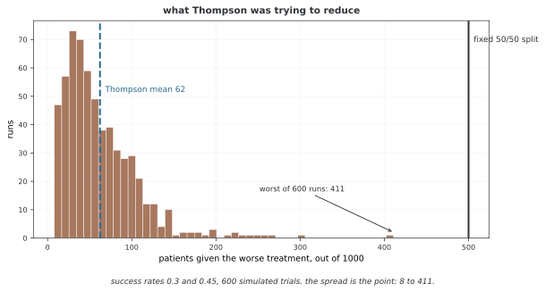

# 베이즈 A/B 테스트와 톰프슨 샘플링

베이즈 A/B 테스트는 각 실험군의 전환율 사후분포로 차이와 상대 향상을 추정한다. 사후확률로 결정을 설계할 수 있지만 반복 관찰이나 조기 종료가 빈도주의 오탐률을 자동으로 제어하는 것은 아니다. 마지막 연습에서는 적응적으로 실험군을 선택하는 톰프슨 샘플링을 살펴본다.

## 1. 코드

```python
"""
베이즈 추론 — 모듈 10: 나아간 쓰임새
수준: 나아간 단계
주제: A/B 시험, 베이즈 최적화, 바뀜점 찾기, 실전 쓰임새

이 모듈은 실제 상황에서 베이즈 추론이 쓰이는 실전 쓰임새를 다룬다.

지은이: 연세대학교 이성철 교수
전자우편: sungchulyonsei@gmail.com
"""

import numpy as np
import matplotlib.pyplot as plt
from scipy import stats
import seaborn as sns

# ========================================================================
# 메인
# ========================================================================

sns.set_style("whitegrid")
plt.rcParams["figure.figsize"] = (12, 8)

"""
베이즈 A/B 시험:

전통적인 A/B 시험은 p값과 붙박이 표본 크기를 쓴다.
베이즈 A/B 시험은 다음을 준다:
- 어느 판이 더 나은지에 대한 확률 진술
- 증거가 셀 때 일찍 멈출 수 있는 힘
- 결과를 곧바로 풀이하기
"""

def bayesian_ab_test(conversions_a, trials_a, conversions_b, trials_b):
    """
    전환율에 대한 베이즈 A/B 시험.
    """
    print("="*70)
    print("BAYESIAN A/B TESTING")
    print("="*70)
    
    print(f"\nVariant A: {conversions_a}/{trials_a} = {conversions_a/trials_a:.3f}")
    print(f"Variant B: {conversions_b}/{trials_b} = {conversions_b/trials_b:.3f}")
    
    # 베타 뒤확률(고른 앞확률)
    post_a = stats.beta(1 + conversions_a, 1 + trials_a - conversions_a)
    post_b = stats.beta(1 + conversions_b, 1 + trials_b - conversions_b)
    
    # P(B > A)을 셈하는 몬테카를로
    n_samples = 100000
    samples_a = post_a.rvs(n_samples)
    samples_b = post_b.rvs(n_samples)
    prob_b_better = np.mean(samples_b > samples_a)
    
    print(f"\nP(B > A) = {prob_b_better:.4f}")
    print(f"P(A > B) = {1-prob_b_better:.4f}")
    
    # 기대 들어올림
    lift = samples_b / samples_a - 1
    print(f"\nExpected lift (B vs A):")
    print(f"  Mean: {np.mean(lift)*100:.2f}%")
    print(f"  95% Credible Interval: [{np.percentile(lift, 2.5)*100:.2f}%, {np.percentile(lift, 97.5)*100:.2f}%]")
    
    # 시각화
    fig, axes = plt.subplots(1, 2, figsize=(14, 6))
    
    # 그림 1: 뒤확률 분포
    p = np.linspace(0, 1, 1000)
    axes[0].plot(p, post_a.pdf(p), 'b-', linewidth=2, label=f'A ({conversions_a}/{trials_a})')
    axes[0].plot(p, post_b.pdf(p), 'r-', linewidth=2, label=f'B ({conversions_b}/{trials_b})')
    axes[0].axvline(post_a.mean(), color='blue', linestyle='--', alpha=0.7)
    axes[0].axvline(post_b.mean(), color='red', linestyle='--', alpha=0.7)
    axes[0].set_xlabel('Conversion Rate', fontsize=12)
    axes[0].set_ylabel('Density', fontsize=12)
    axes[0].set_title('Posterior Distributions', fontsize=13, fontweight='bold')
    axes[0].legend()
    axes[0].grid(True, alpha=0.3)
    
    # 그림 2: 들어올림 분포
    axes[1].hist(lift * 100, bins=50, alpha=0.7, color='green', edgecolor='black', density=True)
    axes[1].axvline(0, color='red', linestyle='--', linewidth=2, label='No difference')
    axes[1].axvline(np.mean(lift)*100, color='black', linestyle='-', linewidth=2, label=f'Mean lift={np.mean(lift)*100:.1f}%')
    axes[1].set_xlabel('Lift (% improvement)', fontsize=12)
    axes[1].set_ylabel('Density', fontsize=12)
    axes[1].set_title('Distribution of Lift (B vs A)', fontsize=13, fontweight='bold')
    axes[1].legend()
    axes[1].grid(True, alpha=0.3, axis='y')
    
    plt.tight_layout()
    plt.savefig('bayesian_ab_test.png', dpi=300, bbox_inches='tight')
    plt.show()
    
    return prob_b_better

if __name__ == "__main__":
    print("\n" + "="*70)
    print("BAYESIAN INFERENCE - MODULE 10: ADVANCED APPLICATIONS")
    print("="*70)
    
    # 보기: A/B 시험
    prob_b_better = bayesian_ab_test(
        conversions_a=120, trials_a=1000,
        conversions_b=145, trials_b=1000
    )
    
    print("\n" + "="*70)
    print("MODULE 10 COMPLETE")
    print("="*70)
    print("\nKey takeaways:")
    print("1. Bayesian A/B testing provides probability statements")
    print("2. Can make early stopping decisions based on evidence")
    print("3. Direct interpretation: P(B better than A)")
    print("4. Naturally handles sequential testing")
    print("\nCongratulations! You've completed the Bayesian Inference curriculum.")
    print("="*70)
```

**출력:**

```
======================================================================
BAYESIAN INFERENCE - MODULE 10: ADVANCED APPLICATIONS
======================================================================
======================================================================
BAYESIAN A/B TESTING
======================================================================

Variant A: 120/1000 = 0.120
Variant B: 145/1000 = 0.145

P(B > A) = 0.9508
P(A > B) = 0.0492

Expected lift (B vs A):
  Mean: 21.54%
  95% Credible Interval: [-3.51%, 51.41%]

======================================================================
MODULE 10 COMPLETE
======================================================================

Key takeaways:
1. Bayesian A/B testing provides probability statements
2. Can make early stopping decisions based on evidence
3. Direct interpretation: P(B better than A)
4. Naturally handles sequential testing

Congratulations! You've completed the Bayesian Inference curriculum.
======================================================================
```

## 2. 논의

실험군별 전환을 독립 베르누이 표본으로 두고 Beta(1,1) 사전을 사용하면, 성공 s개·실패 n−s개의 사후분포는 Beta(1+s,1+n−s)다. 두 사후분포에서 독립적으로 표본을 뽑아 $P(\theta_B>\theta_A\mid D)$를 몬테카를로로 추정한다. 표본 오차와 모형·사전 선택의 영향을 구분한다.

코드의 lift는 $\theta_B/\theta_A-1$인 상대 향상이다. 절대 전환율 차이와 단위가 다르며 $\theta_A$가 0 근처이면 큰 꼬리를 가질 수 있다. 독립 베타 사후에서 A의 첫 모양 파라메터가 1 이하이면 역수 기대값이 발산하므로 기대 상대 향상도 유한하지 않을 수 있다. 유한 몬테카를로 평균이 항상 유효한 기대값을 뜻하지 않는다. 시도 수는 양수이고 성공 수는 0~시도 수여야 한다.

<div class="storybox" markdown>

**그림으로 보는 AI 1.** 톰프슨 샘플링은 광고가 아니라 환자를 두고 나온 생각이다

이 쪽이 A/B 비교에 쓰는 톰프슨 샘플링은 웹 실험을 위해 만들어진 것이 아니다. 1933년에 윌리엄 톰프슨(William R. Thompson)이 예일에 있을 때 《Biometrika》에 실은 「On the likelihood that one unknown probability exceeds another in view of the evidence of two samples」가 출처이고, 그가 생각하던 것은 **임상시험**이었다. 두 치료법 가운데 어느 쪽이 나은지 알아내는 동안, 더 나쁜 치료를 받게 되는 환자 수를 줄이자는 것이다.

그 동기를 그대로 재어 보면 이렇다. 성공률 0.30과 0.45인 두 치료를 환자 1,000명에게 배정하는 시험을 600번 시늉해 보았다.



고정 반반 배정이라면 **500명**이 나쁜 치료를 받는다. 톰프슨 샘플링에서는 평균 **62명**이다. 437명이 덜 받는 셈이고, 1933년의 글이 하려던 말이 정확히 이것이다.

**그런데 꼬리를 보아야 한다.** 600번 가운데 가장 나쁜 판에서는 **411명**이 나쁜 치료를 받았다. 초반에 운 나쁘게 좋은 쪽이 연달아 실패하면 알고리즘이 그쪽을 한동안 접어 두기 때문이다. 평균이 62라는 말과 이번 시험에서 62명 언저리가 나온다는 말은 다르다. 바로 아래 문단이 "사후 우월확률 0.95에서 멈춘다는 규칙이 귀무가설 아래 오탐률 5%를 자동으로 보장하지는 않는다"고 적어 둔 것과 같은 결이다 — **적응적으로 배정하는 순간 운영 특성은 따로 재야 한다.**

덧붙여, 이 생각은 나오자마자 쓰인 것이 아니다. 톰프슨의 1933년 알고리즘은 수십 년 동안 거의 잊혀 있다가 21세기에 들어 다시 발견되었다. 지금 이 쪽이 그것을 A/B 비교의 기본 도구처럼 쓰는 것은 **아흔 해 걸린 재발견**의 끝자락이다.

_확인한 곳 — W. R. Thompson, "On the likelihood that one unknown probability exceeds another in view of the evidence of two samples", *Biometrika* **25**(3–4), 285–294 (1933). 임상시험의 맥락과 열등한 치료에 노출되는 환자를 줄이려는 동기, 그리고 오랫동안 주목받지 못하다 뒤늦게 다시 쓰이게 된 경위는 2차 문헌에서 확인했다. 그림의 수는 그림을 그리는 코드가 직접 시늉해 얻으며, 평균이 반반 배정보다 훨씬 적으면서도 최악의 판은 여전히 나쁘다는 것을 스스로 확인한 뒤에만 그린다._

</div>

적절한 모형·고정된 사전 아래에서 관측 데이터만으로 결정되는 무시 가능한 중단 규칙은 베이즈 갱신에서 별도 우도 항을 필요로 하지 않을 수 있다. 그러나 사후 우월확률 0.95에서 멈춘다는 규칙이 귀무가설 아래 오탐률 5%를 자동으로 보장하지는 않는다. 필요한 결정을 로스·최소 효과·비용과 연결하고, 순차 규칙의 운영 특성은 별도로 평가해야 한다.

## 연습문제

<div class="drillbox" markdown>

**연습문제 1.** <span class="diff med" title="중간"></span>
A가 85/500, B가 110/500일 때 사후분포와 아래 코드의 상대 향상 정의를 설명하라.

</div>

??? success "풀이"

    독립 Beta(1,1) 사전이면 A는 Beta(86,416), B는 Beta(111,391)이다. 표본 비교 비율로 P(B>A|D)를 추정하고 B/A−1의 분위수로 상대 향상 신용구간을 만든다. E[B/A−1]은 일반적으로 E[B]/E[A]−1과 다르다. 코드는 난수 근사이며 정확값이나 고정 수치를 미리 보장하지 않는다.

    ```python
import numpy as np
from scipy import stats

np.random.seed(42)
samples_a = stats.beta(1+85, 1+415).rvs(100000)
samples_b = stats.beta(1+110, 1+390).rvs(100000)

prob_b_better = np.mean(samples_b > samples_a)
lift = samples_b / samples_a - 1

print(f'P(B > A) = {prob_b_better:.4f}')
print(f'Expected lift: {np.mean(lift)*100:.2f}%')
print(f'95% CI: [{np.percentile(lift,2.5)*100:.2f}%, {np.percentile(lift,97.5)*100:.2f}%]')
```


---

<div class="drillbox" markdown>

**연습문제 2.** <span class="diff med" title="중간"></span>
베이즈 사후확률을 반복 관찰하면 빈도주의 오탐률도 자동으로 제어되는가?

</div>

??? success "풀이"

    사후확률의 데이터 조건부 해석과 귀무가설 아래 반복 실험의 오탐률은 다른 성질이다. 중단 규칙이 무시 가능한 조건에서 같은 우도로 갱신할 수 있어도 임의의 확률 임계값이 목표 오탐률을 보장하지는 않는다. 고정 시점 p값을 반복 사용하는 문제와 적절한 순차 검정·신뢰 시퀀스도 구분해야 한다.


---

<div class="drillbox" markdown>

**연습문제 3.** <span class="diff hard" title="어려움"></span>
아래 톰프슨 샘플링의 두 배열이 세는 값과 선택 규칙을 설명하라.

</div>

??? success "풀이"

    successes와 failures는 Beta(1,1)에서 시작한 사후 모양 파라메터다. 매 시점 실험군별 전환율을 사후에서 하나씩 뽑고 가장 큰 군을 선택한 뒤 그 군의 성공·실패만 갱신한다. 고정되고 독립적인 리워드 모형을 가정하며 유한 실행에서 항상 최적 군을 알아내거나 고정 비율을 선택한다는 보장은 없다.

    ```python
import numpy as np

np.random.seed(42)
true_rates = [0.10, 0.12, 0.15]
n_arms = 3
successes = np.ones(n_arms)
failures = np.ones(n_arms)
n_rounds = 5000

choices = []
for _ in range(n_rounds):
    samples = [np.random.beta(successes[k], failures[k]) for k in range(n_arms)]
    chosen = np.argmax(samples)
    choices.append(chosen)
    
    reward = np.random.binomial(1, true_rates[chosen])
    successes[chosen] += reward
    failures[chosen] += (1 - reward)

for k in range(n_arms):
    times_chosen = choices.count(k)
    print(f'Arm {k} (rate={true_rates[k]}): chosen {times_chosen} times '
          f'({times_chosen/n_rounds*100:.1f}%)')
print(f'Best arm chosen: {choices.count(2)/n_rounds*100:.1f}% of the time')
```


## 정리하며

A/B 테스트의 사후 우월확률·절대 차이·상대 향상은 다른 요약이다. 상대 향상의 꼬리와 모멘트 존재를 확인하고, 조기 종료의 사후 해석과 반복 실험 오탐률을 구분한다. 적응적 선택은 명시한 리워드·데이터 수집 모형 아래에서 평가한다.

**참고**: [Hendriksen 등, Optional Stopping with Bayes Factors](https://arxiv.org/abs/1807.09077).
