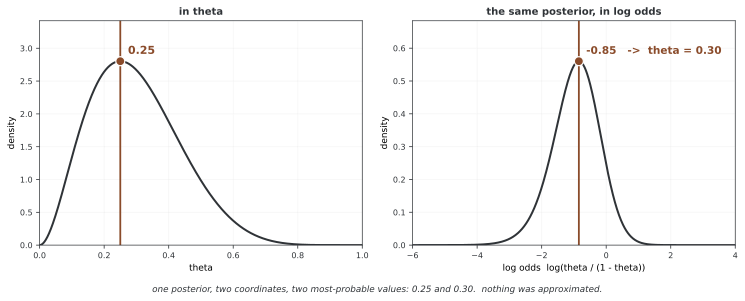

# 최대사후확률 추정 MAP

최대사후확률 추정(MAP)은 사후분포의 밀도 또는 확률질량이 최대인 점을 찾는다. 우도만 최대화하는 MLE 및 사후평균과 비교하고, 수치 최적화와 정규화의 관계를 살펴본다. 연속 파라메터의 MAP는 좌표계에 의존하며 점 추정만으로 불확실성이 표현되지는 않는다.

## 1. 베이즈 추론의 점 추정값 셋

**정의 1.** [세 가지 점 추정값]

MLE는 우도, MAP는 사후분포, 사후평균은 사후 기대값을 기준으로 한다. 아래에서 MLE까지 하나의 사후분포에서 도출되는 양으로 혼동하지 않는다. 최댓값이나 평균이 존재하고 유일한지도 모형별로 확인한다.

$$
\hat{\theta}_{\text{MLE}} = \underset{\theta}{\arg\max} \; p(D \mid \theta), \qquad
\hat{\theta}_{\text{MAP}} = \underset{\theta}{\arg\max} \; p(\theta \mid D), \qquad
\hat{\theta}_{\text{Mean}} = \mathbb{E}[\theta \mid D]
$$

첫째는 사전확률을 아랑곳하지 않고 우도만 보고, 둘째는 사후확률의 **최빈값**을, 셋째는 사후확률의 **평균**을 본다.

<div class="thmbox" markdown>

### 정리 1. 세 가지 점 추정값 — 로스 함수가 추정량을 고른다 { .thm }

사전분포와 우도가 정해졌을 때 다음 관계를 구분한다.

1. 허용 영역 전체에서 사전밀도가 일정하면 그 영역에서 MAP와 MLE의 최대점 집합이 같다.
2. 이산 파라메터의 0-1 로스에서는 사후질량이 가장 큰 값이 베이즈 결정이다. 연속분포에서는 정확히 맞히는 0-1 로스가 모든 점에 같은 기대 로스를 주므로 이 설명을 그대로 쓸 수 없다.
3. 사후 2차 모멘트가 유한한 제곱 오차 로스에서는 사후평균이 기대 로스를 최소화한다.

</div>

??? proof "증명"

    (1) 균등 사전분포에서는 $\log p(\theta)$ 가 상수이므로

    $$
    \underset{\theta}{\arg\max}\,[\log p(D \mid \theta) + \log p(\theta)]
    = \underset{\theta}{\arg\max}\,\log p(D \mid \theta)
    $$

    이다.

    (3) 기대 로스 $\mathbb{E}[(\theta - a)^2 \mid D]$ 를 $a$ 에 대해 미분하여 $0$ 으로 두면

    $$
    -2\,\mathbb{E}[\theta - a \mid D] = 0 \;\Longrightarrow\; a = \mathbb{E}[\theta \mid D]
    $$

    를 얻는다.

    (2) 연속분포에서는 폭이 작은 이웃을 맞히는 로스를 고려할 수 있다. 충분한 매끄러움과 고립된 최빈점 등 조건에서 이웃 확률을 최대화하는 점의 극한을 MAP와 연결한다. 이는 연속 모수의 정확한 0-1 로스와 다른 로스다.

!!! note "쓰임새"
    추정량 선택은 결정 문제의 로스와 계산 예산에 달려 있다. 파라메터 MAP를 모델에 대입한 예측은 사후예측의 최적 결정과 일반적으로 다르다. 분류라면 클래스의 사후예측 확률을 비교하는 문제인지도 구분한다.

| 추정량 | 기준 | 주의할 점 |
|---|---|---|
| MLE | 우도 최대화 | 최댓값이 존재하지 않을 수 있음 |
| MAP | 사후밀도·질량 최대화 | 연속 밀도의 모드는 좌표계에 의존 |
| 사후평균 | 사후 기대값 | 평균·해당 기대 로스가 유한해야 함 |

## 2. 베타-이항 모델의 닫힌 형태

**정의 2.** [켤레 사전분포]

우도 $p(D \mid \theta)$ 에 대해 사전확률 $p(\theta)$ 와 사후확률 $p(\theta \mid D)$ 가 같은 분포족에 들면 그 사전확률을 **켤레 사전분포**라 한다. 이항 우도의 켤레 사전분포는 베타 분포이다.

<div class="thmbox" markdown>

### 정리 2. 베타-이항의 닫힌 형태 — 사전확률은 유사 관측으로 더해진다 { .thm }

사전확률이 $\text{Beta}(\alpha, \beta)$ 이고 데이터가 앞면 $k$ 번, 뒷면 $n-k$ 번이면 사후확률은 $\text{Beta}(\alpha + k,\; \beta + n - k)$ 이고, $\alpha + k > 1$ 이며 $\beta + n - k > 1$ 일 때 다음이 성립한다.

$$
\hat{\theta}_{\text{MAP}} = \frac{\alpha + k - 1}{\alpha + \beta + n - 2}, \qquad
\hat{\theta}_{\text{MLE}} = \frac{k}{n}, \qquad
\hat{\theta}_{\text{Mean}} = \frac{\alpha + k}{\alpha + \beta + n}
$$

</div>

??? proof "증명"

    사후확률의 꼴은

    $$
    p(\theta \mid D) \propto \theta^{k}(1-\theta)^{n-k} \cdot \theta^{\alpha-1}(1-\theta)^{\beta-1}
    = \theta^{\alpha+k-1}(1-\theta)^{\beta+n-k-1}
    $$

    이므로 $\text{Beta}(\alpha+k,\ \beta+n-k)$ 이다. $\text{Beta}(a,b)$ 의 최빈값은 $a,b>1$ 일 때 $(a-1)/(a+b-2)$ 이고 평균은 $a/(a+b)$ 이다. 여기에 $a = \alpha+k$, $b = \beta+n-k$ 를 넣으면 된다.

!!! note "쓰임새"
    Beta(α,β)의 α와 β는 켤레 갱신에서 성공·실패 횟수에 더해진다. 사후평균은 α+β를 사전 표본 크기처럼 해석할 수 있지만, MAP 수식의 유효 횟수는 α−1, β−1이다. 실제 관측 α·β개를 언제나 미리 보았다는 뜻은 아니다.

**보기 1.** <span class="diff easy" title="쉬움"></span> 데이터가 앞면 $7$ 번, 뒷면 $3$ 번이고 사전확률이 $\text{Beta}(2, 2)$ 일 때 세 추정값을 구하시오.

??? success "풀이"

    정리 2에 $\alpha=\beta=2$, $k=7$, $n=10$ 을 넣으면 다음과 같다.

    | 추정량 | 식 | 값 |
    |-----------|---------|-------|
    | 최대 우도 | $7/10$ | $0.700$ |
    | 최대 사후확률 | $(2+7-1)/(2+2+10-2) = 8/12$ | $0.667$ |
    | 사후확률의 평균 | $(2+7)/(2+2+10) = 9/14$ | $0.643$ |

    사전확률 $\text{Beta}(2,2)$ 가 추정값을 $0.5$ 쪽으로 끌어당긴다. 사전확률이 더할 유사 관측이 $4$ 번뿐이라 데이터 $10$ 번에 비교하여 끌어당기는 힘은 약하다.

**문제 1.** <span class="diff med" title="중간"></span> 위 보기에서 사전확률만 $\text{Beta}(10, 10)$ 으로 바꾸면 세 추정값이 어떻게 달라지는지 구하고, 그 까닭을 설명하시오.

??? success "풀이"

    $\hat{\theta}_{\text{MLE}} = 0.700$ 은 그대로이고,

    $$
    \hat{\theta}_{\text{MAP}} = \frac{10+7-1}{10+10+10-2} = \frac{16}{28} \approx 0.571,\qquad
    \hat{\theta}_{\text{Mean}} = \frac{10+7}{10+10+10} = \frac{17}{30} \approx 0.567
    $$

    이다. 사전확률이 유사 관측 $20$ 번을 더하므로 데이터 $10$ 번을 눌러 이기고, 두 베이즈 추정값이 모두 $0.5$ 에 훨씬 가까워진다.

```python
import numpy as np
from scipy import stats

def map_vs_mle_beta_binomial(n_heads, n_tails, prior_alpha=1, prior_beta=1):
    """베타-이항에서 MAP, MLE, 뒤확률 평균을 견준다."""
    
    n_total = n_heads + n_tails
    
    # MLE
    mle = n_heads / n_total if n_total > 0 else 0.5
    
    # 뒤확률 파라메터
    post_alpha = prior_alpha + n_heads
    post_beta = prior_beta + n_tails
    
    # 뒤확률 평균
    posterior_mean = post_alpha / (post_alpha + post_beta)
    
    # MAP(베타 분포의 최빈값)
    if post_alpha > 1 and post_beta > 1:
        map_estimate = (post_alpha - 1) / (post_alpha + post_beta - 2)
    else:
        map_estimate = posterior_mean  # 최빈값이 없으면 평균을 쓴다
    
    return {
        'mle': mle,
        'map': map_estimate,
        'posterior_mean': posterior_mean
    }
```

## 3. 수치 최적화로 하는 최대 사후확률

앞 함수는 베타 사후 모양이 1 이하이면 MAP 대신 사후평균을 반환한다. 이는 올바른 경계 최빈값 처리와 다르다. 예를 들어 Beta(1,5)의 모드는 0이지만 반환 평균은 1/6이다. n=0에서 MLE를 0.5로 반환하는 것도 관측이 정한 고유한 최댓값이 아니라 편의 규칙이다.

켤레가 아닌 모형에서는 닫힌 형태의 MAP가 없을 수 있다. 정규화 상수를 몰라도 로그우도와 로그 사전밀도의 합을 최적화할 수 있지만 전역 최대점의 존재·유일성과 수치 알고리즘의 수렴은 별도 문제다.

<div class="thmbox" markdown>

### 정리 3. 최대 사후확률의 최적화 꼴 — 로그우도와 로그 사전밀도의 합 { .thm }

증거 $p(D)$ 는 $\theta$ 에 달리지 않으므로 다음이 성립한다.

$$
\hat{\theta}_{\text{MAP}}
= \underset{\theta}{\arg\max} \left[ \log p(D \mid \theta) + \log p(\theta) \right]
= \underset{\theta}{\arg\min} \left[ -\log p(D \mid \theta) - \log p(\theta) \right]
$$

</div>

??? proof "증명"

    베이즈 정리에서 $p(\theta \mid D) = p(D \mid \theta)\,p(\theta) / p(D)$ 이고 $\log$ 는 단조 증가하므로

    $$
    \underset{\theta}{\arg\max}\,\log p(\theta \mid D)
    = \underset{\theta}{\arg\max}\,[\log p(D \mid \theta) + \log p(\theta) - \log p(D)]
    $$

    이다. 마지막 항 $\log p(D)$ 는 $\theta$ 와 무관한 상수이므로 $\arg\max$ 에서 떨어져 나간다.

!!! note "쓰임새"
    MAP 최적화에는 증거의 값을 직접 계산할 필요가 없다. 사후분포에서 표본을 얻는 MCMC도 정규화되지 않은 밀도를 사용할 수 있으므로 사후분포를 다루려면 항상 증거를 직접 적분해야 한다는 뜻은 아니다.

**보기 2.** <span class="diff easy" title="쉬움"></span> 데이터가 $x_1,\dots,x_n \sim \mathcal{N}(\mu, \sigma^2)$ 이고 사전확률이 $\mu \sim \mathcal{N}(\mu_0, \sigma_0^2)$, $\tau = 1/\sigma^2 \sim \text{Gamma}(\alpha, \beta)$ 일 때 가장 작게 할 목적함수를 적으시오.

??? success "풀이"

    정리 3에 따라 음의 로그 사후확률을 적으면 다음과 같다.

    $$
    -\log p(\mu, \tau \mid D) = -\sum_{i=1}^n \log p(x_i \mid \mu, \tau) - \log p(\mu) - \log p(\tau) + \text{const}
    $$

    τ=exp(s)로 두면 양수 제약 없이 원래 (μ,τ) 밀도의 최대점을 탐색할 수 있다. 이때는 단순한 최적화 좌표 변경이므로 야코비안을 더하지 않는다. 반대로 (μ,s)의 사후밀도 자체의 MAP를 찾으려면 변수변환 야코비안 τ가 필요하며, 두 MAP는 일반적으로 다르다.

```python
from scipy import optimize

def map_normal_unknown_mean_variance(data, prior_mean_mu=0, prior_std_mu=10,
                                     prior_shape_tau=2, prior_rate_tau=1):
    """평균과 흩어짐을 모르는 정규에 대한 MAP 어림."""
    
    data = np.asarray(data)
    n = len(data)
    sample_mean = np.mean(data)
    sample_var = np.var(data, ddof=1)
    
    def neg_log_posterior(params):
        mu, log_tau = params
        tau = np.exp(log_tau)  # 제약 없는 최적화를 위해 파라메터 바꾸기
        
        # 로그 가능도
        log_lik = np.sum(stats.norm(mu, np.sqrt(1/tau)).logpdf(data))
        
        # 로그 앞확률
        log_prior_mu = stats.norm(prior_mean_mu, prior_std_mu).logpdf(mu)
        log_prior_tau = stats.gamma(prior_shape_tau, 
                                    scale=1/prior_rate_tau).logpdf(tau)
        
        return -(log_lik + log_prior_mu + log_prior_tau)
    
    # 최적화
    initial_guess = [sample_mean, np.log(1/sample_var)]
    result = optimize.minimize(neg_log_posterior, initial_guess, method='BFGS')
    
    map_mu = result.x[0]
    map_tau = np.exp(result.x[1])
    map_sigma = np.sqrt(1/map_tau)
    
    return {'map_mu': map_mu, 'map_sigma': map_sigma}
```

| 기법 | 목적과 한계 |
|---|---|
| 양의 변수의 로그 좌표 | 제약 처리를 단순화하되 MAP 기준 좌표를 명시 |
| 로그 사후밀도 | 확률 곱의 수치적 언더플로 완화 |
| 여러 초기점 | 서로 다른 국소해 탐색, 전역해 보장은 아님 |
| BFGS·L-BFGS | 매끄러운 목적함수 최적화, 성공 여부·경사 확인 |

위 함수는 표본 분산을 초기값에 사용하므로 충분한 표본과 양의 분산이 필요하다. 최적화 result.success를 확인하지 않고 반환하므로 결과를 자동으로 유효한 MAP라 보아서는 안 된다.

## 4. 최대사후확률 추정과 정규화

정리 3의 최적화 꼴을 다시 보면 $-\log p(\theta)$ 가 벌 항의 자리에 그대로 앉아 있다. 이것이 정규화와 베이즈를 잇는 다리다.

<div class="thmbox" markdown>

### 정리 4. 가우시안·라플라스 사전분포와 정규화 { .thm }

선형 회귀에서 계수마다 서로 독립인 사전확률을 두면 다음이 성립한다.

1. $\theta_j \sim \mathcal{N}(0, \sigma_\theta^2)$ 이면 최대 사후확률은 릿지(L2) 회귀와 같다.

$$
\hat{\beta}_{\text{Ridge}} = \underset{\beta}{\arg\min} \left[ \|y - X\beta\|_2^2 + \lambda \|\beta\|_2^2 \right]
$$

2. $\theta_j \sim \text{Laplace}(0, b)$ 이면 최대 사후확률은 라소(L1) 회귀와 같다.

$$
\hat{\beta}_{\text{Lasso}} = \underset{\beta}{\arg\min} \left[ \|y - X\beta\|_2^2 + \lambda \|\beta\|_1 \right]
$$

</div>

??? proof "증명"

    우도가 $y \mid X, \beta \sim \mathcal{N}(X\beta, \sigma^2 I)$ 이면

    $$
    -\log p(D \mid \beta) = \frac{1}{2\sigma^2}\|y - X\beta\|_2^2 + \text{const}
    $$

    이다.

    (1) 가우스 사전확률에서는 $-\log p(\beta) = \frac{1}{2\sigma_\theta^2}\|\beta\|_2^2 + \text{const}$ 이다. 정리 3의 목적함수에 넣고 $2\sigma^2$ 을 곱하면 $\|y-X\beta\|_2^2 + \lambda\|\beta\|_2^2$ 이며 $\lambda = \sigma^2/\sigma_\theta^2$ 이다.

    (2) 라플라스 사전확률에서는 $-\log p(\beta) = \frac{1}{b}\|\beta\|_1 + \text{const}$ 이므로 같은 방식으로 $\lambda = 2\sigma^2/b$ 인 L1 벌 항이 나온다.

!!! note "쓰임새"
    벌점 R(θ)에 대해 exp(−R(θ))가 적분 가능하면 정규화된 사전분포로 해석할 수 있다. 모든 규제가 그런 밀도를 정의하는 것은 아니고, 사전분포에 대응하더라도 MAP 최적화는 사후분포 전체의 베이즈 추론과 다르다. 로스의 합·평균 및 잡음 스케일도 계수 대응에 영향을 준다.

| 사전분포 | MAP의 대표 벌점 |
|---|---|
| 허용 영역의 균등분포 | 영역 내부에서 상수 |
| 독립 가우시안 | 가중 L2 벌점 |
| 독립 라플라스 | 가중 L1 벌점 |

horseshoe는 강한 수축을 위한 계층적 사전분포이며 단순한 L1 벌점이나 항상 희소한 MAP 해와 동일시하지 않는다.

**문제 2.** <span class="diff hard" title="어려움"></span> 라소가 계수를 **딱 $0$** 으로 모는 반면 릿지은 그러지 못하는 까닭을, 두 사전확률의 밀도가 원점에서 보이는 차이로 설명하시오.

??? success "풀이"

    L1 벌점의 원점에서는 부분그래디언트가 구간 [−λ,λ]를 이룬다. 매끄러운 데이터 로스의 해당 그래디언트가 이 구간에서 상쇄되면 계수가 정확히 0인 해가 가능하다. 이는 미분 가능한 가우시안 L2 벌점과 다른 성질이다.

    L2 벌점의 미분은 원점에서 0이므로 보통 계수를 연속적으로 수축한다. 그러나 데이터 로스의 그래디언트도 0이면 릿지 계수가 정확히 0일 수 있다. 따라서 릿지가 절대로 0을 만들지 못한다고 말하는 것은 부정확하다.

```python
import numpy as np
from sklearn.linear_model import Lasso

def demonstrate_map_regularization(n_samples=50, noise_std=1.0):
    """선형 회귀에서 MAP = 벌주기임을 보인다."""
    
    np.random.seed(42)
    X = np.linspace(0, 10, n_samples)
    y = 2.0 - 0.5 * X + np.random.normal(0, noise_std, n_samples)
    
    # 다항 피처(지나친 맞춤에 빠지기 쉽다)
    X_poly = np.column_stack([X**i for i in range(6)])
    
    # 1. MLE(벌주기 없음)
    beta_mle = np.linalg.lstsq(X_poly, y, rcond=None)[0]
    
    # 2. 가우스 앞확률을 쓴 MAP = 능선
    lambda_ridge = 10.0
    beta_ridge = np.linalg.solve(
        X_poly.T @ X_poly + lambda_ridge * np.eye(6),
        X_poly.T @ y
    )
    
    # 3. 라플라스 앞확률을 쓴 MAP = 라소
    lasso = Lasso(alpha=0.1)
    lasso.fit(X_poly, y)
    beta_lasso = np.concatenate([[lasso.intercept_], lasso.coef_[1:]])
    
    return beta_mle, beta_ridge, beta_lasso
```

## 5. 최빈값과 평균의 차이

앞 회귀 비교는 원시 다항식 피처를 쓰고 릿지는 상수항까지 벌점을 주지만 Lasso는 별도 절편을 벌점에서 제외한다. sklearn Lasso의 목적은 잔차 제곱합/(2n)+alpha×L1이므로 표의 잔차 제곱합 규약과 계수 스케일도 다르다. 피처 스케일과 절편·로스 규약을 맞춘 뒤 비교해야 한다.

최대 사후확률과 사후확률의 평균은 늘 다른 값이 아니다. 언제 같고 언제 갈리는지는 사후확률의 모양이 정한다.

<div class="thmbox" markdown>

### 정리 5. 최빈값과 평균의 갈림 — 대칭이면 일치한다 { .thm }

사후분포가 c를 중심으로 대칭이고 고유한 최빈점이 c에 있으며 평균이 존재하면 두 값은 c로 일치한다. 제곱 로스의 최소화 해석에는 유한한 2차 모멘트도 필요하다. Cauchy처럼 대칭 단봉이어도 평균이 없는 분포가 있다.

$$
\hat{\theta}_{\text{MAP}} = \hat{\theta}_{\text{Mean}} = c
$$

이다. 비대칭이면 두 값이 달라질 수 있지만 반드시 달라져야 하는 것은 아니다.

</div>

??? proof "증명"

    대칭이란 $p(c+u \mid D) = p(c-u \mid D)$ 를 뜻한다. 그러면

    $$
    \mathbb{E}[\theta - c \mid D] = \int u\,p(c+u \mid D)\,du = 0
    $$

    이다. 피적분함수가 홀함수이기 때문이다. 따라서 평균은 $c$ 이다. 봉우리가 $c$ 하나뿐이므로 최빈값도 $c$ 이다.

| 분포와 조건 | 최빈값 | 평균 |
|---|---|---|
| Gamma(α,β), shape α>1·rate β>0 | (α−1)/β | α/β |
| Beta(α,β), α>1·β>1 | (α−1)/(α+β−2) | α/(α+β) |

경계 최빈값을 갖는 모양 파라메터에서는 내부 최빈점 공식을 그대로 사용하지 않는다.

**문제 3.** <span class="diff med" title="중간"></span> $\text{Gamma}(\alpha, \beta)$ 사후확률에서 평균과 최빈값의 차를 구하고, 어떤 $\alpha$ 에서 상대 갈림이 가장 큰지 밝히시오.

??? success "풀이"

    α>1, β>0인 shape·rate 규약에서 차이는 1/β이고 평균에 대한 상대 차이는 1/α다. α가 1에 가까워질수록 상대 차이가 커진다. α≤1이면 경계에서의 최빈값을 별도로 해석해야 한다.

    $$
    \frac{\alpha}{\beta} - \frac{\alpha-1}{\beta} = \frac{1}{\beta}
    $$

    로 $\alpha$ 와 무관하게 붙박여 있다. 그러나 평균으로 나눈 상대 갈림은

    $$
    \frac{1/\beta}{\alpha/\beta} = \frac{1}{\alpha}
    $$

    이므로 $\alpha \to 1^{+}$ 에서 가장 커진다. 곧 모양 파라메터가 작아 크게 기운 사후확률일수록 두 추정값이 크게 갈린다.

| 목적 | 고려할 요약 |
|---|---|
| 유한 제곱 로스의 점 결정 | 사후평균 |
| 사후밀도의 높은 점 탐색 | 좌표계를 명시한 MAP |
| 불확실성·다봉 구조 파악 | 사후분포·구간·표본 |
| 새 관측 예측 | 파라메터를 적분한 사후예측 |

<div class="storybox" markdown>

**그림으로 보는 AI 1.** "좌표계를 명시한 MAP"이라는 단서의 내력

위 표의 마지막에서 둘째 줄이 "좌표계를 명시한 MAP"이라고 단서를 달아 둔 것이 유난해 보인다면, 그 단서가 얼마나 큰 것인지 수로 보는 편이 빠르다.

$\text{Beta}(3,7)$ 사후분포를 두고 보자. $\theta$ 좌표에서 밀도가 가장 높은 점은 $(a-1)/(a+b-2) = 0.25$ 다. 이제 같은 분포를 로그오즈 $\varphi = \log\frac{\theta}{1-\theta}$ 로 옮겨 적고 — 야코비안을 제대로 붙여서 — 거기서 가장 높은 점을 찾은 다음 $\theta$ 로 되돌리면 **0.30** 이 나온다.



**근사도 수치오차도 아니다.** 두 값 모두 정확한 닫힌 식이고, 되돌린 0.30 은 공교롭게도 이 사후분포의 **평균** $a/(a+b)$ 와 정확히 같다. 밀도의 최댓값은 분포의 성질이 아니라 **좌표의 성질**이기 때문이다. 좌표를 바꾸면 야코비안이 밀도를 늘렸다 줄였다 하고, 봉우리는 그에 따라 옮겨 간다. 위 표에서 사후평균에는 그런 단서가 붙지 않은 까닭이 그것이다.

이 곤란은 베이즈 추론만큼 오래되었고, 정면으로 다룬 사람이 해럴드 제프리스(Harold Jeffreys)다. 1946년 《Proceedings of the Royal Society A》에 실은 「An invariant form for the prior probability in estimation problems」에서 그가 짚은 것이 바로 **균등함조차 좌표를 탄다**는 점이었다 — $x$ 에 균등한 밀도는 $y=x^3$ 에서 균등하지 않다. 그래서 그는 좌표를 바꿔도 같은 것을 뜻하는 사전분포를 지으려 했고, 피셔 정보 행렬식의 제곱근에 비례하는 꼴을 내놓았다. 오늘 제프리스 사전분포라 부르는 것이다.

**다만 제프리스의 처방은 사전분포를 고칠 뿐 MAP을 고치지 않는다.** 사전분포를 불변인 것으로 바꿔도 사후분포의 **최빈값**은 여전히 좌표를 탄다. 불변인 것은 분포 자체이고, 분포에서 숫자 하나를 꺼내는 순간 그 숫자가 어느 좌표에서 꺼낸 것인지가 따라붙는다. 그러므로 MAP을 보고할 때 좌표를 함께 적는 것은 꼼꼼함이 아니라 **값을 정의하는 일**이다. 위 3절이 $\tau=\exp(s)$ 를 두고 "단순한 최적화 좌표 변경"과 "밀도 자체의 MAP"을 애써 갈라 둔 까닭도 같다.

_확인한 곳 — H. Jeffreys, "An invariant form for the prior probability in estimation problems", *Proceedings of the Royal Society A* **186**(1007), 453–461 (1946년 9월 24일). 불변 사전분포가 피셔 정보 행렬식의 제곱근에 비례한다는 것과, 균등 밀도가 좌표 변환에서 균등하지 않다는 동기가 그 글의 것이다. 그림의 두 최빈값은 그림을 그리는 코드가 닫힌 식과 수치 최대점을 **둘 다** 구해 서로 맞는지 확인한 뒤에만 그린다._

</div>

## 연습문제

<div class="drillbox" markdown>

**연습문제 1.** <span class="diff easy" title="쉬움"></span> 베타-이항 모델에서 균등 사전분포($\text{Beta}(1,1)$)일 때 최대 사후확률이 최대 우도와 같음을 해석적으로 보이시오.

</div>

??? success "풀이"

    정리 2에 $\alpha = \beta = 1$ 을 넣으면

    $$
    \hat{\theta}_{\text{MAP}} = \frac{1+k-1}{1+1+n-2} = \frac{k}{n} = \hat{\theta}_{\text{MLE}}
    $$

    이다. 정리 1의 (1)을 닫힌 형태로 확인한 것이다. 다만 사후확률의 평균은 $(1+k)/(2+n)$ 으로 여전히 다르며, 이는 균등 사전분포조차 관측 두 번의 몫을 한다는 뜻이다.

<div class="drillbox" markdown>

**연습문제 2.** <span class="diff med" title="중간"></span> 사전확률의 세기를 대칭으로 키울 때($\alpha = \beta = c$) 최대 사후확률 추정값이 어디로 가는지 밝히시오.

</div>

??? success "풀이"

    정리 2에서

    $$
    \hat{\theta}_{\text{MAP}} = \frac{c+k-1}{2c+n-2} \;\xrightarrow[c \to \infty]{}\; \frac12
    $$

    이다. 사전확률이 셀수록 데이터를 눌러 이기고 추정값이 사전확률의 최빈값으로 끌려간다. $c = 1$ 에서는 최대 우도 $k/n$ 과 같고, $c$ 가 커질수록 그 사이를 매끄럽게 지나간다.

<div class="drillbox" markdown>

**연습문제 3.** <span class="diff med" title="중간"></span> 계수에 가우스 사전확률을 둔 로지스틱 회귀의 최대사후확률 추정을 구현하고, 정규화 없는 최대 우도와 견주시오.

</div>

??? success "풀이"

    정리 3의 꼴에 따라

    $$
    -\sum_i \left[ y_i \log \sigma(x_i^\top\beta) + (1-y_i)\log(1-\sigma(x_i^\top\beta)) \right] + \frac{\lambda}{2}\|\beta\|_2^2
    $$

    를 가장 작게 한다. 기울기는 $X^\top(\sigma(X\beta) - y) + \lambda\beta$ 이다. 데이터가 선형으로 갈리는 경우 최대 우도는 계수가 무한대로 뻗지만, 가우스 사전확률을 두면 유한한 해가 남는다. 이것이 정리 4가 말하는 릿지 정규화의 효과다.

<div class="drillbox" markdown>

**연습문제 4.** <span class="diff hard" title="어려움"></span> 릿지 회귀가 계수마다 서로 독립인 가우스 사전확률을 둔 최대사후확률 추정과 같음을 증명하고, $\lambda$ 와 사전확률의 분산 사이의 관계를 적으시오.

</div>

??? success "풀이"

    정리 4의 (1)이 그 증명이다. 결론만 다시 적으면

    $$
    \lambda = \frac{\sigma^2}{\sigma_\beta^2}
    $$

    이다. 곧 잡음이 클수록, 그리고 사전확률이 좁을수록 벌이 세진다. $\sigma_\beta \to \infty$ 이면 $\lambda \to 0$ 이 되어 최대 우도로 돌아간다.

<div class="drillbox" markdown>

**연습문제 5.** <span class="diff med" title="중간"></span> 최대 사후확률은 사후확률 전체에 비교하여 어떤 정보를 잃는가? 그럼에도 최대 사후확률이 나을 때는 언제인지 밝히시오.

</div>

??? success "풀이"

    최대 사후확률은 점 추정값(최빈값)만 주고 사후확률의 불확실성을 모두 버린다. 곧 우리가 얼마나 자신하는지, 분포가 얼마나 넓은지, 봉우리가 여럿인지를 알 수 없다. 사후확률 전체는 불확실성 재기, 예측 분포, 주변 우도를 거친 모델 비교를 준다.

    점 요약과 계산 효율이 우선이면 MAP가 실용적인 출발점일 수 있다. 국소 곡률로 라플라스 근사를 추가할 수도 있지만 다봉·비정규 구조를 놓칠 수 있다. 사후분포 전체가 필요할 때는 표본추출이나 근사 추론을 별도로 검토한다.

## 정리하며

MAP는 선택한 파라메터 좌표에서의 사후밀도 최대점이다. 이산 0-1 결정, 연속 모수의 최빈점과 사후평균의 로스 해석을 구분한다. 정규화와 사전분포의 대응은 적분 가능성과 로스 스케일에 의존하며, 점 추정만으로 불확실성이 표현되지는 않는다.

**참고 문헌**

- Murphy, K. *Machine Learning: A Probabilistic Perspective*, 7장
- Bishop, C. *Pattern Recognition and Machine Learning*, 3장
- Gelman, A., et al. *Bayesian Data Analysis* (3rd ed.), 5장
