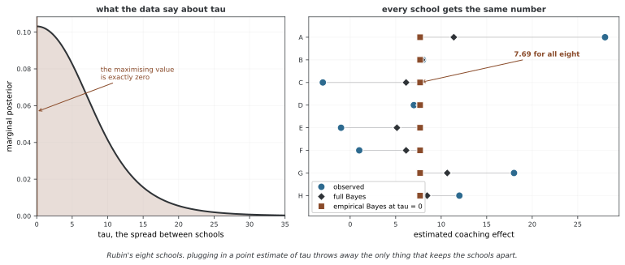

# 다층 모델

다층 모델은 그룹별 절편·그래디언트 등의 변동을 공통 분포로 연결한다. 계층 모델의 한 형태이며 베이즈 추론과 빈도주의 혼합효과 추정 모두에 사용할 수 있다. 중첩 자료뿐 아니라 교차 그룹 구조도 모델링할 수 있으며, 여기서는 그룹별 절편과 공통 그래디언트의 베이즈 예제를 다룬다.

## 1. 모델 명세

### 절편이 달라지는 모델

가장 단순한 다층 모델은 그래디언트는 함께 쓰면서 절편만 그룹마다 다르게 한다.

$$
y_{ij} = \alpha_{j} + \beta x_{ij} + \epsilon_{ij}, \quad \epsilon_{ij} \sim \mathcal{N}(0, \sigma^2)
$$

여기서 $i$은 그룹 $j$ 안의 관찰을 가리키고 다음이 성립한다.

$$
\alpha_j \sim \mathcal{N}(\mu_\alpha, \sigma_\alpha^2)
$$

그룹의 절편 $\alpha_j$은 공통 모집단 분포에서 나오며, 이로써 **부분 풀링**가 가능해져 그룹마다의 추정값이 다른 그룹에서 힘을 빌린다.

### 절편과 그래디언트가 함께 달라지기

더 풍부한 모델은 절편과 그래디언트를 모두 그룹마다 다르게 한다.

$$
y_{ij} = \alpha_j + \beta_j x_{ij} + \epsilon_{ij}
$$

$$
\begin{pmatrix} \alpha_j \\ \beta_j \end{pmatrix} \sim \mathcal{N}\left( \begin{pmatrix} \mu_\alpha \\ \mu_\beta \end{pmatrix}, \boldsymbol{\Sigma} \right)
$$

공분산 행렬 $\boldsymbol{\Sigma}$은 그룹 수준 절편과 그래디언트 사이의 상관을 담는다. 이를테면 기초 수익률이 높은 그룹이 어떤 요인에도 더 민감할 수 있다.

---

## 2. 세 가지 풀링 전략

완전 풀링은 모든 그룹에 같은 계수를, 비풀링은 그룹마다 별도 계수를 사용한다. 부분 풀링은 공통 분포를 통해 그룹 추정에 정보를 공유한다.

단순 정규 절편 모형에서는 그룹 평균과 모집단 평균의 가중 평균으로 나타낼 수 있다. 그러나 그래디언트도 달라지고 절편·그래디언트가 상관되면 일반적으로 행렬 웨이트가 필요하다. 관측 수만이 아니라 그룹 내 설명변수의 분산과 설계, 잡음 및 공통 공분산이 수축을 결정한다.

<div class="storybox" markdown>

**그림으로 보는 AI 1.** 부분 풀링이 완전 풀링으로 무너지는 자리

위 세 전략에서 부분 풀링은 "가운데"처럼 보인다. 그런데 그룹 간 분산 $\sigma_\alpha$ 를 **자료에서 점추정해 대입하면** 가운데에 머물지 못하고 한쪽 끝으로 떨어지는 일이 생긴다. 이것을 가장 분명하게 보여 준 자료가 1981년 도널드 루빈(Donald Rubin)의 「여덟 학교」다.

미국 교육평가원(ETS)이 여덟 고등학교에서 SAT 언어 영역 특별 과외의 효과를 따로따로 실험했다. 관측된 효과는 28, 8, −3, 7, −1, 1, 18, 12 였고 표준오차는 15, 10, 16, 11, 9, 11, 10, 18 이었다. 학교 A 의 28 은 커 보이지만 표준오차가 15 다.

그룹 간 분산 $\tau$ 에 대해 자료가 무엇을 말하는지 보면 이렇다.



**$\tau$ 의 주변우도를 최대로 하는 값이 정확히 0 이다.** 곧 이 자료만 놓고 보면 "학교들 사이에 차이가 없다"가 가장 그럴듯한 설명이다. 그런데 그 점추정을 그대로 대입하면 $\sigma_\alpha = 0$ 이고, 그러면 모든 그룹의 절편이 같아진다 — **부분 풀링이 완전 풀링이 된다.** 오른쪽 그림에서 여덟 개의 사각형이 모두 **7.69** 한 자리에 포개진 것이 그것이다. 학교 A 의 28도, 학교 C 의 −3도 똑같이 7.69다.

$\tau$ 의 불확실성을 적분하는 완전 베이즈는 그러지 않는다. 왼쪽 곡선이 0에서 가장 높지만 **꼬리가 길다** — $\tau$ 가 10이나 15일 가능성도 자료가 배제하지 않는다. 그 가능성들을 모두 더하면 학교 A 는 11.39, 학교 E 는 5.14 가 되어 차이가 남는다. 크게 수축했지만 뭉개지지는 않았다.

**그래서 이 자료가 오래 인용되는 까닭은 "수축이 좋다"가 아니다.** 하이퍼파라미터를 점으로 박아 넣는 일이 그룹을 구별해 주던 **유일한 양을 버리는 일**이 될 수 있다는 것이다. 같은 장의 [경험적 베이즈](empirical_bayes.md) 쪽이 "하이퍼파라미터의 불확실성이 생략된다"고 적어 둔 한 줄의 크기가 여기서는 7.69 와 11.39 의 차이다. 그룹 수가 적을수록 — 여기서는 여덟이다 — $\tau$ 가 제대로 정해지지 않으므로 이 위험이 커진다.

_확인한 곳 — D. B. Rubin, "Estimation in parallel randomized experiments", *Journal of Educational Statistics* **6**(4), 377–401 (1981). 여덟 학교의 효과 추정과 표준오차는 이 자료의 표준 수치를 그대로 썼고, 자료에서 학교 간 차이의 증거가 나타나지 않는다는 점도 그 글의 보고다. 그림의 수는 그림을 그리는 코드가 직접 셈하며, $\tau$ 의 최대우도 추정이 정말 0 이고 경험적 베이즈 추정 여덟 개가 정말 **완전히 같은 수**인지를 스스로 확인한 뒤에만 그린다._

</div>

## 3. PyTorch 구현

코드는 랜덤 절편 alpha_j와 공통 그래디언트 beta를 갖는 Gibbs 샘플러다. 랜덤 그래디언트·절편 공분산 모형까지 구현하지 않는다. 조건부 갱신은 beta~N(0,100), mu_alpha~N(0,1000), 두 분산의 InverseGamma(shape=1,rate=0.1) 사전에 대응한다. 이 사전의 의미와 스케일을 데이터와 함께 명시한다.

x·y는 같은 길이의 1차원 실수 텐서이고 group_ids는 0~n_groups−1의 정수여야 한다. 코드가 CPU 상태 텐서를 생성하므로 장치·자료형을 맞춘다. n_samples가 0이면 결과 변환에서 첫 표본을 참조할 수 없으며 warmup 이후에도 여러 체인의 수렴·유효 표본 수를 확인해야 한다.

```python
import torch
import torch.distributions as dist

class MultilevelModel:
    """
    절편이 달라지는 베이즈 여러 레이어 모형.
    
    다음에 대한 깁스 표집을 구현한다:
        y_{ij} = alpha_j + beta * x_{ij} + epsilon_{ij}
        alpha_j ~ N(mu_alpha, sigma_alpha^2)
    """
    
    def __init__(self, n_groups: int):
        self.n_groups = n_groups
    
    def fit_gibbs(self, x, y, group_ids, n_samples=2000, warmup=500):
        """
        절편이 달라지는 모형의 깁스 표집기.
        
        파라메터
        ----------
        x : 꼴 (N,)의 텐서
        y : 꼴 (N,)의 텐서
        group_ids : 꼴 (N,)의 텐서, 정수 무리 이름표
        """
        N = len(y)
        
        # 파라메터를 초기화한다
        alpha = torch.zeros(self.n_groups)
        beta = torch.tensor(0.0)
        mu_alpha = torch.tensor(0.0)
        sigma2 = torch.tensor(1.0)
        sigma2_alpha = torch.tensor(1.0)
        
        samples = {
            'alpha': [], 'beta': [], 'mu_alpha': [],
            'sigma2': [], 'sigma2_alpha': []
        }
        
        for t in range(n_samples + warmup):
            # --- alpha_j(무리 절편) 표집 ---
            for j in range(self.n_groups):
                mask = (group_ids == j)
                n_j = mask.sum().float()
                if n_j == 0:
                    alpha[j] = dist.Normal(mu_alpha, sigma2_alpha.sqrt()).sample()
                    continue
                
                resid_j = y[mask] - beta * x[mask]
                
                # 뒤확률 정밀도와 평균
                precision_j = n_j / sigma2 + 1.0 / sigma2_alpha
                mean_j = (resid_j.sum() / sigma2 + mu_alpha / sigma2_alpha) / precision_j
                alpha[j] = dist.Normal(mean_j, (1.0 / precision_j).sqrt()).sample()
            
            # --- beta(공통 그래디언트) 표집 ---
            resid = y - alpha[group_ids]
            precision_beta = (x ** 2).sum() / sigma2 + 0.01  # 약한 앞확률
            mean_beta = (x * resid).sum() / sigma2 / precision_beta
            beta = dist.Normal(mean_beta, (1.0 / precision_beta).sqrt()).sample()
            
            # --- mu_alpha(모집단 평균) 표집 ---
            precision_mu = self.n_groups / sigma2_alpha + 0.001
            mean_mu = alpha.sum() / sigma2_alpha / precision_mu
            mu_alpha = dist.Normal(mean_mu, (1.0 / precision_mu).sqrt()).sample()
            
            # --- sigma2(관측 잡음) 표집 ---
            resid_all = y - alpha[group_ids] - beta * x
            ss = (resid_all ** 2).sum()
            sigma2 = dist.InverseGamma(
                torch.tensor(N / 2.0 + 1.0),
                ss / 2.0 + 0.1
            ).sample()
            
            # --- sigma2_alpha(무리 사이 흩어짐) 표집 ---
            ss_alpha = ((alpha - mu_alpha) ** 2).sum()
            sigma2_alpha = dist.InverseGamma(
                torch.tensor(self.n_groups / 2.0 + 1.0),
                ss_alpha / 2.0 + 0.1
            ).sample()
            
            if t >= warmup:
                samples['alpha'].append(alpha.clone())
                samples['beta'].append(beta.item())
                samples['mu_alpha'].append(mu_alpha.item())
                samples['sigma2'].append(sigma2.item())
                samples['sigma2_alpha'].append(sigma2_alpha.item())
        
        return {k: torch.tensor(v) if not isinstance(v[0], torch.Tensor) 
                else torch.stack(v) for k, v in samples.items()}
```

---

## 4. 계량 금융에서의 쓰임

자산별 요인 회귀를 예로 들면 다음과 같은 구조를 정의할 수 있다.

$$r_{it}=\alpha_i+\beta_i f_t+\epsilon_{it}$$

계층 분포로 자산별 계수를 연결할 수 있지만, 수축이 곧 다중검정 오류율을 자동 통제한다는 뜻은 아니다. 금융 패널에서는 시점 간 의존성과 자산 간 잔차 상관도 고려해야 한다.

그룹별 절편 분산은 자산 간 기대 수준의 변동이지 포트폴리오 수익률의 시계열 위험 그 자체가 아니다. 포트폴리오 위험을 계산하려면 요인의 공분산, 자산별 노출과 잔차 공분산을 함께 정의해야 한다. 시간 순서를 지켜 추정·검증한다.

## 연습문제

<div class="drillbox" markdown>

**연습문제 1.** <span class="diff med" title="중간"></span>
랜덤 절편 모형과 랜덤 그래디언트 모형의 차이를 설명하라.

</div>

??? success "풀이"
    랜덤 절편은 그룹별 기준 수준이 다르고 설명변수 효과는 공통이다. 랜덤 그래디언트는 설명변수 효과도 그룹별로 달라진다. 후자에서는 절편·그래디언트 공분산을 통해 함께 변하는 관계를 모델링할 수 있다.

---

<div class="drillbox" markdown>

**연습문제 2.** <span class="diff med" title="중간"></span>
그래디언트 추정에서 관측 수만으로 수축 정도를 결정할 수 있는가?

</div>

??? success "풀이"
    설명변수의 그룹 내 분산과 공선성도 계수의 정밀도를 결정한다. 관측이 많아도 x가 거의 같으면 그래디언트를 잘 식별하지 못할 수 있다. 절편·그래디언트 상관을 포함하면 행렬 정보로 결합 추론한다.

---

<div class="drillbox" markdown>

**연습문제 3.** <span class="diff med" title="중간"></span>
Gibbs 표본 수를 2000개 지정하면 정확한 사후표본 2000개를 얻었다고 볼 수 있는가?

</div>

??? success "풀이"
    조건부 갱신에서 얻은 표본은 상관될 수 있으며 수렴하지 않았을 수도 있다. 여러 체인, 초기값과 warmup, 유효 표본 수·수렴 진단을 확인한다. 고정 반복 수만으로 계산 정확도를 보장할 수 없다.

---

<div class="drillbox" markdown>

**연습문제 4.** <span class="diff hard" title="어려움"></span>
아래 임포트만 있는 조각에 어떤 모형·검증을 추가해야 하는가?

</div>

??? success "풀이"
    우도와 그룹 분포, 하이퍼사전을 정의하고 그룹 ID·차원·장치를 검증한다. 조건부 갱신 또는 다른 추론을 구현한 뒤 사후 계산 진단과 예측 점검을 수행한다. 현재 조각은 다층 모형을 구현하지 않는다.

    ```python
    import numpy as np
    # 구현은 주제에 따라 달라진다.
    # 켤레 모형: 닫힌 꼴 뒤확률 새로 고치기.
    # 켤레가 아닌 모형: MCMC 또는 변분 추론.
    # 핵심 스텝: 앞확률 정하기, 가능도 셈하기, 뒤확률 이끌어 내기/어림하기.
    ```

## 정리하며

다층 모델은 그룹별 효과를 공통 분포로 연결한다. 절편·그래디언트의 변동 구조와 설명변수 설계가 수축을 정한다. 구현한 랜덤 절편 모형의 사전·입력 규약을 명시하고 Gibbs 표본의 계산 진단과 실제 예측 성능을 확인한다.

**참고 문헌**

- Gelman, A., & Hill, J. (2006). *Data Analysis Using Regression and Multilevel/Hierarchical Models*. Cambridge University Press.
- McElreath, R. (2020). *Statistical Rethinking* (2nd ed.). CRC Press. 13~14장.
- Raudenbush, S. W., & Bryk, A. S. (2002). *Hierarchical Linear Models* (2nd ed.). Sage.
