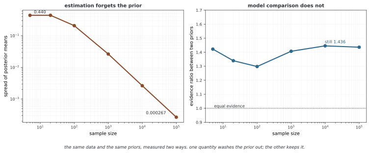

# 18장: 베이즈 기초

베이즈 추론은 사전분포와 관측 모형을 결합해 파라메터의 사후분포를 구하고 예측·의사결정에 사용한다. 이 장은 켤레 갱신, 점·구간 요약, 계층 모형과 모델 비교를 다룬다. 계산한 확률의 의미는 모형과 사전분포에 조건부라는 점을 유지하고, 해석적 결과와 대입·수치 근사의 범위를 구분한다.

**그림으로 보는 AI 1.** 다툰 것은 정리가 아니라 사전분포였다

베이즈 정리 자체를 두고 다툰 사람은 없다. [첫 쪽](bayesian_foundations/prior_likelihood_posterior.md)의 증명을 보면 두 줄이다 — 결합밀도를 두 가지로 적고 나누면 끝난다. 조건부확률의 정의에서 바로 따라 나오므로 반대할 자리가 없다.

두 세기 동안 다툰 것은 **$p(\theta)$ 를 적어도 되는가**였다. 관측하기 전에 파라메터에 분포를 얹는 일 말이다. 20세기 전반의 통계학은 대체로 안 된다는 쪽이었고, 그래서 이 장의 [신용구간](bayesian_foundations/credible_intervals.md) 쪽이 다루는 신뢰구간이라는 장치가 따로 만들어졌다.

이 장을 읽기 전에 알아 두면 좋은 것은, 그 다툼의 답이 **이 장 안에서 두 갈래로 갈린다**는 점이다.

**1절부터 3절까지 하는 일 — 추정 — 에서는 사전분포가 씻겨 나간다.** 참값 0.3 인 동전에 균등·회의적·아주 틀린 세 사전분포를 얹으면 처음에는 사후평균이 0.440 만큼 벌어지는데, 표본이 10만이면 격차가 **0.000267** 이다. 사전분포를 무엇으로 골랐든 같은 답에 닿는다. 다툼이 무색해지는 자리다.

**그런데 4절이 하는 일 — 모델 비교 — 에서는 씻겨 나가지 않는다.** 같은 자료, 같은 두 사전분포로 주변 우도의 비를 셈하면 표본이 10만이 되어도 **1.436** 에 머문다. 1로 가지 않는다. 사후평균은 구별할 수 없게 된 두 사전분포가 증거에서는 끝까지 한쪽을 1.4배 선호한다.

까닭은 단순하다. 주변 우도는 사전분포 **전체로 우도를 평균한** 양이라 사전분포의 폭이 식 안에 그대로 남는다. 그래서 이 장은 두 가지 태도를 함께 요구한다 — 1절부터 3절까지는 "자료가 충분하면 사전분포에 너무 매이지 말 것", 4절에서는 "사전분포를 적지 않은 베이즈 인자는 읽을 수 없다는 것". **같은 장 안에서 상반되어 보이는 이 두 조언이 사실은 한 가지 사실의 두 면이다.**

_확인한 곳 — 그림의 수는 그림을 그리는 코드가 직접 셈하며, 사후평균의 격차가 정말 사라지고 증거 비는 정말 1 로 가지 않는지를 스스로 확인한 뒤에만 그린다. 베이즈 정리의 두 줄 증명은 이 장 첫 쪽에 있고, 사전분포를 얹는 일에 대한 네이만의 반대와 신뢰구간의 유래는 신용구간 쪽에서 다룬다._

## 1. 베이즈 추론의 기본 요소

- [사전분포·우도·사후분포](bayesian_foundations/prior_likelihood_posterior.md): 베이즈 정리, 충분통계량, 순차 갱신
- [켤레 사전분포](bayesian_foundations/conjugate_priors.md): 베타·감마·정규·정규-역감마 모형의 갱신과 예측
- [MAP 추정](bayesian_foundations/map_estimation.md): 로스 함수, 정규화와 좌표 의존성
- [베이즈 신용구간](bayesian_foundations/credible_intervals.md): 동일 꼬리 구간과 HPD 집합의 의미·조건

## 2. 회귀와 함수 사전분포

- [베이즈 선형 회귀](bayesian_distributions/bayesian_linear_regression.md): 계수 불확실성과 관측 예측분산
- [베이즈 로지스틱 회귀](bayesian_distributions/bayesian_logistic_regression.md): 라플라스 사후 근사와 예측 적분
- [가우시안 프로세스](bayesian_distributions/gaussian_processes.md): 평균 함수·커널과 정규 회귀의 예측

## 3. 계층 모델과 수축

- [계층 베이즈 모델](hierarchical/hierarchical_bayes.md): 비풀링·완전 풀링·부분 풀링
- [다층 모델](hierarchical/multilevel.md): 그룹별 효과와 Gibbs 조건부 갱신
- [경험적 베이즈](hierarchical/empirical_bayes.md): 공통 하이퍼파라미터 추정과 대입의 한계
- [계층 모델 계산 예제](bayesian_foundations/07_hierarchical_models.md): 조건부 수축과 단순 대입
- [경험적 베이즈 계산 예제](bayesian_foundations/08_empirical_bayes.md): 적률 추정과 제임스-스타인 수축의 조건

## 4. 모델 비교

- [모델 증거·주변 우도](model_comparison/selection.md): 평균 우도와 순차 예측, 수치 적분
- [베이즈 인자](model_comparison/bayes_factors.md): 사후 오즈, 사전 민감도와 근사
- [베이즈 가설 검정](model_comparison/hypothesis_testing.md): 점 귀무가설과 새비지-디키 비의 조건
- [정보 기준](model_comparison/information_criteria.md): AIC·BIC·DIC·WAIC·LOO의 서로 다른 목표와 스케일

## 5. 응용과 예측

- [선형 회귀 계산 예제](bayesian_foundations/09_bayesian_linear_regression.md): 알려진 잡음분산 아래 회귀와 구간 비교
- [A/B 비교와 순차 의사결정 예제](bayesian_foundations/10_advanced_applications.md): 차이의 사후분포와 Thompson 샘플링
- [금융의 파라메터 불확실성](finance/parameter_uncertainty.md): 단위·연율화·예측 공분산
- [베이즈 포트폴리오 최적화](finance/portfolio.md): 목적함수와 블랙-리터먼 평균 추론
- [국면 탐지와 전략 평가](finance/regime.md): 상태 필터링·의존성·중단 규칙

## 정리하며

사후분포는 지정한 모형 아래의 불확실성을 나타낸다. 파라메터 분포와 관측 예측분포, 조건부 계산과 하이퍼파라미터를 적분한 계산을 구분한다. 모델 비교에서도 적합성 점검·계산 진단·사전 민감도를 함께 살피며 상대 점수를 절대적인 모델 보장으로 읽지 않는다.
