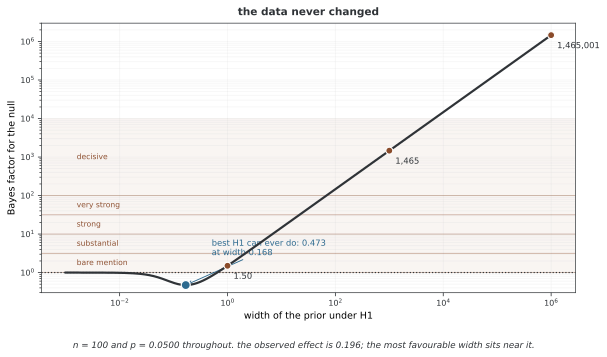

# 베이즈 인자

베이즈 인자는 같은 자료에 대한 두 모델의 주변 우도 비다. 모델 사전 오즈를 사후 오즈로 바꾸는 배수이며, 각 모델 내부의 파라메터 사전분포에 의존한다. 정의와 계산 방향, 순차 분해, 사전 민감도와 수치 근사를 구분해 살펴본다.

## 1. 왜 필요한가: 영가설 검정 너머로

p값은 귀무가설 아래 지정한 검정통계량의 극단성을 측정한다. 가설이 참일 확률이나 두 모델의 상대적인 예측 증거와는 다르다. 큰 표본에서는 실질적으로 작은 효과도 유의할 수 있지만, 참인 귀무가설까지 자료가 많으면 반드시 기각되는 것은 아니다.

베이즈 인자는 대립모델과 귀무모델 양쪽의 주변 우도를 비교한다. 연속적인 상대 증거를 제공하되 모델의 절대 적합도나 경제적·과학적 중요성을 대신 판단하지는 않는다. 빈도주의 추론도 효과 크기·구간·동등성 검정 등을 함께 사용할 수 있으므로 이분법적인 기각만으로 한정하지 않는다.

## 2. 정의와 풀이

파라메터 사전분포가 명시된 모델 M₁·M₂에 대해 다음과 같다.

$$B_{12}=\frac{p(D\mid M_1)}{p(D\mid M_2)},\qquad p(D\mid M_k)=\int p(D\mid\theta_k,M_k)p(\theta_k\mid M_k)\,d\theta_k$$

주변 우도가 양수·유한해야 하며 동일한 관측 공간·기준측도·자료로 비교한다. BF의 아래첨자에서 앞의 모델이 분자다.

$$\frac{p(M_1\mid D)}{p(M_2\mid D)}=B_{12}\frac{p(M_1)}{p(M_2)}$$

수치 계산은 $\log B_{12}=\log p(D|M_1)-\log p(D|M_2)$로 수행한다. 따라서 B₂₁=1/B₁₂이고 동일하게 정의한 세 모델 사이에는 B₁₃=B₁₂B₂₃가 성립한다. 자료 묶음에 대한 독립성만으로 각 묶음에서 같은 사전분포를 다시 사용한 BF를 곱할 수는 없다. 순차 갱신은 다음 절에서 구분한다.

## 3. 풀이 지침

### 증거 등급

[Kass–Raftery(1995)](https://sites.stat.washington.edu/courses/stat527/s14/readings/KassRaftery_jasa1995.pdf)의 기준은 **2 ln B**에 대한 등급이다. 로그 밑과 2배 여부를 혼동하지 않는다.

| 2 ln B₁₂ | B₁₂의 대략적 범위 | M₁에 대한 상대 증거 |
|---|---|---|
| 0~2 | 1~3 | 약함 |
| 2~6 | 3~20 | 긍정적 |
| 6~10 | 20~150 | 강함 |
| 10 초과 | 150 초과 | 매우 강함 |

제프리스의 통상적인 기준은 log₁₀B 경계를 0.5·1·1.5·2로 두므로 같은 표가 아니다. 등급은 관행적 해석이며 유의수준·오류율·확실성의 절대 기준이 아니다. B=1은 상대 오즈를 바꾸지 않으며 B<1이면 역수를 사용해 반대 방향을 해석한다.

### 모델 사후확률

두 모델만 고려하고 모델 사전확률이 같으면 $p(M_1|D)=B_{12}/(1+B_{12})$다. B가 1·3·10·100이면 각각 0.5·0.75·약 0.909·약 0.990이다. 사전 오즈가 다르면 먼저 BF에 곱한다. 어떤 모델이 상대적으로 지지된다는 사실만으로 그 모델이 현실을 충분히 설명한다고 결론 내리지는 않는다.

## 4. 수학적 성질

### 순차 예측 분해

공통 잠재 파라메터가 있는 모형에서 관측이 그 파라메터를 조건으로 독립이더라도 주변화 후 자료는 일반적으로 독립이 아니다. 정확한 분해는 다음과 같다.

$$p(D_1,D_2\mid M)=p(D_1\mid M)p(D_2\mid D_1,M)$$

따라서 전체 로그 BF는 D₁의 로그 BF와 **D₁로 갱신한 사후분포를 사용한** D₂의 조건부 로그 BF의 합이다. 양쪽 자료에서 원래 사전을 각각 사용하는 합은 모델 아래 자료가 주변적으로 독립인 특별한 경우에만 맞는다.

### 일관성과 근사

식별 가능한 모델, 적절한 사전 지지집합과 정규성 조건 등 아래 BF가 참모델을 점근적으로 지지할 수 있다. 동일한 관측분포를 표현하거나 서로 겹치는 모델, 참모델이 후보에 없는 경우에 무조건 B→∞를 주장할 수는 없다. 같은 우도족에서 사전분포만 다른 모델의 BF는 유한한 값으로 수렴할 수도 있다.

정규적인 고정 차원 모델에서 M₁의 차원이 M₂보다 k만큼 크면 BIC 근사는 다음과 같다.

$$\log B_{12}=\ell_1(\hat\theta_1)-\ell_2(\hat\theta_2)-\frac k2\log n+O(1)$$

여기서 추정값은 최대 우도 추정값이다. 사전과 곡률에 따른 O(1)항을 버린 근사이므로 정확한 BF와 같지 않으며, 혼합모형·비식별 모형·고차원 뉴럴 넷트웍 등에 그대로 적용할 수 없다.

## 5. 흔한 검정의 베이즈 인자

### 점 귀무가설

추가 미지 파라메터가 없는 H₀:θ=θ₀와 적절한 연속 사전분포를 갖는 H₁을 비교하면 다음과 같다.

$$B_{01}=\frac{p(D\mid\theta_0)}{\int p(D\mid\theta)p(\theta\mid H_1)\,d\theta}$$

사전밀도가 θ₀에서 양수·유한하고 호환되는 밀도를 사용하면 베이즈 정리로 다음을 얻는다.

$$B_{01}=\frac{p(\theta_0\mid D,H_1)}{p(\theta_0\mid H_1)}$$

이는 한 점의 확률이 아니라 **밀도**의 비다. nuisance 파라메터가 있으면 귀무모델의 사전분포가 대립모델에서 θ=θ₀를 조건으로 한 사전분포와 일치하는 등의 조건이 필요하다. [일반화된 새비지-디키 연구](https://arxiv.org/abs/2004.09899)는 조건이 다른 경우의 보정을 다룬다.

### 평균과 그룹 비교

알려진 분산과 정규 사전분포에서는 평균 비교의 주변 우도를 해석적으로 구할 수 있다. 분산을 몰라도 특정 켤레 사전 아래 해석적 계산이 가능하므로 언제나 수치 적분이 필요한 것은 아니다. 여러 그룹의 평균이 모두 같은 모형·모두 다른 모형·일부만 같은 중간 모형을 각각 정의해 비교할 수 있으며, 중간 모형의 평가가 반드시 그룹별 쌍대 검정이어야 하는 것은 아니다.

## 6. 린들리의 역설

알려진 σ²에서 표본평균 $\bar x\sim N(\mu,\sigma^2/n)$, H₀:μ=0과 H₁:μ∼N(0,τ²)를 비교하자. τ²>0을 고정하면 다음과 같다.

$$B_{01}=\sqrt{1+n\tau^2/\sigma^2}\exp\left[-\frac{n\bar x^2}{2\sigma^2}\frac{n\tau^2/\sigma^2}{1+n\tau^2/\sigma^2}\right]$$

z=√n·x̄/σ를 유의성 경계인 z_(1−α/2)에 고정한 자료열을 생각하면 양측 p값은 α에 머물지만 B₀₁은 커진다. 이때 x̄는 고정된 효과가 아니라 n에 따라 0으로 가까워지는 값이다.

이는 고정된 대립 사전 스케일과 p값의 서로 다른 비교 기준에서 생긴다. 참효과를 0이 아닌 상수로 고정하고 표본을 늘리는 실험과는 다르다. 후자의 정규 모형에서는 충분히 큰 n에서 BF도 대립가설을 지지할 수 있다. 어느 쪽이 모든 상황에서 옳다는 선언 대신 관심 질문과 사전 스케일을 명시한다.

## 7. 사전확률을 어떻게 정하느냐에 대한 민감도

주변 우도는 모델의 파라메터 사전분포 전체로 우도를 평균하므로 사전 범위에 민감하다. 사후 파라메터 추론 역시 사전에 의존하지만, 충분한 자료에서 사후 요약이 안정적이어도 BF는 사전 스케일에 민감할 수 있다.

아주 넓은 대립 사전은 관측 자료를 잘 설명하지 않는 영역에 질량을 배분해 주변 우도를 낮출 수 있다. 넓다는 이유만으로 중립적이라고 보지 않는다. 단위·효과 크기에 맞는 적절한 사전분포 몇 가지에서 민감도를 비교한다.

부적절 사전의 임의 정규화 상수는 보통 모델 간에 약분되지 않아 일반적인 BF가 정의되지 않는다. 공유 nuisance 파라메터의 특별한 처리나 분수·내재 BF처럼 별도 정의한 방법과 일반 BF를 구분한다. 계산에 자료를 사용한 사전분포를 그대로 다시 대입하는 것이 정당한 해결책은 아니다.

<div class="storybox" markdown>

**그림으로 보는 AI 1.** 린들리도 이 민감도를 모르고 있었다

6절의 린들리 역설이 1957년에 나왔을 때, 그 글에는 빠진 항이 하나 있었다. 같은 해 같은 학술지에 모리스 바틀릿(Maurice Bartlett)이 「A comment on D. V. Lindley's statistical paradox」라는 두 쪽짜리 글을 실어 그것을 바로잡았다. 린들리가 대립가설 쪽 균등 사전분포의 **폭에서 오는 $1/I$ 인자**를 빠뜨렸다는 지적이었다. 말을 바꾸면, 린들리 자신도 그 결과가 **사전분포의 폭에 달려 있다는 것을 바틀릿이 짚어 줄 때까지 몰랐다.**

바틀릿이 연 문이 이 절의 주제다. 6절은 $n$ 을 키웠지만, 여기서는 **자료를 전혀 건드리지 않고** 대립 사전분포의 폭만 키워 본다.



$n=100$, $p=0.0500$ 으로 자료를 붙박아 둔 채 폭 $\tau$ 만 움직였다. 폭이 1이면 BF가 $1.50$, 1,000이면 $1{,}465$, $10^6$ 이면 **1,465,001** 이다. 큰 $\tau$ 에서 기울기가 정확히 1이니 **$\tau$ 에 비례해 끝없이 자란다.** 바로 위 문단이 "아주 넓은 대립 사전은 … 주변 우도를 낮출 수 있다"고 적어 둔 것의 크기가 이것이고, 그래서 "넓으니까 중립적"이 왜 성립하지 않는지도 분명해진다. **폭을 무한히 넓히는 것, 곧 부적절 사전분포를 쓰는 것은 "아무 말도 하지 않기"가 아니라 "H0 를 무한히 세게 지지하기"다.**

U자의 왼쪽 끝도 읽을 거리가 있다. 폭을 0으로 줄이면 H1 이 H0 와 같아지므로 BF 가 1로 돌아간다. 그래서 곡선에 **바닥**이 있다 — 이 자료에서 H1 이 낼 수 있는 가장 좋은 값이 $0.473$ 이고, 그 자리의 폭 $0.168$ 은 관측된 효과 크기 $0.196$ 바로 근처다. 사전분포를 자료에 맞춰 가장 유리하게 골라 주어도 **2:1 남짓**이라는 뜻이다. $p=0.05$ 가 들고 있는 증거의 무게가 그 정도다.

**그러므로 BF 를 보고할 때 사전분포를 함께 적는 것은 예의가 아니라 의무다.** 사후 요약은 자료가 쌓이면 사전분포를 잊지만, 베이즈 인자는 잊지 않는다 — 폭이 식 안에 그대로 남아 있기 때문이다. 아래 8절이 기본·객관 베이즈 인자라는 별도의 장치를 따로 만들어야 했던 까닭이 여기에 있다.

_확인한 곳 — M. S. Bartlett, "A comment on D. V. Lindley's statistical paradox", *Biometrika* **44**(3–4), 533–534 (1957년 12월). 린들리가 사전분포 폭에서 오는 인자를 빠뜨렸고 바틀릿이 그것을 바로잡았다는 것이 그 글이다. 등급 띠는 H. Jeffreys, *Theory of Probability* (1961) 부록 B. 그림의 수는 그림을 그리는 코드가 직접 셈하며, 큰 폭에서 기울기가 정말 1 인지와 폭이 0 으로 갈 때 BF 가 1 로 돌아가는지를 스스로 확인한 뒤에만 그린다 — 처음에 "단조증가" 라고 적었다가 그 확인에 걸려 고쳤다._

</div>

## 8. 기본 베이즈 인자와 객관적 베이즈 인자

### JZS 방식

표준화 효과 δ에 Cauchy(0,r) 사전을 두는 기본 t검정 방식이 있다. r은 가능한 효과 크기를 조절하며 소프트웨어의 기본값이 모든 연구에 적합한 것은 아니다. δ는 표준화된 효과이지 균등분포 효과가 아니다. 공통 분산 등의 nuisance 사전과 검정 설계도 함께 정의해야 한다.

### 내재 방식과 분수 방식

내재 BF는 최소 학습 부분집합으로 부적절 사전을 적절하게 만드는 절차를 기반으로 한다. 한 분할에서 계산한 조건부 예측비만을 최종 내재 BF라고 단정할 수는 없으며, 학습 집합의 선택과 결합 규칙을 정의해야 한다.

분수 BF는 0<b<1에 대해 정규화 적분 $m_k(c)=\int L_k(\theta)^c\pi_k(\theta)\,d\theta$가 유한하도록 한 뒤 다음 비를 사용한다.

$$B_{12}^{F}=\frac{m_1(1)/m_1(b)}{m_2(1)/m_2(b)}$$

우도의 일부로 적절한 갱신을 만들고 나머지 기여를 비교하는 방식이다. π_k의 임의 상수는 모델별 비에서 약분되지만, b와 기본 사전 선택의 영향이 사라지는 것은 아니다.

## 9. 여러 모델 비교

후보 모델 M₁,…,M_K와 합이 1인 모델 사전확률을 정의하면 다음과 같다.

$$p(M_k\mid D)=\frac{p(D\mid M_k)p(M_k)}{\sum_jp(D\mid M_j)p(M_j)}$$

같은 사전확률이면 기준모델 M₁에 대한 B_k1을 정규화해 $p(M_k|D)=B_{k1}/\sum_jB_{j1}$을 얻는다. 기준모델의 증거는 양수여야 한다. 수치적으로는 로그 증거와 로그 사전확률에 log-sum-exp를 적용한다.

예측을 모델 사후확률로 평균하면 모델 선택의 불확실성을 반영한다.

$$p(y^*\mid x^*,D)=\sum_kp(y^*\mid x^*,D,M_k)p(M_k\mid D)$$

이는 지정한 후보 집합 안의 불확실성이며 누락된 모델까지 포함하지 않는다. 단일 모델보다 성능이나 보정이 항상 좋은 것은 아니다. 쌍대 BF를 사용하더라도 모델 사전확률을 포함해 일관되게 정규화하면 같은 다중 모델 추론을 구성할 수 있다.

## 10. 셈하는 방법

### 해석적 계산과 라플라스 근사

켤레 모형에서는 정규화 상수의 비로 주변 우도를 구할 수 있다. 적절한 내부 사후 최빈값 θ̂와 양의 정부호 음의 로그 사후 헤시안 H에서 다음 라플라스 근사를 사용한다.

$$\log p(D\mid M)\approx\log p(D\mid\hat\theta,M)+\log p(\hat\theta\mid M)+\frac d2\log(2\pi)-\frac12\log|H|$$

다봉성·경계·특이한 곡률에서는 단일 정규 근사가 부정확할 수 있다. BIC는 정규적 큰 표본 조건에서 주요 항만 남긴 추가 근사다.

### 브리지 샘플링

같은 파라메터 공간에서 q_k(θ)=L_k(θ)π_k(θ), Z_k=∫q_k를 두고 정규화 사후 p_k=q_k/Z_k에서 표본을 얻으면 다음 항등식을 사용한다.

$$\frac{Z_1}{Z_2}=\frac{E_{p_2}[h(\theta)q_1(\theta)]}{E_{p_1}[h(\theta)q_2(\theta)]}$$

적분이 유한하고 분모가 양수여야 하며 분포 사이의 겹침과 h의 선택이 효율을 결정한다. 차원이 다른 모델에는 단순히 서로의 파라메터를 대입할 수 없고 공통 공간으로 확장하거나 모델별 정규화 상수를 추정하는 구성이 필요하다.

### 열역학 적분

적절한 사전에서 power posterior $p_t(\theta)\propto L(\theta)^t\pi(\theta)$, 0≤t≤1을 사용하면 적분·미분 교환 등의 조건 아래 다음과 같다.

$$\log p(D\mid M)=\int_0^1E_{p_t}[\log L(\theta)]\,dt$$

각 모델에서 계산한 로그 증거를 빼면 로그 BF를 얻는다. 온도 격자와 각 분포의 샘플링 오차를 함께 점검한다.

## 11. 파이썬 구현

코드의 BF 관련 함수는 대부분 **자연로그 BF**를 반환한다. savage_dickey_gaussian·savage_dickey_ratio는 log B₀₁이고 bic_bayes_factor는 log B₁₂다. 해석 함수의 M1·M2는 인자로 넣은 로그비의 분자·분모이므로 실제 모델 이름과 맞춰 읽는다. interpret_bayes_factor의 kass_raftery 분기는 본문의 2 ln B 기준과 다른 관행적 log₁₀ 경계를 사용하며, B=1도 M2를 약하게 지지한다고 표시하므로 출력 등급을 원전과 동일시하지 않는다.

베타 예제는 성공 횟수만의 이항 자료가 아니라 순서가 지정된 베르누이 관측열의 주변 우도를 계산한다. Beta(50,50) 등의 공정한 동전 표시는 θ=0.5인 점 귀무가설이 아니라 0.5 주변에 집중한 연속 사전모형이다. 같은 우도족의 사전모형 비교이므로 증거가 한쪽으로 무한히 커져야 한다고 볼 수 없다.

bayes_factor_one_sample_t의 적분은 JZS의 표준 혼합식과 일치하지 않는다. g에 대한 사전 정규화와 스케일, (1+n g)의 요인 및 공통 t통계량 정규화가 맞아야 하며, 이 함수 값을 검증된 JZS BF로 사용하지 않는다. savage_dickey_gaussian도 극단적인 경우 밀도 언더플로로 로그비가 유효하지 않을 수 있다.

린들리 시연은 0이 아닌 참효과를 고정하고 표본 크기를 바꾼다. 본문의 z를 고정한 점근 자료열을 재현하지 않으며, p값은 분산 미지 t검정·BF는 분산 1을 아는 모형을 사용한다. 코드와 출력의 결론 문구가 모든 표본 크기에서 성립하는 이론적 보장이라는 뜻은 아니다. 다항 회귀 BIC 시연은 잡음분산 0.25를 알려진 값으로 사용하므로 파라메터 수에 분산을 추가하지 않는다.

```python
"""
베이즈 인자: 온전한 구현

이 모듈은 모형 견줌을 위한 베이즈 인자의 셈하기와 풀이를 주며,
켤레 모형의 정확한 방법, 어림, 그리고 그려 보기 도구를
함께 담는다.
"""

import numpy as np
import matplotlib.pyplot as plt
from scipy import stats
from scipy.special import gammaln, logsumexp
from scipy.integrate import quad
from typing import Tuple, List, Optional, Dict, Union
from dataclasses import dataclass
from abc import ABC, abstractmethod

# =============================================================================
# 풀이 도구
# =============================================================================

def interpret_bayes_factor(log_bf: float, scale: str = 'kass_raftery') -> str:
    """
    표준 눈금으로 로그 베이즈 인자를 풀이한다.
    
    파라메터
    ----------
    log_bf : float
        베이즈 인자의 자연로그(ln B_12)
    scale : str
        'kass_raftery' 또는 'jeffreys'
    
    반환값
    -------
    str
        증거 세기의 풀이
    """
    # 표준 눈금을 위해 log10으로 바꾸기
    log10_bf = log_bf / np.log(10)
    
    if scale == 'kass_raftery':
        if log10_bf > 2:
            return f"Decisive evidence for M1 (log10 BF = {log10_bf:.2f})"
        elif log10_bf > 1:
            return f"Strong evidence for M1 (log10 BF = {log10_bf:.2f})"
        elif log10_bf > 0.5:
            return f"Substantial evidence for M1 (log10 BF = {log10_bf:.2f})"
        elif log10_bf > 0:
            return f"Weak evidence for M1 (log10 BF = {log10_bf:.2f})"
        elif log10_bf > -0.5:
            return f"Weak evidence for M2 (log10 BF = {log10_bf:.2f})"
        elif log10_bf > -1:
            return f"Substantial evidence for M2 (log10 BF = {log10_bf:.2f})"
        elif log10_bf > -2:
            return f"Strong evidence for M2 (log10 BF = {log10_bf:.2f})"
        else:
            return f"Decisive evidence for M2 (log10 BF = {log10_bf:.2f})"
    
    elif scale == 'jeffreys':
        abs_log = abs(log10_bf)
        direction = "M1" if log10_bf > 0 else "M2"
        
        if abs_log > 2:
            strength = "Decisive"
        elif abs_log > 1.5:
            strength = "Very strong"
        elif abs_log > 1:
            strength = "Strong"
        elif abs_log > 0.5:
            strength = "Substantial"
        else:
            strength = "Barely worth mentioning"
        
        return f"{strength} evidence for {direction} (log10 BF = {log10_bf:.2f})"
    
    else:
        raise ValueError(f"Unknown scale: {scale}")

def log_bf_to_posterior_prob(log_bf: float, prior_odds: float = 1.0) -> float:
    """
    로그 베이즈 인자를 M1의 뒤확률로 바꾼다.
    
    파라메터
    ----------
    log_bf : float
        베이즈 인자 B_12의 자연로그
    prior_odds : float
        앞확률 승산 p(M1)/p(M2), 기본값 1(앞확률이 같음)
    
    반환값
    -------
    float
        뒤확률 p(M1 | D)
    """
    log_posterior_odds = log_bf + np.log(prior_odds)
    # p(M1|D) = 뒤확률_승산 / (1 + 뒤확률_승산)
    #         = 1 / (1 + 1/뒤확률_승산)
    #         = 1 / (1 + exp(-로그_뒤확률_승산))
    return 1.0 / (1.0 + np.exp(-log_posterior_odds))

def posterior_probs_from_log_evidences(
    log_evidences: np.ndarray,
    prior_probs: Optional[np.ndarray] = None
) -> np.ndarray:
    """
    로그 증거에서 뒤확률 모형 확률을 셈한다.
    
    파라메터
    ----------
    log_evidences : array-like
        모형마다의 로그 모형 증거
    prior_probs : array-like, 있어도 되고 없어도 됨
        앞확률(따로 정하지 않으면 고름)
    
    반환값
    -------
    ndarray
        뒤확률 모형 확률
    """
    log_evidences = np.asarray(log_evidences)
    K = len(log_evidences)
    
    if prior_probs is None:
        log_priors = np.zeros(K) - np.log(K)  # 고름
    else:
        log_priors = np.log(np.asarray(prior_probs))
    
    log_unnorm = log_evidences + log_priors
    log_norm = logsumexp(log_unnorm)
    
    return np.exp(log_unnorm - log_norm)

# =============================================================================
# 켤레 모형의 정확한 베이즈 인자
# =============================================================================

class BetaBernoulliModel:
    """정확한 증거 셈하기를 갖춘 베타-베르누이 모형."""
    
    def __init__(self, alpha: float, beta: float):
        """
        파라메터
        ----------
        alpha, beta : float
            베타 앞확률 파라메터
        """
        self.alpha0 = alpha
        self.beta0 = beta
    
    def log_evidence(self, data: np.ndarray) -> float:
        """로그 주변 가능도를 셈한다."""
        n = len(data)
        s = np.sum(data)  # 성공
        f = n - s         # 실패
        
        alpha_n = self.alpha0 + s
        beta_n = self.beta0 + f
        
        # log B(alpha_n, beta_n) - log B(alpha_0, beta_0)
        log_ev = (
            gammaln(alpha_n) + gammaln(beta_n) - gammaln(alpha_n + beta_n)
            - gammaln(self.alpha0) - gammaln(self.beta0) + gammaln(self.alpha0 + self.beta0)
        )
        
        return log_ev

def bayes_factor_beta_bernoulli(
    data: np.ndarray,
    model1_params: Tuple[float, float],
    model2_params: Tuple[float, float]
) -> float:
    """
    베타-베르누이 모형 둘의 베이즈 인자를 셈한다.
    
    파라메터
    ----------
    data : ndarray
        이진 관측
    model1_params : tuple
        모형 1의 (alpha, beta)
    model2_params : tuple
        모형 2의 (alpha, beta)
    
    반환값
    -------
    float
        로그 베이즈 인자 log(B_12)
    """
    model1 = BetaBernoulliModel(*model1_params)
    model2 = BetaBernoulliModel(*model2_params)
    
    return model1.log_evidence(data) - model2.log_evidence(data)

class GaussianKnownVarianceModel:
    """흩어짐을 알고 평균에 정규 앞확률을 준 가우스 모형."""
    
    def __init__(self, mu0: float, sigma0_sq: float, sigma_sq: float):
        """
        파라메터
        ----------
        mu0 : float
            앞확률 평균
        sigma0_sq : float
            앞확률 흩어짐
        sigma_sq : float
            아는 자료 흩어짐
        """
        self.mu0 = mu0
        self.sigma0_sq = sigma0_sq
        self.sigma_sq = sigma_sq
    
    def log_evidence(self, data: np.ndarray) -> float:
        """로그 주변 가능도를 셈한다."""
        n = len(data)
        x_bar = np.mean(data)
        
        # 뒤확률 정밀도
        tau0 = 1.0 / self.sigma0_sq
        tau = 1.0 / self.sigma_sq
        tau_n = tau0 + n * tau
        
        # 로그 증거
        log_ev = (
            -0.5 * n * np.log(2 * np.pi * self.sigma_sq)
            + 0.5 * np.log(tau0 / tau_n)
            - 0.5 / self.sigma_sq * np.sum((data - x_bar)**2)
            - 0.5 * tau0 * n * tau / tau_n * (x_bar - self.mu0)**2
        )
        
        return log_ev

def bayes_factor_one_sample_t(
    data: np.ndarray,
    null_value: float = 0.0,
    prior_scale: float = np.sqrt(2) / 2
) -> Tuple[float, float]:
    """
    한 표본 t검정의 JZS 베이즈 인자.
    
    H0: delta = 0(효과 크기가 0)
    H1: delta ~ 코시(0, prior_scale)
    
    파라메터
    ----------
    data : ndarray
        관측 자료
    null_value : float
        귀무가설 아래의 값
    prior_scale : float
        코시 앞확률의 눈금(기본값: sqrt(2)/2)
    
    반환값
    -------
    log_bf_01 : float
        귀무 쪽 로그 베이즈 인자
    log_bf_10 : float
        대립 쪽 로그 베이즈 인자
    """
    n = len(data)
    t_stat = (np.mean(data) - null_value) / (np.std(data, ddof=1) / np.sqrt(n))
    
    # 수치로 적분하기
    def integrand(g):
        """JZS 베이즈 인자의 피적분 함수."""
        if g <= 0:
            return 0
        return (
            (1 + g)**(-0.5)
            * (1 + t_stat**2 / ((1 + n * g) * (n - 1)))**(-(n) / 2)
            * (2 * np.pi)**(-0.5) * g**(-1.5)
            * np.exp(-1 / (2 * g * prior_scale**2))
        )
    
    # 수치 적분
    result, _ = quad(integrand, 0, np.inf)
    
    # 귀무와 견주기(g 없이 t분포만)
    null_density = stats.t.pdf(t_stat, df=n-1)
    
    log_bf_01 = np.log(null_density) - np.log(result) if result > 0 else np.inf
    log_bf_10 = -log_bf_01
    
    return log_bf_01, log_bf_10

# =============================================================================
# 새비지-디키 밀도 비
# =============================================================================

def savage_dickey_ratio(
    posterior_density_at_null: float,
    prior_density_at_null: float
) -> float:
    """
    새비지-디키 밀도 비로 베이즈 인자를 셈한다.
    
    B_01 = p(theta_0 | D, H1) / p(theta_0 | H1)
    
    파라메터
    ----------
    posterior_density_at_null : float
        귀무값에서의 뒤확률 밀도
    prior_density_at_null : float
        귀무값에서의 앞확률 밀도
    
    반환값
    -------
    float
        귀무 쪽 로그 베이즈 인자
    """
    return np.log(posterior_density_at_null) - np.log(prior_density_at_null)

def savage_dickey_gaussian(
    data: np.ndarray,
    null_value: float,
    prior_mean: float,
    prior_var: float,
    known_var: float
) -> float:
    """
    정규 앞확률을 쓴 가우스 모형의 새비지-디키.
    
    H0: mu = null_value 대 H1: mu ~ N(prior_mean, prior_var)을 검정한다
    
    파라메터
    ----------
    data : ndarray
        관측 자료
    null_value : float
        귀무가설 아래의 값
    prior_mean : float
        H1 아래의 앞확률 평균
    prior_var : float
        H1 아래의 앞확률 흩어짐
    known_var : float
        아는 자료 흩어짐
    
    반환값
    -------
    float
        로그 베이즈 인자 B_01
    """
    n = len(data)
    x_bar = np.mean(data)
    
    # 뒤확률 파라메터
    tau0 = 1.0 / prior_var
    tau = 1.0 / known_var
    tau_n = tau0 + n * tau
    mu_n = (tau0 * prior_mean + n * tau * x_bar) / tau_n
    var_n = 1.0 / tau_n
    
    # 귀무값에서의 밀도
    prior_density = stats.norm.pdf(null_value, prior_mean, np.sqrt(prior_var))
    posterior_density = stats.norm.pdf(null_value, mu_n, np.sqrt(var_n))
    
    return np.log(posterior_density) - np.log(prior_density)

# =============================================================================
# 베이즈 인자의 BIC 어림
# =============================================================================

def bic_bayes_factor(
    log_lik1: float,
    log_lik2: float,
    k1: int,
    k2: int,
    n: int
) -> float:
    """
    로그 베이즈 인자의 BIC 어림.
    
    log B_12 ≈ (log L1 - k1/2 * log n) - (log L2 - k2/2 * log n)
    
    파라메터
    ----------
    log_lik1, log_lik2 : float
        최대로 만든 로그 가능도
    k1, k2 : int
        파라메터의 개수
    n : int
        표본 크기
    
    반환값
    -------
    float
        어림 로그 베이즈 인자
    """
    bic1 = -2 * log_lik1 + k1 * np.log(n)
    bic2 = -2 * log_lik2 + k2 * np.log(n)
    
    # log B_12 ≈ -0.5 * (BIC1 - BIC2)
    return -0.5 * (bic1 - bic2)

# =============================================================================
# 린들리의 역설 보여 주기
# =============================================================================

def demonstrate_lindley_paradox(
    effect_size: float = 0.2,
    sample_sizes: np.ndarray = np.array([10, 50, 100, 500, 1000]),
    prior_var: float = 1.0,
    alpha: float = 0.05
) -> Tuple[np.ndarray, np.ndarray, np.ndarray]:
    """
    린들리의 역설을 보인다.
    
    파라메터
    ----------
    effect_size : float
        표준화한 효과 크기(코언의 d)
    sample_sizes : ndarray
        살펴볼 표본 크기
    prior_var : float
        H1 아래의 앞확률 흩어짐
    alpha : float
        유의수준
    
    반환값
    -------
    p_values : ndarray
        표본 크기마다의 p값
    bayes_factors : ndarray
        표본 크기마다의 로그 베이즈 인자 B_01
    decisions : ndarray
        고전적 결정(True = 귀무를 물리침)
    """
    np.random.seed(42)
    
    p_values = []
    log_bfs = []
    decisions = []
    
    for n in sample_sizes:
        # 붙박이 효과 크기로 자료 흉내내기
        true_mean = effect_size
        data = np.random.normal(true_mean, 1.0, n)
        
        # 고전 t검정
        t_stat, p_val = stats.ttest_1samp(data, 0)
        p_values.append(p_val)
        decisions.append(p_val < alpha)
        
        # 베이즈 인자(간추림, 흩어짐 = 1을 안다고 놓고)
        x_bar = np.mean(data)
        se = 1.0 / np.sqrt(n)
        
        # 점 귀무에 대한 B_01
        # H0 아래: 가능도는 N(0, 1/n)
        log_lik_h0 = stats.norm.logpdf(x_bar, 0, se)
        
        # N(0, 앞확률_흩어짐) 앞확률을 쓴 H1 아래: 주변 분포는 N(0, 앞확률_흩어짐 + 1/n)
        marginal_var = prior_var + se**2
        log_lik_h1 = stats.norm.logpdf(x_bar, 0, np.sqrt(marginal_var))
        
        log_bf_01 = log_lik_h0 - log_lik_h1
        log_bfs.append(log_bf_01)
    
    return np.array(p_values), np.array(log_bfs), np.array(decisions)

# =============================================================================
# 그려 보기 함수
# =============================================================================

def plot_bayes_factor_interpretation(log_bfs: np.ndarray, labels: List[str]) -> plt.Figure:
    """
    풀이 구역과 함께 베이즈 인자를 그려 본다.
    
    파라메터
    ----------
    log_bfs : ndarray
        로그 베이즈 인자(자연로그)
    labels : list
        견줌마다의 이름표
    
    반환값
    -------
    그림
        Matplotlib 그림
    """
    fig, ax = plt.subplots(figsize=(10, 6))
    
    # log10으로 바꾸기
    log10_bfs = log_bfs / np.log(10)
    
    # 바탕 구역(캐스-래프터리 눈금)
    regions = [
        (-np.inf, -2, 'Decisive for M2', '#d62728', 0.2),
        (-2, -1, 'Strong for M2', '#ff7f0e', 0.2),
        (-1, -0.5, 'Substantial for M2', '#ffbb78', 0.2),
        (-0.5, 0.5, 'Inconclusive', '#d3d3d3', 0.3),
        (0.5, 1, 'Substantial for M1', '#98df8a', 0.2),
        (1, 2, 'Strong for M1', '#2ca02c', 0.2),
        (2, np.inf, 'Decisive for M1', '#1f77b4', 0.2),
    ]
    
    y_range = len(labels)
    for low, high, label, color, alpha in regions:
        low_plot = max(low, -4)
        high_plot = min(high, 4)
        ax.axvspan(low_plot, high_plot, alpha=alpha, color=color, label=label)
    
    # 베이즈 인자 그리기
    y_pos = np.arange(len(labels))
    colors = ['#2ca02c' if bf > 0 else '#d62728' for bf in log10_bfs]
    
    ax.barh(y_pos, log10_bfs, color=colors, alpha=0.8, height=0.6)
    ax.set_yticks(y_pos)
    ax.set_yticklabels(labels)
    ax.set_xlabel('log₁₀ Bayes Factor', fontsize=12)
    ax.set_title('Bayes Factor Comparison', fontsize=14)
    ax.axvline(x=0, color='black', linestyle='-', linewidth=1)
    ax.set_xlim(-4, 4)
    ax.grid(True, axis='x', alpha=0.3)
    
    # 값 적어 넣기
    for i, (bf, label) in enumerate(zip(log10_bfs, labels)):
        x_pos = bf + 0.1 if bf > 0 else bf - 0.1
        ha = 'left' if bf > 0 else 'right'
        ax.annotate(f'{bf:.2f}', (x_pos, i), va='center', ha=ha, fontsize=9)
    
    plt.tight_layout()
    return fig

def plot_lindley_paradox() -> plt.Figure:
    """
    린들리의 역설을 그려 본다.
    
    반환값
    -------
    그림
        Matplotlib 그림
    """
    sample_sizes = np.array([20, 50, 100, 200, 500, 1000, 2000, 5000])
    p_values, log_bfs, decisions = demonstrate_lindley_paradox(
        effect_size=0.15,
        sample_sizes=sample_sizes,
        prior_var=1.0
    )
    
    fig, axes = plt.subplots(1, 2, figsize=(14, 5))
    
    # 왼쪽: p값
    ax = axes[0]
    ax.semilogx(sample_sizes, p_values, 'o-', color='#1f77b4', linewidth=2, markersize=8)
    ax.axhline(y=0.05, color='red', linestyle='--', label='α = 0.05')
    ax.set_xlabel('Sample Size', fontsize=12)
    ax.set_ylabel('P-value', fontsize=12)
    ax.set_title('Classical Test: P-values', fontsize=14)
    ax.legend()
    ax.grid(True, alpha=0.3)
    ax.set_ylim(0, 0.5)
    
    # 오른쪽: 베이즈 인자
    ax = axes[1]
    log10_bfs = log_bfs / np.log(10)
    colors = ['#2ca02c' if bf > 0 else '#d62728' for bf in log10_bfs]
    ax.semilogx(sample_sizes, log10_bfs, 'o-', color='#ff7f0e', linewidth=2, markersize=8)
    ax.axhline(y=0, color='black', linestyle='-', linewidth=0.5)
    ax.axhline(y=0.5, color='green', linestyle=':', alpha=0.7, label='Substantial for H0')
    ax.axhline(y=-0.5, color='red', linestyle=':', alpha=0.7, label='Substantial for H1')
    ax.set_xlabel('Sample Size', fontsize=12)
    ax.set_ylabel('log₁₀ Bayes Factor (B₀₁)', fontsize=12)
    ax.set_title('Bayesian Test: Bayes Factors', fontsize=14)
    ax.legend()
    ax.grid(True, alpha=0.3)
    
    # 주석 추가
    ax.annotate(
        "Paradox: p-value significant\nbut BF favors null",
        xy=(500, log10_bfs[4]),
        xytext=(800, -0.8),
        fontsize=10,
        arrowprops=dict(arrowstyle='->', color='gray')
    )
    
    plt.tight_layout()
    return fig

def plot_prior_sensitivity(
    data: np.ndarray,
    prior_scales: np.ndarray = np.array([0.1, 0.5, 1.0, 2.0, 5.0, 10.0])
) -> plt.Figure:
    """
    베이즈 인자가 앞확률에 얼마나 민감한지 보인다.
    
    파라메터
    ----------
    data : ndarray
        관측 자료
    prior_scales : ndarray
        시험해 볼 앞확률 표준편차
    
    반환값
    -------
    그림
        Matplotlib 그림
    """
    fig, axes = plt.subplots(1, 2, figsize=(14, 5))
    
    n = len(data)
    x_bar = np.mean(data)
    
    # 앞확률 눈금마다 베이즈 인자 셈하기
    log_bfs_01 = []
    for scale in prior_scales:
        prior_var = scale**2
        se = 1.0 / np.sqrt(n)  # 흩어짐 = 1을 안다고 놓고
        
        log_lik_h0 = stats.norm.logpdf(x_bar, 0, se)
        marginal_var = prior_var + se**2
        log_lik_h1 = stats.norm.logpdf(x_bar, 0, np.sqrt(marginal_var))
        
        log_bfs_01.append(log_lik_h0 - log_lik_h1)
    
    log_bfs_01 = np.array(log_bfs_01)
    log10_bfs = log_bfs_01 / np.log(10)
    
    # 왼쪽: 앞확률 밀도
    ax = axes[0]
    theta_range = np.linspace(-5, 5, 200)
    
    for i, scale in enumerate(prior_scales[::2]):  # 또렷하게 보이려고 하나 걸러 그린다
        prior_pdf = stats.norm.pdf(theta_range, 0, scale)
        ax.plot(theta_range, prior_pdf, label=f'σ = {scale}', linewidth=2)
    
    ax.axvline(x=x_bar, color='red', linestyle='--', label=f'x̄ = {x_bar:.2f}')
    ax.set_xlabel('θ', fontsize=12)
    ax.set_ylabel('Prior Density', fontsize=12)
    ax.set_title('Prior Distributions for H₁', fontsize=14)
    ax.legend()
    ax.grid(True, alpha=0.3)
    
    # 오른쪽: 앞확률 눈금에 따른 베이즈 인자
    ax = axes[1]
    ax.semilogx(prior_scales, log10_bfs, 'o-', color='#1f77b4', linewidth=2, markersize=8)
    ax.axhline(y=0, color='black', linestyle='-', linewidth=0.5)
    ax.axhline(y=0.5, color='green', linestyle=':', alpha=0.7, label='Substantial for H0')
    ax.axhline(y=-0.5, color='red', linestyle=':', alpha=0.7, label='Substantial for H1')
    ax.set_xlabel('Prior Standard Deviation', fontsize=12)
    ax.set_ylabel('log₁₀ Bayes Factor (B₀₁)', fontsize=12)
    ax.set_title('Prior Sensitivity of Bayes Factor', fontsize=14)
    ax.legend()
    ax.grid(True, alpha=0.3)
    
    # 해석 덧붙이기
    ax.fill_between(prior_scales, -2, 0.5, alpha=0.1, color='red')
    ax.fill_between(prior_scales, 0.5, 3, alpha=0.1, color='green')
    
    plt.tight_layout()
    return fig

def plot_model_comparison_sequential(
    data: np.ndarray,
    model1: 'BetaBernoulliModel',
    model2: 'BetaBernoulliModel'
) -> plt.Figure:
    """
    모형 둘의 잇단 증거 쌓임을 그린다.
    
    파라메터
    ----------
    data : ndarray
        잇단 관측
    model1, model2 : BetaBernoulliModel
        견줄 모형
    
    반환값
    -------
    그림
        Matplotlib 그림
    """
    n = len(data)
    log_bfs = []
    
    for t in range(1, n + 1):
        data_t = data[:t]
        log_ev1 = model1.log_evidence(data_t)
        log_ev2 = model2.log_evidence(data_t)
        log_bfs.append(log_ev1 - log_ev2)
    
    fig, ax = plt.subplots(figsize=(10, 6))
    
    log10_bfs = np.array(log_bfs) / np.log(10)
    
    # 잇단 베이즈 인자 그리기
    ax.plot(range(1, n + 1), log10_bfs, 'o-', color='#1f77b4', 
            linewidth=2, markersize=4, alpha=0.7)
    
    # 기준선
    ax.axhline(y=0, color='black', linestyle='-', linewidth=0.5)
    ax.axhline(y=0.5, color='green', linestyle=':', alpha=0.7)
    ax.axhline(y=-0.5, color='red', linestyle=':', alpha=0.7)
    ax.axhline(y=1, color='green', linestyle='--', alpha=0.5)
    ax.axhline(y=-1, color='red', linestyle='--', alpha=0.5)
    
    # 구역 채우기
    ax.axhspan(0.5, ax.get_ylim()[1], alpha=0.1, color='green')
    ax.axhspan(ax.get_ylim()[0], -0.5, alpha=0.1, color='red')
    
    ax.set_xlabel('Number of Observations', fontsize=12)
    ax.set_ylabel('log₁₀ Bayes Factor (M1 vs M2)', fontsize=12)
    ax.set_title('Sequential Evidence Accumulation', fontsize=14)
    ax.grid(True, alpha=0.3)
    
    # 주석
    ax.text(n * 0.9, 1.2, 'Strong for M1', fontsize=10, color='green')
    ax.text(n * 0.9, -1.2, 'Strong for M2', fontsize=10, color='red')
    
    plt.tight_layout()
    return fig

# =============================================================================
# 보여 주기
# =============================================================================

def demo_basic_bayes_factors():
    """기본 베이즈 인자 셈하기와 풀이를 보인다."""
    
    print("=" * 70)
    print("BAYES FACTORS: BASIC DEMONSTRATION")
    print("=" * 70)
    
    # 동전 던지기 자료 만들기
    np.random.seed(42)
    true_theta = 0.65
    n = 100
    data = np.random.binomial(1, true_theta, n)
    s = data.sum()
    
    print(f"\nData: {s} successes in {n} trials (true θ = {true_theta})")
    
    # 모델 비교
    print("\n--- Comparing Prior Beliefs ---")
    
    # 모형 1: 고른 앞확률(θ은 무엇이든 될 수 있다)
    # 모형 2: 공평한 동전 앞확률(θ이 0.5 언저리에 몰려 있다)
    model_uniform = BetaBernoulliModel(1, 1)
    model_fair = BetaBernoulliModel(50, 50)
    model_biased = BetaBernoulliModel(7, 3)  # θ ≈ 0.7을 기대한다
    
    log_ev_uniform = model_uniform.log_evidence(data)
    log_ev_fair = model_fair.log_evidence(data)
    log_ev_biased = model_biased.log_evidence(data)
    
    print(f"\nLog evidences:")
    print(f"  Uniform prior (α=β=1):     {log_ev_uniform:.4f}")
    print(f"  Fair coin (α=β=50):        {log_ev_fair:.4f}")
    print(f"  Biased prior (α=7, β=3):   {log_ev_biased:.4f}")
    
    # 베이즈 인자
    log_bf_ub = log_ev_uniform - log_ev_biased
    log_bf_fb = log_ev_fair - log_ev_biased
    log_bf_uf = log_ev_uniform - log_ev_fair
    
    print(f"\nBayes factors:")
    print(f"  Uniform vs Biased:  {interpret_bayes_factor(log_bf_ub)}")
    print(f"  Fair vs Biased:     {interpret_bayes_factor(log_bf_fb)}")
    print(f"  Uniform vs Fair:    {interpret_bayes_factor(log_bf_uf)}")
    
    # 뒤확률 모형 확률(앞확률 승산이 같음)
    log_evs = [log_ev_uniform, log_ev_fair, log_ev_biased]
    probs = posterior_probs_from_log_evidences(log_evs)
    
    print(f"\nPosterior model probabilities (equal priors):")
    print(f"  Uniform: {probs[0]:.4f}")
    print(f"  Fair:    {probs[1]:.4f}")
    print(f"  Biased:  {probs[2]:.4f}")

def demo_savage_dickey():
    """새비지-디키 밀도 비를 보인다."""
    
    print("\n" + "=" * 70)
    print("SAVAGE-DICKEY DENSITY RATIO")
    print("=" * 70)
    
    np.random.seed(123)
    
    # 데이터를 생성한다
    true_mu = 0.3  # 작은 효과
    n = 50
    data = np.random.normal(true_mu, 1.0, n)
    
    print(f"\nData: n={n}, mean={np.mean(data):.3f}, std={np.std(data):.3f}")
    print(f"True μ = {true_mu}")
    
    # 앞확률 파라메터
    prior_mean = 0.0
    prior_var = 1.0
    known_var = 1.0
    null_value = 0.0
    
    # 새비지-디키 베이즈 인자 셈하기
    log_bf_01 = savage_dickey_gaussian(data, null_value, prior_mean, prior_var, known_var)
    
    print(f"\nTesting H0: μ = 0 vs H1: μ ~ N(0, 1)")
    print(f"Log B_01 = {log_bf_01:.4f}")
    print(f"Interpretation: {interpret_bayes_factor(log_bf_01)}")
    
    # 밀도 보이기
    x_bar = np.mean(data)
    tau0 = 1.0 / prior_var
    tau = 1.0 / known_var
    tau_n = tau0 + n * tau
    mu_n = (tau0 * prior_mean + n * tau * x_bar) / tau_n
    var_n = 1.0 / tau_n
    
    prior_at_null = stats.norm.pdf(null_value, prior_mean, np.sqrt(prior_var))
    posterior_at_null = stats.norm.pdf(null_value, mu_n, np.sqrt(var_n))
    
    print(f"\nDensities at null value (μ = 0):")
    print(f"  Prior density:     {prior_at_null:.6f}")
    print(f"  Posterior density: {posterior_at_null:.6f}")
    print(f"  Ratio (B_01):      {posterior_at_null / prior_at_null:.6f}")

def demo_bic_approximation():
    """베이즈 인자의 BIC 어림을 보인다."""
    
    print("\n" + "=" * 70)
    print("BIC APPROXIMATION TO BAYES FACTORS")
    print("=" * 70)
    
    np.random.seed(42)
    
    # 다항 회귀 자료 만들기
    n = 100
    x = np.linspace(-2, 2, n)
    true_coeffs = [1, 0.5, -0.3]  # 이차
    y = true_coeffs[0] + true_coeffs[1] * x + true_coeffs[2] * x**2 + np.random.normal(0, 0.5, n)
    
    print(f"\nTrue model: y = 1 + 0.5x - 0.3x² + ε")
    print(f"Sample size: n = {n}")
    
    # 차수가 다른 모형 맞추기
    print("\n--- Model Comparison ---")
    
    results = []
    for degree in [1, 2, 3, 4, 5]:
        # 다항식 맞추기
        coeffs = np.polyfit(x, y, degree)
        y_pred = np.polyval(coeffs, x)
        
        # 로그 가능도 셈하기(σ² = 0.25을 안다고 놓고)
        residuals = y - y_pred
        sigma_sq = 0.25
        log_lik = -0.5 * n * np.log(2 * np.pi * sigma_sq) - 0.5 * np.sum(residuals**2) / sigma_sq
        
        # BIC
        k = degree + 1  # 파라메터의 개수
        bic = -2 * log_lik + k * np.log(n)
        
        results.append({
            'degree': degree,
            'k': k,
            'log_lik': log_lik,
            'bic': bic
        })
        
        print(f"Degree {degree}: log-lik = {log_lik:.2f}, BIC = {bic:.2f}")
    
    # 차수 2(참 모형)에 견준 어림 베이즈 인자 셈하기
    print("\n--- Approximate log Bayes factors vs Degree 2 ---")
    ref_idx = 1  # 차수 2
    
    for i, res in enumerate(results):
        if i != ref_idx:
            log_bf = bic_bayes_factor(
                results[ref_idx]['log_lik'], res['log_lik'],
                results[ref_idx]['k'], res['k'], n
            )
            print(f"Degree 2 vs Degree {res['degree']}: log B = {log_bf:.2f} "
                  f"({interpret_bayes_factor(log_bf).split('(')[0].strip()})")

def demo_lindley_paradox():
    """린들리의 역설을 보인다."""
    
    print("\n" + "=" * 70)
    print("LINDLEY'S PARADOX")
    print("=" * 70)
    
    print("\nEffect size: d = 0.15 (small)")
    print("Prior under H1: μ ~ N(0, 1)")
    
    sample_sizes = np.array([20, 50, 100, 500, 1000, 5000])
    p_values, log_bfs, decisions = demonstrate_lindley_paradox(
        effect_size=0.15,
        sample_sizes=sample_sizes
    )
    
    print("\n  n      p-value   Reject H0?   log₁₀ B₀₁   BF conclusion")
    print("-" * 65)
    
    for n, p, dec, log_bf in zip(sample_sizes, p_values, decisions, log_bfs):
        reject = "Yes" if dec else "No"
        log10_bf = log_bf / np.log(10)
        bf_interp = "H0" if log10_bf > 0.5 else "H1" if log10_bf < -0.5 else "Inconclusive"
        
        print(f"{n:5d}    {p:.4f}     {reject:4s}         {log10_bf:+.3f}        {bf_interp}")
    
    print("\n*** The paradox: Large samples show 'significant' p-values")
    print("    but Bayes factors favor the null hypothesis!")

def demo_sequential_evidence():
    """잇단 증거 쌓임을 보인다."""
    
    print("\n" + "=" * 70)
    print("SEQUENTIAL EVIDENCE ACCUMULATION")
    print("=" * 70)
    
    np.random.seed(42)
    
    # 치우친 동전에서 자료 만들기
    true_theta = 0.65
    n = 200
    data = np.random.binomial(1, true_theta, n)
    
    print(f"\nTrue θ = {true_theta}")
    print(f"Comparing: M1 (uniform) vs M2 (fair coin, α=β=20)")
    
    model1 = BetaBernoulliModel(1, 1)        # 고름
    model2 = BetaBernoulliModel(20, 20)      # 공평한 동전이라는 믿음
    
    # 핵심 점에서 증거 좇기
    checkpoints = [10, 25, 50, 100, 150, 200]
    
    print("\nSequential Bayes factors (M1 vs M2):")
    print("  n      Successes   log₁₀ B₁₂   Interpretation")
    print("-" * 55)
    
    for t in checkpoints:
        data_t = data[:t]
        s = data_t.sum()
        log_bf = model1.log_evidence(data_t) - model2.log_evidence(data_t)
        log10_bf = log_bf / np.log(10)
        
        if log10_bf > 1:
            interp = "Strong for uniform"
        elif log10_bf > 0.5:
            interp = "Substantial for uniform"
        elif log10_bf < -1:
            interp = "Strong for fair"
        elif log10_bf < -0.5:
            interp = "Substantial for fair"
        else:
            interp = "Inconclusive"
        
        print(f"{t:4d}     {s:3d}         {log10_bf:+.3f}        {interp}")
    
    print("\n*** Evidence accumulates as more data arrives")

if __name__ == "__main__":
    demo_basic_bayes_factors()
    demo_savage_dickey()
    demo_bic_approximation()
    demo_lindley_paradox()
    demo_sequential_evidence()
```

??? note "전체 출력 (96줄)"

    ```
    ======================================================================
    BAYES FACTORS: BASIC DEMONSTRATION
    ======================================================================

    Data: 68 successes in 100 trials (true θ = 0.65)

    --- Comparing Prior Beliefs ---

    Log evidences:
      Uniform prior (α=β=1):     -64.8401
      Fair coin (α=β=50):        -66.3883
      Biased prior (α=7, β=3):   -63.9391

    Bayes factors:
      Uniform vs Biased:  Weak evidence for M2 (log10 BF = -0.39)
      Fair vs Biased:     Strong evidence for M2 (log10 BF = -1.06)
      Uniform vs Fair:    Substantial evidence for M1 (log10 BF = 0.67)

    Posterior model probabilities (equal priors):
      Uniform: 0.2721
      Fair:    0.0579
      Biased:  0.6700

    ======================================================================
    SAVAGE-DICKEY DENSITY RATIO
    ======================================================================

    Data: n=50, mean=0.313, std=1.190
    True μ = 0.3

    Testing H0: μ = 0 vs H1: μ ~ N(0, 1)
    Log B_01 = -0.4395
    Interpretation: Weak evidence for M2 (log10 BF = -0.19)

    Densities at null value (μ = 0):
      Prior density:     0.398942
      Posterior density: 0.257073
      Ratio (B_01):      0.644388

    ======================================================================
    BIC APPROXIMATION TO BAYES FACTORS
    ======================================================================

    True model: y = 1 + 0.5x - 0.3x² + ε
    Sample size: n = 100

    --- Model Comparison ---
    Degree 1: log-lik = -85.89, BIC = 181.00
    Degree 2: log-lik = -63.17, BIC = 140.15
    Degree 3: log-lik = -61.20, BIC = 140.81
    Degree 4: log-lik = -60.73, BIC = 144.49
    Degree 5: log-lik = -60.72, BIC = 149.08

    --- Approximate log Bayes factors vs Degree 2 ---
    Degree 2 vs Degree 1: log B = 20.42 (Decisive evidence for M1)
    Degree 2 vs Degree 3: log B = 0.33 (Weak evidence for M1)
    Degree 2 vs Degree 4: log B = 2.17 (Substantial evidence for M1)
    Degree 2 vs Degree 5: log B = 4.46 (Strong evidence for M1)

    ======================================================================
    LINDLEY'S PARADOX
    ======================================================================

    Effect size: d = 0.15 (small)
    Prior under H1: μ ~ N(0, 1)

      n      p-value   Reject H0?   log₁₀ B₀₁   BF conclusion
    -----------------------------------------------------------------
       20    0.9220     No           +0.659        H0
       50    0.8118     No           +0.844        H0
      100    0.0844     No           +0.391        Inconclusive
      500    0.0006     Yes          -1.269        H1
     1000    0.0000     Yes          -10.179        H1
     5000    0.0000     Yes          -15.847        H1

    *** The paradox: Large samples show 'significant' p-values
        but Bayes factors favor the null hypothesis!

    ======================================================================
    SEQUENTIAL EVIDENCE ACCUMULATION
    ======================================================================

    True θ = 0.65
    Comparing: M1 (uniform) vs M2 (fair coin, α=β=20)

    Sequential Bayes factors (M1 vs M2):
      n      Successes   log₁₀ B₁₂   Interpretation
    -------------------------------------------------------
      10       6         -0.322        Inconclusive
      25      19         +0.392        Inconclusive
      50      37         +0.549        Substantial for uniform
     100      68         +0.169        Inconclusive
     150     103         +0.310        Inconclusive
     200     134         +0.173        Inconclusive

    *** Evidence accumulates as more data arrives
    ```


---

## 연습문제

<div class="drillbox" markdown>

**연습문제 1.** <span class="diff med" title="중간"></span>
독립 관측 블록의 BF를 원래 사전분포로 각각 계산해 곱해도 되는가?

</div>

??? success "풀이"
    조건부 독립만으로는 안 된다. 공통 잠재 파라메터를 적분하면 주변 의존성이 생긴다. 두 번째 블록에서는 첫 번째 블록의 사후분포로 계산한 조건부 예측 BF를 곱해야 정확한 전체 BF가 된다.

---

<div class="drillbox" markdown>

**연습문제 2.** <span class="diff med" title="중간"></span>
Beta(1,1)과 Beta(50,50)의 비교가 점 귀무가설 검정과 다른 이유는?

</div>

??? success "풀이"
    두 모델 모두 θ의 내부 범위 전체에 양의 밀도를 주며 공정성 부근에 배분한 사전 질량이 다르다. Beta(50,50)은 θ=0.5에 확률 1을 두는 점 가설이 아니다. 같은 우도족의 사전분포 비교에는 서로 배타적인 참모델 식별 주장을 적용할 수 없다.

---

<div class="drillbox" markdown>

**연습문제 3.** <span class="diff med" title="중간"></span>
표준화 관측 통계량 z를 고정하는 린들리 분석과 참효과 고정 시뮬레이션을 비교하라.

</div>

??? success "풀이"
    z를 고정하면 관측 평균은 1/√n 크기로 0에 가까워진다. 참효과를 0이 아닌 상수로 고정하면 관측 평균은 그 효과로 수렴하며 z는 보통 커진다. 두 실험은 서로 다른 점근 경로이므로 같은 BF 결론을 요구할 수 없다.

---

<div class="drillbox" markdown>

**연습문제 4.** <span class="diff hard" title="어려움"></span>
아래 임포트와 위 로그 BF 함수들을 검증하려면 무엇을 비교해야 하는가?

</div>

??? success "풀이"
    모델·사전·관측 정의를 일치시킨 해석적 증거와 로그비 방향을 대조한다. 알려진 정규 모형의 직접 적분과 새비지-디키, 적절한 베타 모형의 정규화 상수 비를 확인할 수 있다. 보존된 t검정 함수와 등급 표시는 표준 JZS·Kass–Raftery 정의와 동일하지 않다.

    ```python
    import numpy as np
    # 구현은 주제에 따라 달라진다.
    # 켤레 모형: 닫힌 꼴 뒤확률 새로 고치기.
    # 켤레가 아닌 모형: MCMC 또는 변분 추론.
    # 핵심 스텝: 앞확률 정하기, 가능도 셈하기, 뒤확률 이끌어 내기/어림하기.
    ```

## 정리하며

베이즈 인자는 모델 사전 오즈를 갱신하는 주변 우도 비다. 파라메터 사전분포와 모델 사전확률, 로그 밑과 비의 방향을 명시한다. 순차 계산은 갱신된 조건부 예측을 사용하고, 새비지-디키·BIC·수치 적분은 각각의 성립 조건과 계산 오차를 확인한다. 상대 증거가 모델의 절대 적합성이나 모든 상황의 일관성을 보장하지는 않는다.

**참고 문헌**

- Kass, R. E., & Raftery, A. E. (1995). Bayes factors. JASA, 90(430), 773–795.
- Jeffreys, H. (1961). Theory of Probability (3rd ed.).
- Rouder, J. N., et al. (2009). Bayesian t tests. Psychonomic Bulletin & Review, 16(2), 225–237.
