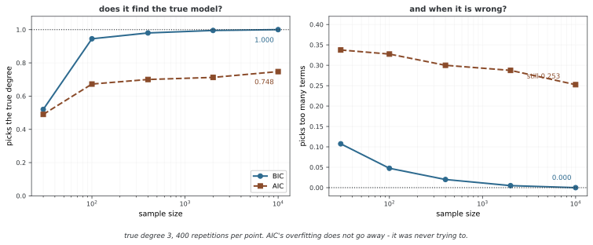

# 정보 기준

정보 기준은 적합도와 복잡도를 함께 고려해 모델을 비교한다. AIC는 주로 예측 로그점수, BIC는 정규적인 큰 표본에서 주변 우도와 연결된다. DIC·WAIC·LOO는 베이즈 사후 추론을 이용하지만 같은 양을 같은 방식으로 계산하는 기준은 아니다. 값의 방향·스케일과 평가할 예측 단위를 먼저 정의한다.

## 1. 왜 필요한가: 실전의 모델 비교

주변 우도 계산이 어려운 경우 정보 기준이 유용할 수 있다. 다만 모든 정보 기준이 베이즈 증거의 근사는 아니다. AIC·AICc·BIC는 최대 로그우도와 파라메터 수를 사용하고, DIC·WAIC는 사후분포에 대한 기댓값이나 분산을 사용한다. LOO는 관측 일부를 제외했을 때의 예측을 평가한다.

모델의 상대 순위만으로 충분한 예측 품질이나 올바른 관측 가정이 증명되지는 않는다. 같은 자료와 반응변수, 같은 예측 과제 및 우도 정규화 상수로 비교해야 한다.

## 2. 아카이케 정보 기준(AIC)

### 정의와 예측 해석

최대 로그우도를 $\hat\ell=\sum_i\log p(y_i\mid\hat\theta)$, 추정한 자유 파라메터 수를 k라 하면 다음과 같다.

$$AIC=-2\hat\ell+2k$$

같은 자료를 최대화한 로그우도는 새 관측의 로그점수를 낙관적으로 평가한다. 정규적인 독립 관측과 적절한 모형 조건에서 관측당 낙관 바이어스는 대략 k/n이다. 이를 보정한 관측당 예측 점수는 ℓ̂/n−k/n이며 −2n을 곱하면 AIC가 된다. 일반적인 모형 오지정에서는 단순 k 대신 정보행렬에 따른 보정이 필요할 수 있다.

AIC는 예측 KL 로스와 연결되며 임의의 모형에서 평균제곱오차를 최소화하는 보장은 아니다. 중첩된 유한 후보에서 참모형이 포함되어도 과도한 모형을 선택할 확률이 남을 수 있어 참모형 식별의 일관성과 구분한다. 작은 AIC를 선호하지만 차이가 작으면 추정 오차와 관심 목적을 함께 살핀다.

### AICc

독립 정규 오차의 선형 회귀에서 k에 회귀계수와 추정 오차분산을 포함하는 관례의 소표본 보정은 다음과 같다.

$$AICc=AIC+\frac{2k(k+1)}{n-k-1}$$

n>k+1이 필요하며 분모가 작을수록 보정이 커진다. 모든 분포·모형에 같은 식이 정확한 것은 아니고, n/k<40 같은 규칙은 경험적 지침이다. n이 충분히 커지면 이 보정은 작아진다. 파라메터 수와 표본 수를 어떤 모형에서 세었는지 명시한다.

### 상대 웨이트

$\Delta_i=AIC_i-\min_jAIC_j$에서 $w_i=\exp(-\Delta_i/2)/\sum_j\exp(-\Delta_j/2)$를 정의할 수 있다. 후보 간 상대 웨이트이며 베이즈 모델 사후확률과 동일하지 않다.

## 3. 베이즈 정보 기준(BIC)

정규적인 고정 차원 모형에서 적절한 사전밀도가 참값 근처에서 양수이고 매끄러운 등의 조건 아래 라플라스 근사로 다음을 얻는다.

$$\log p(D\mid M)=\hat\ell-\frac k2\log n+O(1)$$

단일 모드 라플라스 근사는 사후 최빈값에서 전개한다. 큰 표본의 BIC 유도에서는 최대 우도 추정값으로 주요 항을 표현할 수 있지만, 사후밀도의 선형항이 MLE에서 정확히 0이라고 가정하지는 않는다.

$$BIC=-2\hat\ell+k\log n,\qquad\log B_{12}\approx-\tfrac12(BIC_1-BIC_2)$$

생략한 O(1)항에는 사전과 곡률이 포함된다. BIC가 모든 상황에서 정확히 단위 정보 사전만을 사용한다고 해석하지 않는다. 정규성·식별성·고정된 후보 차원 및 참모형 포함 등의 조건에서 참모형을 선택할 확률이 1로 갈 수 있다. 임의의 특이 모형이나 차원이 자료 수와 함께 증가하는 경우에 자동으로 성립하지 않는다.

n≥8이면 log n>2이므로 같은 k 증가에 BIC가 AIC보다 큰 벌점을 준다. 이것이 모든 자료에서 반드시 더 단순한 모형을 고른다는 뜻은 아니다. 목표가 예측인지 후보 내 참모형 식별인지에 따라 기준을 해석한다.

## 4. 편차 정보 기준(DIC)

편차를 $D(\theta)=-2\log p(D\mid\theta)$라 하고, 그 사후평균을 D̄, 파라메터 사후평균을 θ̄라 하자.

$$p_D=\bar D-D(\bar\theta),\qquad DIC=\bar D+p_D=D(\bar\theta)+2p_D$$

정규 근사가 적절한 일부 모형에서 p_D를 유효 파라메터 수로 해석할 수 있다. 수축이 강하면 원래 개수보다 작을 수 있지만 항상 0과 k 사이에 있는 것은 아니다. 다봉 사후분포에서는 θ̄가 대표적이지 않거나 낮은 밀도 영역에 있어 p_D가 음수가 될 수도 있다.

분산에 기반한 대안은 $p_V=\operatorname{Var}(D(\theta)\mid D)/2$다. 이는 음이 아니지만 모든 상황에서 더 안정적이거나 같은 기준을 준다는 뜻은 아니다.

DIC는 비선형 리파라메리제이션과 잠재변수를 조건으로 둘지 적분할지에 민감하다. 계층 모형에서도 기존 그룹의 새 관측과 새 그룹 전체를 예측하는 문제는 다르다. DIC를 뒷받침하는 이론이 전혀 없다고 하거나 모든 계층 모형에 우선 적용할 기준으로 보지는 않는다. 선택한 예측 과제에 맞는 우도를 정의한다.

## 5. 널리 쓸 수 있는 정보 기준(WAIC)

### 관측별 사후예측 평가

θ 아래 조건부 독립인 관측 단위 i를 정하고 사후표본 θ⁽ˢ⁾, s=1,…,S를 사용한다.

$$\widehat{lppd}=\sum_i\log\left[\frac1S\sum_sp(y_i\mid\theta^{(s)})\right]$$

이는 같은 자료로 적합한 사후분포의 표본 내 로그 예측밀도이므로 낙관 바이어스를 보정한다.

$$p_{WAIC}=\sum_i\operatorname{Var}_{\theta\mid D}[\log p(y_i\mid\theta)]$$

$$elpd_{WAIC}=lppd-p_{WAIC},\qquad WAIC=-2elpd_{WAIC}$$

ELPD는 클수록, −2배인 WAIC는 작을수록 좋다. likelihood 값을 먼저 평균하고 로그를 취하는 lppd와, 로그우도 평균을 혼동하지 않는다. 샘플 계산에는 log-sum-exp를 사용한다.

### 성립 조건과 한계

[와타나베의 이론](https://jmlr.org/papers/v11/watanabe10a.html)은 특이 모형을 포함한 조건 아래 베이즈 교차 검증과 WAIC의 점근 관계를 다룬다. 모든 뉴럴 넷트웍·유한 표본에서 정확하게 작동한다는 보장은 아니다. 영향이 큰 관측과 약한 사전에서는 WAIC 근사가 불안정할 수 있다.

사후 기댓값을 사용하므로 단일 평균 파라메터에 의존하는 DIC보다 리파라메리제이션에 자연스럽지만, 관측 단위나 조건부·주변 우도 선택에는 영향을 받는다. 사후 계산은 MCMC에 한정되지 않으며 사용한 사후 근사의 오차도 포함해 검토한다.

## 6. 하나 빼기 교차 검증(LOO-CV)

### 예측 목표

자료에서 관측 i를 뺀 D₋ᵢ로 적합한 예측 점수를 합한다.

$$elpd_{LOO}=\sum_i\log p(y_i\mid D_{-i})$$

일반적으로 반복 적합이 필요하지만 켤레 모형 등에서는 해석적 지름길도 있다. 독립 자료에서 한 관측을 제외하는 과제와 새 그룹·미래 시점의 예측은 다르다. 그룹별 제외나 시간 순서에 따른 검증이 필요할 수 있다.

### 파레토 평활 중요도 샘플링(PSIS)

전체 사후표본을 관측별 역우도 웨이트 $w_i^{(s)}\propto1/p(y_i\mid\theta^{(s)})$로 재가중하면 LOO를 근사할 수 있다. 원시 중요도 웨이트의 꼬리가 불안정할 수 있어 PSIS는 큰 웨이트에 일반화 파레토분포를 적합하고 기대 순서통계량으로 평활화한다. [Vehtari 등의 연구](https://arxiv.org/abs/1507.04544)는 WAIC와 비교한 유한 표본 성질과 계산을 다룬다.

파레토 모양 추정값 k̂는 꼬리와 근사의 안정성을 진단한다. [loo 공식 진단](https://mc-stan.org/loo/reference/pareto-k-diagnostic.html)은 표본 수에 따른 기준을 사용하며 일반적으로 min(1−1/log₁₀S,0.7)보다 큰 값을 주의해서 평가한다. 큰 k̂에는 추가 표본만이 아니라 모형 개선·모멘트 매칭·해당 관측 재적합 또는 K-fold 검증을 고려한다. 작은 k̂도 관측 모형 자체의 타당성을 증명하지 않는다.

### 스케일 구분

LOO를 elpd로 보고하면 클수록 좋고 LOOIC=−2elpd_LOO로 보고하면 작을수록 좋다. WAIC와 직접 비교할 때 같은 스케일로 변환한다. BIC는 예측 ELPD가 아니라 −2 로그 주변 우도의 점근 근사이므로 모든 기준이 하나의 ELPD 추정량이라는 주장은 잘못이다.

## 7. 관계와 이음

| 기준 | 주요 계산 | 주요 해석 |
|---|---|---|
| AIC | −2ℓ̂+2k | 정규적인 최대 우도 적합의 예측 로그점수 보정 |
| AICc | AIC+2k(k+1)/(n−k−1) | 해당 정규 회귀 모형의 소표본 보정 |
| BIC | −2ℓ̂+k log n | 정규적인 큰 표본에서 −2 로그 증거의 주요 항 |
| DIC | D̄+p_D | 사후평균 편차와 유효 복잡도의 결합 |
| WAIC | −2(lppd−p_WAIC) | 사후 예측의 표본 내 낙관 바이어스 보정 |
| LOO | ∑log p(y_i|D₋ᵢ) | 제외한 관측의 예측 로그점수 |

정규적인 큰 표본과 약한 사전 등에서는 AIC·DIC·WAIC·LOO의 예측 해석이 가까워질 수 있지만, 특이 모형·강한 사전·다봉성에서는 같은 결론을 요구할 수 없다. 특히 WAIC와 LOO는 −2 스케일을 맞춰 비교해야 한다. BIC와의 차이는 벌점 크기뿐 아니라 추정 대상에도 있다.

<div class="storybox" markdown>

**그림으로 보는 AI 1.** 벌점이 $2k$ 냐 $k\log n$ 이냐가 다툼의 핵심이 아니다

위 표를 보면 AIC와 BIC가 벌점 계수만 다른 사촌처럼 보인다. 바로 윗줄이 "추정 대상에도 있다"고 못 박았는데, 그 말의 무게는 두 기준이 **각각 무엇을 하려고 만들어졌는지**를 보면 드러난다.

아카이케 히로쓰구(Hirotugu Akaike)가 1974년 《IEEE Transactions on Automatic Control》에 낸 AIC 는 **예측**을 겨냥한다. 참 분포와 적합한 모형 사이의 쿨백-라이블러 거리를 표본 밖에서 기댓값으로 얼마나 벌어질지 추정하는 양이다. 참 모형을 찾겠다는 말은 들어 있지 않다. 기디언 슈워츠(Gideon Schwarz)가 1978년 《Annals of Statistics》에 낸 BIC 는 전혀 다른 것을 겨냥한다 — 위 표의 해석대로 **$-2\log(\text{증거})$ 의 주요 항**, 곧 이 장 앞부분의 주변 우도를 큰 표본에서 어림한 것이다. 하나는 "어느 쪽이 더 잘 맞힐까", 다른 하나는 "어느 쪽이 참일까"를 묻는다.

목표가 다르면 성적표도 달라진다. 참 차수가 3인 다항 회귀를 400번씩 되풀이해 보았다.



$n=10{,}000$ 에서 BIC 는 **1.000** 으로 참 차수를 맞히고 과적합은 **0.000** 이다. AIC 는 0.748 에서 멈추고, 항을 너무 많이 고르는 비율이 **0.253 으로 남는다** — 표본을 아무리 늘려도 0으로 가지 않는다. 이것을 AIC 의 결함이라고 읽으면 안 된다. **AIC 는 참 차수를 맞히는 시험을 치르고 있지 않다.**

**다만 "그러면 AIC 가 예측은 더 낫겠지"도 재어 보기 전에는 말할 수 없다.** 같은 자리에서 표본 밖 예측오차를 견줘 보니 $n=100$ 에서 AIC 쪽 0.0620, BIC 쪽 0.0505 였고, 참 모형을 후보에서 아예 빼 버린 경우(사인 함수를 다항식으로 맞추게 한 경우)에도 0.0905 대 0.0805 로 **BIC 쪽이 나았다.** AIC 의 예측 지향은 그 양이 어떻게 유도되었는가에 대한 말이지, 주어진 문제에서 더 잘 맞힌다는 보증이 아니다.

그래서 쓸 때의 규칙은 간단하다. **AIC 값과 BIC 값을 나란히 놓고 큰 쪽을 버리는 식으로 읽지 않는다.** 둘은 같은 자의 눈금이 아니라 다른 물음의 답이고, 어느 쪽을 볼지는 지금 하려는 일이 예측인지 구조 식별인지가 정한다. 아래 8절이 기준을 섞어 쓰지 말라고 하는 까닭이다.

_확인한 곳 — H. Akaike, "A new look at the statistical model identification", *IEEE Transactions on Automatic Control* **AC-19**(6), 716–723 (1974) 가 쿨백-라이블러 거리의 추정량으로 AIC 를 유도했고, G. Schwarz, "Estimating the dimension of a model", *Annals of Statistics* **6**(2), 461–464 (1978) 가 주변 우도의 큰 표본 어림으로 BIC 를 유도했다. 그림과 본문의 수는 모두 여기서 직접 돌려 얻었으며, 그림은 BIC 가 1 로 수렴하고 AIC 의 과적합이 0 으로 가지 않는다는 것을 스스로 확인한 뒤에만 그린다. 예측오차 비교에서 작은 표본(n=30)의 수는 8차 다항식의 외삽이 불안정해 싣지 않았다._

</div>

## 8. 실용적인 고려

### 비교 단위와 불확실성

관측 자료·반응변수·우도 정규화 상수와 예측 단위를 맞춘다. 반응변수를 변환했다면 야코비안까지 포함한 같은 관측 공간의 밀도로 비교해야 한다. 계층·시계열 자료의 제외 단위는 실제 사용 목표에 맞춘다.

관측별 elpd 차이를 d_i라 하면 독립 단위의 차이 합에 대한 근사 표준오차는 $\sqrt{n\operatorname{Var}(d_i)}$다. 자료의 의존성이나 소표본에서는 별도 처리가 필요하다. 고정된 Δ<2·Δ>10 같은 규칙을 WAIC·LOO에 무조건 적용하는 대신 점수 차이와 불확실성, 영향 관측을 함께 보고한다. 사후표본 몬테카를로 오차와 새 자료에 따른 예측 평가의 불확실성도 구분한다.

### 모델 평균

기준값 IC_k에 $w_k\propto\exp(-IC_k/2)$를 적용할 수 있다. AIC 웨이트는 상대적 예측 기준의 웨이트이며, BIC 웨이트는 동일한 모델 사전확률과 근사 조건 아래의 사후 웨이트에 가깝다. WAIC 값을 같은 방식으로 지수화한 결과를 정확한 베이즈 모델확률이라 부르지는 않는다.

하나의 점수로 선택한 결과와 예측분포를 평균하는 결과는 다르다. 여러 모델을 시험하고 가장 좋은 점수만 보고하면 선택 바이어스가 생길 수 있으므로 평가 목적과 후보 탐색 과정도 명시한다.

## 9. 파이썬 구현

AIC·BIC 함수에는 **전체 최대 로그우도**를 넣는다. 관측당 평균 로그우도를 넣으면 스케일이 달라진다. 정규 회귀 예제의 k=설계행렬 열 수+1에서 추가 1은 오차분산이며 절편은 설계행렬에 직접 포함해야 한다. 열이 독립이고 잔차분산이 양수인지 확인한다. AICc는 n>k+1에서만 이 식으로 계산된다.

WAIC 함수는 S×n의 관측별 로그우도 행렬을 사용한다. DIC 함수에는 관측별 행렬이 아니라 표본별 **전체 로그우도**와 평균 파라메터에서의 전체 로그우도를 넣는다. 분산 계산은 ddof=0이며 사후표본의 상관·몬테카를로 오차를 별도 추정하지 않는다.

psis_loo라는 이름의 함수는 파레토 적합과 웨이트 평활화를 수행하지 않고 원시 역우도 웨이트를 그대로 사용한다. k_hat도 최대 웨이트와의 로그 비 평균인 임의 진단으로, 표준 PSIS의 파레토 k 추정이 아니다. 공식 k 기준을 이 값에 적용하거나 반환 결과를 검증된 PSIS-LOO로 보고해서는 안 된다. 직접 exp를 사용하는 부분에는 언더플로 위험도 있다.

BayesianLinearRegression은 β|σ²∼N(0,gσ²(XᵀX)⁻¹), σ²∼InvGamma(a0/2,b0/2)에 해당한다. a0·b0는 일반적인 shape·scale 자체가 아니라 두 배 관례다. g>0과 X의 완전 열계수, 양의 사전 파라메터가 필요하며 beta_cov의 분산 평균은 a_n>2일 때만 존재한다. 그렇지 않을 때의 대체값을 사후 평균분산으로 해석하지 않는다.

DIC 시연의 정규 계수 표본은 데이터로 적합한 사후분포가 아니라 지정한 평균·표준편차에서 임의 생성한 값이다. 수식을 계산하는 예시로만 읽고 실제 두 포아송 모형의 유효한 DIC 비교로 해석하지 않는다. 유한 횟수의 일관성 시뮬레이션도 점근 정리를 증명하지 않는다.

```python
"""
정보 기준: 온전한 구현

이 모듈은 모형 견줌을 위한 AIC, AICc, BIC, DIC, WAIC, LOO-CV의 셈하기와
그려 보기 및 모형 평균 내기 도구를 준다.
"""

import numpy as np
import matplotlib.pyplot as plt
from scipy import stats
from scipy.special import logsumexp, gammaln
from typing import Tuple, List, Optional, Dict, Union
from dataclasses import dataclass
from abc import ABC, abstractmethod

# =============================================================================
# 핵심 정보 기준 함수
# =============================================================================

def aic(log_likelihood: float, k: int) -> float:
    """
    아카이케 정보 기준을 셈한다.
    
    파라메터
    ----------
    log_likelihood : float
        최대로 만든 로그 가능도
    k : int
        어림한 파라메터의 개수
    
    반환값
    -------
    float
        AIC 값(낮을수록 좋다)
    """
    return -2 * log_likelihood + 2 * k

def aicc(log_likelihood: float, k: int, n: int) -> float:
    """
    작은 표본을 위한 바로잡은 AIC(AICc)을 셈한다.
    
    파라메터
    ----------
    log_likelihood : float
        최대로 만든 로그 가능도
    k : int
        어림한 파라메터의 개수
    n : int
        표본 크기
    
    반환값
    -------
    float
        AICc 값(낮을수록 좋다)
    
    일으키는 예외
    ------
    ValueError
        n - k - 1 <= 0이면
    """
    if n - k - 1 <= 0:
        raise ValueError(f"Sample size n={n} too small for k={k} parameters")
    
    base_aic = aic(log_likelihood, k)
    correction = 2 * k * (k + 1) / (n - k - 1)
    
    return base_aic + correction

def bic(log_likelihood: float, k: int, n: int) -> float:
    """
    베이즈 정보 기준을 셈한다.
    
    파라메터
    ----------
    log_likelihood : float
        최대로 만든 로그 가능도
    k : int
        어림한 파라메터의 개수
    n : int
        표본 크기
    
    반환값
    -------
    float
        BIC 값(낮을수록 좋다)
    """
    return -2 * log_likelihood + k * np.log(n)

def bic_to_log_bayes_factor(bic1: float, bic2: float) -> float:
    """
    BIC 차이를 어림 로그 베이즈 인자로 바꾼다.
    
    파라메터
    ----------
    bic1, bic2 : float
        모형 1과 2의 BIC 값
    
    반환값
    -------
    float
        어림 log B_12(모형 1 대 모형 2)
    """
    return -0.5 * (bic1 - bic2)

# =============================================================================
# 베이즈 정보 기준(뒤확률 표본이 필요하다)
# =============================================================================

def dic(
    log_lik_samples: np.ndarray,
    log_lik_at_mean: float
) -> Tuple[float, float]:
    """
    이탈도 정보 기준을 셈한다.
    
    파라메터
    ----------
    log_lik_samples : ndarray
        뒤확률 표본마다 값을 매긴 로그 가능도
    log_lik_at_mean : float
        파라메터의 뒤확률 평균에서 값을 매긴 로그 가능도
    
    반환값
    -------
    dic : float
        DIC 값
    p_d : float
        실효 파라메터의 개수
    """
    # 평균 이탈도
    mean_deviance = -2 * np.mean(log_lik_samples)
    
    # 뒤확률 평균에서의 이탈도
    deviance_at_mean = -2 * log_lik_at_mean
    
    # 실효 파라메터
    p_d = mean_deviance - deviance_at_mean
    
    # DIC
    dic_value = mean_deviance + p_d
    
    return dic_value, p_d

def dic_alternative(log_lik_samples: np.ndarray) -> Tuple[float, float]:
    """
    흩어짐 기반 실효 파라메터를 써서 DIC을 셈한다(겔먼 판).
    
    파라메터
    ----------
    log_lik_samples : ndarray
        뒤확률 표본마다 값을 매긴 로그 가능도
    
    반환값
    -------
    dic : float
        DIC 값
    p_d : float
        실효 파라메터의 개수(흩어짐 기반)
    """
    # 평균 이탈도
    mean_deviance = -2 * np.mean(log_lik_samples)
    
    # 흩어짐 기반 실효 파라메터
    p_d = 0.5 * np.var(-2 * log_lik_samples)
    
    # DIC
    dic_value = mean_deviance + p_d
    
    return dic_value, p_d

def waic(
    log_lik_matrix: np.ndarray
) -> Tuple[float, float, float]:
    """
    널리 쓸 수 있는 정보 기준을 셈한다.
    
    파라메터
    ----------
    log_lik_matrix : 꼴 (n_samples, n_observations)의 ndarray
        뒤확률 표본과 관측마다의 로그 가능도
        항목 [s, i] = log p(y_i | theta^(s))
    
    반환값
    -------
    waic : float
        WAIC 값
    lppd : float
        점별 로그 예측 밀도
    p_waic : float
        실효 파라메터의 개수
    """
    S, n = log_lik_matrix.shape
    
    # 점별 로그 예측 밀도
    # lppd = sum_i log( mean_s p(y_i | theta^s) )
    lppd = np.sum(logsumexp(log_lik_matrix, axis=0) - np.log(S))
    
    # 실효 파라메터(점별 흩어짐)
    # p_waic = sum_i Var_s(log p(y_i | theta^s))
    p_waic = np.sum(np.var(log_lik_matrix, axis=0))
    
    # WAIC
    waic_value = -2 * (lppd - p_waic)
    
    return waic_value, lppd, p_waic

def waic_pointwise(
    log_lik_matrix: np.ndarray
) -> Tuple[np.ndarray, np.ndarray, np.ndarray]:
    """
    점별 WAIC 몫을 셈한다.
    
    파라메터
    ----------
    log_lik_matrix : 꼴 (n_samples, n_observations)의 ndarray
        뒤확률 표본과 관측마다의 로그 가능도
    
    반환값
    -------
    elpd_i : ndarray
        점별 기대 로그 예측 밀도
    p_waic_i : ndarray
        점별 실효 파라메터
    waic_i : ndarray
        점별 WAIC 몫
    """
    S, n = log_lik_matrix.shape
    
    # 점별 lppd
    lppd_i = logsumexp(log_lik_matrix, axis=0) - np.log(S)
    
    # 점별 p_waic
    p_waic_i = np.var(log_lik_matrix, axis=0)
    
    # 점별 WAIC
    elpd_i = lppd_i - p_waic_i
    waic_i = -2 * elpd_i
    
    return elpd_i, p_waic_i, waic_i

# =============================================================================
# 하나 빼기 교차 검증
# =============================================================================

def psis_loo(
    log_lik_matrix: np.ndarray,
    return_diagnostics: bool = False
) -> Union[Tuple[float, float], Tuple[float, float, np.ndarray]]:
    """
    파레토로 매끄럽게 한 중요도 표집으로 LOO-CV을 셈한다.
    
    이것은 간추린 구현이다. 실제 제품에서는
    `arviz` 꾸러미를 생각해 보아라.
    
    파라메터
    ----------
    log_lik_matrix : 꼴 (n_samples, n_observations)의 ndarray
        뒤확률 표본과 관측마다의 로그 가능도
    return_diagnostics : bool
        파레토 k 진단을 되돌릴지 여부
    
    반환값
    -------
    loo : float
        LOO-CV 어림값(이탈도가 아니라 elpd 눈금)
    p_loo : float
        실효 파라메터의 개수
    k_hat : ndarray(return_diagnostics=True일 때)
        관측마다의 파레토 k 어림값
    """
    S, n = log_lik_matrix.shape
    
    elpd_loo = np.zeros(n)
    k_hat = np.zeros(n)
    
    for i in range(n):
        # 날 중요도 무게: 1 / p(y_i | theta)
        log_weights = -log_lik_matrix[:, i]
        
        # 안정시키고 파레토 매끄럽게 하기 쓰기
        # (간추림: 무게를 안정시키기만 한다)
        log_weights_centered = log_weights - np.max(log_weights)
        weights = np.exp(log_weights_centered)
        
        # 가장 큰 무게에 파레토 맞추기(간추림)
        M = max(int(np.sqrt(S)), 10)
        sorted_weights = np.sort(weights)[-M:]
        
        # 파레토 k 어림하기(간추린 적률 어림자)
        if sorted_weights[-1] > sorted_weights[0]:
            log_ratios = np.log(sorted_weights[-1] / sorted_weights[:-1])
            k_hat[i] = np.mean(log_ratios)
        else:
            k_hat[i] = 0
        
        # 무게 고르게 하기
        weights_normalized = weights / np.sum(weights)
        
        # LOO 예측 밀도
        log_lik_i = log_lik_matrix[:, i]
        elpd_loo[i] = np.log(np.sum(weights_normalized * np.exp(log_lik_i)))
    
    loo = np.sum(elpd_loo)
    
    # 실효 파라메터(어림)
    lppd = np.sum(logsumexp(log_lik_matrix, axis=0) - np.log(S))
    p_loo = lppd - loo
    
    if return_diagnostics:
        return loo, p_loo, k_hat
    return loo, p_loo

def exact_loo_cv(
    y: np.ndarray,
    X: np.ndarray,
    fit_func,
    predict_log_lik_func
) -> float:
    """
    다시 맞춰서 정확한 LOO-CV을 셈한다.
    
    파라메터
    ----------
    y : ndarray
        반응 변수
    X : ndarray
        설계 행렬
    fit_func : callable
        모형을 맞추고 파라메터를 되돌리는 함수
    predict_log_lik_func : callable
        Function(y_i, X_i, params) -> log p(y_i | X_i, params)
    
    반환값
    -------
    float
        LOO-CV(로그 예측 밀도의 합)
    """
    n = len(y)
    elpd = 0.0
    
    for i in range(n):
        # 관측 i 빼기
        mask = np.ones(n, dtype=bool)
        mask[i] = False
        
        y_train = y[mask]
        X_train = X[mask] if X.ndim > 1 else X[mask]
        
        # 관측 n-1개로 맞추기
        params = fit_func(y_train, X_train)
        
        # 남겨 둔 관측에서 값 매기기
        elpd += predict_log_lik_func(y[i], X[i:i+1] if X.ndim > 1 else X[i], params)
    
    return elpd

# =============================================================================
# 모형 견줌 도구
# =============================================================================

@dataclass
class ModelComparison:
    """모형 견줌 결과를 담는 그릇."""
    names: List[str]
    aic: np.ndarray
    aicc: np.ndarray
    bic: np.ndarray
    n_params: np.ndarray
    log_lik: np.ndarray
    n_obs: int
    
    def summary(self) -> str:
        """꼴을 갖춘 견줌 표를 되돌린다."""
        lines = []
        lines.append("Model Comparison Summary")
        lines.append("=" * 70)
        lines.append(f"{'Model':<20} {'k':>5} {'LL':>12} {'AIC':>10} {'AICc':>10} {'BIC':>10}")
        lines.append("-" * 70)
        
        # AIC로 정렬
        order = np.argsort(self.aic)
        
        for i in order:
            lines.append(
                f"{self.names[i]:<20} {self.n_params[i]:>5} "
                f"{self.log_lik[i]:>12.2f} {self.aic[i]:>10.2f} "
                f"{self.aicc[i]:>10.2f} {self.bic[i]:>10.2f}"
            )
        
        lines.append("-" * 70)
        
        # 델타 값
        lines.append("\nDifferences from best model (AIC):")
        delta_aic = self.aic - np.min(self.aic)
        delta_bic = self.bic - np.min(self.bic)
        
        for i in order:
            lines.append(
                f"  {self.names[i]:<20} ΔAIC = {delta_aic[i]:>7.2f}, "
                f"ΔBIC = {delta_bic[i]:>7.2f}"
            )
        
        return "\n".join(lines)
    
    def weights(self, criterion: str = 'aic') -> np.ndarray:
        """
        모형 무게(아카이케 무게 또는 유사 베이즈 인자)를 셈한다.
        
        파라메터
        ----------
        criterion : str
            'aic' 또는 'bic'
        
        반환값
        -------
        ndarray
            모형 무게(합이 1)
        """
        if criterion == 'aic':
            values = self.aic
        elif criterion == 'bic':
            values = self.bic
        else:
            raise ValueError(f"Unknown criterion: {criterion}")
        
        delta = values - np.min(values)
        weights = np.exp(-0.5 * delta)
        
        return weights / np.sum(weights)

def compare_models(
    models: Dict[str, Tuple[float, int]],
    n_obs: int
) -> ModelComparison:
    """
    정보 기준으로 여러 모형을 견준다.
    
    파라메터
    ----------
    models : dict
        모형 이름을 (log_likelihood, n_params) 튜플로 잇는 사전
    n_obs : int
        관측의 개수
    
    반환값
    -------
    ModelComparison
        견줌 결과
    """
    names = list(models.keys())
    n_models = len(names)
    
    log_liks = np.array([models[name][0] for name in names])
    n_params = np.array([models[name][1] for name in names])
    
    aic_vals = np.array([aic(ll, k) for ll, k in zip(log_liks, n_params)])
    aicc_vals = np.array([aicc(ll, k, n_obs) for ll, k in zip(log_liks, n_params)])
    bic_vals = np.array([bic(ll, k, n_obs) for ll, k in zip(log_liks, n_params)])
    
    return ModelComparison(
        names=names,
        aic=aic_vals,
        aicc=aicc_vals,
        bic=bic_vals,
        n_params=n_params,
        log_lik=log_liks,
        n_obs=n_obs
    )

# =============================================================================
# 선형 회귀 보기
# =============================================================================

class LinearRegressionIC:
    """
    정보 기준 셈하기를 갖춘 선형 회귀.
    
    모형: y = X @ beta + epsilon, epsilon ~ N(0, sigma^2)
    """
    
    def __init__(self):
        self.beta_hat = None
        self.sigma_hat = None
        self.n = None
        self.k = None
    
    def fit(self, X: np.ndarray, y: np.ndarray):
        """
        MLE로 선형 회귀를 맞춘다.
        
        파라메터
        ----------
        X : 꼴 (n, p)의 ndarray
            설계 행렬
        y : 꼴 (n,)의 ndarray
            반응
        """
        self.n = len(y)
        self.k = X.shape[1] + 1  # sigma 몫으로 +1
        
        # beta의 OLS
        self.beta_hat = np.linalg.lstsq(X, y, rcond=None)[0]
        
        # sigma의 MLE
        residuals = y - X @ self.beta_hat
        self.sigma_hat = np.sqrt(np.sum(residuals**2) / self.n)
    
    def log_likelihood(self, X: np.ndarray, y: np.ndarray) -> float:
        """MLE에서의 로그 가능도를 셈한다."""
        residuals = y - X @ self.beta_hat
        ll = (
            -0.5 * self.n * np.log(2 * np.pi)
            - self.n * np.log(self.sigma_hat)
            - 0.5 * np.sum(residuals**2) / self.sigma_hat**2
        )
        return ll
    
    def aic(self, X: np.ndarray, y: np.ndarray) -> float:
        """AIC를 셈한다."""
        return aic(self.log_likelihood(X, y), self.k)
    
    def aicc(self, X: np.ndarray, y: np.ndarray) -> float:
        """AICc을 셈한다."""
        return aicc(self.log_likelihood(X, y), self.k, self.n)
    
    def bic(self, X: np.ndarray, y: np.ndarray) -> float:
        """BIC를 셈한다."""
        return bic(self.log_likelihood(X, y), self.k, self.n)

# =============================================================================
# WAIC을 쓴 베이즈 선형 회귀
# =============================================================================

class BayesianLinearRegression:
    """
    켤레 앞확률을 쓴 베이즈 선형 회귀.
    
    모형: y = X @ beta + epsilon, epsilon ~ N(0, sigma^2)
    앞확률: beta | sigma^2 ~ N(0, sigma^2 * g * (X'X)^{-1})  [g-앞확률]
           sigma^2 ~ 역감마(a0/2, b0/2)
    """
    
    def __init__(self, g: float = 100.0, a0: float = 1.0, b0: float = 1.0):
        """
        파라메터
        ----------
        g : float
            g-앞확률 눈금 파라메터
        a0, b0 : float
            sigma^2의 역감마 앞확률 파라메터
        """
        self.g = g
        self.a0 = a0
        self.b0 = b0
        
        # 뒤확률 파라메터(맞춘 뒤 정해진다)
        self.beta_mean = None
        self.beta_cov = None
        self.a_n = None
        self.b_n = None
        self.X = None
        self.y = None
    
    def fit(self, X: np.ndarray, y: np.ndarray):
        """뒤확률 파라메터를 셈한다."""
        self.X = X
        self.y = y
        n, p = X.shape
        
        # OLS 어림값
        XtX = X.T @ X
        beta_ols = np.linalg.solve(XtX, X.T @ y)
        
        # beta의 뒤확률(sigma^2을 조건으로)
        # 평균: g/(1+g) * beta_ols
        self.beta_mean = self.g / (1 + self.g) * beta_ols
        
        # 잔차 제곱합
        residuals = y - X @ beta_ols
        SSR = np.sum(residuals**2)
        
        # sigma^2의 뒤확률
        self.a_n = self.a0 + n
        self.b_n = self.b0 + SSR + beta_ols.T @ XtX @ beta_ols / (1 + self.g)
        
        # beta의 뒤확률 공분산(sigma^2을 주변화하여)
        sigma2_mean = self.b_n / (self.a_n - 2) if self.a_n > 2 else self.b_n / self.a_n
        self.beta_cov = sigma2_mean * self.g / (1 + self.g) * np.linalg.inv(XtX)
    
    def sample_posterior(self, n_samples: int = 1000) -> Tuple[np.ndarray, np.ndarray]:
        """
        뒤확률 분포에서 표집한다.
        
        반환값
        -------
        beta_samples : 꼴 (n_samples, p)의 ndarray
        sigma2_samples : 꼴 (n_samples,)의 ndarray
        """
        p = len(self.beta_mean)
        
        # 역감마에서 sigma^2 표집
        sigma2_samples = stats.invgamma.rvs(
            self.a_n / 2,
            scale=self.b_n / 2,
            size=n_samples
        )
        
        # 다변량 정규에서 beta | sigma^2 표집
        XtX = self.X.T @ self.X
        beta_samples = np.zeros((n_samples, p))
        
        for s in range(n_samples):
            cov_s = sigma2_samples[s] * self.g / (1 + self.g) * np.linalg.inv(XtX)
            beta_samples[s] = np.random.multivariate_normal(self.beta_mean, cov_s)
        
        return beta_samples, sigma2_samples
    
    def compute_waic(self, n_samples: int = 1000) -> Tuple[float, float, float]:
        """
        이 모형의 WAIC을 셈한다.
        
        반환값
        -------
        waic_value : float
        lppd : float
        p_waic : float
        """
        beta_samples, sigma2_samples = self.sample_posterior(n_samples)
        
        n = len(self.y)
        log_lik_matrix = np.zeros((n_samples, n))
        
        for s in range(n_samples):
            mu = self.X @ beta_samples[s]
            sigma = np.sqrt(sigma2_samples[s])
            log_lik_matrix[s] = stats.norm.logpdf(self.y, mu, sigma)
        
        return waic(log_lik_matrix)

# =============================================================================
# 그려 보기 함수
# =============================================================================

def plot_ic_comparison(
    comparison: ModelComparison,
    criterion: str = 'all',
    figsize: Tuple[float, float] = (12, 5)
):
    """
    정보 기준 견줌을 그려 본다.
    
    파라메터
    ----------
    comparison : ModelComparison
        compare_models의 결과
    criterion : str
        'aic', 'bic', 'all'
    figsize : tuple
        그림 크기
    """
    fig, axes = plt.subplots(1, 2, figsize=figsize)
    
    # 왼쪽: 정보 기준 값
    ax = axes[0]
    x = np.arange(len(comparison.names))
    width = 0.25
    
    if criterion in ['aic', 'all']:
        ax.bar(x - width, comparison.aic, width, label='AIC', alpha=0.8)
    if criterion in ['bic', 'all']:
        ax.bar(x, comparison.bic, width, label='BIC', alpha=0.8)
    if criterion in ['aicc', 'all']:
        ax.bar(x + width, comparison.aicc, width, label='AICc', alpha=0.8)
    
    ax.set_xticks(x)
    ax.set_xticklabels(comparison.names, rotation=45, ha='right')
    ax.set_ylabel('Information Criterion')
    ax.legend()
    ax.set_title('Model Comparison')
    
    # 오른쪽: 모형 무게
    ax = axes[1]
    aic_weights = comparison.weights('aic')
    bic_weights = comparison.weights('bic')
    
    ax.bar(x - width/2, aic_weights, width, label='AIC weights', alpha=0.8)
    ax.bar(x + width/2, bic_weights, width, label='BIC weights', alpha=0.8)
    
    ax.set_xticks(x)
    ax.set_xticklabels(comparison.names, rotation=45, ha='right')
    ax.set_ylabel('Model Weight')
    ax.legend()
    ax.set_title('Model Weights')
    ax.set_ylim(0, 1)
    
    plt.tight_layout()
    plt.show()

def plot_penalty_comparison(
    max_params: int = 20,
    sample_sizes: List[int] = [10, 50, 100, 500]
):
    """
    표본 크기에 걸쳐 AIC와 BIC의 벌점 항을 견준다.
    
    파라메터
    ----------
    max_params : int
        그릴 파라메터의 최대 개수
    sample_sizes : list
        견줄 표본 크기
    """
    k = np.arange(1, max_params + 1)
    
    fig, axes = plt.subplots(1, 2, figsize=(12, 5))
    
    # 왼쪽: 파라메터마다의 벌점
    ax = axes[0]
    ax.axhline(2, color='blue', linestyle='--', label='AIC: 2', linewidth=2)
    
    for n in sample_sizes:
        ax.axhline(np.log(n), linestyle='-', alpha=0.7, 
                   label=f'BIC (n={n}): {np.log(n):.2f}')
    
    ax.set_xlabel('(Reference)')
    ax.set_ylabel('Penalty per Parameter')
    ax.legend()
    ax.set_title('Penalty per Parameter')
    ax.set_ylim(0, 8)
    
    # 오른쪽: 벌점 합계
    ax = axes[1]
    ax.plot(k, 2 * k, 'b--', label='AIC: 2k', linewidth=2)
    
    for n in sample_sizes:
        ax.plot(k, k * np.log(n), label=f'BIC (n={n}): k·log({n})', alpha=0.7)
    
    ax.set_xlabel('Number of Parameters (k)')
    ax.set_ylabel('Total Complexity Penalty')
    ax.legend()
    ax.set_title('Total Penalty vs Model Complexity')
    
    plt.tight_layout()
    plt.show()

def plot_waic_diagnostics(
    elpd_i: np.ndarray,
    p_waic_i: np.ndarray,
    figsize: Tuple[float, float] = (12, 5)
):
    """
    점별 WAIC 진단을 그린다.
    
    파라메터
    ----------
    elpd_i : ndarray
        점별 기대 로그 예측 밀도
    p_waic_i : ndarray
        점별 실효 파라메터
    figsize : tuple
        그림 크기
    """
    n = len(elpd_i)
    
    fig, axes = plt.subplots(1, 2, figsize=figsize)
    
    # 왼쪽: 점별 elpd
    ax = axes[0]
    ax.scatter(range(n), elpd_i, alpha=0.6, s=20)
    ax.axhline(np.mean(elpd_i), color='red', linestyle='--', 
               label=f'Mean: {np.mean(elpd_i):.2f}')
    
    # 말썽 있는 관측 도드라지게 하기
    threshold = np.percentile(elpd_i, 5)
    problematic = elpd_i < threshold
    ax.scatter(np.where(problematic)[0], elpd_i[problematic], 
               color='red', s=40, label=f'Bottom 5% (n={np.sum(problematic)})')
    
    ax.set_xlabel('Observation Index')
    ax.set_ylabel('Pointwise ELPD')
    ax.legend()
    ax.set_title('Pointwise Expected Log Predictive Density')
    
    # 오른쪽: 점별 p_waic
    ax = axes[1]
    ax.scatter(range(n), p_waic_i, alpha=0.6, s=20)
    ax.axhline(np.mean(p_waic_i), color='red', linestyle='--',
               label=f'Mean: {np.mean(p_waic_i):.3f}')
    
    # 영향이 큰 관측 도드라지게 하기
    threshold = np.percentile(p_waic_i, 95)
    high_influence = p_waic_i > threshold
    ax.scatter(np.where(high_influence)[0], p_waic_i[high_influence],
               color='red', s=40, label=f'Top 5% (n={np.sum(high_influence)})')
    
    ax.set_xlabel('Observation Index')
    ax.set_ylabel('Pointwise p_WAIC')
    ax.legend()
    ax.set_title('Pointwise Effective Parameters')
    
    plt.tight_layout()
    plt.show()

# =============================================================================
# 시연 함수
# =============================================================================

def demo_basic_ic():
    """다항 회귀에서 기본 AIC/BIC 견줌을 보인다."""
    
    print("=" * 70)
    print("BASIC INFORMATION CRITERIA: POLYNOMIAL REGRESSION")
    print("=" * 70)
    
    np.random.seed(42)
    
    # 이차 모형에서 자료 만들기
    n = 100
    x = np.linspace(-3, 3, n)
    y_true = 1 + 0.5 * x - 0.3 * x**2
    y = y_true + np.random.normal(0, 0.5, n)
    
    print(f"\nTrue model: y = 1 + 0.5x - 0.3x² + ε, ε ~ N(0, 0.25)")
    print(f"Sample size: n = {n}")
    
    # 차수가 다른 모형 맞추기
    print("\n--- Fitting Polynomial Models ---")
    
    models = {}
    
    for degree in range(1, 7):
        # 설계 행렬 만들기
        X = np.column_stack([x**i for i in range(degree + 1)])
        
        # 모형 맞추기
        model = LinearRegressionIC()
        model.fit(X, y)
        
        ll = model.log_likelihood(X, y)
        k = degree + 2  # 계수 + sigma
        
        models[f'Degree {degree}'] = (ll, k)
        
        print(f"Degree {degree}: k={k}, log-lik={ll:.2f}")
    
    # 모델 비교
    comparison = compare_models(models, n)
    print("\n" + comparison.summary())
    
    # 무게
    print("\nModel weights:")
    aic_w = comparison.weights('aic')
    bic_w = comparison.weights('bic')
    
    for i, name in enumerate(comparison.names):
        print(f"  {name}: AIC weight = {aic_w[i]:.3f}, BIC weight = {bic_w[i]:.3f}")
    
    return comparison

def demo_aic_vs_bic():
    """AIC와 BIC가 엇갈리는 때를 보인다."""
    
    print("\n" + "=" * 70)
    print("AIC VS BIC: WHEN THEY DISAGREE")
    print("=" * 70)
    
    np.random.seed(123)
    
    # 참 모형은 단순하다(차수 1)
    true_degree = 1
    
    sample_sizes = [20, 50, 100, 500, 1000]
    
    print("\nTrue model: y = 1 + 0.5x + ε")
    print("Comparing degree 1 vs degree 3 polynomials")
    print("\n  n     AIC₁   AIC₃    BIC₁   BIC₃   AIC choice  BIC choice")
    print("-" * 65)
    
    for n in sample_sizes:
        x = np.linspace(-3, 3, n)
        y = 1 + 0.5 * x + np.random.normal(0, 0.5, n)
        
        results = []
        for degree in [1, 3]:
            X = np.column_stack([x**i for i in range(degree + 1)])
            model = LinearRegressionIC()
            model.fit(X, y)
            
            ll = model.log_likelihood(X, y)
            k = degree + 2
            
            results.append({
                'aic': aic(ll, k),
                'bic': bic(ll, k, n)
            })
        
        aic_choice = 1 if results[0]['aic'] < results[1]['aic'] else 3
        bic_choice = 1 if results[0]['bic'] < results[1]['bic'] else 3
        
        print(f"{n:5d}  {results[0]['aic']:6.1f} {results[1]['aic']:6.1f}  "
              f"{results[0]['bic']:6.1f} {results[1]['bic']:6.1f}   "
              f"Degree {aic_choice}      Degree {bic_choice}")
    
    print("\n*** BIC's stronger penalty correctly identifies the simpler true model")
    print("    even when AIC might prefer the more complex model")

def demo_waic():
    """베이즈 모형의 WAIC 셈하기를 보인다."""
    
    print("\n" + "=" * 70)
    print("WAIC: FULLY BAYESIAN MODEL COMPARISON")
    print("=" * 70)
    
    np.random.seed(42)
    
    # 데이터를 생성한다
    n = 50
    x = np.linspace(-2, 2, n)
    y_true = 1 + 0.5 * x - 0.2 * x**2
    y = y_true + np.random.normal(0, 0.3, n)
    
    print(f"\nTrue model: y = 1 + 0.5x - 0.2x² + ε")
    print(f"Sample size: n = {n}")
    
    print("\n--- Computing WAIC for Different Polynomial Degrees ---")
    
    results = []
    
    for degree in [1, 2, 3, 4]:
        X = np.column_stack([x**i for i in range(degree + 1)])
        
        model = BayesianLinearRegression(g=n)
        model.fit(X, y)
        
        waic_val, lppd, p_waic = model.compute_waic(n_samples=2000)
        
        results.append({
            'degree': degree,
            'waic': waic_val,
            'lppd': lppd,
            'p_waic': p_waic
        })
        
        print(f"Degree {degree}: WAIC = {waic_val:.2f}, "
              f"lppd = {lppd:.2f}, p_WAIC = {p_waic:.2f}")
    
    # 가장 좋은 모델 찾기
    best = min(results, key=lambda x: x['waic'])
    print(f"\n*** Best model by WAIC: Degree {best['degree']}")
    
    return results

def demo_dic():
    """DIC 셈하기를 보인다."""
    
    print("\n" + "=" * 70)
    print("DIC: DEVIANCE INFORMATION CRITERION")
    print("=" * 70)
    
    np.random.seed(42)
    
    # 데이터를 생성한다
    n = 100
    x = np.linspace(0, 10, n)
    true_rate = 0.5
    y = np.random.poisson(np.exp(true_rate * x) * 0.1, n)
    
    print(f"\nPoisson regression example")
    print(f"Sample size: n = {n}")
    
    # 모형 둘의 뒤확률 표본 흉내내기
    # 모형 1: 일정한 비율
    # 모형 2: 선형 비율
    
    print("\n--- Model 1: Constant rate ---")
    
    # MCMC 표본 흉내내기(간추림)
    n_samples = 2000
    
    # 모형 1: lambda = exp(beta0)
    beta0_samples = np.random.normal(1.5, 0.1, n_samples)
    
    log_lik_1 = np.zeros(n_samples)
    for s in range(n_samples):
        rate = np.exp(beta0_samples[s]) * np.ones(n)
        log_lik_1[s] = np.sum(stats.poisson.logpmf(y, rate))
    
    # 뒤확률 평균에서의 로그 가능도
    rate_mean = np.exp(np.mean(beta0_samples)) * np.ones(n)
    log_lik_at_mean_1 = np.sum(stats.poisson.logpmf(y, rate_mean))
    
    dic_1, pd_1 = dic(log_lik_1, log_lik_at_mean_1)
    print(f"  DIC = {dic_1:.2f}, p_D = {pd_1:.2f}")
    
    print("\n--- Model 2: Linear rate ---")
    
    # 모형 2: lambda = exp(beta0 + beta1 * x)
    beta0_samples_2 = np.random.normal(0.5, 0.05, n_samples)
    beta1_samples = np.random.normal(0.1, 0.01, n_samples)
    
    log_lik_2 = np.zeros(n_samples)
    for s in range(n_samples):
        rate = np.exp(beta0_samples_2[s] + beta1_samples[s] * x)
        log_lik_2[s] = np.sum(stats.poisson.logpmf(y, rate))
    
    # 뒤확률 평균에서의 로그 가능도
    rate_mean = np.exp(np.mean(beta0_samples_2) + np.mean(beta1_samples) * x)
    log_lik_at_mean_2 = np.sum(stats.poisson.logpmf(y, rate_mean))
    
    dic_2, pd_2 = dic(log_lik_2, log_lik_at_mean_2)
    print(f"  DIC = {dic_2:.2f}, p_D = {pd_2:.2f}")
    
    print(f"\n*** Model comparison: ΔDIC = {dic_1 - dic_2:.2f}")
    if dic_1 < dic_2:
        print("    Constant rate model preferred")
    else:
        print("    Linear rate model preferred")

def demo_model_averaging():
    """정보 기준 무게로 모형 평균 내기를 보인다."""
    
    print("\n" + "=" * 70)
    print("MODEL AVERAGING WITH INFORMATION CRITERIA")
    print("=" * 70)
    
    np.random.seed(42)
    
    # 데이터를 생성한다
    n = 50
    x = np.linspace(-2, 2, n)
    y_true = 1 + 0.3 * x - 0.15 * x**2 + 0.05 * x**3
    y = y_true + np.random.normal(0, 0.3, n)
    
    print(f"\nTrue model has small cubic term")
    print("Comparing models of degrees 1, 2, 3, 4")
    
    # 모형 맞추기
    models = {}
    predictions = {}
    
    x_new = np.linspace(-2.5, 2.5, 100)
    
    for degree in [1, 2, 3, 4]:
        X = np.column_stack([x**i for i in range(degree + 1)])
        X_new = np.column_stack([x_new**i for i in range(degree + 1)])
        
        model = LinearRegressionIC()
        model.fit(X, y)
        
        ll = model.log_likelihood(X, y)
        k = degree + 2
        
        models[f'Degree {degree}'] = (ll, k)
        predictions[degree] = X_new @ model.beta_hat
    
    # 무게 셈하기
    comparison = compare_models(models, n)
    weights = comparison.weights('aic')
    
    print("\nAIC weights:")
    for i, name in enumerate(comparison.names):
        print(f"  {name}: {weights[i]:.3f}")
    
    # 모형 평균 예측
    y_avg = np.zeros_like(x_new)
    for i, degree in enumerate([1, 2, 3, 4]):
        y_avg += weights[i] * predictions[degree]
    
    print(f"\n*** Model-averaged prediction incorporates uncertainty")
    print(f"    about which model is correct")
    
    return comparison, predictions, y_avg

def demo_criteria_consistency():
    """BIC의 일관성과 AIC의 효율을 견주어 보인다."""
    
    print("\n" + "=" * 70)
    print("CONSISTENCY VS EFFICIENCY: AIC VS BIC")
    print("=" * 70)
    
    np.random.seed(42)
    
    # 참 모형: 단순 선형
    true_degree = 1
    
    sample_sizes = [20, 50, 100, 200, 500, 1000]
    n_simulations = 100
    
    print(f"\nTrue model: degree {true_degree}")
    print(f"Simulations per sample size: {n_simulations}")
    
    print("\n  n     AIC correct   BIC correct")
    print("-" * 40)
    
    for n in sample_sizes:
        aic_correct = 0
        bic_correct = 0
        
        for _ in range(n_simulations):
            x = np.linspace(-3, 3, n)
            y = 1 + 0.5 * x + np.random.normal(0, 0.5, n)
            
            models = {}
            for degree in [1, 2, 3, 4]:
                X = np.column_stack([x**i for i in range(degree + 1)])
                model = LinearRegressionIC()
                model.fit(X, y)
                
                ll = model.log_likelihood(X, y)
                k = degree + 2
                models[degree] = (ll, k)
            
            comparison = compare_models(
                {f'd{d}': models[d] for d in models},
                n
            )
            
            aic_best = np.argmin(comparison.aic) + 1
            bic_best = np.argmin(comparison.bic) + 1
            
            if aic_best == true_degree:
                aic_correct += 1
            if bic_best == true_degree:
                bic_correct += 1
        
        print(f"{n:5d}     {aic_correct/n_simulations*100:5.1f}%        "
              f"{bic_correct/n_simulations*100:5.1f}%")
    
    print("\n*** BIC is consistent: converges to true model as n → ∞")
    print("    AIC is efficient: minimizes prediction error but may overfit")

if __name__ == "__main__":
    comparison = demo_basic_ic()
    demo_aic_vs_bic()
    demo_waic()
    demo_dic()
    demo_model_averaging()
    demo_criteria_consistency()
```

??? note "전체 출력 (126줄)"

    ```
    ======================================================================
    BASIC INFORMATION CRITERIA: POLYNOMIAL REGRESSION
    ======================================================================

    True model: y = 1 + 0.5x - 0.3x² + ε, ε ~ N(0, 0.25)
    Sample size: n = 100

    --- Fitting Polynomial Models ---
    Degree 1: k=3, log-lik=-132.71
    Degree 2: k=4, log-lik=-62.15
    Degree 3: k=5, log-lik=-59.66
    Degree 4: k=6, log-lik=-59.06
    Degree 5: k=7, log-lik=-59.05
    Degree 6: k=8, log-lik=-59.02

    Model Comparison Summary
    ======================================================================
    Model                    k           LL        AIC       AICc        BIC
    ----------------------------------------------------------------------
    Degree 3                 5       -59.66     129.33     129.97     142.35
    Degree 4                 6       -59.06     130.12     131.02     145.75
    Degree 5                 7       -59.05     132.10     133.31     150.33
    Degree 2                 4       -62.15     132.31     132.73     142.73
    Degree 6                 8       -59.02     134.04     135.62     154.88
    Degree 1                 3      -132.71     271.42     271.67     279.24
    ----------------------------------------------------------------------

    Differences from best model (AIC):
      Degree 3             ΔAIC =    0.00, ΔBIC =    0.00
      Degree 4             ΔAIC =    0.79, ΔBIC =    3.40
      Degree 5             ΔAIC =    2.77, ΔBIC =    7.98
      Degree 2             ΔAIC =    2.98, ΔBIC =    0.38
      Degree 6             ΔAIC =    4.71, ΔBIC =   12.53
      Degree 1             ΔAIC =  142.09, ΔBIC =  136.88

    Model weights:
      Degree 1: AIC weight = 0.000, BIC weight = 0.000
      Degree 2: AIC weight = 0.100, BIC weight = 0.408
      Degree 3: AIC weight = 0.446, BIC weight = 0.492
      Degree 4: AIC weight = 0.300, BIC weight = 0.090
      Degree 5: AIC weight = 0.112, BIC weight = 0.009
      Degree 6: AIC weight = 0.042, BIC weight = 0.001

    ======================================================================
    AIC VS BIC: WHEN THEY DISAGREE
    ======================================================================

    True model: y = 1 + 0.5x + ε
    Comparing degree 1 vs degree 3 polynomials

      n     AIC₁   AIC₃    BIC₁   BIC₃   AIC choice  BIC choice
    -----------------------------------------------------------------
       20    40.1   43.2    43.1   48.2   Degree 1      Degree 1
       50    87.5   82.8    93.2   92.4   Degree 3      Degree 3
      100   151.3  154.9   159.1  167.9   Degree 1      Degree 1
      500   704.7  707.6   717.3  728.6   Degree 1      Degree 1
     1000  1386.4 1386.0  1401.1 1410.5   Degree 3      Degree 1

    *** BIC's stronger penalty correctly identifies the simpler true model
        even when AIC might prefer the more complex model

    ======================================================================
    WAIC: FULLY BAYESIAN MODEL COMPARISON
    ======================================================================

    True model: y = 1 + 0.5x - 0.2x² + ε
    Sample size: n = 50

    --- Computing WAIC for Different Polynomial Degrees ---
    Degree 1: WAIC = 38.98, lppd = -17.12, p_WAIC = 2.37
    Degree 2: WAIC = 19.88, lppd = -7.40, p_WAIC = 2.54
    Degree 3: WAIC = 20.25, lppd = -6.81, p_WAIC = 3.31
    Degree 4: WAIC = 22.08, lppd = -6.91, p_WAIC = 4.12

    *** Best model by WAIC: Degree 2

    ======================================================================
    DIC: DEVIANCE INFORMATION CRITERION
    ======================================================================

    Poisson regression example
    Sample size: n = 100

    --- Model 1: Constant rate ---
      DIC = 771.47, p_D = 4.41

    --- Model 2: Linear rate ---
      DIC = 546.60, p_D = 1.95

    *** Model comparison: ΔDIC = 224.87
        Linear rate model preferred

    ======================================================================
    MODEL AVERAGING WITH INFORMATION CRITERIA
    ======================================================================

    True model has small cubic term
    Comparing models of degrees 1, 2, 3, 4

    AIC weights:
      Degree 1: 0.005
      Degree 2: 0.654
      Degree 3: 0.250
      Degree 4: 0.092

    *** Model-averaged prediction incorporates uncertainty
        about which model is correct

    ======================================================================
    CONSISTENCY VS EFFICIENCY: AIC VS BIC
    ======================================================================

    True model: degree 1
    Simulations per sample size: 100

      n     AIC correct   BIC correct
    ----------------------------------------
       20      72.0%         87.0%
       50      82.0%         95.0%
      100      82.0%         98.0%
      200      73.0%         94.0%
      500      68.0%         96.0%
     1000      76.0%        100.0%

    *** BIC is consistent: converges to true model as n → ∞
        AIC is efficient: minimizes prediction error but may overfit
    ```


---

## 연습문제

<div class="drillbox" markdown>

**연습문제 1.** <span class="diff med" title="중간"></span>
전체 로그우도와 관측당 평균 로그우도를 AIC에 넣으면 어떤 차이가 생기는가?

</div>

??? success "풀이"
    AIC는 전체 최대 로그우도에 −2를 곱하고 2k를 더한다. 평균 로그우도를 그대로 넣으면 적합도 항을 n으로 나누고 벌점은 유지하는 잘못된 상대 가중이 된다.

---

<div class="drillbox" markdown>

**연습문제 2.** <span class="diff med" title="중간"></span>
elpd_LOO=−100과 WAIC=210을 같은 방향으로 비교할 수 있는가?

</div>

??? success "풀이"
    아니다. elpd는 클수록 좋고 WAIC는 −2 스케일로 작을수록 좋다. LOOIC=200으로 변환한 뒤 같은 과제에서 비교하되 추정 차이의 표준오차와 진단을 함께 살펴야 한다.

---

<div class="drillbox" markdown>

**연습문제 3.** <span class="diff med" title="중간"></span>
본문 코드의 psis_loo 함수에 공식 파레토 k 기준을 적용할 수 있는가?

</div>

??? success "풀이"
    아니다. 코드는 원시 중요도 웨이트를 평활화하지 않으며 k_hat도 일반화 파레토 적합으로 얻은 값이 아니다. 표준 PSIS 추정과 진단을 구현하거나 검증된 도구로 대조해야 한다.

---

<div class="drillbox" markdown>

**연습문제 4.** <span class="diff hard" title="어려움"></span>
아래 임포트만 있는 조각으로 유효한 DIC·WAIC 분석을 하려면 무엇이 필요한가?

</div>

??? success "풀이"
    모형의 적절한 사후분포 또는 검증한 근사표본과 관심 예측 단위에 맞는 우도가 필요하다. DIC에는 전체 로그우도, WAIC에는 관측별 로그우도 행렬을 준비한다. 임의 정규 계수 표본이나 이름만 PSIS인 함수는 이 요건을 대신하지 못한다.

    ```python
    import numpy as np
    # 구현은 주제에 따라 달라진다.
    # 켤레 모형: 닫힌 꼴 뒤확률 새로 고치기.
    # 켤레가 아닌 모형: MCMC 또는 변분 추론.
    # 핵심 스텝: 앞확률 정하기, 가능도 셈하기, 뒤확률 이끌어 내기/어림하기.
    ```

## 정리하며

정보 기준은 추정 대상과 스케일이 다르다. AIC의 예측 보정, BIC의 로그 증거 근사, 사후분포를 사용하는 DIC·WAIC, 제외 관측의 예측을 평가하는 LOO를 구분한다. 같은 자료·예측 단위로 비교하고 점수 차이의 불확실성 및 계산 진단을 함께 보고한다.

**참고 문헌**

- Akaike, H. (1974). A new look at the statistical model identification. IEEE Trans. Automatic Control, 19(6), 716–723.
- Schwarz, G. (1978). Estimating the dimension of a model. Annals of Statistics, 6(2), 461–464.
- Spiegelhalter, D. J., et al. (2002). Bayesian measures of model complexity and fit. JRSS B, 64(4), 583–639.
- Watanabe, S. (2010). Asymptotic equivalence of Bayes cross validation and WAIC. JMLR, 11, 3571–3594.
- Vehtari, A., Gelman, A., & Gabry, J. (2017). Practical Bayesian model evaluation using LOO-CV and WAIC. Statistics and Computing, 27(5), 1413–1432.
