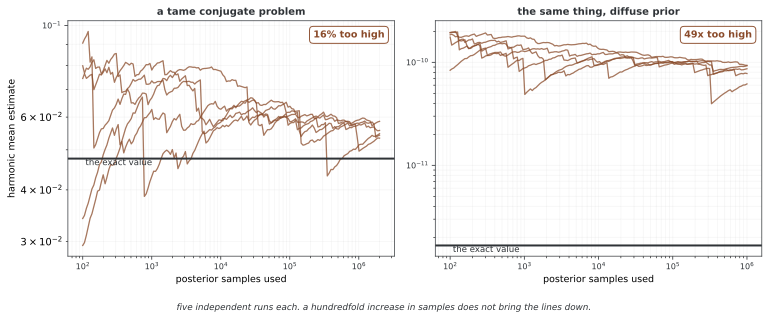

# 모델 증거(주변 우도)

모델 증거 또는 주변 우도는 우도를 파라메터의 사전분포에 대해 평균한 값이다. 연속 자료에서는 관측 자료의 확률밀도에 해당한다. 베이즈 모델 비교와 순차 예측에 어떻게 사용되는지 살펴보고, 해석적 공식과 수치 근사의 성립 조건을 구분한다.

## 1. 왜 필요한가: 왜 모델 증거인가?

모델을 고정한 파라메터 추론은 다음 사후분포를 구한다.

$$p(\theta\mid D,M)=\frac{p(D\mid\theta,M)p(\theta\mid M)}{p(D\mid M)}$$

분모 p(D|M)는 정규화 상수이며 모델 비교에서는 주요 비교량이 된다. 모델 사전확률 p(M)까지 지정하면 모델의 사후확률을 구할 수 있다.

목표가 미래 예측이면 교차 검증이나 예측 정보 기준도 사용할 수 있다. 우도비 검정·AIC·BIC·교차 검증은 서로 다른 가정과 평가 목표를 가지며, 어느 하나를 모든 모델 비교의 대체재로 보지는 않는다. 주변 우도 역시 사전분포와 관측 모형을 명시해야 하며 계산 비용이 클 수 있다.

## 2. 정의와 풀이

### 형식적 정의

파라메터가 $\theta$인 모델 $\mathcal{M}$의 **모델 증거**(주변 우도)는 다음과 같다.

$$
\boxed{p(\mathcal{D} \mid \mathcal{M}) = \int p(\mathcal{D} \mid \theta, \mathcal{M}) \, p(\theta \mid \mathcal{M}) \, d\theta}
$$

**부품**:

- $p(\mathcal{D} \mid \theta, \mathcal{M})$: 우도 함수
- $p(\theta \mid \mathcal{M})$: 사전분포
- 적분: 파라메터 공간 전체에 걸쳐

### 여러 가지 풀이

**1. 평균 우도**: 사전분포 아래의 기대 우도

$$
p(\mathcal{D} \mid \mathcal{M}) = \mathbb{E}_{\theta \sim p(\theta \mid \mathcal{M})}[p(\mathcal{D} \mid \theta, \mathcal{M})]
$$

**2. 예측 확률**: 모델이 데이터를 보기 전에 그것을 얼마나 잘 맞혔는가

**3. 정규화 상수**: 베이즈 정리의 분모

$$
p(\theta \mid \mathcal{D}, \mathcal{M}) = \frac{p(\mathcal{D} \mid \theta, \mathcal{M}) \, p(\theta \mid \mathcal{M})}{p(\mathcal{D} \mid \mathcal{M})}
$$

**4. 사전예측**: 사전예측 분포가 $\mathcal{D}$에 주는 확률

### 왜 "주변" 우도인가?

"주변"이라는 말은 파라메터 위에서 주변화(적분)한다는 뜻이다.

$$
p(\mathcal{D} \mid \mathcal{M}) = \int p(\mathcal{D}, \theta \mid \mathcal{M}) \, d\theta = \int p(\mathcal{D} \mid \theta, \mathcal{M}) \, p(\theta \mid \mathcal{M}) \, d\theta
$$

이는 특정 파라메터 값에서 잰 **조건부 우도** $p(\mathcal{D} \mid \hat{\theta}, \mathcal{M})$과 대비된다.

---

## 3. 베이즈 모델 비교

### 모델의 사후확률

모델 사전확률 $p(\mathcal{M}_k)$이 주어지면 다음과 같다.

$$
p(\mathcal{M}_k \mid \mathcal{D}) = \frac{p(\mathcal{D} \mid \mathcal{M}_k) \, p(\mathcal{M}_k)}{\sum_j p(\mathcal{D} \mid \mathcal{M}_j) \, p(\mathcal{M}_j)}
$$

모델 증거가 데이터가 우리의 모델 믿음을 얼마나 고치는지를 곧바로 정한다.

### 사후 오즈

두 모델 $\mathcal{M}_1$과 $\mathcal{M}_2$에 대해 다음과 같다.

$$
\underbrace{\frac{p(\mathcal{M}_1 \mid \mathcal{D})}{p(\mathcal{M}_2 \mid \mathcal{D})}}_{\text{Posterior odds}} = \underbrace{\frac{p(\mathcal{D} \mid \mathcal{M}_1)}{p(\mathcal{D} \mid \mathcal{M}_2)}}_{\text{Bayes factor}} \times \underbrace{\frac{p(\mathcal{M}_1)}{p(\mathcal{M}_2)}}_{\text{Prior odds}}
$$

사전 오즈이 같으면 베이즈 인자가 사후 오즈과 같다.

### 모델 평균 내기

모델 하나를 고르는 대신 예측을 평균 낼 수 있다.

$$
p(y^* \mid x^*, \mathcal{D}) = \sum_k p(y^* \mid x^*, \mathcal{D}, \mathcal{M}_k) \, p(\mathcal{M}_k \mid \mathcal{D})
$$

이는 모델의 불확실성을 계산에 넣으며 예측 성능을 좋게 할 때가 많다.

---

## 4. 오컴의 면도날: 저절로 주어지는 복잡도 벌

주변 우도는 최대 우도가 아니라 사전분포 아래의 **평균 우도**다. 자료에 매우 잘 맞는 파라메터 영역이 전체 사전 질량에서 작으면, 최대 우도가 높더라도 평균은 낮을 수 있다. 이를 베이즈식 오컴 효과로 해석한다.

하지만 파라메터 개수만으로 증거의 순서가 정해지지는 않는다. 다항 회귀도 사전 스케일과 자료에 따라 고차 모형의 증거가 높을 수 있다. 무관한 파라메터가 적분에서 완전히 분리되면 차원이 추가되어도 증거가 같을 수 있다.

정규화 가능한 사후분포와 유한한 기댓값을 가정하면 다음은 정확한 항등식이다.

$$\log p(D\mid M)=E_{p(\theta\mid D,M)}[\log p(D\mid\theta,M)]-KL(p(\theta\mid D,M)\Vert p(\theta\mid M))$$

첫 항은 MAP에서의 로그우도가 아니라 **사후분포에 대한 로그우도의 평균**이다. 베이즈 정리의 로그를 취해 사후분포로 평균하면 유도된다. KL 항을 사후분포가 사전분포에서 이동한 정도로 해석할 수 있지만 이 분해만으로 차원별 보편적 벌점을 얻는 것은 아니다.

## 5. 켤레 모델의 해석적 해

### 일반 원리

켤레 모델에서는 다음 덕분에 증거를 닫힌 형태로 얻을 수 있다.

$$
p(\mathcal{D} \mid \mathcal{M}) = \frac{p(\mathcal{D} \mid \theta) \, p(\theta)}{p(\theta \mid \mathcal{D})}
$$

적절한 사전·사후의 정규화 상수를 알고 분모의 사후밀도가 양수인 파라메터 값에서 비를 계산할 수 있다. 주변 우도는 그 평가점에 의존하지 않는다.

### 베타-베르누이 모델

**구조**: $x_i \sim \text{Bernoulli}(\theta)$, $\theta \sim \text{Beta}(\alpha_0, \beta_0)$

**증거**:

$$
p(\mathcal{D}) = \frac{B(\alpha_0 + s, \beta_0 + f)}{B(\alpha_0, \beta_0)}
$$

이는 순서가 지정된 독립 베르누이 관측열의 확률이다. 성공 횟수만의 이항 자료라면 조합 계수를 추가한다. 여기서 $s = \sum x_i$(성공), $f = n - s$(실패)이고 $B(\cdot, \cdot)$은 베타 함수이다.

**로그 증거**:

$$
\log p(\mathcal{D}) = \log B(\alpha_n, \beta_n) - \log B(\alpha_0, \beta_0)
$$

$$
= \log\Gamma(\alpha_n) + \log\Gamma(\beta_n) - \log\Gamma(\alpha_n + \beta_n) - \log\Gamma(\alpha_0) - \log\Gamma(\beta_0) + \log\Gamma(\alpha_0 + \beta_0)
$$

### 분산을 아는 정규 모형

**구조**: $x_i \sim \mathcal{N}(\mu, \sigma^2)$($\sigma^2$을 앎), $\mu \sim \mathcal{N}(\mu_0, \sigma_0^2)$

**증거**:

$$
p(\mathcal{D}) = (2\pi\sigma^2)^{-n/2} \cdot \sqrt{\frac{\sigma_n^2}{\sigma_0^2}} \cdot \exp\left(-\frac{1}{2\sigma^2}\sum_i(x_i - \bar{x})^2 - \frac{(\bar{x} - \mu_0)^2}{2(\sigma^2/n + \sigma_0^2)}\right)
$$

**로그 증거**:

$$
\log p(\mathcal{D}) = -\frac{n}{2}\log(2\pi\sigma^2) + \frac{1}{2}\log\frac{\tau_0}{\tau_n} - \frac{1}{2\sigma^2}\sum_i(x_i - \bar{x})^2 - \frac{\tau_0 n \tau}{2\tau_n}(\bar{x} - \mu_0)^2
$$

여기서 사후분산 σ_n²=1/τ_n이며 모든 분산은 양수다. $\tau = 1/\sigma^2$, $\tau_0 = 1/\sigma_0^2$, $\tau_n = \tau_0 + n\tau$이다.

### 분산을 모르는 정규 모형(NIG 사전분포)

**구조**: $x_i \sim \mathcal{N}(\mu, \sigma^2)$, $(\mu, \sigma^2) \sim \text{NIG}(\mu_0, \kappa_0, \alpha_0, \beta_0)$

**로그 증거**:

$$
\log p(\mathcal{D}) = \log\Gamma(\alpha_n) - \log\Gamma(\alpha_0) + \alpha_0\log\beta_0 - \alpha_n\log\beta_n + \frac{1}{2}\log\frac{\kappa_0}{\kappa_n} - \frac{n}{2}\log(2\pi)
$$

여기서 $\kappa_n = \kappa_0 + n$, $\alpha_n = \alpha_0 + n/2$이고 $\beta_n$은 NIG 갱신 식을 따른다.

---

## 6. 근사 방법

### 라플라스 근사

적절한 내부 사후 최빈값 θ̂와 음의 로그 사후 헤시안 H가 양의 정부호인 경우 다음과 같다.

$$\log p(D\mid M)\approx\log p(D\mid\hat\theta,M)+\log p(\hat\theta\mid M)+\frac d2\log(2\pi)-\frac12\log|H|$$

최적화 결과뿐 아니라 곡률과 국소 정규 근사의 적절성이 중요하다. 다봉성·경계·특이성이 있으면 부정확할 수 있다. BIC는 정규적 고정 차원·큰 표본 조건에서 최대 우도와 d log n 항만 남긴 추가 근사이며 사전 관련 상수까지 정확히 복원하지는 않는다.

### 조화평균 추정

적절한 사전분포 아래 우도가 사전 지지집합에서 양수이면 다음 항등식을 사용할 수 있다.

$$p(D)^{-1}=E_{p(\theta\mid D)}[1/p(D\mid\theta)]$$

사후표본에서 역우도를 평균하는 추정량은 분산이 무한해질 수 있고 극단적인 꼬리에 매우 민감하다. 모든 모형에서 반드시 무한 분산인 것은 아니지만, 표본에서 안정적으로 보인다는 이유만으로 신뢰할 수 없다.

<div class="storybox" markdown>

**그림으로 보는 AI 1.** 가장 간단한 어림자가 가장 나쁜 어림자가 된 내력

위 항등식은 아름답다. 사후표본만 있으면 역우도를 평균하는 것으로 증거가 나온다 — 따로 할 일이 없다. 1994년에 마이클 뉴턴(Michael Newton)과 에이드리언 래프터리(Adrian Raftery)가 이것을 내놓았을 때 매력이 바로 그 간편함이었다.

그런데 같은 1994년에 래드퍼드 닐(Radford Neal)이 그 글의 토론에서 불안정하다고 경고했고, 2008년에는 아예 **「The Harmonic Mean of the Likelihood: Worst Monte Carlo Method Ever」** 라는 제목으로 글을 썼다. 사상 최악의 몬테카를로 방법이라는 뜻이다.

바로 위 문단이 "표본에서 안정적으로 보인다는 이유만으로 신뢰할 수 없다"고 적어 둔 것의 크기를 보자. 5절의 켤레 모형이라 **정확한 답을 알고 있으므로** 얼마나 빗나가는지 그대로 셀 수 있다.



**순한 켤레 문제에서조차 표본 200만 개를 써도 16% 높다.** 사전분포를 넓힌 쪽에서는 **49배** 높고, 표본을 백 배 늘려도 선이 내려오지 않는다. 더 돌리면 나아지겠지 하는 기대가 통하지 않는 것이다.

까닭은 곡선에 난 **아래로 뚝 떨어지는 자리**에 있다. 어림자가 쓰는 것은 $1/p(D\mid\theta)$ 이므로 우도가 아주 작은 표본 하나가 합을 지배한다. 그런데 그런 표본은 사후분포에서 좀처럼 뽑히지 않는다 — 사후분포는 우도가 큰 곳에 몰려 있으니까. 그래서 평소에는 **작은 값들을 보지 못한 채 위로 치우친 값**을 내놓다가, 어쩌다 하나 뽑히면 뚝 떨어진다. 분산이 무한하다는 말의 그림이 이것이고, **표본이 적을수록 더 안정되어 보인다**는 고약한 성질도 여기서 나온다.

**그러니 이 어림자를 쓸 때 가장 위험한 신호는 "값이 안정적이다"이다.** 아래 중요도 샘플링 항이 유효 표본 수와 웨이트 집중을 따로 확인하라고 하고, 9절의 구현이 반환하는 표준오차가 "일반적인 공식이 아니다"라고 못 박아 둔 까닭도 같다 — 눈에 보이는 안정성이 수렴의 증거가 되지 못하는 자리가 있다.

_확인한 곳 — M. A. Newton, A. E. Raftery, "Approximate Bayesian inference with the weighted likelihood bootstrap" (1994) 가 조화평균 어림자를 제안했고, Radford Neal 이 같은 해 토론에서 불안정성을 지적한 뒤 2008년 글 "The Harmonic Mean of the Likelihood: Worst Monte Carlo Method Ever" 를 썼다. 그림의 수는 그림을 그리는 코드가 직접 셈하며, 정확한 값은 켤레 모형의 닫힌 식으로 구한다. 다섯 실행이 모두 끝까지 위로 치우쳐 있는지를 스스로 확인한 뒤에만 그린다._

</div>

### 중요도 샘플링

제안분포 q에서 독립 표본을 얻으면 다음과 같이 추정한다.

$$\hat Z=\frac1S\sum_s\frac{p(D\mid\theta^{(s)})p(\theta^{(s)})}{q(\theta^{(s)})},\qquad\theta^{(s)}\sim q$$

분자가 양수인 영역을 q가 덮어야 한다. 사후 근처를 잘 근사해도 꼬리가 너무 얇으면 추정분산이 매우 크거나 무한할 수 있다. 웨이트 집중과 유효 표본 수, 반복 계산 간 변동을 확인한다.

### 어닐링 중요도 샘플링과 네스티드 샘플링

AIS는 정규화된 사전에서 시작해 $p_t(\theta)\propto\pi(\theta)L(\theta)^{\beta_t}$, 0=β₀<…<β_T=1인 경로를 따른다. 중간 분포를 보존하는 전이와 경로 웨이트로 정규화 상수의 비를 추정하며 온도 간 간격과 혼합이 중요하다.

네스티드 샘플링은 적절한 사전 질량 $X(\lambda)=\int_{L(\theta)>\lambda}\pi(\theta)d\theta$와 그에 대응하는 우도 함수 L(X)로 증거를 $Z=\int_0^1L(X)dX$로 나타낸다. 적분 차원이 1로 표현되더라도 우도 제약 아래의 표본 추출은 어려울 수 있으므로 다봉 탐색과 수치 오차를 점검한다.

## 7. 순차 데이터에서의 증거

확률의 연쇄법칙으로 다음은 정확하다.

$$p(x_{1:n}\mid M)=\prod_{t=1}^np(x_t\mid x_{1:t-1},M)$$

관측이 θ를 조건으로 독립이면 각 항은 이전 자료의 사후분포를 사용한 예측이다.

$$p(x_t\mid x_{1:t-1},M)=\int p(x_t\mid\theta,M)p(\theta\mid x_{1:t-1},M)\,d\theta$$

로그 증거는 이 순차 로그 예측 점수의 합이다. 이는 원래 사전분포로 모든 관측의 주변 확률을 각각 계산해 더하는 방법과 다르다. 시간 의존 모형은 우도에도 과거 자료·상태의 조건을 반영한다.

같은 관측 순서와 단위에서 높은 로그 증거는 해당 순차 예측 점수의 합이 높다는 뜻이다. 미래의 모든 예측 지표에서 우월하다는 보장은 아니다. 예측 점수의 급락은 모형 점검의 신호일 수 있지만 정상적인 드문 관측과 구조 변화를 구분해야 한다.

## 8. 사전분포를 어떻게 정하느냐에 대한 민감도

주변 우도는 사전예측분포가 관측 자료에 부여한 질량 또는 밀도이므로 사전 범위에 의존한다. 아주 넓은 사전분포가 중립적이라는 뜻은 아니다. 실제 가능한 스케일에 맞는 적절한 사전분포 몇 가지로 민감도를 비교한다. 사후 파라메터 추론도 사전분포의 영향을 받는다.

부적절 사전분포의 임의 정규화 상수는 일반적인 증거와 BF를 정의하지 못하게 할 수 있다. 훈련·검증 자료를 분리한 조건부 예측비와 분수 BF는 다른 방법이다. 분수 BF는 전체 우도의 거듭제곱 일부로 적절한 갱신을 만든 뒤 나머지 기여를 비교하며 물리적인 자료 분할이 필수는 아니다. [베이즈 인자](bayes_factors.md)의 정의를 참고한다.

사전 민감도가 작다는 사실만으로 관측 모형의 적합성이 증명되지는 않는다. 후보 모델 전체의 예측 점검과 평가 목표도 함께 보고한다.

## 9. 파이썬 구현

베타 함수는 0·1 관측열과 양의 사전 파라메터를 가정한다. 순차 함수는 1 이외의 값을 실패로 처리하므로 입력 범위를 확인해야 한다. 정규 모형은 양의 분산과 비어 있지 않은 1차원 자료를 가정하며 NIG 사전의 κ₀·α₀·β₀도 양수여야 한다. 베타 사전 비교는 같은 우도족에서 사전 예측을 비교하는 것이며 fair coin이라는 이름도 θ=0.5인 점 가설을 뜻하지 않는다.

laplace_approximation은 최적화 성공 여부를 확인하지 않으며 유한차분이 파라메터 경계를 넘을 수 있다. 헤시안 행렬식이 양수인 것만으로 양의 정부호를 보장하지 않고, 음수 행렬식에 절댓값을 취해도 유효한 라플라스 근사가 되지 않는다. 반환값은 진단을 거쳐 해석해야 한다.

중요도 추정의 첫 반환값은 로그 증거지만 두 번째 log_evidence_std는 로그 웨이트 표준편차를 웨이트 ESS의 제곱근으로 나눈 휴리스틱이다. 일반적인 로그 증거 추정량의 표준오차 공식은 아니다. 제안분포의 지지집합·꼬리와 독립성 또는 표본 상관을 별도로 점검한다.

다항 회귀의 오컴 시연은 정확한 사전 적분 대신 BIC 점수를 정규화한다. 분산을 자료에서 추정하면서 파라메터 수에서는 빠뜨렸지만 모든 차수에 동일하게 한 개가 누락되어 BIC 차이는 같다. 정규화한 값은 해당 근사의 웨이트이며 정확한 모델 사후확률은 아니다. 순차 그림은 처음 두 모델 모두 sequential_log_evidence를 제공해야 한다.

```python
"""
모형 증거(주변 가능도): 온전한 구현

이 모듈은 여러 베이즈 모형의 모형 증거 셈하기를 주며, 켤레인 경우의 정확한
풀이와 일반적인 모형의 어림을
보여 준다.
"""

import numpy as np
import matplotlib.pyplot as plt
from scipy import stats
from scipy.special import gammaln, logsumexp
from scipy.optimize import minimize
from typing import Tuple, List, Optional, Callable, Dict
from dataclasses import dataclass
from abc import ABC, abstractmethod

# =============================================================================
# 베이즈 모형의 추상 바탕 클래스
# =============================================================================

class BayesianModel(ABC):
    """증거 셈하기를 갖춘 모형의 추상 바탕 클래스."""
    
    @abstractmethod
    def log_evidence(self, data: np.ndarray) -> float:
        """로그 주변 가능도를 셈한다."""
        pass
    
    @abstractmethod
    def log_likelihood(self, data: np.ndarray, params: np.ndarray) -> float:
        """주어진 파라메터에서 로그 가능도를 셈한다."""
        pass
    
    @abstractmethod
    def log_prior(self, params: np.ndarray) -> float:
        """로그 앞확률 밀도를 셈한다."""
        pass
    
    def log_posterior_unnorm(self, data: np.ndarray, params: np.ndarray) -> float:
        """고르게 하지 않은 로그 뒤확률을 셈한다."""
        return self.log_likelihood(data, params) + self.log_prior(params)

# =============================================================================
# 정확한 증거를 갖는 켤레 모형
# =============================================================================

@dataclass
class BetaBernoulliModel(BayesianModel):
    """
    정확한 증거 셈하기를 갖춘 베타-베르누이 모형.
    
    모형: x_i | θ ~ 베르누이(θ), θ ~ Beta(α₀, β₀)
    
    파라메터
    ----------
    alpha0 : float
        앞확률 alpha 파라메터
    beta0 : float
        앞확률 beta 파라메터
    """
    alpha0: float = 1.0
    beta0: float = 1.0
    
    def log_evidence(self, data: np.ndarray) -> float:
        """
        로그 증거를 해석적으로 셈한다.
        
        log p(D) = log B(α_n, β_n) - log B(α₀, β₀)
        """
        data = np.atleast_1d(data)
        s = data.sum()  # 성공
        f = len(data) - s  # 실패
        
        alpha_n = self.alpha0 + s
        beta_n = self.beta0 + f
        
        # log B(a, b) = log Γ(a) + log Γ(b) - log Γ(a + b)
        log_B_prior = gammaln(self.alpha0) + gammaln(self.beta0) - gammaln(self.alpha0 + self.beta0)
        log_B_post = gammaln(alpha_n) + gammaln(beta_n) - gammaln(alpha_n + beta_n)
        
        return log_B_post - log_B_prior
    
    def log_likelihood(self, data: np.ndarray, params: np.ndarray) -> float:
        """베르누이 로그 가능도를 셈한다."""
        theta = params[0]
        if theta <= 0 or theta >= 1:
            return -np.inf
        s = data.sum()
        f = len(data) - s
        return s * np.log(theta) + f * np.log(1 - theta)
    
    def log_prior(self, params: np.ndarray) -> float:
        """베타 로그 앞확률을 셈한다."""
        theta = params[0]
        return stats.beta.logpdf(theta, self.alpha0, self.beta0)
    
    def sequential_log_evidence(self, data: np.ndarray) -> Tuple[float, List[float]]:
        """
        예측 확률로 증거를 차례대로 셈한다.
        
        전체 로그 증거와 예측 로그 확률의 목록을 되돌린다.
        """
        data = np.atleast_1d(data)
        alpha, beta = self.alpha0, self.beta0
        log_probs = []
        
        for x in data:
            # 예측 확률
            if x == 1:
                p = alpha / (alpha + beta)
            else:
                p = beta / (alpha + beta)
            log_probs.append(np.log(p))
            
            # 갱신
            if x == 1:
                alpha += 1
            else:
                beta += 1
        
        return sum(log_probs), log_probs

@dataclass
class GaussianKnownVarianceModel(BayesianModel):
    """
    흩어짐을 알고 증거를 정확히 셈하는 가우스 모형.
    
    모형: x_i | μ ~ N(μ, σ²), μ ~ N(μ₀, σ₀²)
    
    파라메터
    ----------
    mu0 : float
        앞확률 평균
    sigma0_sq : float
        앞확률 흩어짐
    sigma_sq : float
        아는 자료 흩어짐
    """
    mu0: float = 0.0
    sigma0_sq: float = 1.0
    sigma_sq: float = 1.0
    
    def log_evidence(self, data: np.ndarray) -> float:
        """로그 증거를 해석적으로 셈한다."""
        data = np.atleast_1d(data)
        n = len(data)
        x_bar = data.mean()
        
        tau = 1 / self.sigma_sq
        tau0 = 1 / self.sigma0_sq
        tau_n = tau0 + n * tau
        
        # 표본 평균에서의 제곱 어긋남의 합
        ss = ((data - x_bar) ** 2).sum()
        
        # 로그 증거
        log_ev = (
            -0.5 * n * np.log(2 * np.pi * self.sigma_sq)  # 가능도 고르게 하기
            + 0.5 * np.log(tau0 / tau_n)  # 앞확률/뒤확률 정밀도 비
            - 0.5 * tau * ss  # 자료의 들쭉날쭉함
            - 0.5 * tau0 * n * tau / tau_n * (x_bar - self.mu0) ** 2  # 앞확률과 자료의 어긋남
        )
        
        return log_ev
    
    def log_likelihood(self, data: np.ndarray, params: np.ndarray) -> float:
        """가우스 로그 가능도를 셈한다."""
        mu = params[0]
        return stats.norm.logpdf(data, mu, np.sqrt(self.sigma_sq)).sum()
    
    def log_prior(self, params: np.ndarray) -> float:
        """가우스 로그 앞확률을 셈한다."""
        mu = params[0]
        return stats.norm.logpdf(mu, self.mu0, np.sqrt(self.sigma0_sq))
    
    def sequential_log_evidence(self, data: np.ndarray) -> Tuple[float, List[float]]:
        """증거를 차례대로 셈한다."""
        data = np.atleast_1d(data)
        
        mu_t = self.mu0
        tau_t = 1 / self.sigma0_sq
        tau = 1 / self.sigma_sq
        
        log_probs = []
        
        for x in data:
            # 예측 분포: N(μ_t, σ² + 1/τ_t)
            pred_var = self.sigma_sq + 1 / tau_t
            log_p = stats.norm.logpdf(x, mu_t, np.sqrt(pred_var))
            log_probs.append(log_p)
            
            # 갱신
            tau_new = tau_t + tau
            mu_t = (tau_t * mu_t + tau * x) / tau_new
            tau_t = tau_new
        
        return sum(log_probs), log_probs

@dataclass
class NormalInverseGammaModel(BayesianModel):
    """
    평균과 흩어짐을 모르는 가우스 모형.
    
    모형: x_i | μ, σ² ~ N(μ, σ²)
           (μ, σ²) ~ NIG(μ₀, κ₀, α₀, β₀)
    """
    mu0: float = 0.0
    kappa0: float = 1.0
    alpha0: float = 1.0
    beta0: float = 1.0
    
    def log_evidence(self, data: np.ndarray) -> float:
        """로그 증거를 해석적으로 셈한다."""
        data = np.atleast_1d(data)
        n = len(data)
        
        if n == 0:
            return 0.0
        
        x_bar = data.mean()
        ss = ((data - x_bar) ** 2).sum()
        
        # 뒤확률 파라메터
        kappa_n = self.kappa0 + n
        alpha_n = self.alpha0 + n / 2
        beta_n = (self.beta0 + 0.5 * ss + 
                  0.5 * self.kappa0 * n / kappa_n * (x_bar - self.mu0) ** 2)
        
        # 로그 증거
        log_ev = (
            gammaln(alpha_n) - gammaln(self.alpha0)
            + self.alpha0 * np.log(self.beta0) - alpha_n * np.log(beta_n)
            + 0.5 * np.log(self.kappa0 / kappa_n)
            - 0.5 * n * np.log(2 * np.pi)
        )
        
        return log_ev
    
    def log_likelihood(self, data: np.ndarray, params: np.ndarray) -> float:
        """가우스 로그 가능도를 셈한다."""
        mu, sigma_sq = params
        if sigma_sq <= 0:
            return -np.inf
        return stats.norm.logpdf(data, mu, np.sqrt(sigma_sq)).sum()
    
    def log_prior(self, params: np.ndarray) -> float:
        """NIG 로그 앞확률을 셈한다."""
        mu, sigma_sq = params
        if sigma_sq <= 0:
            return -np.inf
        
        # p(σ²) = 역감마(α₀, β₀)
        log_p_sigma = stats.invgamma.logpdf(sigma_sq, self.alpha0, scale=self.beta0)
        
        # p(μ | σ²) = N(μ₀, σ²/κ₀)
        log_p_mu = stats.norm.logpdf(mu, self.mu0, np.sqrt(sigma_sq / self.kappa0))
        
        return log_p_sigma + log_p_mu

# =============================================================================
# 증거 어림 방법
# =============================================================================

def laplace_approximation(
    model: BayesianModel,
    data: np.ndarray,
    init_params: np.ndarray,
    param_bounds: Optional[List[Tuple]] = None
) -> Tuple[float, np.ndarray, np.ndarray]:
    """
    라플라스 어림으로 로그 증거를 셈한다.
    
    log p(D) ≈ log p(D|θ̂) + log p(θ̂) + (d/2)log(2π) - (1/2)log|H|
    
    파라메터
    ----------
    model : BayesianModel
        log_likelihood과 log_prior 메서드를 갖춘 모형
    data : array
        관측 자료
    init_params : array
        최적화의 첫 파라메터 값
    param_bounds : 튜플의 list, 있어도 되고 없어도 됨
        파라메터마다의 경계
    
    반환값
    -------
    log_evidence : float
        로그 증거의 라플라스 어림
    map_params : array
        MAP 파라메터 어림값
    hessian : array
        MAP에서 음의 로그 뒤확률의 헤세 행렬
    """
    def neg_log_posterior(params):
        return -model.log_posterior_unnorm(data, params)
    
    # MAP 어림값 찾기
    result = minimize(
        neg_log_posterior,
        init_params,
        method='L-BFGS-B',
        bounds=param_bounds
    )
    
    map_params = result.x
    
    # 헤세 행렬을 수치로 셈하기
    d = len(map_params)
    eps = 1e-5
    hessian = np.zeros((d, d))
    
    for i in range(d):
        for j in range(d):
            params_pp = map_params.copy()
            params_pm = map_params.copy()
            params_mp = map_params.copy()
            params_mm = map_params.copy()
            
            params_pp[i] += eps
            params_pp[j] += eps
            params_pm[i] += eps
            params_pm[j] -= eps
            params_mp[i] -= eps
            params_mp[j] += eps
            params_mm[i] -= eps
            params_mm[j] -= eps
            
            hessian[i, j] = (
                neg_log_posterior(params_pp) - neg_log_posterior(params_pm)
                - neg_log_posterior(params_mp) + neg_log_posterior(params_mm)
            ) / (4 * eps ** 2)
    
    # 라플라스 어림
    log_posterior_at_map = model.log_posterior_unnorm(data, map_params)
    sign, log_det_H = np.linalg.slogdet(hessian)
    
    if sign <= 0:
        # 헤세 행렬이 양의 정부호가 아니다. 어림이 나쁠 수 있다
        log_det_H = np.log(np.abs(np.linalg.det(hessian)) + 1e-10)
    
    log_evidence = (
        log_posterior_at_map 
        + 0.5 * d * np.log(2 * np.pi) 
        - 0.5 * log_det_H
    )
    
    return log_evidence, map_params, hessian

def importance_sampling_evidence(
    model: BayesianModel,
    data: np.ndarray,
    proposal_samples: np.ndarray,
    proposal_log_pdf: Callable[[np.ndarray], float]
) -> Tuple[float, float]:
    """
    중요도 표집으로 로그 증거를 어림한다.
    
    파라메터
    ----------
    model : BayesianModel
        log_likelihood과 log_prior 메서드를 갖춘 모형
    data : array
        관측 자료
    proposal_samples : array
        제안 분포에서 뽑은 표본, 꼴 (n_samples, d)
    proposal_log_pdf : callable
        제안의 로그 밀도를 셈하는 함수
    
    반환값
    -------
    log_evidence : float
        어림한 로그 증거
    log_evidence_std : float
        어림한 표준 오차(로그 눈금에서)
    """
    n_samples = len(proposal_samples)
    log_weights = np.zeros(n_samples)
    
    for i, params in enumerate(proposal_samples):
        log_num = model.log_posterior_unnorm(data, params)
        log_denom = proposal_log_pdf(params)
        log_weights[i] = log_num - log_denom
    
    # 수치 안정을 위한 로그-합-지수
    log_evidence = logsumexp(log_weights) - np.log(n_samples)
    
    # 흩어짐 어림하기
    weights = np.exp(log_weights - log_weights.max())
    ess = weights.sum() ** 2 / (weights ** 2).sum()  # 실효 표본 크기
    
    # 어림 표준 오차
    log_evidence_std = np.std(log_weights) / np.sqrt(ess)
    
    return log_evidence, log_evidence_std

def bic_approximation(
    log_likelihood_at_mle: float,
    n_params: int,
    n_samples: int
) -> float:
    """
    로그 증거의 BIC 어림을 셈한다.
    
    log p(D) ≈ log p(D|θ̂_MLE) - (d/2) log(n)
    
    파라메터
    ----------
    log_likelihood_at_mle : float
        MLE에서의 로그 가능도
    n_params : int
        모형 파라메터의 개수
    n_samples : int
        자료점의 개수
    
    반환값
    -------
    float
        로그 증거의 BIC 어림
    """
    return log_likelihood_at_mle - 0.5 * n_params * np.log(n_samples)

# =============================================================================
# 모형 견줌 도구
# =============================================================================

def compute_model_probabilities(
    log_evidences: List[float],
    prior_probs: Optional[List[float]] = None
) -> np.ndarray:
    """
    로그 증거에서 뒤확률 모형 확률을 셈한다.
    
    파라메터
    ----------
    log_evidences : list
        모형마다의 로그 증거
    prior_probs : list, 있어도 되고 없어도 됨
        모형마다의 앞확률(None이면 고름)
    
    반환값
    -------
    array
        뒤확률 모형 확률
    """
    log_evidences = np.array(log_evidences)
    n_models = len(log_evidences)
    
    if prior_probs is None:
        log_priors = np.zeros(n_models) - np.log(n_models)
    else:
        log_priors = np.log(prior_probs)
    
    log_posteriors = log_evidences + log_priors
    log_posteriors -= logsumexp(log_posteriors)
    
    return np.exp(log_posteriors)

def bayes_factor(log_evidence_1: float, log_evidence_2: float) -> float:
    """
    베이즈 인자 BF₁₂ = p(D|M₁) / p(D|M₂)을 셈한다.
    
    수치 안정을 위해 베이즈 인자를 로그 눈금으로 되돌린다.
    """
    return log_evidence_1 - log_evidence_2

def interpret_bayes_factor(log_bf: float) -> str:
    """
    캐스와 래프터리(1995)의 눈금으로 베이즈 인자를 풀이한다.
    
    파라메터
    ----------
    log_bf : float
        로그 베이즈 인자(자연로그)
    
    반환값
    -------
    str
        증거 세기의 풀이
    """
    bf = np.exp(log_bf)
    
    if log_bf > 0:
        model = "Model 1"
        abs_log_bf = log_bf
    else:
        model = "Model 2"
        abs_log_bf = -log_bf
    
    # 캐스와 래프터리 눈금을 위해 밑 10 로그로 바꾸기
    log10_bf = abs_log_bf / np.log(10)
    
    if log10_bf < 0.5:
        strength = "Not worth more than a bare mention"
    elif log10_bf < 1:
        strength = "Substantial"
    elif log10_bf < 2:
        strength = "Strong"
    else:
        strength = "Decisive"
    
    return f"{strength} evidence for {model} (log₁₀ BF = {log10_bf:.2f})"

# =============================================================================
# 그려 보기 함수
# =============================================================================

def plot_evidence_comparison(
    models: Dict[str, BayesianModel],
    data: np.ndarray,
    prior_probs: Optional[Dict[str, float]] = None
) -> plt.Figure:
    """증거로 모형 견줌을 그려 본다."""
    
    model_names = list(models.keys())
    log_evidences = [models[name].log_evidence(data) for name in model_names]
    
    if prior_probs is None:
        priors = None
    else:
        priors = [prior_probs.get(name, 1/len(models)) for name in model_names]
    
    posteriors = compute_model_probabilities(log_evidences, priors)
    
    fig, axes = plt.subplots(1, 3, figsize=(15, 5))
    
    # 로그 증거
    ax = axes[0]
    colors = plt.cm.Set2(np.linspace(0, 1, len(model_names)))
    bars = ax.bar(model_names, log_evidences, color=colors)
    ax.set_ylabel('Log Evidence', fontsize=12)
    ax.set_title('Log Marginal Likelihood', fontsize=14)
    ax.tick_params(axis='x', rotation=45)
    
    for bar, val in zip(bars, log_evidences):
        ax.text(bar.get_x() + bar.get_width()/2, bar.get_height() + 0.5,
                f'{val:.1f}', ha='center', fontsize=10)
    
    # 뒤확률
    ax = axes[1]
    bars = ax.bar(model_names, posteriors, color=colors)
    ax.set_ylabel('Posterior Probability', fontsize=12)
    ax.set_title('Model Posterior Probabilities', fontsize=14)
    ax.set_ylim(0, 1.1)
    ax.tick_params(axis='x', rotation=45)
    
    for bar, val in zip(bars, posteriors):
        ax.text(bar.get_x() + bar.get_width()/2, bar.get_height() + 0.02,
                f'{val:.3f}', ha='center', fontsize=10)
    
    # 가장 좋은 모형에 견준 베이즈 인자
    ax = axes[2]
    best_idx = np.argmax(log_evidences)
    log_bfs = [log_evidences[best_idx] - le for le in log_evidences]
    
    bars = ax.bar(model_names, log_bfs, color=colors)
    ax.set_ylabel('Log Bayes Factor (vs best)', fontsize=12)
    ax.set_title(f'Evidence Against (vs {model_names[best_idx]})', fontsize=14)
    ax.tick_params(axis='x', rotation=45)
    ax.axhline(np.log(10), color='orange', linestyle='--', alpha=0.7, label='Strong (10:1)')
    ax.axhline(np.log(100), color='red', linestyle='--', alpha=0.7, label='Decisive (100:1)')
    ax.legend(fontsize=9)
    
    plt.tight_layout()
    return fig

def plot_sequential_evidence(
    models: Dict[str, BayesianModel],
    data: np.ndarray
) -> plt.Figure:
    """증거가 차례대로 어떻게 쌓이는지 그려 본다."""
    
    fig, axes = plt.subplots(2, 1, figsize=(12, 8))
    
    model_names = list(models.keys())
    colors = plt.cm.Set2(np.linspace(0, 1, len(model_names)))
    
    # 모형마다 잇단 증거 셈하기
    sequential_log_probs = {}
    cumulative_log_evidence = {}
    
    for name, model in models.items():
        if hasattr(model, 'sequential_log_evidence'):
            total, probs = model.sequential_log_evidence(data)
            sequential_log_probs[name] = probs
            cumulative_log_evidence[name] = np.cumsum(probs)
    
    n = len(data)
    x = np.arange(1, n + 1)
    
    # 위: 누적 로그 증거
    ax = axes[0]
    for i, (name, cum_ev) in enumerate(cumulative_log_evidence.items()):
        ax.plot(x, cum_ev, label=name, color=colors[i], linewidth=2)
    
    ax.set_xlabel('Number of Observations', fontsize=12)
    ax.set_ylabel('Cumulative Log Evidence', fontsize=12)
    ax.set_title('Evidence Accumulation', fontsize=14)
    ax.legend(fontsize=10)
    ax.grid(True, alpha=0.3)
    
    # 아래: 잇단 로그 베이즈 인자
    ax = axes[1]
    if len(model_names) >= 2:
        name1, name2 = model_names[0], model_names[1]
        cum1 = cumulative_log_evidence[name1]
        cum2 = cumulative_log_evidence[name2]
        log_bf = cum1 - cum2
        
        ax.plot(x, log_bf, 'b-', linewidth=2)
        ax.axhline(0, color='black', linestyle='-', linewidth=0.5)
        ax.axhline(np.log(10), color='green', linestyle='--', alpha=0.7, label='Substantial for M1')
        ax.axhline(-np.log(10), color='red', linestyle='--', alpha=0.7, label='Substantial for M2')
        
        ax.fill_between(x, 0, log_bf, where=log_bf > 0, alpha=0.3, color='green')
        ax.fill_between(x, 0, log_bf, where=log_bf < 0, alpha=0.3, color='red')
        
        ax.set_xlabel('Number of Observations', fontsize=12)
        ax.set_ylabel(f'Log BF ({name1} vs {name2})', fontsize=12)
        ax.set_title('Sequential Bayes Factor', fontsize=14)
        ax.legend(fontsize=10)
        ax.grid(True, alpha=0.3)
    
    plt.tight_layout()
    return fig

def plot_occam_razor_demo(sample_sizes: List[int] = [10, 50, 200]) -> plt.Figure:
    """다항 모형 견줌으로 오컴의 면도날을 보인다."""
    
    np.random.seed(42)
    
    # 참 모형: 이차
    def true_func(x):
        return 2 + 1.5 * x - 0.5 * x**2
    
    # 데이터를 생성한다
    x_full = np.linspace(-2, 2, 200)
    
    fig, axes = plt.subplots(len(sample_sizes), 2, figsize=(14, 4*len(sample_sizes)))
    
    for row, n in enumerate(sample_sizes):
        np.random.seed(42)
        x = np.random.uniform(-2, 2, n)
        y = true_func(x) + np.random.normal(0, 0.5, n)
        
        # 차수가 다른 다항식 맞추기
        degrees = [1, 2, 3, 5, 8]
        log_evidences = []
        
        for deg in degrees:
            # 증거 어림으로 BIC 쓰기
            X = np.vander(x, deg + 1, increasing=True)
            coeffs = np.linalg.lstsq(X, y, rcond=None)[0]
            y_pred = X @ coeffs
            residuals = y - y_pred
            
            # MLE 흩어짐 어림값
            sigma2_mle = (residuals ** 2).mean()
            
            # MLE에서의 로그 가능도
            log_lik = -0.5 * n * np.log(2 * np.pi * sigma2_mle) - 0.5 * n
            
            # BIC 어림
            log_ev = bic_approximation(log_lik, deg + 1, n)
            log_evidences.append(log_ev)
        
        # 왼쪽: 자료와 맞춤
        ax = axes[row, 0] if len(sample_sizes) > 1 else axes[0]
        ax.scatter(x, y, alpha=0.5, s=30, label='Data')
        
        for i, deg in enumerate([1, 2, 5]):
            X = np.vander(x_full, deg + 1, increasing=True)
            X_fit = np.vander(x, deg + 1, increasing=True)
            coeffs = np.linalg.lstsq(X_fit, y, rcond=None)[0]
            y_fit = X @ coeffs
            ax.plot(x_full, y_fit, label=f'Degree {deg}', linewidth=2)
        
        ax.plot(x_full, true_func(x_full), 'k--', linewidth=2, label='True')
        ax.set_xlabel('x', fontsize=12)
        ax.set_ylabel('y', fontsize=12)
        ax.set_title(f'Polynomial Fits (n = {n})', fontsize=14)
        ax.legend(fontsize=9)
        ax.grid(True, alpha=0.3)
        
        # 오른쪽: 증거 견줌
        ax = axes[row, 1] if len(sample_sizes) > 1 else axes[1]
        
        # 뒤확률로 고르게 하기
        probs = compute_model_probabilities(log_evidences)
        
        colors = ['red' if d != 2 else 'green' for d in degrees]
        bars = ax.bar([f'Deg {d}' for d in degrees], probs, color=colors, alpha=0.7)
        
        ax.set_ylabel('Model Probability', fontsize=12)
        ax.set_title(f'Model Evidence (n = {n})', fontsize=14)
        ax.set_ylim(0, 1.1)
        
        for bar, prob in zip(bars, probs):
            ax.text(bar.get_x() + bar.get_width()/2, bar.get_height() + 0.02,
                    f'{prob:.2f}', ha='center', fontsize=10)
    
    plt.tight_layout()
    return fig

# =============================================================================
# 보여 주기
# =============================================================================

def demo_conjugate_evidence():
    """켤레 모형의 정확한 증거를 보인다."""
    
    print("=" * 70)
    print("MODEL EVIDENCE: CONJUGATE MODELS")
    print("=" * 70)
    
    # 베타-베르누이
    print("\n--- Beta-Bernoulli Model ---")
    np.random.seed(42)
    true_theta = 0.7
    data = np.random.binomial(1, true_theta, 50)
    
    models = {
        'Uniform prior (α=β=1)': BetaBernoulliModel(1, 1),
        'Informative correct (α=7, β=3)': BetaBernoulliModel(7, 3),
        'Informative wrong (α=3, β=7)': BetaBernoulliModel(3, 7),
    }
    
    print(f"Data: {data.sum()} successes in {len(data)} trials (true θ = {true_theta})")
    
    for name, model in models.items():
        log_ev = model.log_evidence(data)
        _, seq_probs = model.sequential_log_evidence(data)
        print(f"\n{name}:")
        print(f"  Log evidence: {log_ev:.4f}")
        print(f"  Sequential check: {sum(seq_probs):.4f}")
    
    # 가우스 모형
    print("\n\n--- Gaussian Models ---")
    np.random.seed(123)
    true_mu, true_sigma = 5.0, 2.0
    data = np.random.normal(true_mu, true_sigma, 30)
    
    print(f"Data: n={len(data)}, mean={data.mean():.2f}, std={data.std():.2f}")
    print(f"True: μ={true_mu}, σ={true_sigma}")
    
    # 흩어짐을 아는 모형
    model_known = GaussianKnownVarianceModel(mu0=0, sigma0_sq=10, sigma_sq=true_sigma**2)
    log_ev_known = model_known.log_evidence(data)
    print(f"\nKnown variance (σ²={true_sigma**2}):")
    print(f"  Log evidence: {log_ev_known:.4f}")
    
    # 흩어짐을 모르는 모형
    model_unknown = NormalInverseGammaModel(mu0=0, kappa0=0.1, alpha0=1, beta0=1)
    log_ev_unknown = model_unknown.log_evidence(data)
    print(f"\nUnknown variance (NIG prior):")
    print(f"  Log evidence: {log_ev_unknown:.4f}")

def demo_laplace_approximation():
    """증거의 라플라스 어림을 보인다."""
    
    print("\n" + "=" * 70)
    print("LAPLACE APPROXIMATION")
    print("=" * 70)
    
    np.random.seed(42)
    data = np.random.normal(5.0, 2.0, 30)
    
    # NIG 모형 쓰기
    model = NormalInverseGammaModel(mu0=0, kappa0=0.1, alpha0=1, beta0=1)
    
    # 정확한 증거
    exact_log_ev = model.log_evidence(data)
    
    # 라플라스 어림
    init_params = np.array([data.mean(), data.var()])
    laplace_log_ev, map_params, hess = laplace_approximation(
        model, data, init_params,
        param_bounds=[(None, None), (0.01, None)]
    )
    
    print(f"\nExact log evidence: {exact_log_ev:.4f}")
    print(f"Laplace approximation: {laplace_log_ev:.4f}")
    print(f"Difference: {abs(exact_log_ev - laplace_log_ev):.4f}")
    print(f"\nMAP estimates: μ = {map_params[0]:.3f}, σ² = {map_params[1]:.3f}")

def demo_model_comparison():
    """증거로 모형을 견주어 보인다."""
    
    print("\n" + "=" * 70)
    print("MODEL COMPARISON")
    print("=" * 70)
    
    np.random.seed(42)
    
    # 치우친 동전에서 자료 만들기
    true_theta = 0.65
    n = 100
    data = np.random.binomial(1, true_theta, n)
    
    print(f"Data: {data.sum()} successes in {n} trials")
    
    # 서로 다른 앞확률 견주기
    models = {
        'Fair coin (α=50, β=50)': BetaBernoulliModel(50, 50),
        'Slight bias allowed (α=5, β=5)': BetaBernoulliModel(5, 5),
        'Uniform (α=1, β=1)': BetaBernoulliModel(1, 1),
        'Biased prior (α=6, β=4)': BetaBernoulliModel(6, 4),
    }
    
    log_evidences = {}
    for name, model in models.items():
        log_ev = model.log_evidence(data)
        log_evidences[name] = log_ev
        print(f"\n{name}:")
        print(f"  Log evidence: {log_ev:.4f}")
    
    # 모형 확률 셈하기
    names = list(log_evidences.keys())
    log_evs = list(log_evidences.values())
    probs = compute_model_probabilities(log_evs)
    
    print("\n--- Posterior Model Probabilities ---")
    for name, prob in zip(names, probs):
        print(f"  {name}: {prob:.4f}")
    
    # 베이즈 인자 풀이
    best_idx = np.argmax(log_evs)
    print(f"\n--- Bayes Factors vs Best Model ({names[best_idx]}) ---")
    for i, name in enumerate(names):
        if i != best_idx:
            log_bf = log_evs[best_idx] - log_evs[i]
            interp = interpret_bayes_factor(log_bf)
            print(f"  vs {name}: {interp}")

def demo_occam_razor():
    """다항 회귀에서 오컴의 면도날을 보인다."""
    
    print("\n" + "=" * 70)
    print("OCCAM'S RAZOR DEMONSTRATION")
    print("=" * 70)
    
    fig = plot_occam_razor_demo([20, 100, 500])
    fig.savefig('occam_razor_demo.png', dpi=150, bbox_inches='tight')
    plt.close()
    print("\nSaved: occam_razor_demo.png")
    print("\nAs sample size increases, evidence concentrates on true model (degree 2)")

if __name__ == "__main__":
    demo_conjugate_evidence()
    demo_laplace_approximation()
    demo_model_comparison()
    demo_occam_razor()
```

**출력:**

```
======================================================================
MODEL EVIDENCE: CONJUGATE MODELS
======================================================================

--- Beta-Bernoulli Model ---
Data: 39 successes in 50 trials (true θ = 0.7)

Uniform prior (α=β=1):
  Log evidence: -28.2755
  Sequential check: -28.2755

Informative correct (α=7, β=3):
  Log evidence: -27.3283
  Sequential check: -27.3283

Informative wrong (α=3, β=7):
  Log evidence: -31.4651
  Sequential check: -31.4651


--- Gaussian Models ---
Data: n=30, mean=5.09, std=2.33
True: μ=5.0, σ=2.0

Known variance (σ²=4.0):
  Log evidence: -72.2430

Unknown variance (NIG prior):
  Log evidence: -73.4229

======================================================================
LAPLACE APPROXIMATION
======================================================================

Exact log evidence: -64.8066
Laplace approximation: -64.9228
Difference: 0.1162

MAP estimates: μ = 4.608, σ² = 2.803

======================================================================
MODEL COMPARISON
======================================================================
Data: 68 successes in 100 trials

Fair coin (α=50, β=50):
  Log evidence: -66.3883

Slight bias allowed (α=5, β=5):
  Log evidence: -64.4785

Uniform (α=1, β=1):
  Log evidence: -64.8401

Biased prior (α=6, β=4):
  Log evidence: -63.9947

--- Posterior Model Probabilities ---
  Fair coin (α=50, β=50): 0.0427
  Slight bias allowed (α=5, β=5): 0.2884
  Uniform (α=1, β=1): 0.2009
  Biased prior (α=6, β=4): 0.4679

--- Bayes Factors vs Best Model (Biased prior (α=6, β=4)) ---
  vs Fair coin (α=50, β=50): Strong evidence for Model 1 (log₁₀ BF = 1.04)
  vs Slight bias allowed (α=5, β=5): Not worth more than a bare mention evidence for Model 1 (log₁₀ BF = 0.21)
  vs Uniform (α=1, β=1): Not worth more than a bare mention evidence for Model 1 (log₁₀ BF = 0.37)

======================================================================
OCCAM'S RAZOR DEMONSTRATION
======================================================================

Saved: occam_razor_demo.png

As sample size increases, evidence concentrates on true model (degree 2)
```

---

## 연습문제

<div class="drillbox" markdown>

**연습문제 1.** <span class="diff med" title="중간"></span>
로그 증거의 로그우도–KL 분해에서 첫 항을 MAP 로그우도로 바꿔도 되는가?

</div>

??? success "풀이"
    아니다. 정확한 식의 첫 항은 사후분포에 대한 로그우도의 기댓값이다. MAP의 로그우도는 한 점 평가이므로 일반적으로 다르다. 베이즈 정리의 로그를 사후분포로 평균하면 올바른 항등식을 얻는다.

---

<div class="drillbox" markdown>

**연습문제 2.** <span class="diff med" title="중간"></span>
베르누이 관측열의 증거와 성공 횟수의 증거는 같은가?

</div>

??? success "풀이"
    성공·실패 수가 같은 특정 관측열의 증거는 베타 함수 비다. 성공 횟수만 관측하면 같은 횟수를 주는 관측열 수인 조합 계수를 곱한다. 양쪽 모델에 같은 관측 정의를 쓰면 공통 계수는 BF에서 약분된다.

---

<div class="drillbox" markdown>

**연습문제 3.** <span class="diff med" title="중간"></span>
BIC를 정규화한 웨이트를 정확한 사후 모델확률로 보고할 수 있는가?

</div>

??? success "풀이"
    일반적으로 아니다. BIC는 특정 정규성 조건에서 로그 증거의 주요 항만 근사하며 모델별 사전·곡률 상수를 생략한다. 모델 사전확률을 명시하고 근사 웨이트임을 보고해야 한다.

---

<div class="drillbox" markdown>

**연습문제 4.** <span class="diff hard" title="어려움"></span>
아래 임포트와 위 라플라스·중요도 함수를 검증하려면 무엇을 확인해야 하는가?

</div>

??? success "풀이"
    임포트는 분석을 수행하지 않는다. 해석적 증거가 있는 모형에서 방향과 단위를 비교하고, 최적화 수렴·헤시안 양의 정부호·경계 및 중요도 지지집합·웨이트 집중을 점검한다. 휴리스틱 표준오차나 행렬식 절댓값은 이 검증을 대신할 수 없다.

    ```python
    import numpy as np
    # 구현은 주제에 따라 달라진다.
    # 켤레 모형: 닫힌 꼴 뒤확률 새로 고치기.
    # 켤레가 아닌 모형: MCMC 또는 변분 추론.
    # 핵심 스텝: 앞확률 정하기, 가능도 셈하기, 뒤확률 이끌어 내기/어림하기.
    ```

## 정리하며

주변 우도는 적절한 사전분포로 평균한 우도이며 모델 비교와 순차 예측을 연결한다. 오컴 효과는 사전 질량 배분의 결과이지 파라메터 개수만의 순위가 아니다. 해석적 공식과 로그우도–KL 항등식을 정확히 사용하고, 수치 근사의 조건과 모델 사전확률·민감도를 명시한다.

**참고 문헌**

- MacKay, D. J. C. (2003). Information Theory, Inference, and Learning Algorithms, 28장.
- Kass, R. E., & Raftery, A. E. (1995). Bayes factors. JASA, 90(430), 773–795.
- Gelman, A., et al. (2013). Bayesian Data Analysis (3rd ed.), 7장.
- Bishop, C. M. (2006). Pattern Recognition and Machine Learning, 3.4절.
