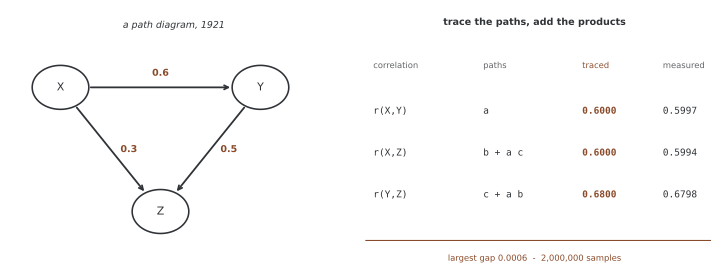

# 19장: 확률 그래프 모델

확률 그래프 모델(PGM)은 조건부 독립과 인수분해로 결합분포를 구조화한다. 희소한 그래프는 표현과 추정을 단순하게 만들 수 있지만 정확 추론의 비용이나 인과 방향 식별을 자동으로 해결하지는 않는다. 이 장은 기본 개념에서 베이즈 네트워크 구성·추론·학습까지 연결한다.

**그림으로 보는 AI 1.** 화살표 그린 그래프는 유전학에서 왔다

변수에 동그라미를 치고 화살표로 잇는다는 생각은 인공지능에서 나오지 않았다. 1921년에 유전학자 시월 라이트(Sewall Wright)가 《농업연구지》에 실은 「상관과 인과」가 그 시작이다. 기니피그의 털 무늬가 어떻게 물려지는지를 따지다가, 변수들 사이의 영향 관계를 그림으로 그리고 화살표마다 **경로 계수**라는 수를 붙였다.

그가 함께 내놓은 것이 경로 분석의 기본 정리다. 두 변수의 상관은 **둘을 잇는 경로를 따라 계수를 곱하고, 그런 경로를 모두 더하면** 나온다는 것이다.

표준화한 선형 모형을 만들어 이백만 개를 뽑아 재어 보면 실제로 맞는다. $r(X,Z)$ 는 직접 경로 $b$ 와 $X\to Y\to Z$ 를 거치는 $a\cdot c$ 를 더한 값이고, 셈한 0.6000 과 잰 0.5994 가 소수 셋째 자리까지 같다.

**그런데 라이트가 한 일을 정확히 보아야 한다. 그는 화살표를 자료에서 찾아낸 것이 아니라 자료에 들어가기 전에 그려 넣었다.** 어느 것이 어느 것에 영향을 준다는 그림은 생물학 지식에서 왔고, 자료가 한 일은 그 화살표에 붙일 **수를 정해 준 것**뿐이다. 그는 상관에서 방향을 읽어 낼 수 있다고 말한 적이 없다.

그래서 아래 「정리하며」가 적어 둘 "화살표를 인과로 해석하려면 추가 가정이 필요하다"는 뒤늦게 붙인 단서가 아니다. **이 기법이 태어날 때부터 지고 있던 조건**이고, 백 년 동안 바뀐 것은 기법이 아니라 사람들의 기대 쪽이다 — 화살표까지 자료에서 배울 수 있기를 바라게 된 것이다. 이 장의 3절이 그 바람이 어디까지 이루어지는지를 다룬다.

_확인한 곳 — S. Wright, "Correlation and causation", *Journal of Agricultural Research* **20**, 557–585 (1921). 경로 계수와, 경로를 이어 상관을 되살리는 기본 정리가 그 글의 것이다. 그림의 수는 그림을 그리는 코드가 직접 뽑아 재며, 경로로 셈한 값과 잰 값이 맞는지 `assert` 로 확인한 뒤에 그린다._

## 1. 기본 개념과 표현

- [확률 그래프 모델의 기초](pgm_foundations/fundamentals.md): 조건부 독립, 방향·무방향 인수분해, 주변·조건부·MAP·MPE 질의
- [분포 연산과 d-분리 예제](pgm_foundations/01_pgm_fundamentals.md): 주변화·조건화와 사슬·포크·충돌점
- [베이즈 네트워크 기초](pgm_foundations/02_bayesian_networks_basics.md): CPT 구성과 순방향 샘플링

## 2. 추론

- [전수 열거와 샘플링](pgm_foundations/04_simple_inference.md): 조건부 확률, MPE, 기각·우도 가중 샘플링
- [변수 제거](pgm_inference/01_variable_elimination.md): 인자 곱·합산, 제거 순서와 유도 폭

## 3. 학습

- [구조 학습](pgm_learning/02_structure_learning.md): 독립성 기반 뼈대 추정, BIC 점수 탐색과 마르코프 동치
- [PGM의 EM 알고리즘](pgm_learning/em_for_pgms.md): 기대 충분통계량, 파라메터 최적화와 단조성의 조건

## 정리하며

그래프가 보장하는 조건부 독립과 특정 CPT의 수치적 독립을 구분한다. 화살표를 인과로 해석하려면 추가 가정이 필요하다. 추론에서는 증거의 확률·상태 공간·인자 크기를, 학습에서는 유한 표본 오류·동치류·목적함수의 범위를 확인한다. 보존된 교육용 구현의 제한을 각 페이지에서 함께 설명한다.
