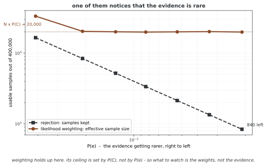

# 단순한 추론

이산 베이즈 네트워크의 조건부 확률은 미관측 변수의 가능한 상태를 합산해 계산할 수 있다. 전수 열거는 작은 네트워크에서 정확한 기준값을 주지만 상태 조합이 많아지면 비싸진다. 기각 샘플링과 가능도 가중 샘플링(likelihood weighting; 가능도는 우도라고도 한다)을 비교하고, 가장 가능성 높은 전체 설명(MPE)과 주변 확률 질의를 구분한다.

## 1. 코드

??? note "코드 (978줄)"

    ```python
    """
    베이즈 네트워크에서의 단순한 추론
    ======================================

    이 모듈은 베이즈 네트워크의 기본 추론 기법을 다루며
    전수 열거로 하는 정확한 추론에 초점을 맞춘다.

    학습 목표:
    -------------------
    1. 확률 모델에서 추론이 무엇인지 이해하기
    2. 전수 열거 추론 배우기(무차별 대입 방식)
    3. 주변 질의하기: P(X)
    4. 조건부 질의하기: P(X|E)
    5. 기각 샘플링과 그 한계 이해하기

    수학적 기초:
    ------------------------
    주변 추론: P(X) = Σ_{Y} P(X, Y)
    조건부 추론: P(X|E) = P(X, E) / P(E)
                                  = Σ_{Y} P(X, E, Y) / Σ_{X,Y} P(X, E, Y)

    지은이: 교육용 ML 팀
    수준: 입문
    미리 볼 것: PGM 기초, 베이즈 네트워크 기초
    """

    import numpy as np
    import networkx as nx
    import matplotlib.pyplot as plt
    from typing import Dict, List, Set, Tuple, Optional
    from itertools import product
    import time
    from collections import defaultdict
    import pandas as pd

    # ========================================================================
    # 도우미 클래스
    # ========================================================================


    class ConditionalProbabilityTable:
        """
        변수의 조건부 확률표(CPT)를 나타낸다.

        CPT는 부모 값의 모든 조합에 대해 P(변수 | 부모)를 명시한다.
        이것이 베이즈 네트워크의 기본
        구성 요소다.

        속성:
            variable: 이 CPT가 정의하는 변수의 이름
            parents: 부모 변수 이름의 목록
            cardinalities: 모든 변수를 상태 수에 대응시키는 딕셔너리
            table: 조건부 확률을 담은 NumPy 배열
        """

        def __init__(self,
                     variable: str,
                     parents: List[str],
                     cardinalities: Dict[str, int],
                     table: Optional[np.ndarray] = None):
            """
            CPT를 초기화한다.

            인수:
                variable: 변수의 이름(이를테면 'Rain')
                parents: 부모 변수 이름의 목록(이를테면 ['Cloudy'])
                cardinalities: 모든 변수의 상태 수 딕셔너리
                table: 선택적인 CPT 값. 형태는
                       (*부모_상태수, 변수_상태수)이어야 한다
                       None이면 균등 분포로 초기화한다

            예:
                # P(Rain | Cloudy)의 CPT
                # Rain도 이진, Cloudy도 이진
                cpt = ConditionalProbabilityTable(
                    variable='Rain',
                    parents=['Cloudy'],
                    cardinalities={'Rain': 2, 'Cloudy': 2},
                    table=np.array([[0.8, 0.2],  # P(Rain | Cloudy=0)
                                   [0.2, 0.8]])  # P(Rain | Cloudy=1)
                )
            """
            self.variable = variable
            self.parents = parents
            self.cardinalities = cardinalities

            # CPT의 형태 정하기
            # 형태: (card(부모1), card(부모2), ..., card(변수))
            parent_cards = [cardinalities[p] for p in parents]
            var_card = cardinalities[variable]
            shape = tuple(parent_cards + [var_card])

            if table is None:
                # 균등 분포로 초기화하기
                self.table = np.ones(shape) / var_card
            else:
                self.table = np.array(table)
                # 형태 확인하기
                assert self.table.shape == shape, \
                    f"Table shape {self.table.shape} doesn't match expected {shape}"
                # 조건부 분포마다 합이 1인지 확인하기
                self._verify_normalized()

        def _verify_normalized(self):
            """
            조건부 확률의 합이 1인지 확인한다.

            부모 값의 조합마다 변수 값에 걸친 확률의
            합이 1이어야 한다.
            """
            # 마지막 축(변수 자신)에 걸쳐 합하기
            sums = np.sum(self.table, axis=-1)
            if not np.allclose(sums, 1.0):
                print(f"Warning: CPT for {self.variable} is not normalized!")
                print(f"Sums: {sums}")

        def get_probability(self, 
                           variable_value: int,
                           parent_values: Dict[str, int]) -> float:
            """
            P(변수=값 | 부모=부모 값)을 얻는다.

            인수:
                variable_value: 변수의 값(정수 인덱스)
                parent_values: 부모 이름을 값에 대응시키는 딕셔너리

            반환값:
                조건부 확률

            예:
                # P(Rain=1 | Cloudy=0) 얻기
                prob = cpt.get_probability(1, {'Cloudy': 0})
            """
            # 표를 조회할 인덱스 튜플 만들기
            index = []
            for parent in self.parents:
                index.append(parent_values[parent])
            index.append(variable_value)

            return self.table[tuple(index)]

        def set_probability(self,
                           variable_value: int,
                           parent_values: Dict[str, int],
                           probability: float):
            """
            P(변수=값 | 부모=부모 값)을 정한다.

            인수:
                variable_value: 변수의 값
                parent_values: 부모 이름을 값에 대응시키는 딕셔너리
                probability: 정할 확률 값
            """
            index = []
            for parent in self.parents:
                index.append(parent_values[parent])
            index.append(variable_value)

            self.table[tuple(index)] = probability

        def sample(self, parent_values: Dict[str, int]) -> int:
            """
            부모 값이 주어졌을 때 변수의 값을 샘플링한다.

            이는 베이즈 네트워크의 순방향 샘플링에 유용하다.

            인수:
                parent_values: 부모 이름을 값에 대응시키는 딕셔너리

            반환값:
                샘플링한 값(정수)

            예:
                # Cloudy=1일 때 Rain 값 샘플링하기
                rain_value = cpt.sample({'Cloudy': 1})
            """
            # 조건부 분포 얻기
            index = tuple(parent_values[p] for p in self.parents)
            probabilities = self.table[index]

            # 범주 분포에서 샘플링하기
            return np.random.choice(len(probabilities), p=probabilities)

        def to_dataframe(self) -> pd.DataFrame:
            """
            CPT를 읽기 좋은 DataFrame으로 바꾼다.

            이는 시각화와 디버깅에 유용하다.

            반환값:
                부모 값과 조건부 확률을 담은 DataFrame
            """
            rows = []

            # 부모 값의 모든 조합 만들기
            parent_cards = [self.cardinalities[p] for p in self.parents]

            if not self.parents:
                # 부모 없음 — 사전분포일 뿐이다
                for var_val in range(self.cardinalities[self.variable]):
                    row = {self.variable: var_val, 'Probability': self.table[var_val]}
                    rows.append(row)
            else:
                for parent_combo in product(*[range(c) for c in parent_cards]):
                    for var_val in range(self.cardinalities[self.variable]):
                        row = {}
                        # 부모 값 더하기
                        for parent, pval in zip(self.parents, parent_combo):
                            row[parent] = pval
                        # 변수 값 더하기
                        row[self.variable] = var_val
                        # 확률 더하기
                        index = parent_combo + (var_val,)
                        row['Probability'] = self.table[index]
                        rows.append(row)

            return pd.DataFrame(rows)

        def __str__(self) -> str:
            """CPT의 문자열 표현."""
            if not self.parents:
                return f"P({self.variable})\n{self.to_dataframe().to_string(index=False)}"
            else:
                parent_str = ', '.join(self.parents)
                return f"P({self.variable} | {parent_str})\n{self.to_dataframe().to_string(index=False)}"


    class BayesianNetwork:
        """
        베이즈 네트워크를 나타낸다. 곧 CPT가 딸린 DAG이다.

        베이즈 네트워크는 다음으로 이루어진다:
        1. 방향 비순환 그래프(DAG) 구조
        2. 노드마다의 조건부 확률표(CPT)

        이 네트워크는 P(X1,...,Xn) = ∏ P(Xi | Parents(Xi))를 나타낸다

        속성:
            graph: 구조를 나타내는 NetworkX DiGraph
            cpts: 변수 이름을 CPT에 대응시키는 딕셔너리
            cardinalities: 변수 이름을 상태 수에 대응시키는 딕셔너리
        """

        def __init__(self):
            """빈 베이즈 네트워크를 초기화한다."""
            self.graph = nx.DiGraph()
            self.cpts: Dict[str, ConditionalProbabilityTable] = {}
            self.cardinalities: Dict[str, int] = {}

        def add_variable(self, name: str, cardinality: int):
            """
            네트워크에 변수(노드)를 더한다.

            인수:
                name: 변수 이름(이를테면 'Weather', 'Traffic')
                cardinality: 있을 수 있는 값의 개수(이진이면 2)

            예:
                bn = BayesianNetwork()
                bn.add_variable('Rain', 2)  # 이진 변수
                bn.add_variable('Season', 4)  # 네 계절
            """
            self.graph.add_node(name)
            self.cardinalities[name] = cardinality

        def add_edge(self, parent: str, child: str):
            """
            변수 사이에 방향 간선(인과 관계)을 더한다.

            인수:
                parent: 부모 변수의 이름
                child: 자식 변수의 이름

            발생하는 예외:
                ValueError: 그 간선이 사이클을 만들 때

            예:
                bn.add_edge('Rain', 'WetGrass')  # 비가 잔디를 적신다
            """
            self.graph.add_edge(parent, child)

            # 사이클이 없는지 확인하기
            if not nx.is_directed_acyclic_graph(self.graph):
                self.graph.remove_edge(parent, child)
                raise ValueError(f"Adding edge {parent}->{child} creates a cycle!")

        def set_cpt(self, 
                    variable: str,
                    table: np.ndarray):
            """
            변수의 조건부 확률표를 정한다.

            인수:
                variable: 변수의 이름
                table: 조건부 확률을 담은 NumPy 배열
                       형태는 (card(부모1), ..., card(부모N), card(변수))와 맞아야 한다

            예:
                # 이진 Cloudy를 부모로 갖는 이진 Rain의 경우
                bn.set_cpt('Rain', np.array([[0.8, 0.2],   # P(Rain | Cloudy=0)
                                             [0.3, 0.7]]))  # P(Rain | Cloudy=1)
            """
            parents = list(self.graph.predecessors(variable))
            parents.sort()  # 일관된 순서

            cpt = ConditionalProbabilityTable(
                variable=variable,
                parents=parents,
                cardinalities=self.cardinalities,
                table=table
            )

            self.cpts[variable] = cpt

        def get_cpt(self, variable: str) -> ConditionalProbabilityTable:
            """
            변수의 CPT를 얻는다.

            인수:
                variable: 변수의 이름

            반환값:
                조건부 확률표
            """
            if variable not in self.cpts:
                raise ValueError(f"No CPT defined for variable {variable}")
            return self.cpts[variable]

        def compute_joint_probability(self, assignment: Dict[str, int]) -> float:
            """
            완전한 대입에 대해 P(X1=x1, X2=x2, ..., Xn=xn)를 계산한다.

            연쇄 법칙 인수분해를 쓴다:
            P(X1,...,Xn) = ∏ P(Xi | Parents(Xi))

            인수:
                assignment: 모든 변수에 값을 준 완전한 대입

            반환값:
                결합 확률

            예:
                # P(Cloudy=1, Rain=1, WetGrass=1) 계산하기
                prob = bn.compute_joint_probability({
                    'Cloudy': 1,
                    'Rain': 1,
                    'WetGrass': 1
                })
            """
            probability = 1.0

            # 변수마다 조건부 확률 곱하기
            for variable in self.graph.nodes():
                cpt = self.get_cpt(variable)
                parents = list(self.graph.predecessors(variable))

                # 부모 값 얻기
                parent_values = {p: assignment[p] for p in parents}

                # 변수 값 얻기
                var_value = assignment[variable]

                # P(변수 | 부모)를 곱하기
                prob = cpt.get_probability(var_value, parent_values)
                probability *= prob

            return probability

        def forward_sample(self) -> Dict[str, int]:
            """
            순방향 샘플링으로 결합 분포에서 표본을 만든다.

            순방향 샘플링은 위상 순서를 따른다:
            1. 변수를 위상 순서로 샘플링한다
            2. 이미 샘플링한 부모 값으로 P(Xi | Parents(Xi))에서 샘플링한다

            반환값:
                P(X1,...,Xn)에서 샘플링한 완전한 대입

            예:
                # 네트워크에서 표본 1000개 만들기
                samples = [bn.forward_sample() for _ in range(1000)]
            """
            assignment = {}

            # 위상 순서로 샘플링하기(자식보다 부모를 먼저)
            for variable in nx.topological_sort(self.graph):
                cpt = self.get_cpt(variable)
                parents = list(self.graph.predecessors(variable))

                # 이미 샘플링한 변수에서 부모 값 얻기
                parent_values = {p: assignment[p] for p in parents}

                # 이 변수 샘플링하기
                assignment[variable] = cpt.sample(parent_values)

            return assignment

        def visualize(self, figsize: Tuple[int, int] = (12, 8), show_cpts: bool = False):
            """
            베이즈 네트워크의 구조와, 원하면 CPT까지 시각화한다.

            인수:
                figsize: 그림 크기
                show_cpts: CPT 값을 보일지 여부
            """
            plt.figure(figsize=figsize)

            # 레이아웃
            try:
                pos = nx.spring_layout(self.graph, k=2, iterations=50)
            except:
                pos = nx.spring_layout(self.graph)

            # 노드와 간선 그리기
            nx.draw(self.graph, pos,
                    with_labels=True,
                    node_color='lightcoral',
                    node_size=3000,
                    font_size=12,
                    font_weight='bold',
                    arrows=True,
                    arrowsize=20,
                    edge_color='gray',
                    width=2)

            # 상태 수를 노드 라벨로 붙이기
            labels = {node: f"{node}\n(card={self.cardinalities[node]})" 
                     for node in self.graph.nodes()}
            pos_labels = {k: (v[0], v[1] - 0.1) for k, v in pos.items()}
            nx.draw_networkx_labels(self.graph, pos_labels, labels, 
                                   font_size=9, font_color='darkred')

            plt.title("Bayesian Network Structure", fontsize=14, fontweight='bold')
            plt.axis('off')
            plt.tight_layout()
            plt.show()

            # 요청하면 CPT 보이기
            if show_cpts:
                print("\n" + "="*70)
                print("CONDITIONAL PROBABILITY TABLES")
                print("="*70)
                for variable in nx.topological_sort(self.graph):
                    cpt = self.get_cpt(variable)
                    print(f"\n{cpt}")
                    print("-"*70)


    def build_weather_network() -> BayesianNetwork:
        """
        단순한 날씨 예측 베이즈 네트워크를 구성한다.

        네트워크의 구조:
            Cloudy -> Rain -> WetGrass
            Cloudy -> Sprinkler -> WetGrass

        이는 다음을 보여 주는 고전적인 예다:
        - 공통 원인(흐림이 비와 물뿌리개에 함께 영향을 준다)
        - 여러 원인(젖은 잔디는 비 때문일 수도 물뿌리개 때문일 수도 있다)

        반환값:
            CPT를 갖춘 완전한 베이즈 네트워크
        """
        print("\nBuilding Weather Network...")
        print("-" * 70)

        bn = BayesianNetwork()

        # 변수 더하기(모두 이진: 0=거짓, 1=참)
        bn.add_variable('Cloudy', 2)
        bn.add_variable('Sprinkler', 2)
        bn.add_variable('Rain', 2)
        bn.add_variable('WetGrass', 2)

        # 간선 더하기(인과 관계)
        bn.add_edge('Cloudy', 'Sprinkler')  # 흐림이 물뿌리개 사용에 영향을 준다
        bn.add_edge('Cloudy', 'Rain')        # 흐림이 비에 영향을 준다
        bn.add_edge('Sprinkler', 'WetGrass') # 물뿌리개가 잔디를 적실 수 있다
        bn.add_edge('Rain', 'WetGrass')      # 비가 잔디를 적실 수 있다

        # CPT 정하기

        # P(Cloudy) — 사전확률
        # [P(Cloudy=0), P(Cloudy=1)]
        bn.set_cpt('Cloudy', np.array([0.5, 0.5]))

        # P(Sprinkler | Cloudy)
        # 흐리면 물뿌리개를 쓸 가능성이 낮다
        bn.set_cpt('Sprinkler', np.array([
            [0.5, 0.5],  # P(Sprinkler | Cloudy=0)
            [0.9, 0.1]   # P(Sprinkler | Cloudy=1) — 흐리면 잘 안 쓴다
        ]))

        # P(Rain | Cloudy)
        # 흐리면 비가 올 가능성이 높다
        bn.set_cpt('Rain', np.array([
            [0.8, 0.2],  # P(Rain | Cloudy=0) — 흐리지 않으면 잘 안 온다
            [0.2, 0.8]   # P(Rain | Cloudy=1) — 흐리면 잘 온다
        ]))

        # P(WetGrass | Sprinkler, Rain)
        # 물뿌리개가 켜졌거나 비가 오면 잔디가 젖는다
        # 순서: [Sprinkler=0, Rain=0], [Sprinkler=0, Rain=1],
        #        [Sprinkler=1, Rain=0], [Sprinkler=1, Rain=1]
        bn.set_cpt('WetGrass', np.array([
            [[1.0, 0.0],   # Sprinkler=0, Rain=0: 잔디가 마름
             [0.1, 0.9]],  # Sprinkler=0, Rain=1: 잔디가 젖음(비)
            [[0.1, 0.9],   # Sprinkler=1, Rain=0: 잔디가 젖음(물뿌리개)
             [0.01, 0.99]] # Sprinkler=1, Rain=1: 잔디가 매우 젖음(둘 다)
        ]))

        print("Network built successfully!")
        print(f"Variables: {list(bn.graph.nodes())}")
        print(f"Edges: {list(bn.graph.edges())}")

        return bn


    # ========================================================================
    # 메인
    # ========================================================================


    class InferenceByEnumeration:
        """
        가능한 모든 조합을 전수 열거해 정확히 추론한다.

        이것이 가장 직접적인 추론 방법이다:
        1. 모든 변수의 가능한 대입을 열거한다
        2. 증거와 일치하는 대입의 확률을 합한다
        3. 정규화하여 조건부 확률을 얻는다

        시간 복잡도: 이진 변수 n개에 대해 O(2^n)(지수이다!)
        공간 복잡도: O(2^n)

        효율은 낮지만 이 방법은 다음과 같다:
        - 정확하다(근사가 아니다)
        - 이해하기 쉽다
        - 작은 네트워크에 유용하다
        - 다른 알고리즘을 시험하는 좋은 기준이다
        """

        def __init__(self, bn: BayesianNetwork):
            """
            추론 엔진을 초기화한다.

            인수:
                bn: 추론할 베이즈 네트워크
            """
            self.bn = bn
            self.query_cache = {}  # 반복되는 질의를 위한 캐시

        def query_marginal(self, 
                          query_vars: List[str],
                          evidence: Optional[Dict[str, int]] = None,
                          use_cache: bool = True) -> Dict[tuple, float]:
            """
            전수 열거로 P(query_vars | evidence)를 계산한다.

            인수:
                query_vars: 확률 분포를 계산할 변수
                evidence: 관측한 변수 값의 딕셔너리(None일 수 있다)
                use_cache: 캐시한 결과를 쓸지 여부

            반환값:
                query_vars의 대입마다 확률에 대응시키는 딕셔너리

            예:
                # P(Rain | Cloudy=1) 계산하기
                result = inference.query_marginal(
                    query_vars=['Rain'],
                    evidence={'Cloudy': 1}
                )
                # 반환값: {(0,): 0.2, (1,): 0.8}
            """
            if evidence is None:
                evidence = {}

            # 캐시 키 만들기
            query_key = (tuple(sorted(query_vars)), tuple(sorted(evidence.items())))
            if use_cache and query_key in self.query_cache:
                return self.query_cache[query_key]

            print(f"\nComputing P({', '.join(query_vars)}" + 
                  (f" | {', '.join(f'{k}={v}' for k, v in evidence.items())})" if evidence else ")"))
            print("-" * 60)

            # 네트워크의 모든 변수 얻기
            all_vars = list(self.bn.graph.nodes())

            # 변수를 질의, 증거, 숨은 변수로 나누기
            hidden_vars = [v for v in all_vars if v not in query_vars and v not in evidence]

            print(f"Query variables: {query_vars}")
            print(f"Evidence variables: {list(evidence.keys())}")
            print(f"Hidden variables: {hidden_vars}")

            # 결과 딕셔너리 초기화하기
            result = defaultdict(float)

            # 상태 수 얻기
            query_cards = [self.bn.cardinalities[v] for v in query_vars]
            hidden_cards = [self.bn.cardinalities[v] for v in hidden_vars]

            total_configurations = np.prod(query_cards) * np.prod(hidden_cards)
            print(f"\nEnumerating {int(total_configurations)} configurations...")

            # 질의 변수와 숨은 변수의 모든 대입 열거하기
            for query_values in product(*[range(c) for c in query_cards]):
                # 질의 대입마다 숨은 변수의 모든 대입에 걸쳐 합하기
                query_assignment = dict(zip(query_vars, query_values))

                for hidden_values in product(*[range(c) for c in hidden_cards]):
                    hidden_assignment = dict(zip(hidden_vars, hidden_values))

                    # 완전한 대입
                    full_assignment = {**query_assignment, **hidden_assignment, **evidence}

                    # 베이즈 네트워크로 P(완전한 대입) 계산하기
                    prob = self.bn.compute_joint_probability(full_assignment)

                    # 이 질의 대입의 결과에 더하기
                    result[query_values] += prob

            # 조건부 확률 P(질의 | 증거)를 얻으려고 정규화하기
            total = sum(result.values())

            if total > 0:
                result = {k: v/total for k, v in result.items()}
            else:
                print("Warning: Evidence has probability 0!")
                # 균등 분포
                result = {k: 1.0/len(result) for k in result.keys()}

            # 결과 캐시에 담기
            if use_cache:
                self.query_cache[query_key] = dict(result)

            return dict(result)

        def query_single_variable(self, 
                                 variable: str,
                                 evidence: Optional[Dict[str, int]] = None) -> np.ndarray:
            """
            변수 하나만 질의하는 편의 메서드.

            인수:
                variable: 질의할 변수
                evidence: 증거 딕셔너리

            반환값:
                변수의 값마다의 확률을 담은 NumPy 배열

            예:
                # P(Rain | Cloudy=1) 계산하기
                probs = inference.query_single_variable('Rain', {'Cloudy': 1})
                print(f"P(Rain=0|Cloudy=1) = {probs[0]}")
                print(f"P(Rain=1|Cloudy=1) = {probs[1]}")
            """
            result_dict = self.query_marginal([variable], evidence)

            # 배열로 바꾸기
            cardinality = self.bn.cardinalities[variable]
            probs = np.zeros(cardinality)

            for value_tuple, prob in result_dict.items():
                probs[value_tuple[0]] = prob

            return probs

        def most_probable_explanation(self, 
                                      evidence: Dict[str, int]) -> Dict[str, int]:
            """
            증거가 주어졌을 때 가장 그럴듯한 완전한 대입을 찾는다.

            이를 MAP(최대 사후확률) 추론이라고도 한다.
            argmax_X P(X | evidence)를 찾는다.

            인수:
                evidence: 관측한 변수

            반환값:
                증거가 아닌 모든 변수에 대한 가장 그럴듯한 대입

            예:
                # 잔디가 젖었다면 가장 그럴듯한 설명은 무엇인가?
                mpe = inference.most_probable_explanation({'WetGrass': 1})
                # 반환될 수 있는 값: {'Cloudy': 1, 'Rain': 1, 'Sprinkler': 0}
            """
            print(f"\nFinding Most Probable Explanation given evidence:")
            print(f"Evidence: {evidence}")
            print("-" * 60)

            # 증거가 아닌 변수 모두 얻기
            all_vars = list(self.bn.graph.nodes())
            query_vars = [v for v in all_vars if v not in evidence]

            # 모든 대입 열거하기
            best_assignment = None
            best_prob = -1

            query_cards = [self.bn.cardinalities[v] for v in query_vars]

            for query_values in product(*[range(c) for c in query_cards]):
                assignment = dict(zip(query_vars, query_values))
                full_assignment = {**assignment, **evidence}

                prob = self.bn.compute_joint_probability(full_assignment)

                if prob > best_prob:
                    best_prob = prob
                    best_assignment = assignment

            print(f"\nMost probable assignment: {best_assignment}")
            print(f"Probability: {best_prob:.6f}")

            return best_assignment


    class RejectionSampling:
        """
        기각 샘플링으로 하는 근사 추론.

        기각 샘플링:
        1. 사전분포 P(X)에서 표본을 만든다
        2. 증거와 맞지 않는 표본을 기각한다
        3. 받아들인 표본에서 통계량을 계산한다

        장점:
        - 구현이 단순하다
        - 편향 없는 추정량이다

        단점:
        - 증거가 드물면 몹시 비효율적일 수 있다
        - 기각률이 아주 높을 수 있다
        """

        def __init__(self, bn: BayesianNetwork):
            """기각 샘플링을 초기화한다."""
            self.bn = bn

        def query(self,
                 query_vars: List[str],
                 evidence: Dict[str, int],
                 num_samples: int = 10000) -> Dict[tuple, float]:
            """
            기각 샘플링으로 추론한다.

            인수:
                query_vars: 질의할 변수
                evidence: 증거 딕셔너리
                num_samples: 만들 표본의 개수

            반환값:
                질의 변수에 걸친 근사 확률 분포
            """
            print(f"\nRejection Sampling: {num_samples} samples")
            print("-" * 60)

            accepted_samples = []
            rejected = 0

            # 표본 만들기
            for _ in range(num_samples):
                sample = self.bn.forward_sample()

                # 표본이 증거와 맞는지 확인하기
                matches = all(sample[var] == val for var, val in evidence.items())

                if matches:
                    accepted_samples.append(sample)
                else:
                    rejected += 1

            print(f"Accepted: {len(accepted_samples)}")
            print(f"Rejected: {rejected}")
            print(f"Acceptance rate: {len(accepted_samples)/num_samples:.2%}")

            if len(accepted_samples) == 0:
                print("Warning: No samples accepted! Try more samples or check evidence.")
                return {}

            # 받아들인 표본에서 확률 계산하기
            result = defaultdict(int)

            for sample in accepted_samples:
                key = tuple(sample[var] for var in query_vars)
                result[key] += 1

            # 정규화
            total = sum(result.values())
            result = {k: v/total for k, v in result.items()}

            return dict(result)


    def demonstrate_simple_queries():
        """
        날씨 네트워크에 단순한 추론 질의를 실행해 보인다.
        """
        print("\n" + "="*70)
        print("DEMONSTRATION: Simple Inference Queries")
        print("="*70)

        # 네트워크 만들기
        bn = build_weather_network()
        inference = InferenceByEnumeration(bn)

        # 질의 1: 주변 확률 P(Rain)
        print("\n" + "="*70)
        print("Query 1: What's the probability of rain?")
        print("="*70)

        rain_probs = inference.query_single_variable('Rain')
        print(f"\nP(Rain=0) = {rain_probs[0]:.4f}")
        print(f"P(Rain=1) = {rain_probs[1]:.4f}")

        # 질의 2: 조건부 확률 P(Rain | Cloudy=1)
        print("\n" + "="*70)
        print("Query 2: What's the probability of rain given it's cloudy?")
        print("="*70)

        rain_given_cloudy = inference.query_single_variable('Rain', {'Cloudy': 1})
        print(f"\nP(Rain=0 | Cloudy=1) = {rain_given_cloudy[0]:.4f}")
        print(f"P(Rain=1 | Cloudy=1) = {rain_given_cloudy[1]:.4f}")

        print("\nNote: Rain is more likely when it's cloudy (0.8 vs 0.2)")

        # 질의 3: 여러 변수 P(Rain, Sprinkler | WetGrass=1)
        print("\n" + "="*70)
        print("Query 3: Given wet grass, what caused it?")
        print("="*70)

        result = inference.query_marginal(['Rain', 'Sprinkler'], {'WetGrass': 1})

        print("\nP(Rain, Sprinkler | WetGrass=1):")
        for (rain, sprinkler), prob in sorted(result.items()):
            print(f"  Rain={rain}, Sprinkler={sprinkler}: {prob:.4f}")

        print("\nInterpretation:")
        print("- Most likely: Rain=1, Sprinkler=0 (rain caused it)")
        print("- Second: Rain=0, Sprinkler=1 (sprinkler caused it)")
        print("- Least likely: Rain=0, Sprinkler=0 (shouldn't happen but numerical errors)")


    def demonstrate_mpe():
        """
        가장 그럴듯한 설명(MPE) 추론을 보인다.
        """
        print("\n" + "="*70)
        print("DEMONSTRATION: Most Probable Explanation (MPE)")
        print("="*70)

        bn = build_weather_network()
        inference = InferenceByEnumeration(bn)

        # 잔디가 젖었을 때의 MPE
        print("\n" + "="*70)
        print("Scenario: You observe that the grass is wet")
        print("Question: What's the most likely complete explanation?")
        print("="*70)

        mpe = inference.most_probable_explanation({'WetGrass': 1})

        print("\nInterpretation:")
        if mpe.get('Rain') == 1:
            print("- It probably rained")
        if mpe.get('Cloudy') == 1:
            print("- It was probably cloudy")
        if mpe.get('Sprinkler') == 1:
            print("- The sprinkler was probably on")
        else:
            print("- The sprinkler was probably off")


    def compare_exact_vs_approximate():
        """
        정확한 추론과 기각 샘플링을 견준다.
        """
        print("\n" + "="*70)
        print("DEMONSTRATION: Exact vs Approximate Inference")
        print("="*70)

        bn = build_weather_network()

        # 정확한 추론
        print("\n" + "-"*70)
        print("EXACT INFERENCE (Enumeration)")
        print("-"*70)

        exact_inference = InferenceByEnumeration(bn)

        start = time.time()
        exact_result = exact_inference.query_single_variable('Rain', {'WetGrass': 1})
        exact_time = time.time() - start

        print(f"\nP(Rain | WetGrass=1):")
        print(f"  Rain=0: {exact_result[0]:.4f}")
        print(f"  Rain=1: {exact_result[1]:.4f}")
        print(f"Time: {exact_time:.6f} seconds")

        # 근사 추론
        print("\n" + "-"*70)
        print("APPROXIMATE INFERENCE (Rejection Sampling)")
        print("-"*70)

        rejection_sampling = RejectionSampling(bn)

        start = time.time()
        approx_result = rejection_sampling.query(['Rain'], {'WetGrass': 1}, num_samples=10000)
        approx_time = time.time() - start

        print(f"\nP(Rain | WetGrass=1):")
        print(f"  Rain=0: {approx_result.get((0,), 0):.4f}")
        print(f"  Rain=1: {approx_result.get((1,), 0):.4f}")
        print(f"Time: {approx_time:.6f} seconds")

        # 비교
        print("\n" + "-"*70)
        print("COMPARISON")
        print("-"*70)
        print(f"\nError in P(Rain=1 | WetGrass=1):")
        error = abs(exact_result[1] - approx_result.get((1,), 0))
        print(f"  {error:.4f} ({error/exact_result[1]*100:.2f}% relative error)")

        print(f"\nNote: Rejection sampling is approximate but can be much faster")
        print(f"for large networks. However, it can be very inefficient if")
        print(f"evidence is unlikely (low acceptance rate).")


    def main():
        """
        메인 시연 함수.
        """
        print("\n" + "="*70)
        print("SIMPLE INFERENCE IN BAYESIAN NETWORKS")
        print("="*70)

        print("\nTopics covered:")
        print("1. Inference by enumeration (exact)")
        print("2. Marginal queries: P(X) and P(X|E)")
        print("3. Most Probable Explanation (MPE)")
        print("4. Rejection sampling (approximate)")

        # 시연 실행
        demonstrate_simple_queries()
        demonstrate_mpe()
        compare_exact_vs_approximate()

        print("\n" + "="*70)
        print("KEY TAKEAWAYS")
        print("="*70)
        print("\n1. Inference = computing P(Query | Evidence)")
        print("\n2. Enumeration is exact but exponentially expensive:")
        print("   - Time: O(2^n) for n binary variables")
        print("   - Practical only for small networks")

        print("\n3. Approximate methods (like rejection sampling):")
        print("   - Trade accuracy for speed")
        print("   - Useful for large networks")
        print("   - Accuracy improves with more samples")

        print("\n4. More efficient exact methods exist:")
        print("   - Variable elimination (next module!)")
        print("   - Junction tree algorithm")
        print("   - These exploit network structure")

        print("\n" + "="*70)
        print("Next: Learn about efficient inference algorithms!")
        print("="*70 + "\n")


    if __name__ == "__main__":
        main()
    ```


## 2. 논의

### 전수 열거

질의 Q, 증거 E=e, 나머지 숨은 변수 H를 구분하면 다음과 같다.

$$P(Q\mid e)=\frac{\sum_hP(Q,h,e)}{P(e)}$$

P(e)>0이어야 한다. 이진 미관측 변수 m개의 상태 수는 2^m이며, 각 상태의 결합확률을 계산하는 비용도 추가된다. 인수분해된 CPT를 사용하더라도 모든 상태를 열거하는 알고리즘은 일반적으로 지수 비용을 피하지 못한다.

### 샘플링과 MPE

기각 샘플링은 결합표본에서 증거와 일치하는 표본을 남긴다. 받아들인 수가 양수라는 조건에서 그 빈도는 올바른 조건부분포를 추정하지만, 고정 시도 수에서 0개를 받아들일 수 있으므로 무조건 정의되는 불편 추정량이라고 단정하지 않는다. 이산 증거의 기대 수락률은 P(e)다. 연속 증거의 정확한 값 일치를 사용하는 방법에는 적용할 수 없다.

가능도 가중 샘플링은 증거를 고정하고 그 조건부 가능도를 표본 웨이트에 곱한다. 모든 생성 표본을 사용해도 웨이트가 소수에 집중하면 유효 표본 수가 작다. 정규화 가중 비율은 일반적으로 유한 표본에서 편향이 있으며 일관성과 불편성을 구분한다.

<div class="storybox" markdown>

**그림으로 보는 AI 1.** 버리는 기법은 1951년에 나왔고, 버리지 않는 기법은 다른 것에 걸린다

기각 샘플링은 이름 그대로 **대부분을 버리는** 방법이다. 뽑아 놓고 증거와 안 맞으면 내버린다. 이 기법을 처음 적어 둔 사람은 1951년의 존 폰 노이만(John von Neumann)이다. 미국 표준국이 낸 난수 관련 보고서에 실린 짧은 글로, 몬테카를로 계산에서 원하는 분포를 직접 뽑기 어려울 때 **쉬운 분포에서 뽑고 조건에 안 맞는 것을 버리면 된다**는 생각을 정리했다. 위 문단이 적은 "기대 수락률은 P(e)다"가 그 기법이 치르는 비용을 한 줄로 적은 것이다.

얼마나 혹독한지 재어 보았다. 숨은 원인 C 하나와 자식 여럿을 두고 "자식이 모두 1"을 증거로 삼으면, 자식을 늘릴수록 P(e)가 작아진다.



기각 쪽은 P(e)를 그대로 따라 내려간다. 40만 표본에서 건진 것이 16,537개에서 **840개**가 된다. 가능도 가중은 그렇지 않다 — 유효 표본 수가 거의 평평하게 2만 근처에 머문다. **증거가 드물어지는 것을 아예 알아차리지 않는다.**

**그렇다고 가능도 가중이 공짜인 것은 아니고, 걸리는 자리가 다를 뿐이다.** 저 2만이라는 천장은 $N \times P(C) = 400{,}000 \times 0.05$ 다. 곧 유효 표본 수를 정한 것은 증거가 얼마나 드문가가 아니라 **웨이트가 큰 쪽을 얼마나 자주 뽑았는가**다. 이 네트워크에서는 C가 둘 중 하나뿐이라 웨이트도 두 값만 가지므로 천장이 꽤 높지만, 숨은 변수가 늘어 웨이트가 몇 개 표본에 집중되면 그 천장이 내려앉는다. 위 문단이 "웨이트가 소수에 집중하면"이라는 조건을 달아 둔 까닭이다.

그래서 두 방법을 가르는 물음이 서로 다르다. 기각 샘플링에는 **증거가 얼마나 드문가**를 묻고, 가능도 가중에는 **웨이트가 얼마나 고른가**를 물어야 한다. 받아들인 표본 수는 눈에 보이지만 유효 표본 수는 따로 계산해 보지 않으면 보이지 않으므로, 표본이 40만 개라는 말에 안심할 수 없다.

_확인한 곳 — J. von Neumann, "Various Techniques Used in Connection with Random Digits", *National Bureau of Standards Applied Mathematics Series* **12**, 36–38 (1951) 에 기각 기법이 실렸다. 그림의 수는 그림을 그리는 코드가 직접 뽑아 재며, 기각 쪽이 실제로 무너지고 두 곡선이 갈라진다는 것을 `assert` 로 확인한 뒤에 그린다._

</div>

MPE는 증거 이외 모든 변수의 공동 상태를 최대화한다. 일부 변수에 대해 나머지를 합산한 뒤 최대화하는 marginal MAP와는 다르다. 코드 MPE가 출력하는 Probability는 증거를 포함한 결합확률이며 P(e)로 나눈 조건부 확률이 아니다. 최대화 위치는 같지만 숫자의 의미는 다르다.

### 구현의 범위

질의 변수와 증거 변수는 겹치지 않게 전달한다. 캐시 키는 질의 변수 이름을 정렬하지만 반환 튜플은 입력 순서를 따르므로 순서를 바꾼 다변수 질의를 캐시로 재사용하면 상태 의미가 어긋날 수 있다. 네트워크 CPT를 바꿨다면 캐시도 무효화해야 한다. 확률 0인 증거에서 반환하는 균등분포는 정당한 사후분포가 아니다. RejectionSampling은 관측되지 않은 상태를 결과 딕셔너리에 생략하고 수락 표본이 없으면 빈 딕셔너리를 반환한다.

## 연습문제

<div class="drillbox" markdown>

**연습문제 1.** <span class="diff hard" title="어려움"></span>
날씨 네트워크의 CPT로 P(Cloudy=1|WetGrass=1)를 전수 열거로 구하라.

</div>

??? success "풀이"

    Cloudy=1의 네 항은 0, 0.324, 0.009, 0.0396으로 합이 0.3726이다. Cloudy=0에서는 (S,R)=(0,0),(0,1),(1,0),(1,1)의 기여가 각각 0, 0.045, 0.18, 0.0495여서 합은 0.2745다. 따라서 P(W=1)=0.6471이며 $P(C=1|W=1)=0.3726/0.6471\approx0.5758$이다. 같은 CPT를 사용했는지 확인해야 한다.


---

<div class="drillbox" markdown>

**연습문제 2.** <span class="diff med" title="중간"></span>
이산 증거의 확률이 p>0일 때 기각 샘플링의 기대 수락률과 수락 하나까지 필요한 시도 수는?

</div>

??? success "풀이"

    독립 결합표본마다 수락 확률은 p이므로 시도 N개의 기대 수락 수는 Np다. 처음 수락까지의 기대 시도 수는 1/p이고, 고정 N개에서 하나도 수락하지 못할 확률은 (1−p)^N이다. 드문 증거에는 가능도 가중·Gibbs 등의 근사나 구조를 활용한 정확 추론을 검토하되 각각의 계산·혼합 진단이 필요하다.


---

<div class="drillbox" markdown>

**연습문제 3.** <span class="diff hard" title="어려움"></span>
아래 두 샘플링 조각이 P(Rain=1|WetGrass=1)를 추정하는 방식과 효율을 비교하라.

</div>

??? success "풀이"

    기각 방식은 실제 WetGrass를 생성해 1인 표본만 남긴다. 가능도 가중 방식은 WetGrass=1을 고정하고 P(WetGrass=1|Sprinkler,Rain)으로 Rain 값을 가중한다. 모든 표본을 쓴다고 항상 효율적인 것은 아니며 웨이트 집중과 유효 표본 수를 비교해야 한다. 두 코드의 50,000회 결과는 난수에 따른 근사이며 시간·오차의 보편적 순서를 보장하지 않는다.

    ```python
    import numpy as np

    np.random.seed(42)
    n_samples = 50000

    # 기각 샘플링
    accepted_rain = []
    for _ in range(n_samples):
        c = np.random.binomial(1, 0.5)
        s = np.random.binomial(1, 0.1 if c else 0.5)
        r = np.random.binomial(1, 0.8 if c else 0.2)
        pw = [[0,0.9],[0.9,0.99]][s][r] if r or s else 0
        w = np.random.binomial(1, [[0,0.9],[0.9,0.99]][s][r])
        if w == 1:
            accepted_rain.append(r)

    print(f'Rejection: P(R=1|W=1)={np.mean(accepted_rain):.4f}, '
          f'accepted={len(accepted_rain)}/{n_samples}')

    # 가능도 가중
    weighted_rain = []
    weights = []
    for _ in range(n_samples):
        c = np.random.binomial(1, 0.5)
        s = np.random.binomial(1, 0.1 if c else 0.5)
        r = np.random.binomial(1, 0.8 if c else 0.2)
        w_prob = [[0,0.9],[0.9,0.99]][s][r]
        weighted_rain.append(r)
        weights.append(w_prob)

    weights = np.array(weights)
    weighted_rain = np.array(weighted_rain)
    result = np.sum(weights * weighted_rain) / np.sum(weights)
    print(f'Likelihood weighting: P(R=1|W=1)={result:.4f}, used all {n_samples} samples')
    ```


## 정리하며

전수 열거는 양의 확률을 갖는 증거의 조건부 확률을 정확하게 계산한다. 기각·가능도 가중 샘플링은 수락 수와 웨이트 집중에 따라 정확도가 달라진다. MPE의 전체 최대화와 주변 확률·marginal MAP를 구분하고, 캐시·0확률 증거 등 구현의 경계 조건을 확인한다.
