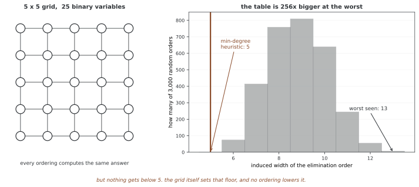

# 변수 제거

변수 제거(variable elimination)는 인수분해된 분포에서 정확한 주변·조건부 확률을 구한다. 제거할 변수를 포함한 인자만 곱하고 그 변수를 합산하므로 전체 결합표를 만들 필요가 없을 수 있다. 효율은 제거 순서와 중간 인자의 크기에 달려 있으며 일반적인 지수 비용이 사라지는 것은 아니다.

## 1. 코드

??? note "코드 (1208줄)"

    ```python
    """
    변수 제거 알고리즘
    ===============================

    이 모듈은 베이즈 망의 구조를 활용하는 효율적인 정확 추론 방법인
    변수 제거 알고리즘을 구현한다.

    학습 목표:
    -------------------
    1. 열거(enumeration)가 왜 비효율적인지 이해하기
    2. 변수 제거 알고리즘 배우기
    3. 인자 연산(곱, 주변화) 이해하기
    4. 제거 순서와 그 영향 배우기
    5. 효율적인 정확 추론 구현하기

    수학적 배경:
    ------------------------
    변수 제거는 다음과 같이 동작한다:
    1. CPT를 인자로 바꾼다
    2. 제거할 변수마다:
       - 그 변수를 담은 인자를 모두 모은다
       - 그것들을 곱한다(인자 곱)
       - 그 변수를 합산해 소거한다(주변화)
    3. 남은 인자를 곱하고 정규화한다

    시간 복잡도: O(n * d^(w+1))이며 여기서:
    - n = 변수의 개수
    - d = 최대 상태 수(cardinality)
    - w = 유도 폭(제거 순서에 달렸다)

    지은이: 교육용 ML 팀
    수준: 중간
    선수 내용: 입문 수준의 01-04
    """

    import numpy as np
    from typing import Dict, List, Set, Optional, Tuple
    from itertools import product
    import networkx as nx
    import matplotlib.pyplot as plt
    import time
    from collections import defaultdict
    import pandas as pd

    # ========================================================================
    # 도우미 클래스
    # ========================================================================


    class ConditionalProbabilityTable:
        """
        변수의 조건부 확률표(CPT)를 나타낸다.

        CPT는 부모 값의 모든 조합에 대해 P(변수 | 부모)를 명시한다.
        이것이 베이즈 네트워크의 기본
        구성 요소다.

        속성:
            variable: 이 CPT가 정의하는 변수의 이름
            parents: 부모 변수 이름의 목록
            cardinalities: 모든 변수를 상태 수에 대응시키는 딕셔너리
            table: 조건부 확률을 담은 NumPy 배열
        """

        def __init__(self,
                     variable: str,
                     parents: List[str],
                     cardinalities: Dict[str, int],
                     table: Optional[np.ndarray] = None):
            """
            CPT를 초기화한다.

            인수:
                variable: 변수의 이름(이를테면 'Rain')
                parents: 부모 변수 이름의 목록(이를테면 ['Cloudy'])
                cardinalities: 모든 변수의 상태 수 딕셔너리
                table: 선택적인 CPT 값. 형태는
                       (*부모_상태수, 변수_상태수)이어야 한다
                       None이면 균등 분포로 초기화한다

            예:
                # P(Rain | Cloudy)의 CPT
                # Rain도 이진, Cloudy도 이진
                cpt = ConditionalProbabilityTable(
                    variable='Rain',
                    parents=['Cloudy'],
                    cardinalities={'Rain': 2, 'Cloudy': 2},
                    table=np.array([[0.8, 0.2],  # P(Rain | Cloudy=0)
                                   [0.2, 0.8]])  # P(Rain | Cloudy=1)
                )
            """
            self.variable = variable
            self.parents = parents
            self.cardinalities = cardinalities

            # CPT의 형태 정하기
            # 형태: (card(부모1), card(부모2), ..., card(변수))
            parent_cards = [cardinalities[p] for p in parents]
            var_card = cardinalities[variable]
            shape = tuple(parent_cards + [var_card])

            if table is None:
                # 균등 분포로 초기화하기
                self.table = np.ones(shape) / var_card
            else:
                self.table = np.array(table)
                # 형태 확인하기
                assert self.table.shape == shape, \
                    f"Table shape {self.table.shape} doesn't match expected {shape}"
                # 조건부 분포마다 합이 1인지 확인하기
                self._verify_normalized()

        def _verify_normalized(self):
            """
            조건부 확률의 합이 1인지 확인한다.

            부모 값의 조합마다 변수 값에 걸친 확률의
            합이 1이어야 한다.
            """
            # 마지막 축(변수 자신)에 걸쳐 합하기
            sums = np.sum(self.table, axis=-1)
            if not np.allclose(sums, 1.0):
                print(f"Warning: CPT for {self.variable} is not normalized!")
                print(f"Sums: {sums}")

        def get_probability(self, 
                           variable_value: int,
                           parent_values: Dict[str, int]) -> float:
            """
            P(변수=값 | 부모=부모 값)을 얻는다.

            인수:
                variable_value: 변수의 값(정수 인덱스)
                parent_values: 부모 이름을 값에 대응시키는 딕셔너리

            반환값:
                조건부 확률

            예:
                # P(Rain=1 | Cloudy=0) 얻기
                prob = cpt.get_probability(1, {'Cloudy': 0})
            """
            # 표를 조회할 인덱스 튜플 만들기
            index = []
            for parent in self.parents:
                index.append(parent_values[parent])
            index.append(variable_value)

            return self.table[tuple(index)]

        def set_probability(self,
                           variable_value: int,
                           parent_values: Dict[str, int],
                           probability: float):
            """
            P(변수=값 | 부모=부모 값)을 정한다.

            인수:
                variable_value: 변수의 값
                parent_values: 부모 이름을 값에 대응시키는 딕셔너리
                probability: 정할 확률 값
            """
            index = []
            for parent in self.parents:
                index.append(parent_values[parent])
            index.append(variable_value)

            self.table[tuple(index)] = probability

        def sample(self, parent_values: Dict[str, int]) -> int:
            """
            부모 값이 주어졌을 때 변수의 값을 샘플링한다.

            이는 베이즈 네트워크의 순방향 샘플링에 유용하다.

            인수:
                parent_values: 부모 이름을 값에 대응시키는 딕셔너리

            반환값:
                샘플링한 값(정수)

            예:
                # Cloudy=1일 때 Rain 값 샘플링하기
                rain_value = cpt.sample({'Cloudy': 1})
            """
            # 조건부 분포 얻기
            index = tuple(parent_values[p] for p in self.parents)
            probabilities = self.table[index]

            # 범주 분포에서 샘플링하기
            return np.random.choice(len(probabilities), p=probabilities)

        def to_dataframe(self) -> pd.DataFrame:
            """
            CPT를 읽기 좋은 DataFrame으로 바꾼다.

            이는 시각화와 디버깅에 유용하다.

            반환값:
                부모 값과 조건부 확률을 담은 DataFrame
            """
            rows = []

            # 부모 값의 모든 조합 만들기
            parent_cards = [self.cardinalities[p] for p in self.parents]

            if not self.parents:
                # 부모 없음 — 사전분포일 뿐이다
                for var_val in range(self.cardinalities[self.variable]):
                    row = {self.variable: var_val, 'Probability': self.table[var_val]}
                    rows.append(row)
            else:
                for parent_combo in product(*[range(c) for c in parent_cards]):
                    for var_val in range(self.cardinalities[self.variable]):
                        row = {}
                        # 부모 값 더하기
                        for parent, pval in zip(self.parents, parent_combo):
                            row[parent] = pval
                        # 변수 값 더하기
                        row[self.variable] = var_val
                        # 확률 더하기
                        index = parent_combo + (var_val,)
                        row['Probability'] = self.table[index]
                        rows.append(row)

            return pd.DataFrame(rows)

        def __str__(self) -> str:
            """CPT의 문자열 표현."""
            if not self.parents:
                return f"P({self.variable})\n{self.to_dataframe().to_string(index=False)}"
            else:
                parent_str = ', '.join(self.parents)
                return f"P({self.variable} | {parent_str})\n{self.to_dataframe().to_string(index=False)}"


    class BayesianNetwork:
        """
        베이즈 네트워크를 나타낸다. 곧 CPT가 딸린 DAG이다.

        베이즈 네트워크는 다음으로 이루어진다:
        1. 방향 비순환 그래프(DAG) 구조
        2. 노드마다의 조건부 확률표(CPT)

        이 네트워크는 P(X1,...,Xn) = ∏ P(Xi | Parents(Xi))를 나타낸다

        속성:
            graph: 구조를 나타내는 NetworkX DiGraph
            cpts: 변수 이름을 CPT에 대응시키는 딕셔너리
            cardinalities: 변수 이름을 상태 수에 대응시키는 딕셔너리
        """

        def __init__(self):
            """빈 베이즈 네트워크를 초기화한다."""
            self.graph = nx.DiGraph()
            self.cpts: Dict[str, ConditionalProbabilityTable] = {}
            self.cardinalities: Dict[str, int] = {}

        def add_variable(self, name: str, cardinality: int):
            """
            네트워크에 변수(노드)를 더한다.

            인수:
                name: 변수 이름(이를테면 'Weather', 'Traffic')
                cardinality: 있을 수 있는 값의 개수(이진이면 2)

            예:
                bn = BayesianNetwork()
                bn.add_variable('Rain', 2)  # 이진 변수
                bn.add_variable('Season', 4)  # 네 계절
            """
            self.graph.add_node(name)
            self.cardinalities[name] = cardinality

        def add_edge(self, parent: str, child: str):
            """
            변수 사이에 방향 간선(인과 관계)을 더한다.

            인수:
                parent: 부모 변수의 이름
                child: 자식 변수의 이름

            발생하는 예외:
                ValueError: 그 간선이 사이클을 만들 때

            예:
                bn.add_edge('Rain', 'WetGrass')  # 비가 잔디를 적신다
            """
            self.graph.add_edge(parent, child)

            # 사이클이 없는지 확인하기
            if not nx.is_directed_acyclic_graph(self.graph):
                self.graph.remove_edge(parent, child)
                raise ValueError(f"Adding edge {parent}->{child} creates a cycle!")

        def set_cpt(self, 
                    variable: str,
                    table: np.ndarray):
            """
            변수의 조건부 확률표를 정한다.

            인수:
                variable: 변수의 이름
                table: 조건부 확률을 담은 NumPy 배열
                       형태는 (card(부모1), ..., card(부모N), card(변수))와 맞아야 한다

            예:
                # 이진 Cloudy를 부모로 갖는 이진 Rain의 경우
                bn.set_cpt('Rain', np.array([[0.8, 0.2],   # P(Rain | Cloudy=0)
                                             [0.3, 0.7]]))  # P(Rain | Cloudy=1)
            """
            parents = list(self.graph.predecessors(variable))
            parents.sort()  # 일관된 순서

            cpt = ConditionalProbabilityTable(
                variable=variable,
                parents=parents,
                cardinalities=self.cardinalities,
                table=table
            )

            self.cpts[variable] = cpt

        def get_cpt(self, variable: str) -> ConditionalProbabilityTable:
            """
            변수의 CPT를 얻는다.

            인수:
                variable: 변수의 이름

            반환값:
                조건부 확률표
            """
            if variable not in self.cpts:
                raise ValueError(f"No CPT defined for variable {variable}")
            return self.cpts[variable]

        def compute_joint_probability(self, assignment: Dict[str, int]) -> float:
            """
            완전한 대입에 대해 P(X1=x1, X2=x2, ..., Xn=xn)를 계산한다.

            연쇄 법칙 인수분해를 쓴다:
            P(X1,...,Xn) = ∏ P(Xi | Parents(Xi))

            인수:
                assignment: 모든 변수에 값을 준 완전한 대입

            반환값:
                결합 확률

            예:
                # P(Cloudy=1, Rain=1, WetGrass=1) 계산하기
                prob = bn.compute_joint_probability({
                    'Cloudy': 1,
                    'Rain': 1,
                    'WetGrass': 1
                })
            """
            probability = 1.0

            # 변수마다 조건부 확률 곱하기
            for variable in self.graph.nodes():
                cpt = self.get_cpt(variable)
                parents = list(self.graph.predecessors(variable))

                # 부모 값 얻기
                parent_values = {p: assignment[p] for p in parents}

                # 변수 값 얻기
                var_value = assignment[variable]

                # P(변수 | 부모)를 곱하기
                prob = cpt.get_probability(var_value, parent_values)
                probability *= prob

            return probability

        def forward_sample(self) -> Dict[str, int]:
            """
            순방향 샘플링으로 결합 분포에서 표본을 만든다.

            순방향 샘플링은 위상 순서를 따른다:
            1. 변수를 위상 순서로 샘플링한다
            2. 이미 샘플링한 부모 값으로 P(Xi | Parents(Xi))에서 샘플링한다

            반환값:
                P(X1,...,Xn)에서 샘플링한 완전한 대입

            예:
                # 네트워크에서 표본 1000개 만들기
                samples = [bn.forward_sample() for _ in range(1000)]
            """
            assignment = {}

            # 위상 순서로 샘플링하기(자식보다 부모를 먼저)
            for variable in nx.topological_sort(self.graph):
                cpt = self.get_cpt(variable)
                parents = list(self.graph.predecessors(variable))

                # 이미 샘플링한 변수에서 부모 값 얻기
                parent_values = {p: assignment[p] for p in parents}

                # 이 변수 샘플링하기
                assignment[variable] = cpt.sample(parent_values)

            return assignment

        def visualize(self, figsize: Tuple[int, int] = (12, 8), show_cpts: bool = False):
            """
            베이즈 네트워크의 구조와, 원하면 CPT까지 시각화한다.

            인수:
                figsize: 그림 크기
                show_cpts: CPT 값을 보일지 여부
            """
            plt.figure(figsize=figsize)

            # 레이아웃
            try:
                pos = nx.spring_layout(self.graph, k=2, iterations=50)
            except:
                pos = nx.spring_layout(self.graph)

            # 노드와 간선 그리기
            nx.draw(self.graph, pos,
                    with_labels=True,
                    node_color='lightcoral',
                    node_size=3000,
                    font_size=12,
                    font_weight='bold',
                    arrows=True,
                    arrowsize=20,
                    edge_color='gray',
                    width=2)

            # 상태 수를 노드 라벨로 붙이기
            labels = {node: f"{node}\n(card={self.cardinalities[node]})" 
                     for node in self.graph.nodes()}
            pos_labels = {k: (v[0], v[1] - 0.1) for k, v in pos.items()}
            nx.draw_networkx_labels(self.graph, pos_labels, labels, 
                                   font_size=9, font_color='darkred')

            plt.title("Bayesian Network Structure", fontsize=14, fontweight='bold')
            plt.axis('off')
            plt.tight_layout()
            plt.show()

            # 요청하면 CPT 보이기
            if show_cpts:
                print("\n" + "="*70)
                print("CONDITIONAL PROBABILITY TABLES")
                print("="*70)
                for variable in nx.topological_sort(self.graph):
                    cpt = self.get_cpt(variable)
                    print(f"\n{cpt}")
                    print("-"*70)


    def build_weather_network() -> BayesianNetwork:
        """
        단순한 날씨 예측 베이즈 네트워크를 구성한다.

        네트워크의 구조:
            Cloudy -> Rain -> WetGrass
            Cloudy -> Sprinkler -> WetGrass

        이는 다음을 보여 주는 고전적인 예다:
        - 공통 원인(흐림이 비와 물뿌리개에 함께 영향을 준다)
        - 여러 원인(젖은 잔디는 비 때문일 수도 물뿌리개 때문일 수도 있다)

        반환값:
            CPT를 갖춘 완전한 베이즈 네트워크
        """
        print("\nBuilding Weather Network...")
        print("-" * 70)

        bn = BayesianNetwork()

        # 변수 더하기(모두 이진: 0=거짓, 1=참)
        bn.add_variable('Cloudy', 2)
        bn.add_variable('Sprinkler', 2)
        bn.add_variable('Rain', 2)
        bn.add_variable('WetGrass', 2)

        # 간선 더하기(인과 관계)
        bn.add_edge('Cloudy', 'Sprinkler')  # 흐림이 물뿌리개 사용에 영향을 준다
        bn.add_edge('Cloudy', 'Rain')        # 흐림이 비에 영향을 준다
        bn.add_edge('Sprinkler', 'WetGrass') # 물뿌리개가 잔디를 적실 수 있다
        bn.add_edge('Rain', 'WetGrass')      # 비가 잔디를 적실 수 있다

        # CPT 정하기

        # P(Cloudy) — 사전확률
        # [P(Cloudy=0), P(Cloudy=1)]
        bn.set_cpt('Cloudy', np.array([0.5, 0.5]))

        # P(Sprinkler | Cloudy)
        # 흐리면 물뿌리개를 쓸 가능성이 낮다
        bn.set_cpt('Sprinkler', np.array([
            [0.5, 0.5],  # P(Sprinkler | Cloudy=0)
            [0.9, 0.1]   # P(Sprinkler | Cloudy=1) — 흐리면 잘 안 쓴다
        ]))

        # P(Rain | Cloudy)
        # 흐리면 비가 올 가능성이 높다
        bn.set_cpt('Rain', np.array([
            [0.8, 0.2],  # P(Rain | Cloudy=0) — 흐리지 않으면 잘 안 온다
            [0.2, 0.8]   # P(Rain | Cloudy=1) — 흐리면 잘 온다
        ]))

        # P(WetGrass | Sprinkler, Rain)
        # 물뿌리개가 켜졌거나 비가 오면 잔디가 젖는다
        # 순서: [Sprinkler=0, Rain=0], [Sprinkler=0, Rain=1],
        #        [Sprinkler=1, Rain=0], [Sprinkler=1, Rain=1]
        bn.set_cpt('WetGrass', np.array([
            [[1.0, 0.0],   # Sprinkler=0, Rain=0: 잔디가 마름
             [0.1, 0.9]],  # Sprinkler=0, Rain=1: 잔디가 젖음(비)
            [[0.1, 0.9],   # Sprinkler=1, Rain=0: 잔디가 젖음(물뿌리개)
             [0.01, 0.99]] # Sprinkler=1, Rain=1: 잔디가 매우 젖음(둘 다)
        ]))

        print("Network built successfully!")
        print(f"Variables: {list(bn.graph.nodes())}")
        print(f"Edges: {list(bn.graph.edges())}")

        return bn


    class InferenceByEnumeration:
        """
        가능한 모든 조합을 전수 열거해 정확히 추론한다.

        이것이 가장 직접적인 추론 방법이다:
        1. 모든 변수의 가능한 대입을 열거한다
        2. 증거와 일치하는 대입의 확률을 합한다
        3. 정규화하여 조건부 확률을 얻는다

        시간 복잡도: 이진 변수 n개에 대해 O(2^n)(지수이다!)
        공간 복잡도: O(2^n)

        효율은 낮지만 이 방법은 다음과 같다:
        - 정확하다(근사가 아니다)
        - 이해하기 쉽다
        - 작은 네트워크에 유용하다
        - 다른 알고리즘을 시험하는 좋은 기준이다
        """

        def __init__(self, bn: BayesianNetwork):
            """
            추론 엔진을 초기화한다.

            인수:
                bn: 추론할 베이즈 네트워크
            """
            self.bn = bn
            self.query_cache = {}  # 반복되는 질의를 위한 캐시

        def query_marginal(self, 
                          query_vars: List[str],
                          evidence: Optional[Dict[str, int]] = None,
                          use_cache: bool = True) -> Dict[tuple, float]:
            """
            전수 열거로 P(query_vars | evidence)를 계산한다.

            인수:
                query_vars: 확률 분포를 계산할 변수
                evidence: 관측한 변수 값의 딕셔너리(None일 수 있다)
                use_cache: 캐시한 결과를 쓸지 여부

            반환값:
                query_vars의 대입마다 확률에 대응시키는 딕셔너리

            예:
                # P(Rain | Cloudy=1) 계산하기
                result = inference.query_marginal(
                    query_vars=['Rain'],
                    evidence={'Cloudy': 1}
                )
                # 반환값: {(0,): 0.2, (1,): 0.8}
            """
            if evidence is None:
                evidence = {}

            # 캐시 키 만들기
            query_key = (tuple(sorted(query_vars)), tuple(sorted(evidence.items())))
            if use_cache and query_key in self.query_cache:
                return self.query_cache[query_key]

            print(f"\nComputing P({', '.join(query_vars)}" + 
                  (f" | {', '.join(f'{k}={v}' for k, v in evidence.items())})" if evidence else ")"))
            print("-" * 60)

            # 네트워크의 모든 변수 얻기
            all_vars = list(self.bn.graph.nodes())

            # 변수를 질의, 증거, 숨은 변수로 나누기
            hidden_vars = [v for v in all_vars if v not in query_vars and v not in evidence]

            print(f"Query variables: {query_vars}")
            print(f"Evidence variables: {list(evidence.keys())}")
            print(f"Hidden variables: {hidden_vars}")

            # 결과 딕셔너리 초기화하기
            result = defaultdict(float)

            # 상태 수 얻기
            query_cards = [self.bn.cardinalities[v] for v in query_vars]
            hidden_cards = [self.bn.cardinalities[v] for v in hidden_vars]

            total_configurations = np.prod(query_cards) * np.prod(hidden_cards)
            print(f"\nEnumerating {int(total_configurations)} configurations...")

            # 질의 변수와 숨은 변수의 모든 대입 열거하기
            for query_values in product(*[range(c) for c in query_cards]):
                # 질의 대입마다 숨은 변수의 모든 대입에 걸쳐 합하기
                query_assignment = dict(zip(query_vars, query_values))

                for hidden_values in product(*[range(c) for c in hidden_cards]):
                    hidden_assignment = dict(zip(hidden_vars, hidden_values))

                    # 완전한 대입
                    full_assignment = {**query_assignment, **hidden_assignment, **evidence}

                    # 베이즈 네트워크로 P(완전한 대입) 계산하기
                    prob = self.bn.compute_joint_probability(full_assignment)

                    # 이 질의 대입의 결과에 더하기
                    result[query_values] += prob

            # 조건부 확률 P(질의 | 증거)를 얻으려고 정규화하기
            total = sum(result.values())

            if total > 0:
                result = {k: v/total for k, v in result.items()}
            else:
                print("Warning: Evidence has probability 0!")
                # 균등 분포
                result = {k: 1.0/len(result) for k in result.keys()}

            # 결과 캐시에 담기
            if use_cache:
                self.query_cache[query_key] = dict(result)

            return dict(result)

        def query_single_variable(self, 
                                 variable: str,
                                 evidence: Optional[Dict[str, int]] = None) -> np.ndarray:
            """
            변수 하나만 질의하는 편의 메서드.

            인수:
                variable: 질의할 변수
                evidence: 증거 딕셔너리

            반환값:
                변수의 값마다의 확률을 담은 NumPy 배열

            예:
                # P(Rain | Cloudy=1) 계산하기
                probs = inference.query_single_variable('Rain', {'Cloudy': 1})
                print(f"P(Rain=0|Cloudy=1) = {probs[0]}")
                print(f"P(Rain=1|Cloudy=1) = {probs[1]}")
            """
            result_dict = self.query_marginal([variable], evidence)

            # 배열로 바꾸기
            cardinality = self.bn.cardinalities[variable]
            probs = np.zeros(cardinality)

            for value_tuple, prob in result_dict.items():
                probs[value_tuple[0]] = prob

            return probs

        def most_probable_explanation(self, 
                                      evidence: Dict[str, int]) -> Dict[str, int]:
            """
            증거가 주어졌을 때 가장 그럴듯한 완전한 대입을 찾는다.

            이를 MAP(최대 사후확률) 추론이라고도 한다.
            argmax_X P(X | evidence)를 찾는다.

            인수:
                evidence: 관측한 변수

            반환값:
                증거가 아닌 모든 변수에 대한 가장 그럴듯한 대입

            예:
                # 잔디가 젖었다면 가장 그럴듯한 설명은 무엇인가?
                mpe = inference.most_probable_explanation({'WetGrass': 1})
                # 반환될 수 있는 값: {'Cloudy': 1, 'Rain': 1, 'Sprinkler': 0}
            """
            print(f"\nFinding Most Probable Explanation given evidence:")
            print(f"Evidence: {evidence}")
            print("-" * 60)

            # 증거가 아닌 변수 모두 얻기
            all_vars = list(self.bn.graph.nodes())
            query_vars = [v for v in all_vars if v not in evidence]

            # 모든 대입 열거하기
            best_assignment = None
            best_prob = -1

            query_cards = [self.bn.cardinalities[v] for v in query_vars]

            for query_values in product(*[range(c) for c in query_cards]):
                assignment = dict(zip(query_vars, query_values))
                full_assignment = {**assignment, **evidence}

                prob = self.bn.compute_joint_probability(full_assignment)

                if prob > best_prob:
                    best_prob = prob
                    best_assignment = assignment

            print(f"\nMost probable assignment: {best_assignment}")
            print(f"Probability: {best_prob:.6f}")

            return best_assignment


    # ========================================================================
    # 메인
    # ========================================================================


    class Factor:
        """
        변수 집합에 걸친 인자(퍼텐셜 함수)를 나타낸다.

        인자 φ(X1, ..., Xk)은 (X1, ..., Xk)의 대입마다
        음이 아닌 수에 대응시키는 함수이다.

        인자는 변수 제거의 기본 자료구조이다.
        """

        def __init__(self,
                     variables: List[str],
                     cardinalities: Dict[str, int],
                     values: Optional[np.ndarray] = None):
            """
            인자를 초기화한다.

            인수:
                variables: 이 인자에 든 변수 이름의 목록
                cardinalities: 모든 변수의 상태 수 딕셔너리
                values: 인자 값의 NumPy 배열(없어도 된다)
            """
            self.variables = sorted(variables)  # 축 순서가 일관되도록 정렬해 둔다
            self.cardinalities = cardinalities

            shape = tuple(cardinalities[var] for var in self.variables)

            if values is None:
                self.values = np.ones(shape)
            else:
                self.values = np.array(values)
                assert self.values.shape == shape, \
                    f"Shape mismatch: {self.values.shape} vs {shape}"

        def multiply(self, other: 'Factor') -> 'Factor':
            """
            인자 곱 φ1 × φ2를 계산한다.

            인자 곱은 서로 일관된 대입마다 값을 곱해
            인자 둘을 합친다.

            이를테면 φ1(A,B)와 φ2(B,C)가 있으면 다음과 같다:
            (φ1 × φ2)(A,B,C) = φ1(A,B) × φ2(B,C)

            인수:
                other: 곱할 다른 인자

            반환값:
                변수의 합집합에 걸친 곱 인자
            """
            # 변수의 합집합 찾기
            new_variables = sorted(set(self.variables + other.variables))

            # 결과 인자 만들기
            result = Factor(new_variables, self.cardinalities)

            # 새 변수의 대입마다
            for assignment in self._enumerate_assignments(new_variables):
                # 두 인자에서 값 얻기
                val1 = self._get_value(assignment)
                val2 = other._get_value(assignment)

                # 곱하기
                result._set_value(assignment, val1 * val2)

            return result

        def marginalize(self, variables_to_eliminate: List[str]) -> 'Factor':
            """
            인자에서 변수를 합산해 소거한다(주변화한다).

            주변화는 φ'(X) = Σ_Y φ(X, Y)를 계산한다

            인수:
                variables_to_eliminate: 합산해 소거할 변수

            반환값:
                변수를 제거한 새 인자
            """
            # 제거한 뒤 남은 변수
            remaining_vars = [v for v in self.variables 
                             if v not in variables_to_eliminate]

            if not remaining_vars:
                # 모든 변수에 걸쳐 합하기 = 숫자 하나
                return Factor([], self.cardinalities, 
                             np.array([np.sum(self.values)]))

            # 결과 인자 만들기
            result = Factor(remaining_vars, self.cardinalities)

            # 남은 변수의 대입마다
            for remaining_assignment in result._enumerate_assignments(remaining_vars):
                # 제거한 변수의 모든 대입에 걸쳐 합하기
                total = 0.0

                elim_cards = [self.cardinalities[v] for v in variables_to_eliminate]
                for elim_values in product(*[range(c) for c in elim_cards]):
                    elim_assignment = dict(zip(variables_to_eliminate, elim_values))
                    full_assignment = {**remaining_assignment, **elim_assignment}

                    total += self._get_value(full_assignment)

                result._set_value(remaining_assignment, total)

            return result

        def reduce(self, evidence: Dict[str, int]) -> 'Factor':
            """
            증거 변수를 고정해 인자를 축소한다.

            증거와 일관된 대입만 고려하는
            새 인자를 만든다.

            인수:
                evidence: 관측한 변수 값의 딕셔너리

            반환값:
                축소한 인자
            """
            # 증거에 없는 변수
            remaining_vars = [v for v in self.variables if v not in evidence]

            if not remaining_vars:
                # 모든 변수가 관측됨
                return Factor([], self.cardinalities, 
                             np.array([self._get_value(evidence)]))

            # 결과 인자 만들기
            result = Factor(remaining_vars, self.cardinalities)

            # 남은 변수의 대입마다
            for assignment in result._enumerate_assignments(remaining_vars):
                full_assignment = {**assignment, **evidence}
                value = self._get_value(full_assignment)
                result._set_value(assignment, value)

            return result

        def normalize(self) -> 'Factor':
            """값의 합이 1이 되도록 인자를 정규화한다."""
            total = np.sum(self.values)
            if total > 0:
                return Factor(self.variables, self.cardinalities, 
                             self.values / total)
            return self

        def _get_value(self, assignment: Dict[str, int]) -> float:
            """대입에 대한 인자 값을 얻는다."""
            if not self.variables:
                return self.values[0]

            index = tuple(assignment[var] for var in self.variables)
            return self.values[index]

        def _set_value(self, assignment: Dict[str, int], value: float):
            """대입에 대한 인자 값을 정한다."""
            if not self.variables:
                self.values[0] = value
            else:
                index = tuple(assignment[var] for var in self.variables)
                self.values[index] = value

        def _enumerate_assignments(self, variables: List[str]):
            """변수의 모든 대입을 만든다."""
            if not variables:
                yield {}
                return

            cards = [self.cardinalities[var] for var in variables]
            for values in product(*[range(c) for c in cards]):
                yield dict(zip(variables, values))

        def __str__(self) -> str:
            """문자열 표현."""
            if not self.variables:
                return f"Factor([]) = {self.values[0]:.4f}"
            return f"Factor({', '.join(self.variables)})\nShape: {self.values.shape}"


    class VariableElimination:
        """
        정확 추론을 위한 변수 제거 알고리즘을 구현한다.

        이것이 베이즈 망 정확 추론의 표준 알고리즘이다.
        분포의 인수분해 구조를 활용하므로 열거보다
        훨씬 효율적이다.
        """

        def __init__(self, bn):
            """
            변수 제거를 초기화한다.

            인수:
                bn: BayesianNetwork 인스턴스
            """
            self.bn = bn

        def _create_factors_from_cpts(self) -> List[Factor]:
            """
            망의 모든 CPT를 인자로 바꾼다.

            반환값:
                변수마다 하나씩인 인자의 목록
            """
            factors = []

            for variable in self.bn.graph.nodes():
                cpt = self.bn.get_cpt(variable)
                parents = cpt.parents

                # 변수와 그 부모에 걸친 인자 만들기
                factor_vars = parents + [variable]
                factor = Factor(factor_vars, self.bn.cardinalities)

                # CPT 값을 인자로 복사하기
                for assignment in factor._enumerate_assignments(factor_vars):
                    parent_vals = {p: assignment[p] for p in parents}
                    var_val = assignment[variable]
                    prob = cpt.get_probability(var_val, parent_vals)
                    factor._set_value(assignment, prob)

                factors.append(factor)

            return factors

        def _choose_elimination_order(self,
                                      variables_to_eliminate: Set[str],
                                      strategy: str = 'min_neighbors') -> List[str]:
            """
            제거 순서를 고른다.

            제거 순서가 효율을 크게 좌우한다!
            여러 전략:
            - min_neighbors: 이웃이 가장 적은 변수를 먼저 제거한다
            - min_fill: 그래프에 추가되는 간선(fill-in)을 가장 적게 한다
            - weighted_min_fill: 변수의 상태 수를 고려한다

            인수:
                variables_to_eliminate: 순서를 정할 변수
                strategy: 순서 결정 전략

            반환값:
                제거 순서대로 나열한 변수의 목록
            """
            if strategy == 'min_neighbors':
                # 단순한 탐욕 전략: 이웃이 가장 적은 변수를 제거한다
                order = []
                graph = self.bn.graph.to_undirected()
                remaining = set(variables_to_eliminate)

                while remaining:
                    # 남은 집합에서 이웃이 가장 적은 변수 찾기
                    min_var = min(remaining, 
                                 key=lambda v: len(set(graph.neighbors(v)) & remaining))
                    order.append(min_var)
                    remaining.remove(min_var)

                return order
            else:
                # 기본값: 정렬한 순서를 그대로 쓴다
                return sorted(variables_to_eliminate)

        def query(self,
                 query_vars: List[str],
                 evidence: Optional[Dict[str, int]] = None,
                 elimination_order: Optional[List[str]] = None,
                 verbose: bool = True) -> Dict[tuple, float]:
            """
            변수 제거로 추론한다.

            인수:
                query_vars: 분포를 계산할 질의 변수
                evidence: 관측한 변수 값
                elimination_order: 직접 지정한 제거 순서(없어도 된다)
                verbose: 진행 상황을 출력할지 여부

            반환값:
                질의 변수에 걸친 확률 분포
            """
            if evidence is None:
                evidence = {}

            if verbose:
                print(f"\nVariable Elimination Query:")
                print(f"Query: P({', '.join(query_vars)}" +
                      (f" | {', '.join(f'{k}={v}' for k, v in evidence.items())})" 
                       if evidence else ")"))
                print("-" * 60)

            # 스텝 1: CPT에서 첫 인자 만들기
            factors = self._create_factors_from_cpts()

            if verbose:
                print(f"\nStep 1: Created {len(factors)} initial factors from CPTs")

            # 스텝 2: 증거로 인자 줄이기
            if evidence:
                factors = [f.reduce(evidence) for f in factors]
                if verbose:
                    print(f"Step 2: Reduced factors with evidence {evidence}")

            # 스텝 3: 제거할 변수 정하기
            all_vars = set(self.bn.graph.nodes())
            variables_to_eliminate = all_vars - set(query_vars) - set(evidence.keys())

            if verbose:
                print(f"Step 3: Variables to eliminate: {sorted(variables_to_eliminate)}")

            # 스텝 4: 제거 순서 고르기
            if elimination_order is None:
                elimination_order = self._choose_elimination_order(variables_to_eliminate)

            if verbose:
                print(f"Step 4: Elimination order: {elimination_order}")

            # 스텝 5: 변수를 하나씩 제거하기
            if verbose:
                print(f"\nStep 5: Eliminating variables...")

            for i, var in enumerate(elimination_order, 1):
                if verbose:
                    print(f"\n  Eliminating {var} ({i}/{len(elimination_order)}):")

                # 이 변수를 담은 인자 찾기
                relevant_factors = [f for f in factors if var in f.variables]
                other_factors = [f for f in factors if var not in f.variables]

                if verbose:
                    print(f"    - Found {len(relevant_factors)} factors containing {var}")

                if relevant_factors:
                    # 해당하는 인자 곱하기
                    product_factor = relevant_factors[0]
                    for f in relevant_factors[1:]:
                        product_factor = product_factor.multiply(f)

                    if verbose:
                        print(f"    - Multiplied factors: scope = {product_factor.variables}")

                    # 변수 주변화하기
                    marginalized_factor = product_factor.marginalize([var])

                    if verbose:
                        print(f"    - Marginalized out {var}: scope = {marginalized_factor.variables}")

                    # 인자 목록 갱신하기
                    factors = other_factors + [marginalized_factor]
                else:
                    factors = other_factors

            # 스텝 6: 남은 인자 곱하기
            if verbose:
                print(f"\nStep 6: Multiplying {len(factors)} remaining factors...")

            result_factor = factors[0]
            for f in factors[1:]:
                result_factor = result_factor.multiply(f)

            # 스텝 7: 정규화하기
            result_factor = result_factor.normalize()

            if verbose:
                print(f"Step 7: Normalized result")

            # 인자를 딕셔너리로 바꾸기
            result = {}
            for assignment in result_factor._enumerate_assignments(query_vars):
                key = tuple(assignment[var] for var in query_vars)
                result[key] = result_factor._get_value(assignment)

            return result


    def demonstrate_variable_elimination():
        """단순한 망에서 변수 제거를 시연한다."""
        print("\n" + "="*70)
        print("DEMONSTRATION: Variable Elimination")
        print("="*70)

        # 날씨 망 구성하기
        bn = build_weather_network()

        # 추론 엔진 만들기
        ve = VariableElimination(bn)

        # 질의 1: 단순한 질의
        print("\n" + "="*70)
        print("Query 1: P(Rain | WetGrass=1)")
        print("="*70)

        result = ve.query(['Rain'], {'WetGrass': 1}, verbose=True)

        print(f"\nResult:")
        print(f"P(Rain=0 | WetGrass=1) = {result[(0,)]:.4f}")
        print(f"P(Rain=1 | WetGrass=1) = {result[(1,)]:.4f}")

        # 질의 2: 질의 변수가 여럿
        print("\n" + "="*70)
        print("Query 2: P(Rain, Sprinkler | WetGrass=1)")
        print("="*70)

        result = ve.query(['Rain', 'Sprinkler'], {'WetGrass': 1}, verbose=True)

        print(f"\nResult:")
        for (rain, sprinkler), prob in sorted(result.items()):
            print(f"P(Rain={rain}, Sprinkler={sprinkler} | WetGrass=1) = {prob:.4f}")


    def compare_enumeration_vs_ve():
        """
        열거와 변수 제거의 효율을 견준다.
        """
        print("\n" + "="*70)
        print("COMPARISON: Enumeration vs Variable Elimination")
        print("="*70)

        bn = build_weather_network()

        # 열거
        print("\nEnumeration:")
        enum = InferenceByEnumeration(bn)
        start = time.time()
        enum_result = enum.query_marginal(['Rain'], {'WetGrass': 1}, use_cache=False)
        enum_time = time.time() - start
        print(f"Time: {enum_time:.6f} seconds")

        # 변수 제거
        print("\nVariable Elimination:")
        ve = VariableElimination(bn)
        start = time.time()
        ve_result = ve.query(['Rain'], {'WetGrass': 1}, verbose=False)
        ve_time = time.time() - start
        print(f"Time: {ve_time:.6f} seconds")

        # 비교
        print(f"\nSpeedup: {enum_time/ve_time:.2f}x faster")
        print(f"\nNote: For small networks the difference is small,")
        print(f"but for larger networks VE can be orders of magnitude faster!")


    def main():
        """메인 데모."""
        print("\n" + "="*70)
        print("VARIABLE ELIMINATION ALGORITHM")
        print("="*70)

        print("\nVariable Elimination is the standard algorithm for exact")
        print("inference in Bayesian Networks. It exploits the factored")
        print("structure to avoid exponential blowup (when possible).")

        demonstrate_variable_elimination()
        compare_enumeration_vs_ve()

        print("\n" + "="*70)
        print("KEY TAKEAWAYS")
        print("="*70)
        print("\n1. VE is much more efficient than enumeration")
        print("\n2. Key operations:")
        print("   - Factor product (multiply factors)")
        print("   - Marginalization (sum out variables)")

        print("\n3. Elimination order matters!")
        print("   - Good order: polynomial time")
        print("   - Bad order: exponential time")
        print("   - Finding optimal order is NP-hard")

        print("\n4. Time complexity: O(n * d^(w+1))")
        print("   - w = induced width (depends on order)")
        print("   - For trees: w=1, very efficient!")
        print("   - For dense graphs: can be expensive")

        print("\n" + "="*70 + "\n")


    if __name__ == "__main__":
        main()
    ```


## 2. 논의

### 인자 곱과 합산

먼저 CPT를 인자로 바꾸고 관측 증거에 해당하는 축 값을 고정한다. 제거할 변수 Y를 포함한 모든 인자를 모아 곱한 뒤 Y를 합산하고 새 인자를 집합에 돌려놓는다. 마지막에는 질의 변수의 인자를 정규화한다.

$$[\phi_1\phi_2](A,B,C)=\phi_1(A,B)\phi_2(B,C),\qquad\phi'(X)=\sum_Y\phi(X,Y)$$

정규화 전 결과는 증거를 포함한 결합 질량이다. 증거 확률이 0이면 조건부분포가 정의되지 않는다.

### 제거 순서와 복잡도

인자 스코프(각 인자가 다루는 변수 집합)에서 만든 무방향 상호작용 그래프에서 변수를 제거할 때 그 이웃을 서로 연결한다. 이 fill-in을 포함한 유도 폭 w와 최대 상태 수 d에 따라 대표적인 표형 연산 비용은 O(n d^(w+1))로 나타난다. 최적 순서 탐색은 일반적으로 어렵고 최소 차수·최소 fill-in 등의 휴리스틱을 사용한다.

무방향 쌍별 트리에서 적절히 리프(이웃이 하나뿐인 끝 노드)부터 제거하면 w=1이다. 하지만 DAG의 뼈대가 트리라는 사실만으로 w=1이라고 할 수는 없다. 부모가 많은 CPT는 처음부터 큰 인자이며 도덕화 그래프에서 부모 사이가 연결된다. 질의가 여러 변수의 큰 결합표를 요구하면 출력 크기 자체의 비용도 남는다.

<div class="storybox" markdown>

**그림으로 보는 AI 1.** 순서를 잘 골라도 내려가지 않는 바닥

제거 순서가 비용을 가른다는 말을 수로 보면 꽤 극적이다. 변수 25개짜리 5×5 격자에서 순서를 무작위로 3,000가지 뽑아 유도 폭을 재어 보았다.



최소 차수 휴리스틱은 폭 5에 닿는다. 무작위 순서는 대개 8에서 10 사이에 몰리고 가장 나쁜 것은 13이었다. 표 크기 $d^{w+1}$ 로 환산하면 **256배** 차이다. 답은 어느 순서로 하든 똑같이 나오는데 비용만 그만큼 달라진다. 위 문단이 휴리스틱을 쓰라고 적은 까닭이다.

**그런데 같은 그림이 더 중요한 것을 하나 보여 준다. 5 아래로는 아무것도 내려가지 않았다.** 그 바닥은 순서를 잘못 골라서 생긴 것이 아니라 **격자라는 구조가 정해 둔 것**이고, 순서를 아무리 잘 골라도 치워지지 않는다. 격자를 한 줄씩 쓸어 가려면 어차피 한 줄 전체를 한꺼번에 들고 있어야 한다.

그래서 순서 찾기를 완벽하게 풀어 주는 오라클(oracle, 답을 즉시 알려 주는 가상의 장치)이 있어도 추론이 쉬워지지는 않는다. 1990년에 그레고리 쿠퍼(Gregory Cooper)가 베이즈 망의 정확 추론이 **NP-난해**임을 보였고, 1993년에 폴 데이검(Paul Dagum)과 마이클 루비(Michael Luby)가 **근사조차 NP-난해**임을 보였다. 탈출구를 둘 다 막은 셈이다.

**그러니 이 절의 지수 비용은 알고리즘이 서툴러서 생긴 것이 아니다.** 변수 제거가 전체 결합표를 만들지 않고도 답을 내는 것은 분명한 이득이지만, 그 이득은 **유도 폭이 작을 때**만 나온다. 그래프가 희소하다(sparse, 간선이 적다)는 것만으로는 모자라다 — 방금 본 격자도 희소하지만 폭이 5 아래로 내려가지 않았다. 유도 폭이 큰 문제를 만나면 할 수 있는 일은 정확 추론을 포기하고 **무엇을 포기할지 고르는 것**이며, 그것이 근사 추론이 따로 한 장을 차지하는 까닭이다.

_확인한 곳 — G. F. Cooper, "The computational complexity of probabilistic inference using Bayesian belief networks", *Artificial Intelligence* **42**(2–3), 393–405 (1990). P. Dagum, M. Luby, "Approximating probabilistic inference in Bayesian belief networks is NP-hard", *Artificial Intelligence* **60**, 141–153 (1993). 그림의 유도 폭은 그림을 그리는 코드가 직접 제거해 가며 재며, 휴리스틱이 무작위 최선보다 나쁘지 않다는 것을 `assert` 로 확인한 뒤에 그린다._

</div>

### 구현의 범위

Factor는 변수명을 정렬하므로 외부 values 배열도 그 축 순서로 제공해야 한다. 스칼라 인자의 예상 형태는 ()인데 일부 메서드는 길이 1 배열을 전달하고 values[0]을 사용하므로 빈 변수 인자를 만드는 경로는 일관되지 않다. 모든 변수가 증거로 고정되거나 마지막 변수를 합산하는 경우를 완성된 구현으로 가정하지 않는다.

자동 순서는 DAG의 무방향 뼈대에서 남은 제거 변수 이웃 수만 비교한다. 부모 간 도덕화·실제 인자 스코프·fill-in·유지할 질의 변수 이웃을 반영하지 않으므로 표준적인 동적 최소 차수 순서와 다르다. 정확한 인자 연산이 유지되면 순서의 차이는 결과보다 비용에 영향을 주지만, 사용자 순서에 은닉 변수(질의도 증거도 아닌 변수)가 빠지거나 질의 변수가 들어가면 올바른 질의를 보장하지 못한다. 질의와 증거는 겹치지 않게 하고 상태 값과 정규화 합을 확인한다.

## 연습문제

<div class="drillbox" markdown>

**연습문제 1.** <span class="diff hard" title="어려움"></span>
날씨 네트워크에서 P(Rain|WetGrass=1)를 C, S 순서로 제거해 표현하라.

</div>

??? success "풀이"

    초기 인자는 f₁(C)=P(C), f₂(C,S)=P(S|C), f₃(C,R)=P(R|C), f₄(S,R,W)=P(W|S,R)다. 증거로 f₄를 g(S,R)=P(W=1|S,R)로 줄인다. C를 제거해 h(S,R)=∑_C f₁f₂f₃를 만들고, S를 제거해 u(R)=∑_S h(S,R)g(S,R)를 얻는다. u의 합이 양수일 때 정규화한다. 이 순서에서는 최대 세 변수 인자만 필요하며 네 변수 전체 표는 만들지 않는다.


---

<div class="drillbox" markdown>

**연습문제 2.** <span class="diff med" title="중간"></span>
중심 H와 리프 L₁,…,L_k의 쌍별 인자가 있는 별 그래프에서 제거 순서의 영향을 비교하라.

</div>

??? success "풀이"

    한 리프를 질의로 유지하고 다른 리프부터 제거하면 중간 인자가 작다. 반대로 H를 먼저 제거하면 H와 모든 리프를 포함한 곱 인자는 d^(k+1) 항목, H 합산 뒤 인자는 d^k 항목을 갖는다. 단일 질의에서도 중간 비용이 지수적으로 커질 수 있다. 모든 리프의 결합분포가 출력이면 그 출력 크기 자체도 d^k이므로 과제를 구분해야 한다.


---

<div class="drillbox" markdown>

**연습문제 3.** <span class="diff hard" title="어려움"></span>
아래 A→B→C→D 예제가 P(D|A=1)를 계산하는 인자 갱신을 설명하라.

</div>

??? success "풀이"

    A=1에서 P(B|A=1)를 시작 인자로 사용한다. B를 합산해 C의 조건부분포를 얻고 C를 합산해 D의 분포를 얻는다. P(A=1)>0에서 공통 인자 P(A=1)는 정규화로 약분되므로 별도로 곱하지 않아도 된다. 이는 사슬 전용 배열 계산이며 위 범용 Factor 클래스의 스칼라·순서 처리를 검증하는 테스트는 아니다.

    ```python
    import numpy as np

    # 사슬 A->B->C->D의 CPT
    P_A = np.array([0.6, 0.4])
    P_B_A = np.array([[0.7, 0.3], [0.3, 0.7]])
    P_C_B = np.array([[0.8, 0.2], [0.4, 0.6]])
    P_D_C = np.array([[0.9, 0.1], [0.2, 0.8]])

    # 증거: A=1
    # B 제거: f(B) = P(B|A=1), 그다음 f(C) = sum_B P(C|B)*P(B|A=1)
    f_B = P_B_A[1, :]  # [P(B=0|A=1), P(B=1|A=1)]
    f_C = np.zeros(2)
    for c in range(2):
        for b in range(2):
            f_C[c] += P_C_B[b, c] * f_B[b]

    # C 제거: f(D) = sum_C P(D|C)*f(C)
    f_D = np.zeros(2)
    for d in range(2):
        for c in range(2):
            f_D[d] += P_D_C[c, d] * f_C[c]

    # 정규화
    P_D_given_A1 = f_D / f_D.sum()
    print(f'P(D=0|A=1) = {P_D_given_A1[0]:.4f}')
    print(f'P(D=1|A=1) = {P_D_given_A1[1]:.4f}')
    ```


## 정리하며

변수 제거는 관련 인자의 곱과 합산을 반복해 정확한 추론을 수행한다. 유도 폭과 출력 크기가 비용을 결정하며, 좋은 순서도 모든 모형을 다항 시간으로 만들지는 않는다. 증거의 양의 확률, 인자 축 순서·스칼라 표현과 제거 순서의 완전성을 확인한다.
