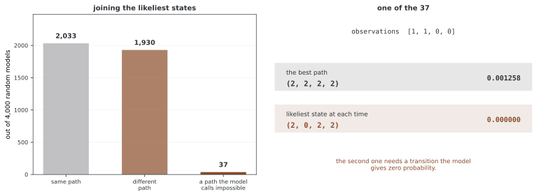

# 은닉 마르코프 모델(HMM)

은닉 마르코프 모델(HMM)은 관측되지 않는 상태의 마르코프 전이와 상태별 관측분포를 결합한다. 유한한 이산 상태에서는 동적 계획법으로 우도·상태 사후확률·최적 경로를 계산할 수 있다. 상태 추론과 파라메터 학습, 필터링과 스무딩의 차이를 먼저 구분한다.

## 1. 수학적 틀

상태 Z_t∈{1,…,K}, 초기분포 π와 전이행렬 A를 정의한다.

$$\pi_k=P(Z_1=k),\qquad A_{ij}=P(Z_t=j\mid Z_{t-1}=i)$$

관측은 전체 상태열을 조건으로 시점별 독립이며 X_t의 분포는 현재 상태 Z_t에만 의존한다고 가정한다. 상태 k의 방출분포를 B_k(x)=p(X_t=x|Z_t=k)라 하면 다음과 같다.

$$p(z_{1:T},x_{1:T})=\pi_{z_1}B_{z_1}(x_1)\prod_{t=2}^TA_{z_{t-1},z_t}B_{z_t}(x_t)$$

연속 관측이면 B_k는 확률밀도이며 관측열의 식도 밀도로 해석한다. 이 페이지의 첫 구현은 유한 범주 관측의 방출행렬 B를 사용한다.

| 관심량 | 의미 | 방법 |
|---|---|---|
| p(x₁:T|θ) | 모든 상태열을 합한 관측 우도 | Forward |
| p(Z_t|x₁:T,θ) | 전체 관측을 사용한 상태 스무딩 | Forward–backward |
| argmax_z p(z|x,θ) | 가장 확률이 높은 전체 상태 경로 | Viterbi |
| 최대 우도 파라메터 θ | 관측 우도의 점 최적화 | Baum–Welch EM |

θ=(π,A,B)를 고정한 상태 사후분포와 θ 자체의 베이즈 사후분포는 다르다.

## 2. Forward–backward 알고리즘

### Forward와 backward 메시지

Forward 값 $\alpha_t(j)=p(x_{1:t},Z_t=j)$는 다음으로 갱신한다.

$$\alpha_1(j)=\pi_jB_j(x_1),\qquad\alpha_t(j)=B_j(x_t)\sum_i\alpha_{t-1}(i)A_{ij}$$

우도는 p(x₁:T)=∑_jα_T(j)다. 이를 현재시점에서 정규화하면 p(Z_t|x₁:t)인 필터 확률을 얻는다. 조밀한 K상태 전이에서는 비용이 O(TK²)로 K^T 경로 전수 열거보다 작다.

Backward 값 $\beta_t(i)=p(x_{t+1:T}\mid Z_t=i)$는 다음과 같다.

$$\beta_T(i)=1,\qquad\beta_t(i)=\sum_jA_{ij}B_j(x_{t+1})\beta_{t+1}(j)$$

### 상태 스무딩

양의 관측 우도에서 전체 관측을 사용한 상태·전이 확률은 다음과 같다.

$$\gamma_t(j)=\frac{\alpha_t(j)\beta_t(j)}{p(x_{1:T})}$$

$$\xi_t(i,j)=\frac{\alpha_t(i)A_{ij}B_j(x_{t+1})\beta_{t+1}(j)}{p(x_{1:T})}$$

스무딩에는 미래 관측이 포함되므로 실시간 전략의 의사결정에 그대로 사용하면 미래 정보가 섞인다. 긴 관측열에서는 직접 확률 곱이 언더플로를 일으킬 수 있어 스케일 계수 또는 log-sum-exp를 사용한다.

## 3. 비터비 알고리즘

Viterbi는 각 도착 상태에서 최적 경로 점수와 직전 상태를 저장하는 동적 계획법이다. 확률 공간의 재귀는 다음과 같다.

$$\delta_1(j)=\pi_jB_j(x_1),\qquad\delta_t(j)=B_j(x_t)\max_i[\delta_{t-1}(i)A_{ij}]$$

마지막 최댓값 상태에서 저장한 역추적 포인터를 따라가면 전체 최적 경로를 얻는다. 실제 구현은 로그 공간의 덧셈·최댓값으로 안정화할 수 있다.

전체 경로를 최대화하는 결과와 각 시점 γ_t의 최빈 상태를 연결한 결과는 일반적으로 다르다. 전자는 유효한 공동 경로 점수를 최대화하고 후자는 시점별 오분류 로스와 연결된다. Viterbi의 최댓값은 p(z*,x)의 **결합확률**이며 관측 우도 p(x)=∑_z p(z,x)와 다르다. 조건부 경로 확률이 필요하면 p(x)로 나눈다.

<div class="storybox" markdown>

**그림으로 보는 AI 1.** 이 알고리즘은 말소리가 아니라 잡음 섞인 전파를 두고 나왔다

비터비 알고리즘은 음성 인식이나 생물정보학에서 만들어진 것이 아니다. 1967년 4월 《IEEE Transactions on Information Theory》에 실린 앤드루 비터비(Andrew J. Viterbi)의 글 제목이 「Error Bounds for Convolutional Codes and an Asymptotically Optimum Decoding Algorithm」이고, 다루는 문제는 **잡음 섞인 통신로로 들어온 컨볼루션 부호를 복호하는 일**이었다. 알고리즘 자체도 오류 확률의 상계를 증명하려다 나온 부산물에 가까웠다. HMM 은 한참 뒤에 같은 구조를 빌려 쓴 쪽이다.

그 내력이 위 문단의 경고와 이어진다. 비터비가 풀려던 것은 **보내진 부호열이 무엇이었나**, 곧 **하나로 이어진 열**을 고르는 문제였다. 시점마다 따로 가장 그럴듯한 기호를 고르는 문제가 아니었다.



얼마나 자주 어긋나는지 세어 보았다. 금지된 전이($0 \to 2$)를 하나 심은 무작위 HMM 4,000개에서, 두 방식이 **다른 경로를 주는 경우가 1,967개(49.2%)** 다. 절반 가까이다.

**그리고 37개에서는 시점별 최빈을 이은 결과가 결합확률 0을 받는다.** 오른쪽 보기가 그중 하나다 — 최적 경로는 $(2,2,2,2)$ 로 결합확률 0.001258인데, 시점마다 가장 그럴듯한 상태를 고르면 $(2,0,2,2)$ 가 되고 이 경로의 확률은 **정확히 0** 이다. $0 \to 2$ 를 지나야 하는데 모델이 그 전이에 확률 0을 주었기 때문이다.

**시점별 최빈이 틀린 답이라는 뜻은 아니다.** 위 문단이 적은 대로 그것은 **시점별 오분류**를 줄이는 답이고, 그 기준에서는 비터비보다 낫다. 두 가지가 서로 다른 물음에 답할 뿐이다. 다만 그 결과를 **경로라고 부르는 순간** 문제가 생긴다 — 이어 붙인 것이 모델 안에서 지나갈 수 없는 길일 수 있기 때문이다. 어느 쪽이 필요한지는 "상태를 맞히려는가, 열을 맞히려는가"로 갈리고, 비터비가 풀던 문제는 뒤쪽이었다.

_확인한 곳 — A. J. Viterbi, "Error Bounds for Convolutional Codes and an Asymptotically Optimum Decoding Algorithm", *IEEE Transactions on Information Theory* **IT-13**(2), 260쪽 (1967년 4월). 컨볼루션 부호의 복호를 다루며 알고리즘이 오류 확률 상계를 보이는 과정에서 제시되었다는 것을 2차 문헌으로 확인했다. 그림의 수는 그림을 그리는 코드가 씨앗을 박고 무작위 HMM 을 만들어 전수 열거로 직접 세며, 두 경로가 실제로 자주 갈리는지와 확률 0 인 보기가 나오는지를 먼저 확인한 뒤에만 그린다._

</div>

## 4. 바움-웰치 알고리즘

Baum–Welch는 고정된 HMM 구조의 EM이다. E단계에서 γ·ξ를 계산하고 범주형 방출의 M단계에서 다음을 갱신한다.

$$\pi_j^{new}=\gamma_1(j),\qquad A_{ij}^{new}=\frac{\sum_{t=1}^{T-1}\xi_t(i,j)}{\sum_{t=1}^{T-1}\gamma_t(i)}$$

$$B_j^{new}(v)=\frac{\sum_{t:x_t=v}\gamma_t(j)}{\sum_{t=1}^T\gamma_t(j)}$$

분모가 0인 상태·전이는 식별되지 않으므로 별도 처리해야 한다. 여러 독립 시퀀스에서는 초기 상태·기대 도수를 시퀀스별로 계산해 합하며 서로 다른 시퀀스 경계를 전이로 세지 않는다. 연속 방출에는 가중 모멘트 등 해당 분포의 갱신을 사용한다.

정확한 E단계와 적절한 M단계에서는 관측 우도가 감소하지 않지만 전역 최적값을 보장하지 않는다. 초기화·동일한 상태의 이름 교환·경계 파라메터·수치 오차를 검토한다. 별도 사전분포 없이 EM으로 구한 값은 파라메터의 완전한 베이즈 추론 결과가 아니다.

## 5. PyTorch 구현

A는 K×K, B는 K×V의 행 확률행렬이고 π는 길이 K의 확률벡터다. 관측은 0~V−1의 정수 인덱스이며 빈 열은 처리하지 않는다. CPU float64 배열을 만드는 부분과 장치·자료형을 맞춘다.

Forward·backward는 확률을 직접 곱하므로 긴 열에서 언더플로가 발생할 수 있고 posterior_states는 전체 관측의 스무딩을 반환한다. Viterbi의 작은 양수 덧셈은 원래 확률 0인 경로에도 양의 값을 주므로 엄밀한 불가능 전이를 보존하지 않는다. 반환 log_prob와 시연의 Log-likelihood라는 출력 이름은 다르며 실제 값은 최적 경로의 로그 결합확률이다.

Baum–Welch는 T=1의 전이 분모나 기대 점유가 0인 상태를 처리하지 않는다. 최대 반복 종료에서는 기록한 마지막 우도가 마지막 M단계 직전 값일 수 있으므로 반환 파라메터의 최종 우도와 기록을 구분한다.

```python
import torch
from typing import Dict, List, Tuple, Optional

class HiddenMarkovModel:
    """
    띄엄띄엄한 내보냄을 갖는 숨은 마르코프 모형.

    성분:
    - A: 숨은 상태의 K×K 옮김 행렬
    - B: K×V 내보냄 행렬(B[k,v] = P(obs=v | state=k))
    - pi: K차원 첫 상태 분포
    """

    def __init__(
        self,
        transition_matrix: torch.Tensor,
        emission_matrix: torch.Tensor,
        initial_distribution: torch.Tensor,
        state_names: Optional[List[str]] = None,
        obs_names: Optional[List[str]] = None
    ):
        self.A = transition_matrix.clone().double()
        self.B = emission_matrix.clone().double()
        self.pi = initial_distribution.clone().double()
        self.K = self.A.shape[0]
        self.V = self.B.shape[1]
        self.state_names = state_names or [f"S{i}" for i in range(self.K)]
        self.obs_names = obs_names or [f"O{i}" for i in range(self.V)]

    def forward_algorithm(
        self, observations: torch.Tensor
    ) -> Tuple[torch.Tensor, float]:
        """
        앞쪽 변수 α_t(j)과 log P(x) 셈하기.

        반환값:
            (alpha, log_likelihood), 여기서 alpha은 (T, K)
        """
        T = len(observations)
        alpha = torch.zeros(T, self.K, dtype=torch.float64)

        alpha[0] = self.pi * self.B[:, observations[0]]
        for t in range(1, T):
            alpha[t] = (alpha[t-1] @ self.A) * self.B[:, observations[t]]

        log_likelihood = torch.log(alpha[-1].sum()).item()
        return alpha, log_likelihood

    def backward_algorithm(
        self, observations: torch.Tensor
    ) -> torch.Tensor:
        """뒤쪽 변수 β_t(i) 셈하기. (T, K) 텐서를 돌려준다."""
        T = len(observations)
        beta = torch.zeros(T, self.K, dtype=torch.float64)
        beta[-1] = 1.0

        for t in range(T - 2, -1, -1):
            beta[t] = self.A @ (self.B[:, observations[t+1]] * beta[t+1])

        return beta

    def posterior_states(
        self, observations: torch.Tensor
    ) -> torch.Tensor:
        """γ_t(j) = P(Z_t = j | x) 셈하기. (T, K) 텐서를 돌려준다."""
        alpha, _ = self.forward_algorithm(observations)
        beta = self.backward_algorithm(observations)
        gamma = alpha * beta
        return gamma / gamma.sum(dim=1, keepdim=True)

    def viterbi(
        self, observations: torch.Tensor
    ) -> Tuple[List[int], float]:
        """
        가장 그럴듯한 숨은 상태 늘어놓음 찾기(로그 공간).

        반환값:
            (best_path, log_probability)
        """
        T = len(observations)
        log_A = torch.log(self.A + 1e-300)
        log_B = torch.log(self.B + 1e-300)
        log_pi = torch.log(self.pi + 1e-300)

        delta = torch.zeros(T, self.K, dtype=torch.float64)
        psi = torch.zeros(T, self.K, dtype=torch.long)

        delta[0] = log_pi + log_B[:, observations[0]]

        for t in range(1, T):
            for j in range(self.K):
                scores = delta[t-1] + log_A[:, j]
                psi[t, j] = scores.argmax()
                delta[t, j] = scores.max() + log_B[j, observations[t]]

        path = [0] * T
        path[-1] = delta[-1].argmax().item()
        log_prob = delta[-1].max().item()

        for t in range(T - 2, -1, -1):
            path[t] = psi[t + 1, path[t + 1]].item()

        return path, log_prob

    def baum_welch(
        self,
        observations: torch.Tensor,
        max_iter: int = 100,
        tol: float = 1e-6
    ) -> Dict:
        """파라메터 어림을 위한 바움-웰치(EM)."""
        T = len(observations)
        log_likelihoods = []

        for iteration in range(max_iter):
            # E 스텝
            alpha, ll = self.forward_algorithm(observations)
            beta = self.backward_algorithm(observations)
            log_likelihoods.append(ll)

            if iteration > 0 and abs(ll - log_likelihoods[-2]) < tol:
                break

            gamma = alpha * beta
            gamma = gamma / gamma.sum(dim=1, keepdim=True)

            xi = torch.zeros(T - 1, self.K, self.K, dtype=torch.float64)
            for t in range(T - 1):
                numerator = (
                    alpha[t].unsqueeze(1) * self.A
                    * self.B[:, observations[t+1]].unsqueeze(0)
                    * beta[t+1].unsqueeze(0)
                )
                xi[t] = numerator / numerator.sum()

            # M 스텝
            self.pi = gamma[0]
            self.A = xi.sum(dim=0) / gamma[:-1].sum(dim=0).unsqueeze(1)

            for v in range(self.V):
                mask = (observations == v).double()
                self.B[:, v] = (gamma * mask.unsqueeze(1)).sum(dim=0)
            self.B = self.B / self.B.sum(dim=1, keepdim=True)

        return {
            'A': self.A, 'B': self.B, 'pi': self.pi,
            'log_likelihoods': log_likelihoods,
            'iterations': len(log_likelihoods)
        }

    def simulate(self, n_steps: int) -> Tuple[List[int], List[int]]:
        """숨은 상태와 관측 흉내내기."""
        states, observations = [], []
        state = torch.multinomial(self.pi.float(), 1).item()

        for t in range(n_steps):
            states.append(state)
            obs = torch.multinomial(self.B[state].float(), 1).item()
            observations.append(obs)
            state = torch.multinomial(self.A[state].float(), 1).item()

        return states, observations
```

---

## 6. 가상 시장 국면 예제

관측과 상태를 알려진 HMM에서 생성하고 같은 파라메터로 복원한다. 출력 정확도는 실제 시장 자료의 외부 검증 성능이나 추정한 파라메터의 정확도가 아니다. 별도로 학습한 모형과 참 상태를 비교한다면 상태 이름의 교환도 정렬해야 한다. A_kk<1일 때 한 번 진입한 상태의 기대 지속기간은 1/(1−A_kk)이며 이는 관측 구간 안의 검열된 지속기간 평균과 다르다.

```python
def demonstrate_hmm_regime_detection():
    """
    관측한 값 액션으로 강세장과 약세장 국면 알아내기.
    """
    print("HMM: Market Regime Detection")
    print("=" * 70)

    state_names = ['Bull', 'Bear']
    obs_names = ['Up', 'Flat', 'Down']

    A = torch.tensor([
        [0.95, 0.05],   # 강세장: 95% 이어짐
        [0.10, 0.90]    # 약세장: 90% 이어짐
    ])

    B = torch.tensor([
        [0.60, 0.30, 0.10],  # 강세장: 대체로 오름
        [0.15, 0.25, 0.60]   # 약세장: 대체로 내림
    ])

    pi = torch.tensor([0.7, 0.3])
    hmm = HiddenMarkovModel(A, B, pi, state_names, obs_names)

    # 흉내내고 풀어내기
    true_states, observations = hmm.simulate(200)
    obs_tensor = torch.tensor(observations)

    decoded_states, log_prob = hmm.viterbi(obs_tensor)
    accuracy = sum(t == d for t, d in zip(true_states, decoded_states))
    accuracy /= len(true_states)

    print(f"Viterbi decoding accuracy: {accuracy:.1%}")
    print(f"Log-likelihood: {log_prob:.2f}")

    # 뒤확률 상태 확률
    gamma = hmm.posterior_states(obs_tensor)

    # 국면이 이어지는 기댓값 길이
    bull_duration = 1.0 / (1.0 - A[0, 0].item())
    bear_duration = 1.0 / (1.0 - A[1, 1].item())
    print(f"\nExpected regime durations:")
    print(f"  Bull: {bull_duration:.1f} periods")
    print(f"  Bear: {bear_duration:.1f} periods")

demonstrate_hmm_regime_detection()
```

**출력:**

```
HMM: Market Regime Detection
======================================================================
Viterbi decoding accuracy: 85.5%
Log-likelihood: -230.49

Expected regime durations:
  Bull: 20.0 periods
  Bear: 10.0 periods
```

---

## 7. 흡수 HMM과 신용 위험

흡수 상태를 가진 은닉 사슬도 정의할 수 있지만 흡수 상태가 존재한다는 사실만으로 모든 초기 상태에서 결국 흡수되지는 않는다. 아래 클래스와 신용등급 예제는 방출 모형 없는 **직접 관측 상태의 흡수 마르코프 사슬**이며 HMM의 은닉 등급 추론을 구현하지 않는다. 기본행렬 공식을 쓰려면 나머지 모든 상태가 과도여야 한다.

### 흡수 사슬 분석

과도 블록 Q의 스펙트럼 반지름이 1보다 작으면 N=(I−Q)⁻¹, 기대 흡수 시간 N1, 흡수 확률 NR을 구한다. 생성자는 확률행렬과 흡수 도달 가능성을 검증하지 않으므로 별도 닫힌 클래스가 있으면 역행렬이 특이할 수 있다.

```python
class AbsorbingMarkovChain:
    """
    흡수 마르코프 사슬 살피기.

    정준 꼴: P = [[Q, R], [0, I]]
    핵심 결과:
    - 바탕 행렬: N = (I - Q)^{-1}
    - 흡수까지의 기댓값 시간: t = N·1
    - 흡수 확률: B = N·R
    """

    def __init__(
        self,
        transition_matrix: torch.Tensor,
        state_names: Optional[List[str]] = None
    ):
        self.P = transition_matrix.clone().double()
        self.n_states = self.P.shape[0]
        self.state_names = state_names or [
            f"State_{i}" for i in range(self.n_states)
        ]
        self._classify_states()
        self._build_canonical_form()

    def _classify_states(self):
        """흡수 상태(P[i,i]=1)와 지나가는 상태 가려내기."""
        self.absorbing_indices = []
        self.transient_indices = []
        for i in range(self.n_states):
            if torch.isclose(self.P[i, i],
                           torch.tensor(1.0, dtype=self.P.dtype)):
                other = self.P[i, :i].sum() + self.P[i, i+1:].sum()
                if torch.isclose(other,
                               torch.tensor(0.0, dtype=self.P.dtype)):
                    self.absorbing_indices.append(i)
                    continue
            self.transient_indices.append(i)

        self.n_transient = len(self.transient_indices)
        self.n_absorbing = len(self.absorbing_indices)
        self.transient_names = [self.state_names[i]
                                for i in self.transient_indices]
        self.absorbing_names = [self.state_names[i]
                                for i in self.absorbing_indices]

    def _build_canonical_form(self):
        """Q과 R 부분 행렬 뽑아내기."""
        reordered = self.transient_indices + self.absorbing_indices
        P_c = self.P[torch.tensor(reordered)][:, torch.tensor(reordered)]
        t = self.n_transient
        self.Q = P_c[:t, :t]
        self.R = P_c[:t, t:]

    def fundamental_matrix(self) -> torch.Tensor:
        """N = (I - Q)^{-1}."""
        I = torch.eye(self.n_transient, dtype=self.Q.dtype)
        self.N = torch.linalg.inv(I - self.Q)
        return self.N

    def expected_absorption_time(self) -> Dict[str, float]:
        """t = N·1."""
        if not hasattr(self, 'N'):
            self.fundamental_matrix()
        ones = torch.ones(self.n_transient, 1, dtype=self.N.dtype)
        t = self.N @ ones
        return {n: t[i, 0].item()
                for i, n in enumerate(self.transient_names)}

    def absorption_probabilities(self) -> Dict[str, Dict[str, float]]:
        """B = N·R."""
        if not hasattr(self, 'N'):
            self.fundamental_matrix()
        B = self.N @ self.R
        result = {}
        for i, tn in enumerate(self.transient_names):
            result[tn] = {an: B[i, j].item()
                          for j, an in enumerate(self.absorbing_names)}
        return result

    def variance_absorption_time(self) -> Dict[str, float]:
        """Var[T_i] = [(2N - I)·t]_i - t_i^2."""
        if not hasattr(self, 'N'):
            self.fundamental_matrix()
        I = torch.eye(self.n_transient, dtype=self.N.dtype)
        ones = torch.ones(self.n_transient, 1, dtype=self.N.dtype)
        t = self.N @ ones
        var = (2 * self.N - I) @ t - t ** 2
        return {n: var[i, 0].item()
                for i, n in enumerate(self.transient_names)}
```

### 신용등급 전이 예제

전이행렬의 마지막 D 상태를 흡수 상태로 가정할 때 P^t의 D 성분을 누적 부도확률로 해석할 수 있다. 숫자는 가상 모형이며 실제 신용위험 추정이 아니다. credit_var는 등급별 노출 총액을 각기 하나의 독립 경로로 움직이므로 한 등급의 여러 차주를 독립적으로 모델링하거나 공통 경기요인의 의존성을 표현하지 않는다.

cvar_95는 VaR 이상 로스의 단순 조건부 평균이다. 이산 로스에서는 VaR 지점에 확률질량이 있으므로 일반적인 상위 5% Expected Shortfall과 다를 수 있다. 로스·등급·기간·LGD 가정과 사후 추정 불확실성을 별도로 정의해야 한다.

```python
class CreditRatingModel:
    """
    흡수 마르코프 사슬로 본 신용 등급 옮김.
    부도(D)가 흡수 상태이다.
    """

    def __init__(self, transition_matrix: torch.Tensor, ratings: List[str]):
        self.P = transition_matrix.clone().double()
        self.ratings = ratings
        self.n_ratings = len(ratings)
        self.default_idx = self.n_ratings - 1

    def cumulative_default_prob(
        self, initial_rating: str, max_horizon: int = 10
    ) -> torch.Tensor:
        """P(시간 t까지 부도 | Rating_0 = initial_rating)."""
        idx = self.ratings.index(initial_rating)
        cum_probs = torch.zeros(max_horizon)
        for t in range(1, max_horizon + 1):
            P_t = torch.linalg.matrix_power(self.P, t)
            cum_probs[t-1] = P_t[idx, self.default_idx]
        return cum_probs

    def credit_var(
        self, portfolio: Dict[str, float], horizon: int,
        lgd: float = 0.6, n_simulations: int = 10000
    ) -> Dict:
        """몬테카를로로 구하는 신용 위험 밸류."""
        losses = []
        for _ in range(n_simulations):
            total_loss = 0
            for rating, exposure in portfolio.items():
                current = self.ratings.index(rating)
                for t in range(horizon):
                    probs = self.P[current].float()
                    current = torch.multinomial(probs, 1).item()
                    if current == self.default_idx:
                        total_loss += exposure * lgd
                        break
            losses.append(total_loss)
        losses = torch.tensor(losses)
        return {
            'mean_loss': losses.mean().item(),
            'var_95': torch.quantile(losses, 0.95).item(),
            'var_99': torch.quantile(losses, 0.99).item(),
            'cvar_95': losses[
                losses >= torch.quantile(losses, 0.95)
            ].mean().item()
        }

def demonstrate_credit_transitions():
    """부도 확률과 VaR을 갖는 신용 등급 모형."""
    print("\nCredit Rating Transition Model")
    print("=" * 70)

    ratings = ['AAA', 'AA', 'A', 'BBB', 'BB', 'B', 'CCC', 'D']
    P = torch.tensor([
        [0.91, 0.08, 0.01, 0.00, 0.00, 0.00, 0.00, 0.00],  # AAA
        [0.01, 0.90, 0.08, 0.01, 0.00, 0.00, 0.00, 0.00],  # AA
        [0.00, 0.02, 0.91, 0.05, 0.01, 0.01, 0.00, 0.00],  # A
        [0.00, 0.00, 0.04, 0.89, 0.05, 0.01, 0.01, 0.00],  # BBB
        [0.00, 0.00, 0.00, 0.06, 0.83, 0.08, 0.02, 0.01],  # BB
        [0.00, 0.00, 0.00, 0.00, 0.06, 0.82, 0.08, 0.04],  # B
        [0.00, 0.00, 0.00, 0.00, 0.01, 0.06, 0.65, 0.28],  # CCC
        [0.00, 0.00, 0.00, 0.00, 0.00, 0.00, 0.00, 1.00],  # D
    ])

    model = CreditRatingModel(P, ratings)

    # 쌓인 부도 확률
    print("\nCumulative Default Probabilities:")
    print("-" * 50)
    header = "Rating  " + "  ".join(f"Year {t}" for t in range(1, 6))
    print(header)
    for rating in ['AAA', 'BBB', 'B', 'CCC']:
        cum_pds = model.cumulative_default_prob(rating, 5)
        row = f"{rating:6}  " + "  ".join(f"{pd:6.2%}" for pd in cum_pds)
        print(row)

    # 흡수 사슬 살피기
    chain = AbsorbingMarkovChain(P, state_names=ratings)
    times = chain.expected_absorption_time()
    print("\nExpected Years to Default (from transient states):")
    for state, t in times.items():
        print(f"  {state}: {t:.1f} years")

    # 포트폴리오 VaR
    portfolio = {
        'AAA': 10e6, 'AA': 25e6, 'A': 35e6,
        'BBB': 20e6, 'BB': 8e6, 'B': 2e6
    }
    var_results = model.credit_var(portfolio, horizon=1)
    print(f"\nPortfolio Credit VaR (1-year, LGD=60%):")
    print(f"  Expected Loss: ${var_results['mean_loss']:,.0f}")
    print(f"  VaR (95%):     ${var_results['var_95']:,.0f}")
    print(f"  VaR (99%):     ${var_results['var_99']:,.0f}")
    print(f"  CVaR (95%):    ${var_results['cvar_95']:,.0f}")

demonstrate_credit_transitions()
```

**출력:**

```
Credit Rating Transition Model
======================================================================

Cumulative Default Probabilities:
--------------------------------------------------
Rating  Year 1  Year 2  Year 3  Year 4  Year 5
AAA      0.00%   0.00%   0.00%   0.00%   0.01%
BBB      0.00%   0.37%   1.03%   1.92%   2.99%
B        4.00%   9.58%  15.73%  21.90%  27.79%
CCC     28.00%  46.45%  58.79%  67.21%  73.08%

Expected Years to Default (from transient states):
  AAA: 80.2 years
  AA: 70.3 years
  A: 59.3 years
  BBB: 48.1 years
  BB: 33.0 years
  B: 19.8 years
  CCC: 7.2 years

Portfolio Credit VaR (1-year, LGD=60%):
  Expected Loss: $91,200
  VaR (95%):     $0
  VaR (99%):     $1,200,000
  CVaR (95%):    $91,200
```

### 도박 파산 예제

0·4를 흡수 경계로 둔 대칭 워크로 종료 시간과 경계 도달 확률을 계산한다. 초기 자금 i에서 위 경계 도달 확률은 i/4, 기대 종료 단계는 i(4−i)다.

```python
def demonstrate_gamblers_ruin():
    """흡수 마르코프 사슬로 본 노름꾼의 파산."""
    print("\nGambler's Ruin (Target = \$4)")
    print("=" * 70)

    states = ['$0 (Broke)', '\$1', '\$2', '\$3', '\$4 (Win)']
    P = torch.tensor([
        [1.0, 0.0, 0.0, 0.0, 0.0],  # \$0: 흡수
        [0.5, 0.0, 0.5, 0.0, 0.0],  # \$1
        [0.0, 0.5, 0.0, 0.5, 0.0],  # \$2
        [0.0, 0.0, 0.5, 0.0, 0.5],  # \$3
        [0.0, 0.0, 0.0, 0.0, 1.0]   # \$4: 흡수
    ])

    chain = AbsorbingMarkovChain(P, state_names=states)

    times = chain.expected_absorption_time()
    probs = chain.absorption_probabilities()
    variances = chain.variance_absorption_time()

    for state in chain.transient_names:
        print(f"\nStarting from {state}:")
        print(f"  E[steps to end]: {times[state]:.2f}")
        print(f"  Std[steps]:      {variances[state]**0.5:.2f}")
        for abs_state in chain.absorbing_names:
            print(f"  P(end at {abs_state}): {probs[state][abs_state]:.4f}")

demonstrate_gamblers_ruin()
```

**출력:**

```
Gambler's Ruin (Target = \$4)
======================================================================

Starting from \$1:
  E[steps to end]: 3.00
  Std[steps]:      2.83
  P(end at $0 (Broke)): 0.7500
  P(end at \$4 (Win)): 0.2500

Starting from \$2:
  E[steps to end]: 4.00
  Std[steps]:      2.83
  P(end at $0 (Broke)): 0.5000
  P(end at \$4 (Win)): 0.5000

Starting from \$3:
  E[steps to end]: 3.00
  Std[steps]:      2.83
  P(end at $0 (Broke)): 0.2500
  P(end at \$4 (Win)): 0.7500
```

---

## 8. 국면 전환 수익률 모델

연속 관측의 상태별 정규 방출을 사용한 국면 전환 **생성** 모형이다. 아래 RegimeSwitchingModel은 파라메터를 주어진 값으로 사용하며 관측 수익률에서 국면을 필터링하거나 학습하지 않는다.

unconditional_moments는 정상분포로 혼합한 한 기간의 평균·분산을 계산한다. 상태별 평균이 다르고 상태가 지속되면 수익률에 자기상관이 생길 수 있다. n기간 합산 분산은 n Var(r)+2∑_(k=1)^(n−1)(n−k)Cov(r_t,r_(t+k))이므로 표준편차에 √252를 곱한 출력은 일반적인 연 변동성을 정확히 계산하지 않는다. 평균의 252배도 복리 누적 수익률과는 다른 산술 합산이다.

```python
import numpy as np

class RegimeSwitchingModel:
    """
    국면 바뀜 모형: 숨은 마르코프 사슬이
    국면마다 다른 수익 분포를 이끈다.

    r_t | S_t = k ~ N(μ_k, σ_k²)
    """

    def __init__(
        self,
        transition_matrix: torch.Tensor,
        regime_means: torch.Tensor,
        regime_stds: torch.Tensor,
        regime_names: List[str] = None
    ):
        self.P = transition_matrix.clone()
        self.n_regimes = self.P.shape[0]
        self.means = regime_means.clone()
        self.stds = regime_stds.clone()
        self.regime_names = regime_names or [
            f"Regime_{i}" for i in range(self.n_regimes)
        ]
        self._compute_stationary()

    def _compute_stationary(self):
        eigenvalues, eigenvectors = torch.linalg.eig(self.P.T)
        idx = torch.argmin(torch.abs(eigenvalues.real - 1.0))
        pi = eigenvectors[:, idx].real
        self.stationary = torch.abs(pi) / torch.abs(pi).sum()

    def simulate(
        self, n_periods: int, initial_regime: int = None
    ) -> Tuple[torch.Tensor, torch.Tensor]:
        """수익과 국면 이름표 흉내내기."""
        if initial_regime is None:
            initial_regime = torch.multinomial(
                self.stationary.float(), 1
            ).item()

        regimes = torch.zeros(n_periods, dtype=torch.long)
        returns = torch.zeros(n_periods)
        current = initial_regime

        for t in range(n_periods):
            regimes[t] = current
            returns[t] = torch.normal(self.means[current],
                                       self.stds[current])
            current = torch.multinomial(
                self.P[current].float(), 1
            ).item()

        return returns, regimes

    def unconditional_moments(self) -> Dict:
        """E[r] = Σ π_k μ_k, Var[r] = Σ π_k(σ_k² + μ_k²) - E[r]²."""
        mean = (self.stationary * self.means).sum()
        second = (self.stationary * (self.stds**2 + self.means**2)).sum()
        var = second - mean**2
        return {'mean': mean.item(), 'std': var.sqrt().item()}

    def regime_duration(self) -> Dict[str, float]:
        """E[이어지는 길이] = 1/(1 - P[k,k])."""
        return {self.regime_names[k]: 1 / (1 - self.P[k, k].item())
                for k in range(self.n_regimes)}

def demonstrate_regime_switching():
    """날마다의 수익을 다루는 두 국면 강세장/약세장 모형."""
    print("\nRegime-Switching Return Model")
    print("=" * 70)

    P = torch.tensor([[0.95, 0.05], [0.10, 0.90]])
    means = torch.tensor([0.0005, -0.0003])    # 날마다
    stds = torch.tensor([0.01, 0.025])

    model = RegimeSwitchingModel(P, means, stds, ['Bull', 'Bear'])

    print(f"Stationary: P(Bull)={model.stationary[0]:.3f}, "
          f"P(Bear)={model.stationary[1]:.3f}")

    durations = model.regime_duration()
    for regime, d in durations.items():
        print(f"E[{regime} duration]: {d:.1f} days")

    moments = model.unconditional_moments()
    print(f"Unconditional: E[r]={moments['mean']*252*100:.2f}% ann, "
          f"σ={moments['std']*np.sqrt(252)*100:.1f}% ann")

demonstrate_regime_switching()
```

**출력:**

```
Regime-Switching Return Model
======================================================================
Stationary: P(Bull)=0.667, P(Bear)=0.333
E[Bull duration]: 20.0 days
E[Bear duration]: 10.0 days
Unconditional: E[r]=5.88% ann, σ=26.3% ann
```

---

## 9. MCMC과의 이음

유한 이산 상태 HMM은 파라메터가 주어졌을 때 forward–backward와 Viterbi로 정확한 합산·최대화를 수행할 수 있다. 파라메터까지 베이즈 추론하려면 사전분포와 추가 계산이 필요하다. 상태 경로를 조건부로 샘플링하는 방법과 파라메터 갱신을 결합할 수 있다.

연속 잠재변수가 있다고 정확한 추론이 모두 불가능한 것은 아니다. 선형 가우시안 상태공간 모형에는 칼만 필터·스무딩이 있다. 비선형·고차원 모형에서는 입자 방법·변분 추론·MCMC 등의 대안을 검토하며 어느 하나가 항상 효율적으로 확장된다고 보장할 수 없다.

## 연습문제

1. 두 은닉 상태·세 관측 범주의 HMM을 정의하고 결합분포의 인수분해와 관측 우도의 합산을 적어라. 상태별 최빈값과 최적 공동 경로가 다를 수 있는 이유를 설명하라.
2. 정확한 Baum–Welch에서 관측 우도가 감소하지 않는 이유와 영 기대 도수·수치 언더플로가 이 계산을 방해하는 경우를 설명하라. 여러 초기값의 비교가 전역 최적점의 증명은 아닌 이유도 논하라.
3. 신용등급이 은닉이고 관측 신호가 범주형 재무 지표인 HMM을 구성하려면 기존 직접 관측 등급 사슬에 무엇을 추가해야 하는지 설명하라. 방출분포와 은닉 상태 추론을 명시하라.
4. 가상 장비 상태가 정상·경미 고장·심각 고장·수리 완료·폐기인 유한 흡수 모형을 정의하라. 뒤 두 상태의 흡수 도달 가능성을 확인한 뒤 기대 종료 시간과 각 종료 확률의 방정식을 적어라.
5. 수익률의 두 국면 모형을 평가할 때 필터링·스무딩·Viterbi와 실제 예측을 구분하라. 시간 순서를 지킨 평가에서 상태 라벨의 임의성과 전이 추정 불확실성, 연율화의 자기상관을 어떻게 다룰지 설명하라.

## 정리하며

HMM은 은닉 상태 전이와 관측 방출을 결합한다. 우도는 경로를 합산하고 Viterbi는 경로를 최대화하며, forward–backward의 스무딩은 미래 관측도 사용한다. EM의 점 학습과 베이즈 파라메터 추론, 직접 관측 흡수 사슬과 HMM, 가상 국면 생성과 실제 자료 추론을 구분한다.

**참고 문헌**

1. Rabiner, L.R. "A Tutorial on Hidden Markov Models and Selected Applications in Speech Recognition." *Proceedings of the IEEE*, 77(2), 1989.
2. Bishop, C.M. *Pattern Recognition and Machine Learning*, 13장. Springer, 2006.
3. Hamilton, J.D. "A New Approach to the Economic Analysis of Nonstationary Time Series." *Econometrica*, 57(2), 1989.
4. Kemeny, J.G. & Snell, J.L. *Finite Markov Chains*, 3장. Springer-Verlag, 1976.
5. Lando, D. *Credit Risk Modeling*. Princeton University Press, 2004.
6. Jarrow, R.A., Lando, D., & Turnbull, S.M. "A Markov Model for the Term Structure of Credit Risk Spreads." *Review of Financial Studies*, 10(2), 1997.
