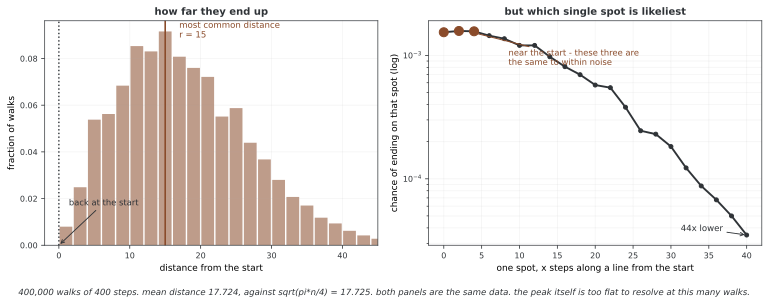

# 랜덤 워크

랜덤 워크는 작은 무작위 이동을 누적한 확률 과정이다. 1차원에서는 오른쪽·왼쪽 이동의 확률로 평균 이동과 분산을 구하고, 2차원에서는 격자 경로와 거리를 관찰한다. 유한 경로의 모습, 이론적인 장기 성질과 제한 시간 안에서만 관측한 도달 시간을 구분한다.

## 1. 코드

??? note "코드 (547줄)"

    ```python
    """
    random_walk.py (단원 03)

    무작위 스텝 흉내내기
    =======================

    Location: 06_markov_chain/01_fundamentals/
    난이도: ⭐⭐ 기초
    걸리는 시간: 3-4시간

    학습 목표:
    - 마르코프 사슬로서 무작위 스텝 이해하기
    - 1차원과 2차원 무작위 스텝 구현하기
    - 성질 살피기: 기댓값 자리, 흩어짐
    - 경계 조건과 첫 지나감 시간 살피기

    수학적 바탕:
    무작위 스텝은 무작위 방향의 스텝으로 이루어진 길이다.
    이는 다음을 만족하는 마르코프 사슬의 특별한 경우이다:
    - 상태는 자리이다(정수나 좌표)
    - 옮김은 지금 자리에만 달렸다

    1차원 대칭 무작위 스텝에서:
    - P(X_{n+1} = X_n + 1) = p
    - P(X_{n+1} = X_n - 1) = 1-p
    - p = 0.5이면 단순한 대칭 무작위 스텝이다

    핵심 성질:
    - 치우친 스텝에서는 E[X_n] = X_0 + n(2p-1)
    - Var[X_n] = 4np(1-p)
    - 대칭 스텝에서는 E[X_n] = X_0, Var[X_n] = n
    """

    import numpy as np
    import matplotlib.pyplot as plt
    from collections import defaultdict

    # 무작위로 뽑는 값이 아래에 나온다. 씨앗을 고정해야 이 쪽에 실린
    # 수가 다시 나온다 — 고정하지 않으면 돌릴 때마다 다른 수가 찍힌다
    np.random.seed(0)

    # ========================================================================
    # 메인
    # ========================================================================


    class RandomWalk1D:
        """
        정수 위의 1차원 무작위 스텝.

        수학 모형:
        X_n = X_0 + Σ_{i=1}^n ξ_i
        여기서 ξ_i은 다음을 만족하는 독립 확률 변수이다:
        P(ξ_i = +1) = p
        P(ξ_i = -1) = 1-p
        """

        def __init__(self, p=0.5, initial_position=0):
            """
            무작위 스텝 첫값 잡기.

            파라메터:
                p (float): 오른쪽으로 걸을 확률([0,1] 안이어야 한다)
                initial_position (int): 시작 자리

            수학 메모:
            - p = 0.5: 대칭(치우치지 않은) 무작위 스텝
            - p > 0.5: 오른쪽으로 쏠린다
            - p < 0.5: 왼쪽으로 쏠린다
            """
            if not 0 <= p <= 1:
                raise ValueError("p must be in [0, 1]")

            self.p = p
            self.initial_position = initial_position
            self.current_position = initial_position
            self.history = [initial_position]

        def step(self):
            """
            무작위 스텝의 한 스텝 떼기.

            반환값:
                int: 새 자리

            수학 과정:
            확률 p으로 오른쪽(+1)으로 움직인다
            확률 1-p으로 왼쪽(-1)으로 움직인다
            """
            # 스텝 만들기: 확률 p으로 +1, 확률 1-p으로 -1
            if np.random.random() < self.p:
                step_size = 1
            else:
                step_size = -1

            self.current_position += step_size
            self.history.append(self.current_position)

            return self.current_position

        def simulate(self, n_steps, initial_position=None):
            """
            무작위 스텝 n스텝 흉내내기.

            파라메터:
                n_steps (int): 뗄 스텝 수
                initial_position (int): 시작 자리(되돌릴 때)

            반환값:
                list: 자리의 늘어놓음

            통계의 성질(대칭 스텝, p=0.5):
            - E[X_n] = X_0(기댓값 쏠림 없음)
            - Var[X_n] = n(흩어짐이 시간에 비례해 자란다)
            - Std[X_n] = √n(표준편차가 제곱근으로 자란다)
            """
            if initial_position is not None:
                self.current_position = initial_position
                self.history = [initial_position]

            for _ in range(n_steps):
                self.step()

            return self.history

        def expected_position(self, n_steps):
            """
            n스텝 뒤의 이론상 기댓값 자리 셈하기.

            파라메터:
                n_steps (int): 스텝 수

            반환값:
                float: 기댓값 자리 E[X_n]

            수학 공식:
            E[X_n] = X_0 + n(2p - 1)

            이끌어 내기:
            스텝마다 확률 p으로 +1, 확률 1-p으로 -1을 보탠다
            E[ξ_i] = (+1)×p + (-1)×(1-p) = 2p - 1
            E[X_n] = E[X_0 + Σξ_i] = X_0 + n×E[ξ_i] = X_0 + n(2p-1)
            """
            return self.initial_position + n_steps * (2 * self.p - 1)

        def variance(self, n_steps):
            """
            n스텝 뒤의 이론상 흩어짐 셈하기.

            파라메터:
                n_steps (int): 스텝 수

            반환값:
                float: 흩어짐 Var[X_n]

            수학 공식:
            Var[X_n] = 4np(1-p)

            대칭 스텝에서는(p=0.5) Var[X_n] = n

            이끌어 내기:
            Var[ξ_i] = E[ξ_i²] - (E[ξ_i])²
            E[ξ_i²] = (+1)²×p + (-1)²×(1-p) = 1
            Var[ξ_i] = 1 - (2p-1)² = 4p(1-p)
            Var[X_n] = n×Var[ξ_i] = 4np(1-p)
            """
            return 4 * n_steps * self.p * (1 - self.p)

        def first_passage_time(self, target_position, max_steps=10000):
            """
            스텝이 target_position에 처음 닿는 때 찾기.

            파라메터:
                target_position (int): 닿을 타깃
                max_steps (int): 시도할 최대 스텝 수

            반환값:
                int or None: 첫 지나감 시간, 닿지 못하면 None

            수학 메모:
            첫 지나감 시간 T = min{n ≥ 0 : X_n = target}
            대칭 스텝에서는 어떤 타깃에 대해서도 E[T]이 유한하다.
            """
            self.current_position = self.initial_position

            for step in range(max_steps):
                if self.current_position == target_position:
                    return step
                self.step()

            return None  # max_steps 안에 타깃에 닿지 못함


    class RandomWalk2D:
        """
        정수 격자 Z² 위의 2차원 무작위 스텝.

        수학 모형:
        (X_n, Y_n) = (X_0, Y_0) + Σ_{i=1}^n (ξ_i, η_i)

        대칭 스텝에서:
        P(오른쪽) = P(왼쪽) = P(위) = P(아래) = 1/4
        """

        def __init__(self, initial_position=(0, 0)):
            """
            2차원 무작위 스텝 첫값 잡기.

            파라메터:
                initial_position (tuple): 시작 (x, y) 좌표
            """
            self.initial_position = np.array(initial_position)
            self.current_position = np.array(initial_position)
            self.history = [self.current_position.copy()]

        def step(self):
            """
            무작위 사방 가운데 한 방향으로 한 스텝 떼기.

            반환값:
                np.ndarray: 새 자리 (x, y)

            수학 과정:
            네 방향 가운데 하나를 같은 확률로 고른다:
            - 오른쪽: (+1, 0)
            - 왼쪽:  (-1, 0)
            - 위:    (0, +1)
            - 아래:  (0, -1)
            """
            # 갈 수 있는 네 방향
            directions = np.array([
                [1, 0],   # 오른쪽
                [-1, 0],  # 왼쪽
                [0, 1],   # 오름
                [0, -1]   # 내림
            ])

            # 무작위 방향 고르기
            direction = directions[np.random.randint(0, 4)]

            self.current_position = self.current_position + direction
            self.history.append(self.current_position.copy())

            return self.current_position

        def simulate(self, n_steps):
            """
            2차원 무작위 스텝 n스텝 흉내내기.

            파라메터:
                n_steps (int): 스텝 수

            반환값:
                list: (x, y) 자리의 목록

            통계의 성질:
            - n이 크면 E[출발점에서의 거리] ≈ √(2n/π)
            - (2차원에서) n → ∞이면 출발점으로 돌아올 확률 → 0
            """
            self.current_position = self.initial_position.copy()
            self.history = [self.current_position.copy()]

            for _ in range(n_steps):
                self.step()

            return self.history

        def distance_from_origin(self):
            """
            출발점에서의 유클리드 거리 셈하기.

            반환값:
                float: ||X_n|| = √(x² + y²)
            """
            return np.linalg.norm(self.current_position - self.initial_position)


    def example_symmetric_walk():
        """
        보기 1: 대칭 무작위 스텝(p = 0.5).

        기댓값 쏠림이 0이고 흩어짐이 자람을 보인다.
        """
        print("=" * 70)
        print("Example 1: Symmetric Random Walk (p = 0.5)")
        print("=" * 70)

        # 대칭 스텝 만들기
        walk = RandomWalk1D(p=0.5, initial_position=0)

        # 한 번의 실현
        path = walk.simulate(n_steps=100)

        print(f"\nSingle path of 100 steps:")
        print(f"  Final position: {path[-1]}")
        print(f"  Maximum position: {max(path)}")
        print(f"  Minimum position: {min(path)}")

        # 이론과 경험의 통계량 견줌
        n = 100
        print(f"\nTheoretical properties after {n} steps:")
        print(f"  Expected position: {walk.expected_position(n):.2f}")
        print(f"  Variance: {walk.variance(n):.2f}")
        print(f"  Standard deviation: {np.sqrt(walk.variance(n)):.2f}")

        # 확인하려고 흉내내기를 많이 돌리기
        n_simulations = 10000
        final_positions = []

        for _ in range(n_simulations):
            walk = RandomWalk1D(p=0.5, initial_position=0)
            path = walk.simulate(100)
            final_positions.append(path[-1])

        print(f"\nEmpirical statistics ({n_simulations} simulations):")
        print(f"  Mean final position: {np.mean(final_positions):.2f}")
        print(f"  Variance: {np.var(final_positions):.2f}")
        print(f"  Standard deviation: {np.std(final_positions):.2f}")


    def example_biased_walk():
        """
        보기 2: 치우친 무작위 스텝(p ≠ 0.5).

        기댓값 방향으로 쏠림을 보인다.
        """
        print("\n" + "=" * 70)
        print("Example 2: Biased Random Walk (p = 0.6)")
        print("=" * 70)

        # 치우친 스텝 만들기
        p = 0.6
        walk = RandomWalk1D(p=p, initial_position=0)

        n = 1000
        path = walk.simulate(n_steps=n)

        print(f"\nSimulation of {n} steps with p = {p}:")
        print(f"  Final position: {path[-1]}")

        # 이론의 기댓값
        print(f"\nTheoretical properties:")
        print(f"  Expected drift per step: {2*p - 1:.2f}")
        print(f"  Expected position after {n} steps: {walk.expected_position(n):.2f}")
        print(f"  Variance: {walk.variance(n):.2f}")

        # p = 0.3, 0.5, 0.7 견주기
        print("\n" + "-" * 70)
        print("Comparing different values of p:")
        print(f"{'p':<8} {'E[X_1000]':<15} {'Var[X_1000]':<15}")

        for p_val in [0.3, 0.5, 0.7]:
            walk = RandomWalk1D(p=p_val)
            exp_pos = walk.expected_position(1000)
            var_pos = walk.variance(1000)
            print(f"{p_val:<8.1f} {exp_pos:<15.2f} {var_pos:<15.2f}")


    def example_first_passage():
        """
        보기 3: 첫 지나감 시간 살피기.

        목표 자리에 닿는 데 얼마나 걸리나?
        """
        print("\n" + "=" * 70)
        print("Example 3: First Passage Time")
        print("=" * 70)

        target = 10
        n_simulations = 1000

        print(f"\nFinding first passage times to position {target}")
        print("(symmetric walk, p = 0.5)")

        passage_times = []

        for _ in range(n_simulations):
            walk = RandomWalk1D(p=0.5, initial_position=0)
            fpt = walk.first_passage_time(target, max_steps=10000)
            if fpt is not None:
                passage_times.append(fpt)

        if passage_times:
            print(f"\nResults from {len(passage_times)} successful walks:")
            print(f"  Mean first passage time: {np.mean(passage_times):.2f} steps")
            print(f"  Median: {np.median(passage_times):.2f} steps")
            print(f"  Min: {min(passage_times)} steps")
            print(f"  Max: {max(passage_times)} steps")
            print(f"  Did not reach in {n_simulations - len(passage_times)} cases")


    def example_2d_walk():
        """
        보기 4: 2차원 무작위 스텝.

        2차원 공간의 무작위 액션을 살펴본다.
        """
        print("\n" + "=" * 70)
        print("Example 4: Two-Dimensional Random Walk")
        print("=" * 70)

        # 2차원 스텝 하나
        walk = RandomWalk2D(initial_position=(0, 0))
        path = walk.simulate(n_steps=1000)

        # x과 y 좌표 뽑아내기
        x_coords = [pos[0] for pos in path]
        y_coords = [pos[1] for pos in path]

        print(f"\nSimulation of 1000 steps:")
        print(f"  Final position: ({x_coords[-1]}, {y_coords[-1]})")
        print(f"  Final distance from origin: {walk.distance_from_origin():.2f}")
        print(f"  Max |x|: {max(abs(x) for x in x_coords)}")
        print(f"  Max |y|: {max(abs(y) for y in y_coords)}")

        # 거리 분포 살피기
        n_simulations = 1000
        final_distances = []

        for _ in range(n_simulations):
            walk = RandomWalk2D()
            walk.simulate(1000)
            final_distances.append(walk.distance_from_origin())

        print(f"\nDistance statistics ({n_simulations} simulations):")
        print(f"  Mean distance: {np.mean(final_distances):.2f}")
        print(f"  Theoretical approximation: {np.sqrt(2 * 1000 / np.pi):.2f}")


    def visualize_random_walks():
        """
        무작위 스텝의 그림 만들기.
        """
        print("\n" + "=" * 70)
        print("Creating Visualizations")
        print("=" * 70)

        # 1차원 스텝 견주기
        fig, axes = plt.subplots(2, 2, figsize=(14, 10))

        # 작은 그림 1: 대칭 스텝 여럿
        ax = axes[0, 0]
        for i in range(10):
            walk = RandomWalk1D(p=0.5)
            path = walk.simulate(200)
            ax.plot(path, alpha=0.6, linewidth=1.5)

        ax.axhline(y=0, color='k', linestyle='--', alpha=0.3)
        ax.set_xlabel('Step', fontsize=11)
        ax.set_ylabel('Position', fontsize=11)
        ax.set_title('10 Symmetric Random Walks (p=0.5)', fontsize=12)
        ax.grid(True, alpha=0.3)

        # 작은 그림 2: 치우친 스텝
        ax = axes[0, 1]
        for p_val, color in [(0.3, 'blue'), (0.5, 'green'), (0.7, 'red')]:
            walk = RandomWalk1D(p=p_val)
            path = walk.simulate(200)
            ax.plot(path, color=color, alpha=0.8, linewidth=2, label=f'p={p_val}')

        ax.axhline(y=0, color='k', linestyle='--', alpha=0.3)
        ax.set_xlabel('Step', fontsize=11)
        ax.set_ylabel('Position', fontsize=11)
        ax.set_title('Biased Random Walks', fontsize=12)
        ax.legend()
        ax.grid(True, alpha=0.3)

        # 작은 그림 3: 2차원 스텝
        ax = axes[1, 0]
        walk_2d = RandomWalk2D()
        path_2d = walk_2d.simulate(500)

        x_coords = [pos[0] for pos in path_2d]
        y_coords = [pos[1] for pos in path_2d]

        # 시간에 따라 색칠하기
        colors = plt.cm.viridis(np.linspace(0, 1, len(path_2d)))
        for i in range(len(path_2d) - 1):
            ax.plot(x_coords[i:i+2], y_coords[i:i+2], color=colors[i], linewidth=1.5)

        ax.plot(0, 0, 'go', markersize=10, label='Start')
        ax.plot(x_coords[-1], y_coords[-1], 'ro', markersize=10, label='End')
        ax.set_xlabel('X Position', fontsize=11)
        ax.set_ylabel('Y Position', fontsize=11)
        ax.set_title('2D Random Walk (500 steps)', fontsize=12)
        ax.legend()
        ax.grid(True, alpha=0.3)
        ax.axis('equal')

        # 작은 그림 4: 마지막 자리의 분포
        ax = axes[1, 1]
        walk = RandomWalk1D(p=0.5)
        final_positions = []
        for _ in range(5000):
            walk = RandomWalk1D(p=0.5)
            path = walk.simulate(100)
            final_positions.append(path[-1])

        ax.hist(final_positions, bins=50, density=True, alpha=0.7, edgecolor='black')
        ax.set_xlabel('Final Position', fontsize=11)
        ax.set_ylabel('Probability Density', fontsize=11)
        ax.set_title('Distribution of Final Positions (100 steps, 5000 simulations)', fontsize=12)
        ax.grid(True, alpha=0.3)

        # 이론의 정규 분포 더하기
        mu = 0
        sigma = np.sqrt(100)
        x = np.linspace(-40, 40, 100)
        y = (1 / (sigma * np.sqrt(2 * np.pi))) * np.exp(-0.5 * ((x - mu) / sigma) ** 2)
        ax.plot(x, y, 'r-', linewidth=2, label='Normal(0, 100)')
        ax.legend()

        plt.tight_layout()
        plt.savefig('random_walks.png', dpi=150, bbox_inches='tight')
        plt.close()
        print("Random walk visualizations saved to random_walks.png")


    def main():
        """
        무작위 스텝 보기 모두 돌리기.
        """
        print("RANDOM WALK SIMULATIONS")
        print("=======================\n")

        # 예제 실행
        example_symmetric_walk()
        example_biased_walk()
        example_first_passage()
        example_2d_walk()

        # 시각화 만들기
        visualize_random_walks()

        print("\n" + "=" * 70)
        print("Key Properties of Random Walks:")
        print("=" * 70)
        print("1. Symmetric walk (p=0.5): E[X_n] = X_0, Var[X_n] = n")
        print("2. Biased walk: E[X_n] = X_0 + n(2p-1)")
        print("3. Standard deviation grows as √n")
        print("4. In 1D: symmetric walk is recurrent (returns to origin infinitely often)")
        print("5. In 2D: symmetric walk is recurrent")
        print("6. In 3D: symmetric walk is transient (may never return)")


    if __name__ == "__main__":
        main()
    ```


**출력:**

```
RANDOM WALK SIMULATIONS
=======================

======================================================================
Example 1: Symmetric Random Walk (p = 0.5)
======================================================================

Single path of 100 steps:
  Final position: 2
  Maximum position: 3
  Minimum position: -14

Theoretical properties after 100 steps:
  Expected position: 0.00
  Variance: 100.00
  Standard deviation: 10.00

Empirical statistics (10000 simulations):
  Mean final position: -0.16
  Variance: 99.57
  Standard deviation: 9.98

======================================================================
Example 2: Biased Random Walk (p = 0.6)
======================================================================

Simulation of 1000 steps with p = 0.6:
  Final position: 228

Theoretical properties:
  Expected drift per step: 0.20
  Expected position after 1000 steps: 200.00
  Variance: 960.00

----------------------------------------------------------------------
Comparing different values of p:
p        E[X_1000]       Var[X_1000]    
0.3      -400.00         840.00         
0.5      0.00            1000.00        
0.7      400.00          840.00         

======================================================================
Example 3: First Passage Time
======================================================================

Finding first passage times to position 10
(symmetric walk, p = 0.5)

Results from 918 successful walks:
  Mean first passage time: 757.47 steps
  Median: 209.00 steps
  Min: 10 steps
  Max: 9662 steps
  Did not reach in 82 cases

======================================================================
Example 4: Two-Dimensional Random Walk
======================================================================

Simulation of 1000 steps:
  Final position: (0, -24)
  Final distance from origin: 24.00
  Max |x|: 14
  Max |y|: 32

Distance statistics (1000 simulations):
  Mean distance: 28.19
  Theoretical approximation: 25.23

======================================================================
Creating Visualizations
======================================================================
Random walk visualizations saved to random_walks.png

======================================================================
Key Properties of Random Walks:
======================================================================
1. Symmetric walk (p=0.5): E[X_n] = X_0, Var[X_n] = n
2. Biased walk: E[X_n] = X_0 + n(2p-1)
3. Standard deviation grows as √n
4. In 1D: symmetric walk is recurrent (returns to origin infinitely often)
5. In 2D: symmetric walk is recurrent
6. In 3D: symmetric walk is transient (may never return)
```

## 2. 논의

### 1차원 평균과 분산

독립 증가량 ξ_t가 확률 p로 +1, 1−p로 −1이면 X_n=x₀+∑ξ_t이고 다음과 같다.

$$E[X_n]=x_0+n(2p-1),\qquad\operatorname{Var}(X_n)=4np(1-p)$$

p=1/2이면 평균은 x₀지만 경로가 그 자리에 머무는 것은 아니다. 표준편차는 √n으로 증가한다. 실수 직선 전체나 정수 격자의 대칭 랜덤 워크에 균등한 정상 확률분포가 있다는 뜻도 아니다.

RandomWalk1D.simulate는 새 초기 위치를 지정하지 않으면 경로를 이어 붙인다. 지정하면 current_position·history만 바꾸고 initial_position 속성은 바꾸지 않으므로 expected_position은 생성자에서 정한 초기 위치를 기준으로 계산한다. 비교할 시간 원점과 초기조건을 맞춘다.

### 최초 도달 시간과 검열

정수 격자의 대칭 워크는 다른 고정 위치에 확률 1로 도달하지만 그 기대 도달 시간은 무한하다. first_passage_time은 유한 max_steps까지만 탐색하고 미도달이면 None을 반환한다. 코드의 시연은 성공한 경로만 평균하므로 제한시간 안에 도달했다는 조건부 평균이지 무조건 기대 도달 시간이 아니다. 마지막 이동 직후의 도달은 다시 검사하지 않는 경계 조건도 있다. 메서드는 위치를 초기화하지만 history를 초기화하지 않으므로 기록 의미도 확인한다.

### 2차원 격자 워크

매 단계 상하좌우 중 하나를 같은 확률로 고른다. 원점 상대 이동의 각 좌표 분산은 n/2, 제곱거리 기댓값은 n이다. 큰 n의 가우시안·Rayleigh 근사에서 평균 거리는 약 √(πn)/2다. 보존된 출력 코드의 √(2n/π)는 이 2차원 평균거리의 올바른 근사가 아니다.

2차원 메서드는 매 simulate 호출에서 경로를 초기화한다. distance_from_origin은 좌표 (0,0)이 아니라 생성자 initial_position에서의 거리를 계산한다. 1차원과 2차원의 재호출 규약이 다르므로 독립 반복 경로와 이어진 경로를 구분한다.

<div class="storybox" markdown>

**그림으로 보는 AI 1.** "랜덤 워크"라는 말은 잡지에 보낸 질문에서 나왔다

1905년 7월 1일, 칼 피어슨(Karl Pearson)이 《네이처》에 짧은 편지를 보냈다. 제목이 「The Problem of the Random Walk」이고, 내용은 풀이가 아니라 **질문**이었다 — 한 사람이 매번 아무 방향으로 같은 거리를 걷는다면 $n$ 걸음 뒤 어디쯤 있겠는가. 이 말이 지금 꼴로 널리 쓰이게 된 것이 그 편지다.

일주일 뒤 같은 잡지에 레일리 경(Lord Rayleigh)의 답장이 실렸다. 그 뒤 피어슨이 내놓은 결론이 자주 인용된다.

> "the most probable place to find a drunken man who is at all capable of keeping on his feet is **somewhere near his starting point**!"

**그런데 이 문장과 위 문단의 √ 가 서로 어긋나 보인다.** 평균 거리가 $\sqrt{\pi n}/2$ 로 끝없이 자란다면서, 가장 그럴듯한 자리가 출발점 근처라니.



둘 다 맞다. 400걸음을 40만 번 걸어 보면 평균 거리는 **17.724**, 식이 주는 $\sqrt{\pi n}/2 = 17.725$ 와 소수점 셋째 자리까지 같다. 그리고 가장 흔한 **거리**는 **15 언저리**이지 0이 아니다. 그런데 **자리 하나씩**으로 보면 이야기가 뒤집힌다 — 출발점 근처의 한 자리에 있을 확률이 가장 높고, 40칸 떨어진 한 자리보다 **44배** 높다.

어긋나 보인 까닭은 **자리를 세느냐 거리를 세느냐**다. 거리 15의 둘레에는 자리가 아주 많고 거리 0에는 하나뿐이다. 그래서 "어느 한 자리에 있을 확률"은 가운데가 제일 높은데, "어느 거리에 있을 확률"은 가운데가 제일 낮다. 피어슨의 문장은 앞쪽을 말한 것이고, 위 문단의 √ 는 뒤쪽을 말한 것이다.

**다만 그림의 왼쪽 끝을 두고 더 말하지는 않겠다.** 출발점 바로 둘레의 세 자리는 이 표본에서 **서로 구별되지 않는다.** 참값의 차이가 1% 남짓이라 가려내려면 40만 번이 아니라 6천만 번쯤 걸어야 한다. 그래서 그림은 "원점이 꼭대기"라고 적지 않고 "가까운 셋은 잡음 안에서 같다"고 적어 두었다. 재어서 말할 수 있는 것은 **가까운 쪽과 먼 쪽의 차이**까지다.

_확인한 곳 — K. Pearson, "The Problem of the Random Walk", *Nature* **72**, 294 (1905년 7월 1일). 레일리의 답장이 일주일 뒤 같은 잡지에 실렸고, 이 왕복에서 오늘의 용어와 "취한 사람" 비유가 자리 잡았다. 인용한 문장과 날짜·권호는 2차 문헌으로 확인했다. 그림의 수는 그림을 그리는 코드가 씨앗을 박고 직접 재며, 평균 거리가 식과 맞는지와 거리의 최빈값이 0 이 아닌지를 먼저 확인한 뒤에만 그린다._

</div>

## 연습문제

<div class="drillbox" markdown>

**연습문제 1.** <span class="diff med" title="중간"></span>
1차원 랜덤 워크의 한 단계 평균과 분산에서 n단계 식을 유도하라.

</div>

??? success "풀이"

    증가량은 +1·−1이므로 평균 2p−1, 제곱 기댓값 1, 분산 1−(2p−1)²=4p(1−p)다. 독립 증가량 n개를 더하면 평균과 분산이 각각 n배이며 초기 위치는 평균에만 더해진다.


---

<div class="drillbox" markdown>

**연습문제 2.** <span class="diff med" title="중간"></span>
여러 시뮬레이션을 비교할 때 이 코드의 초기화 규약에서 무엇을 확인해야 하는가?

</div>

??? success "풀이"

    1차원 simulate는 초기 위치를 생략하면 기존 경로를 이어가고, 새 위치를 주어도 이론 평균의 initial_position은 갱신하지 않는다. 2차원 simulate는 항상 생성자 위치에서 다시 시작한다. 독립 반복이면 새 객체 또는 명시적 초기화를 사용하고 n+1 경로 길이와 시간 원점을 맞춘다.


---

<div class="drillbox" markdown>

**연습문제 3.** <span class="diff med" title="중간"></span>
대칭 1차원 워크의 성공 경로만으로 계산한 유한 최초 도달 시간 평균을 해석하라.

</div>

??? success "풀이"

    제한시간 이내 도달한 경로의 조건부 표본평균이다. 미도달을 제외해 무조건 평균을 추정한 것이 아니며, 정수 격자의 대칭 워크는 도달 확률이 1이어도 무조건 기대 시간이 무한하다. 시간 제한·미도달 비율·경계 검사 규약을 함께 보고해야 한다.


---

<div class="drillbox" markdown>

**연습문제 4.** <span class="diff med" title="중간"></span>
아래 뉴럴 넷트웍 시험 조각이 두 랜덤 워크 클래스에 맞는지 설명하라.

</div>

??? success "풀이"

    호출·parameters·backward를 요구하므로 이 NumPy 경로 클래스에 맞지 않는다. 적절한 점검은 1차원 증가량이 ±1, 2차원 증가량의 맨해튼 길이가 1, n=0의 초기 상태, 재호출 규약, p=0·1의 결정적 경로다. 난수 빈도와 평균은 유한 표본 변동을 고려해야 한다.

    ```python
    def test_randomwalk1d():
        model = RandomWalk1D(...)
        # 보통의 입력
        assert model(normal_input).shape == expected_shape
        # 원소가 하나인 배치
        assert model(single_input).shape == (1, ...)
        # 큰 값 (넘침을 확인한다)
        out = model(torch.ones(...) * 1000)
        assert torch.isfinite(out).all()
        # 경사의 흐름
        out = model(normal_input)
        out.sum().backward()
        for p in model.parameters():
            assert p.grad is not None
    ```


## 정리하며

랜덤 워크의 평균·분산은 증가량에서 계산한다. 경로 이어가기와 재초기화, 유한 제한 안의 도달과 무조건 기대 시간, 평균거리와 제곱거리의 기댓값을 구분한다. 보존된 예제의 2차원 거리 근사와 일반 뉴럴 넷트웍 시험 조각에는 설명한 한계가 있다.
