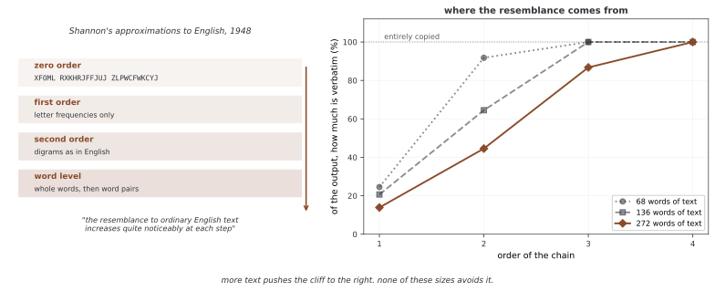

# 텍스트 생성

이 예제는 앞선 k개 단어를 상태로 보고 다음 단어의 경험적 조건부 빈도를 학습하는 마르코프 텍스트 생성기다. 뉴럴 넷트웍이나 PyTorch 학습을 사용하지 않으며, 고정 길이 문맥과 희소한 관측 도수만으로 생성이 어떻게 이루어지는지 보여준다.

## 1. 코드

```python
"""
text_generation.py (단원 09)

마르코프 사슬로 글 만들기
====================================

Location: 06_markov_chain/03_applications/
난이도: ⭐⭐ 기초
예상 시간: 2시간

학습 목표:
- 글 자료로 마르코프 모형 세우기
- n-그램 모형으로 새 글 만들기
- k차 마르코프 사슬 이해하기
- 글 분석 쓰임새 구현하기

수학적 바탕:
글을 위한 k차 마르코프 사슬:
- 상태 = 낱말 k개의 늘어놓음(k-그램)
- 옮김 = 다음 낱말의 확률
- P(w_{n+1} | w_n, w_{n-1}, ..., w_1) = P(w_{n+1} | w_n, ..., w_{n-k+1})
"""

import numpy as np
from collections import defaultdict, Counter
import random

# ========================================================================
# 메인
# ========================================================================


class MarkovTextGenerator:
    """마르코프 사슬로 글 만들기."""
    
    def __init__(self, order=1):
        """
        글 생성기 첫값 잡기.
        
        파라메터:
            order (int): 마르코프 사슬의 차수(살필 앞선 낱말의 수)
        """
        self.order = order
        self.model = defaultdict(Counter)
        self.start_states = []
    
    def train(self, text):
        """글로 모형 익히기."""
        words = text.split()
        
        # 시작할 수 있는 상태 저장
        for i in range(len(words) - self.order):
            state = tuple(words[i:i+self.order])
            if i == 0 or words[i-1] in '.!?':
                self.start_states.append(state)
            
            # 옮김 세기
            next_word = words[i+self.order]
            self.model[state][next_word] += 1
    
    def generate(self, length=50, seed=None):
        """주어진 길이의 글 만들기."""
        if seed:
            random.seed(seed)
        
        # 무작위 시작 상태로 시작
        current_state = random.choice(self.start_states if self.start_states else list(self.model.keys()))
        result = list(current_state)
        
        for _ in range(length - self.order):
            if current_state not in self.model:
                break
            
            # 다음 낱말의 확률 얻기
            next_words = self.model[current_state]
            total = sum(next_words.values())
            
            # 다음 낱말 표집
            choices = list(next_words.keys())
            weights = [next_words[w]/total for w in choices]
            next_word = random.choices(choices, weights=weights)[0]
            
            result.append(next_word)
            current_state = tuple(result[-self.order:])
        
        return ' '.join(result)


# 사용 예
if __name__ == "__main__":
    sample_text = """
    날쌘 갈색 여우가 게으른 개를 뛰어넘는다. 개는 나무 아래에서 자고 있었다.
    브루클린에 나무가 자란다. 브루클린은 뉴욕의 자치구이다. 뉴욕은 결코 잠들지 않는다.
    날쌘 고양이가 공원을 가로질러 달린다. 공원은 봄에 아름답다.
    봄은 뜰에 새 생명을 불어넣는다. 뜰에는 꽃이 많다.
    """
    
    print("MARKOV CHAIN TEXT GENERATION")
    print("=" * 70)
    
    for order in [1, 2]:
        print(f"\\nOrder {order} Markov Chain:")
        gen = MarkovTextGenerator(order=order)
        gen.train(sample_text)
        
        for i in range(3):
            print(f"  Generated {i+1}: {gen.generate(length=20)}")
```

**출력:**

```
MARKOV CHAIN TEXT GENERATION
======================================================================
\nOrder 1 Markov Chain:
  Generated 1: 날쌘 고양이가 공원을 가로질러 달린다. 공원은 봄에 아름답다. 봄은 뜰에 새 생명을 불어넣는다. 뜰에는 꽃이 많다.
  Generated 2: 날쌘 고양이가 공원을 가로질러 달린다. 공원은 봄에 아름답다. 봄은 뜰에 새 생명을 불어넣는다. 뜰에는 꽃이 많다.
  Generated 3: 날쌘 고양이가 공원을 가로질러 달린다. 공원은 봄에 아름답다. 봄은 뜰에 새 생명을 불어넣는다. 뜰에는 꽃이 많다.
\nOrder 2 Markov Chain:
  Generated 1: 날쌘 갈색 여우가 게으른 개를 뛰어넘는다. 개는 나무 아래에서 자고 있었다. 브루클린에 나무가 자란다. 브루클린은 뉴욕의 자치구이다. 뉴욕은 결코 잠들지
  Generated 2: 날쌘 갈색 여우가 게으른 개를 뛰어넘는다. 개는 나무 아래에서 자고 있었다. 브루클린에 나무가 자란다. 브루클린은 뉴욕의 자치구이다. 뉴욕은 결코 잠들지
  Generated 3: 날쌘 갈색 여우가 게으른 개를 뛰어넘는다. 개는 나무 아래에서 자고 있었다. 브루클린에 나무가 자란다. 브루클린은 뉴욕의 자치구이다. 뉴욕은 결코 잠들지
```

## 2. 논의

### 문맥 상태와 전이

차수 k에서 상태는 단어 튜플 (w_(t−k+1),…,w_t)다. train은 이 문맥 뒤에 나온 단어의 Counter를 누적하고 generate는 빈도에 비례해 다음 단어를 뽑는다. 길이 k의 문맥을 하나의 상태로 보면 1차 마르코프 전이로 표현할 수 있다.

k가 커지면 긴 국소 문맥을 유지하지만 관측 가능한 상태가 희소해져 학습 문구를 복제하거나 미관측 문맥에서 멈추기 쉽다. 작은 k는 더 자유롭게 재결합해도 의미·문법과 장거리 일관성을 보장하지 않는다. 관측열을 생성했다고 언어 이해를 검증한 것은 아니다.

<div class="storybox" markdown>

**그림으로 보는 AI 1.** 사다리를 끝까지 오르면 원문이 나온다

위 코드가 하는 일을 **손으로 한 사람**이 있다. 1948년 클로드 섀넌(Claude Shannon)이 「통신의 수학적 이론」에서 영어를 흉내 내는 사다리를 한 칸씩 올라갔다. 맨 아래는 글자를 고르게 뽑는 0차였고, 그가 적어 둔 결과는 이렇다 — `XFOML RXKHRJFFJUJ ZLPWCFWKCYJ`. 다음 칸은 글자마다 영어에서의 빈도를 주었고, 그다음은 앞 글자를 보는 2연(digram), 그리고 글자 대신 **낱말**을 단위로 같은 일을 되풀이했다. 이 쪽의 `order` 가 바로 그 칸 번호다.

섀넌이 남긴 관찰은 한 줄이다 — *"the resemblance to ordinary English text increases quite noticeably at each step."* 한 칸 오를 때마다 눈에 띄게 영어다워진다.



**그런데 그 사다리에는 꼭대기가 있고, 바로 위 문단이 그 이름을 적어 두었다** — 학습 문구의 복제다. 게티즈버그 연설 272낱말로 이 쪽의 생성기를 돌려, 만든 글 가운데 **원문에 그대로 들어 있는 가장 긴 토막**이 차지하는 몫을 재어 보았다. 1차에서 14%, 2차에서 45%, 3차에서 87%, 그리고 **4차에서 100%** 다. 4차에서 만든 글은 새 글이 아니라 원문의 한 토막이다.

글을 늘리면 문턱이 뒤로 밀린다. 68낱말로 줄이면 이미 3차에서 100%가 되고, 272낱말이면 4차까지 간다. **밀리기는 해도 없어지지는 않는다** — 여기서 잰 세 크기 모두 4차에서는 통째로 베낀다.

**그래서 "영어를 더 닮았다"와 "내가 이미 가진 영어다"가 사다리 꼭대기에서는 같은 말이 된다.** 섀넌의 관찰은 틀리지 않았다. 다만 닮음이 올라가는 까닭이 중간쯤부터 바뀐다 — 언어의 성질을 더 잘 잡아서가 아니라, **고를 수 있는 다음 낱말이 하나밖에 남지 않아서**다. 위 문단이 "관측 가능한 상태가 희소해져"라고 적은 그 희소함이 닮음의 정체다. 차수를 올려 그럴듯해진 출력을 보고 모형이 나아졌다고 읽으면 안 되는 까닭이고, 확인하는 방법은 간단하다 — **만든 글을 학습 글에서 찾아보면 된다.**

_확인한 곳 — C. E. Shannon, "A Mathematical Theory of Communication", *Bell System Technical Journal* (1948) 의 영어 근사 항. 0차 보기 `XFOML RXKHRJFFJUJ ZLPWCFWKCYJ` 와 인용한 문장이 그 글에 있고, 사다리가 글자 빈도 → 2연 → 낱말 단위로 올라간다는 것도 같다. 섀넌의 1937년 석사 논문은 [7장](../../ch06/tensors/13_logical_operations.md)에서 따로 다룬다. 오른쪽 그림의 수는 그림을 그리는 코드가 게티즈버그 연설(1863, 퍼블릭 도메인)로 직접 재며, 차수 1이 대체로 새 글이고 차수 4가 거의 통째로 베낀다는 것을 먼저 확인한 뒤에만 그린다._

</div>

### 전처리와 시작 상태

text.split()은 공백으로만 단어를 나누므로 문장부호가 단어에 붙어 남는다. 시작 상태 검사는 앞 토큰이 점·느낌표·물음표 토큰인지를 보므로 단어 끝에 붙은 마침표를 일반적으로 문장 경계로 인식하지 못한다. 상태에 다음 단어가 있어야 학습되므로 마지막 문맥은 전이를 갖지 않을 수 있다. 여러 train 호출은 도수와 시작 목록을 초기화하지 않고 누적한다.

### 길이와 재현성

order는 양의 정수이고 학습 글에는 적어도 order+1개 단어가 필요하다. 학습된 상태가 없으면 시작 상태 선택이 실패한다. 요청 length보다 문맥이 길면 초기 문맥 자체가 반환되어 요청 길이를 넘을 수 있고, 전이가 없는 문맥을 만나면 조기 종료한다. 즉 length는 항상 보장되는 정확한 출력 길이가 아니다.

generate의 if seed 조건은 0을 거짓으로 처리하므로 seed=0은 난수 시드를 설정하지 않는다. 이 코드는 Python random을 사용하므로 NumPy의 시드만 바꾸는 것으로 생성 재현성이 정해지지 않는다. 전처리·차수·학습 자료와 난수 규약을 함께 명시한다.

## 연습문제

<div class="drillbox" markdown>

**연습문제 1.** <span class="diff med" title="중간"></span>
차수 k의 단어 모형을 1차 마르코프 사슬로 볼 수 있는 이유는?

</div>

??? success "풀이"

    앞 k개 단어의 튜플 전체를 하나의 상태로 정의하면 다음 단어 선택은 현재 튜플에만 의존한다. 단어 하나를 상태로 보는 1차 모형과는 상태 공간이 다르며 k가 커질수록 가능한 문맥 수가 빠르게 늘어난다.


---

<div class="drillbox" markdown>

**연습문제 2.** <span class="diff med" title="중간"></span>
공백 기반 전처리와 시작 상태 조건의 차이를 설명하라.

</div>

??? success "풀이"

    공백 분리는 마침표가 붙은 단어를 하나의 토큰으로 남긴다. 시작 조건은 앞 토큰 자체가 .·!·? 중 하나인 경우를 검사하므로 일반적인 문장 끝 단어를 놓친다. 문장 경계 토큰과 단어 토큰화 규칙을 명시적으로 맞춰야 한다.


---

<div class="drillbox" markdown>

**연습문제 3.** <span class="diff med" title="중간"></span>
길이 50 요청이 항상 50단어를 반환하지 않는 이유와 seed=0의 동작을 설명하라.

</div>

??? success "풀이"

    학습되지 않은 후속 문맥이면 조기에 멈추고, length<order면 초기 문맥만으로 요청 길이를 넘는다. 학습 상태가 비면 생성할 수 없다. seed=0은 if seed를 통과하지 않아 시드를 설정하지 않으며 실제 생성 난수는 Python random에서 나온다.


---

<div class="drillbox" markdown>

**연습문제 4.** <span class="diff med" title="중간"></span>
아래 뉴럴 넷트웍 시험 조각이 MarkovTextGenerator에 맞는지 평가하라.

</div>

??? success "풀이"

    이 생성기는 train·generate로 도수를 저장하고 문자열을 반환하며 parameters·backward·텐서 출력이 없다. 아래 일반 시험은 맞지 않는다. 적절한 검증은 알려진 문맥 도수·조건부 확률, 빈 학습·잘못된 차수·미관측 문맥·누적 학습·길이와 재현성 규약을 다뤄야 한다.

    ```python
    def test_markovtextgenerator():
        model = MarkovTextGenerator(...)
        # 보통의 입력
        assert model(normal_input).shape == expected_shape
        # 원소가 하나인 배치
        assert model(single_input).shape == (1, ...)
        # 큰 값 (넘침을 확인한다)
        out = model(torch.ones(...) * 1000)
        assert torch.isfinite(out).all()
        # 경사의 흐름
        out = model(normal_input)
        out.sum().backward()
        for p in model.parameters():
            assert p.grad is not None
    ```


## 정리하며

문맥별 다음 단어 도수로 간단한 텍스트를 생성할 수 있다. 문맥 길이와 희소성의 균형, 토큰화·문장 경계, 조기 종료와 난수 시드의 의미를 확인한다. 보존된 뉴럴 넷트웍 형태의 시험 조각은 이 문자열 생성기의 인터페이스와 다르다.
