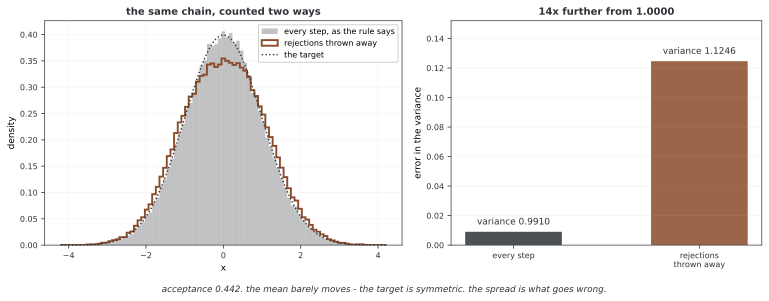

# 메트로폴리스-헤이스팅스 알고리즘

메트로폴리스-헤이스팅스(MH)는 미정규화 목표밀도와 제안밀도로 마르코프 전이를 구성한다. 정규화 상수는 필요 없지만 적절한 목표분포, 탐색 가능한 커널과 수렴 조건은 별도로 필요하다.

## 1. 정규화 상수가 어려운 문제

사후밀도 π(θ|X)=p(X|θ)p(θ)/p(X)에서 주변우도 p(X)는 적분으로 정의된다. 일부 켤레·저차원 문제에서는 계산 가능하지만 일반적인 고차원 모형에서는 비용이 클 수 있다.

더 일반적으로 γ(θ)≥0, 0<Z=∫γ(θ)dθ<∞이고 π=γ/Z라 하자. MH는 γ와 제안밀도의 필요한 비를 평가해 π를 불변분포로 갖는 전이를 만든다. Z가 무한하거나 목표 자체가 정의되지 않으면 상수의 소거만으로 정당한 확률분포가 생기지 않는다.

## 2. 수락확률과 상수 소거

현재 x에서 y~q(·|x)를 제안하고 다음 확률로 수락한다.

$$\alpha(x,y)=\min\left\{1,\frac{\gamma(y)q(x|y)}{\gamma(x)q(y|x)}\right\}.$$

π=γ/Z를 대입하면 분자·분모의 동일한 Z가 소거된다. 베이즈 사후에서는 γ(θ)=p(X|θ)p(θ)이므로 주변우도를 계산할 필요가 없다. 제안 q(y|x)>0인데 역방향 흐름 γ(y)q(x|y)=0이면 거절한다. 시작점은 목표의 유효한 지지집합 안에서 선택한다.

실제 계산은 로그비를 사용한다. log U<min(0,log γ(y)−log γ(x)+log q(x|y)−log q(y|x))이면 수락하며, 거절해도 현재 상태를 다음 표본으로 기록한다. 거절 상태를 버리면 원래 MH 체인의 표본 평균이 아니다.

<div class="storybox" markdown>

**그림으로 보는 AI 1.** 바로 그 한 문장이 1953년 논문에 있다

위 문단의 마지막 줄 — 거절해도 기록하라는 것 — 은 뒷사람이 덧붙인 주의가 아니다. **이 알고리즘이 처음 실린 글에 그대로 적혀 있다.**

1953년 《화학물리학회지》에 실린 「Equation of State Calculations by Fast Computing Machines」가 그 글이고, 하는 일은 지금과 똑같다. 입자 하나를 조금 옮겨 에너지 변화 $\Delta E$ 를 보고, 줄었으면 옮기고, 늘었으면 $\exp(-\Delta E/kT)$ 의 확률로만 옮긴다. 그리고 바로 다음 문장이 이것이다.

> "whether the move has been allowed or not, i.e., whether we are in a different configuration or in the original configuration, **we consider that we are in a new configuration for the purpose of taking our averages.**"

움직였든 안 움직였든 새 배치로 **쳐서 평균에 넣는다**는 말이다. 일흔 해 전에 못 박아 둔 것을 이 쪽이 다시 적고 있는 셈이다.



버리면 얼마나 어긋나는지 재어 보았다. 표준정규를 목표로 20만 걸음을 걷고(수락률 0.442), 규칙대로 모두 세면 분산이 **0.9910** 으로 나온다. 상태가 **바뀐 걸음만** 세면 **1.1246** 이다. 1에서 벗어난 정도로 재면 열네 배 멀다.

**평균은 거의 멀쩡한데 분산이 틀린다**는 점이 고약하다. 목표가 대칭이라 평균은 양쪽 치우침이 상쇄되지만, 분산은 그렇지 않다. 거절은 사슬이 **오래 머무는 자리**, 곧 밀도가 높은 가운데에서 더 자주 나므로, 거절을 버리면 그 머무름이 통째로 사라지고 바깥쪽이 과하게 실린다. 왼쪽 그림에서 가운데가 눌리고 어깨가 두꺼워진 것이 그 모양이다. **평균만 보고 "맞는 것 같다"고 넘어가면 잡히지 않는다.**

이름에 대해서도 한 줄 적어 둘 만하다. 글쓴이는 다섯이다 — 니컬러스 메트로폴리스, 아리아나 로젠블루스, 마셜 로젠블루스, 오거스타 텔러, 에드워드 텔러. 마셜 로젠블루스는 뒷날 구술 기록에서 문제를 낸 것은 에드워드 텔러, 푼 것은 자신, **프로그램을 짠 것은 아리아나 로젠블루스**였다고 말했다. 알고리즘에 붙은 이름은 하나인데 한 일은 그렇게 나뉘어 있었다.

_확인한 곳 — N. Metropolis, A. W. Rosenbluth, M. N. Rosenbluth, A. H. Teller, E. Teller, "Equation of State Calculations by Fast Computing Machines", *Journal of Chemical Physics* **21**, 1087 (1953). 인용한 문장과 $\Delta E$ 규칙은 그 글에서 직접 옮겼다. 역할 분담에 관한 마셜 로젠블루스의 구술 기록은 2차 문헌으로 확인했다. 그림의 수는 그림을 그리는 코드가 씨앗을 박고 직접 재며, 버린 쪽이 실제로 더 나빠지는지를 먼저 확인한 뒤에만 그린다._

</div>

## 3. 상세균형과 수렴의 구분

서로 다른 상태 사이에는 다음 대칭 흐름이 성립한다.

$$\pi(x)q(y|x)\alpha(x,y)=\min\{\pi(x)q(y|x),\pi(y)q(x|y)\}.$$

양변이 x,y 교환에 불변이므로 상세균형을 만족한다. 연속 상태에서는 전체 커널에 거절로 현재 위치에 남는 점질량도 포함한다.

$$P(x,dy)=q(y|x)\alpha(x,y)dy+r(x)\delta_x(dy),\quad r(x)=1-\int q(y|x)\alpha(x,y)dy.$$

상세균형은 π의 불변성을 보이는 충분조건이며 모든 올바른 MCMC에 필요한 조건은 아니다. 초기분포에서 π로의 수렴과 표본 평균의 법칙에는 기약성·재귀성 등의 조건을 확인해야 한다. 유한 상태의 기약·비주기 조건과 일반 상태의 Harris 에르고드 조건을 구분한다. 제안이 한 모드에 갇히면 π가 불변이어도 원하는 전체 목표를 탐색하지 못할 수 있다.

## 4. 상수배와 변수변환

γ를 공통 양의 상수 c배해도 MH 비는 같다. 확률밀도는 기준 측도에 상대적인 값이므로 밀도값 자체를 min(1,π(y))로 수락확률에 넣는 규칙은 일반적인 MH 보정을 대신하지 못한다.

비선형 변수변환 φ=g(θ)에서는 변환밀도 π_φ(φ)=π_θ(θ)|det Dg⁻¹(φ)|를 사용한다. 서로 다른 두 지점의 야코비안이 일반적으로 같지 않으므로 목표밀도 비에서 저절로 소거되지 않는다. 원래 제안까지 일관되게 변환하면 전체 MH 흐름비의 대응을 얻는다. 좌표를 바꾼 뒤 새 대칭 랜덤 워크를 선택하는 것은 원래 체인의 단순한 재표현과 다르다.

## 5. 사후분포와 에너지 모형의 예

로지스틱 회귀의 사후는 베르누이 우도와 사전의 곱으로 평가할 수 있어도 계수 전체의 주변우도 적분이 간단하지 않을 수 있다. MH는 그 적분 없이 상태를 갱신한다.

d차원 K성분 가우스 혼합의 자유 파라메터 수는 평균 Kd, 대칭 공분산 Kd(d+1)/2, 혼합 비중 K−1을 합한 값이다. 단순히 공분산 원소를 d²/2개로 세면 대각 성분과 비중 제약을 놓친다. 라벨 교환과 분리된 모드 때문에 상수가 필요 없다는 사실만으로 탐색이 쉬워지지는 않는다.

이징 모형에서는 고정 역온도 β에서 π(s)∝exp(−βE(s))다. 대칭 스핀 제안의 수락확률은 min(1,exp(−βΔE))다. β까지 미지 파라메터로 추론하면 분배함수 Z(β)가 β에 의존하므로 같은 소거를 무조건 적용할 수 없다.

## 6. 랜덤 워크·독립·경사 제안

대칭 가우스 랜덤 워크 y=x+εη, η~N(0,I)에서는 제안 비가 소거되어 min(1,π(y)/π(x))가 된다. 너무 작은 ε는 높은 수락률에도 이동이 작고, 너무 큰 ε는 거절이 잦을 수 있다. 정확한 비율은 차원·기하·초기상태에 따라 다르다.

독립 제안 q(y|x)=g(y)는 min(1,π(y)g(x)/(π(x)g(y)))를 사용한다. 제안이 목표의 중요한 영역을 충분히 덮어야 한다. MALA는 다음 경사 기반 제안을 사용한다.

$$q(y|x)=N\left(y;x+\frac{\epsilon^2}{2}\nabla\log\pi(x),\epsilon^2I\right).$$

이는 일반적으로 비대칭이므로 정방향·역방향 제안밀도를 모두 포함한다. 전처리·블록·리파라메리제이션 등도 효율에 영향을 주며 하나의 수락률만으로 방법을 평가하지 않는다.

## 7. 점근 최적 수락률의 적용 범위

고차원 곱 형태 목표와 정칙성 조건에서 가우스 랜덤 워크의 확산 한계 효율을 최대화하면 점근 수락률 약 0.234를 얻는다. 이는 모든 차원·모형의 보편적 최적값이 아니다.

제안 표준편차를 ε=ℓ/√d로 두면 수락률과 확산 속도는 다음 형태다.

$$a(\ell)=2\Phi(-\ell\sqrt I/2),\qquad h(\ell)=\ell^2a(\ell).$$

최적값은 ℓ√I≈2.38이다. 표준정규 성분처럼 I=1일 때만 ℓ≈2.38이며 효율은 스텝 길이가 아니라 제곱 길이와 수락률의 곱에 연결된다. 해당 MALA 점근 이론은 ε∝d⁻¹/⁶와 약 0.574를 준다. 서로 다른 최적 수락률을 알고리즘의 절대 성능 순위로 읽지 않는다. 자세한 조건은 [Roberts·Rosenthal의 MALA 논문](https://rss.onlinelibrary.wiley.com/doi/abs/10.1111/1467-9868.00123)을 참고한다.

## 8. 반복 수와 계산비용의 스케일링

스케일링을 비교할 때 반복 수·경사 평가 수·총 계산비용을 구분해야 한다. 정칙적인 곱 목표의 대표적인 정상상태 점근 분석에서 랜덤 워크는 O(d), MALA는 O(d¹/³) 반복의 시간 스케일을 갖는다. 반복당 밀도·경사 비용이 O(d)라면 총비용은 각각 O(d²), O(d⁴/³)로 해석할 수 있다.

고정 물리적 적분시간을 사용하는 HMC의 대표 분석에서는 ε∝d⁻¹/⁴이고 제안당 Leapfrog 수 O(d¹/⁴)가 필요하다. 경사 비용 O(d)를 가정하면 O(d⁵/⁴)의 비용을 얻지만 이를 임의 목표의 엄밀한 혼합시간이라고 부르면 안 된다. [Beskos 외의 분석](https://arxiv.org/abs/1001.4460)은 목표군·정상성·적분 설정에 대한 조건을 둔다. 다봉성·나쁜 조건수·비정칙 모형에서는 다른 병목이 지배할 수 있다.

## 9. 워밍업과 제안 적응

워밍업에서 제안 폭과 공분산을 조정한 뒤 고정 커널로 수집하는 방식이 간단한 선택이다. 아래 함수는 수락률에 따라 폭을 1.1배·0.9배 하는 휴리스틱이며 쌍대 평균 알고리즘이 아니다. 잡음이 큰 단기 수락률만 반복 추종하면 안정적인 조정이 되지 않을 수 있다.

과거 표본의 공분산을 제안에 쓰면 방향별 스케일을 맞출 수 있지만 특이성·초기 표본 품질·정규화 보정을 확인한다. 2.38²/d 배율은 관련 점근 이론의 참고값이다. 계속 적응하는 알고리즘도 감소하는 적응 등 적절한 조건에서 정당화할 수 있으므로 샘플링 전에 반드시 멈춰야만 하는 것은 아니다. 단, 적응 체인을 고정 커널의 증명만으로 정당화할 수는 없다.

```python
def adapt_step_size(sigma, acceptance_rate, target_rate=0.234):
    if acceptance_rate > target_rate:
        sigma *= 1.1  # 스텝 크기 키우기
    else:
        sigma *= 0.9  # 스텝 크기 줄이기
    return sigma
```

## 10. 다봉성·꼬리·상관의 병목

분리된 모드에서는 국소 이동이 잘 수락되어도 모드 간 이동은 드물 수 있다. 혼합 제안·템퍼링·모드 탐색 등을 문제에 맞춰 검토한다. 꼬리가 두꺼우면 중심의 조정이 꼬리에서도 좋은 효율을 보장하지 않는다.

강한 상관에는 공분산 전처리·블록 갱신·리파라메리제이션이 도움이 될 수 있다. 좌표별 깁스가 강한 상관을 자동으로 해결하는 것은 아니며 오히려 매우 느릴 수 있다. 방법을 바꾸었다는 이유만으로 수렴을 가정하지 않고 동일한 관심량의 비용과 오차를 비교한다.

## 11. 목표 제안과 깁스 갱신

독립 제안 g=π를 정확히 생성할 수 있으면 MH 수락확률은 1이며 이후 표본은 목표의 독립 표본이다. 이는 유용한 이론적 기준이지만 원래 샘플링 문제를 이미 푼 상황이다.

깁스는 전체 목표가 아니라 한 좌표의 완전조건부분포에서 정확히 생성하므로 그 좌표의 수락확률이 1이다. 연속 좌표 간 의존성은 남을 수 있고 이산 상태에서는 같은 값을 다시 뽑을 수도 있다. 100% 수락과 전체 상태의 독립성·빠른 혼합을 구분한다.

## 12. 함수별 ESS와 진단

정상 함수열 f(X_t)에 유한 분산·적절한 중심극한정리와 합산 가능한 자기상관이 있을 때 ESS_f≈N/(1+2∑ρ_f(k))로 점근 분산을 표현한다. 함수별 값이며 음의 상관이면 N보다 클 수 있다. 실제 합 추정에는 안정적인 절단 방식이 필요하다.

다양한 시작점의 여러 체인, 트레이스·랭크 그림, 순위 정규화 R-hat과 bulk·tail ESS, 관심량의 MCSE를 함께 본다. R-hat<1.01 같은 기준은 유용한 경고 기준이지 수렴의 증명이 아니다. 수락률이 목표 범위 안이라는 사실이나 ESS>100만으로 정확성을 보장하지 않는다. 자세한 내용은 [진단 절](diagnostics.md)을 참고한다.

## 13. 알고리즘의 핵심과 한계

유효한 시작점에서 제안하고 로그 MH 비로 수락 여부를 정한다. 거절하면 같은 위치를 다음 상태로 남기고 반복한다. 목표의 정규화 상수는 필요 없으며 대칭 제안에서만 제안 비를 생략할 수 있다.

수락 규칙은 목표 불변성을 보존하도록 설계된다. 초기분포의 영향, 탐색 가능성, 유한 표본 오차와 수치 구현의 정확성은 별도로 확인한다. 제안의 목표는 높은 수락률 자체가 아니라 관심량을 원하는 정확도로 계산하는 데 드는 비용을 줄이는 것이다.

## 연습문제

<div class="drillbox" markdown>

**연습문제 1.** <span class="diff med" title="중간"></span>
MH 수락 규칙이 보이는 것과 수렴에 추가로 필요한 조건을 구분하라.

</div>

??? success "풀이"
    대칭 흐름 min{π(x)q(y|x),π(y)q(x|y)}으로 상세균형과 불변성을 보인다. 초기 상태에서 목표로 수렴하려면 상태공간에 맞는 기약성·재귀성·비주기성 등의 조건이 필요하다. 불변성만으로 모드 간 탐색이 보장되지는 않는다.

---

<div class="drillbox" markdown>

**연습문제 2.** <span class="diff med" title="중간"></span>
랜덤 워크의 제안 폭을 너무 작게 또는 크게 정하면 어떤 문제가 생기는가?

</div>

??? success "풀이"
    작으면 높은 수락률에도 이동이 짧아 자기상관이 클 수 있고 크면 거절이 많을 수 있다. 0.234는 특정 고차원 점근 목표군의 효율 최적값이지 모든 문제의 필수 목표는 아니다.

---

<div class="drillbox" markdown>

**연습문제 3.** <span class="diff hard" title="어려움"></span>
상세균형을 분기 없이 증명하고 거절 항을 설명하라.

</div>

??? success "풀이"
    $\pi(x)q(y|x)\alpha(x,y)=\min\{\pi(x)q(y|x),\pi(y)q(x|y)\}$는 x,y에 대칭이다. 현재 상태에 머무는 거절 점질량은 대각 흐름이므로 상세균형과 양립한다. 전체 커널에는 이 항을 반드시 포함한다.

---

<div class="drillbox" markdown>

**연습문제 4.** <span class="diff easy" title="쉬움"></span>
워밍업 표본을 버리면 수렴을 보장하는가?

</div>

??? success "풀이"
    초기 상태와 적응의 영향을 줄이는 목적이지만 고정 비율을 버린다고 보장되지는 않는다. 다양한 시작점과 함수별 진단·MCSE를 확인하며 모든 체인이 같은 누락 모드에 갇히면 진단도 이를 놓칠 수 있다.

## 정리하며

MH는 목표·제안의 흐름비로 미지 정규화 상수를 소거한다. 상세균형과 전체 거절 커널, 변수변환의 야코비안, 점근 조정 규칙의 범위를 구분하고 함수별 오차를 평가한다.
