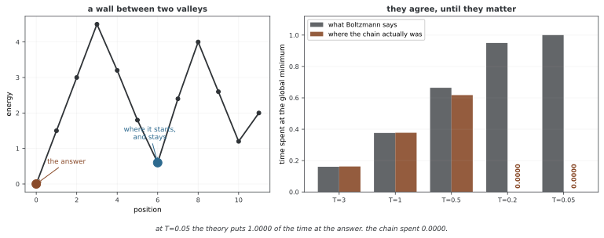

# 시뮬레이티드 어닐링 기초

시뮬레이티드 어닐링(SA)은 온도를 낮추는 시간 비균질 MCMC를 이용한 확률적 최적화 방법이다. 최종 체인의 사후평균을 구하는 고정 목표 샘플링과 구분하고, 현재 상태와 지금까지 찾은 최선 상태를 따로 관리한다.

## 1. 볼츠만 분포

기준 측도에 대해 Z_T=∫exp(−E(x)/T)dx가 유한한 T>0에서 π_T=exp(−E/T)/Z_T를 정의한다. 이산 공간에서는 합을 사용하고 β=1/T를 역온도라 부른다.

유한 상태·계수 측도에서는 T→0의 평형분포가 전역 최소 집합에 균등하게 집중하고 T→∞에는 전체 상태의 균등분포로 간다. 연속 비유계 공간에는 균등 확률분포가 없으며 고온의 정규화가 실패할 수도 있다. 여러 연속 최소점의 저온 질량은 곡률·주변 부피 등에 따라 달라져 단일 디랙이나 균등 혼합이라고 단정할 수 없다.

적절한 적분 조건에서 평형 자유에너지 F_T=−T log Z_T=E_{π_T}E−T H(π_T)다. 더 일반적으로 분포 q에 대해 E_qE−T H(q)=F_T+T KL(q‖π_T)이므로 π_T가 에너지·엔트로피 목적을 최소화한다. 연속 엔트로피는 선택한 기준 측도에 상대적이며 좌표 불변인 단순 절대량이 아니다.

## 2. 시뮬레이티드 어닐링 알고리즘

대칭 제안에서는 ΔE=E(y)−E(x)에 대해 min(1,exp(−ΔE/T_t))로 수락한다. 비대칭 제안이면 q(x|y)/q(y|x)도 필요하다. 높은 T는 주어진 양의 ΔE를 더 자주 허용하고 낮은 T는 주로 개선·동률 이동을 허용한다.

<div class="storybox" markdown>

**그림으로 보는 AI 1.** 쇠를 식히는 법을 회로 배치에 가져온 사람들

위 수락 규칙을 다시 보자. $\min(1, \exp(-\Delta E/T))$ 는 **새로 만든 식이 아니다.** 1953년 메트로폴리스 일행이 입자를 옮길지 말지 정하려고 쓴 바로 그 규칙이고, 달라진 것은 $T$ 를 고정하지 않고 **시간에 따라 내린다**는 것뿐이다.

그 한 걸음을 디딘 것이 1983년 5월 13일 《사이언스》에 실린 커크패트릭(S. Kirkpatrick)·젤랫(C. D. Gelatt Jr.)·베키(M. P. Vecchi)의 글이다. 요지를 그들은 이렇게 적었다.

> "A detailed analogy with **annealing in solids** provides a framework for optimization of the properties of very large and complex systems."

쇠를 달궜다 천천히 식히면 결정이 가지런해진다는 **야금의 담금질**이 그 비유다. 그리고 이 글이 풀려던 문제는 추상적인 최적화 이론이 아니라 **컴퓨터 회로 설계** — 분할, 소자 배치, 배선 — 였고, 외판원 문제를 수천 도시 규모로 돌려 성능을 보였다.

**그런데 식혀 간다는 말이 왜 필요한가.** 위 1절은 $T \to 0$ 이면 평형분포가 전역 최소에 집중한다고 했다. 그렇다면 처음부터 $T$ 를 아주 낮게 두면 될 것 같다. 재어 보면 그렇지 않다.



국소 최소에서 출발시켜 고정 온도로 20만 걸음을 걸었다. $T=3$ 에서는 사슬이 전역 최소에 머문 비율이 **0.1625**, 볼츠만 이론의 0.1606과 거의 같다. $T=1$ 에서도 0.3774 대 0.3761로 맞는다. 그런데 $T=0.2$ 로 내리면 이론은 **0.9497** 을 말하는데 사슬이 실제로 머문 비율은 **0.0000** 이다. 벽을 넘지 못하고 국소 최소에 갇힌 것이다.

**이론과 사슬이 어긋나는 자리가 하필 답이 있는 자리다.** 낮은 온도의 평형분포는 전역 최소를 가리키지만, 그 평형에 **닿는 데 걸리는 시간**은 온도를 내릴수록 길어진다. 1절이 말한 $T\to 0$ 의 집중은 평형에 대한 말이지 유한 시간 안에 거기 간다는 말이 아니다.

어닐링이 하는 일이 바로 그 틈을 메우는 것이다 — 벽을 넘을 수 있을 만큼 뜨겁게 시작해서, 갇히지 않을 만큼 천천히 식힌다. **"천천히"가 얼마나 천천히여야 하는가**가 남는 물음이고, 그것이 아래 냉각 스케줄 쪽의 주제다. 그리고 이 쪽 맨 앞 문단이 고정 목표 샘플링과 구분하라고 적은 까닭도 여기에 있다 — 어닐링은 한 분포를 표본하는 것이 아니라 **목표를 바꿔 가며** 걷는다.

_확인한 곳 — S. Kirkpatrick, C. D. Gelatt Jr., M. P. Vecchi, "Optimization by Simulated Annealing", *Science* **220**(4598), 671–680 (1983년 5월 13일). 인용한 요약 문장, 메트로폴리스 알고리즘을 통계역학과 최적화를 잇는 도구로 쓴다는 서두, 그리고 분할·소자 배치·배선과 수천 도시 외판원 문제에 적용했다는 대목을 내려받은 글에서 직접 확인했다. 그림의 수는 그림을 그리는 코드가 씨앗을 박고 직접 재며, 높은 온도에서 이론과 맞고 낮은 온도에서 갈라지는지를 먼저 확인한 뒤에만 그린다._

</div>

온도를 고정한 커널은 π_T를 불변으로 가질 수 있지만 실제 SA의 상태분포가 매 순간 π_T와 같은 것은 아니다. 점차 감소하는 목표를 충분히 추적할 수 있는지는 제안 그래프·장벽·냉각 조건에 달린다. 느리게 식히면 유한 실행이 반드시 전역 최소점에서 끝난다는 보장은 없다.

아래 구현은 대칭 제안과 양의 T를 가정하고 지금까지 방문한 최선 x_best를 반환한다. proposal이 입력을 제자리 수정하거나 같은 가변 객체를 공유하면 저장한 최선 상태가 바뀔 수 있다. 에너지 평가·유효한 제안·표본 수와 반환 객체의 복사 의미를 확인한다. 유한 상태의 평형분포는 T>0에서 매끄럽게 변하므로 직관적인 급변을 모두 엄밀한 상전이라고 부르지는 않는다.

```python
def simulated_annealing(E, x0, T_schedule, proposal, max_iter):
    """전체 최적화를 위한 흉내낸 담금질.
    
    인수:
        E: 가장 작게 할 에너지 함수
        x0: 첫 상태
        T_schedule: 되풀이를 온도로 잇는 호출 가능 객체
        proposal: 지금 상태에서 제안을 만드는 호출 가능 객체
        max_iter: 최대 되풀이 횟수
        
    반환값:
        찾은 가장 좋은 상태와 그 에너지
    """
    x = x0
    E_best, x_best = E(x), x
    
    for t in range(max_iter):
        T = T_schedule(t)
        x_prop = proposal(x)
        delta_E = E(x_prop) - E(x)
        
        # 온도 T에서의 메트로폴리스 받아들임
        if delta_E < 0 or np.random.rand() < np.exp(-delta_E / T):
            x = x_prop
            if E(x) < E_best:
                x_best, E_best = x, E(x)
    
    return x_best, E_best
```

## 3. 경사 최적화와 냉각 확산

경사하강은 미분과 적절한 스텝 조건을 사용해 목적값을 낮추는 방법이다. 일반 비볼록 문제에서 전역 최소점이나 국소 최소점 수렴을 무조건 보장하지 않는다. SA는 비미분·조합 상태의 제안에도 사용할 수 있지만 더 많은 평가가 필요할 수 있다.

연속 공간의 냉각 Langevin dX=−∇Edt+√(2T(t))dW는 관련된 최적화 확산이다. 임의의 작은 Metropolis 제안에 아무 시간 스케일 없이 이 SDE를 동일시할 수는 없다. 적절한 확산 한계·스케일 가정이 필요하다.

## 4. 응용

경로·일정·그래프 색칠·자원 배분처럼 이산 제약을 가진 조합 문제와 비볼록 연속 목적에 사용할 수 있다. 제안이 제약을 보존하거나 위반을 명시적으로 처리하도록 설계해야 한다.

금융의 정수 단위·종목 수 제약, 모형 보정과 비선형 비용도 가능한 예다. SA가 이 문제들의 전역 해를 실용적 시간에 보장한다는 뜻은 아니다. 알려진 하한·정확 해법·다중 시작 국소 방법과 예산을 맞춰 비교한다.

## 5. 실무 지침

대표적인 양의 에너지 증가 Δ를 확률 a∈(0,1)로 허용하려면 T₀=−Δ/log a를 출발점으로 쓸 수 있다. ΔE의 표준편차와 T₀를 같게 놓는 것만으로 80% 수락률이 보장되지는 않는다. 제안 폭과 온도는 서로 다른 조정 요소다.

온도는 에너지 차이와 같은 단위다. −∇E 드리프트에 √(2T) 잡음을 쓰거나 시간 단위를 바꾼 −∇E/T 드리프트에 √2 잡음을 쓰는 식 모두 고정 T에서 같은 π_T를 보존할 수 있다. 따라서 온도는 반드시 잡음에만 넣을 수 있다고 설명하지 않는다.

고정 양의 온도에서도 최선 상태를 계속 기록하면 최적점을 방문할 수 있지만 최종 현재 상태가 전역 최소 집합에 집중하는 냉각 정리와는 다르다. 다중 시작·재가열·일정 변경은 휴리스틱이며 실제 예산에서 해 품질과 재현성을 평가한다.

## 연습문제

<div class="drillbox" markdown>

**연습문제 1.** <span class="diff med" title="중간"></span>
고정 온도 커널의 불변성과 실제 SA 상태분포를 구분하라.

</div>

??? success "풀이"
    각 고정 T의 MH 커널은 π_T를 보존할 수 있지만 온도가 바뀌는 체인의 현재 분포가 매 순간 π_T라는 뜻은 아니다. 전체 냉각·이동 이력과 혼합이 영향을 준다.

---

<div class="drillbox" markdown>

**연습문제 2.** <span class="diff med" title="중간"></span>
저온에서 에너지가 같은 제안은 어떻게 되는가?

</div>

??? success "풀이"
    대칭 제안에서 ΔE=0이면 수락확률 1이다. 낮은 온도가 엄격한 개선 이동만 허용한다는 표현은 동률을 놓친다. 비대칭 제안에는 정·역 제안 비도 남는다.

---

<div class="drillbox" markdown>

**연습문제 3.** <span class="diff hard" title="어려움"></span>
T→∞에서 항상 균등분포가 되는가?

</div>

??? success "풀이"
    유한 상태의 계수 측도에서는 그렇다. 비유계 연속 공간에는 균등 확률분포가 없고 Z_T의 유한성도 확인해야 한다.

---

<div class="drillbox" markdown>

**연습문제 4.** <span class="diff easy" title="쉬움"></span>
현재 상태와 최선 방문 상태는 왜 구분하는가?

</div>

??? success "풀이"
    SA는 더 나쁜 이동도 수락하므로 현재 상태가 과거 최선보다 나쁠 수 있다. 반환 목적이 최적화라면 최선 상태를 독립적으로 저장하되 가변 객체가 덮어쓰이지 않도록 해야 한다.

## 정리하며

SA는 고정 온도의 볼츠만 MH 커널을 냉각하며 사용하는 최적화 방법이다. 정상 목표와 실제 분포, 최종 현재 상태와 최선 방문 상태, 저온·고온 극한의 상태공간 조건을 구분한다.
