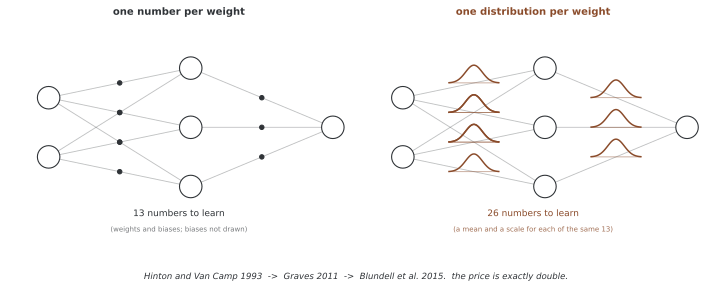

# Bayes by Backprop

Bayes by Backprop은 웨이트의 변분분포를 리파라메리제이션하고 역전파로 학습하는 방법이다. 여기서는 독립 가우스 변분분포와 가우스 사전을 사용하는 기본형을 설명한다. 웨이트의 근사 사후를 학습하는 것과 관측 잡음까지 포함한 전체 예측분포를 계산하는 것은 별도 단계다.

관련 확장은 [44장의 변분 BNN](../../ch43/bayesian_methods/variational_bnn.md)을 참고한다.

## 1. ELBO 목적

웨이트 θ와 관측 D에 대한 변분 목적은 다음과 같다.

$$\mathcal L(\phi)=E_{q_\phi(\theta)}[\log p(D|\theta)]-D_{\mathrm{KL}}(q_\phi(\theta)\Vert p(\theta)).$$

이 식은 총 관측 로그 우도를 사용한다. 미니배치 B의 크기가 m이고 균등 표집이라면 전체 합의 불편 추정은 (N/m)∑ᵢ∈B log p(yᵢ|xᵢ,θ)다. 관측당 평균 목적을 최소화할 때는 배치 평균 음의 로그 우도에 KL/N을 더한다. 배치 **합** 로스라면 상대적으로 같은 배율은 (m/N)KL이다.

사전 항과 데이터 항의 스케일을 맞추지 않으면 다른 목적을 학습한다. KL 웨이트 β를 따로 사용하면 β=1이 표준 목적이며, β≠1은 그 상대 웨이트를 바꾼다.

## 2. 가우스 분포족과 리파라메리제이션

D개의 웨이트·바이어스에 대해 q_φ(θ)=∏ⱼN(θⱼ;μⱼ,σⱼ²), σⱼ=softplus(ρⱼ)로 둔다. 스케일은 양수가 되며 변분 파라메터 수는 2D개다. 유한 정밀도에서 극단적인 ρ는 여전히 수치 문제를 만들 수 있다.

ε∼N(0,I), θ=μ+σ⊙ε로 쓰면 L=E_ε[log p(D|θ)+log p(θ)−log q_φ(θ)]를 φ로 미분할 수 있다. 정칙성 아래 표본 경사의 평균은 목적 경사의 불편 추정이다. 표본 하나의 미분값을 정확한 기대 경사와 등호로 연결하지 않는다.

분포족의 독립성은 웨이트 간 사후 의존성을 제한한다. 뉴럴 넷트웍 출력은 비선형이므로 독립 웨이트에서도 출력의 상관이 생길 수 있다. 반대로 복잡한 웨이트 사후가 반드시 다양한 예측을 뜻하지는 않는다.

<div class="storybox" markdown>

**그림으로 보는 AI 1.** 스물두 해를 두고 세 번 쓰인 같은 생각

"웨이트마다 수 하나 대신 분포 하나를 둔다"는 이 절의 출발점은 2015년에 처음 나온 것이 아니다. 찰스 블런델(Charles Blundell) 일행이 Bayes by Backprop이라는 이름을 붙인 그 글은 자기 계보를 숨기지 않고 적어 두었다 — "build upon the work of Graves (2011), who in turn built upon the work of **Hinton and Van Camp (1993)**".

1993년에 제프리 힌턴과 드루 밴 캠프(Drew van Camp)가 쓴 글의 제목은 베이즈와 아무 상관이 없어 보인다. 「웨이트의 기술 길이를 최소화해 뉴럴 넷트웍을 단순하게 유지하기」다. 생각은 이랬다 — 웨이트를 정확히 적으려면 비트가 많이 들지만 **적당히 흐릿하게** 적으면 적게 든다. 그러니 웨이트에 잡음을 허용하는 것이 곧 모델을 압축하는 것이고, 압축이 곧 단순함이다. 그 "흐릿함"을 분포로 적고 기술 길이를 목적함수로 적으면 1절의 ELBO가 나온다. 블런델 일행이 세운 동기 셋 가운데 첫째가 그대로 "regularisation via a **compression cost** on the weights"인 까닭이다.



값은 그림에 그대로 보인다. 위 2절이 적은 대로 변분 파라메터는 $2D$ 개다 — 작은 넷트웍이라면 13개가 26개가 되고, 큰 넷트웍이라면 **언제나 정확히 두 배**다. 2011년 알렉스 그레이브스(Alex Graves)를 거쳐 2015년에 이르러 달라진 것은 생각이 아니라 셈이었다. 블런델 일행이 내세운 기여도 새 목적이 아니라 "the gradients of Graves (2011) can be made **unbiased**" 였다.

**다만 분포를 얹었다고 불확실성을 얻은 것은 아니다.** 바로 위 문단이 못 박은 대로 이 분포족은 웨이트들이 서로 독립이라고 가정하며, 그것은 사후의 성질이 아니라 **우리가 고른 제약**이다. 파라메터를 두 배로 늘려 산 것은 웨이트마다의 폭 하나씩이지 웨이트들 사이의 얽힘이 아니다. 그 폭이 쓸 만한 예측 불확실성으로 이어지는지는 6절처럼 따로 재어 봐야 한다.

_확인한 곳 — C. Blundell, J. Cornebise, K. Kavukcuoglu, D. Wierstra, "Weight Uncertainty in Neural Networks", arXiv:1505.05424 (2015), ICML 2015 — 계보와 동기는 1절, 이름은 초록에 있다. G. E. Hinton, D. van Camp, "Keeping the neural networks simple by minimizing the description length of the weights", *Proc. COLT* (1993). 그림의 13과 26은 그림을 그리는 코드가 직접 센다._

</div>

## 3. 미니배치 알고리즘

다음 의사코드는 관측당 평균 음의 로그 우도와 KL/N을 사용한다. 표본 수와 옵티마이저·초기값은 최적화 오차에 영향을 준다.

```
Algorithm: Bayes by Backprop
─────────────────────────────
Input: Dataset D, prior p(θ), learning rate η
Initialize: μ, ρ (variational parameters)

For each epoch:
    For each minibatch (x, y) of size m:
        1. Sample ε ~ N(0, I)
        2. Compute θ = μ + softplus(ρ) ⊙ ε
        3. Compute loss:
           L = (1/m) Σ -log p(y_i | x_i, θ)     [NLL]
             + (β/N) KL(q_φ(θ) || p(θ))          [complexity cost]
        4. Compute gradients ∂L/∂μ, ∂L/∂ρ
        5. Update: μ ← μ - η ∂L/∂μ
                   ρ ← ρ - η ∂L/∂ρ
```

KL 워밍업은 초기 β를 작게 두고 목표값까지 올리는 학습 전략이다. 초기 최적화를 바꿀 수 있지만 사전과 비슷한 근사나 다른 실패를 항상 막지는 않는다. β가 바뀌는 동안 목적도 바뀌며, 마지막 β가 1이 아니면 표준 ELBO 최적화와 같지 않다.

## 4. 가우스 KL의 해석적 계산

독립 사전 p(θ)=∏ⱼN(0,σ_p²)일 때 KL은 다음과 같다.

$$D_{\mathrm{KL}}(q_\phi\Vert p)=\sum_{j=1}^D\left[\log\frac{\sigma_p}{\sigma_j}+\frac{\sigma_j^2+\mu_j^2}{2\sigma_p^2}-\frac12\right].$$

이 KL을 정확히 계산하면 우도 기댓값만 표본으로 근사할 수 있다. 스케일 혼합 사전은 원래 Bayes by Backprop에서 다루는 선택 중 하나지만 같은 단일 가우스 KL 공식을 사용할 수는 없다. log p의 혼합 항을 안정적으로 평가하거나 그 사전에 맞는 다른 계산이 필요하다.

## 5. 예제 구현의 로스와 예측

`BayesLinear`는 매 순전파마다 웨이트·바이어스를 새로 생성하고 같은 배치 안에서는 그 웨이트를 공유한다. `.eval()`에서도 이 샘플링을 멈추지 않는다. 레이어별 KL은 순전파에서 갱신되므로 `kl_loss`를 호출하는 시점도 중요하다.

코드의 `train_bnn`은 MSE를 배치에서 **합산**하면서 KL/N을 더한다. 위 의사코드의 배치 평균 목적과 다르며, 배치 크기 m 기준으로 KL의 상대 웨이트가 약 m배 작아진다. 같은 표준 목적에 맞추려면 평균 로스+KL/N 또는 합 로스+(m/N)KL의 단위를 사용해야 한다. 코드는 요청에 따라 수정하지 않았다.

MSE 계수 1은 관측분산 1/2의 가우스 음의 로그 우도와 정규화 상수만큼 차이가 난다. 코드는 관측 잡음 분산을 별도로 학습하지 않는다. `predict`가 반환하는 분산은 웨이트별 네트워크 출력의 표본분산이므로 전체 관측 예측분산이 아니다. 분류에 사용한다면 로짓 대신 클래스 확률을 표본별로 계산해 평균해야 한다.

`predict`에는 no-grad 문맥이 없고 표본 수 1에서 기본 불편 표본분산이 정의되지 않을 수 있다. 평가 모드와 자동미분 비활성화는 별개의 설정이다. 이러한 한계를 전제로 아래 구현을 읽는다.

```python
import torch
import torch.nn as nn
import torch.nn.functional as F
import math

class BayesLinear(nn.Module):
    """
    배울 수 있는 가중값 분포를 갖는 베이즈 선형 레이어.
    
    가중값: w ~ N(mu_w, softplus(rho_w)^2)
    치우침:  b ~ N(mu_b, softplus(rho_b)^2)
    """
    
    def __init__(self, in_features: int, out_features: int,
                 prior_sigma: float = 1.0):
        super().__init__()
        self.in_features = in_features
        self.out_features = out_features
        self.prior_sigma = prior_sigma
        
        # 가중값의 변분 파라메터
        self.mu_w = nn.Parameter(torch.empty(out_features, in_features))
        self.rho_w = nn.Parameter(torch.empty(out_features, in_features))
        
        # 치우침의 변분 파라메터
        self.mu_b = nn.Parameter(torch.empty(out_features))
        self.rho_b = nn.Parameter(torch.empty(out_features))
        
        self.reset_parameters()
        self.kl = 0.0
    
    def reset_parameters(self):
        nn.init.kaiming_uniform_(self.mu_w, a=math.sqrt(5))
        nn.init.constant_(self.rho_w, -3.0)  # 작은 첫 흩어짐
        nn.init.zeros_(self.mu_b)
        nn.init.constant_(self.rho_b, -3.0)
    
    @property
    def sigma_w(self):
        return F.softplus(self.rho_w)
    
    @property
    def sigma_b(self):
        return F.softplus(self.rho_b)
    
    def forward(self, x: torch.Tensor) -> torch.Tensor:
        # 파라메터 바꾸기로 가중값 표집
        eps_w = torch.randn_like(self.mu_w)
        eps_b = torch.randn_like(self.mu_b)
        
        w = self.mu_w + self.sigma_w * eps_w
        b = self.mu_b + self.sigma_b * eps_b
        
        # KL 벌어짐 셈하기
        self.kl = self._kl_divergence(
            self.mu_w, self.sigma_w, self.mu_b, self.sigma_b)
        
        return F.linear(x, w, b)
    
    def _kl_divergence(self, mu_w, sigma_w, mu_b, sigma_b):
        """가우스 분포의 닫힌 꼴 KL(q || 앞확률)."""
        sp = self.prior_sigma
        
        kl_w = (torch.log(sp / sigma_w) + 
                (sigma_w**2 + mu_w**2) / (2 * sp**2) - 0.5).sum()
        kl_b = (torch.log(sp / sigma_b) + 
                (sigma_b**2 + mu_b**2) / (2 * sp**2) - 0.5).sum()
        
        return kl_w + kl_b

class BayesianMLP(nn.Module):
    """회귀나 가르기를 위한 베이즈 다층 퍼셉트론."""
    
    def __init__(self, input_dim: int, hidden_dim: int, output_dim: int,
                 prior_sigma: float = 1.0):
        super().__init__()
        self.fc1 = BayesLinear(input_dim, hidden_dim, prior_sigma)
        self.fc2 = BayesLinear(hidden_dim, hidden_dim, prior_sigma)
        self.fc3 = BayesLinear(hidden_dim, output_dim, prior_sigma)
    
    def forward(self, x):
        x = F.relu(self.fc1(x))
        x = F.relu(self.fc2(x))
        return self.fc3(x)
    
    def kl_loss(self):
        """모든 베이즈 레이어에 걸친 전체 KL 벌어짐."""
        return sum(m.kl for m in self.modules() if isinstance(m, BayesLinear))
    
    def predict(self, x: torch.Tensor, n_samples: int = 50):
        """몬테카를로 미리봄 분포."""
        self.eval()
        preds = torch.stack([self(x) for _ in range(n_samples)])
        return preds.mean(dim=0), preds.var(dim=0)

def train_bnn(model, train_loader, n_epochs=100, lr=1e-3, 
              n_train=None, kl_weight=1.0):
    """
    KL 담금질로 베이즈 뉴럴 넷트웍 익히기.
    """
    optimizer = torch.optim.Adam(model.parameters(), lr=lr)
    
    for epoch in range(n_epochs):
        # KL 담금질: KL 무게를 차츰 올리기
        beta = min(1.0, (epoch + 1) / (n_epochs * 0.3)) * kl_weight
        
        epoch_loss = 0.0
        for x_batch, y_batch in train_loader:
            optimizer.zero_grad()
            
            output = model(x_batch)
            nll = F.mse_loss(output, y_batch, reduction='sum')
            kl = model.kl_loss()
            
            # ELBO 로스: 음의 로그 가능도에 크기 맞춘 KL 더하기
            loss = nll + beta * kl / (n_train or len(train_loader.dataset))
            
            loss.backward()
            optimizer.step()
            epoch_loss += loss.item()
    
    return model
```

## 6. MC 드롭아웃과의 비교

MC 드롭아웃은 여러 마스크의 예측분포를 평균한다. 아래 예제는 `self.train()`으로 마스크를 활성화한 뒤 `.eval()`로 바꾸지만 이전 모드를 복원하지 않는다. 이 모델에는 배치 정규화가 없지만 다른 모델로 옮길 때 전체 학습 모드를 켜면 배치 통계까지 바뀔 수 있다. 드롭아웃 활성화와 다른 레이어의 상태를 구분해야 한다.

```python
class MCDropoutModel(nn.Module):
    """몬테카를로 떨구기로 어림 베이즈 뉴럴 넷트웍처럼 쓸 수 있는 표준 망."""
    
    def __init__(self, input_dim, hidden_dim, output_dim, p=0.1):
        super().__init__()
        self.net = nn.Sequential(
            nn.Linear(input_dim, hidden_dim), nn.ReLU(), nn.Dropout(p),
            nn.Linear(hidden_dim, hidden_dim), nn.ReLU(), nn.Dropout(p),
            nn.Linear(hidden_dim, output_dim)
        )
    
    def forward(self, x):
        return self.net(x)
    
    def mc_predict(self, x, n_samples=100):
        """떨구기를 켠 채로 피드포워드를 T번 돌리기."""
        self.train()  # 떨구기를 켠 채로 둔다
        preds = torch.stack([self(x) for _ in range(n_samples)])
        self.eval()
        return preds.mean(dim=0), preds.var(dim=0)
```

독립 가우스 BNN은 평균·스케일을 저장하고, MC 드롭아웃은 보통 기본 웨이트와 마스크를 사용한다. 양쪽 모두 여러 순전파가 예측 비용을 늘린다. 학습 비용이 정확히 두 배라거나 어느 방법의 캘리브레이션이 항상 우수하다는 결론은 없다. 동일한 우도·데이터·평가 지표·계산 예산에서 비교해야 한다.

## 연습문제

<div class="drillbox" markdown>

**연습문제 1.** <span class="diff med" title="중간"></span>
총 ELBO와 관측당 ELBO에서 미니배치의 데이터 항·KL 배율을 쓰라.

</div>

??? success "풀이"
    총 목적의 음수는 (N/m)배 배치 음의 로그 우도 합+KL로 추정한다. 이를 N으로 나누면 배치 평균 음의 로그 우도+KL/N이다. 배치 합을 유지하고 같은 상대 웨이트를 쓰려면 합+(m/N)KL로 쓴다.

---

<div class="drillbox" markdown>

**연습문제 2.** <span class="diff hard" title="어려움"></span>
리파라메리제이션된 ELBO의 경사와 한 표본 추정을 구분하라.

</div>

??? success "풀이"
    θ=g_φ(ε), ε∼N(0,I)에 대해 ∇L=E_ε[∇_φ{log p(D|g_φ(ε))+log p(g_φ(ε))−log q_φ(g_φ(ε))}]다. 표본 평균으로 오른쪽 기대를 추정하며, 미분에는 θ를 통한 경로와 q의 명시적 φ 의존성을 함께 반영한다.

---

<div class="drillbox" markdown>

**연습문제 3.** <span class="diff med" title="중간"></span>
예제 `predict`의 분산에 빠진 불확실성은 무엇인가?

</div>

??? success "풀이"
    웨이트별 출력의 표본분산만 계산하므로 조건부 관측 잡음의 기댓값이 빠진다. 회귀의 전체 예측분산에는 이 항을 더해야 한다. 또한 유한 표본 오차와 변분 사후의 근사 오차도 남는다.

---

<div class="drillbox" markdown>

**연습문제 4.** <span class="diff med" title="중간"></span>
KL 워밍업과 `.eval()`이 각각 무엇을 바꾸는지 설명하라.

</div>

??? success "풀이"
    워밍업은 학습 목적의 KL 웨이트를 바꾼다. `.eval()`은 모듈의 평가 상태를 바꾸지만 예제 BayesLinear의 명시적 웨이트 샘플링은 그대로 실행된다. 어느 설정도 자동미분 비활성화나 전체 예측 불확실성 계산을 대신하지 않는다.

## 정리하며

Bayes by Backprop은 리파라메리제이션 경사로 웨이트의 변분분포를 학습한다. 배치 합·평균과 KL의 배율을 일치시키고, 웨이트 출력 분산과 관측 예측분산을 구분한다. 예제의 로스 스케일과 평가 모드는 해당 한계를 전제로 해석한다.

**참고 문헌**

- Blundell, C., Cornebise, J., Kavukcuoglu, K., & Wierstra, D. (2015). Weight Uncertainty in Neural Networks. *ICML*.
- Gal, Y., & Ghahramani, Z. (2016). Dropout as a Bayesian Approximation. *ICML*.
- Kingma, D. P., & Welling, M. (2014). Auto-Encoding Variational Bayes. *ICLR*.
- Graves, A. (2011). Practical Variational Inference for Neural Networks. *NeurIPS*.
