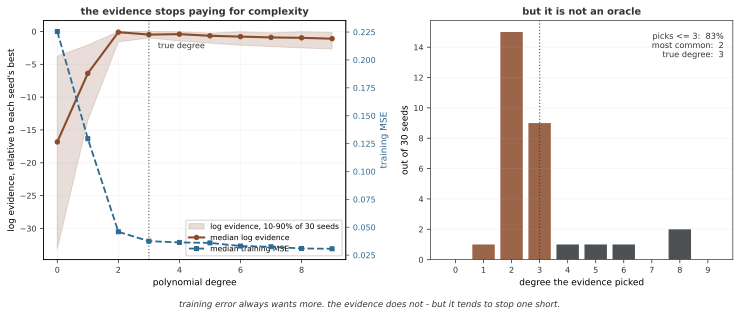

# 베이즈 뉴럴 넷트웍의 기초

베이즈 뉴럴 넷트웍(BNN)은 웨이트에 사전분포를 두고 데이터에 조건부인 사후분포로 예측을 평균한다. 웨이트 한 점을 추정하는 모델과 달리 파라메터 불확실성을 예측에 반영할 수 있다. 그 품질은 생성모델·사전분포·추론 근사와 데이터에 달려 있으며, 베이즈라는 이름만으로 캘리브레이션이나 분포 밖 탐지가 보장되지는 않는다.

구현과 평가 방법은 [44장: 모델 불확실성](../../ch43/index.md)에서 이어서 다룬다.

## 1. 사후분포와 예측분포

관측 D={(xᵢ,yᵢ)}에 대해 p(θ|D)∝p(D|θ)p(θ)이며, 새 입력의 예측은 다음과 같다.

$$p(y_*|x_*,D)=\int p(y_*|x_*,\theta)p(\theta|D)\,d\theta.$$

뉴럴 넷트웍 출력은 이 조건부 관측분포의 평균·분산 또는 클래스 확률을 정의한다. 점 추정 뉴럴 넷트웍도 관측분포를 출력할 수 있으므로 ‘점 추정은 언제나 점 예측만 한다’는 구분은 부정확하다. BNN의 차이는 파라메터의 불확실성까지 평균한다는 데 있다.

정확한 적분이 어려우면 근사 사후 q의 표본 θˢ로 p(y★|x★,D)≈S⁻¹∑ₛp(y★|x★,θˢ)를 계산한다. 이때 사후 근사 오차와 유한 표본 오차를 구분한다. 분류에서는 로짓의 평균에 softmax를 취하는 것과 확률을 평균하는 것이 일반적으로 다르다.

## 2. 회귀의 불확실성 분해

고정된 입력 x★와 데이터 D에서 조건부 평균 μ_θ(x★), 분산 σ²_θ(x★)가 존재하면 전분산 법칙으로 다음을 얻는다.

$$\operatorname{Var}(y_*|x_*,D)=E_{\theta|D}[\sigma_\theta^2(x_*)]+\operatorname{Var}_{\theta|D}[\mu_\theta(x_*)].$$

첫 항은 주어진 모델에서의 **데이터 불확실성(aleatoric uncertainty)**, 둘째는 **모델 불확실성(epistemic uncertainty)**으로 해석한다. 평균 네트워크의 출력 분산만 계산하면 첫 항이 빠져 새 관측의 전체 예측분산이 아니다.

이 구분은 모델과 관측 정보에 상대적이다. 관측 피처·측정 방법을 개선하면 데이터 잡음으로 보이던 부분도 줄 수 있다. 추가 데이터가 모델 불확실성을 평균적으로 줄일 수는 있지만 개별 입력의 유한 표본 추정값이 항상 단조롭게 줄어드는 것은 아니다. 모델 부정확성이나 분포 변화가 사후 웨이트의 스프레드에 충분히 나타나지 않을 수도 있다.

## 3. 분류의 엔트로피 분해

p_θ(c|x)를 각 웨이트의 클래스 확률, p̄(c)=E_θ|D[p_θ(c|x)]라 쓰면 다음과 같다.

$$H(\bar p)=E_{\theta|D}[H(p_\theta)]+I(y;\theta|x,D).$$

평균 조건부 엔트로피는 각 모델 안의 예측 불확실성이고, 상호정보량은 웨이트별 예측의 차이에서 오는 항이다. 상호정보량은 H(p̄)−E[H(p_θ)]로 계산한다. 모든 ‘불확실성’ 수치를 단위와 무관하게 더하는 일반식이 아니라, 여기서는 엔트로피와 상호정보량에 대한 정확한 항등식이다. 근사 사후를 사용하면 그 근사 아래의 분해가 된다.

## 4. 추론이 어려운 이유와 방법

비선형 뉴럴 넷트웍의 사후는 고차원이며, 은닉 유닛의 순열 등 서로 다른 웨이트가 같은 함수를 만드는 대칭성이 있다. 웨이트 공간의 여러 모드가 모두 서로 다른 예측 함수를 뜻하지는 않는다. 일반 비선형 뉴럴 넷트웍에는 간단한 켤레 해가 없지만 고정 피처의 가우스 선형 출력 레이어처럼 해석적 추론이 가능한 특수 경우는 있다.

| 방법 | 계산하는 근사 | 주요 확인 사항 |
|---|---|---|
| HMC | 사후 불변 전이의 표본 | 탐색·수렴·경사 비용 |
| SGLD | 미니배치 경사와 Langevin 잡음 | 러닝레이트·이산화·경사 잡음 |
| 변분 추론 | 제한된 q의 ELBO 최적화 | 분포족·목적 스케일·최적화 |
| 라플라스 | 한 모드 근방의 가우스 | 곡률·양의 정부호·국소성 |
| MC 드롭아웃 | 무작위 마스크 예측 | 학습 설정과 근사 해석 |
| 딥 앙상블 | 여러 적합 모델의 예측 혼합 | 모델 다양성·평가 기준 |

고정된 별점이나 방법 이름만으로 정확도 순위를 정할 수 없다. 관심량·데이터·계산 예산·추론 진단을 맞춰 비교한다. 딥 앙상블의 각 모델은 일반적으로 같은 베이즈 사후의 독립 표본이 아니다.

**그림으로 보는 AI 1.** 사후를 적분하면 복잡함에 제동이 걸린다

위 표의 방법들이 모두 근사하려는 그 적분이 왜 값어치가 있는지를, 1992년에 데이비드 맥케이(David MacKay)가 뉴럴 넷트웍에 처음으로 실용적인 꼴로 보였다. 「역전파 넷트웍을 위한 실용적 베이즈 틀」이라는 글이고, 핵심 주장은 웨이트를 적분해 얻는 **증거**(evidence)가 "오컴의 면도날을 저절로 담는다"는 것이었다. 웨이트 감쇠의 세기를 손으로 고르거나 검증셋으로 조기 종료하는 대신, 적분이 알아서 지나치게 유연한 모델에 벌점을 매긴다는 이야기다.

벌점이 따로 붙는 것이 아니라는 점이 요점이다. 복잡한 모델은 사전 확률질량을 넓은 데이터 공간에 펴 놓아야 하므로 **실제로 본 데이터에 돌아갈 몫이 줄어든다.** 가우스 선형 모델에서는 이 증거에 닫힌 식이 있어 바로 잴 수 있다. 참 차수가 3인 다항식 자료에 차수를 0부터 9까지 올려 가며 씨앗 30개로 돌려 보았다.

왼쪽에서 두 곡선이 갈린다. 훈련 오차 중앙값은 차수가 오르는 내내 내려간다(0.2255에서 0.0307까지). **증거는 그렇지 않다.** 차수 2 언저리에서 멎고 그 뒤로는 더 주지 않는다. 맥케이가 말한 면도날이 이 모양이다 — 적분이 복잡함에 제동을 건다.

**그런데 제동을 건다는 것과 맞힌다는 것은 다르다.** 오른쪽이 그 대목이다. 30번 가운데 83%가 참 차수 이하를 골랐으니 과한 쪽으로 달아나지는 않는다. 그러나 가장 많이 고른 것은 3이 아니라 **2** 였다 — 참값보다 하나 적다. 표본이 14개뿐이라 네 번째 계수를 뒷받침할 근거가 모자라고, 증거는 근거가 없는 복잡함을 사지 않는다. 그것이 옳은 처신이지만 참 구조를 돌려주는 것은 아니다.

그러니 위 문단의 경고가 증거에도 그대로 간다. 증거가 가장 큰 모델을 "맞는 모델"로 읽으면 안 된다. 적분이 말해 주는 것은 **이 자료가 이 모델족 안에서 무엇을 뒷받침하는가**이고, 자료가 적으면 뒷받침되는 것도 적다.

_확인한 곳 — D. J. C. MacKay, "A Practical Bayesian Framework for Backpropagation Networks", *Neural Computation* **4**(3), 448–472 (1992). 증거가 오컴의 면도날을 담는다는 주장과 잘 정해진 파라메터의 유효 개수가 그 글의 것이다. 그림의 수는 그림을 그리는 코드가 가우스 선형 모델의 닫힌 식으로 씨앗 30개에 걸쳐 직접 셈한다._

## 5. 사전분포와 정규화

데이터의 **총** 음의 로그 우도를 L_sum이라 하면 θ∼N(0,σ_p²I)의 MAP 목적은 L_sum+∥θ∥²/(2σ_p²)다. 평균 로스 L_sum/N을 쓰면 사전 항도 N으로 나누어야 같은 MAP 문제다. 라플라스 사전은 L1 벌점에 대응한다.

이는 점 추정 목적의 대응이다. 가우스 사전만 추가했다고 사후분포를 추론한 것은 아니며, AdamW의 분리된 weight decay가 모든 옵티마이저에서 L2 벌점과 동일한 것도 아니다. 연속 수축 사전과 정확한 0의 질량을 갖는 spike-and-slab 사전도 구분한다.

## 6. 시계열과 의사결정에서의 해석

시간 의존성·국면 변화가 있는 데이터에서는 우도와 평가 분할이 그 구조를 반영해야 한다. 사후 예측의 불확실성이 작아도 누락 변수나 모델 오차를 놓칠 수 있으므로 관측 구간과 다른 환경의 정확성을 자동으로 주장하지 않는다.

예측 평균을 모델 표준편차로 나눈 값을 노출 크기로 쓰는 규칙은 하나의 휴리스틱이지 BNN에서 유도되는 최적 투자 규칙이 아니다. 전체 공분산·관측 잡음·거래비용·제약과 의사결정 로스가 빠져 있고 표준편차가 0에 가까우면 불안정하다. 불확실성을 실제 결정에 사용할 때는 해당 목적과 제약을 명시한 모델이 별도로 필요하다.

## 연습문제

**연습문제 1.** 
회귀의 전체 예측분산을 두 항으로 분해하고 각 항의 조건을 설명하라.

??? success "풀이"
    전분산 법칙에 따라 E_θ|D[Var(y★|x★,θ)]+Var_θ|D[E(y★|x★,θ)]다. 고정된 입력과 데이터, 유한한 이차 적률을 가정한다. 첫 항은 조건부 관측 잡음, 둘째는 웨이트별 조건부 평균의 차이다. 평균 네트워크 출력의 표본분산만으로 전체 예측분산을 얻지는 못한다.

---

**연습문제 2.** 
분류에서 엔트로피와 상호정보량을 이용한 분해를 쓰라.

??? success "풀이"
    평균 확률 p̄에 대해 H(p̄)=E[H(p_θ)]+I(y;θ|x,D)다. 먼저 클래스 확률을 평균해야 하며 평균 로짓의 softmax로 대체하면 일반적으로 다르다. 근사 사후를 사용하면 해당 근사 아래에서 계산한 분해다.

---

**연습문제 3.** 
MC 드롭아웃과 가우스 변분 BNN의 캘리브레이션에 보편적 순위를 정할 수 있는가?

??? success "풀이"
    없다. 두 방법은 분포족·학습 목적·사전 또는 정규화 해석과 비용이 다르다. 동일한 데이터 분할과 예측 지표·계산 예산에서 평가해야 한다. 분포족이 더 복잡하다는 이유만으로 유한 학습 결과의 캘리브레이션이 반드시 좋아지지는 않는다.

---

**연습문제 4.** 
가우스 사전의 MAP 대응과 베이즈 사후 예측을 구분하라.

??? success "풀이"
    MAP는 총 음의 로그 우도에 ∥θ∥²/(2σ_p²)를 더해 한 점을 구한다. 베이즈 예측은 관측분포를 사후 웨이트에 걸쳐 평균한다. 동일한 사전이라도 점 추정과 분포 적분은 다른 계산이며 로스를 평균하면 사전 항의 배율도 맞춰야 한다.

## 정리하며

BNN은 웨이트의 사후 불확실성을 예측에 반영한다. 회귀의 전분산과 분류의 엔트로피 분해를 구분하고, 웨이트의 스프레드를 모든 모델 위험의 척도로 일반화하지 않는다. 정확도·캘리브레이션·의사결정 성능은 모델과 근사, 평가 조건에 따라 확인한다.

**참고 문헌**

- Blundell, C., Cornebise, J., Kavukcuoglu, K., & Wierstra, D. (2015). Weight Uncertainty in Neural Networks. *ICML*.
- Gal, Y., & Ghahramani, Z. (2016). Dropout as a Bayesian Approximation: Representing Model Uncertainty in Deep Learning. *ICML*.
- MacKay, D. J. C. (1992). A Practical Bayesian Framework for Backpropagation Networks. *Neural Computation*, 4(3), 448-472.
- Wilson, A. G., & Izmailov, P. (2020). Bayesian Deep Learning and a Probabilistic Perspective of Generalization. *NeurIPS*.
