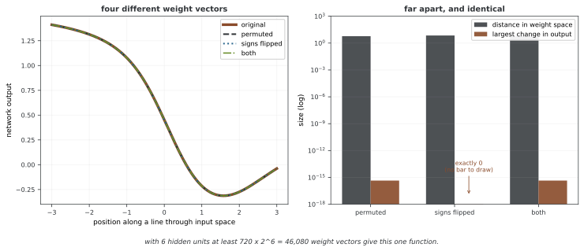

# 베이즈 뉴럴 넷트웍의 웨이트 불확실성

웨이트의 분포는 사전분포, 관측 우도와 추론 방법을 통해 결정된다. 웨이트 공간의 넓은 분포가 반드시 넓은 예측분포를 뜻하지는 않는다. 뉴럴 넷트웍의 대칭성과 웨이트 간 의존성 때문에 서로 다른 파라메터가 같은 함수를 나타낼 수 있기 때문이다.

심화 내용은 [44장의 사전분포](../../ch43/bayesian_methods/priors.md)와 [사후 추론](../../ch43/bayesian_methods/posterior.md)을 참고한다.

## 1. 가우스 사전과 스케일

레이어별 독립 가우스 사전은 p(θ)=∏ₗ∏ᵢⱼN(wᵢⱼ⁽ˡ⁾;0,σₗ²)처럼 정의한다. 바이어스에 같은 사전을 사용할지, 다른 스케일을 둘지도 명시한다. 총 음의 로그 우도에 λ∥w∥²를 더하는 표기에서는 λ=1/(2σ²)이고, λ∥w∥²/2를 더하는 표기에서는 λ=1/σ²다. 로스를 관측당 평균하면 대응 사전 항도 N으로 나눈다.

폭에 따른 스케일은 웨이트 사전이 유도하는 함수의 크기와 깊이에 따른 신호 전파에 영향을 준다. Xavier의 분산 2/(n_in+n_out)와 ReLU의 He 분산 2/n_in은 초기화 이론의 참고값이다. 이를 베이즈 사전의 보편적 정답이나 최적 추론 설정으로 볼 수는 없다. 같은 웨이트 분산이라도 입력의 스케일·활성화·레이어 수·바이어스에 따라 함수 분포가 달라진다.

사전에서 웨이트를 생성했을 때 출력 크기와 매끄러움 등이 문제의 단위에 맞는지 살피는 사전 예측 점검이 유용하다. 변분분포의 초기값을 정하는 것과 사전분포를 정하는 것은 별개다.

## 2. 수축·희소·계층 사전

라플라스 사전 p(w)=exp(−|w|/b)/(2b)는 MAP에서 L1 벌점과 대응한다. 그러나 연속 사후의 표본이 정확히 0이 될 확률은 일반적으로 0이다. 수축과 정확한 변수 제거를 구분한다.

Horseshoe 사전은 전역 스케일 τ와 지역 스케일 λⱼ를 사용한다.

$$w_j|\lambda_j,\tau\sim\mathcal N(0,\tau^2\lambda_j^2),\qquad\lambda_j\sim\mathrm{HalfCauchy}(0,1).$$

τ를 고정할지 하이퍼사전으로 추론할지 명시한다. 작은 값의 수축과 큰 값의 두꺼운 꼬리를 함께 표현하지만 추론 기하가 어려워질 수 있다. 모든 뉴럴 넷트웍에서 자동으로 적합한 희소 모델이 된다는 뜻은 아니다.

정확한 0의 질량을 원하면 spike-and-slab처럼 p(wⱼ)=(1−π)δ₀+πN(0,σ_slab²)를 정의할 수 있다. 단일 웨이트별 선택인지 입력·유닛·레이어별 그룹 선택인지에 따라 구조적 희소성의 의미가 달라진다.

계층 사전의 예로 wⱼ|σ²∼N(0,σ²), σ²∼InverseGamma(a,b)를 둘 수 있다. 모든 웨이트가 스케일 하나를 공유하면 공통 수축을 학습한다. 피처가나 그룹별 정밀도를 따로 두어 관련성을 구분하는 ARD와 자동으로 같은 모델이 되는 것은 아니다. 하이퍼파라미터를 사후로 추론하는 계층 베이즈와 추정값을 대입하는 경험적 베이즈도 구분한다.

## 3. 추론 방법과 근사 오차

HMC는 올바른 전이와 정칙성 아래에서 사후를 불변분포로 갖지만, 유한 실행에서 모든 예측 모드를 탐색했다고 보장하지 않는다. 경사 비용·전처리·다중 체인 진단을 함께 고려한다.

SGLD는 균등 미니배치 B, |B|=m에 대해 다음 갱신을 사용한다.

$$\theta_{t+1}=\theta_t+\frac{\eta_t}{2}\left[\nabla\log p(\theta_t)+\frac Nm\sum_{i\in B}\nabla\log p(y_i|x_i,\theta_t)\right]+\sqrt{\eta_t}\,\xi_t,\quad\xi_t\sim\mathcal N(0,I).$$

ηₜ→0이라는 조건 하나로 정확한 사후 수렴이 따라오는 것은 아니다. 러닝레이트 합 조건, 경사 추정의 불편성·적률, 안정성·모델의 정칙성 등 해당 이론의 가정을 확인해야 한다. 고정 스텝에서는 이산화와 미니배치 오차가 남을 수 있다.

변분 추론은 [ELBO](../variational_inference/elbo.md)를 최적화하며 분포족과 최적화의 오차를 가진다. [Bayes by Backprop](bayes_by_backprop.md)은 리파라메리제이션 경사를 사용하는 대표적인 가우스 근사다.

라플라스 근사는 정칙한 MAP 근방의 H=−∇²log p(θ|D)가 양의 정부호일 때 N(θ_MAP,H⁻¹)로 근사한다. 임의의 정상점이나 특이·부정부호 Hessian을 역행렬로 바꾸면 유효한 공분산이 되지 않는다. 대각·KFAC·저랭크 등의 곡률 근사는 계산량을 줄이는 대신 다른 근사 오차를 만든다. 한 모드의 국소 가우스가 전체 다봉 사후를 표현하는 것도 아니다.

**그림으로 보는 AI 1.** 서로 멀리 떨어진 웨이트가 똑같은 함수일 때

이 쪽 머리글이 "웨이트 공간의 넓은 분포가 반드시 넓은 예측분포를 뜻하지는 않는다"고 적고 그 까닭으로 대칭성을 든다. 그 대칭성이 어떤 모양인지는 1990년에 로버트 헥트닐슨(Robert Hecht-Nielsen)이 정리해 두었다. 은닉층의 두 유닛을 맞바꾸고 다음 레이어의 웨이트도 따라 바꾸면 **입출력 함수가 그대로**라는 것이다. $\tanh$ 가 홀함수이므로 한 유닛으로 들고 나는 웨이트의 부호를 함께 뒤집어도 마찬가지다.

은닉 유닛 6개짜리 넷트웍에서 실제로 옮겨 보았다.

웨이트 공간에서 5.9에서 7.0만큼 떨어진 네 점인데, 출력의 최대 차이가 $4\times10^{-16}$ — 부동소수점 바닥이고 부호 뒤집기는 **정확히 0**이다. 왼쪽 그림에서 곡선 넷이 한 줄로 겹친다. 그리고 이런 점이 몇 개나 있는가 하면, 자리바꿈 $6!$ 가지에 부호 $2^6$ 가지를 곱해 **적어도 46,080개**다. 헥트닐슨은 이 변환들이 군을 이루며, 그 때문에 정말로 탐색할 값어치가 있는 영역이 웨이트 공간 부피의 아주 작은 조각밖에 안 된다는 것까지 보였다.

**그래서 웨이트 분포의 폭을 불확실성의 척도로 읽으면 안 된다.** 사후가 이 46,080개 봉우리에 고르게 퍼져 있다면 웨이트 공간에서는 대단히 넓은 분포지만 예측분포는 **한 점**이다. 위 3절의 방법들이 서로 다른 모드를 얼마나 찾았는지를 따질 때도 같은 주의가 필요하다 — 다른 모드를 찾았다는 것과 다른 **함수**를 찾았다는 것은 다른 말이고, 대칭으로 옮겨 간 모드는 예측에 아무것도 보태지 않는다. 아래 4절의 딥 앙상블이 "같은 베이즈 사후의 독립 표본이 아니다"라는 단서를 달고 다니는 것도 결국 이 자리와 이어진다. 재야 할 것은 웨이트가 얼마나 흩어졌는가가 아니라 **예측이 얼마나 갈라지는가**다.

_확인한 곳 — R. Hecht-Nielsen, "On the algebraic structure of feedforward network weight spaces", *Advanced Neural Computers*, North-Holland (1990), 129–135. 은닉 유닛 교환이 함수를 바꾸지 않는다는 것과 이 변환들이 군을 이룬다는 것이 그 글의 결과다. 그림의 수는 그림을 그리는 코드가 직접 옮겨 보고 재며, 함수가 바뀌면 코드가 멈춘다._

## 4. MC 드롭아웃과 딥 앙상블

MC 드롭아웃은 예측 시 여러 마스크로 조건부 예측분포를 평균한다. 특정 학습·정규화 설정 아래 변분 해석이 가능하지만 임의의 드롭아웃 사용이 정확한 사후 표본화가 되는 것은 아니다. 드롭아웃 활성화와 배치 정규화의 학습 모드도 구분해야 한다.

딥 앙상블은 여러 초기값 등의 차이로 적합한 모델들의 예측을 혼합한다. 서로 다른 최적화 결과를 같은 베이즈 사후의 독립 표본이라고 가정하지 않는다. 사전·모델·분포 변화에 따라 두 방법 모두 과신할 수 있고, 변분 가우스보다 항상 나쁘거나 좋다는 순위는 없다.

웨이트의 주변분산, 예측분산, 분류 확률의 캘리브레이션은 서로 다른 지표다. 비교에는 같은 데이터 분할, 확률적 출력 모델, 예측 표본 수와 비용, 적절한 평가 지표가 필요하다. 예측 표본을 늘리면 근사분포 아래 몬테카를로 오차는 줄일 수 있지만 분포족의 바이어스까지 제거되지는 않는다.

## 연습문제

**연습문제 1.** 
가우스 사전의 L2 계수가 표기에 따라 달라지는 이유를 설명하라.

??? success "풀이"
    음의 로그 사전은 ∥w∥²/(2σ²)+상수다. λ∥w∥² 표기에서는 λ=1/(2σ²), λ∥w∥²/2 표기에서는 λ=1/σ²다. 데이터 로스를 합에서 평균으로 바꾸면 사전 항도 N으로 나누어 같은 MAP 문제를 유지한다.

---

**연습문제 2.** 
공통 스케일의 계층 사전과 피처별 ARD를 구분하라.

??? success "풀이"
    공통 스케일 하나는 모든 웨이트의 수축 정도를 함께 조절한다. ARD는 입력이나 그룹별 정밀도를 구분해 관련성을 학습하도록 설계한다. 단순히 분산에 하이퍼사전을 두었다는 사실만으로 그룹 선택이 생기지는 않는다.

---

**연습문제 3.** 
SGLD에서 ηₜ→0만으로 충분하지 않은 이유를 설명하라.

??? success "풀이"
    스텝이 너무 빨리 줄면 필요한 이동량이 부족할 수 있고 경사 바이어스·무한 분산·불안정성 같은 문제도 남는다. 확률근사의 합 조건과 목표·전이의 정칙성 등을 갖춘 해당 수렴 결과가 필요하다. 고정 스텝 체인과 감소 스텝 알고리즘의 주장도 구분한다.

---

**연습문제 4.** 
웨이트의 넓은 분포와 예측의 넓은 분포가 같은 의미인가?

??? success "풀이"
    아니다. 은닉 유닛 순열이나 스케일 대칭 등으로 서로 다른 웨이트가 같은 함수를 나타낼 수 있다. 실제 관심 입력에서 조건부 예측을 사후 또는 근사 사후에 걸쳐 비교해야 예측 불확실성을 평가할 수 있다.

## 정리하며

웨이트 사전은 함수에 대한 가정을 유도하며 초기화와는 다른 역할을 한다. 공통 수축·그룹 선택·정확한 0의 질량을 구분하고, HMC·SGLD·VI·라플라스·마스크·앙상블 각각의 오차와 비용을 평가한다. 웨이트 분산만으로 예측 품질을 판단하지 않는다.

**참고 문헌**

- Blundell, C., et al. (2015). Weight Uncertainty in Neural Networks. *ICML*.
- Gal, Y., & Ghahramani, Z. (2016). Dropout as a Bayesian Approximation. *ICML*.
- Welling, M., & Teh, Y. W. (2011). Bayesian Learning via Stochastic Gradient Langevin Dynamics. *ICML*.
- Lakshminarayanan, B., Pritzel, A., & Blundell, C. (2017). Simple and Scalable Predictive Uncertainty Estimation using Deep Ensembles. *NeurIPS*.
