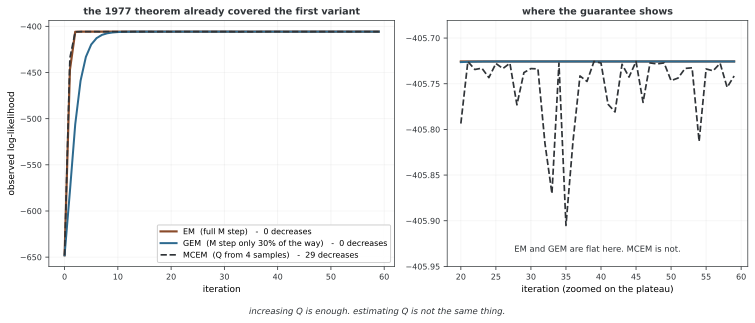

# EM의 변형

EM의 두 단계는 문제에 따라 일부만 최적화하거나, 표본으로 근사하거나, 제한된 분포족으로 대체할 수 있다. 이때 가장 먼저 확인할 것은 실제로 최적화하는 목적함수다. 정확한 관측 우도, 몬테카를로 근사 Q, 변분 하한은 서로 다른 양이며 표준 EM의 보장이 모든 변형에 그대로 적용되지는 않는다.

## 1. 일반화 EM

일반화 EM(GEM)은 정확한 E 단계 뒤에 Q를 완전히 최대화하는 대신 다음 조건만 요구한다.

$$Q(\theta_{t+1}|\theta_t)\geq Q(\theta_t|\theta_t).$$

현재 점에서 ELBO가 관측 우도와 일치하므로 이 조건으로 관측 우도의 비감소성을 얻는다. 등호도 허용하므로 반드시 엄격한 진전이 있다는 뜻은 아니다. 정상점 수렴에는 여전히 적절한 상승·정칙성 조건이 필요하다.

M 단계에 경사 상승, Newton 또는 준 Newton 방법을 사용할 수 있다. 그러나 임의의 러닝레이트로 경사 방향을 따라 한 번 이동했다고 Q가 증가하는 것은 아니다. 제약을 만족하는 후보와 선 탐색 등으로 실제 목적값을 확인해야 한다. 단순 사영 역시 일반적인 Q 증가의 보장이 아니다.

<div class="storybox" markdown>

**그림으로 보는 AI 1.** 첫 변형은 원래 논문 안에 있었다

이 장의 변형들 가운데 첫째인 GEM은 뒤에 누가 붙인 것이 아니다. 1977년 템프스터·레어드·루빈의 그 논문 3절에 **정의와 이름이 함께** 들어 있다.

> "Definition. An iterative algorithm with mapping $M(\phi)$ is a **generalized EM algorithm (a GEM algorithm)** if $Q(M(\phi)|\phi) \ge Q(\phi|\phi)$ for every $\phi$ in $\Omega$."

그리고 더 중요한 것은 같은 절의 정리 1이 **EM이 아니라 GEM에 대해** 증명되어 있다는 점이다 — "For every GEM algorithm, $L(M(\phi)) \ge L(\phi)$". 다시 말해 관측 우도가 올라간다는 보장은 M 단계에서 **최대화할 것을 요구한 적이 없다.** 올리기만 하면 된다. 세 사람은 처음부터 그렇게 적어 두었다.

그래서 M 단계를 어설프게 해도 보장이 살아 있다. 성분 둘짜리 혼합에서 M 단계를 해까지 가지 않고 **30%만** 걸어가 보았다.



GEM은 느리게 올라가지만 60걸음 동안 로그 우도가 **한 번도 내려가지 않는다.** 닿는 곳도 EM과 같다. 위 문단이 적은 조건 $Q(\theta_{t+1}|\theta_t)\ge Q(\theta_t|\theta_t)$ 하나면 충분하다는 것이 이 그림이다.

**그런데 같은 그림이 경계선도 보여 준다.** 몬테카를로 EM을 표본 4개로 돌리면 로그 우도가 **29번 내려간다.** 오른쪽 확대에서 EM·GEM이 완전히 평평한 자리에서 MCEM만 거듭 주저앉는다. 정리 1이 배신한 것이 아니다 — MCEM은 애초에 정리의 조건을 만족하지 않는다. 식 (3.5)는 **참 $Q$** 에 대한 부등식인데 MCEM이 들고 있는 것은 $Q$ 의 추정값이라, 표본 잡음이 부등식을 깨는 순간 보장이 적용될 자리가 없어진다.

이 쪽 머리글이 "가장 먼저 확인할 것은 실제로 최적화하는 목적함수다"라고 적은 까닭이 그것이다. **$Q$ 를 덜 올리는 것과 $Q$ 를 추정하는 것은 전혀 다른 종류의 변형이다.** 앞은 1977년에 이미 덮였고, 뒤는 아래 5절처럼 따로 따져야 한다.

_확인한 곳 — A. P. Dempster, N. M. Laird, D. B. Rubin, *Journal of the Royal Statistical Society B* **39**(1), 1–38 (1977) 의 3절. GEM 의 정의는 식 (3.5) 이고 정리 1 은 식 (3.7) 이다. 그림의 수는 그림을 그리는 코드가 직접 돌려 얻으며, EM 과 GEM 이 단조가 아니거나 MCEM 이 단조이면 코드가 멈춘다._

</div>

## 2. 조건부 최대화 EM

ECM은 하나의 E 단계에서 구한 qₜ를 고정하고 θ의 블록을 차례로 최적화한다. 두 블록이면 다음과 같다.

$$\theta_1^{new}\in\arg\max_{\theta_1}Q(\theta_1,\theta_2^t|\theta_t),\qquad \theta_2^{new}\in\arg\max_{\theta_2}Q(\theta_1^{new},\theta_2|\theta_t).$$

뒤 블록에는 앞 블록의 최신 값을 사용한다. 각 조건부 단계가 같은 Q를 감소시키지 않으므로 전체 갱신은 GEM 조건을 만족한다. 블록을 충분히 다루는 조건은 정상점에 관한 논의에서 별도로 필요하다.

인자 분석처럼 파라메터가 얽힌 모델에서도 블록별 선형계나 분산 갱신이 편리할 수 있다. 다만 그 모델의 모든 파라메터에 항상 결합 닫힌 해가 없다는 뜻은 아니다. 중심화 여부·제약·사전분포에 따라 결합 해나 더 효율적인 갱신이 가능하다.

## 3. 관측 우도를 활용하는 ECME

ECME는 일부 조건부 최대화 단계를 Q 대신 관측 로그 우도 ℓ에 대한 조건부 최적화로 바꾼다. 결측 정보가 큰 방향을 직접 다루면 반복 수가 줄어들 수 있다. 그러나 한 반복의 비용이 커질 수 있으므로 전체 실행비용과 함께 비교한다.

단조성 설명에는 단계의 순서와 기준점이 중요하다. 한 가지 안전한 구성은 현재 사후분포에 기초한 Q 단계들을 먼저 수행해 우도를 높인 뒤, 관측 우도를 직접 높이는 단계들을 수행하는 것이다. 관측 우도 갱신 뒤에 오래된 q의 Q를 다시 높이면 그 시점의 우도를 높인다고 자동으로 결론 낼 수 없다. 다시 E 단계를 수행해 하한을 맞추거나 직접 우도 증가를 확인하는 등 설계에 맞는 논증이 필요하다.

ECME라는 이름만으로 임의의 Q·우도 단계 배열이 정당화되지는 않는다. 원래 알고리즘의 조건부 공간과 단조성 조건을 명시해야 한다.

## 4. 파라메터 확장 EM

PX-EM은 보조 파라메터를 도입한 확장 모델에서 갱신한 다음 원래 모델로 환원한다. 확장 파라메터를 φ, 환원 사상을 R이라 할 때 관측 모델은 다음 일관성을 만족해야 한다.

$$p_{exp}(X|\phi)=p_{orig}(X|R(\phi)).$$

원래 모델을 확장 공간에 포함하는 기준값과, 확장된 완전 데이터 구조도 함께 정의해야 한다. 단순히 파라메터 개수를 늘리거나 동일한 우도를 재표현하는 것만으로 가속 EM이 되는 것은 아니다.

예를 들어 인자 분석에서 잠재 공분산 Σ_z를 허용하면 관측 공분산은 WΣ_zWᵀ+Ψ다. Σ_z=LLᵀ로 분해해 W_red=WL로 환원하면 표준 잠재 공분산 I인 모델의 같은 관측분포를 얻는다. 이 불필요한 자유도를 갱신에 활용할 수 있다. 적절한 PX 설계는 국소 수렴을 개선할 수 있지만 모든 확장과 초기값에서 엄격히 더 빠르다는 일반적 보장은 아니다.

## 5. 몬테카를로 EM

MCEM은 E 단계의 적분이 어려울 때 현재 잠재변수 사후분포의 표본으로 Q를 근사한다.

$$Z^{(m)}\sim p(Z|X,\theta_t),\qquad \widehat Q_M(\theta|\theta_t)=\frac1M\sum_{m=1}^M\log p(X,Z^{(m)}|\theta).$$

한 M 단계의 최적화 동안 표본을 고정하면 동일한 무작위 목적함수를 최적화할 수 있다. 제안분포에서 표본을 얻었다면 필요한 중요도 웨이트를 포함해야 하며, MCMC 표본이면 자기상관과 초기화 오차도 고려한다.

유한 M에서 Q의 근사가 증가해도 정확한 관측 우도가 매번 증가하는 것은 아니다. 반복 후반에 표본 수를 늘리는 전략이 유용할 수 있지만 Mₜ→∞만으로 모든 수렴 정리가 성립하는 것은 아니다. 오차의 누적·증가 속도·최적화 정확도 등에 대한 해당 이론의 조건이 필요하다.

아래 예제는 사후 샘플러와 완전 데이터 로그 우도, 최적화 루틴을 외부에서 제공받는 골격이다. 이 함수들이 정의되어 있고 현재 θ의 사후를 올바르게 표본화한다는 전제 없이 독립 실행 가능한 MCEM 구현으로 읽지 않는다.

```python
def mcem_iteration(X, theta, n_samples, sampler):
    """
    몬테카를로 EM의 한 되풀이.
    
    인수:
        X: 관측한 자료
        theta: 지금의 파라메터
        n_samples: 몬테카를로 표본의 개수
        sampler: 뒤확률에서 Z을 표집하는 함수
    
    반환값:
        새로 고친 theta
    """
    # E 스텝: 뒤확률에서 표집
    Z_samples = [sampler(X, theta) for _ in range(n_samples)]
    
    # M 스텝: 어림한 Q을 가장 크게 하기
    def neg_Q(new_theta):
        return -sum(
            complete_log_likelihood(X, Z, new_theta) 
            for Z in Z_samples
        ) / n_samples
    
    result = minimize(neg_Q, theta)
    return result.x
```

## 6. 확률적 EM

SEM은 사후분포에서 잠재 배정 Z를 하나 생성한 뒤 그 완전 데이터의 파라메터를 최대화하는 방식이다. GMM에서는 확률적으로 라벨을 뽑아 군집별 추정을 수행한다. 사후 모드 라벨을 선택하는 하드 EM과 달리 배정에 무작위성이 있다.

잠재 배정을 표본화한다고 θ까지 베이즈 사후에서 생성하는 것은 아니다. θ는 여전히 최대화 갱신을 받으므로 이 절차를 파라메터 사후의 깁스 샘플러로 해석하면 안 된다. 반복의 정상분포나 최적점 주변의 변동에 관한 결과는 모델과 알고리즘의 별도 조건에 의존한다. 관측 우도의 매회 단조성도 일반적으로 없다.

한 번의 확률 배정에서 빈 성분이나 표본이 부족한 성분이 생길 수 있다. 공분산과 비중의 처리 규칙을 명시해야 한다. 무작위성이 국소해 탐색에 도움을 줄 수 있어도 전역 최적성을 보장하지는 않는다.

## 7. 변분 EM

정확한 사후 대신 제한된 분포족 Q 안에서 q를 고른다. 변분 E 단계와 M 단계는 다음 하한을 번갈아 높인다.

$$\mathcal L(q,\theta)=E_q[\log p(X,Z|\theta)]-E_q[\log q(Z)].$$

평균장 q(Z)=∏ⱼqⱼ(Zⱼ)를 쓰면 다른 인자를 고정한 최적 인자는 log qⱼ★=E_q₋ⱼ[log p(X,Z|θ)]+상수의 형태다. 이 기댓값을 실제로 계산할 수 있는지, 인자가 정규화 가능한지는 모델별로 확인한다.

각 좌표를 정확히 최적화하거나 하한 증가를 확인하면 ELBO가 감소하지 않는다. 그러나 사후 근사 오차가 달라지므로 관측 우도의 단조성은 따라오지 않는다. 차이 ℓ−L은 KL이지만 주변우도 ℓ을 모르면 실제 KL 차이도 일반적으로 계산할 수 없다. 하한의 안정화는 제한된 근사 문제의 진단이며 정확한 사후나 전역 최적점의 증명이 아니다.

## 8. 증분 EM과 온라인 EM

증분 EM은 데이터별로 저장한 충분통계량의 기여를 일부만 갱신한다. 같은 데이터를 재방문할 때는 해당 데이터의 이전 기여를 빼고 새 기여를 더해야 한다. 새 기여만 계속 더하면 같은 관측을 중복 계산한다.

온라인 EM은 새 관측이나 미니배치의 기댓값 충분통계량 ŝₜ를 이동평균으로 통합한다.

$$s_t=(1-\eta_t)s_{t-1}+\eta_t\hat s_t,\qquad\theta_t=\bar\theta(s_t).$$

GMM에서는 성분별 배정 비중 Sₖ, 가중 일차 적률 Tₖ, **원점 기준 이차 적률** Rₖ를 일관된 평균 또는 합의 단위로 유지할 수 있다. 그러면 μₖ=Tₖ/Sₖ, Σₖ=Rₖ/Sₖ−μₖμₖᵀ다. 매번 달라지는 옛 평균에 중심화한 외적만 누적하면 새 평균에 대한 공분산을 이 식으로 복원할 수 없다.

아래 코드는 `compute_weighted_outer_products`에 현재 평균을 전달한다. 이 함수가 그 평균에 중심화한 외적만 반환한다면, 서로 다른 중심의 통계량을 섞는 문제가 생긴다. 원점 기준 적률이나 중심 변경 보정이 필요하다. 보조 함수와 `N_total`도 외부 정의에 의존하는 예제다.

확률근사에서는 흔히 ∑ηₜ=∞, ∑ηₜ²<∞ 조건과 적절한 데이터·안정성·정칙성 조건을 사용한다. 예를 들어 ηₜ∝t⁻κ, 1/2<κ≤1이 두 합 조건을 만족한다. 고정 러닝레이트는 변화 추적과 망각에 사용할 수 있지만 고정된 모집단 목적의 정확한 최대점 수렴과 같은 주장은 아니다.

```python
def online_em_step(batch, theta, sufficient_stats, learning_rate):
    """흐름 속 EM에서 작은 배치 하나 다루기."""
    
    # 배치에 대한 E 스텝
    gamma = compute_responsibilities(batch, theta)
    
    # 배치의 충분 통계량 셈하기
    batch_S = gamma.sum(dim=0)
    batch_T = gamma.T @ batch
    batch_V = compute_weighted_outer_products(batch, gamma, theta['mu'])
    
    # 흐름 속 새로 고침
    sufficient_stats['S'] = (1 - learning_rate) * sufficient_stats['S'] + learning_rate * batch_S * N_total / len(batch)
    sufficient_stats['T'] = (1 - learning_rate) * sufficient_stats['T'] + learning_rate * batch_T * N_total / len(batch)
    sufficient_stats['V'] = (1 - learning_rate) * sufficient_stats['V'] + learning_rate * batch_V * N_total / len(batch)
    
    # 충분 통계량으로 하는 M 스텝
    theta['pi'] = sufficient_stats['S'] / sufficient_stats['S'].sum()
    theta['mu'] = sufficient_stats['T'] / sufficient_stats['S'].unsqueeze(1)
    theta['Sigma'] = sufficient_stats['V'] / sufficient_stats['S'].unsqueeze(1).unsqueeze(2)
    
    return theta, sufficient_stats
```

## 9. 가속법과 미분 항등식

Aitken 외삽은 국소 선형 수렴 패턴을 이용해 극한값을 추정한다. 작은 분모나 아직 점근 영역이 아닌 구간에서는 불안정할 수 있다. 벡터 오차의 노름비 하나가 모든 방향의 수렴을 나타내는 것도 아니다. SQUAREM은 EM 사상 평가와 외삽을 결합하며 유효 영역·목적값을 확인하는 보호 절차가 중요하다. EM 두 번의 단순 합성과 동일한 방법이 아니다.

준 Newton 방법 등과 결합할 때는 목적함수와 미분을 일관되게 계산한다. Fisher의 항등식은 다음과 같다.

$$\nabla\ell(\theta)=E[\nabla_\theta\log p(X,Z|\theta)\mid X,\theta]=\left.\nabla_{\vartheta}Q(\vartheta|\theta)\right|_{\vartheta=\theta}.$$

첫 번째 인자에 대해서만 미분한 식이며, Q의 두 인자 미분을 빼는 공식이 아니다. Louis의 관측 정보 항등식은 다음처럼 완전 데이터 음의 Hessian의 조건부 기댓값에서 점수의 조건부 공분산을 뺀다.

$$-\nabla^2\ell=E[-\nabla^2\log p(X,Z|\theta)\mid X]-\operatorname{Cov}(\nabla\log p(X,Z|\theta)\mid X).$$

둘은 각각 일차·이차 미분에 관한 항등식이다. 미분과 적분을 교환할 수 있는 정칙성도 필요하다.

## 10. 방법을 고를 때의 비교 기준

| 방법 | 바꾸는 부분 | 확인할 목적과 오차 |
|---|---|---|
| GEM | M 단계의 완전 최대화를 완화 | 고정 Q의 실제 증가 |
| ECM | M 단계를 조건부 블록으로 분할 | 같은 Q와 최신 블록 값 |
| ECME | 일부 단계를 관측 우도로 대체 | 단계 순서와 관측 우도 증가 |
| PX-EM | 확장 공간에서 갱신 후 환원 | 같은 관측 모델로의 환원 |
| MCEM·SEM | 사후 기댓값을 표본으로 대체 | 몬테카를로 오차와 빈 성분 |
| 변분 EM | 제한된 사후 근사 | ELBO와 근사 바이어스 |
| 온라인 EM | 통계량의 확률근사 | 데이터 단위·러닝레이트·안정성 |

빠르다는 비교에는 반복 수뿐 아니라 사후 계산, 선 탐색, 행렬 연산과 샘플링 비용을 포함한다. 모든 모델에서 성립하는 속도 순위는 없다.

## 11. 변분 GMM 구현의 목적함수

아래 구현은 Dirichlet 비중과 정규–Wishart 성분 파라메터의 평균장 갱신을 보여 준다. 유효한 사전에는 α₀>0, β₀>0, ν₀>d−1과 양의 정부호 Wishart 스케일이 필요하다. 코드의 기본 ν₀=d는 이 자유도 조건을 만족한다. 가중 산포·평균의 수축·기댓값 로그 행렬식은 해당 파라메터화에 맞춰 해석한다.

중요한 한계는 `_compute_elbo`다. 이 함수는 주로 기댓값 관측 로그 밀도와 배정 엔트로피만 계산한다. 배정의 E[log π], Dirichlet 사전·사후 항, 정규–Wishart 사전·사후 항 등이 빠져 있어 **완전한 ELBO가 아니다**. 따라서 이 값의 변화나 `lower_bound_`를 로그 주변우도의 정당한 하한·전체 변분 목적의 수렴으로 보고하면 안 된다.

또한 Wishart 갱신의 행렬에 정규화 항을 더하므로 정확한 좌표 최적해와 차이가 생길 수 있다. 기본 텐서의 장치·자료형과 K≤N 등의 입력 조건도 일반화되어 있지 않다. 코드는 그대로 두었으며 실제 실행 결과나 성능을 확인했다는 의미는 아니다.

```python
import torch
import torch.nn as nn
from torch.distributions import MultivariateNormal, Dirichlet, Categorical

class VariationalGMM:
    """
    가우스 섞음 모형의 변분 EM.
    
    섞음 무게에 디리클레 앞확률을 두고 성분 파라메터에 정규-위샤트
    앞확률을 두는 평균장 어림을 쓴다.
    """
    
    def __init__(self, n_components: int, n_features: int, 
                 alpha_0: float = 1.0, beta_0: float = 1.0,
                 nu_0: float = None, reg_covar: float = 1e-6):
        """
        인수:
            n_components: 섞음 성분의 개수
            n_features: 자료의 차원
            alpha_0: 디리클레 몰림 파라메터
            beta_0: 앞확률 정밀도의 크기 잡기
            nu_0: 위샤트 자유도(기본값: n_features)
            reg_covar: 공분산 벌주기
        """
        self.K = n_components
        self.d = n_features
        self.reg_covar = reg_covar
        
        # 앞확률의 웃파라메터
        self.alpha_0 = alpha_0
        self.beta_0 = beta_0
        self.nu_0 = nu_0 if nu_0 is not None else float(n_features)
        
        # 변분 파라메터(fit에서 첫값을 잡는다)
        self.alpha_ = None      # 섞음 무게의 디리클레 파라메터
        self.beta_ = None       # 정밀도 크기 잡기
        self.m_ = None          # 평균 파라메터
        self.W_ = None          # 위샤트 규모 행렬
        self.nu_ = None         # 위샤트 자유도
        
    def _initialize(self, X: torch.Tensor):
        """변분 파라메터 첫값 잡기."""
        N, d = X.shape
        
        # k 평균으로 평균 첫값 잡기
        indices = torch.randperm(N)[:self.K]
        self.m_ = X[indices].clone()
        
        # 다른 파라메터 첫값 잡기
        self.alpha_ = torch.ones(self.K) * self.alpha_0 + N / self.K
        self.beta_ = torch.ones(self.K) * self.beta_0 + N / self.K
        self.nu_ = torch.ones(self.K) * self.nu_0 + N / self.K
        self.W_ = torch.stack([torch.eye(d) for _ in range(self.K)])
        
    def _compute_responsibilities(self, X: torch.Tensor) -> torch.Tensor:
        """변분 E 스텝: 기댓값 맡음 몫 셈하기."""
        N = X.shape[0]
        
        # 기댓값 로그 섞음 무게: E[log π_k]
        log_pi = torch.digamma(self.alpha_) - torch.digamma(self.alpha_.sum())
        
        # 기댓값 로그 정밀도 행렬식: E[log |Λ_k|]
        log_det_Lambda = torch.zeros(self.K)
        for k in range(self.K):
            log_det_Lambda[k] = (
                self.d * torch.log(torch.tensor(2.0)) +
                torch.logdet(self.W_[k]) +
                sum(torch.digamma((self.nu_[k] + 1 - i) / 2) for i in range(1, self.d + 1))
            )
        
        # 기댓값 마할라노비스 거리: E[(x - μ_k)^T Λ_k (x - μ_k)]
        log_rho = torch.zeros(N, self.K)
        for k in range(self.K):
            diff = X - self.m_[k]
            E_Lambda = self.nu_[k] * self.W_[k]
            mahal = self.d / self.beta_[k] + self.nu_[k] * (diff @ self.W_[k] * diff).sum(dim=1)
            
            log_rho[:, k] = log_pi[k] + 0.5 * log_det_Lambda[k] - 0.5 * self.d * torch.log(torch.tensor(2 * torch.pi)) - 0.5 * mahal
        
        # 정규화
        log_rho_norm = torch.logsumexp(log_rho, dim=1, keepdim=True)
        return torch.exp(log_rho - log_rho_norm)
    
    def _update_parameters(self, X: torch.Tensor, r: torch.Tensor):
        """변분 M 스텝: 변분 파라메터 새로 고치기."""
        N = X.shape[0]
        
        # 충분 통계량
        N_k = r.sum(dim=0) + 1e-10
        x_bar = (r.T @ X) / N_k.unsqueeze(1)
        
        # 파라메터 갱신
        self.alpha_ = self.alpha_0 + N_k
        self.beta_ = self.beta_0 + N_k
        self.nu_ = self.nu_0 + N_k
        
        # 평균의 앞확률(0으로 놓음)
        m_0 = torch.zeros(self.d)
        self.m_ = (self.beta_0 * m_0 + N_k.unsqueeze(1) * x_bar) / self.beta_.unsqueeze(1)
        
        # 위샤트 규모 행렬
        W_0_inv = torch.eye(self.d)
        for k in range(self.K):
            diff = X - x_bar[k]
            S_k = (r[:, k].unsqueeze(1) * diff).T @ diff
            
            diff_m = x_bar[k] - m_0
            W_k_inv = (
                W_0_inv + S_k + 
                (self.beta_0 * N_k[k]) / (self.beta_0 + N_k[k]) * 
                torch.outer(diff_m, diff_m)
            )
            self.W_[k] = torch.inverse(W_k_inv + self.reg_covar * torch.eye(self.d))
    
    def _compute_elbo(self, X: torch.Tensor, r: torch.Tensor) -> float:
        """증거 아래 경계 셈하기."""
        N = X.shape[0]
        N_k = r.sum(dim=0) + 1e-10
        
        # 이는 간추린 ELBO 셈하기이다
        # 온전한 판에는 모든 변분 분포의 KL 벌어짐이 들어간다
        
        # 기댓값 로그 가능도
        E_log_lik = 0.0
        for k in range(self.K):
            diff = X - self.m_[k]
            E_Lambda = self.nu_[k] * self.W_[k]
            mahal = self.d / self.beta_[k] + self.nu_[k] * (diff @ self.W_[k] * diff).sum(dim=1)
            
            log_det = self.d * torch.log(torch.tensor(2.0)) + torch.logdet(self.W_[k])
            log_det += sum(torch.digamma((self.nu_[k] + 1 - i) / 2) for i in range(1, self.d + 1))
            
            E_log_lik += (r[:, k] * (0.5 * log_det - 0.5 * self.d * torch.log(torch.tensor(2 * torch.pi)) - 0.5 * mahal)).sum()
        
        # 맡음 몫의 엔트로피
        H_r = -(r * torch.log(r + 1e-10)).sum()
        
        return (E_log_lik + H_r).item()
    
    def fit(self, X: torch.Tensor, max_iter: int = 100, tol: float = 1e-4,
            verbose: bool = False) -> 'VariationalGMM':
        """변분 EM으로 변분 가우스 섞음 모형 맞추기."""
        self._initialize(X)
        
        prev_elbo = float('-inf')
        
        for iteration in range(max_iter):
            # 변분 E 스텝
            r = self._compute_responsibilities(X)
            
            # M 스텝
            self._update_parameters(X, r)
            
            # ELBO 셈하기
            elbo = self._compute_elbo(X, r)
            
            if verbose and iteration % 10 == 0:
                print(f"Iteration {iteration}: ELBO = {elbo:.4f}")
            
            if abs(elbo - prev_elbo) < tol:
                if verbose:
                    print(f"Converged at iteration {iteration}")
                break
            
            prev_elbo = elbo
        
        return self
    
    def predict(self, X: torch.Tensor) -> torch.Tensor:
        """무리 배정 미리보기."""
        r = self._compute_responsibilities(X)
        return r.argmax(dim=1)
    
    def predict_proba(self, X: torch.Tensor) -> torch.Tensor:
        """무리 확률 미리보기."""
        return self._compute_responsibilities(X)
```

## 연습문제

<div class="drillbox" markdown>

**연습문제 1.** <span class="diff hard" title="어려움"></span>
GEM에서 한 번의 경사 갱신이 관측 우도 증가를 보장하려면 무엇을 확인해야 하는가?

</div>

??? success "풀이"
    정확한 E 단계로 현재 우도에 일치하는 하한을 만든 뒤, 유효한 파라메터에서 같은 Q가 감소하지 않는지 확인해야 한다. 경사 방향이라는 사실만으로 임의의 러닝레이트가 안전한 것은 아니다. 선 탐색 등으로 Q 증가를 확보할 수 있다.

---

<div class="drillbox" markdown>

**연습문제 2.** <span class="diff hard" title="어려움"></span>
MCEM과 변분 EM의 근사 대상과 단조성 주장을 비교하라.

</div>

??? success "풀이"
    MCEM은 현재 사후의 Q 기댓값을 표본으로 근사하므로 유한 표본에서는 관측 우도가 감소할 수 있다. 변분 EM은 제한된 분포족의 ELBO를 최적화하며 좌표별 증가를 확보해도 정확한 관측 우도가 증가한다는 보장은 없다.

---

<div class="drillbox" markdown>

**연습문제 3.** <span class="diff med" title="중간"></span>
온라인 GMM에서 누적해야 하는 충분통계량과 공분산 복원식을 쓰라.

</div>

??? success "풀이"
    같은 가중 단위로 Sₖ=E[rₖ], Tₖ=E[rₖx], Rₖ=E[rₖxxᵀ]를 누적한다. μₖ=Tₖ/Sₖ, Σₖ=Rₖ/Sₖ−μₖμₖᵀ로 복원한다. 바뀌는 이전 평균을 중심으로 한 산포만 단순 누적하면 중심 보정이 빠진다.

---

<div class="drillbox" markdown>

**연습문제 4.** <span class="diff med" title="중간"></span>
예제의 `_compute_elbo`를 완전한 하한으로 사용할 수 없는 이유를 설명하라.

</div>

??? success "풀이"
    완전한 ELBO에는 E[log p(X,Z,π,성분 파라메터)]−E[log q]의 모든 항이 필요하다. 예제는 관측 적합도와 일부 엔트로피만 포함하고 비중·성분 사전과 사후 항 등을 생략하므로 정당한 증거 하한이나 전체 변분 수렴의 지표가 아니다.

## 정리하며

EM의 변형은 계산과 최적화의 병목을 다르게 완화한다. 각 방법이 Q·관측 우도·변분 하한 중 무엇을 실제로 높이는지, 근사·표본 오차가 어떤 보장을 바꾸는지 확인한다. 예제의 불완전한 목적값을 완전한 ELBO로 해석하지 않는다.

### 주요 참고 문헌


- Dempster, A. P., Laird, N. M., & Rubin, D. B. (1977). Maximum likelihood from incomplete data via the EM algorithm. *JRSS-B*, 39(1), 1-38.
- Meng, X. L., & Rubin, D. B. (1993). Maximum likelihood estimation via the ECM algorithm. *Biometrika*, 80(2), 267-278.
- Liu, C., & Rubin, D. B. (1994). The ECME algorithm: A simple extension of EM and ECM with faster monotone convergence. *Biometrika*, 81(4), 633-648.
- Wei, G. C., & Tanner, M. A. (1990). A Monte Carlo implementation of the EM algorithm. *JASA*, 85(411), 699-704.
- Celeux, G., & Diebolt, J. (1985). The SEM algorithm: A probabilistic teacher algorithm derived from the EM algorithm. *Computational Statistics Quarterly*, 2, 73-82.
- Cappé, O., & Moulines, E. (2009). On-line expectation–maximization algorithm for latent data models. *JRSS-B*, 71(3), 593-613.
