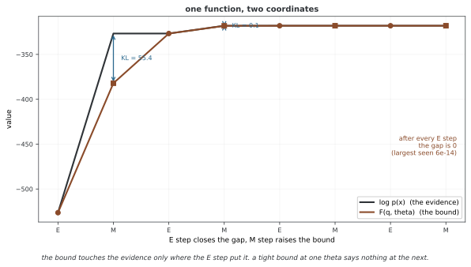

# 증거 하한(ELBO)

증거 하한(evidence lower bound, ELBO)은 로그 주변우도의 하한이며, 정확한 사후분포와 변분분포 사이의 KL 발산만큼 차이가 난다. EM에서는 현재 파라메터에서 이 차이를 0으로 만들고, 변분 추론에서는 제한된 분포족 안에서 차이를 줄인다. 어떤 변수를 적분하고 어떤 파라메터를 고정하는지 명시해야 같은 기호의 서로 다른 목적을 구분할 수 있다.

## 1. 주변우도와 지지집합

고정 θ의 잠재변수 모델에서 p(X|θ)=∫p(X,Z|θ)dZ라 하자. 0<p(X|θ)<∞를 가정한다. 뉴럴 넷트웍 디코더처럼 적분의 닫힌 해가 없는 경우에도 효율적인 수치 근사가 가능할 수 있으므로 ‘해석적 해가 없다’와 ‘어떤 근사도 계산할 수 없다’는 다른 주장이다.

정규화된 q(Z)에 대해 ELBO를 다음과 같이 정의한다.

$$\mathcal L(q,\theta)=E_q[\log p(X,Z|\theta)-\log q(Z)].$$

필요한 로그 기댓값이 정의되어야 한다. q가 양의 확률을 두는 영역에서 결합밀도가 0이면 하한이 −∞일 수 있다. 반대로 결합밀도가 양수인 영역을 q가 누락하면 아래 중요도 기댓값으로 전체 주변우도를 표현하는 등식이 성립하지 않을 수 있다. 두 방향의 지지집합 조건을 구분한다.

## 2. Jensen 부등식에 의한 유도

결합밀도의 질량을 q가 모두 덮는 경우 w(Z)=p(X,Z|θ)/q(Z)를 쓰면 p(X|θ)=E_q[w]다. 양의 확률변수와 엄격히 오목한 log에 Jensen 부등식을 적용한다.

$$\log p(X|\theta)=\log E_q[w]\geq E_q[\log w]=\mathcal L(q,\theta).$$

엄격히 오목한 함수에서는 적절한 유한성 조건 아래 입력이 거의 확실히 상수일 때만 등호가 성립한다. 단순히 오목하기만 한 함수에는 이 ‘오직 그때’ 조건을 일반화할 수 없다. w가 상수이고 전체 질량을 덮으면 상수는 p(X|θ)이므로 q(Z)=p(Z|X,θ)다.

q가 결합밀도의 일부만 덮더라도 E_q[w]≤p(X|θ)로부터 하한을 얻을 수 있다. 그러나 q의 지지집합 안에서 w가 상수라는 사실만으로 전체 증거와의 등호를 결론 내리면 안 된다. 빠진 질량이 없는지도 필요하다.

## 3. KL 분해에 의한 유도

Bayes 정리를 KL의 정의에 대입하면 다음 항등식을 얻는다. 각 항이 유한해 ∞−∞ 같은 미정형이 생기지 않는 경우를 가정한다.

$$D_{\mathrm{KL}}\bigl(q(Z)\Vert p(Z|X,\theta)\bigr)=E_q[\log q]-E_q[\log p(X,Z|\theta)]+\log p(X|\theta).$$

$$\boxed{\log p(X|\theta)=\mathcal L(q,\theta)+D_{\mathrm{KL}}\bigl(q\Vert p(Z|X,\theta)\bigr)}.$$

이는 하한과 증거 사이의 차이가 정확히 KL임을 보여 준다. q가 사후분포와 거의 어디서나 같으면 차이가 0이다. 고정 θ에서 ELBO를 높이는 것은 같은 방향의 KL을 낮추는 것과 같다. 다만 증거를 모르면 차이의 수치값도 일반적으로 알 수 없다.

<div class="storybox" markdown>

**그림으로 보는 AI 1.** EM을 다시 보니 함수가 하나뿐이었다

1977년의 EM은 두 단계짜리 절차로 적혀 있었다 — 기댓값을 셈하고, 최대화하고, 되풀이한다. 1998년에 래드퍼드 닐과 제프리 힌턴이 「증분·희소 변형을 정당화하는 EM 알고리즘의 한 관점」에서 그것을 다시 보았다. 두 단계가 아니라 **함수 하나**이고, 두 단계는 그 함수를 서로 다른 좌표에서 올리고 있을 뿐이라는 것이었다. 그 함수가 바로 위 식의 $\mathcal L(q,\theta)$ 다(그들은 음의 자유에너지라 불렀다).

- **E 단계**는 $\theta$ 를 고정하고 $q$ 에 대해 $\mathcal L$ 을 최대화한다. 위 항등식에서 올릴 수 있는 만큼이 KL이므로, 최대점은 KL이 0이 되는 자리 — 곧 $q=p(Z|X,\theta)$ 다.
- **M 단계**는 $q$ 를 고정하고 $\theta$ 에 대해 최대화한다.

좌표 상승이다. 성분 둘짜리 혼합에 돌려 두 값을 한 그림에 올려 보면 그대로 보인다.



E 단계 뒤마다 간격이 **정확히 0**이다 — 여덟 번 모두에서 가장 컸던 값이 $6\times10^{-14}$ 로 부동소수점 바닥이다. 그리고 M 단계가 $\theta$ 를 옮기는 순간 간격이 다시 벌어진다. 첫 M 단계에서는 55.4나 벌어진다. 이 쪽 머리글이 "EM에서는 현재 파라메터에서 이 차이를 0으로 만들고"라고 적은 것이 이 그림의 동그라미들이고, "변분 추론에서는 제한된 분포족 안에서 차이를 줄인다"는 것은 그 동그라미에 **닿지 못하는** 경우다. 평균장처럼 $q$ 를 제한하면 E 단계가 KL을 0까지 내리지 못한다.

**그러니 하한이 꽉 끼었다는 말은 언제나 "지금 이 $\theta$ 에서"라는 단서를 달고 다닌다.** 방금 E 단계를 마친 자리에서는 $\mathcal L$ 이 $\log p(X|\theta)$ 와 같은 값이지만, M 단계가 한 걸음만 움직여도 그 등호가 깨진다. 위 문단이 덧붙인 조심스러운 말 — 증거를 모르면 차이의 수치값도 모른다 — 이 실전에서 더 무겁다. 그림에서는 $\log p(X|\theta)$ 를 셈할 수 있어서 간격을 그릴 수 있었지만, 그것을 셈할 수 있는 모델이라면 애초에 하한이 필요 없었을 것이다.

_확인한 곳 — R. M. Neal, G. E. Hinton, "A View of the EM Algorithm that Justifies Incremental, Sparse, and Other Variants", in *Learning in Graphical Models*, Kluwer (1998), 355–368. E 단계가 $q$ 에 대해, M 단계가 $\theta$ 에 대해 같은 함수를 최대화한다는 것이 그 글의 요지다. A. P. Dempster, N. M. Laird, D. B. Rubin (1977) 이 두 단계로 적은 원래 꼴은 [EM의 기초](../em/foundations.md)에서 다룬다. 그림의 수는 그림을 그리는 코드가 직접 돌려 얻으며, E 단계 뒤 간격이 0이 아니면 코드가 멈춘다._

</div>

## 4. 중요도 가중 하한

ELBO는 **로그 중요도 웨이트의 기댓값**이다. 주변우도의 하한에 로그를 취한 별도 양이나, 로그 웨이트 기댓값보다 더 작은 양이 아니다. 독립 표본 Z₁,…,Z_K∼q로 다음 목적을 만들 수 있다.

$$\mathcal L_K=E\left[\log\left(\frac1K\sum_{k=1}^K\frac{p(X,Z_k|\theta)}{q(Z_k)}\right)\right]\leq\log p(X|\theta).$$

K=1이면 표준 ELBO다. 적절한 조건에서 표본 수에 따른 기대 하한의 비감소성을 얻지만, 임의의 한 표본 묶음에서 계산한 로그 평균이 항상 증거 아래에 있다는 뜻은 아니다. K→∞에서 증거에 접근하는 주장에도 지지집합·적분 가능성과 기대의 극한 교환 조건이 필요하다. 이 구조가 중요도 가중 자동인코더(IWAE)의 목적과 연결된다.

## 5. 같은 목적의 여러 표현

결합분포가 p(X|Z,θ)p(Z|θ)로 분해되면 다음과 같다.

$$\mathcal L=E_q[\log p(X|Z,\theta)]-D_{\mathrm{KL}}(q\Vert p(Z|\theta))$$

$$=E_q[\log p(X|Z,\theta)]+E_q[\log p(Z|\theta)]+H(q).$$

첫 항은 기댓값 로그 우도 또는 VAE의 재구성 항이다. 둘째 표현에서는 사전 적합과 엔트로피의 역할을 따로 볼 수 있다. 엔트로피 항은 다른 항과 함께 작용하므로 어떤 모델에서도 붕괴나 과소 분산을 반드시 막는다고 보장하지 않는다. 연속 분포의 미분 엔트로피는 음수일 수도 있다.

변분 자유 에너지를 F=−L로 정의하면 자유 에너지 최소화와 ELBO 최대화는 같은 문제다. 문헌마다 부호와 온도 정의가 다를 수 있으므로 식을 기준으로 읽는다.

## 6. 근사 차이와 최적화 오차

분포족을 포함관계 Q₁⊆Q₂로 확장하면 이론적인 최적 ELBO는 나빠지지 않는다. 실제 학습 결과는 초기화·최적화 오차 때문에 더 낮을 수 있다. 깊은 잠재모델로 생성모델까지 바꾸면 비교 대상인 증거 자체가 달라지므로 ‘레이어를 늘리면 같은 사후의 KL이 반드시 감소한다’는 결론은 아니다.

단봉 가우스 근사는 다봉 사후를 정확히 표현하지 못할 수 있다. 그렇다고 분산이나 모든 예측량의 오차가 항상 같은 방향이라는 뜻은 아니다. 더 유연한 분포족, 구조화 근사와 가중 하한은 서로 다른 방식으로 근사 목적을 개선한다.

## 7. EM과 VAE

EM의 E 단계는 qₜ=p(Z|X,θₜ)로 현재 점의 하한을 일치시킨다. M 단계는 qₜ를 고정해 Q=E_qₜ[log p(X,Z|θ)]를 높인다. 엔트로피가 상수이므로 다음 부등식이 성립한다.

$$\ell(\theta_{t+1})\geq\mathcal L(q_t,\theta_{t+1})\geq\mathcal L(q_t,\theta_t)=\ell(\theta_t).$$

제한된 사후 근사의 좌표 최적화는 ELBO를 높일 수 있어도 현재 우도와 하한이 일치하지 않으므로 같은 우도 단조성을 얻지 못한다. VAE는 입력별 q_φ(z|x)를 인코더로 공유하고 θ와 φ를 확률적 경사법으로 학습하므로 일반적으로 매번 ELBO가 증가한다는 보장도 없다. VI 전체가 CAVI 한 방식으로만 최적화되는 것은 아니다.

VAE의 한 관측 목적은 E_qφ[log pθ(x|z)]−KL(qφ(z|x)∥p(z))다. 대각 가우스에서는 ε∼N(0,I), z=μ_φ(x)+σ_φ(x)⊙ε로 경로별 미분을 계산할 수 있다. 표본 하나는 확률적 경사 추정의 선택일 뿐 어떤 문제에서나 충분한 정확도를 보장하지 않는다.

고정 분산의 가우스 디코더는 상수와 스케일을 제외하면 제곱오차, 베르누이 디코더는 이진 교차 엔트로피에 대응한다. 학습하는 관측 분산이나 로스의 합·평균 단위를 바꾸면 같은 목적이 아닐 수 있다. β-VAE는 KL에 β를 곱한 다른 목적이며 β≠1에서 원래 모델의 표준 ELBO와 같지 않다. β를 키운다고 표현의 품질이나 분리성이 단조롭게 개선되는 것도 아니다.

[KL 발산](../../ch07/loss/kl_divergence.md)과 [리파라메리제이션](reparameterization.md)에서 관련 계산을 이어서 다룬다.

## 8. 가우스 모델의 해석적 예제

θ∼N(μ₀,σ₀²), xᵢ|θ∼N(θ,σ²), q=N(m,s²)이고 두 분산이 양수라고 하자.

$$E_q[\log p(D|\theta)]=-\frac n2\log(2\pi\sigma^2)-\frac{\sum_i(x_i-m)^2+ns^2}{2\sigma^2},$$

$$E_q[\log p(\theta)]=-\frac12\log(2\pi\sigma_0^2)-\frac{(m-\mu_0)^2+s^2}{2\sigma_0^2},\qquad H(q)=\frac12\log(2\pi e s^2).$$

세 항의 합이 ELBO다. 최적값은 s²=(σ₀⁻²+nσ⁻²)⁻¹, m=s²(μ₀σ₀⁻²+σ⁻²∑ᵢxᵢ)이며 정확한 사후와 일치한다. 이때 하한은 해당 계층 모델의 로그 증거와 같다.

아래 구현은 이 해석적 목적을 Adam으로 최적화한다. 양의 표준편차를 log s로 파라메터화하지만 장치·자료형 처리는 일반화하지 않았다. 기록된 ELBO와 s는 갱신 전 값이고 m은 갱신 후 값이므로 이력을 같은 시점의 파라메터 쌍으로 해석할 때 주의한다. 코드와 출력·그림은 실행하거나 재생성하지 않았다.

```python
import torch
import torch.nn as nn
from typing import Tuple, Dict

class GaussianELBO:
    """흩어짐을 아는 가우스 평균 어림의 ELBO 셈하기."""

    def __init__(self, prior_mean: float, prior_std: float,
                 likelihood_std: float):
        self.mu_0 = prior_mean
        self.sigma_0 = prior_std
        self.sigma = likelihood_std

    def elbo(self, data: torch.Tensor, m: torch.Tensor,
             s: torch.Tensor) -> Tuple[torch.Tensor, torch.Tensor, torch.Tensor]:
        """ELBO = E_q[log p(D|theta)] - KL(q || 앞확률) 셈하기.

        반환값:
            (elbo, reconstruction_term, kl_term)
        """
        n = len(data)

        # 되살림: E_q[log p(D|theta)]
        reconstruction = (
            -0.5 * n * torch.log(torch.tensor(2 * torch.pi * self.sigma**2))
            - 0.5 / self.sigma**2 * (torch.sum((data - m)**2) + n * s**2)
        )

        # KL(N(m, s^2) || N(mu_0, sigma_0^2))
        kl = (
            torch.log(torch.tensor(self.sigma_0) / s)
            + (s**2 + (m - self.mu_0)**2) / (2 * self.sigma_0**2)
            - 0.5
        )

        return reconstruction - kl, reconstruction, kl

def optimize_elbo(data: torch.Tensor, elbo_computer: GaussianELBO,
                  n_iterations: int = 500,
                  learning_rate: float = 0.05) -> Dict:
    """PyTorch의 autograd로 그래디언트 오르기를 해서 ELBO 최적화하기."""
    m = torch.tensor([0.0], requires_grad=True)
    log_s = torch.tensor([0.0], requires_grad=True)  # 양수로 만들려는 로그 눈금

    optimizer = torch.optim.Adam([m, log_s], lr=learning_rate)
    history = {'elbo': [], 'm': [], 's': []}

    for _ in range(n_iterations):
        optimizer.zero_grad()
        s = torch.exp(log_s)
        elbo, _, _ = elbo_computer.elbo(data, m, s)
        (-elbo).backward()  # ELBO의 음수를 가장 작게
        optimizer.step()
        history['elbo'].append(elbo.item())
        history['m'].append(m.item())
        history['s'].append(s.item())

    return history, m.detach(), torch.exp(log_s).detach()
```

## 9. 모델 비교에서의 한계

전역 파라메터까지 적절한 사전 아래 적분한 증거 p(D|M)와, 고정 θ에서 잠재 Z만 적분한 p(D|θ,M)는 다르다. 후자에 대한 ELBO를 θ로 최대화했다고 베이즈 모델 증거가 되는 것은 아니다.

모델별 ELBO는 log p(D|M)에서 각 모델의 서로 다른 사후 근사 차이를 뺀 값이다. 차이가 다르면 ELBO의 순위와 증거의 순위가 뒤집힐 수 있다. 근사족·최적화 수준·생략한 상수·데이터 단위가 일관된지 확인해야 하며, ‘완전한 사후를 사용하므로 AIC/BIC보다 풍부하다’는 식의 보편적인 우열을 주장하지 않는다.

## 연습문제

### 연습 1: 지지집합과 등호

q가 결합밀도의 일부 영역만 덮을 때 E_q[p(X,Z)/q(Z)]와 p(X)의 관계를 구하라. 중요도 비가 q 아래에서 상수여도 전체 증거에 대한 Jensen 하한이 일치하지 않을 수 있는 이유를 설명하라.

### 연습 2: 베타–이항 ELBO

θ∼Beta(α₀,β₀), x|θ∼Binomial(n,θ), q=Beta(a,b)의 ELBO를 유도하라. 이항계수 항을 포함하고 정확한 사후에서 증거와 일치함을 보이라.

### 연습 3: 가우스 모델

본문의 해석적 ELBO를 m과 s²로 미분해 최적값을 구하라. 정확한 사후가 변분분포족에 포함되는지 확인하라.

### 연습 4: EM과 VAE

정확한 EM의 단조성 증명 중 어떤 등식이 제한된 변분 E 단계에서는 사라지는지 설명하라. 확률적 경사 갱신까지 사용할 때 추가로 생기는 차이도 구분하라.

## 정리하며

ELBO는 기대 로그 중요도 웨이트이며 로그 증거와의 차이는 사후 KL이다. 중요도 표현의 지지집합, 기대 하한과 표본 추정값, 고정 파라메터의 주변우도와 베이즈 모델 증거를 구분해야 한다. 이 구분이 EM·VI·VAE의 서로 다른 보장을 설명한다.

**참고 문헌**

1. Blei, D. M., Kucukelbir, A., & McAuliffe, J. D. (2017). "Variational Inference: A Review for Statisticians."
2. Bishop, C. M. (2006). *Pattern Recognition and Machine Learning*, 10장.
3. Hoffman, M. D., & Johnson, M. J. (2016). "ELBO Surgery: Yet Another Way to Carve up the Variational Evidence Lower Bound."
4. Kingma, D. P., & Welling, M. (2014). "Auto-Encoding Variational Bayes."
