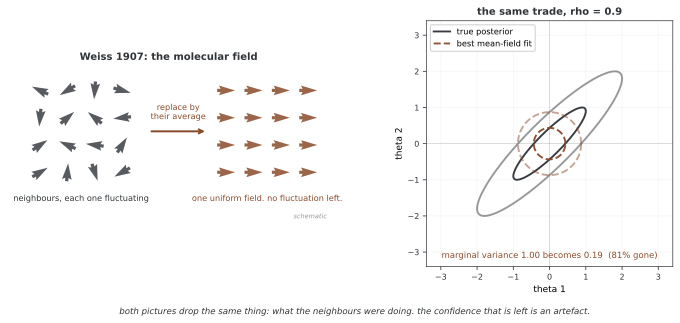

# 평균장 변분 추론

평균장 근사는 변분분포를 여러 독립 블록의 곱으로 제한한다. 이 독립성은 근사분포에 대한 가정이며 실제 사후분포의 성질은 아니다. 블록을 어떻게 나누는지와 KL의 방향에 따라 상관·분산·다봉성의 근사 오차가 달라진다.

## 1. 평균장 가정

θ=(θ₁,…,θ_K)에 대해 q(θ)=∏ⱼqⱼ(θⱼ)로 둔다. θⱼ는 스칼라일 수도 있고 여러 변수를 묶은 블록일 수도 있다. 필요한 적률이 존재하면 서로 다른 블록의 공분산은 0이지만 블록 안의 상관까지 반드시 제거하는 것은 아니다.

‘평균장’이라는 용어는 다른 변수들의 영향을 평균한 장으로 대체하는 통계물리의 근사에서 유래한다. 변분 갱신은 일반적으로 다른 변수의 **기댓값 로그 결합밀도**를 이용하며, 그 변수의 평균 하나만 필요한 것은 아니다. 이차항이나 비선형항에는 분산·고차 적률 등이 필요할 수 있다.

아래 도식은 상관된 목표와 독립 근사의 모양을 비교한다. 근사의 주변분산은 원래 사후의 주변분산을 그대로 복사한 값으로 정해지지 않는다.

```
True Posterior p(θ₁,θ₂|D):            Mean-Field q(θ₁)q(θ₂):
┌─────────────────────┐              ┌─────────────────────┐
│         ╱           │              │                     │
│        ╱            │              │    ┌───────────┐    │
│       ╱   ╭──╮      │              │    │           │    │
│      ╱   │  │       │     →→→      │    │     ○     │    │
│     ╱    ╰──╯       │              │    │           │    │
│    ╱                │              │    └───────────┘    │
└─────────────────────┘              └─────────────────────┘
   Correlated ellipse                 Axis-aligned ellipse
   (tilted, captures                  (cannot capture
    covariance)                        covariance)
```

## 2. 상관된 가우스의 정확한 평균장 해

목표가 평균 μ, 공분산 Σ인 비퇴화 가우스이고 정밀도 Λ=Σ⁻¹이라 하자. KL(q∥p)를 최소화하는 완전 인수분해 가우스의 평균은 μ이고 각 분산은 vⱼ=1/Λⱼⱼ다. 이는 목표의 주변분산 Σⱼⱼ와 일반적으로 다르다.

이변량에서 주변 표준편차가 σ₁,σ₂이고 상관계수 |ρ|<1이면 다음과 같다.

$$q^*=\mathcal N(\mu_1,\sigma_1^2(1-\rho^2))\,\mathcal N(\mu_2,\sigma_2^2(1-\rho^2)).$$

가우스 KL 식에 대입하면 trace 항은 2이고 행렬식 비만 남는다.

$$D_{\mathrm{KL}}(q^*\Vert p)=-\tfrac12\log(1-\rho^2).$$

| ρ | 최적 평균장 KL |
|---|---|
| 0 | 0 |
| 0.5 | 0.144 |
| 0.8 | 0.511 |
| 0.9 | 0.830 |
| 0.95 | 1.164 |
| 0.99 | 1.959 |

이 예에서는 상관이 강할수록 최적 근사도 주변분산을 작게 추정한다. 반대로 KL(p∥q)를 최소화하는 독립 가우스는 목표의 주변 평균과 주변분산을 맞춘다. 두 KL 방향의 최적해를 혼동하면 안 된다. 이 가우스 예의 오차 방향을 모든 모델·관심량에 대한 정리로 일반화하지 않는다.

<div class="storybox" markdown>

**그림으로 보는 AI 1.** 평균장은 자석에서 왔고, 거기서도 같은 것을 잃었다

"평균장"이라는 말은 통계학에서 만들어진 것이 아니다. 1907년 피에르 바이스(Pierre Weiss)가 강자성을 설명하려고 쓴 「분자장 가설과 강자성」에서 왔다. 쇳조각 안의 원자 자석 하나가 느끼는 것은 둘레 이웃들이 저마다 흔들리며 만드는 실제 장인데, 바이스는 그것을 **이웃들의 평균 정렬이 만드는 장 하나**로 바꿔 놓았다. 그러면 자석 하나하나를 따로 풀 수 있고, 자화율이 $\chi = C/(T-T_c)$ 라는 퀴리–바이스 법칙이 나온다.



위 2절이 변분분포에 한 일이 꼭 같다. 서로 얽힌 $\theta_1,\theta_2$ 를 독립인 두 인자로 바꾸면 **이웃이 무엇을 하고 있었는지가 지워진다.** 그리고 지워진 자리에서 사라지는 것도 같다 — 흔들림이다. $\rho=0.9$ 에서 주변분산 1.00이 $1-\rho^2=0.19$ 로 줄어 81%가 없어진다. 물리에서도 바이스 근사의 가장 잘 알려진 결함이 이것이어서, 임계점 근처의 실제 지수는 평균장을 벗어나야만 얻어진다. 흔들림을 평균으로 바꾼 대가를 흔들림으로 치르는 셈이다.

**다만 "평균장은 분산을 과소추정한다"를 정리처럼 들고 다니면 안 된다.** 위 문단이 이미 못 박아 둔 대로다. 여기서 줄어든 것은 이 가우스 예에서, 그리고 $\mathrm{KL}(q\Vert p)$ 라는 **방향을 고른 결과**다. 방향을 뒤집어 $\mathrm{KL}(p\Vert q)$ 를 줄이면 같은 독립 가우스가 주변분산을 1.00으로 **정확히 맞춘다.** 자석과 사후분포가 나누어 가진 것은 결론이 아니라 **장치**다 — 얽힌 것을 평균으로 바꿔 풀기 쉽게 만든다는 장치이고, 무엇을 잃는지는 그때그때 재어 봐야 한다.

_확인한 곳 — P. Weiss, "L'hypothèse du champ moléculaire et la propriété ferromagnétique" (1907) 의 분자장 가설과 거기서 따라 나오는 퀴리–바이스 법칙. 바이스 자신은 "분자장"이라 불렀고 "평균장"은 뒤에 이런 꼴의 근사를 가리키는 일반 이름이 되었다. 그림 오른쪽의 수는 그림을 그리는 코드가 $v_j=1/\Lambda_{jj}$ 로 직접 셈하며, 위 표의 KL 값도 모두 따로 셈해 맞는 것을 확인했다._

</div>

## 3. 최적 인자의 유도

다른 인자를 고정하고 fⱼ(θⱼ)=E_q₋ⱼ[log p(D,θ)]라 쓰자. qⱼ와 관련된 ELBO는 ∫qⱼfⱼ−∫qⱼlog qⱼ+상수다. 정규화 제약 ∫qⱼ=1에 대한 라그랑주 승수를 포함해 범함수 미분을 하면 다음을 얻는다.

$$\log q_j^*(\theta_j)=E_{q_{-j}}[\log p(D,\theta)]+C,$$

$$q_j^*(\theta_j)=\frac{\exp\{E_{q_{-j}}[\log p(D,\theta)]\}}{\int\exp\{E_{q_{-j}}[\log p(D,\theta)]\}\,d\theta_j}.$$

분모가 유한한 양수이고 필요한 기댓값이 정의되어야 한다. 이는 최적 인자의 함수 형태를 주는 일반식이지 항상 해석적으로 적분할 수 있는 닫힌 해는 아니다. qⱼ 자체를 더 좁은 파라메터족으로 제한하면 이 식이 그 족 밖에 있을 수도 있다.

## 4. CAVI의 반복과 보장

좌표 상승 변분 추론(CAVI)은 인자를 하나씩 위의 최적값으로 갱신한다. 앞에서 갱신한 인자는 최신 값을 사용한다. 모든 인자를 이전 값으로 동시에 갱신하는 방식에는 같은 순차 최적화의 단조성 증명을 그대로 적용할 수 없다.

```
Algorithm: Coordinate Ascent Variational Inference (CAVI)
─────────────────────────────────────────────────────────
Input: Model p(D, θ), initial q₁⁽⁰⁾, ..., qₖ⁽⁰⁾
Output: Optimized variational factors q₁*, ..., qₖ*

1. Initialize variational factors q₁⁽⁰⁾, ..., qₖ⁽⁰⁾
2. Compute initial ELBO
3. Repeat until convergence:
   a. For j = 1, ..., K:
      i.  Compute expected sufficient statistics from q₋ⱼ
      ii. Update: qⱼ(θⱼ) ∝ exp{E_{q₋ⱼ}[log p(θ, D)]}
   b. Compute ELBO
   c. Check convergence (ELBO change < tolerance)
4. Return optimized factors
```

정규화된 최적 인자를 q̃ⱼ라 하면 한 좌표의 목적은 −KL(qⱼ∥q̃ⱼ)+상수다. 따라서 정확한 좌표 갱신은 ELBO를 감소시키지 않는다. 유한한 log p(D)가 상계이고 초기 ELBO가 유한하면 목적값은 수렴한다.

목적값의 수렴만으로 인자열의 수렴이나 국소 최대점 도달까지 증명되지는 않는다. 적절한 정칙성 아래에서 좌표별 고정점·정상성 등을 논의할 수 있고, 좌표별 최적점이 결합 방향의 국소 최대점이라는 보장도 일반적으로 없다. 선형 수렴률 ρ<1은 추가 곡률·정칙성 또는 국소 분석이 필요한 결과다. CAVI라는 이름만으로 모든 모델에 적용하지 않는다.

## 5. 평균과 정밀도를 모르는 가우스

Gamma를 shape–rate로 정의하고 다음 정규–감마 모델을 사용한다.

$$\tau\sim\mathrm{Gamma}(\alpha_0,\beta_0),\quad\mu|\tau\sim\mathcal N(\mu_0,(\kappa_0\tau)^{-1}),\quad x_i|\mu,\tau\sim\mathcal N(\mu,\tau^{-1}).$$

α₀,β₀,κ₀는 양수이고 q(μ,τ)=q_μ(μ)q_τ(τ)로 근사한다. κ=κ₀+n, m=(κ₀μ₀+∑ᵢxᵢ)/κ라 두면 평균 인자는 다음과 같다.

$$q_\mu=\mathcal N(m,v),\qquad v=\frac1{\kappa E_q[\tau]}.$$

정밀도 인자는 다음과 같다.

$$q_\tau=\mathrm{Gamma}(a,b),\qquad a=\alpha_0+\frac{n+1}{2},$$

$$b=\beta_0+\frac12\left[\kappa_0(m-\mu_0)^2+\sum_i(x_i-m)^2+(\kappa_0+n)v\right].$$

분산 항의 계수에는 n뿐 아니라 사전의 κ₀도 포함된다. E[(μ−μ₀)²]=(m−μ₀)²+v이기 때문이다. E[τ]=a/b와 E[log τ]=ψ(a)−log b를 사용해 두 인자를 번갈아 갱신한다.

정확한 결합 사후는 여전히 정규–감마이며 독립 곱이 아니다. α_n=α₀+n/2, β_n=β₀+[∑ᵢ(xᵢ−x̄)²+κ₀n(x̄−μ₀)²/κ]/2라 하자. 평균장 고정점은 a=α_n+1/2, b=β_n a/α_n, v=β_n/(κα_n)이다. 정확한 μ 주변분산은 α_n>1일 때 β_n/[κ(α_n−1)]이므로 이 예에서 평균장이 더 작다.

아래 구현의 `update_q_tau`는 사전 항의 Var(μ)까지 포함하므로 위의 갱신과 일치한다. 적절한 양의 하이퍼파라미터와 비어 있지 않은 데이터가 필요하며, 종료의 작은 절댓값 차이 자체가 전체 수렴 정리인 것은 아니다.

```python
import torch
import torch.distributions as dist
from typing import Dict, Tuple
import matplotlib.pyplot as plt
import numpy as np

class MeanFieldGaussianCAVI:
    """
    평균과 정밀도를 모르는 가우스의 좌표 오르기 변분 추론.
    
    모형:
        τ ~ Gamma(α₀, β₀)           [정밀도 앞확률]
        μ | τ ~ N(μ₀, (λ₀τ)⁻¹)      [조건부 평균 앞확률]
        xᵢ | μ,τ ~ N(μ, τ⁻¹)        [가능도]
    
    변분 집안:
        q(μ,τ) = q(μ)q(τ)
        q(μ) = N(μₙ, λₙ⁻¹)
        q(τ) = Gamma(αₙ, βₙ)
    """
    
    def __init__(self, alpha_0: float = 1.0, beta_0: float = 1.0,
                 mu_0: float = 0.0, lambda_0: float = 1.0):
        """
        앞확률의 웃파라메터로 첫값 잡기.
        """
        self.alpha_0 = alpha_0
        self.beta_0 = beta_0
        self.mu_0 = mu_0
        self.lambda_0 = lambda_0
        
        # 변분 파라메터(앞확률로 첫값을 잡는다)
        self.alpha_n = alpha_0
        self.beta_n = beta_0
        self.mu_n = mu_0
        self.lambda_n = lambda_0
    
    @property
    def E_tau(self) -> float:
        """기댓값 정밀도 E_q[τ]"""
        return self.alpha_n / self.beta_n
    
    @property
    def E_log_tau(self) -> float:
        """기댓값 로그 정밀도 E_q[log τ]"""
        return torch.digamma(torch.tensor(self.alpha_n)).item() - np.log(self.beta_n)
    
    @property
    def E_mu(self) -> float:
        """기댓값 평균 E_q[μ]"""
        return self.mu_n
    
    @property
    def Var_mu(self) -> float:
        """평균의 흩어짐 Var_q[μ]"""
        return 1.0 / self.lambda_n
    
    def update_q_mu(self, data: torch.Tensor) -> None:
        """
        q(μ)의 변분 파라메터 새로 고치기.
        
        q*(μ) ∝ exp{E_q(τ)[log p(x,μ,τ)]}
        """
        n = len(data)
        x_bar = data.mean().item()
        
        # 변분 가우스의 정밀도
        self.lambda_n = (self.lambda_0 + n) * self.E_tau
        
        # 변분 가우스의 평균
        self.mu_n = (self.lambda_0 * self.mu_0 + n * x_bar) / (self.lambda_0 + n)
    
    def update_q_tau(self, data: torch.Tensor) -> None:
        """
        q(τ)의 변분 파라메터 새로 고치기.
        
        q*(τ) ∝ exp{E_q(μ)[log p(x,μ,τ)]}
        """
        n = len(data)
        
        # 꼴 파라메터
        self.alpha_n = self.alpha_0 + (n + 1) / 2
        
        # 비율 파라메터
        # E[(μ - μ₀)²] = (E[μ] - μ₀)² + Var[μ]
        E_mu_minus_mu0_sq = (self.E_mu - self.mu_0)**2 + self.Var_mu
        
        # E[Σ(xᵢ - μ)²] = Σ(xᵢ - E[μ])² + n·Var[μ]
        E_sum_sq = torch.sum((data - self.E_mu)**2).item() + n * self.Var_mu
        
        self.beta_n = self.beta_0 + 0.5 * (self.lambda_0 * E_mu_minus_mu0_sq + E_sum_sq)
    
    def compute_elbo(self, data: torch.Tensor) -> float:
        """
        증거 아래 경계 셈하기.
        
        ELBO = E_q[log p(x,μ,τ)] - E_q[log q(μ,τ)]
             = E_q[log p(x|μ,τ)] + E_q[log p(μ|τ)] + E_q[log p(τ)]
               - E_q[log q(μ)] - E_q[log q(τ)]
        """
        n = len(data)
        
        # E[log p(x|μ,τ)] - 기댓값 로그 가능도
        E_log_likelihood = (
            0.5 * n * (self.E_log_tau - np.log(2 * np.pi))
            - 0.5 * self.E_tau * (
                torch.sum((data - self.E_mu)**2).item() + n * self.Var_mu
            )
        )
        
        # E[log p(μ|τ)] - μ에 대한 기댓값 로그 앞확률
        E_log_prior_mu = (
            0.5 * (np.log(self.lambda_0) + self.E_log_tau - np.log(2 * np.pi))
            - 0.5 * self.lambda_0 * self.E_tau * (
                (self.E_mu - self.mu_0)**2 + self.Var_mu
            )
        )
        
        # E[log p(τ)] - τ에 대한 기댓값 로그 앞확률
        E_log_prior_tau = (
            self.alpha_0 * np.log(self.beta_0)
            - torch.lgamma(torch.tensor(self.alpha_0)).item()
            + (self.alpha_0 - 1) * self.E_log_tau
            - self.beta_0 * self.E_tau
        )
        
        # -E[log q(μ)] - q(μ)의 엔트로피
        H_q_mu = 0.5 * (1 + np.log(2 * np.pi) - np.log(self.lambda_n))
        
        # -E[log q(τ)] - q(τ)의 엔트로피
        H_q_tau = (
            self.alpha_n
            - np.log(self.beta_n)
            + torch.lgamma(torch.tensor(self.alpha_n)).item()
            + (1 - self.alpha_n) * torch.digamma(torch.tensor(self.alpha_n)).item()
        )
        
        elbo = E_log_likelihood + E_log_prior_mu + E_log_prior_tau + H_q_mu + H_q_tau
        
        return elbo
    
    def fit(self, data: torch.Tensor, max_iter: int = 100, 
            tol: float = 1e-6, verbose: bool = True) -> Dict:
        """
        모일 때까지 CAVI 알고리즘 돌리기.
        """
        history = {
            'elbo': [],
            'mu_n': [],
            'lambda_n': [],
            'alpha_n': [],
            'beta_n': [],
            'E_mu': [],
            'E_tau': []
        }
        
        elbo_prev = -float('inf')
        
        for iteration in range(max_iter):
            # 좌표 오르기 새로 고침
            self.update_q_mu(data)
            self.update_q_tau(data)
            
            # ELBO 셈하기
            elbo = self.compute_elbo(data)
            
            # 이력 기록
            history['elbo'].append(elbo)
            history['mu_n'].append(self.mu_n)
            history['lambda_n'].append(self.lambda_n)
            history['alpha_n'].append(self.alpha_n)
            history['beta_n'].append(self.beta_n)
            history['E_mu'].append(self.E_mu)
            history['E_tau'].append(self.E_tau)
            
            if verbose and (iteration + 1) % 10 == 0:
                print(f"Iter {iteration+1:3d}: ELBO = {elbo:.4f}, "
                      f"E[μ] = {self.E_mu:.4f}, E[τ] = {self.E_tau:.4f}")
            
            # 모임 살피기
            if abs(elbo - elbo_prev) < tol:
                if verbose:
                    print(f"\nConverged at iteration {iteration + 1}")
                break
            
            elbo_prev = elbo
        
        return history
    
    def get_posterior_distributions(self) -> Tuple[dist.Distribution, dist.Distribution]:
        """변분 분포를 돌려준다."""
        q_mu = dist.Normal(self.mu_n, 1.0 / np.sqrt(self.lambda_n))
        q_tau = dist.Gamma(self.alpha_n, self.beta_n)
        return q_mu, q_tau

def visualize_cavi_results(model: MeanFieldGaussianCAVI, 
                          history: Dict,
                          data: torch.Tensor,
                          true_mu: float = None,
                          true_tau: float = None):
    """CAVI 결과 두루 그려 보기."""
    
    fig, axes = plt.subplots(2, 3, figsize=(15, 10))
    
    # 그림 1: ELBO의 모임
    ax = axes[0, 0]
    ax.plot(history['elbo'], 'b-', linewidth=2)
    ax.set_xlabel('Iteration', fontsize=11)
    ax.set_ylabel('ELBO', fontsize=11)
    ax.set_title('(a) ELBO Convergence', fontsize=12, fontweight='bold')
    ax.grid(True, alpha=0.3)
    
    # 그림 2: 평균 파라메터의 모임
    ax = axes[0, 1]
    ax.plot(history['E_mu'], 'b-', linewidth=2, label='E[μ]')
    if true_mu is not None:
        ax.axhline(true_mu, color='r', linestyle='--', linewidth=2, label='True μ')
    ax.axhline(data.mean().item(), color='g', linestyle=':', linewidth=2, 
               label='Sample mean')
    ax.set_xlabel('Iteration', fontsize=11)
    ax.set_ylabel('Mean', fontsize=11)
    ax.set_title('(b) Mean Convergence', fontsize=12, fontweight='bold')
    ax.legend()
    ax.grid(True, alpha=0.3)
    
    # 그림 3: 정밀도 파라메터의 모임
    ax = axes[0, 2]
    ax.plot(history['E_tau'], 'b-', linewidth=2, label='E[τ]')
    if true_tau is not None:
        ax.axhline(true_tau, color='r', linestyle='--', linewidth=2, label='True τ')
    ax.set_xlabel('Iteration', fontsize=11)
    ax.set_ylabel('Precision', fontsize=11)
    ax.set_title('(c) Precision Convergence', fontsize=12, fontweight='bold')
    ax.legend()
    ax.grid(True, alpha=0.3)
    
    # 그림 4: 뒤확률 q(μ)
    ax = axes[1, 0]
    q_mu, _ = model.get_posterior_distributions()
    mu_range = torch.linspace(model.E_mu - 3/np.sqrt(model.lambda_n),
                              model.E_mu + 3/np.sqrt(model.lambda_n), 200)
    q_mu_pdf = torch.exp(q_mu.log_prob(mu_range))
    
    ax.plot(mu_range.numpy(), q_mu_pdf.numpy(), 'b-', linewidth=2.5, label='q(μ)')
    ax.fill_between(mu_range.numpy(), q_mu_pdf.numpy(), alpha=0.3, color='blue')
    if true_mu is not None:
        ax.axvline(true_mu, color='r', linestyle='--', linewidth=2, label='True μ')
    ax.axvline(model.E_mu, color='b', linestyle=':', linewidth=2, label='E[μ]')
    ax.set_xlabel('μ', fontsize=11)
    ax.set_ylabel('Density', fontsize=11)
    ax.set_title('(d) Posterior q(μ)', fontsize=12, fontweight='bold')
    ax.legend()
    ax.grid(True, alpha=0.3)
    
    # 그림 5: 뒤확률 q(τ)
    ax = axes[1, 1]
    _, q_tau = model.get_posterior_distributions()
    tau_range = torch.linspace(0.01, model.E_tau * 3, 200)
    q_tau_pdf = torch.exp(q_tau.log_prob(tau_range))
    
    ax.plot(tau_range.numpy(), q_tau_pdf.numpy(), 'g-', linewidth=2.5, label='q(τ)')
    ax.fill_between(tau_range.numpy(), q_tau_pdf.numpy(), alpha=0.3, color='green')
    if true_tau is not None:
        ax.axvline(true_tau, color='r', linestyle='--', linewidth=2, label='True τ')
    ax.axvline(model.E_tau, color='g', linestyle=':', linewidth=2, label='E[τ]')
    ax.set_xlabel('τ', fontsize=11)
    ax.set_ylabel('Density', fontsize=11)
    ax.set_title('(e) Posterior q(τ)', fontsize=12, fontweight='bold')
    ax.legend()
    ax.grid(True, alpha=0.3)
    
    # 그림 6: 자료와 뒤확률 미리봄
    ax = axes[1, 2]
    ax.hist(data.numpy(), bins=20, density=True, alpha=0.6, 
            color='gray', edgecolor='black', label='Data')
    
    # 뒤확률 미리봄(표집으로 어림)
    n_samples = 1000
    mu_samples = np.random.normal(model.mu_n, 1/np.sqrt(model.lambda_n), n_samples)
    tau_samples = np.random.gamma(model.alpha_n, 1/model.beta_n, n_samples)
    
    x_range = np.linspace(data.min().item() - 2, data.max().item() + 2, 200)
    pred_pdf = np.zeros_like(x_range)
    for mu_s, tau_s in zip(mu_samples, tau_samples):
        pred_pdf += np.exp(-0.5 * tau_s * (x_range - mu_s)**2) * np.sqrt(tau_s / (2*np.pi))
    pred_pdf /= n_samples
    
    ax.plot(x_range, pred_pdf, 'b-', linewidth=2.5, label='Posterior Predictive')
    if true_mu is not None:
        ax.axvline(true_mu, color='r', linestyle='--', linewidth=2, label='True μ')
    ax.set_xlabel('x', fontsize=11)
    ax.set_ylabel('Density', fontsize=11)
    ax.set_title('(f) Posterior Predictive', fontsize=12, fontweight='bold')
    ax.legend()
    ax.grid(True, alpha=0.3)
    
    plt.tight_layout()
    plt.savefig('mean_field_cavi.png', dpi=150, bbox_inches='tight')
    plt.show()

# 사용 예
if __name__ == "__main__":
    torch.manual_seed(42)
    np.random.seed(42)
    
    # 합성 데이터 생성
    true_mu = 3.0
    true_tau = 0.5  # 정밀도 = 1/흩어짐
    n_samples = 100
    
    data = torch.randn(n_samples) / np.sqrt(true_tau) + true_mu
    
    print("=" * 60)
    print("Mean-Field CAVI for Gaussian Model")
    print("=" * 60)
    print(f"\nTrue μ = {true_mu}, True τ = {true_tau}")
    print(f"Sample mean = {data.mean().item():.4f}")
    print(f"Sample variance = {data.var().item():.4f}")
    
    # CAVI 돌리기
    model = MeanFieldGaussianCAVI(
        alpha_0=1.0, beta_0=1.0,  # τ에 두는 감마 앞확률
        mu_0=0.0, lambda_0=0.01   # μ에 두는 정규 앞확률
    )
    
    history = model.fit(data, max_iter=100, verbose=True)
    
    print(f"\nFinal estimates:")
    print(f"  E[μ] = {model.E_mu:.4f} (true: {true_mu})")
    print(f"  E[τ] = {model.E_tau:.4f} (true: {true_tau})")
    
    # 시각화한다
    visualize_cavi_results(model, history, data, true_mu, true_tau)
```

다음 출력과 그림 코드는 기존 내용을 보존했다. 예측 그림은 q_μq_τ에서 생성한 몬테카를로 근사이며 정확한 결합 사후 예측과 같다고 단정하지 않는다.

```
============================================================
Mean-Field CAVI for Gaussian Model
============================================================

True μ = 3.0, True τ = 0.5
Sample mean = 3.0845
Sample variance = 1.9459

Converged at iteration 4

Final estimates:
  E[μ] = 3.0842 (true: 3.0)
  E[τ] = 0.5238 (true: 0.5)
```

## 6. 지수족의 좌표 갱신

완전조건부분포가 같은 지수족의 고정 충분통계량을 공유하는 경우 p(θⱼ|θ₋ⱼ,D)∝h(θⱼ)exp{ηⱼ(θ₋ⱼ,D)ᵀT(θⱼ)}이고, 최적 인자의 자연파라메터는 E_q₋ⱼ[ηⱼ]다. 이 기댓값이 유효한 자연파라메터 영역에 있어야 한다.

가우스에서는 평균 자체보다 정밀도와 정밀도로 가중한 평균을 갱신한다. 범주분포의 로그 비중에는 E[log πₖ]가 들어가며 log E[πₖ]와 다르다. 예를 들어 π∼Dir(α)이면 E[log πₖ]=ψ(αₖ)−ψ(∑ⱼαⱼ)다. ‘기댓값 확률의 로그’를 대입하면 일반적인 CAVI 식과 달라진다.

다음 의사코드도 순차 좌표 갱신과 ELBO 확인의 구조를 나타낸다.

```
Algorithm: Coordinate Ascent Variational Inference (CAVI)
━━━━━━━━━━━━━━━━━━━━━━━━━━━━━━━━━━━━━━━━━━━━━━━━━━━━━━━━
Input: 
  - Model: p(D, θ) = p(D|θ)p(θ)
  - Factorization: q(θ) = ∏ⱼ qⱼ(θⱼ)
  - Tolerance: ε
  - Max iterations: T

Output: Optimized variational factors {qⱼ*}

1. Initialize: Set initial variational parameters {φⱼ⁽⁰⁾}
2. Compute: ELBO⁽⁰⁾

3. For t = 1, 2, ..., T:
   a. For j = 1, 2, ..., K:
      i.   Compute: E_{q₋ⱼ}[log p(θ, D)]
      ii.  Update: qⱼ⁽ᵗ⁾(θⱼ) ∝ exp{E_{q₋ⱼ}[log p(θ, D)]}
      iii. Extract: New variational parameters φⱼ⁽ᵗ⁾
   
   b. Compute: ELBO⁽ᵗ⁾
   
   c. If |ELBO⁽ᵗ⁾ - ELBO⁽ᵗ⁻¹⁾| < ε:
      Return {qⱼ⁽ᵗ⁾}

4. Return {qⱼ⁽ᵀ⁾} (may not have converged)
```

## 7. 알려진 관측 분산의 베이즈 GMM

일변량 모델에서 π∼Dir(α₀,…,α₀), μₖ∼N(μ₀,σ₀²), zᵢ∼Cat(π), xᵢ|zᵢ=k,μₖ∼N(μₖ,σ²)라 하자. σ²는 알려진 고정값이다. 근사는 q(π)∏ₖq(μₖ)∏ᵢq(zᵢ)다.

q(π)=Dir(α), q(μₖ)=N(mₖ,sₖ²), rᵢₖ=q(zᵢ=k)로 쓰면 다음 갱신을 얻는다.

$$r_{ik}\propto\exp\left\{\psi(\alpha_k)-\psi\left(\sum_j\alpha_j\right)-\frac{(x_i-m_k)^2+s_k^2}{2\sigma^2}\right\},$$

$$N_k=\sum_i r_{ik},\qquad\alpha_k=\alpha_0+N_k,$$

$$s_k^2=(\sigma_0^{-2}+N_k\sigma^{-2})^{-1},\qquad m_k=s_k^2\left(\mu_0\sigma_0^{-2}+\sigma^{-2}\sum_i r_{ik}x_i\right).$$

책임도는 관측마다 정규화한다. 평균의 불확실성 sₖ²가 배정식에 들어가며 EM의 점 추정 평균만 대입하는 식과 다르다. 전역 파라메터의 분포를 추정하지만 전체 결합 사후를 정확히 복원하는 것은 아니다.

## 8. GMM 구현과 ELBO의 한계

아래 코드의 `'kmeans'` 초기화는 무작위 중심에서 거리를 계산해 소프트 배정할 뿐 Lloyd 반복이나 k-means++를 수행하지 않는다. 제곱 거리 대신 거리를 사용하며, `squeeze` 뒤 차원은 표본 수나 K가 1인 경우 달라질 수 있다. 장치·자료형과 입력 검증도 일반화되어 있지 않다.

더 중요한 문제는 `compute_elbo`의 Dirichlet 엔트로피다. A=∑ₖαₖ일 때 올바른 식은 다음과 같다.

$$H[\mathrm{Dir}(\alpha)]=\sum_k\log\Gamma(\alpha_k)-\log\Gamma(A)+(A-K)\psi(A)-\sum_k(\alpha_k-1)\psi(\alpha_k).$$

코드는 앞의 로그 베타함수 항을 반대 부호로 넣는다. 따라서 기록한 값을 완전한 ELBO나 증거 하한으로 해석하거나 그 단조성으로 CAVI 이론을 확인하면 안 된다. 좌표 갱신식의 정당성과 모니터링 목적함수의 구현 정확성은 별개의 문제다. 코드와 출력은 요청대로 유지했다.

```python
import torch
import torch.nn.functional as F
from torch.distributions import Normal, Dirichlet, Categorical
from typing import Dict, Tuple
import matplotlib.pyplot as plt
import numpy as np

class GMMCavi:
    """
    가우스 섞음 모형의 좌표 오르기 변분 추론.
    
    모형:
        π ~ Dir(α₀)
        μₖ ~ N(μ₀, σ₀²)
        zᵢ ~ Cat(π)
        xᵢ | zᵢ ~ N(μ_{zᵢ}, σ²)
    
    변분 집안:
        q(π, μ, z) = q(π) ∏ₖ q(μₖ) ∏ᵢ q(zᵢ)
    """
    
    def __init__(self, n_components: int, 
                 alpha_0: float = 1.0,
                 mu_0: float = 0.0,
                 sigma_0: float = 10.0,
                 sigma: float = 1.0):
        """
        가우스 섞음 모형 CAVI 첫값 잡기.
        
        인수:
            n_components: 섞음 성분의 개수 K
            alpha_0: 디리클레 앞확률의 몰림
            mu_0: 성분 평균의 앞확률 평균
            sigma_0: 성분 평균의 앞확률 표준편차
            sigma: 아는 관측 잡음의 표준편차
        """
        self.K = n_components
        self.alpha_0 = alpha_0
        self.mu_0 = mu_0
        self.sigma_0 = sigma_0
        self.sigma = sigma
        
        # 변분 파라메터(자료로 첫값을 잡는다)
        self.r = None       # N x K 맡음 몫 행렬
        self.alpha = None   # 디리클레 파라메터 K개
        self.m = None       # 성분 평균 K개
        self.s2 = None      # 성분 흩어짐 K개
    
    def initialize(self, data: torch.Tensor, init_method: str = 'kmeans'):
        """
        변분 파라메터 첫값 잡기.
        """
        N = len(data)
        
        if init_method == 'random':
            # 무작위 첫값 잡기
            self.r = torch.rand(N, self.K)
            self.r = self.r / self.r.sum(dim=1, keepdim=True)
        elif init_method == 'kmeans':
            # k 평균++ 방식의 첫값 잡기
            indices = torch.randperm(N)[:self.K]
            centers = data[indices].clone()
            
            # 거리를 셈하고 배정하기
            dists = torch.cdist(data.unsqueeze(1), centers.unsqueeze(0).unsqueeze(2))
            self.r = F.softmax(-dists.squeeze() / self.sigma**2, dim=1)
        
        # 맡음 몫에 따라 다른 파라메터 첫값 잡기
        self._update_q_pi()
        self._update_q_mu(data)
    
    def _update_q_z(self, data: torch.Tensor) -> None:
        """
        모든 자료 점에 대해 q(zᵢ) 새로 고치기.
        
        q*(zᵢ = k) ∝ exp{E[log πₖ] - (xᵢ - E[μₖ])²/(2σ²) - Var[μₖ]/(2σ²)}
        """
        N = len(data)
        
        # E[log πₖ] = ψ(αₖ) - ψ(Σⱼ αⱼ)
        E_log_pi = torch.digamma(self.alpha) - torch.digamma(self.alpha.sum())
        
        # 로그 맡음 몫(고르게 하지 않음)
        log_r = torch.zeros(N, self.K)
        
        for k in range(self.K):
            # E[(xᵢ - μₖ)²] = (xᵢ - E[μₖ])² + Var[μₖ]
            E_sq_diff = (data - self.m[k])**2 + self.s2[k]
            log_r[:, k] = E_log_pi[k] - 0.5 / self.sigma**2 * E_sq_diff
        
        # 고르게 하기(소프트맥스)
        self.r = F.softmax(log_r, dim=1)
    
    def _update_q_mu(self, data: torch.Tensor) -> None:
        """
        모든 성분에 대해 q(μₖ) 새로 고치기.
        
        q*(μₖ) = N(mₖ, sₖ²)
        """
        N_k = self.r.sum(dim=0)  # 성분마다의 기댓값 횟수
        
        # 뒤확률 정밀도
        precision = 1/self.sigma_0**2 + N_k / self.sigma**2
        self.s2 = 1 / precision
        
        # 뒤확률 평균
        weighted_sum = (self.r * data.unsqueeze(1)).sum(dim=0)
        self.m = self.s2 * (self.mu_0 / self.sigma_0**2 + weighted_sum / self.sigma**2)
    
    def _update_q_pi(self) -> None:
        """
        q(π) 새로 고치기.
        
        q*(π) = Dir(α₁, ..., αₖ)
        αₖ = α₀ + Σᵢ rᵢₖ
        """
        N_k = self.r.sum(dim=0)
        self.alpha = self.alpha_0 + N_k
    
    def compute_elbo(self, data: torch.Tensor) -> float:
        """
        증거 아래 경계 셈하기.
        """
        N = len(data)
        N_k = self.r.sum(dim=0)
        
        # E[log p(x|z,μ)] - 기댓값 로그 가능도
        E_log_lik = 0.0
        for k in range(self.K):
            E_sq_diff = (data - self.m[k])**2 + self.s2[k]
            E_log_lik += (self.r[:, k] * (
                -0.5 * np.log(2 * np.pi * self.sigma**2)
                - 0.5 / self.sigma**2 * E_sq_diff
            )).sum()
        
        # E[log p(z|π)] - z에 대한 기댓값 로그 앞확률
        E_log_pi = torch.digamma(self.alpha) - torch.digamma(self.alpha.sum())
        E_log_p_z = (self.r * E_log_pi).sum()
        
        # E[log p(π)] - π에 대한 기댓값 로그 앞확률
        E_log_p_pi = (
            torch.lgamma(torch.tensor(self.K * self.alpha_0))
            - self.K * torch.lgamma(torch.tensor(self.alpha_0))
            + (self.alpha_0 - 1) * E_log_pi.sum()
        )
        
        # E[log p(μ)] - μ에 대한 기댓값 로그 앞확률
        E_log_p_mu = 0.0
        for k in range(self.K):
            E_log_p_mu += (
                -0.5 * np.log(2 * np.pi * self.sigma_0**2)
                - 0.5 / self.sigma_0**2 * ((self.m[k] - self.mu_0)**2 + self.s2[k])
            )
        
        # -E[log q(z)] - q(z)의 엔트로피
        H_q_z = -(self.r * torch.log(self.r + 1e-10)).sum()
        
        # -E[log q(π)] - q(π)의 엔트로피
        H_q_pi = (
            torch.lgamma(self.alpha.sum())
            - torch.lgamma(self.alpha).sum()
            + (self.alpha - 1).dot(
                torch.digamma(self.alpha.sum()) - torch.digamma(self.alpha)
            )
        )
        
        # -E[log q(μ)] - q(μ)의 엔트로피
        H_q_mu = 0.5 * self.K * (1 + np.log(2 * np.pi)) + 0.5 * torch.log(self.s2).sum()
        
        elbo = (E_log_lik + E_log_p_z + E_log_p_pi + E_log_p_mu 
                + H_q_z + H_q_pi + H_q_mu)
        
        return elbo.item()
    
    def fit(self, data: torch.Tensor, max_iter: int = 100,
            tol: float = 1e-6, verbose: bool = True) -> Dict:
        """
        CAVI 알고리즘 돌리기.
        """
        # 초기화한다
        self.initialize(data)
        
        history = {
            'elbo': [],
            'r': [],
            'm': [],
            'alpha': []
        }
        
        elbo_prev = -float('inf')
        
        for iteration in range(max_iter):
            # CAVI 새로 고침
            self._update_q_z(data)
            self._update_q_mu(data)
            self._update_q_pi()
            
            # ELBO 셈하기
            elbo = self.compute_elbo(data)
            
            # 이력 기록
            history['elbo'].append(elbo)
            history['r'].append(self.r.clone())
            history['m'].append(self.m.clone())
            history['alpha'].append(self.alpha.clone())
            
            if verbose and (iteration + 1) % 10 == 0:
                print(f"Iter {iteration+1:3d}: ELBO = {elbo:.4f}, "
                      f"means = {self.m.numpy()}")
            
            # 모임 살피기
            if abs(elbo - elbo_prev) < tol:
                if verbose:
                    print(f"\nConverged at iteration {iteration + 1}")
                break
            
            elbo_prev = elbo
        
        return history
    
    def predict(self, data: torch.Tensor) -> torch.Tensor:
        """
        무리 배정 미리보기.
        """
        self._update_q_z(data)
        return self.r.argmax(dim=1)

def visualize_gmm_cavi(model: GMMCavi, history: Dict, data: torch.Tensor,
                       true_labels: torch.Tensor = None):
    """가우스 섞음 모형 CAVI 결과 그려 보기."""
    
    fig, axes = plt.subplots(2, 3, figsize=(15, 10))
    
    # 그림 1: ELBO의 모임
    ax = axes[0, 0]
    ax.plot(history['elbo'], 'b-', linewidth=2)
    ax.set_xlabel('Iteration', fontsize=11)
    ax.set_ylabel('ELBO', fontsize=11)
    ax.set_title('(a) ELBO Convergence', fontsize=12, fontweight='bold')
    ax.grid(True, alpha=0.3)
    
    # 그림 2: 성분 평균의 모임
    ax = axes[0, 1]
    means_history = torch.stack(history['m'])
    for k in range(model.K):
        ax.plot(means_history[:, k], linewidth=2, label=f'μ_{k+1}')
    ax.set_xlabel('Iteration', fontsize=11)
    ax.set_ylabel('Mean', fontsize=11)
    ax.set_title('(b) Component Means', fontsize=12, fontweight='bold')
    ax.legend()
    ax.grid(True, alpha=0.3)
    
    # 그림 3: 마지막 무리짓기
    ax = axes[0, 2]
    predictions = model.r.argmax(dim=1)
    colors = plt.cm.tab10(predictions.numpy() / model.K)
    ax.scatter(data.numpy(), np.zeros_like(data.numpy()), c=colors, alpha=0.6, s=50)
    for k in range(model.K):
        ax.axvline(model.m[k].item(), color=plt.cm.tab10(k / model.K), 
                   linestyle='--', linewidth=2, label=f'μ_{k+1}')
    ax.set_xlabel('x', fontsize=11)
    ax.set_title('(c) Final Clustering', fontsize=12, fontweight='bold')
    ax.legend()
    ax.grid(True, alpha=0.3)
    
    # 그림 4: 맡음 몫의 흘러감
    ax = axes[1, 0]
    r_history = torch.stack(history['r'])
    sample_idx = 0  # 첫 자료 점 기록
    for k in range(model.K):
        ax.plot(r_history[:, sample_idx, k], linewidth=2, label=f'r_{sample_idx+1},{k+1}')
    ax.set_xlabel('Iteration', fontsize=11)
    ax.set_ylabel('Responsibility', fontsize=11)
    ax.set_title(f'(d) Responsibilities (point {sample_idx+1})', 
                fontsize=12, fontweight='bold')
    ax.legend()
    ax.grid(True, alpha=0.3)
    
    # 그림 5: 디리클레 파라메터
    ax = axes[1, 1]
    alpha_history = torch.stack(history['alpha'])
    for k in range(model.K):
        ax.plot(alpha_history[:, k], linewidth=2, label=f'α_{k+1}')
    ax.set_xlabel('Iteration', fontsize=11)
    ax.set_ylabel('Concentration', fontsize=11)
    ax.set_title('(e) Dirichlet Parameters', fontsize=12, fontweight='bold')
    ax.legend()
    ax.grid(True, alpha=0.3)
    
    # 그림 6: 마지막 섞음 밀도
    ax = axes[1, 2]
    x_range = torch.linspace(data.min() - 2, data.max() + 2, 500)
    
    E_pi = model.alpha / model.alpha.sum()
    mixture_pdf = torch.zeros_like(x_range)
    
    for k in range(model.K):
        component_pdf = E_pi[k] * torch.exp(
            -0.5 * (x_range - model.m[k])**2 / (model.sigma**2 + model.s2[k])
        ) / np.sqrt(2 * np.pi * (model.sigma**2 + model.s2[k]))
        mixture_pdf += component_pdf
        ax.plot(x_range.numpy(), component_pdf.numpy(), '--', 
                linewidth=1.5, alpha=0.7, label=f'Component {k+1}')
    
    ax.plot(x_range.numpy(), mixture_pdf.numpy(), 'b-', linewidth=2.5, 
            label='Mixture')
    ax.hist(data.numpy(), bins=30, density=True, alpha=0.4, color='gray')
    ax.set_xlabel('x', fontsize=11)
    ax.set_ylabel('Density', fontsize=11)
    ax.set_title('(f) Fitted Mixture', fontsize=12, fontweight='bold')
    ax.legend()
    ax.grid(True, alpha=0.3)
    
    plt.tight_layout()
    plt.savefig('gmm_cavi.png', dpi=150, bbox_inches='tight')
    plt.show()

# 사용 예
if __name__ == "__main__":
    torch.manual_seed(42)
    np.random.seed(42)
    
    # 인공 섞음 자료 만들기
    n_samples = 300
    true_means = torch.tensor([-3.0, 0.0, 4.0])
    true_weights = torch.tensor([0.3, 0.4, 0.3])
    sigma = 1.0
    
    # 섞음에서 표집
    z_true = torch.multinomial(true_weights, n_samples, replacement=True)
    data = torch.randn(n_samples) * sigma + true_means[z_true]
    
    print("=" * 60)
    print("Gaussian Mixture Model CAVI")
    print("=" * 60)
    print(f"\nTrue means: {true_means.numpy()}")
    print(f"True weights: {true_weights.numpy()}")
    
    # CAVI로 가우스 섞음 모형 맞추기
    model = GMMCavi(n_components=3, alpha_0=1.0, sigma=sigma)
    history = model.fit(data, max_iter=100, verbose=True)
    
    print(f"\nFinal estimates:")
    print(f"  Means: {model.m.numpy()}")
    print(f"  Expected weights: {(model.alpha / model.alpha.sum()).numpy()}")
    
    # 시각화한다
    visualize_gmm_cavi(model, history, data)
```

다음은 기존 출력이다. `predict`는 새 데이터의 책임도를 `self.r`에 다시 저장하므로 호출 뒤 그 배열이 훈련 데이터의 책임도라고 가정하지 않는다. 예측 밀도 그림은 평균장 근사 아래에서 평균의 불확실성을 관측 분산에 더한 혼합분포를 나타낸다.

```
============================================================
Gaussian Mixture Model CAVI
============================================================

True means: [-3.  0.  4.]
True weights: [0.3 0.4 0.3]
Iter  10: ELBO = -58.1256, means = [-2.911948    0.22011478  4.07871   ]
Iter  20: ELBO = -58.1248, means = [-2.9012287  0.2339373  4.0846953]

Converged at iteration 21

Final estimates:
  Means: [-2.9011886   0.23398545  4.084713  ]
  Expected weights: [0.34762272 0.40051472 0.25186256]
```

## 9. 계산비용과 사용 범위

위의 일변량·알려진 관측 분산 GMM에서는 책임도와 가중합 계산에 반복당 O(NK), 책임도 저장에 O(NK)가 필요하다. 다변량 전 공분산이나 비켤레 모델에도 이 비용을 그대로 적용할 수는 없다. EM과 비슷한 계산 규모라는 말도 같은 모델과 연산을 비교할 때만 의미가 있다.

평균장은 간단한 기준 근사와 큰 모델의 계산에 유용할 수 있다. 강한 상관·다봉성·꼬리 확률이 중요한 경우에는 블록 구조, 리파라메리제이션, 더 유연한 근사나 다른 추론 결과와 비교한다. 분포족의 독립성 때문에 생기는 근사 오차와 최적화가 충분하지 않아 생기는 오차를 나누어 평가한다.

## 연습문제

### 연습 1: 가우스 평균장 해

이변량 가우스 목표에서 KL(q∥p)를 최소화하는 독립 가우스의 분산을 유도하라. 주변분산을 그대로 사용하는 해는 어느 KL 방향의 최적인지 비교하라.

### 연습 2: 정규–감마 갱신

본문의 b 갱신에서 Var(μ)의 계수가 κ₀+n임을 유도하라. 정확한 결합 사후와 평균장 곱이 서로 다른 이유를 설명하라.

### 연습 3: CAVI 단조성의 범위

한 좌표의 ELBO를 −KL(qⱼ∥q̃ⱼ)+상수로 표현하라. 목적값 수렴만으로 전체 인자열의 수렴과 국소 최대점 도달을 단정할 수 없는 이유도 설명하라.

### 연습 4: 베이즈 선형 회귀

웨이트와 잡음 정밀도의 사전분포를 명시하고, 웨이트 블록과 정밀도 블록을 독립으로 둔 CAVI 식을 유도하라. 웨이트 블록 안의 공분산을 유지하는 경우와 좌표별로 분리하는 경우를 구분하라.

### 연습 5: GMM 엔트로피

Dirichlet의 로그 밀도에서 엔트로피를 유도해 예제의 로그 베타함수 항과 비교하라. 좌표 갱신이 올바르더라도 잘못된 ELBO 모니터링이 어떤 해석 문제를 만드는지 설명하라.

### 연습 6: 초기화와 근사 오차

동일한 모델에서 초기값을 바꾸는 것과 변분분포족을 확장하는 것이 줄이려는 오차를 구분하라. 같은 초기화 전략이라는 이름만으로 실제 구현이 동일하지 않을 수 있는 사례를 본문에서 찾아라.

## 정리하며

평균장 VI는 블록 독립 근사를 사용하고 CAVI는 다른 인자를 고정한 기댓값 로그 결합밀도로 각 인자를 갱신한다. 정확한 좌표 갱신의 ELBO 비감소성과 전체 파라메터 수렴을 구분한다. 상관된 가우스의 최적 역방향 KL 근사는 주변분산을 그대로 복사하지 않으며, 구현에서는 갱신식뿐 아니라 엔트로피와 목적값도 확인해야 한다.

**참고 문헌**

1. Blei, D. M., Kucukelbir, A., & McAuliffe, J. D. (2017). Variational Inference: A Review for Statisticians.
2. Bishop, C. M. (2006). *Pattern Recognition and Machine Learning*, 10장.
3. Wainwright, M. J., & Jordan, M. I. (2008). Graphical Models, Exponential Families, and Variational Inference.
4. Parisi, G. (1988). *Statistical Field Theory*.
5. Blei, D. M., & Jordan, M. I. (2006). Variational Inference for Dirichlet Process Mixtures.
6. Hoffman, M. D., Blei, D. M., Wang, C., & Paisley, J. (2013). Stochastic Variational Inference.
