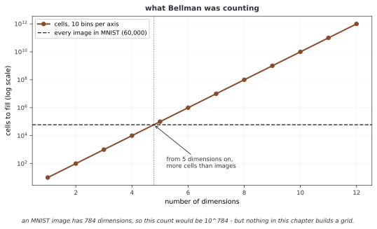

# 25장: 차원 축소

이 장에서는 PCA의 선형 부분공간 근사부터 커널과 매니폴드 방법까지 차원 축소의 목표와 구현을 살펴본다. 분산·재구성·거리·이웃 관계는 서로 다른 보존 기준이다. 같은 데이터라도 목적과 전처리에 따라 적절한 방법이 달라진다.

**그림으로 보는 AI 1.** "차원의 저주"는 이 장의 문제를 두고 한 말이 아니었다

차원을 줄이는 이야기를 꺼내면 거의 언제나 따라 나오는 말이 있다. 차원의 저주다. 리처드 벨먼(Richard Bellman)이 1957년 책 《동적 계획법》에서 만든 말인데, 그가 그때 보고 있던 것은 자료 분석이 아니었다. **여러 단계에 걸친 결정 문제**를 풀고 있었고, 저주는 아주 구체적인 셈에서 나왔다 — 상태 공간을 칸으로 잘라 전부 훑으려 하면 칸의 수가 차원에 따라 지수로 는다.

세어 보면 금방이다. 축마다 칸을 열 개씩만 두어도 $d$ 차원에는 $10^d$ 칸이 있다. 이 책이 내내 쓰는 MNIST가 60,000장인데, **5차원이면 이미 칸이 그림보다 많다.** MNIST 한 장의 실제 차원인 784로 가면 칸은 $10^{784}$ 개다. 그 공간을 훑는다는 말은 뜻이 없다.

**그런데 이 장의 어느 방법도 공간을 칸으로 자르지 않는다.** PCA는 공분산을 고유분해하고, MDS는 거리를 맞추고, t-SNE는 이웃 확률을 맞춘다. 격자는 어디에도 없다. 그러니 벨먼이 말한 저주가 여기에 그대로 걸리는 것은 아니고, 이 장에서 실제로 발목을 잡는 것은 그것과 다른 것들이다 — 거리가 서로 비슷해지는 일, 이웃이 뜻을 잃는 일, 표본이 모자라는 일.

그리고 저주가 재는 것은 **최악의 경우**다. 784차원 공간이 아무리 비어 있어도 손글씨 숫자 사진들은 그 안에 고루 흩어져 있지 않고 훨씬 얇은 자리에 모여 있다. 이 장의 방법들이 쓸모가 있는 까닭이 바로 그것이며, 2절의 매니폴드 이야기가 그 가정을 정면으로 다룬다. 차원이 높다는 말과 자료가 어렵다는 말은 같은 말이 아니다.

_확인한 곳 — R. Bellman, *Dynamic Programming*, Princeton University Press (1957) 에서 만든 말이다. 벨먼의 본디 관심은 동적 계획법에서 상태 공간을 이산화할 때 격자점이 상태 변수 수에 따라 지수로 느는 계산 문제였다. 그림의 수는 그림을 그리는 코드가 직접 셈한다._

## 1. PCA의 수학과 구현

- [주성분 분석](pca/pca_fundamentals.md): 중심화와 로딩·점수부터 분산 최대화와 재구성 오차 최소화의 동등성까지. 세 정리의 증명은 접어 두었다
- [커널 PCA](pca/kernel_pca.md): 피처 공간의 중심화, 고윳값 정규화와 프리이미지 문제
- [NumPy 2차원 예제](pca/01_pca_2d_numpy.md): SVD로 방향을 구하고 투영·재구성하기
- [scikit-learn 2차원 예제](pca/02_pca_2d_sklearn.md): 적합·변환과 분산 속성, whitening과 평가 누출
- 텐서와 자동 미분 자체는 [7장 PyTorch 기초](../ch06/index.md)가 다룬다. 여기서는 그것을 PCA에 쓴다.
- [PyTorch 2차원 예제](pca/04_pca_2d_pytorch.md): 배치 SVD와 고정·데이터 의존 기저의 미분
- [MNIST PCA](pca/05_pca_mnist_pytorch.md): 784차원 이미지의 저차원 표현과 같은 데이터 재구성

## 2. 거리와 이웃 기반 방법

- [MDS](manifold/mds.md): 고전 MDS의 그람 행렬 근사, 계량·비계량 stress와 PCA의 관계
- [매니폴드 방법 비교](manifold/01_manifold_comparison.md): MDS·Isomap·LLE·t-SNE의 목표와 전처리·평가 기준
- [t-SNE 자세히 살펴보기](manifold/02_tsne_deep_dive.md): 퍼플렉서티, 최적화와 초기화, 시각화의 해석 한계
- [MDS 구현 자세히 살펴보기](manifold/03_mds_deep_dive.md): 고유분해와 직접 좌표 최적화, 코드의 계산 범위

네 방법이 모두 비선형으로 차원을 줄이므로, 뒤에 오는 [26장 오토인코더](../ch25/index.md)와 같은 이야기처럼 보이기 쉽다. 가려 두고 읽는 편이 낫다.

**매니폴드 학습은 가지고 있는 사진들을 책상 위에 늘어놓아 비슷한 것끼리 가깝게 모아 주는 일이고, 오토인코더는 사진을 작게 접었다가 다시 펴는 법 자체를 배우는 일이다.**

이 절은 앞쪽, 곧 **늘어놓는 쪽** 이다. 내놓는 것이 그 점들의 좌표이지 접고 펴는 함수가 아니므로 두 가지가 따라온다. 새 점이 오면 대개 처음부터 다시 해야 하고(MDS와 t-SNE에는 `transform`이 없다), 펼 도구가 없으니 **복원이라는 말 자체가 성립하지 않는다.** 그래서 이 절에는 재구성 오차를 재는 대목이 없다.

## 3. 금융 데이터 응용

- [수익률 곡선 PCA](finance/yield_curve.md): 수준·그래디언트·곡률의 경험적 해석과 요인 위험, 데이터·추정 조건

## 정리하며

PCA의 설명 분산은 모든 예측 정보의 보존율이 아니며, 시각화의 군집과 거리는 원래 공간의 관계로 바로 해석할 수 없다. 학습·평가 데이터를 구분하고 평균·스케일·분모를 일관되게 사용한다. 차원 수 감소와 실제 저장 공간·실행 속도도 별도로 평가해야 한다.
